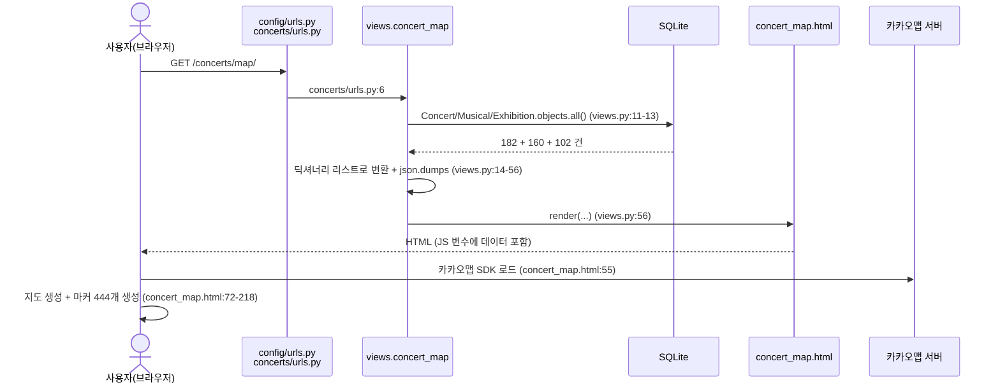
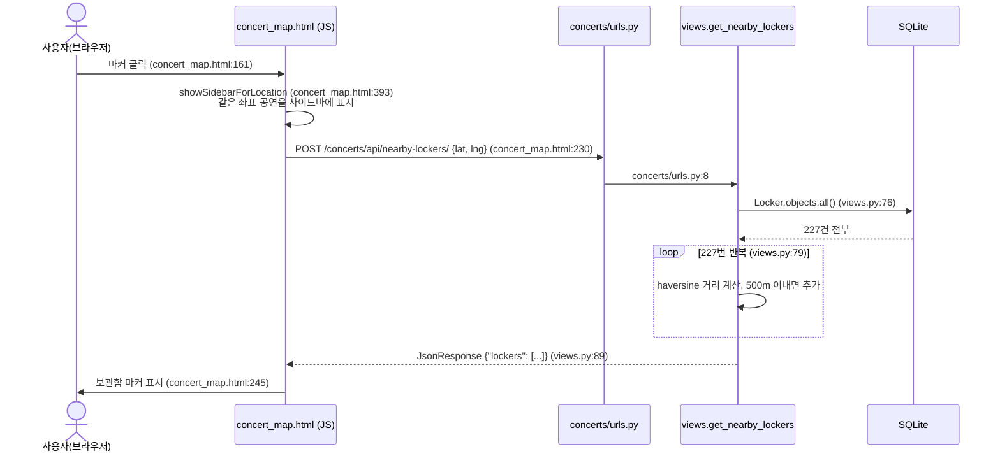
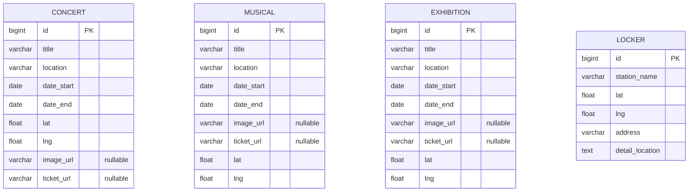

# CatTicket 프로젝트로 배우는 Django

> 이 문서는 리팩터링 전에 **Django의 동작 방식**과 **이 프로젝트의 현재 흐름**을 공부하기 위한 자료입니다.
> 코드는 하나도 수정하지 않았고, 읽기만 해서 작성했습니다.
>
> - 코드 위치는 `파일경로:라인번호`로 적었습니다. 경로 기준은 `django4/` 폴더입니다. (배포 파일은 `../`로 시작)
> - 코드에서 직접 확인하지 못한 내용은 **(추정)** 이라고 표시했습니다.
> - DB 내용은 `db.sqlite3`를 읽기 전용으로 열어서 확인했습니다. (2026-10-29 기준)

---

## 목차

1. [프로젝트 개요](#1-프로젝트-개요)
2. [Django 기본 개념 (이 프로젝트 코드로 설명)](#2-django-기본-개념-이-프로젝트-코드로-설명)
3. [파일/폴더 맵](#3-파일폴더-맵)
4. [기능별 흐름 추적](#4-기능별-흐름-추적)
5. [데이터 모델](#5-데이터-모델)
6. [현재 문제점](#6-현재-문제점)
7. [리팩터링 전에 공부할 것](#7-리팩터링-전에-공부할-것)
8. [스킬시트용 기술 요약](#8-스킬시트용-기술-요약)

---

## 1. 프로젝트 개요

### 이 앱은 무엇인가

**CatTicket**(`concerts/templates/concerts/concert_map.html:17`)은 **서울에서 열리는 콘서트·뮤지컬·전시회를 지도 위에 마커로 보여주는 웹 서비스**입니다. 마커를 누르면 왼쪽 사이드바에 그 장소의 공연 목록(포스터, 기간, 예매 링크)이 나오고, 동시에 **그 장소 반경 500m 안에 있는 지하철역 물품보관함**을 지도에 표시합니다. 공연 보러 갈 때 짐을 맡길 곳을 찾아주는 것이 핵심 아이디어입니다. 종류별 필터(체크박스), 제목 검색, 현재 위치 표시 기능도 있고, 서울 밖은 회색으로 덮어 서울만 강조합니다.

### 사용 기술과 버전

| 구분 | 기술 | 버전 / 근거 |
|---|---|---|
| 언어 | Python | 3.11, 3.12 (추정: `__pycache__`에 `cpython-311`, `cpython-312` 파일이 있음). 서버는 Ubuntu 기본 Python 3.10 (`../django설정.txt:18`) |
| 웹 프레임워크 | Django | 5.2.4 (`config/settings.py:4`, `concerts/migrations/0001_initial.py:1`) |
| DB | SQLite | `config/settings.py:76-81` |
| 프론트엔드 | HTML + CSS + 순수 JavaScript (라이브러리 없음) | `concerts/templates/concerts/concert_map.html` |
| 지도 | 카카오맵 JavaScript SDK | `concert_map.html:55` |
| 지도 (실험) | 네이버 지도 API v3 | `concert_map_naver.html:11` |
| 지도 데이터 | 서울 경계 GeoJSON | `concerts/static/data/seoul_boundary.json` |
| 배포 서버 | Ubuntu 22.04 (VirtualBox VM, Vagrant로 생성) | `../Vagrantfile:4` |
| WSGI 서버 | Gunicorn (systemd 서비스) | `../gunicorn.service:10` |
| 웹 서버 | Nginx (리버스 프록시) | `../nginx.conf` |
| 데이터 출처 | 인터파크 티켓 (추정: CSV 이미지/예매 링크가 모두 `interpark.com`) | `concerts.csv` 2번째 줄 |

> `requirements.txt`나 `pyproject.toml`은 **없습니다**. 필요한 패키지는 `django`와 `gunicorn` 두 개입니다. (`../django설정.txt:26`)

---

## 2. Django 기본 개념 (이 프로젝트 코드로 설명)

### 2-1. MTV 패턴

> **MTV 패턴**: 웹 앱을 "데이터(Model) / 화면(Template) / 처리 로직(View)" 세 부분으로 나눠서 만드는 Django의 설계 방식.

식당에 비유하면 이렇습니다.

| 역할 | 식당 비유 | 이 프로젝트에서 |
|---|---|---|
| **Model** (모델) | 창고 (재료 보관) | `concerts/models.py`: `Concert`, `Musical`, `Exhibition`, `Locker` 4개 표(테이블) 정의 |
| **View** (뷰) | 주방장 (주문 받고 요리) | `concerts/views.py`: `concert_map`(지도 페이지), `get_nearby_lockers`(보관함 찾기) |
| **Template** (템플릿) | 접시 (완성된 요리를 담음) | `concerts/templates/concerts/concert_map.html` |
| **URL 설정** | 메뉴판 (어떤 주문을 누가 처리할지) | `config/urls.py`, `concerts/urls.py` |

이 프로젝트에서 실제로 연결되는 모습은 이렇습니다.

1. **Model** `Concert`(`concerts/models.py:3-15`)가 공연 데이터의 모양을 정의합니다.
2. **View** `concert_map`(`concerts/views.py:10-56`)이 `Concert.objects.all()`(`views.py:11`)로 창고에서 데이터를 꺼내 정리합니다.
3. **Template**에 데이터를 넘겨(`views.py:56`) `const concerts = {{ concerts|safe }};`(`concert_map.html:58`) 자리에 끼워 넣습니다.
4. 완성된 HTML이 브라우저로 갑니다.

> **주의**: 이 프로젝트는 화면 대부분을 **브라우저의 JavaScript**가 그립니다. Django 템플릿은 데이터를 JS 변수로 한 번 넘겨주는 역할만 하고, 마커·사이드바·검색은 전부 JS가 처리합니다(`concert_map.html:57-430`).

### 2-2. 요청 하나가 들어와서 응답이 나갈 때까지 (request lifecycle)

> **요청(request)**: 브라우저가 서버에 "이 페이지 주세요"라고 보내는 메시지.
> **응답(response)**: 서버가 돌려주는 결과(HTML, JSON 등).
> **미들웨어(middleware)**: 모든 요청과 응답이 지나가는 "검문소". 보안 검사, 세션 처리 등을 공통으로 해줌.

`http://서버/concerts/map/`에 접속했을 때의 순서입니다.

```
[브라우저]
   │ ① GET /concerts/map/
   ▼
[Nginx]  ../nginx.conf:2 (8000번 포트에서 받음)          ← 배포 환경에서만
   │ ② ../nginx.conf:13 유닉스 소켓으로 넘김
   ▼
[Gunicorn]  ../gunicorn.service:10                         ← 배포 환경에서만
   │ ③ config/wsgi.py:16 의 application 호출
   ▼                                                        (개발 중에는 ①→④ 를 manage.py runserver 가 대신함)
[Django 미들웨어 7개, 위에서 아래로]  config/settings.py:43-51
   │ ④ 보안 헤더, 세션, CSRF 검사, 로그인 사용자 확인 ...
   ▼
[URL 찾기]  ROOT_URLCONF = "config.urls"  config/settings.py:53
   │ ⑤ config/urls.py:23  "concerts/" → concerts/urls.py 로 넘김
   │ ⑥ concerts/urls.py:6  "map/" → views.concert_map
   ▼
[View]  concerts/views.py:10
   │ ⑦ ORM 으로 DB 조회 (views.py:11-13)
   │ ⑧ 템플릿에 데이터 넣어 HTML 생성 (views.py:56)
   ▼
[Django 미들웨어, 이번엔 아래에서 위로]
   │ ⑨ 응답에 보안 헤더 등 추가
   ▼
[브라우저] HTML 받음 → 카카오맵 SDK, CSS, 이미지 등을 추가로 요청 → JS 실행
```

미들웨어 7개(`config/settings.py:43-51`)는 모두 Django 기본값이고, 직접 만든 것은 없습니다.

| 미들웨어 | 하는 일 (한 줄) |
|---|---|
| `SecurityMiddleware` | 보안 관련 HTTP 헤더 추가 |
| `SessionMiddleware` | 세션(로그인 상태 등 사용자별 임시 저장소) 처리 |
| `CommonMiddleware` | URL 끝에 `/` 붙여주기 등. `/concerts/map` → `/concerts/map/`로 301 리다이렉트하는 것이 이것 |
| `CsrfViewMiddleware` | CSRF 공격(다른 사이트가 사용자 몰래 요청 보내기) 방어 |
| `AuthenticationMiddleware` | 요청한 사람이 누구인지(`request.user`) 붙여줌 |
| `MessageMiddleware` | "저장되었습니다" 같은 일회성 알림 메시지 |
| `XFrameOptionsMiddleware` | 다른 사이트가 이 페이지를 iframe으로 몰래 넣는 것을 막음 |

### 2-3. project vs app

> **project(프로젝트)**: 웹사이트 전체. 설정 파일과 최상위 URL을 가짐.
> **app(앱)**: 기능 하나의 묶음. 한 프로젝트 안에 여러 개 넣을 수 있음.

| | 이 프로젝트에서 | 들어있는 것 |
|---|---|---|
| project | `config/` 폴더 | `settings.py`(설정), `urls.py`(최상위 URL), `wsgi.py`/`asgi.py`(서버 연결 입구) |
| app | `concerts/` 폴더 (1개뿐) | 모델, 뷰, URL, 템플릿, 정적 파일, 마이그레이션 |

앱은 `INSTALLED_APPS`에 등록해야 Django가 인식합니다. 이 프로젝트에서는 `config/settings.py:40`에 `"concerts"`가 등록되어 있습니다.

### 2-4. settings.py 주요 항목

| 항목 | 위치 | 현재 값 | 의미 |
|---|---|---|---|
| `BASE_DIR` | `config/settings.py:16` | `django4/` 폴더 | 프로젝트 기준 경로 |
| `SECRET_KEY` | `config/settings.py:23` | 코드에 직접 적힘 | 암호화·서명용 비밀 키. **외부 노출 금지** |
| `DEBUG` | `config/settings.py:26` | `True` | 오류 시 상세 화면 표시. 개발용. 운영에서는 `False` |
| `ALLOWED_HOSTS` | `config/settings.py:28` | `[]` (비어 있음) | 접속을 허용할 도메인/IP 목록. 비어 있으면 DEBUG일 때 localhost만 허용 |
| `INSTALLED_APPS` | `config/settings.py:33-41` | 기본 앱 6개 + `concerts` | 사용할 앱 목록 |
| `MIDDLEWARE` | `config/settings.py:43-51` | 기본 7개 | 2-2 참고 |
| `ROOT_URLCONF` | `config/settings.py:53` | `config.urls` | 최상위 URL 파일 |
| `TEMPLATES` | `config/settings.py:55-68` | `APP_DIRS: True` | 각 앱의 `templates/` 폴더에서 템플릿을 찾음 |
| `DATABASES` | `config/settings.py:76-81` | SQLite, `db.sqlite3` | DB 종류와 위치 |
| `LANGUAGE_CODE`, `TIME_ZONE` | `config/settings.py:106-108` | `en-us`, `UTC` | 언어·시간대. 한국 서비스인데 기본값 그대로 |
| `STATIC_URL` | `config/settings.py:118` | `/static/` | 정적 파일 URL 앞부분 |
| `STATICFILES_DIRS` | `config/settings.py:119` | `django4/static` | 앱 외부 정적 파일 폴더. **이 폴더는 실제로 없음** |
| `DEFAULT_AUTO_FIELD` | `config/settings.py:124` | `BigAutoField` | 모델의 `id` 자동 번호 타입 |

### 2-5. ORM

> **ORM(Object-Relational Mapping)**: SQL을 직접 쓰지 않고 Python 코드로 DB를 다루게 해주는 도구.

| Python 코드 | 실제로 실행되는 SQL (개념) | 위치 |
|---|---|---|
| `Concert.objects.all()` | `SELECT * FROM concerts_concert` | `concerts/views.py:11` |
| `Musical.objects.all()` | `SELECT * FROM concerts_musical` | `concerts/views.py:12` |
| `Exhibition.objects.all()` | `SELECT * FROM concerts_exhibition` | `concerts/views.py:13` |
| `Locker.objects.all()` | `SELECT * FROM concerts_locker` | `concerts/views.py:76` |

이 프로젝트는 `.all()`만 씁니다. `.filter()`(조건 검색), `.exclude()`, `.order_by()` 같은 기능은 쓰지 않고, 필요한 걸러내기를 **Python 반복문**(`views.py:25`, `views.py:79-88`)이나 **브라우저 JS**에서 합니다.

### 2-6. migrations

> **마이그레이션(migration)**: 모델(Python 코드)의 변경 내용을 DB 테이블 구조에 반영하기 위한 "변경 기록 파일".

흐름은 이렇습니다.
1. `models.py`를 고친다.
2. `python manage.py makemigrations` → `migrations/` 폴더에 기록 파일이 생긴다.
3. `python manage.py migrate` → 실제 DB에 적용되고, DB의 `django_migrations` 표에 "적용 완료"가 기록된다.

이 프로젝트의 기록 파일:

| 파일 | 내용 | 만든 날 |
|---|---|---|
| `concerts/migrations/0001_initial.py` | `Concert` 표 생성 | 2025-07-21 |
| `concerts/migrations/0002_concert_image_url.py` | `Concert`에 `image_url` 추가 | 2025-07-22 |
| `concerts/migrations/0003_locker.py` | `Locker` 표 생성 | 2025-07-22 |
| `concerts/migrations/0004_concert_ticket_url.py` | `Concert`에 `ticket_url` 추가 | 2025-07-23 |
| `concerts/migrations/0005_exhibition_musical.py` | `Musical`, `Exhibition` 표 생성 | 2025-07-23 |

> ⚠️ **코드와 DB의 기록이 다릅니다.** DB의 `django_migrations` 표에는 `0005_exhibitions_musicals`, `0006_exhibition_musical_delete_exhibitions_and_more`가 적용된 것으로 기록되어 있습니다. 그런데 이 두 파일은 코드에 **없습니다**. 반대로 코드에 있는 `0005_exhibition_musical`은 DB에 "미적용"으로 나옵니다. 처음에 `Exhibitions`/`Musicals`(복수형)로 만들었다가 이름을 바꾸는 과정에서 마이그레이션 파일을 지우고 다시 만든 것으로 보입니다 (추정). 자세한 내용은 6장을 보세요.

### 2-7. admin

> **admin(관리자 페이지)**: Django가 자동으로 만들어주는 데이터 관리 화면. 코드를 거의 안 짜도 DB 내용을 보고 고칠 수 있음.

- URL 연결: `config/urls.py:22` → `/admin/`
- 등록된 모델: `Concert`, `Locker`만 (`concerts/admin.py:4-5`). **`Musical`, `Exhibition`은 등록되지 않아 관리자 화면에 나오지 않습니다.**
- DB에 관리자(superuser) 계정이 1개 있습니다. (계정 정보는 확인하지 않았습니다)

### 2-8. forms

> **form(폼)**: 사용자 입력을 받고 검증하는 Django 기능.

**미사용.** 이 프로젝트에는 입력 폼이 없습니다. 보관함 API는 JSON을 직접 읽습니다(`concerts/views.py:72`).

### 2-9. static / media

> **static(정적 파일)**: CSS, JS, 이미지처럼 개발자가 미리 넣어두는 파일.
> **media(미디어 파일)**: 사용자가 업로드하는 파일.

- **static**: `concerts/static/` 아래에 `css/`, `data/`, `img/`, `js/`(비어 있음)가 있습니다. 템플릿에서는 ``(`concert_map.html:1`)로 불러온 뒤 ``(`concert_map.html:11`)처럼 씁니다.
- 배포할 때는 `collectstatic` 명령으로 정적 파일을 한 폴더(`STATIC_ROOT`)에 모은 뒤 Nginx가 직접 내보냅니다(`../nginx.conf:6-8`). 그런데 `STATIC_ROOT`는 코드의 `settings.py`에 **없고**, 서버에서 손으로 추가했다는 메모만 있습니다(`../django설정.txt:50`).
- **media: 미사용.** 포스터 이미지는 인터파크 URL을 그대로 씁니다.

### 2-10. 인증 (auth)

> **인증(authentication)**: 로그인해서 "누구인지" 확인하는 기능.

**미사용** (관리자 페이지 로그인 제외). `django.contrib.auth`는 기본으로 켜져 있지만(`config/settings.py:35`), 일반 사용자의 회원가입이나 로그인 기능은 없습니다.

---

## 3. 파일/폴더 맵

### 3-1. 전체 구조

```
gpt-server/                       ← 압축 파일 최상위 (배포 설정 모음)
├── Vagrantfile                   VM 생성 설정
├── django설정.txt                서버 세팅 순서 메모
├── gunicorn.service              Gunicorn을 systemd 서비스로 등록
├── gunicorn.socket               Gunicorn 소켓 파일 설정
├── nginx.conf                    Nginx 설정
└── django4/                      ← Django 프로젝트 본체
    ├── manage.py
    ├── db.sqlite3
    ├── *.csv (5개)
    ├── .vscode/settings.json
    ├── config/                   ← project
    │   ├── settings.py / urls.py / wsgi.py / asgi.py / __init__.py
    └── concerts/                 ← app
        ├── models.py / views.py / urls.py / admin.py / apps.py / tests.py / __init__.py
        ├── management/commands/import_concerts.py
        ├── migrations/0001 ~ 0005
        ├── templates/concerts/concert_map.html, concert_map_naver.html
        └── static/css, data, img, js
```

### 3-2. 파일별 역할

| 파일/폴더 | 역할 | 비고 |
|---|---|---|
| `manage.py` | Django 명령어 실행 입구 (`runserver`, `migrate` 등) | 기본 생성 파일 |
| `db.sqlite3` | SQLite DB 파일 (공연 182, 뮤지컬 160, 전시 102, 보관함 227건) | ⚠️ 보통 코드와 함께 배포하지 않음 |
| `config/settings.py` | 프로젝트 설정 | |
| `config/urls.py` | 최상위 URL (`admin/`, `concerts/`) | `/`(루트) 주소는 연결 없음 → 404 |
| `config/wsgi.py` | Gunicorn이 Django를 실행할 때 쓰는 입구 | |
| `config/asgi.py` | 비동기 서버용 입구 | 미사용 (기본 생성 파일) |
| `concerts/models.py` | 데이터 구조 4개 정의 | |
| `concerts/views.py` | 페이지·API 처리 함수 2개 + 거리 계산 함수 | |
| `concerts/urls.py` | 앱 URL 3개 | |
| `concerts/admin.py` | 관리자 페이지에 모델 등록 | Musical/Exhibition 누락 |
| `concerts/apps.py` | 앱 설정 | 기본 생성 파일 |
| `concerts/tests.py` | 테스트 | ⚠️ 비어 있음 |
| `concerts/migrations/` | DB 변경 기록 | ⚠️ DB 기록과 불일치 |
| `concerts/templates/concerts/concert_map.html` | 메인 화면 (HTML+CSS 링크+JS 약 370줄) | |
| `concerts/templates/concerts/concert_map_naver.html` | 네이버 지도 버전 | ⚠️ 실험용으로 보임. 기능이 적고 오류 있음 |
| `concerts/static/css/style.css` | 헤더·검색창·버튼 스타일 | |
| `concerts/static/css/html.css` | 범례·사이드바·지도 배치 스타일 | ⚠️ 이름이 내용과 안 맞음 |
| `concerts/static/data/seoul_boundary.json` | 서울 경계선 GeoJSON(지도용 좌표 데이터 형식) | |
| `concerts/static/img/*.png` | 마커·아이콘 이미지 7개 | ⚠️ `help.png`(14KB)를 빼면 개당 약 0.3~1.5MB (60px 아이콘치고 매우 큼) |
| `concerts/static/js/` | JS 파일 폴더 | ⚠️ 비어 있음. JS는 전부 HTML 안에 있음 |
| `../Vagrantfile`, `../gunicorn.*`, `../nginx.conf`, `../django설정.txt` | 배포 관련 | |

### 3-3. 역할이 애매하거나 엉뚱한 곳에 있는 파일

| 파일 | 문제 |
|---|---|
| `concerts.csv`, `musicals.csv`, `exhibitions.csv`, `locker_lat_lng.csv` | 원본 데이터인데 프로젝트 최상위에 흩어져 있음. 보통 `data/` 폴더 등에 모음 |
| `공연정보_좌표포함.csv` | `concerts.csv`의 옛 버전으로 보임 (추정: 날짜 형식이 `2025.07.23`이고 이미지·링크 열이 없음). 코드 어디에서도 쓰지 않음 |
| `concerts/management/commands/import_concerts.py` | **0바이트 빈 파일.** CSV를 DB에 넣는 명령어를 만들려던 흔적 (추정). `management/`와 `commands/` 폴더에 `__init__.py`도 없음. 실제로 데이터를 어떻게 넣었는지는 코드에 남아 있지 않음 |
| `concert_map_naver.html` | 카카오 버전과 별도로 남은 실험 파일. 같은 뷰 함수를 공유함 (`views.py:54-55`) |
| `__pycache__/` 폴더들 | Python이 자동 생성하는 캐시. 저장소나 압축 파일에 넣지 않는 것이 관례 |
| `.vscode/settings.json` | 개인 에디터 설정 (conda 사용). 프로젝트와 무관 |
| `../django설정.txt` | 운영 서버에서 `settings.py`를 손으로 고치라고 적혀 있음 (`:48-50`). 즉 **서버의 설정 파일이 코드와 다름** |

---

## 4. 기능별 흐름 추적

### 4-1. 지도 페이지 열기 (`/concerts/map/`)

| 단계 | 위치 | 하는 일 |
|---|---|---|
| URL | `/concerts/map/` | 사용자가 접속 |
| 최상위 urls | `config/urls.py:23` | `concerts/`로 시작하면 `concerts.urls`로 넘김 |
| 앱 urls | `concerts/urls.py:6` | `map/` → `views.concert_map` |
| view | `concerts/views.py:10-56` | 아래 참고 |
| model/DB | `views.py:11-13` | 콘서트·뮤지컬·전시 전체 조회 (쿼리 3번) |
| 가공 | `views.py:14-53` | 각 데이터를 딕셔너리 리스트로 변환. 좌표 없는 것은 제외 (`:25`, `:38`, `:52`) |
| template | `views.py:56` | `json.dumps()`로 JSON 문자열을 만들어 `concert_map.html`에 전달 |
| 응답 | `concert_map.html:58-60` | JS 변수 `concerts`, `musicals`, `exhibitions`에 데이터가 박혀서 브라우저로 감 |
| 브라우저 | `concert_map.html:72-78` | 카카오맵 생성 (서울시청 중심) |
| 브라우저 | `concert_map.html:149-218` | 데이터마다 마커 생성 (종류별로 같은 코드 3번 반복) |



### 4-2. 서울 외 지역 가리기

Django를 거의 거치지 않는 **브라우저 단독 기능**입니다.

| 단계 | 위치 | 하는 일 |
|---|---|---|
| 요청 | `concert_map.html:81` | `fetch()`로 `/static/data/seoul_boundary.json` 요청 |
| 응답 | Django의 static 처리 (개발) / Nginx (배포, `../nginx.conf:6-8`) | JSON 파일을 그대로 보냄 |
| 브라우저 | `concert_map.html:84-85` | 좌표를 카카오맵 좌표로 변환 |
| 브라우저 | `concert_map.html:87-100` | 한반도 전체를 덮는 사각형에 서울 모양 구멍을 뚫어 회색으로 칠함 |
| 브라우저 | `concert_map.html:102-109` | 서울 경계선을 빨간 선으로 그림 |

### 4-3. 마커 클릭 → 사이드바 + 근처 보관함 (`/concerts/api/nearby-lockers/`)

이 프로젝트에서 **유일하게 서버와 다시 통신하는 기능**입니다.

> **API**: 화면(HTML) 대신 데이터(JSON)만 주고받는 주소.
> **JSON**: `{"이름": "값"}` 형태의 데이터 형식.

| 단계 | 위치 | 하는 일 |
|---|---|---|
| 클릭 | `concert_map.html:161-169` (콘서트 예) | 마커 클릭 → 지도 이동 → `onAnyMarkerClick` |
| 분기 | `concert_map.html:388-391` | ① 사이드바 표시 ② 보관함 요청 |
| ① 사이드바 | `concert_map.html:393-428` | 클릭한 좌표와 **정확히 같은 좌표**의 공연을 모아 카드로 표시 (서버 통신 없음) |
| ② 요청 | `concert_map.html:222-242` | `POST /concerts/api/nearby-lockers/`에 `{lat, lng}` 전송 |
| 앱 urls | `concerts/urls.py:8` | → `views.get_nearby_lockers` |
| view | `concerts/views.py:68-90` | `@csrf_exempt`로 CSRF 검사 생략 (`:68`) |
| 입력 처리 | `views.py:72-74` | 요청 본문 JSON에서 위도·경도 꺼냄 |
| model/DB | `views.py:76` | 보관함 **전체** 조회 |
| 계산 | `views.py:79-88` | 하나씩 하버사인 거리(지구 곡률을 고려한 두 좌표 사이 거리, `views.py:58-66`) 계산 → 500m 이내만 수집 |
| 응답 | `views.py:89` | `{"lockers": [...]}` JSON |
| 브라우저 | `concert_map.html:245-299` | 기존 보관함 마커 지우고 새로 표시, 클릭 시 안내창 |



### 4-4. 필터와 검색 (브라우저 단독)

서버와 통신하지 않습니다. 처음 받은 데이터 안에서만 마커를 숨기거나 보여줍니다.

| 기능 | 위치 | 동작 |
|---|---|---|
| 종류 필터 (체크박스) | `concert_map.html:62-64`, `:340-352` | 체크 해제 시 그 종류 마커를 지도에서 제거 (`setMap(null)`) |
| 제목 검색 | `concert_map.html:354-385` | 한 글자 입력할 때마다 모든 제목을 검사해 마커 표시/숨김 |
| 현재 위치 | `concert_map.html:320-338` | 브라우저 위치 정보 API(Geolocation)로 내 위치에 마커 |
| 범례 토글 | `concert_map.html:316-319` | 도움말 아이콘 클릭 시 범례 표시/숨김 |

### 4-5. 관리자 페이지 (`/admin/`)

| 단계 | 위치 | 하는 일 |
|---|---|---|
| URL | `config/urls.py:22` | `/admin/` → Django 내장 관리자 |
| 로그인 | Django 내장 | 로그인 안 했으면 `/admin/login/`으로 302 리다이렉트 |
| 모델 | `concerts/admin.py:4-5` | `Concert`, `Locker`만 관리 가능 |

---

## 5. 데이터 모델

### 5-1. 모델 목록

> **모델 = DB의 표(테이블) 하나**, **필드 = 표의 열(컬럼) 하나**.

**Concert** (콘서트) — `concerts/models.py:3-15`, DB 표 이름 `concerts_concert`

| 필드 | 타입 | 설명 | 위치 |
|---|---|---|---|
| id | BigAutoField | 자동 번호 (자동 생성) | `settings.py:124` |
| title | CharField(255) | 공연명 | `models.py:4` |
| location | CharField(255) | 공연장 이름 | `models.py:5` |
| date_start | DateField | 시작일 | `models.py:6` |
| date_end | DateField | 종료일 | `models.py:7` |
| lat | FloatField | 위도 | `models.py:8` |
| lng | FloatField | 경도 | `models.py:9` |
| image_url | URLField, 빈 값 허용 | 포스터 URL | `models.py:10` |
| ticket_url | URLField, 빈 값 허용 | 예매 링크 | `models.py:11` |

**Musical** (뮤지컬) — `concerts/models.py:27-39`, **Exhibition** (전시) — `concerts/models.py:41-53`
→ 필드가 `Concert`와 **완전히 같습니다** (순서만 다름).

**Locker** (물품보관함) — `concerts/models.py:17-25`

| 필드 | 타입 | 설명 | 위치 |
|---|---|---|---|
| id | BigAutoField | 자동 번호 | |
| station_name | CharField(100) | 역 이름 | `models.py:18` |
| lat | FloatField | 위도 | `models.py:19` |
| lng | FloatField | 경도 | `models.py:20` |
| address | CharField(255) | 주소 | `models.py:21` |
| detail_location | TextField | 상세 위치 (`/`로 여러 곳 구분) | `models.py:22` |

### 5-2. 관계

> **FK(ForeignKey)**: "이 공연은 저 공연장 소속" 같은 1:N 연결.
> **M2M(ManyToMany)**: 다대다 연결.

**관계 없음.** 4개 모델이 서로 FK나 M2M으로 연결되어 있지 않습니다.
- 공연과 보관함은 **DB 관계가 아니라 좌표 거리 계산**으로 그때그때 연결합니다 (`views.py:79-88`).
- 공연장(`location`)이 문자열로 공연마다 반복 저장됩니다. 같은 좌표를 공유하는 공연 묶음이 콘서트 32개, 뮤지컬 38개, 전시 32개 있습니다.

### 5-3. ER 다이어그램

> **ER 다이어그램**: 표와 표 사이 관계를 그린 그림.



(선이 없는 이유: 표들 사이에 관계가 정의되어 있지 않기 때문입니다.)

### 5-4. 현재 DB 데이터 상태 (2026-10-29 기준)

| 표 | 건수 | 가장 이른 시작일 | 가장 늦은 종료일 | 이미 끝난 것 |
|---|---|---|---|---|
| concerts_concert | 182 | 2025-07-03 | 2025-12-31 | **182 (전부)** |
| concerts_musical | 160 | 2022-07-08 | 2026-03-04 | **160 (전부)** |
| concerts_exhibition | 102 | 2010-01-20 | 2026-03-22 | **102 (전부)** |
| concerts_locker | 227 | - | - | - |

---

## 6. 현재 문제점

> 수정은 하지 않았습니다. 심각도: **높음** = 보안·장애 위험 또는 면접에서 바로 지적될 것 / **중간** = 품질·유지보수 문제 / **낮음** = 정리 차원

### 6-1. 보안

| # | 문제 | 심각도 | 위치 |
|---|---|---|---|
| S1 | `SECRET_KEY`가 코드에 직접 적혀 있음. 코드가 공개되면 세션 위조 등이 가능해짐 | 높음 | `config/settings.py:23` |
| S2 | `DEBUG = True`. 운영에서 오류가 나면 코드·설정 정보가 화면에 노출됨 | 높음 | `config/settings.py:26` |
| S3 | 카카오맵 API 키, 네이버 지도 키가 HTML에 노출됨 (브라우저용 키라 노출 자체는 정상이지만, 카카오 콘솔에서 **허용 도메인 제한**이 걸려 있는지는 확인 불가 (추정)) | 중간 | `concert_map.html:55`, `concert_map_naver.html:11` |
| S4 | `@csrf_exempt`로 CSRF 방어를 끔. JS는 토큰을 보내려 하지만(`concert_map.html:234`) 페이지에서 CSRF 쿠키를 만들지 않아 실제로는 빈 값을 보냄 (추정: 템플릿에 ``이 없음) | 중간 | `concerts/views.py:68` |
| S5 | XSS(다른 사람이 심은 스크립트가 내 페이지에서 실행되는 공격) 위험: 공연 제목 등을 `innerHTML`에 그대로 넣음. 데이터에 `<script>` 같은 문자가 들어가면 실행됨 | 중간 | `concert_map.html:414-427`, `:264-276` |
| S6 | 서버 데이터를 `{{ ...\|safe }}`로 JS에 직접 넣음. Django에는 이를 안전하게 처리하는 `json_script` 필터가 따로 있음 | 중간 | `concert_map.html:58-60`, `views.py:56` |
| S7 | API 입력값 검증 없음. `lat`이 없거나 숫자가 아니면 500 서버 오류 발생 | 중간 | `concerts/views.py:72-74` |
| S8 | `ALLOWED_HOSTS`가 비어 있고, 서버에서 손으로 고치는 방식 | 중간 | `config/settings.py:28`, `../django설정.txt:48` |
| S9 | DB 파일(관리자 계정 포함)이 코드와 함께 압축되어 있음 | 중간 | `db.sqlite3` |

### 6-2. Django 관례와 다른 점 / 구조

| # | 문제 | 심각도 | 위치 |
|---|---|---|---|
| D1 | **마이그레이션 파일과 DB 기록 불일치.** DB에는 코드에 없는 `0005_exhibitions_musicals`, `0006_...`이 적용되어 있고, 코드의 `0005_exhibition_musical`은 미적용. 새 DB를 만들거나 모델을 바꾸면 꼬일 수 있음 | 높음 | `concerts/migrations/`, `db.sqlite3` |
| D2 | **같은 구조의 모델 3개** (`Concert`, `Musical`, `Exhibition`). 하나의 모델 + 종류(category) 필드가 일반적 | 높음 | `concerts/models.py:3-53` |
| D3 | 운영 서버 설정이 코드와 다름 (`STATIC_ROOT`, `ALLOWED_HOSTS`를 서버에서 수동 수정) | 중간 | `../django설정.txt:44-50` |
| D4 | `requirements.txt` 없음. 어떤 패키지·버전이 필요한지 코드만 보고 알 수 없음 | 중간 | (없음) |
| D5 | URL 이름 `concert_map`이 두 번 쓰임. ``을 쓰면 어느 쪽인지 모호해짐 | 낮음 | `concerts/urls.py:6-7` |
| D6 | 한 뷰가 `request.path`로 분기해 두 템플릿을 처리함. 보통 뷰를 나눔 | 낮음 | `concerts/views.py:54-55` |
| D7 | `STATICFILES_DIRS`가 없는 폴더를 가리켜 실행할 때마다 경고 | 낮음 | `config/settings.py:119` |
| D8 | 관리자 페이지에 `Musical`, `Exhibition` 미등록 | 낮음 | `concerts/admin.py:2-5` |
| D9 | `LANGUAGE_CODE`, `TIME_ZONE`이 기본값(`en-us`, `UTC`) | 낮음 | `config/settings.py:106-108` |
| D10 | 루트 주소 `/`에 연결된 페이지가 없음 (404) | 낮음 | `config/urls.py:21-24` |

### 6-3. 성능

| # | 문제 | 심각도 | 위치 |
|---|---|---|---|
| P1 | 마커 아이콘 PNG가 개당 최대 약 1.5MB, 7개 합계 약 7.5MB. 60px로 표시하기엔 과도함 | 높음 | `concerts/static/img/` |
| P2 | 보관함 API가 매 요청마다 227건 전체를 읽고 Python으로 거리 계산. 위도·경도 범위로 DB에서 먼저 걸러낼 수 있음 | 중간 | `concerts/views.py:76-88` |
| P3 | 끝난 공연까지 전부 내려보냄 (현재는 100% 종료). 날짜 조건 필터 없음 | 중간 | `concerts/views.py:11-13` |
| P4 | 검색 시 한 글자마다 마커 444개를 전부 다시 처리 (디바운스(입력이 멈출 때까지 잠깐 기다리기) 없음) | 낮음 | `concert_map.html:354-385` |
| P5 | N+1 쿼리(목록 1번 + 항목마다 1번씩 추가 조회하는 비효율): **해당 없음.** FK가 없어서 발생하지 않음 | - | - |

### 6-4. 중복 코드 / 버그

| # | 문제 | 심각도 | 위치 |
|---|---|---|---|
| B1 | 딕셔너리 변환 코드가 3번 반복 | 중간 | `concerts/views.py:14-53` |
| B2 | 마커 생성 코드가 3번 반복 | 중간 | `concert_map.html:149-218` |
| B3 | 검색 로직이 3번 반복 | 중간 | `concert_map.html:361-384` |
| B4 | 네이버 버전에서 `lockerIcon`이 주석 처리되어 있는데 사용함 → 보관함이 하나라도 있으면 JS 오류 | 중간 | `concert_map_naver.html:27-43`, `:125` |
| B5 | 이미지가 없을 때 쓰는 `/static/img/default.jpg` 파일이 실제로 없음 | 낮음 | `concert_map.html:419` |
| B6 | 보관함 안내 목록에 `:작은_파란색_다이아몬드:`라는 글자가 그대로 나옴 (이모지 단축어를 붙여넣은 흔적, 추정: 슬랙 등에서 복사) | 낮음 | `concert_map.html:260` |
| B7 | 보관함 안내창이 열려 있으면 다른 보관함을 눌러도 닫히기만 하고 새 창이 안 열림 (두 번 눌러야 함) | 낮음 | `concert_map.html:283-288` |
| B8 | 함수 이름 `onConcertMarkerClick`이 실제로는 모든 종류에 쓰임 | 낮음 | `concert_map.html:222`, `:390` |
| B9 | 쓰지 않는 import (`serialize`), 함수 안에서 `json`을 다시 import | 낮음 | `concerts/views.py:7`, `:71` |
| B10 | "현재 위치" 버튼을 누를 때마다 내 위치 마커가 계속 쌓임 (이전 마커를 지우지 않음) | 낮음 | `concert_map.html:328-333` |

### 6-5. 파일 구조 / 테스트

| # | 문제 | 심각도 | 위치 |
|---|---|---|---|
| F1 | **테스트 없음** | 높음 | `concerts/tests.py` |
| F2 | 데이터를 DB에 넣는 코드가 없음 (빈 파일). DB를 다시 만들 방법이 없음 | 높음 | `concerts/management/commands/import_concerts.py` |
| F3 | JS 약 370줄이 HTML 안에 있음. `static/js/`는 비어 있음 | 중간 | `concert_map.html:57-430` |
| F4 | `__pycache__`, `.vscode`, `db.sqlite3`이 함께 들어 있음 (`.gitignore` 없음) | 낮음 | 여러 곳 |
| F5 | CSV 원본이 루트에 흩어져 있고, 안 쓰는 옛 CSV도 있음 | 낮음 | `*.csv` |
| F6 | CSS 파일 이름(`html.css`)이 내용과 맞지 않음 | 낮음 | `concerts/static/css/html.css` |
| F7 | 인라인 스타일이 JS 문자열 안에 섞여 있음 | 낮음 | `concert_map.html:264-276` |

---

## 7. 리팩터링 전에 공부할 것

위에서부터 순서대로 공부하면 됩니다. 각 항목 옆은 이 프로젝트에서 그 지식이 필요한 곳입니다.

### 1순위: 이것 없이는 리팩터링 불가

- [ ] **Django 공식 튜토리얼 1~5편**: 전체 흐름을 손으로 한 번 따라 하기
  https://docs.djangoproject.com/en/5.2/intro/tutorial01/
- [ ] **모델 기초 + 추상 기반 클래스 / choices**: D2(모델 3개 통합) 해결에 필요
  https://docs.djangoproject.com/en/5.2/topics/db/models/
  https://docs.djangoproject.com/en/5.2/ref/models/fields/#choices
- [ ] **마이그레이션**: D1(기록 불일치) 정리, 모델 통합 후 데이터 옮기기
  https://docs.djangoproject.com/en/5.2/topics/migrations/
  https://docs.djangoproject.com/en/5.2/topics/migrations/#data-migrations
- [ ] **QuerySet으로 조회하기 (`filter`, `exclude`, 날짜 조건)**: P2, P3 해결
  https://docs.djangoproject.com/en/5.2/topics/db/queries/
- [ ] **설정과 배포 체크리스트**: S1, S2, S8 (SECRET_KEY·DEBUG를 환경변수로)
  https://docs.djangoproject.com/en/5.2/topics/settings/
  https://docs.djangoproject.com/en/5.2/howto/deployment/checklist/

### 2순위: 보안과 품질

- [ ] **CSRF**: S4 (`csrf_exempt` 없애기)
  https://docs.djangoproject.com/en/5.2/howto/csrf/
- [ ] **`json_script` 템플릿 필터**: S6, F3 (JS 분리의 열쇠)
  https://docs.djangoproject.com/en/5.2/ref/templates/builtins/#json-script
- [ ] **Django 보안 개요 (XSS 등)**: S5
  https://docs.djangoproject.com/en/5.2/topics/security/
- [ ] **테스트 작성**: F1
  https://docs.djangoproject.com/en/5.2/topics/testing/overview/
- [ ] **커스텀 관리 명령어**: F2 (CSV → DB 가져오기 명령 만들기)
  https://docs.djangoproject.com/en/5.2/howto/custom-management-commands/
- [ ] **요청/응답 객체, JsonResponse**: S7 (API 입력 검증)
  https://docs.djangoproject.com/en/5.2/ref/request-response/

### 3순위: 구조 개선과 배포

- [ ] **URL 설정 (이름, include)**: D5, D10
  https://docs.djangoproject.com/en/5.2/topics/http/urls/
- [ ] **뷰 작성 (함수형 / 클래스형)**: D6, B1
  https://docs.djangoproject.com/en/5.2/topics/http/views/
  https://docs.djangoproject.com/en/5.2/topics/class-based-views/
- [ ] **정적 파일 관리와 배포 (`STATIC_ROOT`, `collectstatic`)**: D3, D7
  https://docs.djangoproject.com/en/5.2/howto/static-files/
  https://docs.djangoproject.com/en/5.2/howto/static-files/deployment/
- [ ] **템플릿 언어 (상속, 태그)**: F3, F7
  https://docs.djangoproject.com/en/5.2/topics/templates/
- [ ] **admin 커스터마이징**: D8
  https://docs.djangoproject.com/en/5.2/ref/contrib/admin/
- [ ] **Gunicorn으로 배포**: 현재 배포 구조 이해
  https://docs.djangoproject.com/en/5.2/howto/deployment/wsgi/gunicorn/
- [ ] **DB 접근 최적화 / 인덱스**: P2 심화
  https://docs.djangoproject.com/en/5.2/topics/db/optimization/
  https://docs.djangoproject.com/en/5.2/ref/models/indexes/

### 참고 (지금은 미사용, 필요해지면)

- [ ] 미들웨어 동작 원리: https://docs.djangoproject.com/en/5.2/topics/http/middleware/
- [ ] 폼: https://docs.djangoproject.com/en/5.2/topics/forms/
- [ ] 인증: https://docs.djangoproject.com/en/5.2/topics/auth/

---

## 8. 스킬시트용 기술 요약

> 코드에 **실제로 있는 것만** 적었습니다. 일본 스킬시트에 바로 옮길 수 있도록 일본어 표기를 같이 붙였습니다.

### 프로젝트 한 줄 소개

- 🇰🇷 서울 공연·전시 정보를 지도에 표시하고, 공연장 근처 지하철 물품보관함을 찾아주는 웹 서비스 (개인 프로젝트)
- 🇯🇵 ソウルの公演・展示情報を地図上に表示し、会場周辺の地下鉄コインロッカーを検索できるWebサービス（個人開発）

### 사용 기술

| 분류 | 기술 | 日本語 |
|---|---|---|
| 언어 | Python, JavaScript, HTML, CSS | 言語 |
| 프레임워크 | Django 5.2 | フレームワーク |
| DB | SQLite | DB |
| 외부 API | Kakao Maps JavaScript API (Naver Maps API 검증) | 外部API |
| OS / 환경 | Ubuntu 22.04 (VirtualBox + Vagrant) | OS・環境 |
| 웹/AP 서버 | Nginx, Gunicorn (systemd) | Web/APサーバ |

### 담당 공정

요건 정의부터 설계, 구현, 배포까지 혼자 진행 (추정: 개인 프로젝트이므로. 실제 담당 범위는 본인이 확인 필요)

### 구현한 기능 (코드 근거)

| 기능 | 근거 | 日本語 |
|---|---|---|
| Django 모델 설계 및 마이그레이션 (모델 4개) | `concerts/models.py` | Djangoモデル設計・マイグレーション |
| 공연 데이터를 지도에 마커로 표시, 종류별 아이콘 | `concert_map.html:115-218` | 公演データの地図マーカー表示 |
| 종류별 필터, 제목 실시간 검색 | `concert_map.html:340-385` | カテゴリ絞り込み・リアルタイム検索 |
| 반경 500m 물품보관함 검색 JSON API (하버사인 거리 계산) | `concerts/views.py:58-90` | 半径500m以内のロッカー検索API（Haversine距離計算） |
| 비동기 통신 (Fetch API)으로 지도 갱신 | `concert_map.html:230-241` | Fetch APIによる非同期通信 |
| GeoJSON으로 서울 영역 강조 (외부 마스킹) | `concert_map.html:81-111` | GeoJSONによるエリアマスキング |
| 브라우저 위치 정보로 현재 위치 표시 | `concert_map.html:320-338` | Geolocation APIで現在地表示 |
| Nginx + Gunicorn + systemd로 Linux 서버 배포 | `../nginx.conf`, `../gunicorn.service`, `../gunicorn.socket` | Nginx＋Gunicorn＋systemdでLinuxサーバへデプロイ |
| Vagrant로 VM 서버 구축 (디스크 확장 LVM 포함) | `../Vagrantfile:21-39` | VagrantによるVM構築（LVMディスク拡張含む） |

### 적지 않는 것이 좋은 것 (코드에 없음)

- 테스트 코드, CI/CD, Docker, REST framework, 회원 기능, 클라우드 배포, 크롤링 코드(데이터 수집 코드는 남아 있지 않음)
- 리팩터링 후 실제로 추가하면 그때 적으세요.
