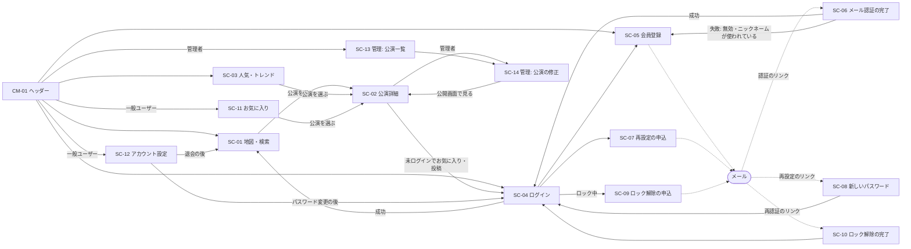
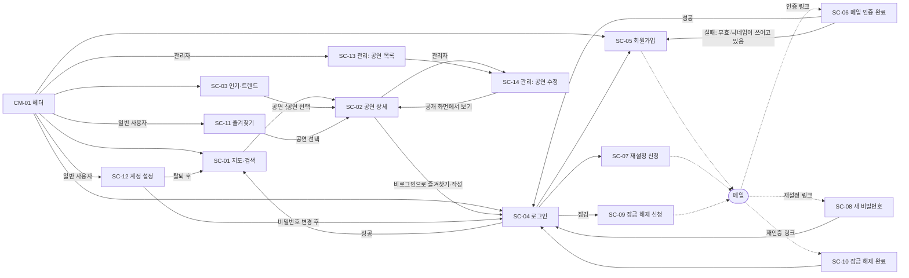

# 02. 画面設計書

- 状態: 基本設計: 承認（2026-11-06、Issue #15 コメント 6678921752。P-01〜P-18 は決定済み）。工程4（Issue #20）の確認2 の決定を反映（2026-11-09）。ゲート4 の reviewer の判定は条件付き承認（2026-11-09）で、指摘（韓国語の固定の文言を「예매처」にそろえる）を反映済み。人間の承認待ち。Issue #28（Issue #24 の決定2〜4、追加のやること No.7、Issue #28 コメント 6759899229 の決定 No.4〜8、コメント 6760305027 の決定 C）を反映（2026-11-10）、reviewer の確認待ち
- 担当: architect
- 最終更新: 2026-11-10
- 前提: [01. 要件定義書](01-requirements.md)（R-62〜R-66 を反映）、ADR 0006〜0016、Issue #15
- 関連: [03. API 設計書](03-api.md)（要件対応表は 03 の 6.）、[05. バッチ設計書](05-batch.md)
- ゲート3 の reviewer の指摘（Issue #15 コメント 6678542365）と人間の決定（2026-11-06、コメント 6678516145）を反映した: パスワードのルールの説明（軽微3。SC-05・SC-08・SC-12）、原文の併記の位置の解釈（軽微4。3.4）、期間の区切りの記号（提案。P-18）
- 工程4（Issue #20）の人間の決定 D-08（2026-11-06、Issue #20 コメント 6679098450）を反映した: SC-05・SC-08・SC-12 のパスワードのルールの説明に「空白は使えない」を入れた（03 の 4.6・01 の R-64 とそろえる）
- 工程4（Issue #20）の確認2（2026-11-09 の人間の決定）を反映した: 人気順位の「表示できない公演」（SC-02・SC-03。01 の F-29 ⑧、R-65。03 の 9.1）、ニックネームの正規化した形での表示（3.4・SC-05・SC-12）、会場の住所の翻訳（3.4）、人気急上昇で上がった公演が0件のときの表示（SC-03）、メールの送信の失敗の表示（6.2・SC-05・SC-07・SC-09）、名前のない予約サイトの表示（SC-02・SC-14）
- Issue #28 で、Issue #24 の人間の決定（2026-11-10、Issue #24 コメント 6758551367。PR #25 の reviewer の指摘から）を反映した: 決定2 の仮の文言・値（SC-99 のリンク「지도로 이동」、メニューのボタンと言語の切り替えの `aria-label`、フッターの2行目の「출처: 」、通知の表示 4 秒。3.1・3.2・3.3・SC-99）、決定3 の保存できないブラウザでの言語の切り替え（3.1。ADR 0006 決定3 の例外）、決定4 のアカウントのリンクの表示「계정 (닉네임)」（3.1）
- Issue #28 の追加のやること No.7（人間の決定、2026-11-10、Issue #28 のコメント）を反映した: 長いニックネームの表示（ニックネームの部分を「…」で切る、ツールチップと `aria-label`、PC 表示の幅 960px であふれない。3.1。最大の幅の値は 07 の 4.1）
- Issue #28 の人間の決定（2026-11-10、Issue #28 コメント 6759899229）を反映した: No.8 のスマホ表示・PC 表示の定義（CDK `Breakpoints.Handset` をやめ、幅 960px 未満をスマホ表示、960px 以上を PC 表示にする。1.・3.1。実装は Issue #33）、No.6・No.7 の長いニックネームのツールチップ（全体のニックネームだけ、切ったときだけ出す。3.1）、No.4 のアカウントのリンクの日本語の表示（「アカウント (ニックネーム)」のまま。3.1）。No.5 のフッターの「출처: 」は日本語表示でも翻訳しないことを確かめた（3.2 は変更なし）
- Issue #28 の人間の決定 C（2026-11-10、Issue #28 コメント 6760305027）を反映した: SC-01 のスマホ表示の地図の隅の出典のリンクの名前は画面の操作の文言として翻訳する（「출처」/「出典」）。「翻訳しない出典の文言」の範囲（フッターの2行と「출처: 」、リンクを押して出る内容）を書き分け、表示言語ごとの表を足した（3.2・3.4。決定 No.5 は変えない）

## 1. 方針

- 画面は Angular の SPA。部品は Angular Material（Material 3）と CDK を使う（ADR 0014）。見た目（色・文字・余白）は `07-ui-guide.md` と試作（ui-designer）で決める。**この設計書は画面の項目・操作・状態・遷移を決める**（試作と食い違うときはこの設計書が正。ADR 0015）。
- PC とスマートフォンの両方ですべての機能を使える（N-02）。画面の幅で表示を切り替える（CDK `BreakpointObserver`）。この設計書では、**画面の幅が 960px 未満**を「**スマホ表示**」、**960px 以上**を「**PC 表示**」と呼ぶ（Issue #28 の人間の決定 No.8、2026-11-10、Issue #28 コメント 6759899229）。
  - 判定は幅だけで行い、端末の種類・画面の向きは見ない（縦の向きの 600〜959px のタブレットなどもスマホ表示になる）。CDK の `Breakpoints.Handset` は使わない（Handset は向きによって境目が変わり、PC 表示のいちばん狭い幅が決まらないため）。
  - 境目はメディアクエリ `(max-width: 959.98px)` に当たればスマホ表示とする（`BreakpointObserver` の条件と CSS のメディアクエリで同じ境目を使う）。これにより、**PC 表示のいちばん狭い幅は 960px** になる（3.1 の長いニックネーム）。
  - 実装（`BreakpointObserver` の条件を Handset からこの境目に変える）は、Issue #28 のマージの後に Issue #33 で frontend-dev が行う。
- **地図（Google Maps）を使うのは SC-01 だけ**にする。地図は読み込むたびに1日の上限（300回、ADR 0006）を使うため、公演詳細などには地図を置かない。SC-01 から別の画面へ移って戻ったときに地図を作り直さない工夫（ルートの再利用など）は、06・実装で決める。
- 表示言語（F-10）を切り替えるとページを読み込み直す（ADR 0006 決定3）。ただし、選んだ言語をブラウザに保存できないときは例外として読み込み直さない（3.1）。
- 判断の区分: この設計書で決めた値・振る舞いのうち、要件の解釈が分かれるもの・利用者に見える振る舞いを新しく決めたものは `P-xx` の番号を付け、8. に一覧する。人間が決めたものは「**決定**」とする（P-01〜P-15: 2026-11-05、Issue #15 コメント 6651238358。P-16〜P-18: 2026-11-06、Issue #15 コメント 6676943465）。それ以外は「確定」（reviewer の確認の対象）。
- ライト表示・ダーク表示（F-36）を切り替えてもページは読み込み直さない（3.8）。

## 2. 画面一覧

| ID | 画面名 | URL | 使う人 | 要件 ID | スマホ表示と PC 表示の違い |
|---|---|---|---|---|---|
| SC-01 | 地図・検索（トップ） | `/` | 全員 | F-01, F-02, F-05, F-06, F-07, F-08, F-09, F-11, F-30, F-31, F-36, N-06 | あり（PC: 左に条件・一覧、右に地図。スマホ: 地図を全面に、条件は全画面のダイアログ、一覧・会場の情報は下から出るシート） |
| SC-02 | 公演詳細 | `/performances/:performanceId` | 全員 | F-03, F-04, F-05, F-06, F-08, F-09, F-11, F-17, F-19, F-21, F-22, F-23, F-24, F-28, F-29, F-30, F-31, F-32, F-36 | あり（PC: 2段組み。スマホ: 1段） |
| SC-03 | 人気・トレンド | `/rankings` | 全員 | F-09, F-29, F-31, F-33, F-34, F-36 | 小さい（ジャンルの選び方: PC はチップ、スマホはプルダウン） |
| SC-04 | ログイン | `/login` | 未ログイン | F-12, F-13, F-14, F-25, F-35, F-36, N-05 | なし（1段のフォーム） |
| SC-05 | 会員登録 | `/signup` | 未ログイン | F-12, F-17, F-36, N-05, N-06 | なし |
| SC-06 | メール認証の完了 | `/signup/verify` | 未ログイン | F-12, F-36 | なし |
| SC-07 | パスワード再設定の申込 | `/password-reset` | 未ログイン | F-15, F-36, N-06 | なし |
| SC-08 | 新しいパスワードの設定 | `/password-reset/confirm` | 未ログイン | F-14, F-15, F-36, N-05 | なし |
| SC-09 | ロック解除の申込 | `/unlock` | 未ログイン | F-14, F-36, N-06 | なし |
| SC-10 | ロック解除の完了 | `/unlock/confirm` | 未ログイン | F-14, F-36 | なし |
| SC-11 | お気に入り | `/favorites` | 一般ユーザー | F-09, F-19, F-20, F-30, F-31, F-36 | 小さい（カードの並び: PC は複数列、スマホは1列） |
| SC-12 | アカウント設定 | `/account` | 一般ユーザー | F-16, F-17, F-18, F-36, N-05 | なし |
| SC-13 | 管理: 公演一覧 | `/admin/performances` | 管理者 | F-25, F-26, F-27, F-36 | あり（PC: 表。スマホ: カードの一覧） |
| SC-14 | 管理: 公演の修正 | `/admin/performances/:performanceId` | 管理者 | F-25, F-26, F-27, F-28, F-36 | 小さい（項目の並び: PC は「自動収集の値・現在の値・修正欄」を横に、スマホは縦に） |
| SC-99 | エラー | 上にない URL、権限のない画面 | 全員 | F-03 ⑤, F-24, F-36 | なし |

ほかに、どの画面にも出す共通部品（CM-01 ヘッダー、CM-02 フッター、CM-03 通知）がある（3.）。ダイアログは、それを開く画面の一部として書く。

- **ライト表示・ダーク表示（F-36）**: 切り替えは CM-01 に置き、表示は管理者の画面（SC-13・SC-14。決定 P-16）を含むすべての画面に効く（3.8）。そのため上の表の各画面に F-36 を書いた。

## 3. 共通部品と共通のルール

### 3.1 CM-01 ヘッダー（F-10, F-24, F-25, F-35, F-36）

| 項目 | 未ログイン | 一般ユーザー | 管理者 |
|---|---|---|---|
| サービス名（押すと SC-01） | ○ | ○ | ○ |
| 「地図」（SC-01）・「人気・トレンド」（SC-03） | ○ | ○ | ○ |
| 「お気に入り」（SC-11） | — | ○ | — |
| 「アカウント」（SC-12） | — | ○（ニックネームを表示。下の「アカウントのリンク」） | — |
| 「管理」（SC-13） | — | — | ○ |
| 「ログイン」（SC-04）・「会員登録」（SC-05） | ○ | — | — |
| 「ログアウト」（F-35 ①） | — | ○ | ○ |
| 表示言語の切り替え「한국어 / 日本語」（F-10） | ○ | ○ | ○ |
| ライト表示・ダーク表示の切り替え（F-36） | ○ | ○ | ○（P-16） |

- スマホ表示では、サービス名・言語の切り替え・ライト表示とダーク表示の切り替え以外をメニュー（ハンバーガー）にまとめる。メニューを開くボタンはアイコンだけのボタンにし、`aria-label` を「메뉴」（日本語表示では「メニュー」）にする（Issue #24 の決定2）。
- **アカウントのリンク（Issue #24 の決定4）**: 一般ユーザーのアカウントのリンク（SC-12 へ）は、「계정 (닉네임)」の形で表示する（日本語表示では「アカウント (ニックネーム)」。Issue #28 の決定 No.4、2026-11-10、Issue #28 コメント 6759899229）。`닉네임` / `ニックネーム` の部分にはログインしている利用者のニックネーム（3.4 の正規化した形）が入る（例: 「계정 (Cat)」）。括弧は半角 `(` `)` で、前に半角の空白を1つ置く。PC 表示のヘッダーとスマホ表示のメニューの中で同じ表示にする（承認した試作 SC-02 の PC 表示と同じ）。
- **長いニックネーム（Issue #28 の追加のやること No.7。人間の決定、2026-11-10、Issue #28 のコメント）**: ニックネームは 1〜20 文字（P-05。NFKC に正規化した後の文字数。03 の 4.6・7.1）だが、文字によって幅が大きく違う（例: 全角の文字・ハングル 20 文字）ため、次のとおり表示する。PC 表示のヘッダーとスマホ表示のメニューのアカウントのリンクの両方に当てはめる。
  - 切るのは**ニックネームの部分だけ**。ニックネームの部分が最大の幅を超えたら、超えた分を表示せず、末尾に「…」を付けて切る（例: 「계정 (고양이를좋아하는…)」）。「계정 (」/「アカウント (」と閉じ括弧「)」は常に表示し、切らない。最大の幅の値は **07 の 4.1 で決める**（この設計書には書かない）。
  - 切らない（最大の幅に収まる）ときは、上の「계정 (닉네임)」の表示のまま。
  - 全体のニックネーム（切る前の、3.4 の正規化した形）を**ツールチップ**と **`aria-label`** に入れる。
  - **ツールチップ（Issue #28 の決定 No.6・No.7、2026-11-10、Issue #28 コメント 6759899229）**: 中身は**全体のニックネームだけ**にする（例: 「고양이를좋아하는사람입니다」）。「계정」/「アカウント」と括弧は付けない（画面に見えているため繰り返さない）。ツールチップは**ニックネームの部分を切ったときだけ**出し、切っていないときは出さない。スマホ表示ではツールチップは長押しでだけ出るが、`aria-label` に全体のニックネームがあるので、それで足りるとする。
  - `aria-label` は、上の表示と同じ形「계정 (닉네임)」（日本語表示では「アカウント (ニックネーム)」）にし、`닉네임` / `ニックネーム` の部分に全体のニックネームを入れる（例: 「계정 (고양이를좋아하는사람입니다)」）。表示と同じ形にするのは、画面の読み上げで聞く名前と見えている文言を合わせるため（決定 No.6 で、この形のままとした）。
  - **PC 表示のいちばん狭い幅（960px。1. の定義で、960px 以上が PC 表示）で、ヘッダーがあふれない**こと（項目が隠れない・横にはみ出さない）。ニックネームが 20 文字で最大の幅を超える一般ユーザーの状態を、韓国語表示・日本語表示の両方で確かめる。
- 表示言語: 初回は韓国語（F-10 ①）。選んだ言語はブラウザ（`localStorage`）に記憶し、次に開いたときも使う（F-10 ③）。切り替えるとページを読み込み直す（ADR 0006 決定3）。ただし、保存できないときは下の例外のとおり読み込み直さない。ログインしていてもサーバーには保存しない。
- 言語の切り替え（「한국어 / 日本語」のボタンのまとまり）には、まとまり全体の `aria-label` を「표시 언어」（日本語表示では「表示言語」）として付ける（Issue #24 の決定2）。
- **例外: 選んだ言語を保存できないブラウザ（Issue #24 の決定3。ADR 0006 決定3 の例外）**: 切り替えの操作のときにブラウザ（`localStorage`）への保存に失敗した（ブラウザの設定で保存が許されていないなど）ときは、**ページを読み込み直さず、その場で画面の文言（と `<html lang>`）だけを選んだ言語に変える**。
  - 理由: 読み込み直すと保存した言語を読めず、初回と同じ韓国語（F-10 ①）に戻ってしまい、切り替えられなくなるため。
  - このとき、地図（SC-01。Wave 2 で実装）の文字（地名など）は**前の言語のまま残ることがある**。地図の言語は API を読み込むときにだけ決まり（ADR 0006 決定3）、この例外では地図を読み込み直さないため。地図の上のボタン・会場の情報など、アプリの文言は選んだ言語に変わる。
  - 記憶できないので、次に開いたときは韓国語で始まる（F-10 ③ の「次に開いたときもその言語」は、保存できないブラウザでは満たせない）。
  - これは ADR 0006 決定3（言語を切り替えたらページを読み込み直す）の**例外**である。ADR 0006 決定3 は具体的な画面の動きを 02 に任せており、保存できるブラウザでは決定3 のとおり読み込み直す（ADR 0006 は書き換えない）。
- ライト表示・ダーク表示の切り替え: 1つのボタンで、押すたびにライト表示とダーク表示が入れ替わる。アイコンだけのボタンにするときは、押すとどちらになるかを `aria-label` で示す（例: ライト表示のとき「ダーク表示に切り替える」）。アイコン・形は 07。振る舞いは 3.8。
- ログアウト: 押すとすぐログアウトし（確認ダイアログなし）、SC-01 へ移り、通知「ログアウトしました」を出す。

### 3.2 CM-02 フッター（出典の表示。ADR 0008 6.、ADR 0009 5.）

- 全画面のフッターに出典を表示する: KOPIS（`출처: (재)예술경영지원센터 공연예술통합전산망(www.kopis.or.kr)`）、ソウル交通公社の公開データ（駅の座標・住所、コインロッカーの位置、駅名の多言語表記（공공누리 제1유형））。
- 2行で表示し、1行目が KOPIS、2行目がソウル交通公社。**2行目の前にも1行目と同じ「출처: 」（`출처:` と半角の空白）を付ける**（Issue #24 の決定2）。日本語表示でも「출처: 」のまま（下の「翻訳しない」）。
- SC-01 のスマホ表示は地図が全面でフッターが見えないため、地図の隅に出典のリンクを置き、押すと同じ内容（上の2行。「출처: 」を含む）を出す。
- **出典のリンクの名前（Issue #28 の決定 C、2026-11-10、Issue #28 コメント 6760305027）**: SC-01 のスマホ表示の地図の隅のリンクの名前は、出典の文言ではなく**画面の操作の文言**として扱い、表示言語で翻訳する（韓国語表示「출처」/ 日本語表示「出典」）。押すと何が起きるかを日本語の利用者が分かるようにするため。
- 出典の文言は韓国語の原文のまま（翻訳しない）。ここでいう「出典の文言」は、**フッターの2行（行の前の「출처: 」を含む）と、上のリンクを押して出る同じ内容**のこと（Issue #28 の決定 No.5、2026-11-10、Issue #28 コメント 6759899229。決定 C でも変えない）。上のリンクの名前はこれに含まない。

| 表示するもの | 種類 | 韓国語表示 | 日本語表示 |
|---|---|---|---|
| フッターの2行（「출처: 」を含む） | 出典の文言 | 原文 | 原文のまま（例: 「출처: (재)예술경영지원센터 …」） |
| SC-01 のスマホ表示のリンクを押して出る内容 | 出典の文言 | フッターの2行と同じ | フッターの2行と同じ（原文のまま） |
| SC-01 のスマホ表示の地図の隅のリンクの名前 | 画面の操作の文言 | 「출처」 | 「出典」 |

### 3.3 CM-03 通知

- 操作の結果（保存した、削除した、ログアウトした など）は画面の下に短く出す通知（スナックバー）で示す。入力の誤りは、その入力欄の下に出す。
- 通知は **4 秒**表示して自動で消える（Issue #24 の決定2）。

### 3.4 外部データの表示と翻訳（F-11, N-01）

| 表示するもの | 韓国語表示 | 日本語表示 |
|---|---|---|
| 公演名・会場名・駅名 | 原文 | 翻訳を大きく、その下に原文を小さく併記する（F-11 ②） |
| 出演者・チケット価格・公演時間の案内・上演時間・観覧年齢・予約サイトの名前・会場の住所・コインロッカーの位置の文章 | 原文 | 翻訳だけ（原文は併記しない。F-11 ③。会場の住所は Issue #20 の確認2（2026-11-09）で加えた） |
| ジャンル・公演の状態・区の名前・「終了」などの決まった値、名前のない予約サイトの名前（「예매처」「予約サイト」） | 画面の文言の辞書 | 画面の文言の辞書（API で翻訳しない。ADR 0007） |
| レビューの本文・ニックネーム | そのまま | そのまま（翻訳しない。F-11 ④） |
| 出典の文言（フッターの2行と、SC-01 のスマホ表示のリンクを押して出る内容。3.2） | そのまま | そのまま（リンクの名前「출처」/「出典」は画面の文言で、翻訳する。3.2） |

- **ニックネームの表示の形（Issue #20 の確認2、2026-11-09）**: ニックネームは保存の前に NFKC で正規化される（03 の 7.1）。全角の英数字は半角に（`Ｃａｔ` → `Cat`）、半角カナは全角に（`ﾈｺ` → `ネコ`）なり、**表示されるのは入力したとおりの形ではなく、正規化した形**である（CM-01・SC-02・SC-12・SC-14 のすべて）。大文字・小文字、ひらがな・カタカナは入力のまま表示する。
- **会場の住所（Issue #20 の確認2、2026-11-09）**: 日本語表示では KOPIS の韓国語の住所の機械翻訳だけを表示する（SC-01 の会場の情報、SC-02）。英語の住所は使わない（KOPIS にないため）。翻訳がないときは P-06 のとおり原文と「原文」。

- **原文の併記の位置（F-11 ②の解釈）**: 01 の F-11 ② と Issue #10 の U-13 の「翻訳の横に原文を併記」は、「翻訳と一緒に原文を示す」という意味と解釈し、上の表の「翻訳の下に原文」で満たす（人間の決定。2026-11-06、Issue #15 コメント 6678516145。ゲート3 の軽微4）。理由: 公演名は長いことが多く、スマホ表示の狭い幅で翻訳と原文を左右に並べると、どちらも折り返して読みにくくなる。上下に置けば、PC 表示とスマホ表示で同じ並びにできる。受け入れのテストでは、翻訳と原文が同じ項目の中に両方表示されていることを確かめる（左右の位置は問わない）。
- 駅名の日本語は公式の多言語表記を使う（ADR 0009）。
- **翻訳がないときの表示（P-06）**: 月の翻訳文字数の上限に達した、または翻訳がまだ済んでいない項目は、韓国語の原文をそのまま表示する（F-11 ①、R-58）。原文の横に小さく「原文」と示す。公演名・会場名・駅名は、同じ原文を2回並べず1回だけ表示する。
- 上限に達する前に翻訳した文は、上限に達した月の残りの期間も翻訳のまま表示する（翻訳は保存したものを使うため。F-11 ① の「新たに翻訳できないテキスト」だけが原文になる）。

### 3.5 ログインが必要な操作と自動ログアウト（F-24, F-35。ADR 0013）

- 未ログインでログインが必要な画面（SC-11, SC-12）を開いたとき、またはログインが必要な操作（お気に入りの登録、レビューの投稿）をしたときは、SC-04 へ移る。ログインに成功したら元の画面へ戻る（`returnUrl`）。
- 一般ユーザーが管理者の画面（SC-13, SC-14）を開いたときは SC-99（権限がない）を表示する。
- **自動ログアウトの後（ADR 0013 で 02 に回された事項）**: 最後の操作から 30 分（ADR 0013）でサーバーのセッションが切れる。画面側にタイマーは置かない。ログインしているはずの画面で API が「未ログイン」を返したら、画面のログイン状態を消し、通知「一定時間操作がなかったため、ログアウトしました」を出して SC-04 へ移る（`returnUrl` 付き）。ログインが不要な画面（SC-01 など）を見ているだけのときは、次にログインが必要な操作をするまで画面は移らない（ヘッダーは次の API の結果で未ログインの表示に変わる）。
- ログイン・ログアウトの後は CSRF のトークンが変わる（ADR 0013）。画面は、ログイン・ログアウトの直後に API-30（03）を呼んで新しいトークンとログイン状態を受け取る。

### 3.6 状態の表示（全画面共通）

| 状態 | 表示 |
|---|---|
| 読み込み中 | 一覧はスケルトン（灰色の仮の枠）、ボタンの操作中はボタンの中にスピナーを出し、二重送信できないようにする |
| 空 | 画面ごとの文言（4. の各画面） |
| エラー（通信・サーバー） | 「読み込めませんでした」と「もう一度読み込む」ボタン |
| 見つからない（404） | SC-99 |

### 3.7 公演のカード（一覧で共通）

SC-01・SC-03・SC-11 の公演の一覧は同じカードを使う: ポスター画像、公演名（3.4）、会場名（3.4）、公演期間、ジャンル、状態（「公演中」「公演予定」「終了」（F-09 ③））、評価（F-30。例: ★4.3（12）／ 0件は「まだレビューがありません」）、受賞作バッジ（F-31。受賞歴があるときだけ）。カードを押すと SC-02 を開く。

### 3.8 ライト表示・ダーク表示（F-36。R-63）

| 場合 | 表示 | 要件 |
|---|---|---|
| このブラウザで切り替えの操作をしたことがない | 画面を開いたときの端末（OS）の設定（`prefers-color-scheme`）がダークならダーク表示、それ以外（ライト・設定なし）ならライト表示 | F-36 ② |
| 切り替えの操作をした | 選んだ表示（`light` / `dark`）をブラウザ（`localStorage`）に記憶する。次に開いたときは、端末の設定にかかわらず記憶した表示にする | F-36 ①③ |

- ログインしていてもいなくても同じ（F-36 ④）。ログインしていてもサーバーには保存しない（F-10 と同じ）。API は使わない。
- 切り替えてもページを読み込み直さない。画面の色はその場で変わる（色の値は 07）。入力中の値・開いているダイアログ・一覧の位置はそのまま。
- 端末の設定は**画面を開いたときに1回だけ**見る。開いている間に端末の設定が変わっても追従せず、次に開いたときに反映する（地図の `FOLLOW_SYSTEM` も読み込みのときに1回だけ見る仕様のため、画面と地図の表示をそろえる）。
- 最初の表示で一瞬ライト表示が出てから暗くなる（ちらつく）ことがないよう、表示を決める処理は画面の最初の描画の前に行う（方法は 06・実装）。
- 対象の画面: SC-01〜SC-14・SC-99（管理者の画面 SC-13・SC-14 を含む。決定 P-16）とダイアログ・通知。

**地図（SC-01）の暗い表示（確定（設計））**

- 地図は、Maps JavaScript API の地図の作成の設定 `colorScheme` に、いまの表示（`LIGHT` / `DARK`）を指定して作る。`FOLLOW_SYSTEM` は使わない（ブラウザに記憶した表示を優先する F-36 ③ を満たせないため）。
- `colorScheme` は**地図を作るときにだけ**指定でき、作った後に変えても反映されない（公式。確認日 2026-11-06）。そのため、SC-01 を表示している間に切り替えたときは、地図を作り直す（中心・ズーム・印・選んでいる会場・「近くを見る」の表示は引き継ぐ）。作り直すと地図の読み込みが1回増え、1日 300 回（ADR 0006）に数えられる。切り替えは頻繁な操作ではないため、上限への影響は小さいと見込む。
- SC-01 から別の画面へ移って戻ったとき（1. の地図の再利用）に表示が変わっていれば、戻ったときに作り直す。
- 地図の上限に達しているとき（6.1）に切り替えても、地図の領域は 6.1 の案内のまま（作り直しに失敗しても、ほかの機能はそのまま使える）。
- 自作の部分の色（07 の 4.5。人間の決定: Issue #15 コメント 6677710885）:
  - 印・円（会場の印・現在地の印・駅の印・半径 500m の円）は、**アプリの表示ではなく、地図が実際に作られた表示（`colorScheme` の `LIGHT` / `DARK`）**に合わせ、07 のライト表示またはダーク表示の値を使う。通常はアプリの表示と同じになる。下の「実装で確かめること」で**地図だけライト表示のまま**にしたときは、アプリがダーク表示でも印・円はライト表示の値にする。
  - 地図の上のボタン（「近くを見る」「この範囲で検索」）は、アプリの表示（ライト / ダーク）に従う。
- **ADR 0006 の範囲で足りる（新しい ADR は不要）**: `colorScheme` は ADR 0006 で採用した Maps JavaScript API の地図の設定の1つで、課金の単位は「地図の読み込みの成功」（map ID の有無にかかわらず Dynamic Maps）であり、暗い表示のための追加の費用・サービスの記載はない（公式。確認日 2026-11-06）。
- **実装で確かめること**: 公式の説明は `colorScheme` が map ID なしの地図（ADR 0006 の使い方）で暗くなるかを明記していない（`LIGHT` を「従来の Maps JS の既定値」とだけ書いている）。frontend-dev が実装で確かめ、暗くならない場合は**地図だけライト表示のまま**にする（ほかの部分はダーク表示）。地図を暗くするために map ID・クラウドの地図のスタイル設定（Cloud-based maps styling）を使う場合は、ADR 0006 にない Google Cloud の設定が増えるので、architect に報告し、ADR を書いてから入れる。
- 確認した公式ドキュメント（確認日 2026-11-06）:
  - 地図の色の設定（`LIGHT` / `DARK` / `FOLLOW_SYSTEM`、地図を作るときにだけ指定できる、roadmap・terrain が対象）: https://developers.google.com/maps/documentation/javascript/mapcolorscheme
  - `MapOptions.colorScheme`・`ColorScheme`（`FOLLOW_SYSTEM` は実行のときに1回だけ端末の設定を見る）: https://developers.google.com/maps/documentation/javascript/reference/map
  - Dynamic Maps の課金の単位（map ID の有無にかかわらず地図の読み込みの成功）: https://developers.google.com/maps/billing-and-pricing/sku-details/maps

## 4. 各画面

### SC-01 地図・検索（トップ）

企画書 8. の画面の構想（最初の画面に地図とすべての公演、印を押すと周辺 500m の駅・コインロッカー、「近くを見る」で現在地の周辺）をこの画面で具体化する。

**項目**

| 領域 | 項目 | 要件 |
|---|---|---|
| 地図 | 最初はソウルの中心（ソウル市庁の付近）を表示する。公開中の公演（03 の 1.6）の会場に印を置く。**印は会場ごとに1つ**で、その会場の公演の数を印に表示する（P-01） | F-01 ①② |
| 検索の条件 | 期間（開始日・終了日。1日なら同じ日）、場所（「区」「地図の範囲」「会場」の3つから1つの方法を選ぶ）、ジャンル、公演の状態（公演中・公演予定）、キーワード（公演名）。「検索」「条件をクリア」ボタン。複数選べる条件はP-04（区・ジャンル・状態は複数、会場は1つ） | F-02 |
| 検索結果の一覧 | 件数、公演のカード（3.7）、ページ送り（20件ずつ）。並び順は公演開始日の早い順（P-15） | F-02, F-30, F-31 |
| 会場の情報（印を選んだとき） | 会場名・住所（3.4）、その会場の公演（いまの検索条件に合うもの）のカード、周辺 500m の駅（駅名・路線・会場からの距離）とコインロッカー（駅名・路線・位置の文章・距離）。地図上に駅の印と半径 500m の円を表示する | F-01 ③, F-05, F-06 |
| 「近くを見る」ボタン | 押すと端末の位置を取り、現在地の印と半径 500m の円、500m 以内の公演（会場の印）・駅・コインロッカーを地図に出し、一覧を「公演 / 駅 / コインロッカー」のタブで出す。「検索に戻る」で通常の表示に戻る | F-07 |

- 距離は m の整数で表示する（四捨五入）。駅・コインロッカーは距離の近い順。
- 「地図の範囲」を選んだときは、検索ボタンを押した時点で表示している範囲を条件にする。地図を動かしても自動では検索しない（地図の上に「この範囲で検索」ボタンを出す）。
- 場所の3つの方法は同時に使えない（P-04）。別の方法を選ぶと、前の方法の値は消える。
- 会場は、名前を入力して候補（API-06）から選ぶ。
- 地図の印は、検索の条件を変えると、その条件に合う公演の会場だけになる。最初（条件なし）はすべての公開中の公演の会場。
- 会場の座標がない公演は地図に出せない。扱いはP-11（地図・地図の範囲・現在地の周辺には出ず、ほかの条件の検索結果には出る）。

**操作**: 条件を入れて検索する／印を選ぶ／公演のカードを選んで SC-02 へ移る／「近くを見る」／「検索に戻る」。

**PC 表示とスマホ表示**

- PC: 左に幅の決まったパネル（上に条件、下に一覧）、右に地図。会場の情報はパネルの中に重ねて出す（「戻る」で一覧に戻る）。
- スマホ: 地図を全面に出し、上にキーワードの入力欄と「条件」ボタン（押すと全画面のダイアログで条件を入れる）。一覧と会場の情報は下から出るシートに出す。シートの「地図 / 一覧」で切り替える。

**状態**

| 状態 | 表示 |
|---|---|
| 読み込み中 | 一覧はスケルトン。地図は読み込みが終わるまで灰色の枠 |
| 空（条件に合う公演がない） | 「条件に合う公演がありません。条件を変えてみてください」 |
| 空（会場の周辺に駅・コインロッカーがない） | 「500m 以内に駅はありません」「500m 以内にコインロッカーはありません」 |
| 空（現在地の周辺） | タブごとに「500m 以内に公演はありません」など |
| 位置情報が許可されない・取れない | 「位置情報の利用が許可されていないため、現在地の周辺を表示できません」。地図はソウルの中心のまま。ほかの機能はそのまま使える（F-07 ⑥⑦） |
| 地図を表示できない | 6.1（P-07） |
| エラー | 3.6 |

### SC-02 公演詳細

**項目**

| 領域 | 項目 | 要件 |
|---|---|---|
| 基本情報 | ポスター、公演名（3.4）、「終了」の表示（終わった公演）、状態、公演期間、会場名（3.4）と住所（3.4。日本語表示では翻訳だけ）、ジャンル、出演者、チケット価格、公演時間の案内、上演時間、観覧年齢 | F-03 ②④, F-09 ③, F-11 |
| 統計・評判 | 評価（★平均（件数）。0件は「まだレビューがありません」）、受賞作バッジ、オープンランの表示と開幕からの累計の上演回数、人気順位（P-02: 全体とその公演のジャンルの、日次・週次・月次のうち10位以内に入っているものをすべて「週次・全体 3位」のように、それぞれの集計期間と一緒に表示（P-12。例: 「週次・全体 3位（集計期間 2026-10-26~2026-11-01）」。集計期間の形式は P-18）。順位は SC-03 と同じく表示できない公演を除いて振り直したもの。入っていなければ表示しない） | F-03 ②③, F-29, F-30, F-31, F-32 |
| 予約 | 予約サイトの名前とリンク（新しいタブで開く）。名前のない予約サイト（KOPIS に名前がない。03 の API-03 の `name` が `null`）は、画面の辞書の固定の文言「예매처」（日本語表示では「予約サイト」。翻訳しない）を名前として表示する（Issue #20 の確認2、2026-11-09）。情報がない公演は「予約サイトの情報がありません」 | F-04 |
| 周辺 | 会場から 500m 以内の駅（駅名・路線・距離）、コインロッカー（駅名・路線・位置の文章・距離）。一覧だけで、地図は出さない（1.） | F-05, F-06 |
| お気に入り | 「お気に入り」ボタン（登録済みなら「お気に入り解除」）。管理者には出さない | F-19 |
| 自分のレビュー | 未投稿で投稿できるとき: 「レビューを書く」ボタン。投稿済み: 自分のレビュー（星・本文）と「編集」「削除」。公演の開始日より前: ボタンを無効にし「公演の開始日（YYYY-MM-DD）から投稿できます」。管理者には出さない | F-21, F-22 |
| レビューの一覧 | 新しい順に 20 件ずつ。**ログインしているとき**: 星・本文・ニックネーム・投稿日。**未ログインのとき**: 星だけ（本文・ニックネーム・投稿日を出さない）と、「ログインするとレビューの本文を読めます」 | F-23 |
| 管理者だけ | 「管理画面で修正」（SC-14 へ）、各レビューの「削除」 | F-28 |

- **予約・購入の機能は置かない（F-04 ②）。** 画面にはその旨の文言を出さない（制約であり、表示する項目ではない。Issue #15 コメント 6676583842 の 7.）。

**ダイアログ**

- DL-01 レビューの投稿・編集: 評価（星 1〜5。必須）、本文（任意。上限 1,000 文字（P-05）。入力中の文字数を表示）。「保存」「キャンセル」。
- DL-02 削除の確認（自分のレビュー、管理者のレビュー削除）: 「このレビューを削除しますか」「削除」「キャンセル」。

**操作**: お気に入りの登録・解除／レビューの投稿・編集・削除／予約サイトを開く／（管理者）SC-14 へ移る・レビューを削除する。未ログインでお気に入り・「レビューを書く」を押すと SC-04 へ移る（3.5）。

**PC 表示とスマホ表示**: PC は2段組み（左: 基本情報・予約・統計、右: 周辺）、その下にレビュー。スマホは1段（基本情報 → 統計 → 予約 → 周辺 → レビュー）。

**状態**

| 状態 | 表示 |
|---|---|
| 読み込み中 | スケルトン |
| 公演がない・非表示の公演（F-03 ⑤） | SC-99（「公演が見つかりません」） |
| レビューが0件 | 「まだレビューがありません」 |
| 周辺に駅・コインロッカーがない | SC-01 と同じ文言 |
| 会場の座標がない | 周辺の欄に「会場の位置情報がないため、周辺の情報を表示できません」（P-11） |
| 2件目の投稿（F-21 ⑤） | ボタンを出さないので通常は起きない。API が「投稿済み」を返したら「この公演にはすでにレビューを投稿しています」 |
| エラー | 3.6 |

### SC-03 人気・トレンド

タブを3つ置く。優先度の低い機能（F-33 は Could、F-34 は Should）のタブは、その機能を実装するまで出さない。タブ・期間・ジャンルは URL のクエリ（`tab`・`period`・`genre`）に持つ。

| タブ | 項目 | 要件 |
|---|---|---|
| 人気順位 | 期間（日次・週次・月次）、ジャンル（全体 + ジャンル）、**表示している順位の集計期間**（F-29 ④。例: 週次なら 2026-10-26~2026-11-01。形式は P-18）、最大10件: 順位（表示できない公演を除いて 1〜10 に振り直したもの）、公演のカード（3.7。評価を除く） | F-29, F-31 |
| 人気急上昇 | 期間・ジャンル・**現在の期間の集計期間**（F-33 ②）と比べる直前の期間の集計期間、最大10件: 「NEW」または「▲上昇幅」（上がった公演が0件のときは「-」。下の項目）、現在の順位、公演のカード | F-33 |
| ジャンル別トレンド | 集計期間（直近30日。例: 2026-10-06~2026-11-04）、基準の表示、ジャンルごとの割合（% と横棒） | F-34 |

- **「全国基準」の表示（F-34 ①、R-50。02 で決めるとされた文言と位置）**: ソウルだけで集計できないときは、タブの見出しのすぐ下に「全国基準」のラベルと、「ソウルだけの集計を取得できないため、全国の予約で計算しています」を表示する。ソウルで集計できたときは「ソウル基準」のラベルだけを出す。
- 横棒はグラフのライブラリを使わず、CSS で描く（新しいライブラリを入れない）。
- **表示する期間と集計期間（P-12。01 F-29 ④・F-33 ②、R-62）**: 人気順位・人気急上昇は、すでに終わった期間のうち、**その期間の順位の収集が終わっている直近の期間**を表示し、その集計期間を一緒に表示する（どの期間かは API-20・API-21 が決めて返す。03 の 4.9）。
  - 直近の終わった期間（日次は前日、週次は先週（月〜日）、月次は先月）の収集が終わっていれば、その期間を表示する（例: 11月5日に、10月の順位の収集が終わった後に月次を見ると、10月の順位と集計期間（10月）を表示する）。
  - 収集がまだ終わっていなければ、その1つ前の期間（日次は前々日、週次は先々週、月次は先々月）を、その集計期間と一緒に表示する。日付が変わってから日次の収集（05 の B-01。06:00 に起動）が終わるまでがこの場合に当たる。
  - 人気急上昇は、上の「表示する期間」を現在の期間とし、その1つ前の期間と比べる（F-33 ②）。
  - 集計期間は、期間・ジャンルを切り替えるたびに、表示している順位の期間に合わせて変わる（期間の種類・ジャンルごとに収集の終わり方が違うことがあるため。03 の 4.9）。
- 人気急上昇で、比べる直前の期間の順位がない（収集の失敗が続いたなど）ときは、一覧を出さず、現在の期間の集計期間と「比べる期間（{直前の期間の集計期間}）の順位データがないため、人気急上昇を表示できません」を表示する（決定 P-17）。
- **表示できない公演（01 の F-29 ⑧、R-65。03 の 9.1。Issue #20 の確認2、2026-11-09）**: 非表示の公演と、公演の情報がまだない順位の行（収集の途中で、順位にある公演がまだ DB にない）は、人気順位・人気急上昇・SC-02 の人気順位のどれにも出さず、下の順位を繰り上げて 1〜10 に振り直す。画面に理由の文言は出さない（番号が提供元の順位とずれることがある。公演の情報が補われると次の表示から提供元の順位に戻る）。
- **人気急上昇で上がった公演が0件のとき（01 の F-33 ⑪、R-66。Issue #20 の確認2、2026-11-09。03 の API-21 の `NO_RISE`）**: 両方の期間の順位があり、「NEW」の公演も順位が上がった公演も0件のとき（例: 上位が前の期間と変わらない）は、空にせず、**現在の期間の順位の上位**（表示できる公演、最大10件、現在の順位の順）を表示する。各行の「NEW」・「▲上昇幅」の場所には、上昇幅の代わりに「-」を表示する（「現在の順位」と公演のカードはいつもと同じ）。「-」は読み上げで分かるよう `aria-label`「順位の上昇なし」（韓国語「순위 상승 없음」）を付ける。

**状態**: 読み込み中（スケルトン）／空「この期間の順位データがありません」（トレンドは「この期間の統計データがありません」。表示できる期間の順位がまったくないとき、またはその期間の表示できる公演が0件のとき）／人気急上昇で直前の期間の順位がない（P-17）／人気急上昇で上がった公演が0件（上の「-」の一覧。空にしない）／エラー（3.6）。

### SC-04 ログイン

**項目**: メールアドレス、パスワード、「ログイン」。リンク: 「会員登録」（SC-05）、「パスワードを忘れた方」（SC-07）、「ロックを解除する」（SC-09）。一般ユーザーと管理者で同じ画面（F-25）。

**結果の表示**

| 結果 | 表示 | 要件 |
|---|---|---|
| 成功 | `returnUrl` の画面へ、なければ SC-01 へ移る | F-13 ① |
| メールアドレスかパスワードが違う | 「メールアドレスまたはパスワードが正しくありません」（どちらが違うかは示さない） | F-13 ② |
| ロック中 | 「ログインに続けて失敗したため、アカウントがロックされています」と、解除の2つの方法: 「確認とメールの再認証で解除する」（SC-09）、「パスワードを再設定する」（SC-07） | F-14 ③④ |
| メールの認証が済んでいない | 「メールの認証が完了していません。届いたメールのリンクから認証してください」。リンクの期限が切れたときは、もう一度会員登録できる（P-10） | F-12 ⑧ |
| 自動ログアウトの後に来た | 上に通知「一定時間操作がなかったため、ログアウトしました」 | F-35 ③ |

**状態**: 送信中（ボタンにスピナー）／エラー（3.6）。

### SC-05 会員登録

**項目**: メールアドレス、パスワード、パスワード（確認）、ニックネーム、パスワードのルールの説明（「英字・数字・記号で 8〜64 文字（英字と数字を含む、空白は使えない）」。01 の F-12 ④、R-64。パスワードの入力欄の下に常に表示する）、「登録する」。入力のルールは 03 の 4.6（「記号」に空白は含まれず、空白を含むとルールに合わない入力の誤りになる。2026-11-06 人間の決定、Issue #15 コメント 6678921752。SC-08・SC-12 も同じ）。説明に「空白は使えない」を入れるのは Issue #20 の D-08（人間の決定、2026-11-06、Issue #20 コメント 6679098450）。

**結果の表示**

| 結果 | 表示 |
|---|---|
| 申込を受け付けた | 画面を「{メールアドレス} に確認のメールを送りました。メールのリンクを 24 時間以内に開いて、登録を完了してください」に切り替える（期限はP-10） |
| 入力の誤り（必須・パスワードのルール・確認の不一致） | 入力欄の下に表示（F-12 ②④） |
| 登録済みのメールアドレス | 「このメールアドレスはすでに登録されています」（F-12 ⑤） |
| 使われているニックネーム | 「このニックネームはすでに使われています」（F-12 ③）。大文字・小文字、全角・半角、ひらがな・カタカナの違いだけの名前も「使われている」になる（03 の 4.6・7.1） |
| メールの上限 | 6.2 |
| メールの送信の失敗 | 6.2 |

- ニックネームは正規化した形で保存される（3.4。例: `Ｃａｔ` と入れると `Cat` で登録される）。この画面では入力欄の値を書き換えない（正規化した形は、登録の後に CM-01・SC-12 などで表示される）。

### SC-06 メール認証の完了

- メールのリンク（`/signup/verify?token=...`）で開く。開くとすぐトークンをサーバーへ送り（API-34）、URL からトークンを消す。
- 成功: 「登録が完了しました。ログインしてください」と「ログイン」ボタン（SC-04）。
- 失敗（無効・期限切れ・使用済み）: 「リンクが無効か、期限が切れています。もう一度会員登録してください」と「会員登録」ボタン（SC-05）。
- 失敗（認証の時点でニックネームが使われている。03 の 4.7 の API-34 の 2.。人間の決定: Issue #15 コメント 6677710885 の Q-01 の B）: 「このニックネームは、メールの認証の前にほかの方が登録したため、登録を完了できませんでした。別のニックネームで、もう一度会員登録してください」と「会員登録」ボタン（SC-05）。この申込は削除されるので、同じメールアドレスで申し込み直せる（F-12 ③）。
- 状態: 確認中（スピナー）。

### SC-07 パスワード再設定の申込

- 項目: メールアドレス、「再設定のメールを送る」。ログインしていない状態で使う（F-15 ①）。
- 送信後: 登録の有無にかかわらず「登録されているメールアドレスであれば、再設定のメールを送りました。メールのリンクを 1 時間以内に開いてください」（登録の有無を知らせない。期限はP-10）。
- メールの上限・メールの送信の失敗: 6.2。

### SC-08 新しいパスワードの設定

- メールのリンク（`/password-reset/confirm?token=...`）で開く。項目: 新しいパスワード、新しいパスワード（確認）、パスワードのルールの説明（「英字・数字・記号で 8〜64 文字（英字と数字を含む、空白は使えない）」。SC-05 と同じ。F-15 ③）、「設定する」。
- 成功: 「パスワードを再設定しました。新しいパスワードでログインしてください」（ロック中だった場合はロックも解除されている。F-15 ④）と「ログイン」ボタン。
- パスワードのルールに合わない: 入力欄の下に表示（F-15 ③）。
- トークンが無効・期限切れ: 「リンクが無効か、期限が切れています」と「再設定のメールをもう一度送る」（SC-07）。

### SC-09 ロック解除の申込

F-14 ④(a)「自動操作ではないことの確認の通過」と「メールアドレスの再認証」の両方を、この順で行う。

- 項目: メールアドレス、reCAPTCHA のチェックボックス（ADR 0011）、「再認証のメールを送る」（チェックを通過するまで押せない）。
- 送信後: 「ロック中のアカウントであれば、再認証のメールを送りました。メールのリンクを 1 時間以内に開いてください」（登録・ロックの有無を知らせない。期限はP-10）。
- 確認に失敗した・確認のサービスが使えない: 「確認に失敗しました。もう一度試すか、パスワードを再設定してロックを解除してください」と SC-07 へのリンク（ADR 0011 決定4）。
- メールの上限・メールの送信の失敗: 6.2。
- 確認だけでは解除されない（メールのリンクを開くまで解除しない。F-14 ⑤）。メールのリンクは確認を通過したときにだけ送るので、再認証だけで解除されることもない。

### SC-10 ロック解除の完了

- メールのリンク（`/unlock/confirm?token=...`）で開く。開くとすぐトークンを送る（API-38）。
- 成功: 「ロックを解除しました。ログインしてください」と「ログイン」ボタン（F-14 ⑥）。
- 失敗: 「リンクが無効か、期限が切れています」と、SC-09・SC-07 へのリンク。

### SC-11 お気に入り（一般ユーザー）

- 項目: 公演のカード（3.7）と「解除」ボタン、ページ送り（20件ずつ）。並び順は登録の新しい順。終わった公演は「終了」と示して出す（F-20 ④）。非表示の公演は出さない（F-20 ⑤）。
- 操作: カードを押して SC-02 へ／「解除」（確認なしで解除し、通知「お気に入りを解除しました」を出して一覧から消す。F-19 ①、F-20 ③）。
- 状態: 読み込み中／空「お気に入りはまだありません」と SC-01 へのリンク／エラー。
- 未ログインで開くと SC-04 へ（3.5）。

### SC-12 アカウント設定（一般ユーザー）

| 欄 | 項目 | 結果 | 要件 |
|---|---|---|---|
| ニックネーム | 現在のニックネーム、新しいニックネーム、「変更する」 | 成功: 通知「ニックネームを変更しました」。「現在のニックネーム」と CM-01 の表示を、API が返した保存した値（正規化した形。3.4）に変える（入力と違うことがある。例: `Ｃａｔ` → `Cat`）。使われている: 「このニックネームはすでに使われています」（大文字・小文字、全角・半角、ひらがな・カタカナの違いだけの名前を含む。自分のいまのニックネームとの違いがそれだけのときは変更できる） | F-17 |
| パスワード | 現在のパスワード、新しいパスワード、新しいパスワード（確認）、パスワードのルールの説明（「英字・数字・記号で 8〜64 文字（英字と数字を含む、空白は使えない）」。SC-05 と同じ。F-16 ③）、「変更する」（現在のパスワードを求めるのはP-14） | 成功: セッションが無効になる（ADR 0013 決定9）ので、「パスワードを変更しました。新しいパスワードでログインしてください」と SC-04 へ移る。現在のパスワードが違う・ルールに合わない: 入力欄の下に表示 | F-16 |
| 退会 | 「退会する」→ DL-03 | 成功: ログアウトされ、SC-01 へ移り、通知「退会しました」 | F-18 |

- DL-03 退会の確認: 「退会すると、あなたのレビューとお気に入りはすべて削除され、元に戻せません。同じメールアドレスでもう一度登録しても、以前のデータは引き継がれません」（F-18 ③④⑥）、現在のパスワード（P-14）、「退会する」「キャンセル」。
- 未ログインで開くと SC-04 へ、管理者が開くと SC-99（権限がない）。

### SC-13 管理: 公演一覧（管理者）

- 項目: 条件（キーワード（公演名・公演 ID）、表示の状態（すべて／表示中／非表示）、「終わった公演も含める」）、「検索」。結果: 公演 ID、公演名（原文）、会場名、公演期間、状態（公演中／公演予定／終了）、非表示かどうか、管理者の修正があるかどうか。ページ送り（20件ずつ）、公演開始日の新しい順。
- 操作: 行を選んで SC-14 へ。
- PC は表、スマホはカードの一覧（同じ項目）。
- 状態: 読み込み中／空「条件に合う公演がありません」／エラー。

### SC-14 管理: 公演の修正（管理者）

| 欄 | 項目 | 要件 |
|---|---|---|
| 公演の情報 | 修正できる項目（P-13）ごとに: 項目名、自動収集の値、現在の値（修正していれば修正した値）、修正の入力欄、「修正を取り消す」（修正した項目だけ）。「保存」 | F-26 ①③④⑤ |
| 修正できない項目 | 会場、ポスター、受賞歴、上演回数、翻訳は表示だけ（P-13） | F-26 |
| 表示 | 現在の状態（表示中／非表示）と「非表示にする」または「非表示を解除する」（DL-04 で確認） | F-27 |
| レビュー | その公演のレビューの一覧（星・本文・ニックネーム・投稿日、新しい順、20件ずつ）と「削除」（DL-02） | F-28 |
| リンク | 「公開画面で見る」（SC-02。非表示の公演では出さない） | — |

- 予約サイトの自動収集の値で名前のないもの（KOPIS に名前がない。03 の API-51）は、SC-02 と同じ固定の文言「예매처」（日本語表示では「予約サイト」）で表示する。修正欄では名前は必須（03 の 8.8）。
- 修正を保存すると、日本語の翻訳は次の収集（05 の B-01）で作り直す。それまで日本語表示では修正した原文を表示する（3.4 の「翻訳がないとき」と同じ）。
- 「修正を取り消す」を押すと、その項目は自動収集の値に戻る（F-26 ⑤）。
- DL-04 非表示の確認: 「この公演を非表示にしますか。一般ユーザーのすべての画面から見えなくなります」（解除のときは「非表示を解除しますか」）。
- 状態: 読み込み中／公演がない（SC-99）／入力の誤り（入力欄の下）／エラー。

### SC-99 エラー

| 場合 | 表示 |
|---|---|
| URL がない・公演がない・非表示の公演 | 「ページが見つかりません」（公演のときは「公演が見つかりません」）と SC-01 へのリンク |
| 権限がない（一般ユーザーが管理の画面、管理者がアカウント設定など） | 「この画面を表示する権限がありません」と SC-01 へのリンク |

- SC-01 へのリンクの文言は「지도로 이동」（日本語表示では「地図へ移動」）。上の2つの場合で同じ（Issue #24 の決定2）。

## 5. 画面遷移図

- SC-04 の「成功」は、`returnUrl` があればその画面へ移る（図では SC-01 で代表する）。
- どの画面からも、自動ログアウトの後にログインが必要な操作をすると SC-04 へ移る（3.5）。404・権限なしは SC-99。

## 6. 外部サービスの上限に達したときの表示（01 7.3、N-06、F-11 ①）

「1日」「1か月」の区切りの基準時刻は 05 の 2. に書く。

### 6.1 地図（1日 300 回。ADR 0006。P-07）

- **止まる範囲**: 地図の表示（F-01 の地図の印）、検索条件の「地図の範囲」（F-02 ⑦ の方法の1つ）、地図の上の印（会場の情報・現在地の周辺の印と円）。
- **止まらない範囲**: 検索のほかの条件（区・会場・期間・ジャンル・状態・キーワード）と検索結果の一覧、会場の印を使わない公演の選択（一覧から SC-02 へ）、SC-02 の周辺の駅・コインロッカー（一覧）、「近くを見る」（端末の位置とサーバーの距離計算だけで動くので、結果を一覧のタブで出す）、SC-03 などほかの画面。
- **表示**: 地図の読み込みに失敗したと画面で分かったとき、地図の領域に「現在、地図を表示できません（1日の利用の上限に達した可能性があります）。一覧から公演を探せます」と表示し、条件の「地図の範囲」を選べなくする。スマホ表示では一覧のシートを開いた状態にする。
- 注意: 上限による失敗を画面のプログラムで確実に見分けられるかは、Google の公式ドキュメントで確認できなかった（確認日 2026-11-05。エラー `OverQuotaMapError` は記載があるが、受け取る方法の記載がない）。見分けられない場合は、地図の領域に Google の表示が出たままになり、一覧などの機能はそのまま使える。見分け方は実装（frontend-dev）で確かめる。

### 6.2 メール（1日 400 通。ADR 0012。P-08）

- メールを送る操作（SC-05 の会員登録の申込、SC-07 の再設定の申込、SC-09 の再認証の申込）で、上限に達していると API がその旨を返す（03 の 4.8）。
- 表示: 「現在、メールの送信の上限に達しているため、メールを送れません。時間をおいてもう一度お試しください」。
- 会員登録の申込は**保存しない**（アカウントを作らない）。上限が戻った後にもう一度申し込む。ロック解除の申込も、確認（reCAPTCHA）の結果を残さず、もう一度最初から行う。
- メールが送れない間は、ロック中のアカウントの解除（(a)・(b) のどちらもメールを使う）もできない。これは N-06 ② で許された範囲である。

**メールの送信の失敗（Issue #20 の確認2、2026-11-09。03 の `MAIL_SEND_FAILED`）**

- 上限ではなく、送信そのものに失敗したとき（メールのサービスの一時的なエラーなど。03 の 4.8・7.5）は、上限とは別の文言で示す: 「メールを送れませんでした。時間をおいてもう一度お試しください」。
- 表示の場所・形は上限のときと同じ（その画面の上の案内。07 の 5. の「メールの上限」と同じ見た目）。3.6 の「読み込めませんでした」「もう一度読み込む」にはしない（読み込みの失敗ではなく、送信のやり直しで済むため）。
- **フォームの入力は消さない**（メールアドレス・ニックネーム・パスワード（SC-05）、メールアドレス（SC-07・SC-09））。利用者はそのまま送信のボタンをもう一度押せる。会員登録の申込は保存されていない（03 の 4.8）ので、もう一度押せば新しい申込になる。
- SC-09 では、reCAPTCHA のチェックは使った後なので、チェックを外した状態に戻し、もう一度チェックしてから送る（メールアドレスは消さない）。上限のとき（上の3つ目の項目）も同じ。
- SC-07 ではアカウントがあるとき、SC-09 ではロック中のアカウントがあるときだけ、送信の失敗が出る（03 の API-35 の注。通常は起きない）。

### 6.3 翻訳（月 180 万文字。ADR 0007）

- 3.4 の「翻訳がないときの表示」（P-06）。上限は利用者の操作では起きず、収集（05）の中で起きる。

## 7. Issue #15「この Issue で決める値・方法」の結果

| 項目 | 関係する要件 | 結果 | 書いた場所 |
|---|---|---|---|
| 自動ログアウトまでの時間（R-26） | F-35, N-05 | **確定**: 最後の操作から 30 分（ADR 0013 で決定済み）。自動ログアウトの後の画面の動きは 3.5 | 02 の 3.5、03 の 1.3 |
| レビュー本文の文字数の上限（R-32） | F-21, F-22 | **決定（P-05）**: 1,000 文字 | 02 の SC-02、03 の 4.6 |
| 管理者アカウントをサーバーで登録する方法（R-35）。管理者にもメールアドレスが必須 | F-25, F-14, F-15 | **確定（設計）**: 運営者のコマンド（B-03）で、環境変数のメールアドレスと初期パスワードから1つだけ作る。メールアドレスは必須 | 05 の 5. |
| 公演がどの区にあるかを判定する方法（R-21） | F-02 | **確定（設計）**: 会場の住所（KOPIS の施設詳細 `adres`）の「서울특별시」に続く区の名前を、ソウルの25区の一覧と照らして決める | 03 の 4.2、05 の 3. |
| 公演詳細に示す人気順位の期間・ジャンル（O-01） | F-03 ③ | **決定（P-02）**: 全体とその公演のジャンルの、日次・週次・月次で10位以内のものをすべて、集計期間と一緒に表示 | 02 の SC-02、03 の 4.3 |
| 評価の平均の丸め方（O-04） | F-30 ① | **決定（P-03）**: 小数第2位を四捨五入して小数第1位にする | 03 の 4.4 |
| 同じ種類の条件を複数選べる検索条件（O-06） | F-02 ⑨ | **決定（P-04）**: 区・ジャンル・公演の状態は複数、会場・地図の範囲・期間・キーワードは1つ。場所の3つの方法は同時に使わない | 02 の SC-01、03 の 4.1 |
| 駅・コインロッカーのデータの更新頻度（O-07） | N-04 | **確定**: コインロッカーは四半期に1回、駅は年に1回または駅の開業・移転・廃止のとき（ADR 0009）。取り込みの手順は B-02 | 05 の 4. |
| 企画書 8. の画面の構想 | F-01, F-05〜F-07 | SC-01 で具体化。印の形（会場ごとに1つ）は **決定（P-01）** | 02 の SC-01 |
| 暗い表示の色・地図の表示（F-36 の備考で 02・07 に回された事項） | F-36 | 地図: **確定（設計）**（3.8。`colorScheme` を地図の作成のときに指定し、切り替えたら作り直す。ADR 0006 の範囲）。色: 07（ui-designer）。管理者の画面にも効かせる（**決定 P-16**） | 02 の 3.8、07 |

01 7.3 のうち 02 に回された事項: 上限に達したときの画面の表示（6.）、地図の上限で止まる機能の範囲（6.1）、上限に達する前に翻訳した文の扱い（3.4）、「全国基準」の文言と位置（SC-03）、翻訳の上限に達したときの原文の表示の方法（3.4）、自動ログアウトの後の画面の動き（3.5）、出典の表示の場所（3.2）。

## 8. 判断（P-xx）の一覧

### 8.1 決定（P-01〜P-15）

**決定（2026-11-05、Issue #15 コメント 6651238358）。** P-01〜P-15 はすべて下の推奨案のとおり採用された。P-12 は要件の変更を伴い、01 の F-29 ④・F-33 ② が R-62 で変更された（Issue #15 コメント 6673568053）。下の P-12 の内容は変更後の 01 に合わせて書き直した。

| No. | 内容（決定） | 理由 | 関係する要件 |
|---|---|---|---|
| P-01 | 地図の印は**会場ごとに1つ**にし、その会場の公演の数を印に出す。印を選ぶと会場の情報（その会場の公演・周辺の駅・コインロッカー）を出す | 同じ会場（大学路の劇場など）で複数の公演が同時に行われることが多く、公演ごとの印は同じ位置に重なって選べない。周辺の駅・コインロッカーは会場で決まる。印をまとめるライブラリ（クラスター）を入れずに済む | F-01 ①③, F-05, F-06 |
| P-02 | 公演詳細の人気順位は、**全体とその公演のジャンルの、日次・週次・月次で10位以内に入っているものをすべて**表示する（最大6つ）。入っていなければ何も出さない | 「人気順位に入っている公演は、その順位を確認できる」（F-03 ③）を、どの区切りで入っていても満たせる | F-03 ③（O-01） |
| P-03 | 評価の平均は**小数第2位を四捨五入**して小数第1位にする（例: 4.25 → 4.3、4.24 → 4.2） | 利用者にとって最も一般的な丸め方 | F-30 ①（O-04） |
| P-04 | 複数選べる条件は**区・ジャンル・公演の状態**。会場・地図の範囲・期間・キーワードは1つ。場所の3つの方法（区・地図の範囲・会場）は**同時に使わない** | 区とジャンルは「江南区か瑞草区」「演劇かミュージカル」のように複数で探すことが多い。場所の方法を混ぜると、同じ種類の条件の OR（F-02 ⑨）で範囲が広がり分かりにくい | F-02 ⑦⑨（O-06） |
| P-05 | レビュー本文の上限は **1,000 文字**。ニックネームは **1〜20 文字** | 公演の感想に十分で、一覧で読みやすい長さ。ニックネームはレビューの投稿者として一覧に並べて表示するため短くする | F-21 ④, F-22 ②（R-32）, F-12, F-17 |
| P-06 | 翻訳がない項目は韓国語の原文を表示し、横に小さく「原文」と示す。公演名・会場名・駅名は原文を1回だけ表示する | 翻訳と原文の併記の形のまま同じ文字を2回並べると読みにくい。翻訳されていないことが分かる | F-11 ①②, N-01（R-58） |
| P-07 | 地図の上限で止まるのは、地図の表示・「地図の範囲」の条件・地図上の印だけ。一覧での検索・公演詳細の周辺・「近くを見る」（一覧）は使える。地図の領域に案内を出す | N-06 ① は地図が表示されないことだけを許している。地図を使わずに作れる機能まで止める理由がない | F-01, F-02, F-07, N-06 ① |
| P-08 | メールの上限は**直近 24 時間で 400 通**で数える（05 の 2.）。上限のときは会員登録の申込を保存しない | Gmail の公式に、1日が暦の日か直近 24 時間かの記載がない（確認日 2026-11-05）。直近 24 時間で数えれば、どちらの場合も Gmail の 500 通を超えない。申込を保存しないと、メールが届かないまま登録済みになる人が出ない | N-06 ②, F-12, F-14, F-15 |
| P-09 | 翻訳の月の上限は **Asia/Seoul の暦の月**で数える（05 の 2.） | Azure の公式に、月の無料枠の区切りの時刻の記載がない（確認日 2026-11-05）。サービスの日付はすべて Asia/Seoul なので合わせる。区切りがずれて Azure 側で先に上限（`403001`）になっても課金はされず、その日の翻訳を止めるだけ | F-11 ①, N-01 |
| P-10 | 会員登録は、メールの認証を完了するまで「登録済み」に含めない。認証前に同じメールアドレスで申し込み直すと、前の申込を置き換えて新しいメールを送る。リンクの期限は、会員登録の認証 **24 時間**、パスワードの再設定 **1 時間**、ロック解除の再認証 **1 時間** | F-12 ⑦ は「認証を完了すると登録が完了」としている。置き換えができないと、メールを見落とした人が二度と登録できない（要件にない「再送」の機能を足さずに済む。ADR 0012 決定5） | F-12 ⑤⑦⑧, F-14, F-15 |
| P-11 | 会場の座標が KOPIS にない公演は、地図・地図の範囲の条件・現在地の周辺には出さず、ほかの条件の検索結果と公演詳細には出す。公演詳細の周辺の欄には「会場の位置情報がないため、周辺の情報を表示できません」 | 座標がないと地図に置けず、距離も計算できない。検索・詳細から消すと、F-02 で探せる公演が減る | F-01, F-02, F-05〜F-07 |
| P-12 | 人気順位・人気急上昇は、すでに終わった期間のうち**順位の収集が終わっている直近の期間**を、**その集計期間と一緒に**表示する（SC-03 と SC-02 の人気順位）。直近の終わった期間の収集がまだ終わっていなければ（日次の収集 B-01 は 06:00 に起動するので、日付が変わってから収集が終わるまで）、1つ前の期間をその集計期間と一緒に表示する。人気急上昇は、その期間を現在の期間とし、その1つ前の期間と比べる | 収集が終わるまで新しい期間の順位はないため。何も出さないより、期間を示して前の結果を出すほうが使える。人間の決定で 01 の F-29 ④・F-33 ② をこの形に変更した（R-62） | F-29 ④, F-33 ②, R-62（ADR 0008 で 05・03 に回された事項） |
| P-13 | 管理者が修正できる項目: 公演名、公演期間（開始日・終了日）、ジャンル、出演者、チケット価格、公演時間の案内、上演時間、観覧年齢、オープンランかどうか、予約サイト（名前と URL）。修正できない: 会場、ポスター、受賞歴、上演回数、翻訳 | 利用者に見える公演の文の誤りを直せる。会場を変えると座標・区・周辺の計算が変わり影響が大きい。統計は提供元の値のまま示す | F-26（「修正できる項目は基本設計で決める」） |
| P-14 | パスワードの変更と退会では、**現在のパスワード**の入力を求める | ログインしたまま離れた端末で、他人に変更・退会されるのを防ぐ。要件に書かれていない入力を1つ増やす | F-16, F-18 |
| P-15 | 検索結果の並び順は**公演開始日の早い順**（同じなら公演 ID の順）に固定する。並び替えの選択は置かない | 要件に並び順の指定がない。公演中・近く始まる公演が先に並ぶ | F-02 |

### 8.2 決定（P-16〜P-18）

**決定（2026-11-06、Issue #15 コメント 6676943465）。** R-62・R-63 を反映したときに新しく決める必要が出た事項。P-16〜P-18 はすべて下の推奨案のとおり採用された。P-18 の例の日付の区切りの記号は、決定の後、ゲート3 の reviewer の提案（07 の 4.6 の例との食い違い）を受けて半角の `~` にそろえた（2026-11-06。`YYYY-MM-DD` の形・初日と末日を示すことは変えていない）。

| No. | 内容（決定） | 理由 | ほかの選択肢（採用しなかったもの） | 関係する要件 |
|---|---|---|---|---|
| P-16 | ライト表示・ダーク表示を**管理者の画面（SC-13・SC-14）にも効かせる**（ヘッダーの切り替えも管理者に出す） | F-36 は画面を限っておらず、①「画面が暗い色の表示に」を全画面と読むのが自然。テーマは Angular Material のテーマ（ADR 0014）で1か所にまとめるため、管理者の画面だけ外すと例外の処理が増える。管理者の画面も同じ部品（表・フォーム）でできている | 管理者の画面はいつもライト表示にする（07 のダーク表示の確認の対象が減るが、F-36 ① の「画面」から管理者の画面を除く理由を要件に書く必要がある） | F-36 ①, F-25 |
| P-17 | 人気急上昇で、現在の期間の順位はあるが**比べる直前の期間の順位がない**（収集の失敗が続いたなど）ときは、一覧を出さず、現在の期間の集計期間と「比べる期間（{直前の期間の集計期間}）の順位データがないため、人気急上昇を表示できません」を表示する | F-33 ③ の「NEW」は「直前の期間の上位10位になかった」ことを示すので、データがないのに全部を「NEW」にすると誤った情報になる。さらに前の期間と比べると、F-33 ② の「比べる直前の期間はその1つ前の期間」に合わない。なお、B-01 は毎日、現在と直前の両方の期間を取り直すため（05 の 3.4）、この表示が出るのは2日続けて直前の期間の収集に失敗したときなどに限られる | (a) すべてを「NEW」として表示する（誤り）。(b) 2つ前の期間と比べる（F-33 ② に合わない）。(c) タブの「空」と同じ「この期間の順位データがありません」（現在の期間の順位はあるので、理由が伝わらない） | F-33 ②③, R-62 |
| P-18 | 集計期間は、ラベル「集計期間」（韓国語は「집계 기간」）の後に、**`YYYY-MM-DD` の形**で示す。日次は1日（例: `2026-11-04`）、週次・月次は初日〜末日（例: 週次 `2026-10-26~2026-11-01`、月次 `2026-10-01~2026-10-31`）。両方の言語で同じ形。**日付と日付の区切りの記号は半角の `~`（U+007E）**にし、両方の言語で同じにする（集計期間・ジャンル別トレンドの集計期間・公演期間の表示。前後の空白などの見た目は 07 に従う）。日本語の文の中の範囲（例: 「8〜64 文字」）は日本語の書き方（`〜`）のままとする | 07 の「日付は両方の言語で `YYYY-MM-DD`」と、画面のほかの日付（公演期間・投稿日）にそろう。年をまたぐ時期（12月〜1月）に年が分かる。月次も初日〜末日で書くと、週次・月次で同じ形になり、どの日からどの日までかがすぐ分かる | 「10/1〜10/31」のような月/日（短いが年が分からず、07 の日付の形と違う）。月次だけ「2026-10」（短いが週次と形が変わる） | F-29 ④, F-33 ② |

---

## 한국어

### 02. 화면 설계서

- 상태: 기본설계: 승인(2026-11-06, Issue #15 코멘트 6678921752. P-01~P-18은 결정 완료). 공정 4(Issue #20) 확인 2의 결정을 반영(2026-11-09). 관문 4의 reviewer 판정은 조건부 승인(2026-11-09)이며, 지적(한국어 고정 문구를 "예매처"로 맞춤)을 반영함. 사람의 승인 대기. Issue #28(Issue #24의 결정 2~4, 추가 할 일 No.7, Issue #28 코멘트 6759899229의 결정 No.4~8, 코멘트 6760305027의 결정 C)을 반영(2026-11-10), reviewer 확인 대기
- 담당: architect
- 최종 갱신: 2026-11-10
- 전제: [01. 요건정의서](01-requirements.md)(R-62~R-66 반영), ADR 0006~0016, Issue #15
- 관련: [03. API 설계서](03-api.md)(요건 대응표는 03의 6.), [05. 배치 설계서](05-batch.md)
- 관문 3 reviewer의 지적(Issue #15 코멘트 6678542365)과 사람의 결정(2026-11-06, 코멘트 6678516145)을 반영했다: 비밀번호 규칙 설명(경미 3. SC-05·SC-08·SC-12), 원문 병기 위치의 해석(경미 4. 3.4), 기간 구분 기호(제안. P-18)
- 공정 4(Issue #20)의 사람의 결정 D-08(2026-11-06, Issue #20 코멘트 6679098450)을 반영했다: SC-05·SC-08·SC-12의 비밀번호 규칙 설명에 "공백은 쓸 수 없음"을 넣었다(03의 4.6·01의 R-64와 맞춘다)
- 공정 4(Issue #20) 확인 2(2026-11-09 사람의 결정)를 반영했다: 인기 순위의 "표시할 수 없는 공연"(SC-02·SC-03. 01의 F-29 ⑧, R-65. 03의 9.1), 닉네임을 정규화한 형태로 표시(3.4·SC-05·SC-12), 공연장 주소 번역(3.4), 인기 급상승에서 오른 공연이 0건일 때의 표시(SC-03), 메일 발송 실패의 표시(6.2·SC-05·SC-07·SC-09), 이름 없는 예매처의 표시(SC-02·SC-14)
- Issue #28에서 Issue #24의 사람의 결정(2026-11-10, Issue #24 코멘트 6758551367. PR #25 reviewer 지적에서)을 반영했다: 결정 2의 임시 문구·값(SC-99의 링크 "지도로 이동", 메뉴 버튼과 언어 전환의 `aria-label`, 푸터 2번째 줄의 "출처: ", 알림 표시 4초. 3.1·3.2·3.3·SC-99), 결정 3의 저장할 수 없는 브라우저에서의 언어 전환(3.1. ADR 0006 결정 3의 예외), 결정 4의 계정 링크 표시 "계정 (닉네임)"(3.1)
- Issue #28의 추가 할 일 No.7(사람의 결정, 2026-11-10, Issue #28 코멘트)을 반영했다: 긴 닉네임의 표시(닉네임 부분을 "…"로 자름, 툴팁과 `aria-label`, PC 표시 폭 960px에서 넘치지 않음. 3.1. 최대 폭의 값은 07의 4.1)
- Issue #28의 사람의 결정(2026-11-10, Issue #28 코멘트 6759899229)을 반영했다: No.8의 스마트폰 표시·PC 표시의 정의(CDK `Breakpoints.Handset`을 그만두고 폭 960px 미만을 스마트폰 표시, 960px 이상을 PC 표시로 한다. 1.·3.1. 구현은 Issue #33), No.6·No.7의 긴 닉네임 툴팁(전체 닉네임만, 잘랐을 때만 낸다. 3.1), No.4의 계정 링크의 일본어 표시("アカウント (ニックネーム)" 그대로. 3.1). No.5의 푸터 "출처: "는 일본어 표시에서도 번역하지 않음을 확인했다(3.2는 변경 없음)
- Issue #28의 사람의 결정 C(2026-11-10, Issue #28 코멘트 6760305027)를 반영했다: SC-01 스마트폰 표시의 지도 구석 출처 링크의 이름은 화면 조작 문구로서 번역한다("출처"/"出典"). "번역하지 않는 출처 문구"의 범위(푸터의 2줄과 "출처: ", 링크를 눌러 나오는 내용)를 구분해 쓰고, 표시 언어별 표를 더했다(3.2·3.4. 결정 No.5는 바꾸지 않음)

### 1. 방침

- 화면은 Angular SPA. 부품은 Angular Material(Material 3)과 CDK를 쓴다(ADR 0014). 겉모습(색·글자·여백)은 `07-ui-guide.md`와 시안(ui-designer)에서 정한다. **이 설계서는 화면의 항목·조작·상태·전이를 정한다**(시안과 어긋나면 이 설계서가 기준. ADR 0015).
- PC와 스마트폰 모두에서 모든 기능을 쓸 수 있다(N-02). 화면 폭으로 표시를 바꾼다(CDK `BreakpointObserver`). 이 설계서에서는 **화면 폭이 960px 미만**을 "**스마트폰 표시**", **960px 이상**을 "**PC 표시**"라고 부른다(Issue #28의 사람의 결정 No.8, 2026-11-10, Issue #28 코멘트 6759899229).
  - 판정은 폭만으로 하고, 단말 종류·화면 방향은 보지 않는다(세로 방향 600~959px의 태블릿 등도 스마트폰 표시가 된다). CDK `Breakpoints.Handset`은 쓰지 않는다(Handset은 방향에 따라 경계가 바뀌어 PC 표시의 가장 좁은 폭이 정해지지 않기 때문).
  - 경계는 미디어 쿼리 `(max-width: 959.98px)`에 해당하면 스마트폰 표시로 한다(`BreakpointObserver`의 조건과 CSS 미디어 쿼리에서 같은 경계를 쓴다). 이로써 **PC 표시의 가장 좁은 폭은 960px**이 된다(3.1의 긴 닉네임).
  - 구현(`BreakpointObserver`의 조건을 Handset에서 이 경계로 바꾸는 것)은 Issue #28 머지 뒤에 Issue #33에서 frontend-dev가 한다.
- **지도(Google Maps)를 쓰는 것은 SC-01뿐**으로 한다. 지도는 불러올 때마다 하루 상한(300회, ADR 0006)을 쓰므로 공연 상세 등에는 지도를 두지 않는다. SC-01에서 다른 화면으로 갔다가 돌아올 때 지도를 다시 만들지 않는 방법(라우트 재사용 등)은 06·구현에서 정한다.
- 표시 언어(F-10)를 바꾸면 페이지를 다시 불러온다(ADR 0006 결정 3). 단, 고른 언어를 브라우저에 저장할 수 없을 때는 예외로 다시 불러오지 않는다(3.1).
- 판단 구분: 이 설계서에서 정한 값·동작 중 요건 해석이 갈리는 것·이용자에게 보이는 동작을 새로 정한 것은 `P-xx` 번호를 붙이고 8.에 모은다. 사람이 정한 것은 "**결정**"으로 한다(P-01~P-15: 2026-11-05, Issue #15 코멘트 6651238358. P-16~P-18: 2026-11-06, Issue #15 코멘트 6676943465). 그 밖은 "확정"(reviewer 확인 대상).
- 라이트 표시·다크 표시(F-36)를 바꿔도 페이지를 다시 불러오지 않는다(3.8).

### 2. 화면 목록

| ID | 화면명 | URL | 쓰는 사람 | 요건 ID | 스마트폰 표시와 PC 표시의 차이 |
|---|---|---|---|---|---|
| SC-01 | 지도·검색(톱) | `/` | 모두 | F-01, F-02, F-05, F-06, F-07, F-08, F-09, F-11, F-30, F-31, F-36, N-06 | 있음(PC: 왼쪽에 조건·목록, 오른쪽에 지도. 스마트폰: 지도를 전면에, 조건은 전체 화면 다이얼로그, 목록·공연장 정보는 아래에서 올라오는 시트) |
| SC-02 | 공연 상세 | `/performances/:performanceId` | 모두 | F-03, F-04, F-05, F-06, F-08, F-09, F-11, F-17, F-19, F-21, F-22, F-23, F-24, F-28, F-29, F-30, F-31, F-32, F-36 | 있음(PC: 2단. 스마트폰: 1단) |
| SC-03 | 인기·트렌드 | `/rankings` | 모두 | F-09, F-29, F-31, F-33, F-34, F-36 | 작음(장르 선택: PC는 칩, 스마트폰은 드롭다운) |
| SC-04 | 로그인 | `/login` | 비로그인 | F-12, F-13, F-14, F-25, F-35, F-36, N-05 | 없음(1단 폼) |
| SC-05 | 회원가입 | `/signup` | 비로그인 | F-12, F-17, F-36, N-05, N-06 | 없음 |
| SC-06 | 메일 인증 완료 | `/signup/verify` | 비로그인 | F-12, F-36 | 없음 |
| SC-07 | 비밀번호 재설정 신청 | `/password-reset` | 비로그인 | F-15, F-36, N-06 | 없음 |
| SC-08 | 새 비밀번호 설정 | `/password-reset/confirm` | 비로그인 | F-14, F-15, F-36, N-05 | 없음 |
| SC-09 | 잠금 해제 신청 | `/unlock` | 비로그인 | F-14, F-36, N-06 | 없음 |
| SC-10 | 잠금 해제 완료 | `/unlock/confirm` | 비로그인 | F-14, F-36 | 없음 |
| SC-11 | 즐겨찾기 | `/favorites` | 일반 사용자 | F-09, F-19, F-20, F-30, F-31, F-36 | 작음(카드 배치: PC는 여러 열, 스마트폰은 1열) |
| SC-12 | 계정 설정 | `/account` | 일반 사용자 | F-16, F-17, F-18, F-36, N-05 | 없음 |
| SC-13 | 관리: 공연 목록 | `/admin/performances` | 관리자 | F-25, F-26, F-27, F-36 | 있음(PC: 표. 스마트폰: 카드 목록) |
| SC-14 | 관리: 공연 수정 | `/admin/performances/:performanceId` | 관리자 | F-25, F-26, F-27, F-28, F-36 | 작음(항목 배치: PC는 "자동 수집 값·현재 값·수정란"을 가로로, 스마트폰은 세로로) |
| SC-99 | 오류 | 위에 없는 URL, 권한이 없는 화면 | 모두 | F-03 ⑤, F-24, F-36 | 없음 |

이 밖에 모든 화면에 나오는 공통 부품(CM-01 헤더, CM-02 푸터, CM-03 알림)이 있다(3.). 다이얼로그는 그것을 여는 화면의 일부로 쓴다.

- **라이트 표시·다크 표시(F-36)**: 전환은 CM-01에 두고, 표시는 관리자 화면(SC-13·SC-14. 결정 P-16)을 포함한 모든 화면에 적용된다(3.8). 그래서 위 표의 각 화면에 F-36을 적었다.

### 3. 공통 부품과 공통 규칙

#### 3.1 CM-01 헤더 (F-10, F-24, F-25, F-35, F-36)

| 항목 | 비로그인 | 일반 사용자 | 관리자 |
|---|---|---|---|
| 서비스명(누르면 SC-01) | ○ | ○ | ○ |
| "지도"(SC-01)·"인기·트렌드"(SC-03) | ○ | ○ | ○ |
| "즐겨찾기"(SC-11) | — | ○ | — |
| "계정"(SC-12) | — | ○(닉네임 표시. 아래의 "계정 링크") | — |
| "관리"(SC-13) | — | — | ○ |
| "로그인"(SC-04)·"회원가입"(SC-05) | ○ | — | — |
| "로그아웃"(F-35 ①) | — | ○ | ○ |
| 표시 언어 전환 "한국어 / 日本語"(F-10) | ○ | ○ | ○ |
| 라이트 표시·다크 표시 전환(F-36) | ○ | ○ | ○(P-16) |

- 스마트폰 표시에서는 서비스명·언어 전환·라이트 표시와 다크 표시 전환 외에는 메뉴(햄버거)로 묶는다. 메뉴를 여는 버튼은 아이콘만 있는 버튼으로 하고, `aria-label`을 "메뉴"(일본어 표시에서는 "メニュー")로 한다(Issue #24의 결정 2).
- **계정 링크(Issue #24의 결정 4)**: 일반 사용자의 계정 링크(SC-12로)는 "계정 (닉네임)" 형태로 표시한다(일본어 표시에서는 "アカウント (ニックネーム)". Issue #28의 결정 No.4, 2026-11-10, Issue #28 코멘트 6759899229). `닉네임` / `ニックネーム` 부분에는 로그인한 이용자의 닉네임(3.4의 정규화한 형태)이 들어간다(예: "계정 (Cat)"). 괄호는 반각 `(` `)`이고, 앞에 반각 공백을 하나 둔다. PC 표시의 헤더와 스마트폰 표시의 메뉴 안에서 같은 표시로 한다(승인한 시안 SC-02의 PC 표시와 같음).
- **긴 닉네임(Issue #28의 추가 할 일 No.7. 사람의 결정, 2026-11-10, Issue #28 코멘트)**: 닉네임은 1~20자(P-05. NFKC로 정규화한 뒤의 글자 수. 03의 4.6·7.1)지만 글자에 따라 폭이 크게 다르므로(예: 전각 문자·한글 20자) 다음과 같이 표시한다. PC 표시의 헤더와 스마트폰 표시의 메뉴의 계정 링크 모두에 적용한다.
  - 자르는 것은 **닉네임 부분만**이다. 닉네임 부분이 최대 폭을 넘으면 넘은 만큼을 표시하지 않고 끝에 "…"를 붙여 자른다(예: "계정 (고양이를좋아하는…)"). "계정 ("/"アカウント ("와 닫는 괄호 ")"는 항상 표시하고 자르지 않는다. 최대 폭의 값은 **07의 4.1에서 정한다**(이 설계서에는 쓰지 않는다).
  - 자르지 않을 때(최대 폭 안에 들어갈 때)는 위의 "계정 (닉네임)" 표시 그대로다.
  - 전체 닉네임(자르기 전의, 3.4의 정규화한 형태)을 **툴팁**과 **`aria-label`**에 넣는다.
  - **툴팁(Issue #28의 결정 No.6·No.7, 2026-11-10, Issue #28 코멘트 6759899229)**: 내용은 **전체 닉네임만**으로 한다(예: "고양이를좋아하는사람입니다"). "계정"/"アカウント"와 괄호는 붙이지 않는다(화면에 보이므로 반복하지 않는다). 툴팁은 **닉네임 부분을 잘랐을 때만** 내고, 자르지 않았을 때는 내지 않는다. 스마트폰 표시에서는 툴팁이 길게 누를 때만 나오지만, `aria-label`에 전체 닉네임이 있으므로 그것으로 충분하다고 본다.
  - `aria-label`은 위의 표시와 같은 형태 "계정 (닉네임)"(일본어 표시에서는 "アカウント (ニックネーム)")으로 하고, `닉네임` / `ニックネーム` 부분에 전체 닉네임을 넣는다(예: "계정 (고양이를좋아하는사람입니다)"). 표시와 같은 형태로 하는 것은 화면 낭독으로 듣는 이름과 보이는 문구를 맞추기 위해서다(결정 No.6에서 이 형태 그대로로 했다).
  - **PC 표시의 가장 좁은 폭(960px. 1.의 정의로 960px 이상이 PC 표시)에서 헤더가 넘치지 않을 것**(항목이 가려지거나 옆으로 삐져나오지 않음). 닉네임이 20자이고 최대 폭을 넘는 일반 사용자 상태를 한국어 표시·일본어 표시 양쪽에서 확인한다.
- 표시 언어: 처음에는 한국어(F-10 ①). 고른 언어는 브라우저(`localStorage`)에 기억하고 다음에 열 때도 쓴다(F-10 ③). 바꾸면 페이지를 다시 불러온다(ADR 0006 결정 3). 단, 저장할 수 없을 때는 아래의 예외대로 다시 불러오지 않는다. 로그인해도 서버에는 저장하지 않는다.
- 언어 전환("한국어 / 日本語" 버튼 묶음)에는 묶음 전체의 `aria-label`을 "표시 언어"(일본어 표시에서는 "表示言語")로 붙인다(Issue #24의 결정 2).
- **예외: 고른 언어를 저장할 수 없는 브라우저(Issue #24의 결정 3. ADR 0006 결정 3의 예외)**: 전환 조작 때 브라우저(`localStorage`)에 저장하는 데 실패했을 때(브라우저 설정에서 저장이 허용되지 않는 경우 등)는 **페이지를 다시 불러오지 않고, 그 자리에서 화면 문구(와 `<html lang>`)만 고른 언어로 바꾼다**.
  - 이유: 다시 불러오면 저장한 언어를 읽을 수 없어 처음과 같은 한국어(F-10 ①)로 돌아가 버려, 전환할 수 없게 되기 때문.
  - 이때 지도(SC-01. Wave 2에서 구현)의 글자(지명 등)는 **이전 언어로 남을 수 있다**. 지도 언어는 API를 불러올 때만 정해지고(ADR 0006 결정 3), 이 예외에서는 지도를 다시 불러오지 않기 때문. 지도 위 버튼·공연장 정보 등 앱의 문구는 고른 언어로 바뀐다.
  - 기억할 수 없으므로 다음에 열 때는 한국어로 시작한다(F-10 ③의 "다음에 열었을 때도 그 언어"는 저장할 수 없는 브라우저에서는 충족할 수 없다).
  - 이것은 ADR 0006 결정 3(언어를 바꾸면 페이지를 다시 불러온다)의 **예외**다. ADR 0006 결정 3은 구체적인 화면 동작을 02에 맡기고 있으며, 저장할 수 있는 브라우저에서는 결정 3대로 다시 불러온다(ADR 0006은 고치지 않는다).
- 라이트 표시·다크 표시 전환: 버튼 하나로, 누를 때마다 라이트 표시와 다크 표시가 바뀐다. 아이콘만 있는 버튼으로 할 때는 누르면 어느 쪽이 되는지를 `aria-label`로 보여준다(예: 라이트 표시일 때 "다크 표시로 전환"). 아이콘·모양은 07. 동작은 3.8.
- 로그아웃: 누르면 바로 로그아웃하고(확인 다이얼로그 없음) SC-01로 이동하며 알림 "로그아웃했습니다"를 띄운다.

#### 3.2 CM-02 푸터 (출처 표시. ADR 0008 6., ADR 0009 5.)

- 모든 화면 푸터에 출처를 표시한다: KOPIS(`출처: (재)예술경영지원센터 공연예술통합전산망(www.kopis.or.kr)`), 서울교통공사 공개 데이터(역 좌표·주소, 물품보관함 위치, 역명 다국어 표기(공공누리 제1유형)).
- 2줄로 표시하며 1번째 줄이 KOPIS, 2번째 줄이 서울교통공사. **2번째 줄 앞에도 1번째 줄과 같은 "출처: "(`출처:`와 반각 공백)를 붙인다**(Issue #24의 결정 2). 일본어 표시에서도 "출처: " 그대로(아래의 "번역하지 않음").
- SC-01의 스마트폰 표시는 지도가 전면이라 푸터가 보이지 않으므로, 지도 구석에 출처 링크를 두고 누르면 같은 내용(위의 2줄. "출처: " 포함)을 보여준다.
- **출처 링크의 이름(Issue #28의 결정 C, 2026-11-10, Issue #28 코멘트 6760305027)**: SC-01 스마트폰 표시의 지도 구석 링크의 이름은 출처 문구가 아니라 **화면 조작 문구**로 다루고, 표시 언어로 번역한다(한국어 표시 "출처" / 일본어 표시 "出典"). 누르면 무엇이 일어나는지를 일본어 이용자가 알 수 있게 하기 위해서다.
- 출처 문구는 한국어 원문 그대로(번역하지 않음). 여기서 말하는 "출처 문구"는 **푸터의 2줄(줄 앞의 "출처: " 포함)과, 위의 링크를 눌러 나오는 같은 내용**이다(Issue #28의 결정 No.5, 2026-11-10, Issue #28 코멘트 6759899229. 결정 C에서도 바꾸지 않음). 위 링크의 이름은 여기에 포함하지 않는다.

| 표시하는 것 | 종류 | 한국어 표시 | 일본어 표시 |
|---|---|---|---|
| 푸터의 2줄("출처: " 포함) | 출처 문구 | 원문 | 원문 그대로(예: "출처: (재)예술경영지원센터 …") |
| SC-01 스마트폰 표시의 링크를 눌러 나오는 내용 | 출처 문구 | 푸터의 2줄과 같음 | 푸터의 2줄과 같음(원문 그대로) |
| SC-01 스마트폰 표시의 지도 구석 링크의 이름 | 화면 조작 문구 | "출처" | "出典" |

#### 3.3 CM-03 알림

- 조작 결과(저장함, 삭제함, 로그아웃함 등)는 화면 아래에 짧게 나오는 알림(스낵바)으로 보여준다. 입력 오류는 그 입력란 아래에 보여준다.
- 알림은 **4초** 표시하고 자동으로 사라진다(Issue #24의 결정 2).

#### 3.4 외부 데이터 표시와 번역 (F-11, N-01)

| 표시하는 것 | 한국어 표시 | 일본어 표시 |
|---|---|---|
| 공연명·공연장명·역명 | 원문 | 번역을 크게, 그 아래에 원문을 작게 병기(F-11 ②) |
| 출연진·티켓 가격·공연 시간 안내·상연 시간·관람 연령·예매처 이름·공연장 주소·물품보관함 위치 설명 | 원문 | 번역만(원문은 병기하지 않음. F-11 ③. 공연장 주소는 Issue #20 확인 2(2026-11-09)에서 더했다) |
| 장르·공연 상태·구 이름·"종료" 등 정해진 값, 이름 없는 예매처의 이름("예매처" "予約サイト") | 화면 문구 사전 | 화면 문구 사전(API로 번역하지 않음. ADR 0007) |
| 리뷰 본문·닉네임 | 그대로 | 그대로(번역하지 않음. F-11 ④) |
| 출처 문구(푸터의 2줄과, SC-01 스마트폰 표시의 링크를 눌러 나오는 내용. 3.2) | 그대로 | 그대로(링크의 이름 "출처"/"出典"은 화면 문구이며 번역한다. 3.2) |

- **닉네임의 표시 형태(Issue #20 확인 2, 2026-11-09)**: 닉네임은 저장 전에 NFKC로 정규화된다(03의 7.1). 전각 영숫자는 반각으로(`Ｃａｔ` → `Cat`), 반각 가나는 전각으로(`ﾈｺ` → `ネコ`) 바뀌며, **표시되는 것은 입력한 그대로의 형태가 아니라 정규화한 형태**다(CM-01·SC-02·SC-12·SC-14 모두). 대소문자, 히라가나·가타카나는 입력한 대로 표시한다.
- **공연장 주소(Issue #20 확인 2, 2026-11-09)**: 일본어 표시에서는 KOPIS의 한국어 주소를 기계 번역한 것만 표시한다(SC-01의 공연장 정보, SC-02). 영어 주소는 쓰지 않는다(KOPIS에 없으므로). 번역이 없을 때는 P-06대로 원문과 "원문".

- **원문 병기 위치(F-11 ②의 해석)**: 01의 F-11 ②와 Issue #10의 U-13의 "번역 옆에 원문 병기"는 "번역과 함께 원문을 보여 준다"는 뜻으로 해석하고, 위 표의 "번역 아래에 원문"으로 충족한다(사람의 결정. 2026-11-06, Issue #15 코멘트 6678516145. 관문 3의 경미 4). 이유: 공연명은 긴 경우가 많아, 스마트폰 표시의 좁은 폭에서 번역과 원문을 좌우로 늘어놓으면 둘 다 줄이 바뀌어 읽기 어렵다. 위아래로 두면 PC 표시와 스마트폰 표시에서 같은 배치로 할 수 있다. 완료 기준 테스트에서는 번역과 원문이 같은 항목 안에 둘 다 표시되는지를 확인한다(좌우 위치는 묻지 않는다).
- 역명의 일본어는 공식 다국어 표기를 쓴다(ADR 0009).
- **번역이 없을 때의 표시(P-06)**: 월 번역 글자 수 상한에 도달했거나 아직 번역되지 않은 항목은 한국어 원문을 그대로 보여준다(F-11 ①, R-58). 원문 옆에 작게 "원문"이라고 표시한다. 공연명·공연장명·역명은 같은 원문을 두 번 나란히 쓰지 않고 한 번만 보여준다.
- 상한에 도달하기 전에 번역한 글은 상한에 도달한 달의 남은 기간에도 번역된 채로 보여준다(번역은 저장한 것을 쓰기 때문. F-11 ①의 "새로 번역할 수 없는 텍스트"만 원문이 된다).

#### 3.5 로그인이 필요한 조작과 자동 로그아웃 (F-24, F-35. ADR 0013)

- 비로그인 상태로 로그인이 필요한 화면(SC-11, SC-12)을 열거나, 로그인이 필요한 조작(즐겨찾기 등록, 리뷰 작성)을 하면 SC-04로 이동한다. 로그인에 성공하면 원래 화면으로 돌아간다(`returnUrl`).
- 일반 사용자가 관리자 화면(SC-13, SC-14)을 열면 SC-99(권한 없음)를 보여준다.
- **자동 로그아웃 뒤(ADR 0013에서 02로 넘긴 사항)**: 마지막 조작에서 30분(ADR 0013)이 지나면 서버 세션이 끊긴다. 화면 쪽에는 타이머를 두지 않는다. 로그인되어 있어야 할 화면에서 API가 "비로그인"을 돌려주면 화면의 로그인 상태를 지우고, 알림 "일정 시간 조작이 없어 로그아웃되었습니다"를 띄운 뒤 SC-04로 이동한다(`returnUrl` 포함). 로그인이 필요 없는 화면(SC-01 등)을 보고만 있을 때는 다음에 로그인이 필요한 조작을 할 때까지 화면이 바뀌지 않는다(헤더는 다음 API 결과로 비로그인 표시로 바뀐다).
- 로그인·로그아웃 뒤에는 CSRF 토큰이 바뀐다(ADR 0013). 화면은 로그인·로그아웃 직후 API-30(03)을 불러 새 토큰과 로그인 상태를 받는다.

#### 3.6 상태 표시 (모든 화면 공통)

| 상태 | 표시 |
|---|---|
| 로딩 중 | 목록은 스켈레톤(회색 임시 틀), 버튼 조작 중에는 버튼 안에 스피너를 보여 이중 전송을 막는다 |
| 빈 결과 | 화면별 문구(4.의 각 화면) |
| 오류(통신·서버) | "불러오지 못했습니다"와 "다시 불러오기" 버튼 |
| 찾을 수 없음(404) | SC-99 |

#### 3.7 공연 카드 (목록 공통)

SC-01·SC-03·SC-11의 공연 목록은 같은 카드를 쓴다: 포스터 이미지, 공연명(3.4), 공연장명(3.4), 공연 기간, 장르, 상태("공연 중", "공연 예정", "종료"(F-09 ③)), 평점(F-30. 예: ★4.3(12) / 0건은 "아직 리뷰가 없습니다"), 수상작 뱃지(F-31. 수상 이력이 있을 때만). 카드를 누르면 SC-02를 연다.

#### 3.8 라이트 표시·다크 표시 (F-36. R-63)

| 경우 | 표시 | 요건 |
|---|---|---|
| 이 브라우저에서 전환 조작을 한 적이 없음 | 화면을 열 때 단말(OS) 설정(`prefers-color-scheme`)이 다크면 다크 표시, 그 밖(라이트·설정 없음)이면 라이트 표시 | F-36 ② |
| 전환 조작을 했음 | 고른 표시(`light` / `dark`)를 브라우저(`localStorage`)에 기억한다. 다음에 열 때는 단말 설정과 상관없이 기억한 표시로 한다 | F-36 ①③ |

- 로그인 여부와 관계없이 같다(F-36 ④). 로그인해도 서버에는 저장하지 않는다(F-10과 같음). API는 쓰지 않는다.
- 바꿔도 페이지를 다시 불러오지 않는다. 화면 색은 그 자리에서 바뀐다(색 값은 07). 입력 중인 값·열린 다이얼로그·목록 위치는 그대로.
- 단말 설정은 **화면을 열 때 한 번만** 본다. 열려 있는 동안 단말 설정이 바뀌어도 따라가지 않고, 다음에 열 때 반영한다(지도의 `FOLLOW_SYSTEM`도 불러올 때 한 번만 보는 사양이므로 화면과 지도의 표시를 맞춘다).
- 첫 표시에서 잠깐 라이트 표시가 나왔다가 어두워지는(깜빡이는) 일이 없도록, 표시를 정하는 처리는 화면의 첫 그리기 전에 한다(방법은 06·구현).
- 대상 화면: SC-01~SC-14·SC-99(관리자 화면 SC-13·SC-14 포함. 결정 P-16)와 다이얼로그·알림.

**지도(SC-01)의 어두운 표시(확정(설계))**

- 지도는 Maps JavaScript API의 지도 생성 설정 `colorScheme`에 현재 표시(`LIGHT` / `DARK`)를 지정해 만든다. `FOLLOW_SYSTEM`은 쓰지 않는다(브라우저에 기억한 표시를 우선하는 F-36 ③을 충족할 수 없기 때문).
- `colorScheme`은 **지도를 만들 때만** 지정할 수 있고, 만든 뒤 바꿔도 반영되지 않는다(공식. 확인일 2026-11-06). 그래서 SC-01을 보고 있는 동안 전환하면 지도를 다시 만든다(중심·줌·마커·고른 공연장·"근처 보기" 표시는 이어받는다). 다시 만들면 지도 로드가 1회 늘고 하루 300회(ADR 0006)에 세어진다. 전환은 자주 하는 조작이 아니므로 상한에 대한 영향은 작다고 본다.
- SC-01에서 다른 화면으로 갔다가 돌아올 때(1.의 지도 재사용) 표시가 바뀌었으면 돌아올 때 다시 만든다.
- 지도 상한에 도달했을 때(6.1) 전환해도 지도 영역은 6.1의 안내 그대로(다시 만들기에 실패해도 다른 기능은 그대로 쓸 수 있다).
- 직접 만든 부분의 색(07의 4.5. 사람의 결정: Issue #15 코멘트 6677710885):
  - 마커·원(공연장 마커·현재 위치 마커·역 마커·반경 500m 원)은 **앱 표시가 아니라 지도가 실제로 만들어진 표시(`colorScheme`의 `LIGHT` / `DARK`)**에 맞춰 07의 라이트 표시 또는 다크 표시 값을 쓴다. 보통은 앱 표시와 같아진다. 아래 "구현에서 확인할 것"에서 **지도만 라이트 표시 그대로** 두었을 때는, 앱이 다크 표시여도 마커·원은 라이트 표시 값으로 한다.
  - 지도 위 버튼("근처 보기" "이 범위로 검색")은 앱 표시(라이트 / 다크)를 따른다.
- **ADR 0006의 범위로 충분하다(새 ADR 불필요)**: `colorScheme`은 ADR 0006에서 채택한 Maps JavaScript API의 지도 설정 중 하나이고, 과금 단위는 "지도 로드 성공"(map ID 유무와 관계없이 Dynamic Maps)이며, 어두운 표시를 위한 추가 비용·서비스 기재는 없다(공식. 확인일 2026-11-06).
- **구현에서 확인할 것**: 공식 설명은 `colorScheme`이 map ID 없는 지도(ADR 0006의 사용 방식)에서 어두워지는지를 명시하지 않는다(`LIGHT`를 "기존 Maps JS의 기본값"이라고만 쓴다). frontend-dev가 구현에서 확인하고, 어두워지지 않으면 **지도만 라이트 표시로 둔다**(다른 부분은 다크 표시). 지도를 어둡게 하려고 map ID·클라우드 지도 스타일 설정(Cloud-based maps styling)을 쓰는 경우는 ADR 0006에 없는 Google Cloud 설정이 늘어나므로 architect에게 보고하고 ADR을 쓴 뒤 넣는다.
- 확인한 공식 문서(확인일 2026-11-06):
  - 지도 색 설정(`LIGHT` / `DARK` / `FOLLOW_SYSTEM`, 지도를 만들 때만 지정 가능, roadmap·terrain 대상): https://developers.google.com/maps/documentation/javascript/mapcolorscheme
  - `MapOptions.colorScheme`·`ColorScheme`(`FOLLOW_SYSTEM`은 실행할 때 한 번만 단말 설정을 본다): https://developers.google.com/maps/documentation/javascript/reference/map
  - Dynamic Maps 과금 단위(map ID 유무와 관계없이 지도 로드 성공): https://developers.google.com/maps/billing-and-pricing/sku-details/maps

### 4. 각 화면

#### SC-01 지도·검색(톱)

기획서 8.의 화면 구상(첫 화면에 지도와 모든 공연, 마커를 누르면 주변 500m의 역·물품보관함, "근처 보기"로 현재 위치 주변)을 이 화면에서 구체화한다.

**항목**

| 영역 | 항목 | 요건 |
|---|---|---|
| 지도 | 처음에는 서울 중심(서울시청 부근)을 보여준다. 공개 중인 공연(03의 1.6)의 공연장에 마커를 둔다. **마커는 공연장마다 1개**이고, 그 공연장의 공연 수를 마커에 표시한다(P-01) | F-01 ①② |
| 검색 조건 | 기간(시작일·종료일. 하루면 같은 날), 장소("구", "지도 범위", "공연장" 3가지 중 한 방법을 고른다), 장르, 공연 상태(공연 중·공연 예정), 키워드(공연명). "검색", "조건 지우기" 버튼. 여러 개 고를 수 있는 조건은 P-04(구·장르·상태는 여러 개, 공연장은 1개) | F-02 |
| 검색 결과 목록 | 건수, 공연 카드(3.7), 페이지 넘기기(20건씩). 정렬은 공연 시작일이 빠른 순(P-15) | F-02, F-30, F-31 |
| 공연장 정보(마커를 골랐을 때) | 공연장명·주소(3.4), 그 공연장의 공연(현재 검색 조건에 맞는 것) 카드, 주변 500m의 역(역명·노선·공연장에서의 거리)과 물품보관함(역명·노선·위치 설명·거리). 지도 위에 역 마커와 반경 500m 원을 표시한다 | F-01 ③, F-05, F-06 |
| "근처 보기" 버튼 | 누르면 기기 위치를 얻어 현재 위치 마커와 반경 500m 원, 500m 안의 공연(공연장 마커)·역·물품보관함을 지도에 보여주고, 목록을 "공연 / 역 / 물품보관함" 탭으로 보여준다. "검색으로 돌아가기"로 보통 표시로 돌아간다 | F-07 |

- 거리는 m 단위 정수로 표시한다(반올림). 역·물품보관함은 가까운 순.
- "지도 범위"를 골랐을 때는 검색 버튼을 누른 시점에 보이는 범위를 조건으로 한다. 지도를 움직여도 자동으로 검색하지 않는다(지도 위에 "이 범위에서 검색" 버튼을 보여준다).
- 장소의 3가지 방법은 동시에 쓸 수 없다(P-04). 다른 방법을 고르면 이전 방법의 값은 지워진다.
- 공연장은 이름을 입력해 후보(API-06)에서 고른다.
- 지도 마커는 검색 조건을 바꾸면 그 조건에 맞는 공연의 공연장만 남는다. 처음(조건 없음)은 공개 중인 모든 공연의 공연장.
- 공연장 좌표가 없는 공연은 지도에 표시할 수 없다. 처리는 P-11(지도·지도 범위·현재 위치 주변에는 나오지 않고, 다른 조건의 검색 결과에는 나온다).

**조작**: 조건을 넣고 검색 / 마커 선택 / 공연 카드를 골라 SC-02로 이동 / "근처 보기" / "검색으로 돌아가기".

**PC 표시와 스마트폰 표시**

- PC: 왼쪽에 폭이 정해진 패널(위에 조건, 아래에 목록), 오른쪽에 지도. 공연장 정보는 패널 안에 겹쳐 보여준다("뒤로"로 목록으로 돌아감).
- 스마트폰: 지도를 전면에 보여주고, 위에 키워드 입력란과 "조건" 버튼(누르면 전체 화면 다이얼로그로 조건 입력). 목록과 공연장 정보는 아래에서 올라오는 시트에 보여준다. 시트의 "지도 / 목록"으로 전환한다.

**상태**

| 상태 | 표시 |
|---|---|
| 로딩 중 | 목록은 스켈레톤. 지도는 다 불러올 때까지 회색 틀 |
| 빈 결과(조건에 맞는 공연 없음) | "조건에 맞는 공연이 없습니다. 조건을 바꿔 보세요" |
| 빈 결과(공연장 주변에 역·물품보관함 없음) | "500m 안에 역이 없습니다", "500m 안에 물품보관함이 없습니다" |
| 빈 결과(현재 위치 주변) | 탭마다 "500m 안에 공연이 없습니다" 등 |
| 위치 정보가 허용되지 않음·얻지 못함 | "위치 정보 사용이 허용되지 않아 현재 위치 주변을 표시할 수 없습니다". 지도는 서울 중심 그대로. 다른 기능은 그대로 쓸 수 있다(F-07 ⑥⑦) |
| 지도를 표시할 수 없음 | 6.1(P-07) |
| 오류 | 3.6 |

#### SC-02 공연 상세

**항목**

| 영역 | 항목 | 요건 |
|---|---|---|
| 기본 정보 | 포스터, 공연명(3.4), "종료" 표시(끝난 공연), 상태, 공연 기간, 공연장명(3.4)과 주소(3.4. 일본어 표시에서는 번역만), 장르, 출연진, 티켓 가격, 공연 시간 안내, 상연 시간, 관람 연령 | F-03 ②④, F-09 ③, F-11 |
| 통계·평판 | 평점(★평균(건수). 0건은 "아직 리뷰가 없습니다"), 수상작 뱃지, 오픈런 표시와 개막부터의 누계 상연 횟수, 인기 순위(P-02: 전체와 그 공연 장르의 일간·주간·월간 중 10위 안에 든 것을 모두 "주간·전체 3위"처럼 각각의 집계 기간과 함께 표시(P-12. 예: "주간·전체 3위(집계 기간 2026-10-26~2026-11-01)". 집계 기간 형식은 P-18). 순위는 SC-03과 같이 표시할 수 없는 공연을 빼고 다시 매긴 것. 들지 않았으면 표시하지 않음) | F-03 ②③, F-29, F-30, F-31, F-32 |
| 예매 | 예매처 이름과 링크(새 탭으로 열기). 이름 없는 예매처(KOPIS에 이름이 없음. 03의 API-03의 `name`이 `null`)는 화면 사전의 고정 문구 "예매처"(일본어 표시에서는 "予約サイト". 번역하지 않는다)를 이름으로 표시한다(Issue #20 확인 2, 2026-11-09). 정보가 없는 공연은 "예매처 정보가 없습니다" | F-04 |
| 주변 | 공연장에서 500m 안의 역(역명·노선·거리), 물품보관함(역명·노선·위치 설명·거리). 목록만이고 지도는 보여주지 않는다(1.) | F-05, F-06 |
| 즐겨찾기 | "즐겨찾기" 버튼(등록되어 있으면 "즐겨찾기 해제"). 관리자에게는 보이지 않는다 | F-19 |
| 내 리뷰 | 미작성이고 작성할 수 있을 때: "리뷰 쓰기" 버튼. 작성함: 내 리뷰(별·본문)와 "수정", "삭제". 공연 시작일 전: 버튼을 비활성화하고 "공연 시작일(YYYY-MM-DD)부터 작성할 수 있습니다". 관리자에게는 보이지 않는다 | F-21, F-22 |
| 리뷰 목록 | 최신순 20건씩. **로그인했을 때**: 별·본문·닉네임·작성일. **비로그인일 때**: 별만(본문·닉네임·작성일은 보이지 않음)과 "로그인하면 리뷰 본문을 읽을 수 있습니다" | F-23 |
| 관리자만 | "관리 화면에서 수정"(SC-14로), 각 리뷰의 "삭제" | F-28 |

- **예매·구매 기능은 두지 않는다(F-04 ②).** 화면에는 그런 문구를 보여주지 않는다(제약이지 표시 항목이 아니다. Issue #15 코멘트 6676583842의 7.).

**다이얼로그**

- DL-01 리뷰 작성·수정: 평점(별 1~5. 필수), 본문(선택. 상한 1,000자(P-05). 입력 중인 글자 수 표시). "저장", "취소".
- DL-02 삭제 확인(내 리뷰, 관리자의 리뷰 삭제): "이 리뷰를 삭제할까요?", "삭제", "취소".

**조작**: 즐겨찾기 등록·해제 / 리뷰 작성·수정·삭제 / 예매처 열기 / (관리자) SC-14로 이동·리뷰 삭제. 비로그인으로 즐겨찾기·"리뷰 쓰기"를 누르면 SC-04로 이동한다(3.5).

**PC 표시와 스마트폰 표시**: PC는 2단(왼쪽: 기본 정보·예매·통계, 오른쪽: 주변), 그 아래에 리뷰. 스마트폰은 1단(기본 정보 → 통계 → 예매 → 주변 → 리뷰).

**상태**

| 상태 | 표시 |
|---|---|
| 로딩 중 | 스켈레톤 |
| 공연이 없음·숨긴 공연(F-03 ⑤) | SC-99("공연을 찾을 수 없습니다") |
| 리뷰 0건 | "아직 리뷰가 없습니다" |
| 주변에 역·물품보관함 없음 | SC-01과 같은 문구 |
| 공연장 좌표 없음 | 주변 란에 "공연장 위치 정보가 없어 주변 정보를 표시할 수 없습니다"(P-11) |
| 두 번째 작성(F-21 ⑤) | 버튼을 보이지 않으므로 보통은 일어나지 않는다. API가 "작성함"을 돌려주면 "이 공연에는 이미 리뷰를 작성했습니다" |
| 오류 | 3.6 |

#### SC-03 인기·트렌드

탭을 3개 둔다. 우선순위가 낮은 기능(F-33은 Could, F-34는 Should)의 탭은 그 기능을 구현할 때까지 보이지 않는다. 탭·기간·장르는 URL 쿼리(`tab`·`period`·`genre`)에 둔다.

| 탭 | 항목 | 요건 |
|---|---|---|
| 인기 순위 | 기간(일간·주간·월간), 장르(전체 + 장르), **보여주는 순위의 집계 기간**(F-29 ④. 예: 주간이면 2026-10-26~2026-11-01. 형식은 P-18), 최대 10건: 순위(표시할 수 없는 공연을 빼고 1~10으로 다시 매긴 것), 공연 카드(3.7. 평점 제외) | F-29, F-31 |
| 인기 급상승 | 기간·장르·**현재 기간의 집계 기간**(F-33 ②)과 비교하는 직전 기간의 집계 기간, 최대 10건: "NEW" 또는 "▲상승폭"(오른 공연이 0건일 때는 "-". 아래 항목), 현재 순위, 공연 카드 | F-33 |
| 장르별 트렌드 | 집계 기간(최근 30일. 예: 2026-10-06~2026-11-04), 기준 표시, 장르별 비중(%와 가로 막대) | F-34 |

- **"전국 기준" 표시(F-34 ①, R-50. 02에서 정하기로 한 문구와 위치)**: 서울만으로 집계할 수 없을 때는 탭 제목 바로 아래에 "전국 기준" 라벨과 "서울만의 집계를 얻을 수 없어 전국 예매로 계산했습니다"를 표시한다. 서울로 집계했을 때는 "서울 기준" 라벨만 보여준다.
- 가로 막대는 그래프 라이브러리를 쓰지 않고 CSS로 그린다(새 라이브러리를 넣지 않는다).
- **보여주는 기간과 집계 기간(P-12. 01 F-29 ④·F-33 ②, R-62)**: 인기 순위·인기 급상승은 이미 끝난 기간 중 **그 기간의 순위 수집이 끝난 가장 최근 기간**을 보여주고, 그 집계 기간을 함께 보여준다(어느 기간인지는 API-20·API-21이 정해서 돌려준다. 03의 4.9).
  - 가장 최근에 끝난 기간(일간은 전날, 주간은 지난주(월~일), 월간은 지난달)의 수집이 끝났으면 그 기간을 보여준다(예: 11월 5일에 10월 순위 수집이 끝난 뒤 월간을 보면 10월 순위와 집계 기간(10월)을 보여준다).
  - 수집이 아직 끝나지 않았으면 그 하나 앞 기간(일간은 그저께, 주간은 지지난주, 월간은 지지난달)을 그 집계 기간과 함께 보여준다. 날짜가 바뀐 뒤 일간 수집(05의 B-01. 06:00에 기동)이 끝날 때까지가 이 경우다.
  - 인기 급상승은 위의 "보여주는 기간"을 현재 기간으로 하고 그 하나 앞 기간과 비교한다(F-33 ②).
  - 집계 기간은 기간·장르를 바꿀 때마다 보여주는 순위의 기간에 맞춰 바뀐다(기간 종류·장르마다 수집이 끝나는 상태가 다를 수 있기 때문. 03의 4.9).
- 인기 급상승에서 비교할 직전 기간의 순위가 없을 때(수집 실패가 이어진 경우 등)는 목록을 보여주지 않고, 현재 기간의 집계 기간과 "비교할 기간({직전 기간의 집계 기간})의 순위 데이터가 없어 인기 급상승을 표시할 수 없습니다"를 보여준다(결정 P-17).
- **표시할 수 없는 공연(01의 F-29 ⑧, R-65. 03의 9.1. Issue #20 확인 2, 2026-11-09)**: 숨긴 공연과, 공연 정보가 아직 없는 순위 행(수집 도중이라 순위에 있는 공연이 아직 DB에 없음)은 인기 순위·인기 급상승·SC-02의 인기 순위 어디에도 내지 않고, 아래 순위를 끌어올려 1~10으로 다시 매긴다. 화면에 이유 문구는 내지 않는다(번호가 제공처 순위와 어긋날 수 있다. 공연 정보가 보완되면 다음 표시부터 제공처 순위로 돌아간다).
- **인기 급상승에서 오른 공연이 0건일 때(01의 F-33 ⑪, R-66. Issue #20 확인 2, 2026-11-09. 03의 API-21의 `NO_RISE`)**: 두 기간의 순위가 모두 있고, "NEW" 공연도 순위가 오른 공연도 0건일 때(예: 상위가 앞 기간과 같음)는 비우지 않고 **현재 기간 순위의 상위**(표시할 수 있는 공연, 최대 10건, 현재 순위 순)를 보여준다. 각 행의 "NEW"·"▲상승폭" 자리에는 상승폭 대신 "-"를 표시한다("현재 순위"와 공연 카드는 평소와 같다). "-"에는 읽어 줄 때 알 수 있도록 `aria-label` "순위 상승 없음"(일본어 "順位の上昇なし")을 붙인다.

**상태**: 로딩 중(스켈레톤) / 빈 결과 "이 기간의 순위 데이터가 없습니다"(트렌드는 "이 기간의 통계 데이터가 없습니다". 보여줄 수 있는 기간의 순위가 전혀 없을 때, 또는 그 기간의 표시할 수 있는 공연이 0건일 때) / 인기 급상승에서 직전 기간의 순위가 없음(P-17) / 인기 급상승에서 오른 공연이 0건(위의 "-" 목록. 비우지 않는다) / 오류(3.6).

#### SC-04 로그인

**항목**: 이메일 주소, 비밀번호, "로그인". 링크: "회원가입"(SC-05), "비밀번호를 잊으셨나요"(SC-07), "잠금 해제하기"(SC-09). 일반 사용자와 관리자가 같은 화면(F-25).

**결과 표시**

| 결과 | 표시 | 요건 |
|---|---|---|
| 성공 | `returnUrl` 화면으로, 없으면 SC-01로 이동 | F-13 ① |
| 이메일 주소나 비밀번호가 틀림 | "이메일 주소 또는 비밀번호가 올바르지 않습니다"(어느 쪽이 틀렸는지는 알리지 않음) | F-13 ② |
| 잠김 | "로그인에 연속으로 실패해 계정이 잠겼습니다"와 해제 방법 2가지: "확인과 메일 재인증으로 해제"(SC-09), "비밀번호 재설정"(SC-07) | F-14 ③④ |
| 메일 인증이 끝나지 않음 | "메일 인증이 완료되지 않았습니다. 받은 메일의 링크로 인증해 주세요". 링크 기한이 지났으면 다시 회원가입할 수 있다(P-10) | F-12 ⑧ |
| 자동 로그아웃 뒤에 옴 | 위에 알림 "일정 시간 조작이 없어 로그아웃되었습니다" | F-35 ③ |

**상태**: 전송 중(버튼에 스피너) / 오류(3.6).

#### SC-05 회원가입

**항목**: 이메일 주소, 비밀번호, 비밀번호(확인), 닉네임, 비밀번호 규칙 설명("영문·숫자·기호로 8~64자(영문과 숫자를 포함, 공백은 쓸 수 없음)". 01의 F-12 ④, R-64. 비밀번호 입력란 아래에 항상 표시한다), "가입하기". 입력 규칙은 03의 4.6("기호"에 공백은 포함되지 않으며, 공백을 포함하면 규칙에 맞지 않는 입력 오류가 된다. 2026-11-06 사람의 결정, Issue #15 코멘트 6678921752. SC-08·SC-12도 같음). 설명에 "공백은 쓸 수 없음"을 넣은 것은 Issue #20의 D-08(사람의 결정, 2026-11-06, Issue #20 코멘트 6679098450).

**결과 표시**

| 결과 | 표시 |
|---|---|
| 신청 접수 | 화면을 "{이메일 주소}로 확인 메일을 보냈습니다. 메일의 링크를 24시간 안에 열어 가입을 완료해 주세요"로 바꾼다(기한은 P-10) |
| 입력 오류(필수·비밀번호 규칙·확인 불일치) | 입력란 아래에 표시(F-12 ②④) |
| 이미 가입된 이메일 | "이미 가입된 이메일 주소입니다"(F-12 ⑤) |
| 사용 중인 닉네임 | "이미 사용 중인 닉네임입니다"(F-12 ③). 대소문자, 전각·반각, 히라가나·가타카나 차이뿐인 이름도 "사용 중"이 된다(03의 4.6·7.1) |
| 메일 상한 | 6.2 |
| 메일 발송 실패 | 6.2 |

- 닉네임은 정규화한 형태로 저장된다(3.4. 예: `Ｃａｔ`을 넣으면 `Cat`으로 가입된다). 이 화면에서는 입력란의 값을 고쳐 쓰지 않는다(정규화한 형태는 가입 뒤 CM-01·SC-12 등에서 표시된다).

#### SC-06 메일 인증 완료

- 메일의 링크(`/signup/verify?token=...`)로 연다. 열면 바로 토큰을 서버로 보내고(API-34) URL에서 토큰을 지운다.
- 성공: "가입이 완료되었습니다. 로그인해 주세요"와 "로그인" 버튼(SC-04).
- 실패(무효·기한 만료·사용됨): "링크가 무효이거나 기한이 지났습니다. 다시 회원가입해 주세요"와 "회원가입" 버튼(SC-05).
- 실패(인증 시점에 닉네임이 쓰이고 있음. 03의 4.7의 API-34의 2.. 사람의 결정: Issue #15 코멘트 6677710885의 Q-01의 B): "이 닉네임은 메일 인증 전에 다른 분이 등록해서 가입을 완료할 수 없었습니다. 다른 닉네임으로 다시 회원가입해 주세요"와 "회원가입" 버튼(SC-05). 이 신청은 삭제되므로 같은 이메일 주소로 다시 신청할 수 있다(F-12 ③).
- 상태: 확인 중(스피너).

#### SC-07 비밀번호 재설정 신청

- 항목: 이메일 주소, "재설정 메일 보내기". 로그인하지 않은 상태에서 쓴다(F-15 ①).
- 전송 후: 가입 여부와 관계없이 "가입된 이메일 주소라면 재설정 메일을 보냈습니다. 메일의 링크를 1시간 안에 열어 주세요"(가입 여부를 알리지 않음. 기한은 P-10).
- 메일 상한·메일 발송 실패: 6.2.

#### SC-08 새 비밀번호 설정

- 메일의 링크(`/password-reset/confirm?token=...`)로 연다. 항목: 새 비밀번호, 새 비밀번호(확인), 비밀번호 규칙 설명("영문·숫자·기호로 8~64자(영문과 숫자를 포함, 공백은 쓸 수 없음)". SC-05와 같음. F-15 ③), "설정하기".
- 성공: "비밀번호를 재설정했습니다. 새 비밀번호로 로그인해 주세요"(잠겨 있었다면 잠금도 풀렸다. F-15 ④)와 "로그인" 버튼.
- 비밀번호 규칙에 맞지 않음: 입력란 아래에 표시(F-15 ③).
- 토큰이 무효·기한 만료: "링크가 무효이거나 기한이 지났습니다"와 "재설정 메일 다시 보내기"(SC-07).

#### SC-09 잠금 해제 신청

F-14 ④(a) "자동 조작이 아님을 확인하는 것의 통과"와 "이메일 주소 재인증" 둘 다를 이 순서로 한다.

- 항목: 이메일 주소, reCAPTCHA 체크박스(ADR 0011), "재인증 메일 보내기"(확인을 통과할 때까지 누를 수 없음).
- 전송 후: "잠긴 계정이라면 재인증 메일을 보냈습니다. 메일의 링크를 1시간 안에 열어 주세요"(가입·잠금 여부를 알리지 않음. 기한은 P-10).
- 확인 실패·확인 서비스를 쓸 수 없음: "확인에 실패했습니다. 다시 시도하거나 비밀번호를 재설정해 잠금을 풀어 주세요"와 SC-07 링크(ADR 0011 결정 4).
- 메일 상한·메일 발송 실패: 6.2.
- 확인만으로는 풀리지 않는다(메일 링크를 열 때까지 풀지 않음. F-14 ⑤). 메일 링크는 확인을 통과했을 때만 보내므로 재인증만으로 풀리는 일도 없다.

#### SC-10 잠금 해제 완료

- 메일의 링크(`/unlock/confirm?token=...`)로 연다. 열면 바로 토큰을 보낸다(API-38).
- 성공: "잠금을 해제했습니다. 로그인해 주세요"와 "로그인" 버튼(F-14 ⑥).
- 실패: "링크가 무효이거나 기한이 지났습니다"와 SC-09·SC-07 링크.

#### SC-11 즐겨찾기 (일반 사용자)

- 항목: 공연 카드(3.7)와 "해제" 버튼, 페이지 넘기기(20건씩). 정렬은 등록이 최신인 순. 끝난 공연은 "종료"로 표시해 보여준다(F-20 ④). 숨긴 공연은 보여주지 않는다(F-20 ⑤).
- 조작: 카드를 눌러 SC-02로 / "해제"(확인 없이 해제하고, 알림 "즐겨찾기를 해제했습니다"를 띄워 목록에서 지운다. F-19 ①, F-20 ③).
- 상태: 로딩 중 / 빈 결과 "아직 즐겨찾기가 없습니다"와 SC-01 링크 / 오류.
- 비로그인으로 열면 SC-04로(3.5).

#### SC-12 계정 설정 (일반 사용자)

| 란 | 항목 | 결과 | 요건 |
|---|---|---|---|
| 닉네임 | 현재 닉네임, 새 닉네임, "변경하기" | 성공: 알림 "닉네임을 변경했습니다". "현재 닉네임"과 CM-01의 표시를 API가 돌려준 저장한 값(정규화한 형태. 3.4)으로 바꾼다(입력과 다를 수 있다. 예: `Ｃａｔ` → `Cat`). 사용 중: "이미 사용 중인 닉네임입니다"(대소문자, 전각·반각, 히라가나·가타카나 차이뿐인 이름 포함. 내 지금 닉네임과의 차이가 그것뿐이면 변경할 수 있다) | F-17 |
| 비밀번호 | 현재 비밀번호, 새 비밀번호, 새 비밀번호(확인), 비밀번호 규칙 설명("영문·숫자·기호로 8~64자(영문과 숫자를 포함, 공백은 쓸 수 없음)". SC-05와 같음. F-16 ③), "변경하기"(현재 비밀번호를 묻는 것은 P-14) | 성공: 세션이 무효가 되므로(ADR 0013 결정 9) "비밀번호를 변경했습니다. 새 비밀번호로 로그인해 주세요"를 띄우고 SC-04로 이동. 현재 비밀번호가 틀림·규칙에 맞지 않음: 입력란 아래에 표시 | F-16 |
| 탈퇴 | "탈퇴하기" → DL-03 | 성공: 로그아웃되고 SC-01로 이동, 알림 "탈퇴했습니다" | F-18 |

- DL-03 탈퇴 확인: "탈퇴하면 내 리뷰와 즐겨찾기가 모두 삭제되며 되돌릴 수 없습니다. 같은 이메일 주소로 다시 가입해도 이전 데이터는 이어지지 않습니다"(F-18 ③④⑥), 현재 비밀번호(P-14), "탈퇴하기", "취소".
- 비로그인으로 열면 SC-04로, 관리자가 열면 SC-99(권한 없음).

#### SC-13 관리: 공연 목록 (관리자)

- 항목: 조건(키워드(공연명·공연 ID), 표시 상태(전체 / 표시 중 / 숨김), "끝난 공연도 포함"), "검색". 결과: 공연 ID, 공연명(원문), 공연장명, 공연 기간, 상태(공연 중 / 공연 예정 / 종료), 숨김 여부, 관리자 수정 여부. 페이지 넘기기(20건씩), 공연 시작일 최신순.
- 조작: 행을 골라 SC-14로.
- PC는 표, 스마트폰은 카드 목록(같은 항목).
- 상태: 로딩 중 / 빈 결과 "조건에 맞는 공연이 없습니다" / 오류.

#### SC-14 관리: 공연 수정 (관리자)

| 란 | 항목 | 요건 |
|---|---|---|
| 공연 정보 | 수정할 수 있는 항목(P-13)마다: 항목명, 자동 수집 값, 현재 값(수정했으면 수정한 값), 수정 입력란, "수정 취소"(수정한 항목만). "저장" | F-26 ①③④⑤ |
| 수정할 수 없는 항목 | 공연장, 포스터, 수상 이력, 상연 횟수, 번역은 표시만(P-13) | F-26 |
| 표시 | 현재 상태(표시 중 / 숨김)와 "숨기기" 또는 "숨김 해제"(DL-04로 확인) | F-27 |
| 리뷰 | 그 공연의 리뷰 목록(별·본문·닉네임·작성일, 최신순, 20건씩)과 "삭제"(DL-02) | F-28 |
| 링크 | "공개 화면에서 보기"(SC-02. 숨긴 공연에서는 보이지 않음) | — |

- 예매처의 자동 수집 값 중 이름이 없는 것(KOPIS에 이름이 없음. 03의 API-51)은 SC-02와 같은 고정 문구 "예매처"(일본어 표시에서는 "予約サイト")로 표시한다. 수정란에서 이름은 필수(03의 8.8).
- 수정을 저장하면 일본어 번역은 다음 수집(05의 B-01)에서 다시 만든다. 그때까지 일본어 표시에서는 수정한 원문을 보여준다(3.4의 "번역이 없을 때"와 같음).
- "수정 취소"를 누르면 그 항목은 자동 수집 값으로 돌아간다(F-26 ⑤).
- DL-04 숨김 확인: "이 공연을 숨길까요? 일반 사용자의 모든 화면에서 보이지 않게 됩니다"(해제할 때는 "숨김을 해제할까요?").
- 상태: 로딩 중 / 공연 없음(SC-99) / 입력 오류(입력란 아래) / 오류.

#### SC-99 오류

| 경우 | 표시 |
|---|---|
| URL이 없음·공연이 없음·숨긴 공연 | "페이지를 찾을 수 없습니다"(공연일 때는 "공연을 찾을 수 없습니다")와 SC-01 링크 |
| 권한 없음(일반 사용자가 관리 화면, 관리자가 계정 설정 등) | "이 화면을 볼 권한이 없습니다"와 SC-01 링크 |

- SC-01 링크의 문구는 "지도로 이동"(일본어 표시에서는 "地図へ移動"). 위 두 경우에서 같다(Issue #24의 결정 2).

### 5. 화면 전이도

- SC-04의 "성공"은 `returnUrl`이 있으면 그 화면으로 이동한다(그림에서는 SC-01로 대표).
- 어느 화면에서든 자동 로그아웃 뒤에 로그인이 필요한 조작을 하면 SC-04로 이동한다(3.5). 404·권한 없음은 SC-99.

### 6. 외부 서비스 상한에 도달했을 때의 표시 (01 7.3, N-06, F-11 ①)

"하루", "한 달"을 나누는 기준 시각은 05의 2.에 쓴다.

#### 6.1 지도 (하루 300회. ADR 0006. P-07)

- **멈추는 범위**: 지도 표시(F-01의 지도 마커), 검색 조건의 "지도 범위"(F-02 ⑦의 방법 중 하나), 지도 위 마커(공연장 정보·현재 위치 주변의 마커와 원).
- **멈추지 않는 범위**: 검색의 다른 조건(구·공연장·기간·장르·상태·키워드)과 검색 결과 목록, 공연장 마커를 쓰지 않는 공연 선택(목록에서 SC-02로), SC-02의 주변 역·물품보관함(목록), "근처 보기"(기기 위치와 서버 거리 계산만으로 동작하므로 결과를 목록 탭으로 보여준다), SC-03 등 다른 화면.
- **표시**: 지도를 불러오지 못했다고 화면에서 알 수 있을 때, 지도 영역에 "지금은 지도를 표시할 수 없습니다(하루 이용 상한에 도달했을 수 있습니다). 목록에서 공연을 찾을 수 있습니다"를 표시하고, 조건의 "지도 범위"를 고를 수 없게 한다. 스마트폰 표시에서는 목록 시트를 연 상태로 한다.
- 주의: 상한으로 인한 실패를 화면 프로그램에서 확실히 구별할 수 있는지는 Google 공식 문서에서 확인하지 못했다(확인일 2026-11-05. 오류 `OverQuotaMapError`는 기재되어 있지만 받는 방법은 기재가 없다). 구별할 수 없으면 지도 영역에 Google의 표시가 그대로 나오고, 목록 등의 기능은 그대로 쓸 수 있다. 구별 방법은 구현(frontend-dev)에서 확인한다.

#### 6.2 메일 (하루 400통. ADR 0012. P-08)

- 메일을 보내는 조작(SC-05 회원가입 신청, SC-07 재설정 신청, SC-09 재인증 신청)에서 상한에 도달했으면 API가 그 사실을 돌려준다(03의 4.8).
- 표시: "지금은 메일 발송 상한에 도달해 메일을 보낼 수 없습니다. 잠시 후 다시 시도해 주세요".
- 회원가입 신청은 **저장하지 않는다**(계정을 만들지 않는다). 상한이 풀린 뒤 다시 신청한다. 잠금 해제 신청도 확인(reCAPTCHA) 결과를 남기지 않고 처음부터 다시 한다.
- 메일을 보낼 수 없는 동안은 잠긴 계정의 해제((a)·(b) 둘 다 메일을 씀)도 할 수 없다. 이는 N-06 ②에서 허용한 범위다.

**메일 발송 실패(Issue #20 확인 2, 2026-11-09. 03의 `MAIL_SEND_FAILED`)**

- 상한이 아니라 발송 자체에 실패했을 때(메일 서비스의 일시적인 오류 등. 03의 4.8·7.5)는 상한과는 다른 문구로 보여준다: "메일을 보내지 못했습니다. 잠시 후 다시 시도해 주세요".
- 표시 위치·형태는 상한일 때와 같다(그 화면 위의 안내. 07의 5.의 "메일 상한"과 같은 모양). 3.6의 "불러오지 못했습니다" "다시 불러오기"로 하지 않는다(불러오기 실패가 아니라 다시 보내면 되므로).
- **폼 입력은 지우지 않는다**(이메일 주소·닉네임·비밀번호(SC-05), 이메일 주소(SC-07·SC-09)). 이용자는 그대로 보내기 버튼을 다시 누를 수 있다. 회원가입 신청은 저장되지 않았으므로(03의 4.8) 다시 누르면 새 신청이 된다.
- SC-09에서는 reCAPTCHA 체크를 이미 썼으므로 체크를 해제한 상태로 되돌리고, 다시 체크한 뒤 보낸다(이메일 주소는 지우지 않는다). 상한일 때(위의 세 번째 항목)도 같다.
- SC-07에서는 계정이 있을 때, SC-09에서는 잠긴 계정이 있을 때만 발송 실패가 나온다(03의 API-35의 주. 보통은 일어나지 않는다).

#### 6.3 번역 (월 180만 자. ADR 0007)

- 3.4의 "번역이 없을 때의 표시"(P-06). 상한은 이용자의 조작으로는 일어나지 않고 수집(05) 안에서 일어난다.

### 7. Issue #15 "이 Issue에서 정할 값·방법"의 결과

| 항목 | 관련 요건 | 결과 | 쓴 곳 |
|---|---|---|---|
| 자동 로그아웃까지의 시간(R-26) | F-35, N-05 | **확정**: 마지막 조작에서 30분(ADR 0013에서 결정됨). 자동 로그아웃 뒤의 화면 동작은 3.5 | 02의 3.5, 03의 1.3 |
| 리뷰 본문 글자 수 상한(R-32) | F-21, F-22 | **결정(P-05)**: 1,000자 | 02의 SC-02, 03의 4.6 |
| 관리자 계정을 서버에서 등록하는 방법(R-35). 관리자에게도 이메일 주소 필수 | F-25, F-14, F-15 | **확정(설계)**: 운영자 명령(B-03)으로, 환경변수의 이메일 주소와 초기 비밀번호에서 1개만 만든다. 이메일 주소는 필수 | 05의 5. |
| 공연이 어느 구에 있는지 판정하는 방법(R-21) | F-02 | **확정(설계)**: 공연장 주소(KOPIS 시설상세 `adres`)의 "서울특별시" 뒤에 오는 구 이름을 서울 25개 구 목록과 대조해 정한다 | 03의 4.2, 05의 3. |
| 공연 상세에 보여줄 인기 순위의 기간·장르(O-01) | F-03 ③ | **결정(P-02)**: 전체와 그 공연 장르의 일간·주간·월간 중 10위 안의 것을 모두 집계 기간과 함께 표시 | 02의 SC-02, 03의 4.3 |
| 평점 평균 반올림 방법(O-04) | F-30 ① | **결정(P-03)**: 소수 둘째 자리에서 반올림해 소수 첫째 자리로 | 03의 4.4 |
| 같은 종류의 조건을 여러 개 고를 수 있는 검색 조건(O-06) | F-02 ⑨ | **결정(P-04)**: 구·장르·공연 상태는 여러 개, 공연장·지도 범위·기간·키워드는 1개. 장소의 3가지 방법은 동시에 쓰지 않는다 | 02의 SC-01, 03의 4.1 |
| 역·물품보관함 데이터 갱신 빈도(O-07) | N-04 | **확정**: 물품보관함은 분기에 1번, 역은 1년에 1번 또는 역 개통·이전·폐지 때(ADR 0009). 수집 절차는 B-02 | 05의 4. |
| 기획서 8.의 화면 구상 | F-01, F-05~F-07 | SC-01에서 구체화. 마커 모양(공연장마다 1개)은 **결정(P-01)** | 02의 SC-01 |
| 어두운 표시의 색·지도 표시(F-36 비고에서 02·07로 넘긴 사항) | F-36 | 지도: **확정(설계)**(3.8. `colorScheme`을 지도 생성 때 지정하고, 전환하면 다시 만든다. ADR 0006의 범위). 색: 07(ui-designer). 관리자 화면에도 적용한다(**결정 P-16**) | 02의 3.8, 07 |

01 7.3 중 02로 넘어온 사항: 상한 도달 때의 화면 표시(6.), 지도 상한으로 멈추는 기능 범위(6.1), 상한 도달 전에 번역한 글의 처리(3.4), "전국 기준"의 문구와 위치(SC-03), 번역 상한 도달 때 원문 표시 방법(3.4), 자동 로그아웃 뒤 화면 동작(3.5), 출처 표시 위치(3.2).

### 8. 판단(P-xx) 목록

#### 8.1 결정(P-01~P-15)

**결정(2026-11-05, Issue #15 코멘트 6651238358).** P-01~P-15는 모두 아래 추천안대로 채택되었다. P-12는 요건 변경을 동반하며, 01의 F-29 ④·F-33 ②가 R-62로 바뀌었다(Issue #15 코멘트 6673568053). 아래 P-12의 내용은 바뀐 01에 맞춰 다시 썼다.

| No. | 내용(결정) | 이유 | 관련 요건 |
|---|---|---|---|
| P-01 | 지도 마커는 **공연장마다 1개**로 하고 그 공연장의 공연 수를 마커에 보여준다. 마커를 고르면 공연장 정보(그 공연장의 공연·주변 역·물품보관함)를 보여준다 | 같은 공연장(대학로 극장 등)에서 여러 공연이 동시에 열리는 일이 많아, 공연마다 마커를 두면 같은 위치에 겹쳐 고를 수 없다. 주변 역·물품보관함은 공연장으로 정해진다. 마커를 묶는 라이브러리(클러스터)를 넣지 않아도 된다 | F-01 ①③, F-05, F-06 |
| P-02 | 공연 상세의 인기 순위는 **전체와 그 공연 장르의 일간·주간·월간 중 10위 안에 든 것을 모두** 보여준다(최대 6개). 들지 않았으면 아무것도 보여주지 않는다 | "인기 순위에 든 공연은 그 순위를 확인할 수 있다"(F-03 ③)를 어느 구분에 들어 있든 충족한다 | F-03 ③(O-01) |
| P-03 | 평점 평균은 **소수 둘째 자리에서 반올림**해 소수 첫째 자리로 한다(예: 4.25 → 4.3, 4.24 → 4.2) | 이용자에게 가장 일반적인 반올림 방법 | F-30 ①(O-04) |
| P-04 | 여러 개 고를 수 있는 조건은 **구·장르·공연 상태**. 공연장·지도 범위·기간·키워드는 1개. 장소의 3가지 방법(구·지도 범위·공연장)은 **동시에 쓰지 않는다** | 구와 장르는 "강남구나 서초구", "연극이나 뮤지컬"처럼 여러 개로 찾는 일이 많다. 장소 방법을 섞으면 같은 종류 조건의 OR(F-02 ⑨)로 범위가 넓어져 알기 어렵다 | F-02 ⑦⑨(O-06) |
| P-05 | 리뷰 본문 상한은 **1,000자**. 닉네임은 **1~20자** | 공연 감상에 충분하고 목록에서 읽기 쉬운 길이. 닉네임은 리뷰 작성자로 목록에 나란히 보여주므로 짧게 한다 | F-21 ④, F-22 ②(R-32), F-12, F-17 |
| P-06 | 번역이 없는 항목은 한국어 원문을 보여주고 옆에 작게 "원문"이라고 표시한다. 공연명·공연장명·역명은 원문을 한 번만 보여준다 | 번역과 원문 병기 형태 그대로 같은 글자를 두 번 나란히 쓰면 읽기 어렵다. 번역되지 않았다는 것을 알 수 있다 | F-11 ①②, N-01(R-58) |
| P-07 | 지도 상한으로 멈추는 것은 지도 표시·"지도 범위" 조건·지도 위 마커뿐. 목록 검색·공연 상세의 주변·"근처 보기"(목록)는 쓸 수 있다. 지도 영역에 안내를 보여준다 | N-06 ①은 지도가 표시되지 않는 것만 허용했다. 지도 없이 만들 수 있는 기능까지 멈출 이유가 없다 | F-01, F-02, F-07, N-06 ① |
| P-08 | 메일 상한은 **최근 24시간에 400통**으로 센다(05의 2.). 상한일 때는 회원가입 신청을 저장하지 않는다 | Gmail 공식에 하루가 달력의 날인지 최근 24시간인지 기재가 없다(확인일 2026-11-05). 최근 24시간으로 세면 어느 쪽이든 Gmail의 500통을 넘지 않는다. 신청을 저장하지 않으면 메일을 못 받은 채 가입된 사람이 생기지 않는다 | N-06 ②, F-12, F-14, F-15 |
| P-09 | 번역의 월 상한은 **Asia/Seoul 달력의 월**로 센다(05의 2.) | Azure 공식에 월 무료 한도의 경계 시각이 기재되어 있지 않다(확인일 2026-11-05). 서비스의 날짜는 모두 Asia/Seoul이므로 맞춘다. 경계가 어긋나 Azure 쪽에서 먼저 상한(`403001`)이 되어도 과금되지 않고 그날 번역을 멈출 뿐이다 | F-11 ①, N-01 |
| P-10 | 회원가입은 메일 인증을 마칠 때까지 "가입됨"에 포함하지 않는다. 인증 전에 같은 이메일 주소로 다시 신청하면 이전 신청을 대체하고 새 메일을 보낸다. 링크 기한은 회원가입 인증 **24시간**, 비밀번호 재설정 **1시간**, 잠금 해제 재인증 **1시간** | F-12 ⑦은 "인증을 마치면 가입 완료"라고 한다. 대체할 수 없으면 메일을 놓친 사람이 다시는 가입할 수 없다(요건에 없는 "재전송" 기능을 더하지 않아도 된다. ADR 0012 결정 5) | F-12 ⑤⑦⑧, F-14, F-15 |
| P-11 | 공연장 좌표가 KOPIS에 없는 공연은 지도·지도 범위 조건·현재 위치 주변에는 보여주지 않고, 다른 조건의 검색 결과와 공연 상세에는 보여준다. 공연 상세의 주변 란에는 "공연장 위치 정보가 없어 주변 정보를 표시할 수 없습니다" | 좌표가 없으면 지도에 둘 수 없고 거리도 계산할 수 없다. 검색·상세에서 지우면 F-02로 찾을 수 있는 공연이 줄어든다 | F-01, F-02, F-05~F-07 |
| P-12 | 인기 순위·인기 급상승은 이미 끝난 기간 중 **순위 수집이 끝난 가장 최근 기간**을 **그 집계 기간과 함께** 보여준다(SC-03과 SC-02의 인기 순위). 가장 최근에 끝난 기간의 수집이 아직 끝나지 않았으면(일간 수집 B-01은 06:00에 기동하므로 날짜가 바뀐 뒤 수집이 끝날 때까지) 하나 앞 기간을 그 집계 기간과 함께 보여준다. 인기 급상승은 그 기간을 현재 기간으로 하고 그 하나 앞 기간과 비교한다 | 수집이 끝날 때까지 새 기간의 순위가 없기 때문. 아무것도 보여주지 않는 것보다 기간을 보이고 이전 결과를 보여주는 편이 쓸모 있다. 사람의 결정으로 01의 F-29 ④·F-33 ②를 이 형태로 바꿨다(R-62) | F-29 ④, F-33 ②, R-62(ADR 0008에서 05·03으로 넘긴 사항) |
| P-13 | 관리자가 수정할 수 있는 항목: 공연명, 공연 기간(시작일·종료일), 장르, 출연진, 티켓 가격, 공연 시간 안내, 상연 시간, 관람 연령, 오픈런 여부, 예매처(이름과 URL). 수정할 수 없음: 공연장, 포스터, 수상 이력, 상연 횟수, 번역 | 이용자에게 보이는 공연 글의 오류를 고칠 수 있다. 공연장을 바꾸면 좌표·구·주변 계산이 바뀌어 영향이 크다. 통계는 제공처 값 그대로 보여준다 | F-26("수정할 수 있는 항목은 기본설계에서 정한다") |
| P-14 | 비밀번호 변경과 탈퇴에서는 **현재 비밀번호** 입력을 요구한다 | 로그인한 채 자리를 비운 기기에서 다른 사람이 변경·탈퇴하는 것을 막는다. 요건에 없는 입력을 하나 늘린다 | F-16, F-18 |
| P-15 | 검색 결과 정렬은 **공연 시작일이 빠른 순**(같으면 공연 ID 순)으로 고정한다. 정렬 선택은 두지 않는다 | 요건에 정렬 지정이 없다. 공연 중·곧 시작하는 공연이 앞에 온다 | F-02 |

#### 8.2 결정(P-16~P-18)

**결정(2026-11-06, Issue #15 코멘트 6676943465).** R-62·R-63을 반영할 때 새로 정해야 하게 된 사항. P-16~P-18은 모두 아래 추천안대로 채택되었다. P-18 예시의 날짜 구분 기호는 결정 뒤 관문 3 reviewer의 제안(07의 4.6 예시와의 차이)을 받아 반각 `~`로 맞췄다(2026-11-06. `YYYY-MM-DD` 형식·첫날과 마지막 날을 보여 주는 것은 바꾸지 않았다).

| No. | 내용(결정) | 이유 | 다른 선택지(채택하지 않은 것) | 관련 요건 |
|---|---|---|---|---|
| P-16 | 라이트 표시·다크 표시를 **관리자 화면(SC-13·SC-14)에도 적용한다**(헤더의 전환도 관리자에게 보여준다) | F-36은 화면을 한정하지 않았고, ① "화면이 어두운 색 표시로"를 모든 화면으로 읽는 것이 자연스럽다. 테마는 Angular Material 테마(ADR 0014)로 한 곳에 모으므로 관리자 화면만 빼면 예외 처리가 늘어난다. 관리자 화면도 같은 부품(표·폼)으로 되어 있다 | 관리자 화면은 항상 라이트 표시로 한다(07의 다크 표시 확인 대상이 줄지만, F-36 ①의 "화면"에서 관리자 화면을 빼는 이유를 요건에 써야 한다) | F-36 ①, F-25 |
| P-17 | 인기 급상승에서 현재 기간의 순위는 있지만 **비교할 직전 기간의 순위가 없을 때**(수집 실패가 이어진 경우 등)는 목록을 보여주지 않고, 현재 기간의 집계 기간과 "비교할 기간({직전 기간의 집계 기간})의 순위 데이터가 없어 인기 급상승을 표시할 수 없습니다"를 보여준다 | F-33 ③의 "NEW"는 "직전 기간의 상위 10위에 없었다"는 뜻이므로, 데이터가 없는데 전부 "NEW"로 하면 잘못된 정보가 된다. 더 앞의 기간과 비교하면 F-33 ②의 "비교하는 직전 기간은 그 하나 앞 기간"에 맞지 않는다. 또한 B-01은 매일 현재와 직전 두 기간을 다시 가져오므로(05의 3.4) 이 표시가 나오는 것은 이틀 연속 직전 기간 수집에 실패했을 때 등으로 한정된다 | (a) 전부 "NEW"로 표시(잘못됨). (b) 두 단계 앞 기간과 비교(F-33 ②에 맞지 않음). (c) 탭의 "빈 결과"와 같은 "이 기간의 순위 데이터가 없습니다"(현재 기간의 순위는 있으므로 이유가 전해지지 않음) | F-33 ②③, R-62 |
| P-18 | 집계 기간은 라벨 "집계 기간"(일본어는 "集計期間") 뒤에 **`YYYY-MM-DD` 형식**으로 보여준다. 일간은 하루(예: `2026-11-04`), 주간·월간은 첫날~마지막 날(예: 주간 `2026-10-26~2026-11-01`, 월간 `2026-10-01~2026-10-31`). 두 언어 모두 같은 형식. **날짜와 날짜의 구분 기호는 반각 `~`(U+007E)**로 하고 두 언어에서 같게 한다(집계 기간·장르별 트렌드의 집계 기간·공연 기간 표시. 앞뒤 공백 등 겉모습은 07을 따른다). 일본어 문장 안의 범위(예: 「8〜64 文字」)는 일본어 표기(`〜`) 그대로 둔다 | 07의 "날짜는 두 언어 모두 `YYYY-MM-DD`"와 화면의 다른 날짜(공연 기간·작성일)에 맞는다. 해가 바뀌는 시기(12월~1월)에 연도를 알 수 있다. 월간도 첫날~마지막 날로 쓰면 주간·월간이 같은 형식이 되고, 어느 날부터 어느 날까지인지 바로 알 수 있다 | "10/1~10/31" 같은 월/일(짧지만 연도를 알 수 없고 07의 날짜 형식과 다르다). 월간만 "2026-10"(짧지만 주간과 형식이 달라진다) | F-29 ④, F-33 ② |
