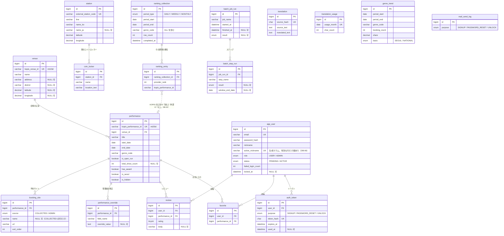
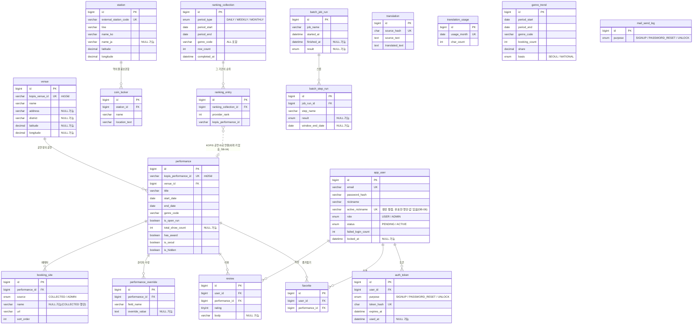

# 04. テーブル設計書

- 状態: 基本設計 承認（2026-11-06、Issue #15 コメント 6678921752）。詳細設計: **作成済み、reviewer の確認の前**（工程4、Issue #20。11. に書いた。確認2（2026-11-09 の人間の決定）を反映し、Flyway の `V1__create_schema.sql` を書いて `test_catticket` に適用できることを確かめた）
- 担当: db-designer
- 工程4（Issue #20）: 1.〜10. は基本設計の内容のまま（参照のための番号を変えない。確認2 で変わった `booking_site.name` の NULL 可・会場の住所の翻訳・表示できない公演は、該当の行にも反映した）。型・長さ・照合順序・制約・インデックスの詳細と、Issue #20 の D-01〜D-05・D-09 のうち db-designer の分は 11. に書いた。**4.・6. と 11. が違うところは 11. が正**。**11. と `backend/src/main/resources/db/migration/V1__create_schema.sql` は一致させる**
- 最終更新: 2026-11-09
- 前提: [01. 要件定義書](01-requirements.md)（F-01〜F-36、N-01〜N-08。R-62〜R-64 を反映）、[02. 画面設計書](02-screens.md)、[03. API 設計書](03-api.md)（**5. のデータ項目**、**6. の対応表**）、[05. バッチ設計書](05-batch.md)、ADR 0006〜0016（特に 0007・0008・0009・0012・0013）
- この設計書の 8. に、**要件 → テーブルの対応表**を 03 の 6. と同じ行（同じ要件 ID・同じ順番）で置く。2つの表を要件 ID で突き合わせると、要件 → 画面 → API → バッチ → テーブルの対応になる（Issue #15 コメント 6651238358 の 3.）
- `DB-xx` はこの設計書の設計判断の番号（9.）。`P-xx` は 02 の判断（人間が決定済み）
- 10.1 の Q-01〜Q-03 は解決済み（人間の決定: Issue #15 コメント 6677710885。それを受けた 03・05 の変更: コミット dc1f012）。Q-01 の決定（案 B）に合わせて DB-06 を変えた
- ゲート3 の reviewer の指摘（Issue #15 コメント 6678542365）と人間の決定（2026-11-06、コメント 6678516145）を反映した: 3. と 8. の要件 ID の一致（軽微2）、公演に結びつかない順位の行（軽微6。DB-04・10.2）。03 の 6. の変更（コミット 3d54b12）と 8. の行が一致することを確かめた

## 1. 方針

### 1.1 共通の決まり

| 項目 | 決まり |
|---|---|
| DB | MySQL 8.4。文字コードは utf8mb4。時刻は Asia/Seoul（`compose.yaml` の `TZ`）。日付の判定（「今日」）はすべて Asia/Seoul（03 の 1.1） |
| 名前 | テーブル・カラムは `snake_case`。テーブル名は単数形（`performance`、`review` など）。ユーザーだけは MySQL のシステムのテーブル `mysql.user` と紛らわしいため `app_user` とする |
| 主キー | すべて `id BIGINT AUTO_INCREMENT`。外部データの ID（KOPIS の `mt20id`・`mt10id`、駅の外部コード）は別のカラムに持ち、`UNIQUE` を付ける（取り込みの重複を防ぐ） |
| 作成・更新日時 | すべてのテーブルに `created_at DATETIME NOT NULL DEFAULT CURRENT_TIMESTAMP` と `updated_at DATETIME NOT NULL DEFAULT CURRENT_TIMESTAMP ON UPDATE CURRENT_TIMESTAMP` を付ける。追記だけの記録（メールの送信の記録、翻訳など）は、出来事の日時に `created_at` を使い、同じ意味のカラムを重ねて持たない（4. の各表に書く） |
| COMMENT | **すべてのテーブル・カラムに `COMMENT` を付ける**（`CLAUDE.md`）。内容はこの設計書の「説明」の列を基にする |
| 制約 | **外部キー・一意制約・`NOT NULL`・`CHECK` は DB でも定義する**（アプリだけに頼らない。`CLAUDE.md`）。`ON DELETE` の動きは 5. に明記する |
| 日時・日付 | 日時は `DATETIME`、日付は `DATE`。`TIMESTAMP` は使わない（2038 年の上限と、セッションのタイムゾーンによる変換を避けるため） |
| 真偽 | `BOOLEAN`（MySQL では `TINYINT(1)`）。カラム名は `is_` / `has_` で始める |
| 区分の値 | 値の種類が決まっていて変わらないもの（役割、トークンの用途など）は `ENUM` を使う。KOPIS のジャンルのように提供元が決める値は `VARCHAR` に提供元のコードをそのまま持つ（4.） |
| 座標 | `DECIMAL(9,6)`（緯度・経度。小数第6位 ≒ 0.1m）。理由は DB-12 |

### 1.2 この工程（工程3）で書く範囲

- ER 図、テーブル一覧、主なカラム（型は予定。決められるものは書く）、主キー・外部キー・一意制約・`CHECK`、主なインデックスとその理由、要件との対応。
- 型の長さの最終値、照合順序（collation）、インデックスの最終形、Flyway のマイグレーション SQL は工程4で書く（Issue #15 の「注意」）。
- 工程4 の詳細は 11.（Flyway の SQL は `V1__create_schema.sql`。11.9）。

### 1.3 テーブルにしないもの

| もの | 置き場所 | 理由 |
|---|---|---|
| ログインのセッション | アプリのメモリ（サーブレットコンテナ） | ADR 0013 決定2。Spring Session JDBC は採らない（ADR 0013「検討した選択肢」）。セッションのテーブルは作らない |
| 表示言語（F-10）・ライト表示／ダーク表示（F-36） | ブラウザ（`localStorage`） | 03 の 6. のとおり。サーバーに保存する要件はない |
| ジャンル・公演の状態・区の表示の文言 | 画面の辞書 | 03 の 1.2、ADR 0007。DB にはコード（ジャンルの KOPIS のコード、区の原文の名前）だけを持つ |
| ソウルの 25 区の一覧 | アプリの定数 | 区の判定（03 の 4.2）で照らすだけで、変わらない。ほかのデータから参照されない |
| 地図の1日の読み込み回数（ADR 0006） | Google Cloud の割り当て | アプリでは数えない（05 の 2.） |
| バッチの二重起動の防止 | MySQL の名前付きロック（`GET_LOCK`） | 05 の 1.1。テーブルを使わない |
| reCAPTCHA の検証の結果 | 保存しない | API-37 の中で検証してすぐ使う（ADR 0011） |

Flyway が作る `flyway_schema_history` は Flyway の管理用で、この設計書の対象外とする。

## 2. ER 図



- 図では `created_at`・`updated_at` を省いた（すべてのテーブルにある）。
- `translation`・`translation_usage`・`genre_trend`・`mail_send_log` はほかのテーブルと外部キーで結ばない。`translation` は原文のハッシュで引く（DB-05）。

## 3. テーブル一覧

| No. | テーブル | 役割 | 主キー | 外部キー | 一意制約 | 要件 ID | API | バッチ |
|---|---|---|---|---|---|---|---|---|
| 1 | `venue` | 会場（KOPIS の施設）。区・座標 | `id` | — | `kopis_venue_id` | F-01, F-02, F-03, F-05〜F-08, F-11, N-01 | API-01〜06, 50, 51 | B-01（S1, S4） |
| 2 | `performance` | 公演（自動収集の値）と非表示 | `id` | `venue_id` → `venue` | `kopis_performance_id` | F-01〜F-03, F-07〜F-09, F-11, F-19〜F-21, F-26, F-27, F-29, F-31〜F-33, N-01, N-04 | API-01〜03, 05, 06, 10, 11, 20, 21, 43〜45, 50〜55 | B-01（S1, S3〜S5） |
| 3 | `booking_site` | 予約サイト（1つの公演に複数）。自動収集の分と管理者が修正した分 | `id` | `performance_id` → `performance` | (`performance_id`, `source`, `sort_order`) | F-03, F-04, F-08, F-11, F-26, N-01 | API-03, 51〜53 | B-01（S1, S4） |
| 4 | `performance_override` | 管理者の修正（項目ごとに1行） | `id` | `performance_id` → `performance` | (`performance_id`, `field_name`) | F-01〜F-04, F-07, F-08, F-11, F-26, F-32, N-01, N-04 | API-01〜03, 05, 43, 50〜53 | B-01（上書きしない。S7 の翻訳の対象） |
| 5 | `station` | 駅（ソウル交通公社 1〜8号線のソウルの駅。乗り換え駅は路線ごとに1行） | `id` | — | `external_station_code`、(`line`, `name_ko`) | F-05〜F-07, F-11, N-01, N-04 | API-04, 05 | B-02 |
| 6 | `coin_locker` | コインロッカー（駅に属する） | `id` | `station_id` → `station` | — | F-06, F-07, F-11, N-01, N-04 | API-04, 05 | B-02, B-01（S7） |
| 7 | `translation` | 原文ごとの日本語の翻訳 | `id` | — | `source_hash` | F-02, F-11, N-01 | 03 の 1.2 の全 API | B-01（S7） |
| 8 | `translation_usage` | 翻訳の月（Asia/Seoul）の文字数 | `id` | — | `usage_month` | F-11, N-01, N-07 | — | B-01（S7） |
| 9 | `ranking_collection` | 人気順位の収集の完了（期間の種類・期間・ジャンルの組ごとに1行） | `id` | — | (`period_type`, `genre_code`, `period_start`) | F-03, F-29, F-33 | API-03, 20, 21 | B-01（S2） |
| 10 | `ranking_entry` | 人気順位の行（提供元が返したすべての行） | `id` | `ranking_collection_id` → `ranking_collection` | (`ranking_collection_id`, `kopis_performance_id`) | F-03, F-09, F-29, F-33 | API-03, 20, 21 | B-01（S2, S4） |
| 11 | `genre_trend` | ジャンル別トレンド（直近30日の予約数・割合・基準） | `id` | — | (`period_start`, `period_end`, `genre_code`) | F-34 | API-22 | B-01（S6） |
| 12 | `app_user` | ユーザー（一般ユーザー・管理者。認証前の申込を含む） | `id` | — | `email`（認証前の行も含む）、`active_nickname`（有効な行のニックネームだけ。DB-06）、管理者は1行だけ（DB-07） | F-12〜F-18, F-23〜F-25, N-05 | API-10, 30〜42, 55 | B-03, B-04（期限の切れた認証前の行を削除） |
| 13 | `auth_token` | メールのリンクのトークン（会員登録の認証・パスワード再設定・ロック解除） | `id` | `user_id` → `app_user` | `token_hash` | F-12, F-14, F-15, F-18, N-05 | API-33〜38 | B-04（会員登録の認証のトークンの有効期限で削除する行を決める。トークンは `app_user` の削除の CASCADE で消える） |
| 14 | `favorite` | お気に入り | `id` | `user_id` → `app_user`、`performance_id` → `performance` | (`user_id`, `performance_id`) | F-09, F-18〜F-20 | API-03, 42〜45 | — |
| 15 | `review` | レビュー（評価と本文） | `id` | `user_id` → `app_user`、`performance_id` → `performance` | (`user_id`, `performance_id`) | F-03, F-09, F-17, F-18, F-21〜F-24, F-28, F-30 | API-01, 03, 10〜13, 42, 43, 55, 56 | — |
| 16 | `mail_send_log` | メールの送信の記録（直近 24 時間の数を数える） | `id` | — | — | F-12, F-14, F-15, N-06, N-07 | API-33, 35, 37 | — |
| 17 | `batch_job_run` | バッチの実行の記録（1回の実行に1行） | `id` | — | — | F-08, F-12, N-04 | — | B-01〜B-04 |
| 18 | `batch_step_run` | バッチのステップの実行の記録 | `id` | `job_run_id` → `batch_job_run` | (`job_run_id`, `step_name`) | F-08, F-12, N-04 | — | B-01〜B-04 |

## 4. テーブルごとの主なカラム

「型（予定）」の長さは工程4で確定する（**確定した型・長さ・照合順序・制約は 11.2**。この節と違うときは 11.2 が正）。どのテーブルにも 1.1 の `id`・`created_at`・`updated_at` がある（表では、意味を持たせるときだけ書く）。

### 4.1 `venue`（会場）

| カラム | 型（予定） | NULL | 既定 | 制約 | 説明 |
|---|---|---|---|---|---|
| `kopis_venue_id` | VARCHAR | 不可 | — | UNIQUE | KOPIS の施設 ID（`mt10id`） |
| `name` | VARCHAR | 不可 | — | — | 会場名（原文） |
| `address` | VARCHAR | 可 | NULL | — | 住所（`adres`。原文）。S7 の翻訳の対象（03 の 5.1 の H-11） |
| `district` | VARCHAR | 可 | NULL | — | 区の名前（原文。例: `종로구`）。住所から決める（03 の 4.2）。決められなければ NULL |
| `latitude` | DECIMAL(9,6) | 可 | NULL | CHECK（緯度と経度は両方 NULL か両方値あり） | 緯度（`la`）。ない会場もある（P-11） |
| `longitude` | DECIMAL(9,6) | 可 | NULL | 同上 | 経度（`lo`） |

- 会場は B-01 の S1・S4 で、まだ DB にない施設だけを追加する（05 の 3.3）。削除しない。

### 4.2 `performance`（公演）

自動収集の値を持つ。管理者が修正した値は `performance_override`（4.4）に持ち、表示には「修正した値があればそれ、なければこの表の値」を使う（03 の 4.10）。

| カラム | 型（予定） | NULL | 既定 | 制約 | 説明 |
|---|---|---|---|---|---|
| `kopis_performance_id` | VARCHAR | 不可 | — | UNIQUE | KOPIS の公演 ID（`mt20id`）。画面・API の公演 ID |
| `venue_id` | BIGINT | 不可 | — | FK → `venue.id` | 会場 |
| `title` | VARCHAR | 不可 | — | — | 公演名（原文） |
| `start_date` | DATE | 不可 | — | — | 公演開始日 |
| `end_date` | DATE | 不可 | — | — | 公演終了日。終わったかどうかは照会のたびにこの日と今日で判定する（03 の 1.6） |
| `genre_code` | VARCHAR | 不可 | — | — | ジャンルの KOPIS のコード（例: `AAAA`） |
| `cast_text` | TEXT | 可 | NULL | — | 出演者（原文） |
| `ticket_price` | TEXT | 可 | NULL | — | チケット価格（原文の文） |
| `schedule_text` | TEXT | 可 | NULL | — | 公演時間の案内（原文） |
| `runtime` | VARCHAR | 可 | NULL | — | 上演時間（原文。例: `1시간 30분`） |
| `age_limit` | VARCHAR | 可 | NULL | — | 観覧年齢（原文） |
| `poster_url` | VARCHAR | 可 | NULL | — | ポスターの URL |
| `is_open_run` | BOOLEAN | 不可 | FALSE | — | オープンランかどうか（`openrun`） |
| `total_show_count` | INT | 可 | NULL | CHECK（0 以上） | 開幕からの累計の上演回数（R-49。05 の 3.6）。まだ取れていなければ NULL |
| `has_award` | BOOLEAN | 不可 | FALSE | — | 受賞歴があるか（S3 が立てるだけで消さない。05 の 3.2） |
| `is_seoul` | BOOLEAN | 不可 | — | — | ソウルの公演か（05 の 3.3 の 6.） |
| `is_hidden` | BOOLEAN | 不可 | FALSE | — | 管理者が非表示にしたか（F-27）。B-01 は書き換えない |
| `kopis_updated_at` | DATETIME | 可 | NULL | — | KOPIS の最終更新日時 |
| `collected_at` | DATETIME | 不可 | — | — | この公演を最後に収集した日時（S1・S4 が更新する。`updated_at` は非表示の切り替えでも変わるので別に持つ） |

- 公演は削除しない（F-09 ②。03 の 5.）。

### 4.3 `booking_site`（予約サイト）

| カラム | 型（予定） | NULL | 既定 | 制約 | 説明 |
|---|---|---|---|---|---|
| `performance_id` | BIGINT | 不可 | — | FK → `performance.id` | 公演 |
| `source` | ENUM(`COLLECTED`, `ADMIN`) | 不可 | — | — | 自動収集の分か、管理者が修正した分か（DB-02） |
| `name` | VARCHAR | 可（`COLLECTED` の行だけ） | NULL | CHECK（`ADMIN` の行は NULL 不可） | 予約サイトの名前（原文）。KOPIS に名前がない予約サイトは NULL（03 の 5.1 の H-10。11.2.3） |
| `url` | VARCHAR | 不可 | — | — | 予約サイトの URL |
| `sort_order` | INT | 不可 | — | UNIQUE（`performance_id`, `source`, `sort_order`） | 並び順（提供元の順。管理者の分は入力の順） |

- B-01 は `source = COLLECTED` の行だけを、その公演の分ごとに入れ替える。`ADMIN` の行は変えない（F-26 ③）。

### 4.4 `performance_override`（管理者の修正）

| カラム | 型（予定） | NULL | 既定 | 制約 | 説明 |
|---|---|---|---|---|---|
| `performance_id` | BIGINT | 不可 | — | FK → `performance.id` | 公演 |
| `field_name` | VARCHAR | 不可 | — | UNIQUE（`performance_id`, `field_name`）。CHECK（下の値だけ） | 修正した項目 |
| `override_value` | TEXT | 可 | NULL | CHECK（`field_name = 'booking_sites'` のときだけ NULL、ほかは NULL 不可） | 修正した値（文字列で持ち、型はアプリで変換する） |
| `updated_at` | DATETIME | 不可 | 1.1 | — | 修正した日時（同じ項目を修正し直すと変わる） |

- `field_name` の値（P-13 の修正できる項目と 1対1）: `title`、`start_date`、`end_date`、`genre_code`、`cast_text`、`ticket_price`、`schedule_text`、`runtime`、`age_limit`、`is_open_run`、`booking_sites`。値は `performance` のカラム名とそろえる（`booking_sites` は 4.3 の `ADMIN` の行を使うことを示す）。
- 修正を取り消す（API-53）と、その行を削除する。`booking_sites` を取り消すときは、同じトランザクションで 4.3 の `ADMIN` の行も削除する（F-26 ⑤）。
- 修正した公演名などの日本語の翻訳は、`translation`（4.7）に原文として入り、次の B-01 の S7 で作られる（03 の 4.10）。

### 4.5 `station`（駅）

| カラム | 型（予定） | NULL | 既定 | 制約 | 説明 |
|---|---|---|---|---|---|
| `external_station_code` | VARCHAR | 不可 | — | UNIQUE | 外部の駅コード（座標のファイルの「고유역번호(외부역코드)」。乗り換え駅は路線ごとに別のコード） |
| `line` | VARCHAR | 不可 | — | UNIQUE（`line`, `name_ko`） | 路線（例: `1호선`。書き方はファイルを取得して工程4で決める） |
| `name_ko` | VARCHAR | 不可 | — | 同上 | 駅名（韓国語） |
| `name_ja` | VARCHAR | 可 | NULL | — | 駅名（日本語の公式表記。ADR 0009）。ない駅は `translation` の機械翻訳を使う |
| `latitude` | DECIMAL(9,6) | 不可 | — | — | 緯度 |
| `longitude` | DECIMAL(9,6) | 不可 | — | — | 経度 |

- B-02 が1つのトランザクションで全件入れ替える（05 の 4.3）。(`line`, `name_ko`) の一意制約は、コインロッカーの「호선・보관함명」と駅の「호선・역명」の結びつけ（05 の 4.3 の 4.）で、駅が1つに決まることを保証する。

### 4.6 `coin_locker`（コインロッカー）

| カラム | 型（予定） | NULL | 既定 | 制約 | 説明 |
|---|---|---|---|---|---|
| `station_id` | BIGINT | 不可 | — | FK → `station.id` | 属する駅。距離は駅の座標で判定する（F-06 ②、U-20） |
| `name` | VARCHAR | 不可 | — | — | 保管庫の名前（ファイルの「보관함명」。原文） |
| `location_text` | VARCHAR | 不可 | — | — | 位置の文章（「상세위치」。韓国語。例: `1번 출입구 주변`） |

- 一意制約は置かない。同じ駅に位置の違う保管庫が複数あり、ファイルの「연번」は版ごとに変わるので外部の ID として使えない。全件入れ替えなので重複は起きない（05 の 4.3 の 5.）。

### 4.7 `translation`（翻訳）

| カラム | 型（予定） | NULL | 既定 | 制約 | 説明 |
|---|---|---|---|---|---|
| `source_hash` | CHAR(64) | 不可 | — | UNIQUE | 原文の SHA-256（16進）。同じ原文は1行だけ（ADR 0007 3.） |
| `source_text` | TEXT | 不可 | — | — | 原文（韓国語） |
| `translated_text` | TEXT | 不可 | — | — | 日本語の翻訳 |
| `created_at` | DATETIME | 不可 | 1.1 | — | 翻訳した日時 |

- 公演名・会場名などの翻訳は、その原文のハッシュでこの表を引く（DB-05）。翻訳がない（行がない）ときは「翻訳がない」として返す（03 の 1.2）。

### 4.8 `translation_usage`（翻訳の月の文字数）

| カラム | 型（予定） | NULL | 既定 | 制約 | 説明 |
|---|---|---|---|---|---|
| `usage_month` | DATE | 不可 | — | UNIQUE。CHECK（月の1日） | 月（Asia/Seoul の暦の月。P-09）。その月の1日の日付で持つ |
| `char_count` | INT | 不可 | 0 | CHECK（0 以上） | その月に翻訳した文字数。翻訳が成功するたびに足す（05 の 3.7） |

### 4.9 `ranking_collection`（人気順位の収集の完了）

| カラム | 型（予定） | NULL | 既定 | 制約 | 説明 |
|---|---|---|---|---|---|
| `period_type` | ENUM(`DAILY`, `WEEKLY`, `MONTHLY`) | 不可 | — | UNIQUE（`period_type`, `genre_code`, `period_start`） | 期間の種類 |
| `genre_code` | VARCHAR | 不可 | — | 同上 | ジャンルのコード。全体は `ALL`（API-20 の `genre=ALL` と同じ。NULL にしないのは一意制約を効かせるため） |
| `period_start` | DATE | 不可 | — | 同上 | 期間の初日 |
| `period_end` | DATE | 不可 | — | CHECK（`period_start` 以上） | 期間の末日（DB-09） |
| `row_count` | INT | 不可 | — | CHECK（0 以上） | 保存した行の数（提供元が 0 件なら 0） |
| `completed_at` | DATETIME | 不可 | — | — | 収集を終えた日時（その組の順位を取得した日時を兼ねる） |

- B-01 の S2 は、組ごとに、この行の追加・更新と `ranking_entry` の入れ替えを**1つのトランザクション**で行う（05 の 3.4）。照会に失敗した組は、行も記録も変えない。
- API は、期間の種類とジャンルごとに、この表で `period_end` が今日より前の行のうち `period_start` が最も新しいものを「収集が終わっている直近の期間」とする（03 の 4.9）。行の有無で判断するので、0 件の期間と未収集の期間を見分けられる。

### 4.10 `ranking_entry`（人気順位の行）

| カラム | 型（予定） | NULL | 既定 | 制約 | 説明 |
|---|---|---|---|---|---|
| `ranking_collection_id` | BIGINT | 不可 | — | FK → `ranking_collection.id` | どの組（期間の種類・期間・ジャンル）の順位か |
| `provider_rank` | INT | 不可 | — | CHECK（1 以上） | 提供元の順位（`rnum`）。非表示の公演を除いた振り直しは API で照会のたびに行う（ADR 0008 4.） |
| `kopis_performance_id` | VARCHAR | 不可 | — | UNIQUE（`ranking_collection_id`, `kopis_performance_id`） | 公演 ID（`mt20id`）。`performance` とは外部キーで結ばない（DB-04） |

- 提供元が返したすべての行を保存する（上位10位だけではない。ADR 0008 3.）。カラム名を `rank` にしないのは、MySQL 8 の予約語のため。

### 4.11 `genre_trend`（ジャンル別トレンド）

| カラム | 型（予定） | NULL | 既定 | 制約 | 説明 |
|---|---|---|---|---|---|
| `period_start` | DATE | 不可 | — | UNIQUE（`period_start`, `period_end`, `genre_code`） | 集計期間の初日（前日までの直近30日の初日） |
| `period_end` | DATE | 不可 | — | 同上。CHECK（`period_start` 以上） | 集計期間の末日（前日） |
| `genre_code` | VARCHAR | 不可 | — | 同上 | ジャンルのコード |
| `booking_count` | INT | 不可 | — | CHECK（0 以上） | 予約数 |
| `share` | DECIMAL | 不可 | — | CHECK（0〜100） | 割合（%）。S6 が計算して保存する（DB-09） |
| `basis` | ENUM(`SEOUL`, `NATIONAL`) | 不可 | — | — | 集計の基準（ソウル / 全国。R-50） |

- S6 は集計期間の組で全部入れ替える（05 の 3.2）。API-22 は `period_end` が最も新しい期間を返す。

### 4.12 `app_user`（ユーザー）

| カラム | 型（予定） | NULL | 既定 | 制約 | 説明 |
|---|---|---|---|---|---|
| `email` | VARCHAR(254) | 不可 | — | UNIQUE | メールアドレス（03 の 4.6 で 254 文字以内）。一意制約は認証前の行にも効く（同じメールアドレスの申込し直しは行の置き換え。P-10） |
| `password_hash` | VARCHAR | 不可 | — | — | パスワードのハッシュ（`DelegatingPasswordEncoder` の形。既定は bcrypt。ADR 0013 決定6） |
| `nickname` | VARCHAR(20) | 不可 | — | —（一意制約は下の `active_nickname` に置く） | ニックネーム（1〜20 文字。P-05。NFKC に正規化した値。11.2.12）。認証前の行は申込のときのニックネーム（押さえない）。管理者は画面に出ないが、NOT NULL のため B-03 で決めた値を入れる（工程4） |
| `active_nickname` | VARCHAR(20)。生成カラム（`GENERATED ALWAYS AS (CASE WHEN status = 'ACTIVE' THEN nickname END) VIRTUAL`） | 可 | （式で決まる） | UNIQUE | 有効な行のニックネーム。認証前の行は NULL。**有効なアカウントの間だけでニックネームの重複を防ぐ**（DB-06。03 の 4.7）。アプリは書き込まない（INSERT・UPDATE の列に入れない） |
| `role` | ENUM(`USER`, `ADMIN`) | 不可 | `USER` | 管理者は1行だけ（DB-07） | 役割（一般ユーザー / 管理者） |
| `status` | ENUM(`PENDING`, `ACTIVE`) | 不可 | `PENDING` | — | 状態（認証前 / 有効）。B-03 の管理者は `ACTIVE` で作る |
| `failed_login_count` | INT | 不可 | 0 | CHECK（0 以上） | 連続の失敗回数（F-14 ①②） |
| `locked_at` | DATETIME | 可 | NULL | — | ロックした日時。NULL でなければロック中（DB-08） |
| `created_at` | DATETIME | 不可 | 1.1 | — | 作成日時（会員登録の申込・置き換えの日時） |

- 退会（F-18）では行を削除する（退会した行を残さない。メールアドレス・ニックネームを再び使えるようにする。03 の 5.）。レビュー・お気に入り・トークンは外部キーで一緒に削除される（5.）。
- 認証前の申込もこの表に入れる（`status = PENDING`）。同じメールアドレスの申込し直しはこの行を置き換える（P-10）。**認証前の行はニックネームを押さえない**（人間の決定。Issue #15 コメント 6677710885 の Q-01 の B）: `active_nickname` が NULL なので、同じニックネームの認証前の行が何行あっても、有効な行と同じニックネームでも、一意制約に当たらない（MySQL の UNIQUE は NULL どうしを重複とみなさない）。
- 認証の完了（API-34）で `status` を `ACTIVE` にすると `active_nickname` に値が入り、そのときに同じニックネームの有効な行があれば一意制約の違反（エラー 1062）になる。API-34 はこれを「認証の時点でニックネームが使われている」と同じ扱い（その認証前の行を削除して 409）にする（03 の 4.7）。ニックネームの変更（API-40）も、有効な行の間でこの制約が効く。
- 認証前の行が削除されるのは、API-33 の置き換え（同じメールアドレス）、API-34 の 2.（ニックネームが使われていた）、B-04（期限の切れた行。05 の 6.）の3つ。どれもトークンは外部キーの CASCADE で一緒に消える（5.）。

### 4.13 `auth_token`（トークン）

| カラム | 型（予定） | NULL | 既定 | 制約 | 説明 |
|---|---|---|---|---|---|
| `user_id` | BIGINT | 不可 | — | FK → `app_user.id` | 対象のユーザー |
| `purpose` | ENUM(`SIGNUP`, `PASSWORD_RESET`, `UNLOCK`) | 不可 | — | — | 用途（会員登録の認証 / パスワード再設定 / ロック解除の再認証） |
| `token_hash` | CHAR(64) | 不可 | — | UNIQUE | トークンのハッシュ（SHA-256 の16進）。トークンそのものは保存しない（03 の 4.7） |
| `expires_at` | DATETIME | 不可 | — | — | 有効期限（24 時間・1 時間・1 時間。P-10） |
| `used_at` | DATETIME | 可 | NULL | — | 使った日時。NULL でなければ使用済み（1回使ったら無効） |

- B-04 は、認証前の行のうち、有効期限内の `SIGNUP` のトークンが1つもない行を削除する（05 の 6.2 の 3.）。この判定に `user_id`・`purpose`・`expires_at` を使う（6. のインデックス）。

### 4.14 `favorite`（お気に入り）

| カラム | 型（予定） | NULL | 既定 | 制約 | 説明 |
|---|---|---|---|---|---|
| `user_id` | BIGINT | 不可 | — | FK → `app_user.id`。UNIQUE（`user_id`, `performance_id`） | ユーザー |
| `performance_id` | BIGINT | 不可 | — | FK → `performance.id` | 公演（会場は登録できない。F-19 ②） |
| `created_at` | DATETIME | 不可 | 1.1 | — | 登録日時（API-43 の並び順） |

### 4.15 `review`（レビュー）

| カラム | 型（予定） | NULL | 既定 | 制約 | 説明 |
|---|---|---|---|---|---|
| `user_id` | BIGINT | 不可 | — | FK → `app_user.id`。UNIQUE（`user_id`, `performance_id`） | 投稿者（1人1公演1件。F-21 ⑤） |
| `performance_id` | BIGINT | 不可 | — | FK → `performance.id` | 公演 |
| `rating` | TINYINT | 不可 | — | CHECK（1〜5） | 評価（F-21 ③） |
| `body` | VARCHAR(1000) | 可 | NULL | — | 本文（任意。1,000 文字以内。P-05）。MySQL の `VARCHAR(n)` は文字数で数えるので、03 の 4.6（コードポイントで数える）と一致する |
| `created_at` | DATETIME | 不可 | 1.1 | — | 投稿日時（API-10・55 の並び順） |
| `updated_at` | DATETIME | 不可 | 1.1 | — | 更新日時 |

- 評価の平均・件数は保存せず、照会のたびに計算する（03 の 4.4。F-30 ③）。

### 4.16 `mail_send_log`（メールの送信の記録）

| カラム | 型（予定） | NULL | 既定 | 制約 | 説明 |
|---|---|---|---|---|---|
| `purpose` | ENUM(`SIGNUP`, `PASSWORD_RESET`, `UNLOCK`) | 不可 | — | — | 用途 |
| `created_at` | DATETIME | 不可 | 1.1 | — | 送った日時。直近 24 時間の数（03 の 4.8、P-08）はこのカラムで数える |

- 宛先・ユーザーは持たない（DB-11）。

### 4.17 `batch_job_run`（バッチの実行の記録）

| カラム | 型（予定） | NULL | 既定 | 制約 | 説明 |
|---|---|---|---|---|---|
| `job_name` | VARCHAR | 不可 | — | — | 処理の名前（`daily-collect`・`import-subway`・`create-admin`・`purge-expired-signups`。05 の 1.1） |
| `started_at` | DATETIME | 不可 | — | — | 開始日時 |
| `finished_at` | DATETIME | 可 | NULL | — | 終了日時。実行中は NULL |
| `result` | ENUM(`SUCCESS`, `PARTIAL_FAILURE`, `FAILURE`) | 可 | NULL | — | 結果（成功 / 一部失敗 / 失敗。05 の 1.1）。実行中は NULL |
| `error_message` | TEXT | 可 | NULL | — | エラーの内容 |

### 4.18 `batch_step_run`（バッチのステップの実行の記録）

| カラム | 型（予定） | NULL | 既定 | 制約 | 説明 |
|---|---|---|---|---|---|
| `job_run_id` | BIGINT | 不可 | — | FK → `batch_job_run.id`。UNIQUE（`job_run_id`, `step_name`） | どの実行のステップか |
| `step_name` | VARCHAR | 不可 | — | — | ステップ（B-01 は `S1`〜`S7`。B-02〜B-04 は1つのステップとして記録する。B-04 は削除した件数を `processed_count` に入れる） |
| `started_at` | DATETIME | 不可 | — | — | 開始日時 |
| `finished_at` | DATETIME | 可 | NULL | — | 終了日時 |
| `result` | ENUM(`SUCCESS`, `FAILURE`) | 可 | NULL | — | 結果。実行中は NULL |
| `processed_count` | INT | 可 | NULL | — | 処理した件数 |
| `summary` | TEXT | 可 | NULL | — | 件数の内訳（区を決められなかった会場の数、座標のない会場の数、取り込まなかった駅・コインロッカーの数と内容など。05 の 3.3・4.3） |
| `error_message` | TEXT | 可 | NULL | — | エラーの内容 |
| `window_end_date` | DATE | 可 | NULL | — | S1 が成功したときの収集の窓の末日（05 の 3.3 の 3.(b)・7.）。S1 以外は NULL |

- 「前回 S1 が成功した日」（`afterdate` に使う）は、`step_name = 'S1'` かつ `result = 'SUCCESS'` の最も新しい行の `started_at` の日付（Asia/Seoul）として求める（DB-10）。

## 5. 外部キーと削除の扱い

| 外部キー | ON DELETE | 理由 |
|---|---|---|
| `performance.venue_id` → `venue` | RESTRICT | 会場は削除しない。公演のある会場が消えないようにする |
| `booking_site.performance_id` → `performance` | RESTRICT | 公演は削除しない（F-09 ②）。誤って公演を削除できないようにする |
| `performance_override.performance_id` → `performance` | RESTRICT | 同上 |
| `favorite.performance_id` → `performance` | RESTRICT | 同上。お気に入り・レビューのある公演を消さない |
| `review.performance_id` → `performance` | RESTRICT | 同上 |
| `favorite.user_id` → `app_user` | **CASCADE** | 退会（行の削除）でお気に入りも一緒に削除する（F-18 ④） |
| `review.user_id` → `app_user` | **CASCADE** | 退会でレビューも一緒に削除する（F-18 ③）。評価にも含まれなくなる |
| `auth_token.user_id` → `app_user` | **CASCADE** | 退会でトークンも削除する（03 の 5.）。認証前の行の削除（API-33 の置き換え、API-34 の 2.、B-04）でもトークンを一緒に消す（03 の 4.7、05 の 6.2） |
| `coin_locker.station_id` → `station` | **CASCADE** | B-02 が駅を全件入れ替えるとき、属するコインロッカーも消す（同じトランザクションで入れ直す。05 の 4.3） |
| `ranking_entry.ranking_collection_id` → `ranking_collection` | **CASCADE** | 組の行を消すときはその順位の行も消す（S2 は組の行を更新し、順位の行を入れ替える） |
| `batch_step_run.job_run_id` → `batch_job_run` | **CASCADE** | 実行の記録を消すとき（運用で古い記録を消す場合）にステップも消す |

- ON UPDATE はすべて RESTRICT（主キーは変えない）。
- `ranking_entry` → `performance` は外部キーを置かない（DB-04）。

## 6. 主なインデックス（案）と理由

主キー・一意制約・外部キーのインデックス（MySQL が自動で作る）に加えて、次を置く。最終形は工程4で、実際のクエリ（MyBatis の XML）と合わせて決める（**工程4 で決めたものは 11.4**。この表から外したもの・変えたものも 11.4 に書いた）。

| テーブル | インデックス | 理由（どのクエリのためか） |
|---|---|---|
| `performance` | (`is_hidden`, `end_date`, `start_date`) | 公開中の公演（03 の 1.6: 非表示でない・終了日 ≥ 今日・開始日 ≤ 今日 + 180 日）の絞り込み（API-01, 02, 05, 06） |
| `performance` | (`start_date`) | API-50 の並び順（公演開始日の新しい順）、API-01 の並び順（早い順） |
| `venue` | (`district`) | 区で絞る（API-01, 02。03 の 4.1） |
| `venue` | (`latitude`, `longitude`) | 地図の範囲・周辺の候補の絞り込み（API-01, 02, 05） |
| `station` | (`latitude`, `longitude`) | 周辺の駅の候補の絞り込み（API-04, 05）。駅は約 270 行なので全件の計算でも足りるが、範囲で先に絞れるようにする |
| `ranking_entry` | (`ranking_collection_id`, `provider_rank`) | 期間・ジャンルの順位を順位の順に読む（API-20, 21） |
| `ranking_entry` | (`kopis_performance_id`) | 公演詳細で、その公演が入っている順位を探す（API-03。4.3 の人気順位） |
| `review` | (`performance_id`, `created_at`) | 公演のレビューの一覧（新しい順。API-10, 55）と評価の集計（API-01, 03, 43） |
| `favorite` | (`user_id`, `created_at`) | お気に入りの一覧（登録の新しい順。API-43） |
| `auth_token` | (`user_id`, `purpose`, `expires_at`) | 申込し直し・再設定のときに、同じユーザー・用途の古いトークンを無効にする（API-33, 35, 37）。B-04 で、認証前の行ごとに「有効期限内の `SIGNUP` のトークンがあるか」を確かめる（05 の 6.2 の 3.。末尾の `expires_at` で期限の比較までインデックスで済む） |
| `app_user` | (`status`) | B-04 で認証前（`PENDING`）の行だけを読む（05 の 6.2 の 3.）。有効な行が大半で、認証前の行は少ない見込みなので、絞り込みに効く |
| `mail_send_log` | (`created_at`) | 直近 24 時間の送信数を数える（03 の 4.8） |
| `batch_job_run` | (`job_name`, `started_at`) | 処理ごとの最新の実行を見る（運用） |
| `batch_step_run` | (`step_name`, `result`, `started_at`) | 前回 S1 が成功した日と窓の末日を求める（05 の 3.3） |

- `ranking_collection` の一意制約は (`period_type`, `genre_code`, `period_start`) の順にし、「期間の種類・ジャンルごとの最新の完了した期間」（03 の 4.9）を同じインデックスで引けるようにする。
- 空間インデックス（`POINT`・`SPATIAL`）は使わない（DB-12）。
- 申込・認証の完了・ニックネームの変更での「有効なアカウントでニックネームが使われているか」（03 の 4.7。API-33, 34, 40）は、`active_nickname` の一意制約のインデックスを `WHERE active_nickname = ?` で引く（DB-06）。
- 管理者の修正した値（4.4）を反映した値で絞る条件（期間・ジャンル・キーワード）は、`performance` のインデックスだけでは効かない。公演は数千件の規模なので、工程4で実際のクエリと実行計画を見て決める（DB-01）。

## 7. 03 の 5. のデータ項目の割り当て

| 03 の 5. のデータ | 割り当て先 |
|---|---|
| 公演 | `performance`（KOPIS の公演 ID → `kopis_performance_id`、会場 → `venue_id`、公演名 → `title`、開始日・終了日 → `start_date`・`end_date`、ジャンル → `genre_code`、出演者 → `cast_text`、チケット価格 → `ticket_price`、公演時間の案内 → `schedule_text`、上演時間 → `runtime`、観覧年齢 → `age_limit`、ポスター → `poster_url`、オープンラン → `is_open_run`、累計の上演回数 → `total_show_count`、受賞歴 → `has_award`、ソウルか → `is_seoul`、KOPIS の最終更新日時 → `kopis_updated_at`、収集した日時 → `collected_at`、非表示 → `is_hidden`） |
| 予約サイト | `booking_site`（公演 → `performance_id`、名前 → `name`、URL → `url`、並び順 → `sort_order`。自動収集か修正かを `source` で分ける。DB-02） |
| 管理者の修正 | `performance_override`（公演 → `performance_id`、項目 → `field_name`、修正した値 → `override_value`、修正した日時 → `updated_at`）。予約サイトの修正した値は `booking_site` の `ADMIN` の行 |
| 会場 | `venue`（施設 ID → `kopis_venue_id`、会場名 → `name`、住所 → `address`、区 → `district`、緯度・経度 → `latitude`・`longitude`） |
| 駅 | `station`（路線 → `line`、駅名（韓国語）→ `name_ko`、駅名（日本語の公式表記）→ `name_ja`、緯度・経度、外部の駅コード → `external_station_code`） |
| コインロッカー | `coin_locker`（駅 → `station_id`、保管庫の名前 → `name`、位置の文章 → `location_text`） |
| 翻訳 | `translation`（原文のハッシュ → `source_hash`、原文 → `source_text`、日本語の翻訳 → `translated_text`、翻訳した日時 → `created_at`） |
| 翻訳の月の文字数 | `translation_usage`（月 → `usage_month`、文字数 → `char_count`） |
| 人気順位 | `ranking_entry`（提供元の順位 → `provider_rank`、公演 ID → `kopis_performance_id`）。期間の種類・期間の初日・末日・ジャンル・取得した日時は、親の `ranking_collection`（`period_type`・`period_start`・`period_end`・`genre_code`・`completed_at`）に持つ（DB-03） |
| 人気順位の収集の完了 | `ranking_collection`（期間の種類・初日・末日・ジャンル、収集を終えた日時 → `completed_at`、件数 → `row_count`。組ごとに1行） |
| ジャンル別トレンド | `genre_trend`（集計期間 → `period_start`・`period_end`、ジャンル → `genre_code`、予約数 → `booking_count`、割合 → `share`、基準 → `basis`） |
| ユーザー | `app_user`（メールアドレス → `email`、パスワードのハッシュ → `password_hash`、ニックネーム → `nickname`、役割 → `role`、状態 → `status`、連続の失敗回数 → `failed_login_count`、ロック中か → `locked_at`、作成日時 → `created_at`）。「ニックネームの重複は有効なアカウントの間だけで禁止」は `active_nickname` の一意制約、「メールアドレスの重複は認証前の行を含めて禁止」は `email` の一意制約（DB-06） |
| トークン | `auth_token`（用途 → `purpose`、ユーザー → `user_id`、トークンのハッシュ → `token_hash`、有効期限 → `expires_at`、使った日時 → `used_at`） |
| お気に入り | `favorite`（ユーザー・公演、登録日時 → `created_at`。(`user_id`, `performance_id`) で一意） |
| レビュー | `review`（ユーザー・公演、評価 → `rating`、本文 → `body`、投稿日時 → `created_at`、更新日時 → `updated_at`。(`user_id`, `performance_id`) で一意） |
| メールの送信の記録 | `mail_send_log`（送った日時 → `created_at`、用途 → `purpose`） |
| バッチの実行の記録 | `batch_job_run`（ジョブ、開始・終了日時、結果、エラーの内容）と `batch_step_run`（ステップ、開始・終了日時、結果、件数 → `processed_count`・`summary`、エラーの内容）。前回の収集が成功した日は `batch_step_run` から求める（DB-10）。「今回の窓の末日」（03 の 5.。05 の 3.3 の 3.(b)・7.）は `batch_step_run.window_end_date` |

03 の 5. にない項目で、この設計書が持つもの:

| 項目 | 理由 |
|---|---|
| `booking_site.source` | 予約サイトの管理者の修正を、自動収集の行と分けて持つため（DB-02。03 の 4.10・P-13 の「予約サイト（名前と URL）」の修正） |
| `app_user.active_nickname` | 03 の 4.7・5. の「ニックネームの重複は有効なアカウントの間だけで禁止」を DB の一意制約で守るための生成カラム（DB-06）。値は `nickname` と `status` から決まり、新しい事実は持たない |

## 8. 要件 → テーブルの対応表

03 の 6. と同じ行（F-01〜F-36、N-01〜N-08。同じ順番）で書く。画面・API・バッチの列は 03 の 6. を見る。

| 要件 ID | テーブル | 使い方 |
|---|---|---|
| F-01 | `performance`, `venue`, `performance_override` | 公開中の公演（非表示・終了日・開始日 ≤ 今日 + 180 日・ソウル）を会場の座標ごとに数える。値は修正を反映した値 |
| F-02 | `performance`, `venue`, `performance_override`, `translation` | 期間・区（`venue.district`）・地図の範囲（会場の座標）・会場・ジャンル・状態・キーワード（日本語表示では翻訳した公演名も） |
| F-03 | `performance`, `venue`, `performance_override`, `booking_site`, `review`, `ranking_collection`, `ranking_entry` | 公演詳細の項目、評価、人気順位（4.3 の P-02）。周辺の駅・コインロッカーは F-05・F-06 の行 |
| F-04 | `booking_site`, `performance_override` | 予約サイトの名前（自動収集の行は NULL のことがある。H-10）と URL（管理者の修正があれば `ADMIN` の行） |
| F-05 | `station`, `venue` | 会場の座標と駅の座標の距離（500m 以下） |
| F-06 | `coin_locker`, `station`, `venue` | コインロッカーが属する駅の座標で距離を判定し、位置の文章を返す |
| F-07 | `performance`, `venue`, `performance_override`, `station`, `coin_locker` | 現在地から 500m 以内の公開中の公演（会場ごと）・駅・コインロッカー |
| F-08 | `performance`, `venue`, `booking_site`, `performance_override`, `batch_job_run`, `batch_step_run` | 毎日の収集で追加・更新する（修正した項目・非表示は書き換えない）。前回の成功の日と窓の末日を記録する |
| F-09 | `performance`, `ranking_entry`, `favorite`, `review` | 公演を削除しない（外部キーは RESTRICT）。終わったかは `end_date` で判定。順位・お気に入り・レビューは終わった公演も対象 |
| F-10 | — | ブラウザに記憶する（03 の 6. と同じ。1.3） |
| F-11 | `translation`, `translation_usage`, `performance`, `performance_override`, `booking_site`, `venue`, `station`, `coin_locker` | 翻訳する原文（05 の 3.7 の S7 の対象: 公演の項目・管理者の修正した値・予約サイトの名前（NULL の行は対象外）・会場名・会場の住所（03 の 5.1 の H-11）・駅名・コインロッカーの位置の文章）は各テーブルにあり、その原文のハッシュで `translation` を引く。公演名・会場名・駅名は原文も返す（②）。駅名は `station.name_ja`（公式表記）を優先。月の上限は `translation_usage` |
| F-12 | `app_user`, `auth_token`, `mail_send_log`, `batch_job_run`, `batch_step_run` | 認証前の行（`PENDING`。ニックネームは押さえない）と認証のトークン。メールの上限を数える。認証の完了で有効にし、ニックネームの重複は `active_nickname` の一意制約でも防ぐ（DB-06）。期限の切れた認証前の行は B-04 が削除し、その実行を記録する |
| F-13 | `app_user` | メールアドレス・パスワードのハッシュ・状態の確認 |
| F-14 | `app_user`, `auth_token`, `mail_send_log` | 失敗回数・ロック（`locked_at`）。ロック解除の再認証のトークンとメール |
| F-15 | `app_user`, `auth_token`, `mail_send_log` | パスワード再設定のトークンとメール。ロック解除・失敗回数の初期化 |
| F-16 | `app_user` | パスワードのハッシュの更新 |
| F-17 | `app_user`, `review` | ニックネーム（有効なアカウントの間で一意。`active_nickname`。DB-06）。レビューの投稿者として `review` から結んで表示する |
| F-18 | `app_user`, `review`, `favorite`, `auth_token` | 行の削除。外部キーの CASCADE でレビュー・お気に入り・トークンも削除する |
| F-19 | `favorite`, `performance` | (`user_id`, `performance_id`) で一意。登録・解除 |
| F-20 | `favorite`, `performance` | 自分のお気に入り（非表示を除き、終わった公演を含む） |
| F-21 | `review`, `performance` | 評価 1〜5（CHECK）、本文 1,000 文字以内、1人1公演1件（一意制約）、開始日以降（`start_date`） |
| F-22 | `review` | 自分の行の更新・削除 |
| F-23 | `review`, `app_user` | 未ログインには評価だけ、ログインしていれば本文・ニックネーム・投稿日 |
| F-24 | `app_user`, `review` | 役割（`role`）。自分のレビューかどうか（`review.user_id`） |
| F-25 | `app_user` | 管理者の行（`role = ADMIN`、1行だけ）。B-03 が作る |
| F-26 | `performance_override`, `booking_site`, `performance` | 項目ごとの修正の保存・取り消し。自動収集の値は `performance` に残る |
| F-27 | `performance` | `is_hidden`（B-01 は書き換えない） |
| F-28 | `review` | 管理者による行の削除 |
| F-29 | `ranking_collection`, `ranking_entry`, `performance` | 収集が終わっている直近の期間（R-62）の順位を、表示できない公演（非表示の公演と、`performance` に結びつかない順位の行。R-65・D-01）を除いて振り直す |
| F-30 | `review` | 評価の平均・件数を照会のたびに計算する。保存しないので、投稿・編集・削除（API-11〜13）の結果は次の照会にそのまま反映される（③） |
| F-31 | `performance` | `has_award` |
| F-32 | `performance`, `performance_override` | `is_open_run`（修正できる）、`total_show_count` |
| F-33 | `ranking_collection`, `ranking_entry`, `performance` | 現在の期間と1つ前の期間の順位を比べる。1つ前の期間の完了の記録がなければ P-17。表示できない公演は F-29 と同じく除く。上がった公演が0件なら現在の上位を返す（R-66。API-21 の `NO_RISE`。テーブルは変わらない） |
| F-34 | `genre_trend` | 最新の集計期間の割合と基準 |
| F-35 | — | ログアウト・自動ログアウトはセッション（アプリのメモリ。ADR 0013 決定2〜4）で行い、テーブルを使わない（03 の 6. と同じ。1.3。10.1 の Q-03） |
| F-36 | — | ブラウザに記憶する（03 の 6. と同じ。1.3） |
| N-01 | `translation`, `translation_usage`, `performance`, `performance_override`, `booking_site`, `venue`, `station`, `coin_locker` | F-11 と同じ |
| N-02 | — | 画面の対応（03 の 6. と同じ） |
| N-03 | — | 応答速度の目標を置かない（03 の 6. と同じ） |
| N-04 | `performance`, `performance_override`, `station`, `coin_locker`, `batch_job_run`, `batch_step_run` | 1日1回の更新（修正・非表示を保つ）、駅・コインロッカーの入れ替え、実行の記録 |
| N-05 | `app_user`, `auth_token` | ② パスワードのハッシュ、③ ロック、④ ルール（アプリで確認。03 の 4.6。R-64 の ASCII 8〜64 文字は最大 64 バイトで、ハッシュの列の長さは変わらない）、トークンのハッシュ。⑤ 自動ログアウトはセッション（テーブルなし） |
| N-06 | `mail_send_log` | ② メールの直近 24 時間の上限。① 地図の上限は Google の割り当て（テーブルなし） |
| N-07 | `translation_usage`, `mail_send_log` | 翻訳の月の上限、メールの1日の上限 |
| N-08 | — | リリース（03 の 6. と同じ） |

### 8.1 逆向きの確認（余分がないこと）

- 3. のすべてのテーブルに要件 ID がある（8. の表のどこかの行に出る）。`batch_job_run`・`batch_step_run` は F-08・N-04（収集の再実行・`afterdate`）と F-12（B-04 の実行の記録）、`ranking_collection` は F-29・F-33（R-62 の「収集が終わっている」の判断）、`mail_send_log` は N-06 ②・N-07、`translation_usage` は F-11 ①・N-07 のため。
- **3. の「要件 ID」の列とこの表は、テーブルと要件の組で一致させる**（ゲート3 の軽微2 で確かめた）。F-11・N-01 は、翻訳する原文を持つテーブル（05 の 3.7 の S7 の対象）を含める。
- 03 の 6. で「—」の要件（F-10, F-35, F-36, N-02, N-03, N-08）は、この表でも「—」。03 の 6. で「04 に記入」の要件は、この表ですべてテーブルがある（2つの表の「—」の行が一致する）。
- 03 の 6. のバッチの列の B-01〜B-04 は、3. のバッチの列のどこかに出る（B-04 は `app_user`・`auth_token`・`batch_job_run`・`batch_step_run`）。
- 要件にないデータ（例: 閲覧の履歴、検索条件の保存、通知、ログインの履歴、レビューの「いいね」）のテーブルは置いていない（X-04〜X-07）。

## 9. 設計判断（DB-xx）

| No. | 判断 | 理由 | 採らなかった案 |
|---|---|---|---|
| DB-01 | 管理者の修正は、`performance` と別のテーブル（`performance_override`）に**項目ごとに1行**で持つ | 03 の 4.10（自動収集の値と別に持ち、取り消すと消す）と 5.（項目ごと・修正した日時）にそのまま合う。B-01 は `performance` だけを書くので、修正した値を上書きする誤りが構造上起きない（F-26 ③）。修正の有無（SC-13）は行の有無で分かる | `performance` に `title_override` のような列を項目ごとに足す: 列が倍になり、項目ごとの修正日時も列が増える。値の表示はこちらが簡単だが、工程4で必要ならビューで同じことができる |
| DB-02 | 予約サイトの修正は、`booking_site` に `source`（`COLLECTED` / `ADMIN`）を持たせ、管理者の分を別の行で持つ。修正したことは `performance_override` の `booking_sites` の行で示す | 予約サイトは1つの公演に複数あり、1つの文字列に入れられない（JSON の文字列にすると型・検査が DB で効かない）。修正の印を `performance_override` に置くと、修正の有無・取り消しがほかの項目と同じ形になり、管理者が「予約サイトなし」に修正することもできる | 修正した一覧を JSON で `override_value` に入れる: DB の制約（NOT NULL・長さ）が効かない |
| DB-03 | 人気順位は「組」（`ranking_collection`）と「行」（`ranking_entry`）の2つのテーブルに分け、期間・ジャンルは組だけに持つ | 03 の 5. の「人気順位」と「人気順位の収集の完了」は、同じ組（期間の種類・期間・ジャンル）を持つ。組を1か所にすると重複がなくなり、S2 が組ごとに「行の入れ替え + 完了の記録」を1つのトランザクションで行う（05 の 3.4）形と一致する。行があるのに完了の記録がない状態が構造上起きない | 2つを別々の表にして、両方に期間・ジャンルを持つ: 同じ値を2か所に持ち、ずれるおそれがある |
| DB-04 | `ranking_entry` は公演を KOPIS の公演 ID（文字列）で持ち、`performance` への外部キーを置かない | S2 の時点では、順位に出た公演がまだ DB にないことがある（S4 で後から補う。05 の 3.2）。S4 が失敗しても順位は保存したい。`performance` に結びつかない順位の行の扱いは工程4で決める（03 の 4.9。画面に見える振る舞いが変わる場合は工程4で人間に確認する。ゲート3 の軽微6）。`performance.kopis_performance_id` の一意制約で結ぶ | 外部キーを置く: S2 の前に公演が必要になり、S2・S4 の順番と失敗の扱い（05）と合わない |
| DB-05 | 翻訳は `translation` に原文のハッシュ（SHA-256）ごとに1行で持ち、公演などのテーブルに翻訳の列を持たない | 「同じ原文は二度翻訳しない」（ADR 0007 3.）を一意制約で守れる。原文が変われば別のハッシュになり、自動で「翻訳がない」状態になる（05 の 3.3 の 4.）。管理者の修正した値・駅名・コインロッカーの位置の文章も同じ仕組みで引ける。`TEXT` の原文そのものには一意制約を付けにくいのでハッシュにする | 各テーブルに `title_ja` などの列を持つ: 列が多くなり、同じ原文の翻訳を使い回せず、原文が変わったときに翻訳を消す処理がいる |
| DB-06 | 認証前の会員登録の申込も `app_user` に `status = PENDING` で持つ。**メールアドレスの一意制約は認証前の行にも効かせ、ニックネームの一意制約は有効な行だけに効かせる**。後者は生成カラム `active_nickname`（`CASE WHEN status = 'ACTIVE' THEN nickname END`、`VIRTUAL`）に UNIQUE を付けて実現する | 人間の決定（Issue #15 コメント 6677710885 の Q-01 の B）と 03 の 4.7: 認証前の申込はニックネームを押さえず、有効なアカウントの間の重複は DB の一意制約でも防ぐ。MySQL 8.4 の UNIQUE は NULL どうしを重複とみなさないので、認証前の行（NULL）は何行でも入り、有効な行の間だけ重複が防がれる。認証の完了で `status` を変えた瞬間に制約が効くので、2つの申込がほぼ同時に有効になっても片方は失敗する（03 の 4.7 の 2. の競合）。生成カラムにした理由: ① 値の確認（API-33, 34, 40）が `WHERE active_nickname = ?` でそのインデックスを使える（式インデックスでは、問い合わせごとに同じ式を正確に書かないと使われない）、② 違反のときのキーの名前が列の名前で分かり、API-34 で 409 に変えやすい、③ `SHOW CREATE TABLE` で意図が読める。`VIRTUAL` にしたのは、値を行に保存しなくても InnoDB はセカンダリインデックスに値を持つので足りるため。メールアドレスは、同じメールアドレスの申込し直しを行の置き換えにする（P-10）ので、認証前の行も含めて一意にする | 申込を別のテーブルに持つ: 03 の 5. と合わない。テーブルが増える。／認証前の行もニックネームを押さえる（db-designer の以前の提案）: 人間が採らなかった（Q-01）。／式インデックス `UNIQUE ((CASE WHEN status = 'ACTIVE' THEN nickname END))`: 同じことができるが、上の ① ② の理由で生成カラムにした。／アプリの確認だけ: 03 の 4.7 の競合を防げず、`CLAUDE.md` に合わない |
| DB-07 | 管理者は1行だけであることを DB で保証する（`role = 'ADMIN'` のときだけ値を持つ式に一意制約を付ける。MySQL 8 の式インデックス。形は工程4） | F-25 ①（管理者アカウント1つ）を、B-03 の確認（05 の 5. の 3.）だけに頼らない | アプリの確認だけ: `CLAUDE.md` の「制約は DB でも定義する」に合わない |
| DB-08 | ロック中かどうかは `locked_at`（NULL でなければロック中）で持つ | 「ロック中かどうか」に加えて、いつロックしたかが運用の確認に使える。解除で NULL と失敗回数 0 にする | 真偽の列 `is_locked`: 日時が残らない |
| DB-09 | **正規化を崩すもの**: `ranking_collection.period_end`・`genre_trend.period_end`（初日と期間の種類から計算できる）、`genre_trend.share`（予約数から計算できる）、`genre_trend.basis`（同じ期間の行でみな同じ値） | `period_end`: 03 の 5. が初日・末日を求め、API が集計期間をそのまま返す。暦の週・月の末日の計算を SQL ごとに書かない。`share`: 05 の S6 が収集のときに計算して保存する設計。期間ごとに全部入れ替えるので、値がずれない。`basis`: S6 は1回の照会で1つの期間を取るので、同じ期間の行はいつも同じ値になる。期間の親テーブルを作るほどの利点がない | 計算で求める・親テーブルを作る |
| DB-10 | 「前回 S1 が成功した日」は列に持たず、`batch_step_run` の成功した S1 の行から求める。窓の末日は計算できないので `window_end_date` に持つ | 同じ事実を2か所に持たない。S1 が失敗したときは成功の行ができないので、05 の 3.3 の 7.（失敗したら記録を更新しない）と同じ動きになる | 状態を1行で持つテーブル: 実行の記録と同じ内容を重ねて持つ |
| DB-11 | メールの送信の記録に宛先・ユーザーを持たない | 上限の数え方（03 の 4.8）に要らない。退会したユーザーのメールアドレスを残さない（F-18） | 宛先を持つ: 個人情報が退会の後も残る |
| DB-12 | 座標は `DECIMAL(9,6)` で持ち、空間のデータ型・インデックスを使わない | 提供元の値が小数第6位（ADR 0009）で、`DECIMAL` なら丸めの誤差なしにそのまま持てる。距離はハバーサインの式で計算する（03 の 4.5）。駅は約 270 行、会場は約千行で、範囲での絞り込みは通常のインデックスで足りる | `POINT` + `SPATIAL INDEX`: SRID・軸の順番などの扱いが増え、この規模では利点が小さい。`DOUBLE`: 2進数の丸めの誤差がある |

## 10. 未決事項・ほかの設計書への申し送り

### 10.1 architect への確認（03・05 の記述）— すべて解決済み

| No. | 内容 | 関係 | 状態と 04 での扱い |
|---|---|---|---|
| Q-01 | 認証前の申込（`PENDING`）がニックネームを押さえるか。期限の切れた認証前の行をいつ消すか | 03 の 4.7、F-12 ③、P-10 | **解決**（人間の決定: Issue #15 コメント 6677710885。案 B。db-designer の提案は採らない。03 の 4.7・05 の 6. への反映: コミット dc1f012）。認証前の申込はニックネームを押さえず、認証の完了のときに有効なアカウントで使われていれば登録は失敗し、その認証前の行を削除する。期限の切れた認証前の行は B-04（`purge-expired-signups`、毎日 04:00）が削除する。04 では DB-06 を変え（`active_nickname` の一意制約）、3.・4.12・4.13・4.17・4.18・5.・6.・8. を合わせた |
| Q-02 | 05 の 3.3 の 7. が「今回の窓の末日」の記録を求めているが、03 の 5. の「バッチの実行の記録」の項目にない | 03 の 5.、05 の 3.3 | **解決**（03 の 5. に「今回の窓の末日」が足された。コミット dc1f012）。`batch_step_run.window_end_date` に持つ（7.） |
| Q-03 | 03 の 6. で F-35 のテーブルの列は「04 に記入」だが、セッションはアプリのメモリ（ADR 0013 決定2）なので、テーブルを使わない | 03 の 6.、ADR 0013 | **解決**（03 の 6. の F-35 が「—（セッションはメモリ。ADR 0013）」になった。コミット dc1f012）。8. も「—」 |

### 10.2 工程4（詳細設計）で決めること

各項目をどこで決めたか（案）は 11.8 の表に書いた。

- 型の長さ（`VARCHAR` の文字数、`share` の桁など）。KOPIS・駅のファイルの実際の値の長さを見て決める。
- **照合順序（collation）**: サーバーの既定は `utf8mb4_unicode_ci`（`compose.yaml`）。大文字・小文字やかな（ひらがな・カタカナ）、濁点の違いを同じとみなす場合がある。メールアドレス（大文字・小文字を同じとみなしてよいか）、ニックネームの一意制約（「Cat」と「cat」を同じニックネームとするか）、キーワード検索（F-02 ⑥）、ハッシュの列（`_bin` か `ascii`）について、列ごとに決める。ニックネームの扱いは利用者に見える振る舞いなので、人間の確認が要る（Issue #15 コメント 6677710885 で工程4へ送られた）。一意制約は `active_nickname`（生成カラム）に付くので、その照合順序を `nickname` と同じに明示する。
- DB-07（管理者は1行だけ）も DB-06 と同じく生成カラム + UNIQUE にするか、式インデックスにするか。
- 管理者の修正を反映した値を読む方法（ビューにするか、クエリごとに結ぶか）と、その値で絞るときのインデックス（DB-01・6.）。
- `ranking_entry` の一意制約を (`ranking_collection_id`, `provider_rank`) にも付けるか（`boxoffice` が同じ順位を複数返すことがあるかを、ADR 0008 の「注意点」の確認で見る）。
- **`performance` に結びつかない順位の行**（S4 が失敗した・まだ補っていない公演）の扱い（03 の 4.9、DB-04）。F-29 ⑤⑧（提供元のデータのまま、非表示の公演だけを除いて振り直す）との関係を見て決める。画面に見える振る舞い（順位の番号・件数）が変わる場合は、工程4で人間に確認する（ゲート3 の軽微6。人間の決定: Issue #15 コメント 6678516145）。テーブルの形（DB-04）は変わらない。
- `station.line` の値の書き方、`coin_locker` の結びつけの規則（05 の 4.4。ファイルを取得して決める）。
- 管理者の `nickname` に入れる値（B-03。画面には出ない）。
- 古い記録（`mail_send_log`、`batch_*`、有効なアカウントの使った・期限の切れた `auth_token`）を消すかどうか。消す機能は要件にないので、今は消さない（量は小さい）。期限の切れた認証前の行とそのトークンは B-04 が消す（05 の 6.）。
- B-04 と認証の完了（API-34）が期限の直前に同時に動いたときの行のロックの取り方（05 の 6.3。06 で決める。テーブルの形は変わらない）。

## 11. 詳細設計（工程4、Issue #20）

- **状態: 作成済み、reviewer の確認の前**。確認2（2026-11-09 の人間の決定。11.6）を反映した。この節の定義から Flyway の `backend/src/main/resources/db/migration/V1__create_schema.sql` を書き、`./gradlew test` で `test_catticket` に適用されることを確かめた（11.9）。
- 前提: 03 の 5.1（H-01〜H-11）・7.・8.・9.（D-01 は決定・D-05・D-06・D-07・D-09）・9.6、01 の R-65・R-66、05 の 3.3 の 9.・3.7、Issue #20 コメント 6679098450（D-02 の人間の決定: ニックネームの大文字・小文字は同じとみなす）と確認2 の決定（D-01 は 03 の 9.1 の案 (a)、D-02 は案 A + NFKC、名前のない予約サイト、会場の住所の翻訳）。
- 確認2 で決まったことは 11.6 に記録した。
- 新しいテーブル・列は足していない（03 の 5.1 のとおり。確認2 の決定でも要らなかった）。足したのは、管理者が1行だけであることを守る生成列 `app_user.admin_singleton`（D-04。値は `role` から決まり、新しい事実を持たない）と、ビュー `performance_effective`（D-09。テーブルではない）だけ。

### 11.1 共通の決まり（詳細）

| 項目 | 決まり |
|---|---|
| エンジン・文字コード | すべて `ENGINE=InnoDB DEFAULT CHARSET=utf8mb4 COLLATE=utf8mb4_0900_as_ci`。**テーブルごとに明示し、サーバーの既定（`compose.yaml` の `utf8mb4_unicode_ci`）に頼らない**（理由は 11.5 の D-03） |
| 照合順序 | 次の2つだけを使う。① **表の既定 `utf8mb4_0900_as_ci`**: 人が読む文（メールアドレス、ニックネーム、公演名、会場名、翻訳など）と、それと比べる・結ぶコード（ジャンルのコード）。② **`utf8mb4_bin`**: 機械の値（KOPIS の ID、外部の駅コード、ハッシュ、`performance_override.field_name`）。11.2 の「照合」の列が「既定」なら ①、`bin` なら ② を列に明示する |
| 主キー | `id BIGINT NOT NULL AUTO_INCREMENT` + `PRIMARY KEY (id)`。COMMENT は `'ID'` |
| 作成・更新日時 | `created_at DATETIME NOT NULL DEFAULT CURRENT_TIMESTAMP COMMENT '作成日時'`、`updated_at DATETIME NOT NULL DEFAULT CURRENT_TIMESTAMP ON UPDATE CURRENT_TIMESTAMP COMMENT '更新日時'`。意味を持たせる表（4.）では COMMENT をその意味にする（11.2 に書いた）。秒まで（小数の秒は持たない。API も秒まで。03 の 7.2） |
| 時刻のタイムゾーン | `DATETIME` はタイムゾーンを持たない。DB の `CURRENT_TIMESTAMP` は接続のタイムゾーンで決まるので、アプリの接続とサーバーを Asia/Seoul にそろえる（接続の設定は 06。11.7 の A-05） |
| 真偽 | `BOOLEAN`（= `TINYINT(1)`）`NOT NULL` |
| 生成列 | `VIRTUAL`。アプリは INSERT・UPDATE の列に入れず、API にも返さない（一意制約のためだけの列） |
| 名前 | 一意制約 `uk_{テーブル}_{内容}`、インデックス `idx_{テーブル}_{内容}`、外部キー `fk_{テーブル}_{参照先}`、CHECK `chk_{テーブル}_{内容}`。**CHECK と外部キーの名前はスキーマの中で一意でなければならない**ので、必ずテーブル名から始める（MySQL 8.4 公式「CHECK Constraints」、確認日 2026-11-06） |
| 外部キーと CHECK | MySQL は、`ON DELETE`・`ON UPDATE` の動きを持つ外部キーの列に CHECK を付けられない（公式。同上）。そのため外部キーの列（`*_id`）には CHECK を付けない |
| ON UPDATE | 外部キーはすべて `ON UPDATE RESTRICT`（主キーは変えない。5.） |
| マイグレーション | 1つ目のファイル `V1__create_schema.sql` に、外部キーの参照の順（`venue` → `performance` → …）で全テーブル（18）とビュー（1）を作る（書いた。2026-11-09）。1つのファイルにしたのは、最初のスキーマはまとめて1度だけ適用し、途中までの状態に意味がないため（MySQL の DDL はトランザクションで戻せないので、失敗したら Flyway の履歴が失敗になり、DB を作り直して直す）。**適用した後はこのファイルを編集しない**。変更は `V2__…` から新しいファイルで行う |

### 11.2 テーブル定義

表の列: 「照合」は文字列の列の照合順序（既定 = `utf8mb4_0900_as_ci`、bin = `utf8mb4_bin`）。「COMMENT」は列の `COMMENT` に入れる文（日本語）。すべての表に 11.1 の `id`・`created_at`・`updated_at` がある（意味を持たせるものだけ表に書く）。

#### 11.2.1 `venue` — COMMENT '会場（KOPIS の施設）'

| 列 | 型 | NULL | 既定 | 照合 | 制約 | COMMENT |
|---|---|---|---|---|---|---|
| `kopis_venue_id` | VARCHAR(20) | 不可 | — | bin | `uk_venue_kopis_venue_id` | KOPIS の施設 ID（mt10id） |
| `name` | VARCHAR(200) | 不可 | — | 既定 | — | 会場名（原文） |
| `address` | VARCHAR(500) | 可 | NULL | 既定 | — | 住所（原文） |
| `district` | VARCHAR(10) | 可 | NULL | 既定 | — | 区の名前（原文。例: 종로구）。決められなければ NULL |
| `latitude` | DECIMAL(9,6) | 可 | NULL | — | 下の CHECK | 緯度 |
| `longitude` | DECIMAL(9,6) | 可 | NULL | — | 下の CHECK | 経度 |

- CHECK: `chk_venue_location_pair` `((latitude IS NULL) = (longitude IS NULL))`、`chk_venue_latitude_range` `(latitude BETWEEN -90 AND 90)`、`chk_venue_longitude_range` `(longitude BETWEEN -180 AND 180)`（NULL は CHECK を通る）。
- インデックス: `idx_venue_district` (`district`)、`idx_venue_location` (`latitude`, `longitude`)。

#### 11.2.2 `performance` — COMMENT '公演（自動収集の値と非表示）'

| 列 | 型 | NULL | 既定 | 照合 | 制約 | COMMENT |
|---|---|---|---|---|---|---|
| `kopis_performance_id` | VARCHAR(20) | 不可 | — | bin | `uk_performance_kopis_performance_id` | KOPIS の公演 ID（mt20id） |
| `venue_id` | BIGINT | 不可 | — | — | `fk_performance_venue` → `venue(id)` ON DELETE RESTRICT | 会場 |
| `title` | VARCHAR(500) | 不可 | — | 既定 | — | 公演名（原文） |
| `start_date` | DATE | 不可 | — | — | — | 公演開始日 |
| `end_date` | DATE | 不可 | — | — | — | 公演終了日 |
| `genre_code` | VARCHAR(10) | 不可 | — | 既定 | — | ジャンルの KOPIS のコード |
| `cast_text` | TEXT | 可 | NULL | 既定 | — | 出演者（原文） |
| `ticket_price` | TEXT | 可 | NULL | 既定 | — | チケット価格（原文） |
| `schedule_text` | TEXT | 可 | NULL | 既定 | — | 公演時間の案内（原文） |
| `runtime` | VARCHAR(200) | 可 | NULL | 既定 | — | 上演時間（原文） |
| `age_limit` | VARCHAR(200) | 可 | NULL | 既定 | — | 観覧年齢（原文） |
| `poster_url` | VARCHAR(2000) | 可 | NULL | 既定 | — | ポスターの URL |
| `is_open_run` | BOOLEAN | 不可 | FALSE | — | — | オープンランか |
| `total_show_count` | INT | 可 | NULL | — | `chk_performance_total_show_count` (`total_show_count >= 0`) | 開幕からの累計の上演回数 |
| `has_award` | BOOLEAN | 不可 | FALSE | — | — | 受賞歴があるか |
| `is_seoul` | BOOLEAN | 不可 | （なし） | — | — | ソウルの公演か |
| `is_hidden` | BOOLEAN | 不可 | FALSE | — | — | 管理者が非表示にしたか |
| `kopis_updated_at` | DATETIME | 可 | NULL | — | — | KOPIS の最終更新日時 |
| `collected_at` | DATETIME | 不可 | — | — | — | 最後に収集した日時 |

- インデックス: `idx_performance_venue_id` (`venue_id`。外部キー用。名前を付けて明示する)。ほかは置かない（11.4 の「外したもの」）。
- 自動収集の公演開始日・終了日に CHECK（開始日 ≤ 終了日）を置かない。提供元の値をそのまま持つ表で、提供元の誤りがあるとその公演の保存（S1）がすべて失敗するため。修正を反映した期間の順は API-52・53 が確かめる（03 の 8.8）。
- `genre_code` を `bin` にしないのは、ビュー（11.3）で `performance_override.override_value`（既定）と1つの式にまとめ、`ranking_collection.genre_code` と比べるため（照合順序をそろえないと、式の照合順序が混ざる）。値は API がアプリの定数の一覧で確かめる（03 の 8.1）。

#### 11.2.3 `booking_site` — COMMENT '予約サイト'

| 列 | 型 | NULL | 既定 | 照合 | 制約 | COMMENT |
|---|---|---|---|---|---|---|
| `performance_id` | BIGINT | 不可 | — | — | `fk_booking_site_performance` → `performance(id)` ON DELETE RESTRICT | 公演 |
| `source` | ENUM('COLLECTED','ADMIN') | 不可 | — | — | — | 自動収集の分か管理者の修正の分か |
| `name` | VARCHAR(200) | 可 | NULL | 既定 | 下の CHECK | 予約サイトの名前（原文）。自動収集で名前がなければ NULL（管理者の行は必須） |
| `url` | VARCHAR(2000) | 不可 | — | 既定 | 下の CHECK | 予約サイトの URL |
| `sort_order` | INT | 不可 | — | — | `chk_booking_site_sort_order` (`sort_order >= 1`) | 並び順（1 から） |

- 一意制約: `uk_booking_site_performance_source_order` (`performance_id`, `source`, `sort_order`)。外部キーのインデックスを兼ねる。API-03 の読み方（`source` を決めて `sort_order` の順）もこれで引く。
- 長さ: 管理者の入力の上限（名前 100、URL 2,000。03 の 8.8）以上。
- **名前のない予約サイト**（決定: Issue #20 の確認2、2026-11-09。03 の 5.1 の H-10、05 の 3.3 の 9.）: KOPIS の `relatenm` が空・ない予約サイトは `name` を NULL で保存する。CHECK:
  - `chk_booking_site_admin_name` `(source = 'COLLECTED' OR name IS NOT NULL)`: NULL にできるのは自動収集の行だけ。管理者の行（`ADMIN`）は名前が必須（03 の 8.8）で、API-52 の確認に加えて DB でも守る。**置くことにした**理由: 03 が `ADMIN` の名前を必須としていて、`ADMIN` の行の NULL は API-52 の誤りでしか起きない。DB で止めれば、画面に名前のない管理者の予約サイトが出る誤りを防げる。`source` と `name` は同じ行の列で、外部キーの列ではないので CHECK にできる（11.1）。
  - `chk_booking_site_name_not_empty` `(name IS NULL OR CHAR_LENGTH(name) >= 1)`: 名前なしは NULL だけで表す（空文字を入れない。05 の 3.3 の 9. は前後の空白を除いて0文字なら NULL にする）。「NULL か空文字か」の2通りを読む側で扱わないで済む。
  - `chk_booking_site_url_not_empty` `(CHAR_LENGTH(url) >= 1)`: URL が空・ない予約サイトは保存しない（05 の 3.3 の 9.）。
- 05 の 3.3 の 9. の「URL がなく保存しなかった数」は、S1 の実行の記録の `batch_step_run.summary`（件数の内訳。11.2.18）に書く。新しい列は要らない（区を決められなかった会場の数・座標のない会場の数と同じ扱い。05 の 3.3 の 5.）。
- 名前が NULL の予約サイトは S7 の翻訳の対象にしない（05 の 3.7）。`translation` には何も入らない。

#### 11.2.4 `performance_override` — COMMENT '管理者の修正（項目ごとに1行）'

| 列 | 型 | NULL | 既定 | 照合 | 制約 | COMMENT |
|---|---|---|---|---|---|---|
| `performance_id` | BIGINT | 不可 | — | — | `fk_performance_override_performance` → `performance(id)` ON DELETE RESTRICT | 公演 |
| `field_name` | VARCHAR(30) | 不可 | — | bin | 下の CHECK | 修正した項目（performance の列名。booking_sites は予約サイト） |
| `override_value` | TEXT | 可 | NULL | 既定 | 下の CHECK | 修正した値（文字列。日付は YYYY-MM-DD、真偽は true/false） |
| `updated_at` | DATETIME | 不可 | 11.1 | — | — | 修正した日時（COMMENT は「修正した日時」） |

- 一意制約: `uk_performance_override_performance_field` (`performance_id`, `field_name`)。外部キーのインデックスを兼ね、ビュー（11.3）の結合をこの一意制約の1行の読み込みにする。
- CHECK:
  - `chk_performance_override_field_name`: `field_name IN ('title','start_date','end_date','genre_code','cast_text','ticket_price','schedule_text','runtime','age_limit','is_open_run','booking_sites')`
  - `chk_performance_override_value_null`: `((field_name = 'booking_sites') = (override_value IS NULL))`
  - `chk_performance_override_date_format`: `(field_name NOT IN ('start_date','end_date') OR override_value REGEXP '^[0-9]{4}-[0-9]{2}-[0-9]{2}$')`
  - `chk_performance_override_bool_format`: `(field_name <> 'is_open_run' OR override_value COLLATE utf8mb4_bin IN ('true','false'))`
  - 理由: ビュー（11.3）が日付・真偽に変換するので、変換できない値が入らないようにする。暦にない日付（`2026-02-30`）は API-52 が確かめる。
- `override_value` の照合順序は `performance` の文の列と同じ（既定）にする。ビューで「修正した値があればそれ、なければ自動収集の値」を1つの式にするとき、照合順序が違うとエラー（照合順序の混在）になるため。
- 長さ（公演名 200 など。03 の 8.8）は API-52 が確かめ、DB では `TEXT` のまま（03 の 5.1 の H-02）。

#### 11.2.5 `station` — COMMENT '駅（ソウル交通公社 1〜8号線のソウルの駅。乗り換え駅は路線ごとに1行）'

| 列 | 型 | NULL | 既定 | 照合 | 制約 | COMMENT |
|---|---|---|---|---|---|---|
| `external_station_code` | VARCHAR(20) | 不可 | — | bin | `uk_station_external_station_code` | 外部の駅コード（고유역번호(외부역코드)） |
| `line` | TINYINT | 不可 | — | — | `chk_station_line` (`line BETWEEN 1 AND 8`) | 路線（1〜8） |
| `name_ko` | VARCHAR(50) | 不可 | — | 既定 | — | 駅名（韓国語） |
| `name_ja` | VARCHAR(100) | 可 | NULL | 既定 | — | 駅名（日本語の公式表記） |
| `latitude` | DECIMAL(9,6) | 不可 | — | — | `chk_station_latitude_range` | 緯度 |
| `longitude` | DECIMAL(9,6) | 不可 | — | — | `chk_station_longitude_range` | 経度 |

- 一意制約: `uk_station_line_name_ko` (`line`, `name_ko`)。インデックス: `idx_station_location` (`latitude`, `longitude`)。
- `line` を整数にした理由は 11.5 の D-09。

#### 11.2.6 `coin_locker` — COMMENT 'コインロッカー（駅に属する）'

| 列 | 型 | NULL | 既定 | 照合 | 制約 | COMMENT |
|---|---|---|---|---|---|---|
| `station_id` | BIGINT | 不可 | — | — | `fk_coin_locker_station` → `station(id)` ON DELETE CASCADE | 属する駅 |
| `name` | VARCHAR(200) | 不可 | — | 既定 | — | 保管庫の名前（보관함명。原文） |
| `location_text` | VARCHAR(500) | 不可 | — | 既定 | — | 位置の文章（상세위치。韓国語） |

- インデックス: `idx_coin_locker_station_id` (`station_id`。外部キー用)。

#### 11.2.7 `translation` — COMMENT '原文ごとの日本語の翻訳'

| 列 | 型 | NULL | 既定 | 照合 | 制約 | COMMENT |
|---|---|---|---|---|---|---|
| `source_hash` | CHAR(64) | 不可 | — | bin | `uk_translation_source_hash`、`chk_translation_source_hash_format` (`source_hash REGEXP '^[0-9a-f]{64}$'`) | 原文の SHA-256（小文字の16進） |
| `source_text` | TEXT | 不可 | — | 既定 | — | 原文（韓国語） |
| `translated_text` | TEXT | 不可 | — | 既定 | — | 日本語の翻訳 |
| `created_at` | DATETIME | 不可 | 11.1 | — | — | 翻訳した日時 |

- **ハッシュの決まり**: 原文（表示する文。管理者の修正があれば修正した値）の UTF-8 のバイト列の SHA-256 を、**小文字の16進 64 文字**にしたもの。前後の空白を除く・正規化するなどの加工をしない。MySQL の `SHA2(文, 256)`（接続の文字コード utf8mb4 のバイト列で計算し、小文字の16進を返す）と同じ値になるので、日本語のキーワード検索（11.3）で SQL の中から引ける。

#### 11.2.8 `translation_usage` — COMMENT '翻訳の月（Asia/Seoul）の文字数'

| 列 | 型 | NULL | 既定 | 照合 | 制約 | COMMENT |
|---|---|---|---|---|---|---|
| `usage_month` | DATE | 不可 | — | — | `uk_translation_usage_usage_month`、`chk_translation_usage_month_first_day` (`DAYOFMONTH(usage_month) = 1`) | 月（その月の1日） |
| `char_count` | INT | 不可 | 0 | — | `chk_translation_usage_char_count` (`char_count >= 0`) | その月に翻訳した文字数 |

#### 11.2.9 `ranking_collection` — COMMENT '人気順位の収集の完了（期間の種類・期間・ジャンルの組ごとに1行）'

| 列 | 型 | NULL | 既定 | 照合 | 制約 | COMMENT |
|---|---|---|---|---|---|---|
| `period_type` | ENUM('DAILY','WEEKLY','MONTHLY') | 不可 | — | — | 一意制約 | 期間の種類 |
| `genre_code` | VARCHAR(10) | 不可 | — | 既定 | 一意制約 | ジャンルのコード（全体は ALL） |
| `period_start` | DATE | 不可 | — | — | 一意制約 | 期間の初日 |
| `period_end` | DATE | 不可 | — | — | 下の CHECK | 期間の末日 |
| `row_count` | INT | 不可 | — | — | `chk_ranking_collection_row_count` (`row_count >= 0`) | 保存した行の数 |
| `completed_at` | DATETIME | 不可 | — | — | — | 収集を終えた日時 |

- 一意制約: `uk_ranking_collection_type_genre_start` (`period_type`, `genre_code`, `period_start`)。
- CHECK `chk_ranking_collection_period_shape`: 期間の形（05 の 2.。暦の日・週（月〜日）・月）
  ```sql
  CHECK (
    (period_type = 'DAILY'   AND period_end = period_start) OR
    (period_type = 'WEEKLY'  AND DAYOFWEEK(period_start) = 2 AND period_end = period_start + INTERVAL 6 DAY) OR
    (period_type = 'MONTHLY' AND DAYOFMONTH(period_start) = 1 AND period_end = LAST_DAY(period_start))
  )
  ```
  （`DAYOFWEEK` の 2 は月曜日。どれも決定的な関数なので CHECK に使える。DB-09 の `period_end` を持つ非正規化が、初日とずれないことを DB で守る）

#### 11.2.10 `ranking_entry` — COMMENT '人気順位の行（提供元が返したすべての行）'

| 列 | 型 | NULL | 既定 | 照合 | 制約 | COMMENT |
|---|---|---|---|---|---|---|
| `ranking_collection_id` | BIGINT | 不可 | — | — | `fk_ranking_entry_collection` → `ranking_collection(id)` ON DELETE CASCADE | どの組の順位か |
| `provider_rank` | INT | 不可 | — | — | `chk_ranking_entry_provider_rank` (`provider_rank >= 1`) | 提供元の順位（rnum） |
| `kopis_performance_id` | VARCHAR(20) | 不可 | — | bin | — | 公演 ID（mt20id）。performance とは外部キーで結ばない |

- 一意制約: `uk_ranking_entry_collection_performance` (`ranking_collection_id`, `kopis_performance_id`)。外部キーのインデックスを兼ねる。
- インデックス: `idx_ranking_entry_collection_rank` (`ranking_collection_id`, `provider_rank`, `kopis_performance_id`)。
- (`ranking_collection_id`, `provider_rank`) の一意制約は置かない（11.5 の D-09）。外部キーを `performance` に置かない（DB-04、11.5 の D-01）。

#### 11.2.11 `genre_trend` — COMMENT 'ジャンル別トレンド（直近30日）'

| 列 | 型 | NULL | 既定 | 照合 | 制約 | COMMENT |
|---|---|---|---|---|---|---|
| `period_start` | DATE | 不可 | — | — | 一意制約 | 集計期間の初日 |
| `period_end` | DATE | 不可 | — | — | 一意制約、`chk_genre_trend_period` (`period_end >= period_start`) | 集計期間の末日 |
| `genre_code` | VARCHAR(10) | 不可 | — | 既定 | 一意制約 | ジャンルのコード |
| `booking_count` | INT | 不可 | — | — | `chk_genre_trend_booking_count` (`booking_count >= 0`) | 予約数 |
| `share` | DECIMAL(9,6) | 不可 | — | — | `chk_genre_trend_share` (`share BETWEEN 0 AND 100`) | 割合（%） |
| `basis` | ENUM('SEOUL','NATIONAL') | 不可 | — | — | — | 集計の基準（ソウル / 全国） |

- 一意制約: `uk_genre_trend_end_start_genre` (`period_end`, `period_start`, `genre_code`)。列の順を基本設計（4.11）から変え、`period_end` を先頭にした。API-22 の「`period_end` が最も新しい期間」をこのインデックスで引くため（11.4）。
- `share` の桁は 11.5 の D-09。

#### 11.2.12 `app_user` — COMMENT 'ユーザー（一般ユーザー・管理者。認証前の申込を含む）'

| 列 | 型 | NULL | 既定 | 照合 | 制約 | COMMENT |
|---|---|---|---|---|---|---|
| `email` | VARCHAR(254) | 不可 | — | 既定 | `uk_app_user_email` | メールアドレス |
| `password_hash` | VARCHAR(255) | 不可 | — | bin | — | パスワードのハッシュ（DelegatingPasswordEncoder の形） |
| `nickname` | VARCHAR(20) | 不可 | — | `utf8mb4_0900_as_ci`（表の既定と同じ。明示する） | `chk_app_user_nickname_length` (`CHAR_LENGTH(nickname) >= 1`) | ニックネーム（NFKC に正規化し前後の空白を除いた値。表示もこの値） |
| `role` | ENUM('USER','ADMIN') | 不可 | 'USER' | — | — | 役割 |
| `status` | ENUM('PENDING','ACTIVE') | 不可 | 'PENDING' | — | — | 状態（認証前 / 有効） |
| `active_nickname` | VARCHAR(20)。`GENERATED ALWAYS AS (CASE WHEN status = 'ACTIVE' THEN nickname END) VIRTUAL` | 可 | （式） | `utf8mb4_0900_as_ci`（`nickname` と同じものを明示する） | `uk_app_user_active_nickname` | 有効な行のニックネーム（一意制約のための生成列） |
| `admin_singleton` | TINYINT。`GENERATED ALWAYS AS (CASE WHEN role = 'ADMIN' THEN 1 END) VIRTUAL` | 可 | （式） | — | `uk_app_user_admin_singleton` | 管理者の行だけ 1（管理者を1行にする生成列） |
| `failed_login_count` | INT | 不可 | 0 | — | `chk_app_user_failed_login_count` (`failed_login_count >= 0`) | 連続のログインの失敗回数 |
| `locked_at` | DATETIME | 可 | NULL | — | — | ロックした日時（NULL でなければロック中） |
| `created_at` | DATETIME | 不可 | 11.1 | — | — | 作成日時（申込・置き換えの日時） |

- CHECK `chk_app_user_admin_active`: `(role <> 'ADMIN' OR status = 'ACTIVE')`（管理者はいつも有効。05 の 5. の 5.）。
- インデックス: `idx_app_user_status` (`status`)。
- `password_hash` の長さ: 既定の bcrypt は `{bcrypt}` + 60 文字 = 68 文字。`DelegatingPasswordEncoder` で方式を変えたとき（ADR 0013 決定6）も入るよう 255 にした。
- `nickname`・`active_nickname` の照合順序は `utf8mb4_0900_as_ci`（決定: Issue #20 の確認2、2026-11-09。11.5 の D-02 の案 A）。表の既定と同じだが、一意制約の比べ方を決める列なので SQL で明示する。
- `nickname` の長さ 20 は、NFKC に正規化し前後の空白を除いた後のコードポイントの数（03 の 7.1・5.1 の H-02）。NFKC で文字数が増えても（`㍿` → `株式会社`）、API が正規化の後に数えるので列に収まる。

#### 11.2.13 `auth_token` — COMMENT 'メールのリンクのトークン'

| 列 | 型 | NULL | 既定 | 照合 | 制約 | COMMENT |
|---|---|---|---|---|---|---|
| `user_id` | BIGINT | 不可 | — | — | `fk_auth_token_user` → `app_user(id)` ON DELETE CASCADE | 対象のユーザー |
| `purpose` | ENUM('SIGNUP','PASSWORD_RESET','UNLOCK') | 不可 | — | — | — | 用途 |
| `token_hash` | CHAR(64) | 不可 | — | bin | `uk_auth_token_token_hash`、`chk_auth_token_token_hash_format` (`token_hash REGEXP '^[0-9a-f]{64}$'`) | トークンの SHA-256（小文字の16進） |
| `expires_at` | DATETIME | 不可 | — | — | — | 有効期限 |
| `used_at` | DATETIME | 可 | NULL | — | — | 使った日時（NULL でなければ使用済み） |

- インデックス: `idx_auth_token_user_purpose_expires` (`user_id`, `purpose`, `expires_at`)。外部キーのインデックスを兼ねる（先頭が `user_id`）。
- トークンのハッシュは、43 文字のトークン（03 の 7.6）の ASCII のバイト列の SHA-256 を小文字の16進にしたもの。

#### 11.2.14 `favorite` — COMMENT 'お気に入り'

| 列 | 型 | NULL | 既定 | 照合 | 制約 | COMMENT |
|---|---|---|---|---|---|---|
| `user_id` | BIGINT | 不可 | — | — | `fk_favorite_user` → `app_user(id)` ON DELETE CASCADE | ユーザー |
| `performance_id` | BIGINT | 不可 | — | — | `fk_favorite_performance` → `performance(id)` ON DELETE RESTRICT | 公演 |
| `created_at` | DATETIME | 不可 | 11.1 | — | — | 登録日時 |

- 一意制約: `uk_favorite_user_performance` (`user_id`, `performance_id`)。インデックス: `idx_favorite_user_created` (`user_id`, `created_at`)、`idx_favorite_performance_id` (`performance_id`。外部キー用)。

#### 11.2.15 `review` — COMMENT 'レビュー'

| 列 | 型 | NULL | 既定 | 照合 | 制約 | COMMENT |
|---|---|---|---|---|---|---|
| `user_id` | BIGINT | 不可 | — | — | `fk_review_user` → `app_user(id)` ON DELETE CASCADE | 投稿者 |
| `performance_id` | BIGINT | 不可 | — | — | `fk_review_performance` → `performance(id)` ON DELETE RESTRICT | 公演 |
| `rating` | TINYINT | 不可 | — | — | `chk_review_rating` (`rating BETWEEN 1 AND 5`) | 評価（1〜5） |
| `body` | VARCHAR(1000) | 可 | NULL | 既定 | `chk_review_body` (`body IS NULL OR CHAR_LENGTH(body) >= 1`) | 本文（なければ NULL） |
| `created_at` | DATETIME | 不可 | 11.1 | — | — | 投稿日時 |
| `updated_at` | DATETIME | 不可 | 11.1 | — | — | 更新日時 |

- 一意制約: `uk_review_user_performance` (`user_id`, `performance_id`)。インデックス: `idx_review_performance_created` (`performance_id`, `created_at`)。
- 本文なし（`null`・空・空白だけ。03 の API-11）は NULL で持つ。空文字を入れないことを CHECK で守る（空白だけかの判定は Unicode の空白なのでアプリで行う）。

#### 11.2.16 `mail_send_log` — COMMENT 'メールの送信の記録'

| 列 | 型 | NULL | 既定 | 照合 | 制約 | COMMENT |
|---|---|---|---|---|---|---|
| `purpose` | ENUM('SIGNUP','PASSWORD_RESET','UNLOCK') | 不可 | — | — | — | 用途 |
| `created_at` | DATETIME | 不可 | 11.1 | — | — | 送った日時 |

- インデックス: `idx_mail_send_log_created` (`created_at`)。

#### 11.2.17 `batch_job_run` — COMMENT 'バッチの実行の記録'

| 列 | 型 | NULL | 既定 | 照合 | 制約 | COMMENT |
|---|---|---|---|---|---|---|
| `job_name` | VARCHAR(50) | 不可 | — | 既定 | — | 処理の名前（daily-collect など） |
| `started_at` | DATETIME | 不可 | — | — | — | 開始日時 |
| `finished_at` | DATETIME | 可 | NULL | — | 下の CHECK | 終了日時 |
| `result` | ENUM('SUCCESS','PARTIAL_FAILURE','FAILURE') | 可 | NULL | — | 下の CHECK | 結果 |
| `error_message` | TEXT | 可 | NULL | 既定 | — | エラーの内容 |

- CHECK `chk_batch_job_run_finished`: `((finished_at IS NULL) = (result IS NULL))`（終わったら結果がある）。
- インデックス: `idx_batch_job_run_name_started` (`job_name`, `started_at`)。

#### 11.2.18 `batch_step_run` — COMMENT 'バッチのステップの実行の記録'

| 列 | 型 | NULL | 既定 | 照合 | 制約 | COMMENT |
|---|---|---|---|---|---|---|
| `job_run_id` | BIGINT | 不可 | — | — | `fk_batch_step_run_job_run` → `batch_job_run(id)` ON DELETE CASCADE | どの実行のステップか |
| `step_name` | VARCHAR(50) | 不可 | — | 既定 | 一意制約 | ステップ（S1〜S7 など） |
| `started_at` | DATETIME | 不可 | — | — | — | 開始日時 |
| `finished_at` | DATETIME | 可 | NULL | — | 下の CHECK | 終了日時 |
| `result` | ENUM('SUCCESS','FAILURE') | 可 | NULL | — | 下の CHECK | 結果 |
| `processed_count` | INT | 可 | NULL | — | `chk_batch_step_run_processed_count` (`processed_count >= 0`) | 処理した件数 |
| `summary` | TEXT | 可 | NULL | 既定 | — | 件数の内訳 |
| `error_message` | TEXT | 可 | NULL | 既定 | — | エラーの内容 |
| `window_end_date` | DATE | 可 | NULL | — | 下の CHECK | S1 が成功したときの収集の窓の末日 |

- 一意制約: `uk_batch_step_run_job_step` (`job_run_id`, `step_name`)。外部キーのインデックスを兼ねる。インデックス: `idx_batch_step_run_step_result_started` (`step_name`, `result`, `started_at`)。
- CHECK: `chk_batch_step_run_finished` `((finished_at IS NULL) = (result IS NULL))`、`chk_batch_step_run_window` `(window_end_date IS NULL OR (step_name = 'S1' AND result = 'SUCCESS'))`。
- `summary` には、05 が「記録に残す」とする件数を書く（S1: 区を決められなかった会場の数・座標のない会場の数・URL がなく保存しなかった予約サイトの数（05 の 3.3 の 5.・9.）、B-02: 取り込まなかった駅・コインロッカーの数と内容（05 の 4.3）など）。書き方（文の形）は 05・06 で決める。件数ごとの列は置かない（種類がステップごとに違い、API が読まない運用の記録のため）。

### 11.3 ビュー `performance_effective`（管理者の修正を反映した公演の値。D-09・03 の 5.1 の H-01）

一般ユーザー向けの API が使う「修正を反映した値」（03 の 9.5）を1か所で定義する。API-01〜03・05・06・20・21・43・50 と、API-11 の開始日の確認が読む（要件: F-01〜F-03、F-07、F-20、F-21、F-26、F-29、F-33。03 の 9.5 の表）。

```sql
CREATE ALGORITHM = MERGE SQL SECURITY INVOKER VIEW performance_effective AS
SELECT
  p.id,
  p.kopis_performance_id,
  p.venue_id,
  CASE WHEN o_title.id   IS NULL THEN p.title         ELSE o_title.override_value                  END AS title,
  CASE WHEN o_start.id   IS NULL THEN p.start_date    ELSE CAST(o_start.override_value AS DATE)    END AS start_date,
  CASE WHEN o_end.id     IS NULL THEN p.end_date      ELSE CAST(o_end.override_value AS DATE)      END AS end_date,
  CASE WHEN o_genre.id   IS NULL THEN p.genre_code    ELSE o_genre.override_value                  END AS genre_code,
  CASE WHEN o_cast.id    IS NULL THEN p.cast_text     ELSE o_cast.override_value                   END AS cast_text,
  CASE WHEN o_price.id   IS NULL THEN p.ticket_price  ELSE o_price.override_value                  END AS ticket_price,
  CASE WHEN o_sched.id   IS NULL THEN p.schedule_text ELSE o_sched.override_value                  END AS schedule_text,
  CASE WHEN o_run.id     IS NULL THEN p.runtime       ELSE o_run.override_value                    END AS runtime,
  CASE WHEN o_age.id     IS NULL THEN p.age_limit     ELSE o_age.override_value                    END AS age_limit,
  CASE WHEN o_open.id    IS NULL THEN p.is_open_run   ELSE (o_open.override_value = 'true')        END AS is_open_run,
  (o_sites.id IS NOT NULL) AS has_booking_site_override,
  p.poster_url, p.total_show_count, p.has_award, p.is_seoul, p.is_hidden
FROM performance p
LEFT JOIN performance_override o_title ON o_title.performance_id = p.id AND o_title.field_name = 'title'
LEFT JOIN performance_override o_start ON o_start.performance_id = p.id AND o_start.field_name = 'start_date'
LEFT JOIN performance_override o_end   ON o_end.performance_id   = p.id AND o_end.field_name   = 'end_date'
LEFT JOIN performance_override o_genre ON o_genre.performance_id = p.id AND o_genre.field_name = 'genre_code'
LEFT JOIN performance_override o_cast  ON o_cast.performance_id  = p.id AND o_cast.field_name  = 'cast_text'
LEFT JOIN performance_override o_price ON o_price.performance_id = p.id AND o_price.field_name = 'ticket_price'
LEFT JOIN performance_override o_sched ON o_sched.performance_id = p.id AND o_sched.field_name = 'schedule_text'
LEFT JOIN performance_override o_run   ON o_run.performance_id   = p.id AND o_run.field_name   = 'runtime'
LEFT JOIN performance_override o_age   ON o_age.performance_id   = p.id AND o_age.field_name   = 'age_limit'
LEFT JOIN performance_override o_open  ON o_open.performance_id  = p.id AND o_open.field_name  = 'is_open_run'
LEFT JOIN performance_override o_sites ON o_sites.performance_id = p.id AND o_sites.field_name = 'booking_sites';
```

- **`ALGORITHM = MERGE`**: ビューを読む SQL にビューの定義が展開され、外側の `WHERE`・`ORDER BY`・`LIMIT` と一緒に最適化される。各 `LEFT JOIN` は一意制約 `uk_performance_override_performance_field` の1行の読み込みになる。集約（`GROUP BY`・`MAX` など）・`DISTINCT`・**select の中のサブクエリ**があると MERGE にならず一時テーブルになる（MySQL 8.4 公式「Optimizing Derived Tables, View References, and Common Table Expressions」、確認日 2026-11-06）。そのため、項目を行から列に変える方法（`MAX(CASE …) GROUP BY`）や、項目ごとのサブクエリにはしない。
- **`SQL SECURITY INVOKER`**: 読む人の権限で動かす。環境（開発・テスト・本番）で DB のユーザー名が違っても、作ったユーザー（DEFINER）が要らない。
- ビューには `COMMENT` を付けられない（MySQL の `CREATE VIEW` に COMMENT の句がない）ので、説明はこの設計書と SQL の中のコメント（`--`）に書く。
- 予約サイトは、`has_booking_site_override` が真なら `booking_site` の `ADMIN` の行、偽なら `COLLECTED` の行を `sort_order` の順で読む（API-03。DB-02）。
- API-50 の `hasOverride`（修正が1つ以上あるか）はビューに入れない（select の中のサブクエリになり MERGE にならないため）。API-50 の SQL で `EXISTS (SELECT 1 FROM performance_override o WHERE o.performance_id = pe.id)` とする。
- API-51・52・53（管理者が自動収集の値と修正した値を別々に見る・書く）はビューを使わず、`performance`・`performance_override`・`booking_site` を直接読む・書く。B-01 はビューを使わない（`performance` だけを書く。F-26 ③）。
- **日本語のキーワード（F-02 ⑥）**: `LEFT JOIN translation t ON t.source_hash = SHA2(pe.title, 256)` で、修正を反映した公演名の翻訳を引き、`(pe.title LIKE ? OR t.translated_text LIKE ?)` とする（03 の 8.1 の API-01）。`source_hash`（`utf8mb4_bin`）と `SHA2()` の結果（接続の文字コード utf8mb4）は同じ文字コードなので、列の側が変換されず、一意制約のインデックスで引ける（MySQL 8.4 公式「Collation Coercibility in Expressions」・「Encryption and Compression Functions」、確認日 2026-11-06）。実際に引けることは工程5で `EXPLAIN` で確かめる。

### 11.4 インデックス（最終）

主キー（`PRIMARY`）のほかに置くもの。外部キーの列は、先頭がその列のインデックスがあればそれを使い（MySQL は新しく作らない）、なければ `idx_{テーブル}_{列}` を明示して作る。

| テーブル | 名前 | 列 | 種類 | 理由（どのクエリのためか） |
|---|---|---|---|---|
| `venue` | `uk_venue_kopis_venue_id` | `kopis_venue_id` | UNIQUE | 取り込みの重複の防止。API-01・04 の会場 ID |
| `venue` | `idx_venue_district` | `district` | INDEX | 区で絞る（API-01・02） |
| `venue` | `idx_venue_location` | `latitude`, `longitude` | INDEX | 地図の範囲・周辺の候補（API-01・02・05） |
| `performance` | `uk_performance_kopis_performance_id` | `kopis_performance_id` | UNIQUE | 取り込みの重複の防止。API の公演 ID。順位の行との結合（D-01） |
| `performance` | `idx_performance_venue_id` | `venue_id` | INDEX | 外部キー。会場の公演（API-01 の `venueId`・API-05） |
| `booking_site` | `uk_booking_site_performance_source_order` | `performance_id`, `source`, `sort_order` | UNIQUE | 外部キーを兼ねる。公演の予約サイトを並び順に読む（API-03・51） |
| `performance_override` | `uk_performance_override_performance_field` | `performance_id`, `field_name` | UNIQUE | 外部キーを兼ねる。ビューの結合（11.3）。API-50 の `EXISTS` |
| `station` | `uk_station_external_station_code` | `external_station_code` | UNIQUE | 取り込みの重複の防止 |
| `station` | `uk_station_line_name_ko` | `line`, `name_ko` | UNIQUE | コインロッカーの結びつけで駅が1つに決まる（05 の 4.3） |
| `station` | `idx_station_location` | `latitude`, `longitude` | INDEX | 周辺の駅の候補（API-04・05） |
| `coin_locker` | `idx_coin_locker_station_id` | `station_id` | INDEX | 外部キー。駅のコインロッカー（API-04・05） |
| `translation` | `uk_translation_source_hash` | `source_hash` | UNIQUE | 原文の翻訳を引く（1.2 の全 API、11.3）。同じ原文を二度翻訳しない（S7） |
| `translation_usage` | `uk_translation_usage_usage_month` | `usage_month` | UNIQUE | 月の文字数（S7） |
| `ranking_collection` | `uk_ranking_collection_type_genre_start` | `period_type`, `genre_code`, `period_start` | UNIQUE | 組の重複の防止。「期間の種類・ジャンルごとの、`period_end` が今日より前で `period_start` が最も新しい行」（03 の 4.9）を後ろから読む。直前の期間を初日で引く（API-21） |
| `ranking_entry` | `uk_ranking_entry_collection_performance` | `ranking_collection_id`, `kopis_performance_id` | UNIQUE | 外部キーを兼ねる。同じ組に同じ公演を二重に入れない |
| `ranking_entry` | `idx_ranking_entry_collection_rank` | `ranking_collection_id`, `provider_rank`, `kopis_performance_id` | INDEX | 組の順位を「提供元の順位 → 公演 ID」の順（03 の 9.1）に読む（API-03・20・21）。並べ替えをしないで済む |
| `genre_trend` | `uk_genre_trend_end_start_genre` | `period_end`, `period_start`, `genre_code` | UNIQUE | S6 の入れ替え。API-22 の最新の期間（`MAX(period_end)` と、その期間の行） |
| `app_user` | `uk_app_user_email` | `email` | UNIQUE | メールアドレスの重複の防止（認証前の行も）。ログイン・申込・再設定の検索（API-31・33・35・37） |
| `app_user` | `uk_app_user_active_nickname` | `active_nickname` | UNIQUE | 有効な行の間のニックネームの重複の防止と確認（API-33・34・40。DB-06） |
| `app_user` | `uk_app_user_admin_singleton` | `admin_singleton` | UNIQUE | 管理者は1行だけ（DB-07、D-04） |
| `app_user` | `idx_app_user_status` | `status` | INDEX | B-04 の候補（認証前の行）を読む（03 の 9.2、D-05） |
| `auth_token` | `uk_auth_token_token_hash` | `token_hash` | UNIQUE | トークンで引く（API-34・36・38）。`FOR UPDATE` でその1行だけをロックする（D-05） |
| `auth_token` | `idx_auth_token_user_purpose_expires` | `user_id`, `purpose`, `expires_at` | INDEX | 外部キーを兼ねる。古いトークンを使用済みにする（03 の 7.6）。B-04 の「有効期限内の `SIGNUP` がない」（インデックスだけで判定できる。D-05） |
| `favorite` | `uk_favorite_user_performance` | `user_id`, `performance_id` | UNIQUE | 外部キー（`user_id`）を兼ねる。重複の防止（API-44）。API-03 の `isFavorite` |
| `favorite` | `idx_favorite_user_created` | `user_id`, `created_at` | INDEX | お気に入りの一覧（登録の新しい順 → ID の大きい順。API-43。InnoDB のインデックスは末尾に主キーを持つので ID の順もこれで済む） |
| `favorite` | `idx_favorite_performance_id` | `performance_id` | INDEX | 外部キー |
| `review` | `uk_review_user_performance` | `user_id`, `performance_id` | UNIQUE | 外部キー（`user_id`）を兼ねる。1人1公演1件（API-11）。API-03 の自分のレビュー |
| `review` | `idx_review_performance_created` | `performance_id`, `created_at` | INDEX | 外部キー（`performance_id`）を兼ねる。レビューの一覧（新しい順 → ID の大きい順。API-10・55）、評価の合計と件数（API-01・03・43） |
| `mail_send_log` | `idx_mail_send_log_created` | `created_at` | INDEX | 直近 24 時間の数（03 の 4.8） |
| `batch_job_run` | `idx_batch_job_run_name_started` | `job_name`, `started_at` | INDEX | 処理ごとの最新の実行（運用） |
| `batch_step_run` | `uk_batch_step_run_job_step` | `job_run_id`, `step_name` | UNIQUE | 外部キーを兼ねる |
| `batch_step_run` | `idx_batch_step_run_step_result_started` | `step_name`, `result`, `started_at` | INDEX | 前回 S1 が成功した日と窓の末日（05 の 3.3） |

**基本設計（6.）から外したもの・変えたもの**

| もの | 扱い | 理由 |
|---|---|---|
| `performance` (`is_hidden`, `end_date`, `start_date`)、(`start_date`) | **外した** | 公開中の条件・期間・並び順は**修正を反映した値**（ビューの式）で判断するので（03 の 9.5）、`performance` の列のインデックスは使われない。式は別の表の値を含むので、式インデックスにもできない。公演は数千件の規模（ADR 0007・0008。削除しないので年に数千件ずつ増える）で、全件を読んでもビューの結合は1行ずつ一意制約で引くので、応答の目標を置かない（N-03）この規模では足りる。遅いと分かったら、修正を反映した値を `performance` に別の列として持ち（API-52・53・B-01 が更新）インデックスを置く方法を考える（その時は 9. に DB-xx を足す） |
| `ranking_entry` (`kopis_performance_id`) | **外した** | API-03 の順位（4.3）は、組ごとに非表示・結びつかない行を除いて振り直してから、その公演が 10 位以内かを見る（03 の 9.1）。組の上位を読むので `idx_ranking_entry_collection_rank` を使い、公演 ID から引く場面がない |
| `ranking_entry` (`ranking_collection_id`, `provider_rank`) | **`kopis_performance_id` を足した** | 03 の 9.1 の並び順（同じ提供元の順位は公演 ID の順）をインデックスの順で読む |
| `genre_trend` の一意制約 | **列の順を変えた**（`period_end` を先頭） | API-22 の最新の期間 |
| `auth_token`、`favorite`、`review` などの外部キー | 新しいインデックスを作らない | 先頭がその列の一意制約・インデックスで足りる |

### 11.5 Issue #20 の決定事項（db-designer の分）

#### D-01 公演に結びつかない順位の行（決定: 03 の 9.1 の案 (a)。Issue #20 の確認2、2026-11-09）

- **決定**: DB-04 のまま。`ranking_entry` から `performance` への外部キーは置かない。結びつかない行も保存し、消さない（S4 が後で公演を補えば、次の照会から結びつく）。読むときは `performance_effective`（11.3）と `kopis_performance_id` で INNER JOIN し、結びつかない行と非表示の公演を除いてから振り直す（03 の 9.1）。結合は `uk_performance_kopis_performance_id` の1行の読み込みになる。
- 結びつかない行を消す・印を付ける列は置かない（S4 が補った時点で自然に結びつくので、状態を持つと S4 と二重の管理になる）。
- 画面の振る舞い: 03 の 9.1 の案 (a) に決まった（非表示の公演と結びつかない順位の行をまとめて「表示できない公演」として除き、下の順位を繰り上げる。01 の F-29 ⑧・R-65）。テーブルの形は案のときから変わらない。
- 人気急上昇で上がった公演が0件のとき（01 の F-33 ⑪・R-66。API-21 の `NO_RISE`・`movement = NONE`）は、同じ順位の行の読み方で決まる API の応答の形で、テーブル・列・インデックスは変わらない（確かめた: 現在の期間の振り直した上位は `idx_ranking_entry_collection_rank` で読み、直前の期間と比べるだけ）。

#### D-02 ニックネームの比べ方（決定: 案 A `utf8mb4_0900_as_ci` + NFKC。Issue #20 の確認2、2026-11-09）

**決定**: 照合順序は案 A（`utf8mb4_0900_as_ci`）。保存の前の正規化は **NFKC**（03 の 7.1。人間の決定。04 の案の NFC から変わった）。`nickname`・`active_nickname` を `utf8mb4_0900_as_ci` にする（11.2.12）。新しい列は要らない。

**比べ方の仕組み**: API はニックネームを **NFKC に正規化 → 前後の空白を除く → …**（03 の 7.1）の順に処理し、**正規化した値を保存する。表示も正規化した形**（入力したとおりの形では残さない。例: `Ｃａｔ` を入れると `Cat` と保存・表示される。03 の API-40）。大文字・小文字とひらがな・カタカナは NFKC でも変わらない（`Cat` は `Cat`、`ねこ` は `ねこ` のまま保存・表示）。同じかどうかは `active_nickname` の一意制約で、**その列の照合順序**で比べる。照合順序は保存する値を変えない。

**NFKC と照合順序の分担**: NFKC は保存する値をそろえる。分解されたハングルと合成済みの形、`e` + 結合アクセントと `é` に加えて、全角・半角の英数字とカナ（`Ｃａｔ` → `Cat`、`ﾈｺ` → `ネコ`）、ハングルの互換字母（`ㅋ` U+314B → `ᄏ` U+110F）、`①` → `1`、`㍿` → `株式会社` なども1つの形にする。照合順序 `utf8mb4_0900_as_ci` は、NFKC でそろわない**大文字・小文字、ひらがな・カタカナ、小書きのかな**を同じとみなし、濁点・半濁点・アクセントを区別する。全角・半角は NFKC と照合順序の両方で同じになる（どちらか一方でも結果は同じ）。下の表の「案 A」の列は、NFKC にしても変わらない（NFKC で同じ値になる組は、照合順序でももともと同じ）。

**MySQL の照合順序の比べ方**（UCA 9.0.0 の重みは3段: 1段目が文字、2段目がアクセント・濁点、3段目が大文字・小文字・全角半角・ひらがなとカタカナ・小書き）:

| 照合順序 | 比べる段 | 大文字・小文字 | 全角・半角 | ひらがな・カタカナ | 濁点・半濁点 | アクセント |
|---|---|---|---|---|---|---|
| `utf8mb4_0900_ai_ci` | 1段目 | 同じ | 同じ | 同じ | **同じ** | **同じ** |
| `utf8mb4_0900_as_ci` | 1・2段目 | 同じ | 同じ | 同じ | 区別 | 区別 |
| `utf8mb4_0900_as_cs` / `utf8mb4_0900_bin` | 1〜3段目 / 符号 | **区別** | 区別 | 区別 | 区別 | 区別 |
| `utf8mb4_ja_0900_as_cs` / `_ks` | 1〜3 / 1〜4段目 | **区別** | 区別 | 同じ / 区別 | 区別 | 区別 |
| `utf8mb4_unicode_ci`（サーバーの既定。UCA 4.0.0） | 1段目 | 同じ | 同じ | 同じ | **同じ** | **同じ**。さらに**絵文字など補助面の文字がすべて同じ**とみなされる |

- `_cs`（大文字・小文字を区別）のものは、人間の決定（「Cat」と「cat」は重複）に合わないので候補から外す。MySQL 8.4 の日本語の照合順序は `utf8mb4_ja_0900_as_cs` と `_ks` だけで、どちらも大文字・小文字を区別する。
- `utf8mb4_unicode_ci` は、補助面の文字（絵文字、まれな漢字）がすべて同じ重みになり、「🐱」と「🐶」が同じニックネームとみなされるので使わない（どの列にも使わない。D-03）。

**選択肢**（確認2 のときの比較。判断の記録として残す。例は、ある有効なアカウントが左の名前を使っているときに、右の名前で登録・変更できるか。「重複」は 409。正規化は当時の NFC の前提）

| 例 | 案 A（推奨）`utf8mb4_0900_as_ci` | 案 B `utf8mb4_0900_ai_ci` | 案 C 大文字・小文字だけ同じ | 案 D 全角・半角と大文字・小文字を同じ（かなは区別） |
|---|---|---|---|---|
| `Cat` / `cat` | 重複 | 重複 | 重複 | 重複 |
| `Cat` / `Ｃａｔ`（全角） | 重複 | 重複 | 登録できる | 重複 |
| `ネコ` / `ﾈｺ`（半角カタカナ） | 重複 | 重複 | 登録できる | 重複 |
| `ねこ` / `ネコ` | 重複 | 重複 | 登録できる | 登録できる |
| `ファン` / `フアン`（小書きの「ァ」） | **重複** | 重複 | 登録できる | 登録できる |
| `ハハ` / `パパ`（濁点・半濁点） | 登録できる | **重複** | 登録できる | 登録できる |
| `café` / `cafe` | 登録できる | **重複** | 登録できる | 登録できる |
| `고양이` / `고양이`（分解された形で入力） | 重複（NFC で同じ値） | 重複 | 重複 | 重複 |
| `고양이` / `꼬양이`、`高` / `髙` | 登録できる | 登録できる | 登録できる | 登録できる |
| `ㅋㅋ`（互換字母）/ `ᄏᄏ`（結合字母） | 重複 | 重複 | 登録できる | 重複 |
| `🐱` / `🐶` | 登録できる | 登録できる | 登録できる | 登録できる |
| 作り方 | `nickname`・`active_nickname` を `utf8mb4_0900_as_ci` に（11.2.12 のまま） | 2つの列を `utf8mb4_0900_ai_ci` に | `active_nickname` を `CASE WHEN status = 'ACTIVE' THEN LOWER(nickname) END`、照合順序 `utf8mb4_bin` に | アプリが NFKC + 小文字にした値を新しい列 `nickname_key`（`utf8mb4_bin`。NFKC で文字が増えるので VARCHAR(360)）に書き、`active_nickname` をその列から作る |
| 影響 | 新しい列・アプリの処理なし | 同左 | 同左（`LOWER()` は Unicode の大文字・小文字の対応。全角の `Ｃ` は全角の `ｃ` になる） | **列を足し、03 の 7.1・5.1 の H-09 の変更が要る**（API が比べるための値を作る） |

- **案 A に決まった**（確認2）。推奨の理由: ① 人間の決定の目的（似た名前による混同やなりすましを防ぐ）に、全角・半角（`Cat`/`Ｃａｔ`、`ネコ`/`ﾈｺ`）と、ひらがな・カタカナ（同じ読み）の違いも当たる。② 濁点・アクセントは区別するので、`ハハ`/`パパ` や `café`/`cafe` のような別の言葉は別の名前として使える（案 B はこれも重複にしてしまう）。③ MySQL の照合順序だけで済み、新しい列・アプリの処理・03 の変更が要らない。④ キーワード検索（D-03）と同じ照合順序なので、比べ方がサービスの中でそろう。
- 案 A の副作用: 小書きのかな（`ァ`・`ッ` など）と普通のかなが同じになる（`ファン`/`フアン`、`ハッピー`/`ハツピー` が重複）。どちらかがすでにあると、もう一方は使えない。
- ハングル・漢字への影響: どの案でも、違う字は違う名前のまま（ハングルの音節・漢字は1段目で区別される）。ハングルの互換字母（`ㅋ` U+314B）と結合字母（`ᄏ` U+110F）は3段目の違いなので、案 A・B・D では同じ、案 C では別。字体の違う漢字（`高`/`髙`）は別の文字なので、どの案でも別。
- 画面の振る舞い: 02 の文言は変わらない。違いは「このニックネームは使われています」（409。SC-05・SC-06・SC-12）が出る組み合わせだけ。API-40 で自分の名前を同じとみなされる名前（`ねこ` → `ネコ` など）に変えるのは、どの案でも自分との重複にならず、表示だけが変わる（03 の 8.6）。

**実機での確認（2026-11-09、確認済み。11.7 の A-08 は解消）**

- 実行 Claude が MySQL 8.4 のコンテナで `SELECT a = b COLLATE utf8mb4_0900_as_ci` を実行した結果:
  - **等しい（1）**: `Cat`/`cat`、`Cat`/`Ｃａｔ`、`ネコ`/`ﾈｺ`、`ねこ`/`ネコ`、`ファン`/`フアン`、`catticket-admin`/`CATTICKET-ADMIN`
  - **異なる（0）**: `ハハ`/`パパ`、`café`/`cafe`、`고양이`/`고양희`、`高`/`髙`、`😺`/`😸`
  - 下の公式の資料からの予想（上の表の案 A の列）と一致した。
- db-designer も、V1 を適用した `test_catticket` で、ROLLBACK するトランザクションの中で `app_user` に行を入れて確かめた（11.9）: 有効な `Cat` があると有効な `cat` は `uk_app_user_active_nickname` の違反（1062）、認証前の `cat` は入り、それを有効にすると 1062。`ハハ` と `パパ`、`😺` と `😸` は両方入る。管理者 `catticket-admin` があると `CATTICKET-ADMIN` は 1062。

**確かめた方法と根拠（確認2 の前。確認日 2026-11-06）**

- このときは `docker compose ps db` で MySQL が起動していなかった（コンテナがない）。また `scripts/db-inspect.sh` は `SHOW TABLES`・`SHOW CREATE TABLE`・Flyway の履歴だけを実行する（任意の `SELECT` で比べられない）。そのため、実機では確かめず、次の公式の資料で確かめた（実機の結果は上）。
  - MySQL 8.4 Reference Manual「12.10.1 Unicode Character Sets」: `utf8mb4_0900_ai_ci` は UCA 9.0.0 に基づく。日本語は `utf8mb4_ja_0900_as_cs`・`_ks` だけで、どちらも大文字・小文字とアクセントを区別し、`_ks` だけがひらがな・カタカナを区別する。UCA 4.0.0 の照合順序（`utf8mb4_unicode_ci`）では補助面の文字がすべて同じ重み（0xFFFD）。0900 の照合順序は NO PAD（末尾の空白も比べる）。https://dev.mysql.com/doc/refman/8.4/en/charset-unicode-sets.html
  - 同「12.3.1 Collation Naming Conventions」: `_ai`・`_as`・`_ci`・`_cs`・`_ks` の意味。https://dev.mysql.com/doc/refman/8.4/en/charset-collation-names.html
  - Unicode「allkeys.txt」UCA 9.0.0（DUCET）: `a`/`A`/`ａ`/`Ａ`、`あ`/`ア`/`ｱ`/`ぁ`/`ァ` は1・2段目が同じで3段目だけが違う。`が`・`ば`・`ぱ` は清音に2段目の重み（濁点 0037・半濁点 0038）を足したもの。`é` は `e` に2段目の重み（0024）を足したもの。`ㄱ`（U+3131）と `ᄀ`（U+1100）は3段目だけが違う。`🐱`・`🐶` は1段目が違う。https://www.unicode.org/Public/UCA/9.0.0/allkeys.txt
- 確認2 の後、SQL を確定する前に、MySQL 8.4 の実機で確かめる予定だった SQL（上の「実機での確認」で確かめた）:
  ```sql
  SELECT 'Cat' = 'cat' COLLATE utf8mb4_0900_as_ci,      -- 1
         'Cat' = 'Ｃａｔ' COLLATE utf8mb4_0900_as_ci,    -- 1
         'ねこ' = 'ネコ' COLLATE utf8mb4_0900_as_ci,     -- 1
         'ネコ' = 'ﾈｺ' COLLATE utf8mb4_0900_as_ci,       -- 1
         'ファン' = 'フアン' COLLATE utf8mb4_0900_as_ci,  -- 1
         'ハハ' = 'パパ' COLLATE utf8mb4_0900_as_ci,     -- 0
         'café' = 'cafe' COLLATE utf8mb4_0900_as_ci,    -- 0
         '🐱' = '🐶' COLLATE utf8mb4_0900_as_ci,         -- 0
         '🐱' = '🐶' COLLATE utf8mb4_unicode_ci;         -- 1
  ```

#### D-03 列ごとの照合順序

| 列 | 照合順序 | 理由 |
|---|---|---|
| `app_user.email` | `utf8mb4_0900_as_ci` | 03 の 5.1 の H-09: `A@example.com` と `a@example.com` を同じアカウントにする（大文字・小文字を同じに）。アクセントは区別する（`é` と `e` は別のアドレス）。全角の英字も同じになるが、全角のアドレスはメールが届かないので困らない。ログイン・申込・再設定（API-31・33・35・37）も同じ比べ方になる |
| `app_user.nickname`・`active_nickname` | `utf8mb4_0900_as_ci`（D-02 の案 A。決定: 確認2、2026-11-09） | D-02。保存する値は NFKC に正規化した値（03 の 7.1） |
| キーワード検索の対象: `performance.title`、`performance_override.override_value`、`translation.translated_text`、`venue.name` | `utf8mb4_0900_as_ci` | F-02 ⑥・API-06・API-50 の「含む」（`LIKE`）で、大文字・小文字・全角半角・ひらがなとカタカナの違いを気にせず探せる（例: `lang=ja` で「おぺら」と入れて「オペラ座の怪人」が出る、`mamma` で `MAMMA MIA!` が出る）。濁点・アクセントは区別する（「ハ」で「パ」を含む公演名を出さない）。注意: `LIKE` は1文字ずつ比べるので、`=` と結果が違うことがある（MySQL 8.4 公式「String Comparison Functions and Operators」。例: 半角の「ﾊﾟ」は2文字なので、`LIKE` では「パ」に当たらない） |
| そのほかの人が読む文（住所、出演者、駅名、コインロッカー、ジャンルのコードなど） | `utf8mb4_0900_as_ci`（表の既定） | 1つの照合順序にそろえ、ビュー（11.3）などで照合順序が混ざるエラーを起こさない |
| 機械の値: `kopis_venue_id`、`kopis_performance_id`（2表）、`external_station_code`、`token_hash`、`source_hash`、`password_hash`、`performance_override.field_name` | `utf8mb4_bin` | 符号のとおりに比べる（大文字・小文字の違う ID を同じとみなさない）。比べるのが速い。`ranking_entry` と `performance` の公演 ID は両方 `bin` なので結合で変換が起きない。`ascii` の文字コードにしないのは、`SHA2()` などの結果（接続の文字コード utf8mb4）と比べたときに、列の側が変換されてインデックスが使われなくなるのを避けるため（11.3） |
| サーバーの既定 `utf8mb4_unicode_ci` | **使わない**（全テーブルで明示する） | D-02 の表のとおり、補助面の文字（絵文字など）がすべて同じになり、濁点も区別しない。`compose.yaml` の設定は変えない（実行 Claude の担当。テーブルごとに明示すれば影響しない） |

- API-50 のキーワードは「公演名または公演 ID に含む」（03 の 8.8）。公演 ID は `bin` なので、`pf27` では `PF270001` に当たらない。大文字・小文字を無視するかは 11.7 の A-03。

#### D-04 管理者は1行だけ（DB-07）

- **決めたこと: 生成列 + 一意制約**。`admin_singleton TINYINT GENERATED ALWAYS AS (CASE WHEN role = 'ADMIN' THEN 1 END) VIRTUAL` に `UNIQUE`（`uk_app_user_admin_singleton`）。一般ユーザーの行は NULL なので何行でも入り、管理者の行は 1 なので2行目は一意制約の違反（エラー 1062）になる。
- 理由: DB-06（`active_nickname`）と同じ形にして、`SHOW CREATE TABLE` で意図が読める。B-03 の「管理者がいるか」（05 の 5. の 3.）やテストで `WHERE admin_singleton = 1` とそのインデックスを使える。
- 採らなかった案: 式インデックス `UNIQUE ((CASE WHEN role = 'ADMIN' THEN 1 END))`。MySQL では式インデックスも見えない生成列として作られ（MySQL 8.4 公式「CREATE INDEX」の Functional Key Parts、確認日 2026-11-06）、守れることは同じ。違反のときのキーの名前もインデックスの名前で出る。ただし、問い合わせでそのインデックスを使うには同じ式を正確に書く必要がある。どちらでもよいが、DB-06 にそろえた。
- 足した CHECK `chk_app_user_admin_active`（管理者はいつも有効）: 管理者を認証前の状態で作らない（05 の 5. の 5.）。

#### D-05 B-04 と API-34 の行のロック（03 の 9.2 を受けるインデックス）

03 の 9.2 の SQL が使うインデックスと、取られるロック（分離レベルは MySQL の既定 REPEATABLE READ）:

| 手順 | 使うインデックス | ロック |
|---|---|---|
| API-34 の 1.（トークンで `user_id` を得る。ロックしない読み） | `uk_auth_token_token_hash` | なし |
| API-34 の 2.（`app_user` を主キーで `FOR UPDATE`） | `PRIMARY` | その行だけ（主キーの一致なので範囲のロックなし） |
| API-34 の 3.（`auth_token` をトークンのハッシュで `FOR UPDATE`） | `uk_auth_token_token_hash` | その行だけ（一意制約の一致） |
| API-34 の 4.（`app_user` を主キーで削除。トークンは CASCADE） | `PRIMARY`、`idx_auth_token_user_purpose_expires`（CASCADE が `user_id` で子の行を探す） | 消す行 |
| API-34 の 5.（有効にする・トークンを使用済み） | `PRIMARY`、`uk_app_user_active_nickname`（一意制約の確認） | 更新する行と、一意制約のインデックスの該当の値 |
| B-04 の 2.（候補を読む。ロックしない読み） | `idx_app_user_status`（`PENDING`）、`idx_auth_token_user_purpose_expires`（`user_id`・`purpose` の一致と `expires_at > T` の範囲。インデックスだけで判定でき、表を読まない） | なし |
| B-04 の 3.（主キーの一覧と条件の DELETE） | `PRIMARY`（`id IN (…)`）、`NOT EXISTS` は `idx_auth_token_user_purpose_expires` | 消す行（主キー）。`NOT EXISTS` が読む `auth_token` の範囲には共有のロック（next-key）がかかる見込み（MySQL 8.4 公式「Locks Set by Different SQL Statements in InnoDB」は、書き換える文の中のサブクエリ（`UPDATE t … WHERE col IN (SELECT … FROM s …)`）が読む行に共有の next-key ロックを置くとしている。確認日 2026-11-06。DELETE の `NOT EXISTS` も同じと見込み、工程5で確かめる） |

- **結論**: 03 の 9.2 の手順に、基本設計（6.）のインデックスで足りる。新しいインデックスは要らない。
- B-04 の 3. の `NOT EXISTS` の共有のロックで、その間、同じユーザーへの新しい `SIGNUP` のトークンの追加（API-33 の申込し直し）は B-04 のコミットまで待つ。B-04 は1つのトランザクションで短く終わる見込み（05 の 6.2）なので許容する。ロックの順は `app_user` → `auth_token` で、03 の 9.2 の全体の決まりと同じ。
- 工程5 で確かめること: B-04 の 3. の DELETE が `PRIMARY` で行を探すこと（`EXPLAIN`）。もし最適化で `idx_app_user_status` が選ばれると、そのインデックスの範囲（隙間）もロックされ、同じ時刻の API-33 の新しい申込（認証前の行の追加）が B-04 のコミットまで待つ。結果は変わらないが、待ちを避けるため、選ばれる場合は `FORCE INDEX (PRIMARY)` を付ける（06・実装）。
- 関係する申し送り: API-33 の「メールアドレスの行を `FOR UPDATE` で読む」（03 の 8.5）は、行がないとき（初めての申込）に `uk_app_user_email` の隙間のロックになり、同じメールアドレスの初めての申込が同時に2つ来ると、片方がデッドロック（1213）または一意制約の違反（1062）になる（11.7 の A-04）。

#### D-09 型の長さ・一意制約・修正を反映した値の読み方・`station.line`・管理者の `nickname`・古い記録

| 事項 | 決めたこと | 理由 |
|---|---|---|
| 型の長さ | 11.2 のとおり。KOPIS の ID は `VARCHAR(20)`（開発資料で `mt20id` は 8 文字、`mt10id` は 8 文字と 20 文字の記述がある。`docs/kopis-api.md` の 1.。長い方に合わせた）。API はパスの ID を英数字・20 文字以内で確かめる（03 の 7.1）。管理者の入力の上限（03 の 8.8）以上: `booking_site.name` 200（上限 100）、`url` 2,000（上限 2,000）、`override_value` TEXT。提供元の文: 公演名 500、上演時間・観覧年齢 200、会場名 200、住所 500、ポスター・予約サイトの URL 2,000、出演者・チケット価格・公演時間の案内 TEXT。駅名（韓国語）50・（日本語）100、コインロッカーの名前 200・位置 500 | 提供元の実際の長さは実装の前に確かめる（05 の 7.）。迷う長さは大きめにした（`VARCHAR` は使った分だけ保存するので、大きくしても容量はほぼ変わらない）。1行の大きさの上限（65,535 バイト）と、インデックスの上限（3,072 バイト）を超えない（最大は `email` の 254 文字 × 4 = 1,016 バイト）。提供元の値が列より長かったときの扱いは 11.7 の A-02 |
| `share` の桁 | `DECIMAL(9,6)`（0.000000〜100.000000） | API は保存した値を小数第1位に `HALF_UP` で丸める（03 の 8.4）。保存のときにも丸めるので、2回の丸めで結果がずれないよう、保存の桁を十分に細かくした（ずれるのは小数第7位以下の境目だけ）。S6 は小数第6位に `HALF_UP` で丸めて保存する（11.7 の A-06） |
| `ranking_entry` の一意制約 | (`ranking_collection_id`, `kopis_performance_id`) **だけ**。(`ranking_collection_id`, `provider_rank`) には付けない | 提供元が同じ順位を複数返すか（同率）は未確認（ADR 0008「注意点」）。付けると、同率があったときにその組の保存（S2 の1トランザクション）がすべて失敗し、その期間の順位が表示されなくなる。03 の 9.1 は同率でも並び順を決めている（提供元の順位 → 公演 ID）。同じ組に同じ公演が2回入ることは、表示の振り直しを壊すので一意制約で防ぐ（提供元が同じ公演を2回返したら S2 のその組が失敗する。05 の 7. の確認で見つかったら見直す） |
| 修正を反映した値の読み方（H-01） | **ビュー `performance_effective`**（11.3） | 定義が1か所になり、MyBatis の XML ごとに同じ結合を書かない（書き間違いで修正が反映されない API ができるのを防ぐ）。`MERGE` で展開されるので、クエリごとに結ぶのと同じ実行計画になる。採らなかった案: クエリごとに結ぶ（MyBatis の `<sql>` で共通化）: 同じことができるが、DB の外の定義になり、テストで確かめにくい。修正を反映した値を `performance` の列に持つ: 同じ値を2か所に持ち、DB-01（B-01 が修正を上書きしない構造）が崩れる |
| `station.line` | `TINYINT`（1〜8。CHECK） | API は 1〜8 の整数で返す（03 の 8.2）。DB でも整数で持てば、変換は取り込み（B-02）の1か所だけになり、範囲を CHECK で守れる。ファイルの「호선」の書き方（`1`・`1호선`・`01` など）から整数への変換は B-02 で行う（11.7 の A-07） |
| 管理者の `nickname` | `catticket-admin`（B-03 が固定の値で入れる） | 03 の 5.1 の H-08: ニックネームのルール（1〜20 文字、制御文字なし）を満たし、利用者が使いそうにない。管理者の行は有効なので、この名前（と、D-02 で同じとみなされる名前。案 A なら `CATTICKET-ADMIN` など）は一般ユーザーが使えなくなる（409）。画面に出ないので、影響はこの1つの名前が使えないことだけ。B-03 の時点でこの名前の有効なアカウントがあれば、一意制約の違反で B-03 は失敗する（本番の最初に実行するので通常は起きない） |
| 古い記録 | **消さない**（消す処理を作らない） | 要件に消す機能がない（03 の 9.5）。量の見込み: `mail_send_log` は1日最大 400 行（年に約 15 万行）、`batch_*` は1日 10 行ほど、`auth_token` は申込・再設定・解除の数だけ、`ranking_entry` は毎日の新しい日次の期間の分（ジャンルの数 × 返る行の数。年に数十万行まで）、`genre_trend` は1日 10 行ほど。どれも API が読む範囲は直近・インデックスで引く範囲なので、増えても API の結果と速さは変わらない。消す必要が出たら、運用手順（`docs/ops/`）か要件の追加で決め、この設計書を更新する |

### 11.6 確認2 で人間に確かめたこと（04 の分）— 決定（2026-11-09）

| No. | 事項 | 選択肢（確認2 のとき） | 決定（Issue #20 の確認2、2026-11-09） | 画面への影響 |
|---|---|---|---|---|
| 1 | **D-02: ニックネームの日本語などの扱い**（大文字・小文字は同じ: 決定済み） | A: 全角・半角、ひらがな・カタカナ（小書きを含む）も同じ。濁点・アクセントは区別 / B: A に加えて濁点・アクセントも同じ / C: 大文字・小文字だけ同じ / D: 全角・半角と大文字・小文字は同じ、ひらがな・カタカナは区別（列と 03 の変更が要る） | **決定: A（`utf8mb4_0900_as_ci`）**。保存の前の正規化は **NFKC**（NFC から変更。保存・表示は正規化した値。03 の 7.1） | 「このニックネームは使われています」（409。SC-05・SC-06・SC-12）が出る組み合わせは 11.5 の D-02 の案 A の列。NFKC により、全角英数字・半角カナなどを入れると正規化した形で表示される（02 の SC-05・SC-12） |
| 2 | （参考。D-03 は確認不要）キーワード検索の比べ方 | 大文字・小文字、全角・半角、ひらがな・カタカナの違いを気にせず探す（`utf8mb4_0900_as_ci`） | **決定: そのまま**（D-03） | SC-01・SC-13 の検索の結果に出る公演が、上の違いを気にしない分だけ増える |
| 3 | （参考）管理者のニックネーム `catticket-admin` | — | **決定: そのまま**（D-09） | この名前（と `CATTICKET-ADMIN` など同じとみなされる名前）が一般ユーザーに使えなくなる（409）だけ |
| 4 | （参考。architect の案）D-01 公演に結びつかない順位の行 | 03 の 9.1 | **決定: 03 の 9.1 の案 (a)**（01 の R-65） | 03 の 9.1。テーブルの形は変わらない（DB-04 のまま。外部キーなし・INNER JOIN） |
| 5 | （architect の分。04 に関係するもの）名前のない予約サイト・会場の住所の翻訳 | 03 の 5.1 の H-10・H-11 | **決定**: 名前は NULL で保存（H-10）、住所も S7 で翻訳（H-11） | 03・05。04 は `booking_site.name` を NULL 可にし CHECK を足した（11.2.3）。住所は新しい列なし |

### 11.7 未決事項・ほかの設計書への申し送り（04 の詳細で気づいたこと）

A-01・A-08 は解消した。A-02〜A-07 はテーブルの形（型・列・制約）を 04 で決め済みで、残るのは処理・応答の決まりなので、表の「相手」の設計書で決める（04 で決められることは「04 での扱い」に書いた）。

| No. | 内容 | 相手 | 04 での扱い |
|---|---|---|---|
| A-01 | **名前のない予約サイト**: KOPIS の公演詳細の `relates` に、名前（`relatenm`）のない項目がある | architect（03・05） | **解消**（決定: Issue #20 の確認2、2026-11-09。03 の 5.1 の H-10、05 の 3.3 の 9.）。`booking_site.name` を NULL 可にし、`ADMIN` の行だけ NOT NULL にする CHECK `chk_booking_site_admin_name` と、空文字を入れない CHECK、URL が空でない CHECK を置いた（11.2.3）。URL がなく保存しなかった数は `batch_step_run.summary`（11.2.18） |
| A-02 | 提供元の値が列の長さより長いときの扱い（S1・S4・B-02）が 05 にない（MySQL の strict モードでは挿入がエラーになり、その単位のトランザクションが失敗する） | architect（05・06） | 長さは大きめにした（D-09）。切り詰める・失敗として記録するなどは 05・06 で決める。テーブルは変わらない |
| A-03 | API-50 のキーワードを公演 ID と比べるとき、大文字・小文字を無視するか（03 の 8.8 に書いていない） | architect（03） | 無視するなら、SQL で `kopis_performance_id COLLATE utf8mb4_0900_as_ci LIKE ?` とする（`LIKE '%…%'` はもともとインデックスを使わないので速さは変わらない）。列の照合順序は `bin` のまま（どちらに決まってもテーブルは変わらない） |
| A-04 | API-33 の同じメールアドレスの初めての申込が同時に来たとき、`FOR UPDATE` の隙間のロックで片方がデッドロック（1213）か一意制約の違反（1062）になる。その応答（再試行するか、409 か 500 か） | architect（06） | テーブルの形は変わらない（D-05） |
| A-05 | DB の `CURRENT_TIMESTAMP`（作成・更新日時の既定）とアプリの時刻をそろえるため、JDBC の接続のタイムゾーンを Asia/Seoul にする（本番の MySQL も Asia/Seoul にする） | architect（06）、backend-dev（`application.yml`）、実行 Claude（本番の設定） | 11.1。列は `DATETIME`（タイムゾーンを持たない）で決め済み |
| A-06 | S6 が `share` を保存するときに小数第6位に `HALF_UP` で丸める | architect（05・06） | `DECIMAL(9,6)`（D-09）。CHECK で 0〜100 |
| A-07 | B-02 がファイルの「호선」の値を 1〜8 の整数に変える（コインロッカーのファイルの「호선」も同じ）。書き方はファイルを取得して確かめる（05 の 7.） | architect（05） | `station.line TINYINT`、CHECK で 1〜8（D-09） |
| A-08 | D-02 の照合順序の挙動を実機で確かめる方法 | 実行 Claude、人間 | **解消**（2026-11-09。実行 Claude が MySQL 8.4 で確かめた。結果は 11.5 の D-02 の「実機での確認」。予想と一致） |
| A-09 | `scripts/db-inspect.sh create` の出力で、日本語の `COMMENT` が `???` と表示される。コンテナの `mysql` クライアントの文字コードが utf8mb4 でないための表示だけの問題で、**DB には正しく保存されている**（11.9 で `information_schema` を JDBC で読んで確かめた）。`mysql` に `--default-character-set=utf8mb4` を付けると読める見込み | 実行 Claude（`scripts/`） | 04 は変えない。reviewer が `SHOW CREATE TABLE` で COMMENT を読むときに要る |

### 11.8 10.2（工程4 に送ったもの）の決め先

| 10.2 の項目 | Issue #20 | 決めたところ |
|---|---|---|
| 型の長さ | D-09 | 11.2、11.5 の D-09 |
| 照合順序（メールアドレス、ニックネーム、キーワード検索、ハッシュ） | D-02・D-03 | 11.1、11.5 の D-02（確認2 で決定）・D-03 |
| DB-07 を生成列にするか式インデックスにするか | D-04 | 11.5 の D-04、11.2.12 |
| 修正を反映した値の読み方とインデックス | D-09（H-01） | 11.3、11.4、11.5 の D-09 |
| `ranking_entry` の一意制約 | D-09（H-03） | 11.5 の D-09、11.2.10 |
| `performance` に結びつかない順位の行 | D-01（H-03） | 11.5 の D-01（画面の振る舞いは 03 の 9.1。確認2） |
| `station.line` の書き方 | D-09（H-05） | 11.5 の D-09、11.2.5。`coin_locker` の結びつけの規則は 05 の 4.4 のまま（ファイルを取得して決める。11.7 の A-07） |
| 管理者の `nickname` | D-09（H-08） | 11.5 の D-09 |
| 古い記録 | D-09 | 11.5 の D-09 |
| B-04 と API-34 のロック | D-05（H-04） | 11.5 の D-05（ロックの手順は 03 の 9.2、クラスは 06） |


### 11.9 マイグレーションの適用の確認（2026-11-09）

- ファイル: `backend/src/main/resources/db/migration/V1__create_schema.sql`（11.1 の「マイグレーション」）。11.2 の列・型・NULL・既定・照合・制約・COMMENT、11.3 のビュー、11.4 のインデックスと一致させた。
- `cd backend && ./gradlew test`: **BUILD SUCCESSFUL**。テストの起動時に Flyway が `test_catticket` に V1 を適用した。
- `bash scripts/db-inspect.sh history`: `1 | 1 | create schema | success = 1`。
- `bash scripts/db-inspect.sh tables`: テーブル **18**（3. の一覧のとおり）+ ビュー `performance_effective` + `flyway_schema_history`。
- `information_schema` を読み取り専用の JDBC で確かめた（開発 PC の一時のプログラム。リポジトリには入れていない）: 列 151、COMMENT が空・文字化けの列とテーブル 0、CHECK 34、外部キー 11（5. の表のとおり）、`utf8mb4_bin` の列は D-03 の機械の値の8列だけ、ほかの文字列の列はすべて `utf8mb4_0900_as_ci`。
- 制約の動きを、ROLLBACK するトランザクションの中で確かめた（データは残していない）: メールアドレスの大文字・小文字の重複（1062）、有効な行のニックネームの重複（1062）と認証前の行の許可、管理者の2行目（1062）、管理者の認証前（CHECK）、`booking_site` の `ADMIN` の名前 NULL・空文字の名前・空の URL（CHECK）と `COLLECTED` の名前 NULL の許可、`performance_override` の日付・真偽・項目の形（CHECK）、`ranking_collection` の週の初日が月曜でない（CHECK）、`ranking_entry` の公演のない行の許可（D-01）、`translation` の大文字のハッシュ（CHECK）、`translation_usage` の1日でない月（CHECK）、`batch_*` の終了と結果、S1 以外の窓の末日（CHECK）、`review` の評価・空の本文（CHECK）、予約サイト・レビューのある公演の削除（RESTRICT）、ユーザーの削除でレビューが消える（CASCADE）。
- ビュー `performance_effective`: 修正した公演開始日・真偽・予約サイトの印が反映された。`EXPLAIN` で `performance` は `uk_performance_kopis_performance_id`、11 の `performance_override` の結合はすべて `uk_performance_override_performance_field` の `const`（MERGE で展開されている）。

---

## 한국어

### 04. 테이블 설계서

- 상태: 기본설계 승인(2026-11-06, Issue #15 코멘트 6678921752). 상세설계: **작성함, reviewer 확인 전**(공정 4, Issue #20. 11.에 썼다. 확인 2(2026-11-09 사람의 결정)를 반영하고, Flyway `V1__create_schema.sql`을 써서 `test_catticket`에 적용되는 것을 확인했다)
- 담당: db-designer
- 공정 4(Issue #20): 1.~10.은 기본설계 내용 그대로(참조용 번호를 바꾸지 않음. 확인 2에서 바뀐 `booking_site.name`의 NULL 가능·공연장 주소 번역·표시할 수 없는 공연은 해당 행에도 반영했다). 타입·길이·콜레이션·제약·인덱스의 상세와, Issue #20의 D-01~D-05·D-09 중 db-designer 몫은 11.에 썼다. **4.·6.과 11.이 다른 곳은 11.이 기준**. **11.과 `backend/src/main/resources/db/migration/V1__create_schema.sql`은 일치시킨다**
- 최종 갱신: 2026-11-09
- 전제: [01. 요건정의서](01-requirements.md)(F-01~F-36, N-01~N-08. R-62~R-64 반영), [02. 화면 설계서](02-screens.md), [03. API 설계서](03-api.md)(**5.의 데이터 항목**, **6.의 대응표**), [05. 배치 설계서](05-batch.md), ADR 0006~0016(특히 0007·0008·0009·0012·0013)
- 이 설계서의 8.에 **요건 → 테이블 대응표**를 03의 6.과 같은 행(같은 요건 ID·같은 순서)으로 둔다. 두 표를 요건 ID로 맞대면 요건 → 화면 → API → 배치 → 테이블의 대응이 된다(Issue #15 코멘트 6651238358의 3.)
- `DB-xx`는 이 설계서의 설계 판단 번호(9.). `P-xx`는 02의 판단(사람이 결정함)
- 10.1의 Q-01~Q-03은 해결됨(사람의 결정: Issue #15 코멘트 6677710885. 그에 따른 03·05 변경: 커밋 dc1f012). Q-01 결정(안 B)에 맞춰 DB-06을 바꿨다
- 게이트 3 reviewer 지적(Issue #15 코멘트 6678542365)과 사람의 결정(2026-11-06, 코멘트 6678516145)을 반영했다: 3.과 8.의 요건 ID 일치(경미 2), 공연과 연결되지 않는 순위 행(경미 6. DB-04·10.2). 03의 6. 변경(커밋 3d54b12)과 8.의 행이 일치함을 확인했다

### 1. 방침

#### 1.1 공통 규칙

| 항목 | 규칙 |
|---|---|
| DB | MySQL 8.4. 문자 코드는 utf8mb4. 시각은 Asia/Seoul(`compose.yaml`의 `TZ`). 날짜 판정("오늘")은 모두 Asia/Seoul(03의 1.1) |
| 이름 | 테이블·컬럼은 `snake_case`. 테이블 이름은 단수형(`performance`, `review` 등). 사용자만 MySQL 시스템 테이블 `mysql.user`와 헷갈리므로 `app_user`로 한다 |
| 기본 키 | 모두 `id BIGINT AUTO_INCREMENT`. 외부 데이터의 ID(KOPIS의 `mt20id`·`mt10id`, 역의 외부 코드)는 별도 컬럼에 두고 `UNIQUE`를 붙인다(수집 중복 방지) |
| 생성·수정 일시 | 모든 테이블에 `created_at DATETIME NOT NULL DEFAULT CURRENT_TIMESTAMP`와 `updated_at DATETIME NOT NULL DEFAULT CURRENT_TIMESTAMP ON UPDATE CURRENT_TIMESTAMP`를 붙인다. 추가만 하는 기록(메일 발송 기록, 번역 등)은 사건의 일시로 `created_at`을 쓰고, 같은 뜻의 컬럼을 겹쳐 두지 않는다(4.의 각 표에 쓴다) |
| COMMENT | **모든 테이블·컬럼에 `COMMENT`를 붙인다**(`CLAUDE.md`). 내용은 이 설계서의 "설명" 열을 바탕으로 한다 |
| 제약 | **외래 키·유일 제약·`NOT NULL`·`CHECK`는 DB에도 정의한다**(앱에만 의존하지 않음. `CLAUDE.md`). `ON DELETE` 동작은 5.에 명시한다 |
| 일시·날짜 | 일시는 `DATETIME`, 날짜는 `DATE`. `TIMESTAMP`는 쓰지 않는다(2038년 상한과 세션 타임존에 따른 변환을 피하기 위해) |
| 참거짓 | `BOOLEAN`(MySQL에서는 `TINYINT(1)`). 컬럼 이름은 `is_` / `has_`로 시작한다 |
| 구분 값 | 값의 종류가 정해져 있고 바뀌지 않는 것(역할, 토큰 용도 등)은 `ENUM`을 쓴다. KOPIS 장르처럼 제공처가 정하는 값은 `VARCHAR`에 제공처 코드를 그대로 둔다(4.) |
| 좌표 | `DECIMAL(9,6)`(위도·경도. 소수 여섯째 자리 ≒ 0.1m). 이유는 DB-12 |

#### 1.2 이 공정(공정 3)에서 쓰는 범위

- ER 다이어그램, 테이블 목록, 주요 컬럼(타입은 예정. 정할 수 있는 것은 쓴다), 기본 키·외래 키·유일 제약·`CHECK`, 주요 인덱스와 그 이유, 요건과의 대응.
- 타입 길이의 최종 값, 콜레이션, 인덱스의 최종 형태, Flyway 마이그레이션 SQL은 공정 4에서 쓴다(Issue #15의 "주의").
- 공정 4의 상세는 11.(Flyway SQL은 `V1__create_schema.sql`. 11.9).

#### 1.3 테이블로 만들지 않는 것

| 것 | 위치 | 이유 |
|---|---|---|
| 로그인 세션 | 앱의 메모리(서블릿 컨테이너) | ADR 0013 결정 2. Spring Session JDBC는 쓰지 않는다(ADR 0013 "검토한 선택지"). 세션 테이블은 만들지 않는다 |
| 표시 언어(F-10)·라이트 표시/다크 표시(F-36) | 브라우저(`localStorage`) | 03의 6.대로. 서버에 저장하는 요건은 없다 |
| 장르·공연 상태·구의 표시 문구 | 화면 사전 | 03의 1.2, ADR 0007. DB에는 코드(장르의 KOPIS 코드, 구의 원문 이름)만 둔다 |
| 서울 25개 구 목록 | 앱 상수 | 구 판정(03의 4.2)에서 대조할 뿐이고 바뀌지 않는다. 다른 데이터에서 참조하지 않는다 |
| 지도의 하루 로드 횟수(ADR 0006) | Google Cloud 할당량 | 앱에서 세지 않는다(05의 2.) |
| 배치 이중 실행 방지 | MySQL 이름 있는 잠금(`GET_LOCK`) | 05의 1.1. 테이블을 쓰지 않는다 |
| reCAPTCHA 검증 결과 | 저장하지 않음 | API-37 안에서 검증하고 바로 쓴다(ADR 0011) |

Flyway가 만드는 `flyway_schema_history`는 Flyway 관리용이며 이 설계서의 대상이 아니다.

### 2. ER 다이어그램



- 다이어그램에서는 `created_at`·`updated_at`을 생략했다(모든 테이블에 있다).
- `translation`·`translation_usage`·`genre_trend`·`mail_send_log`는 다른 테이블과 외래 키로 연결하지 않는다. `translation`은 원문 해시로 찾는다(DB-05).

### 3. 테이블 목록

| No. | 테이블 | 역할 | 기본 키 | 외래 키 | 유일 제약 | 요건 ID | API | 배치 |
|---|---|---|---|---|---|---|---|---|
| 1 | `venue` | 공연장(KOPIS 시설). 구·좌표 | `id` | — | `kopis_venue_id` | F-01, F-02, F-03, F-05~F-08, F-11, N-01 | API-01~06, 50, 51 | B-01(S1, S4) |
| 2 | `performance` | 공연(자동 수집 값)과 숨김 | `id` | `venue_id` → `venue` | `kopis_performance_id` | F-01~F-03, F-07~F-09, F-11, F-19~F-21, F-26, F-27, F-29, F-31~F-33, N-01, N-04 | API-01~03, 05, 06, 10, 11, 20, 21, 43~45, 50~55 | B-01(S1, S3~S5) |
| 3 | `booking_site` | 예매처(한 공연에 여러 개). 자동 수집분과 관리자가 수정한 분 | `id` | `performance_id` → `performance` | (`performance_id`, `source`, `sort_order`) | F-03, F-04, F-08, F-11, F-26, N-01 | API-03, 51~53 | B-01(S1, S4) |
| 4 | `performance_override` | 관리자 수정(항목마다 1행) | `id` | `performance_id` → `performance` | (`performance_id`, `field_name`) | F-01~F-04, F-07, F-08, F-11, F-26, F-32, N-01, N-04 | API-01~03, 05, 43, 50~53 | B-01(덮어쓰지 않음. S7 번역 대상) |
| 5 | `station` | 역(서울교통공사 1~8호선의 서울 역. 환승역은 노선마다 1행) | `id` | — | `external_station_code`, (`line`, `name_ko`) | F-05~F-07, F-11, N-01, N-04 | API-04, 05 | B-02 |
| 6 | `coin_locker` | 물품보관함(역에 속함) | `id` | `station_id` → `station` | — | F-06, F-07, F-11, N-01, N-04 | API-04, 05 | B-02, B-01(S7) |
| 7 | `translation` | 원문별 일본어 번역 | `id` | — | `source_hash` | F-02, F-11, N-01 | 03의 1.2의 모든 API | B-01(S7) |
| 8 | `translation_usage` | 번역의 월(Asia/Seoul) 글자 수 | `id` | — | `usage_month` | F-11, N-01, N-07 | — | B-01(S7) |
| 9 | `ranking_collection` | 인기 순위 수집 완료(기간 종류·기간·장르 조합마다 1행) | `id` | — | (`period_type`, `genre_code`, `period_start`) | F-03, F-29, F-33 | API-03, 20, 21 | B-01(S2) |
| 10 | `ranking_entry` | 인기 순위 행(제공처가 돌려준 모든 행) | `id` | `ranking_collection_id` → `ranking_collection` | (`ranking_collection_id`, `kopis_performance_id`) | F-03, F-09, F-29, F-33 | API-03, 20, 21 | B-01(S2, S4) |
| 11 | `genre_trend` | 장르별 트렌드(최근 30일 예매 수·비중·기준) | `id` | — | (`period_start`, `period_end`, `genre_code`) | F-34 | API-22 | B-01(S6) |
| 12 | `app_user` | 사용자(일반 사용자·관리자. 인증 전 신청 포함) | `id` | — | `email`(인증 전 행 포함), `active_nickname`(유효한 행의 닉네임만. DB-06), 관리자는 1행만(DB-07) | F-12~F-18, F-23~F-25, N-05 | API-10, 30~42, 55 | B-03, B-04(기한이 지난 인증 전 행 삭제) |
| 13 | `auth_token` | 메일 링크 토큰(회원가입 인증·비밀번호 재설정·잠금 해제) | `id` | `user_id` → `app_user` | `token_hash` | F-12, F-14, F-15, F-18, N-05 | API-33~38 | B-04(회원가입 인증 토큰의 유효기간으로 삭제할 행을 정한다. 토큰은 `app_user` 삭제의 CASCADE로 지워진다) |
| 14 | `favorite` | 즐겨찾기 | `id` | `user_id` → `app_user`, `performance_id` → `performance` | (`user_id`, `performance_id`) | F-09, F-18~F-20 | API-03, 42~45 | — |
| 15 | `review` | 리뷰(평점과 본문) | `id` | `user_id` → `app_user`, `performance_id` → `performance` | (`user_id`, `performance_id`) | F-03, F-09, F-17, F-18, F-21~F-24, F-28, F-30 | API-01, 03, 10~13, 42, 43, 55, 56 | — |
| 16 | `mail_send_log` | 메일 발송 기록(최근 24시간 수를 센다) | `id` | — | — | F-12, F-14, F-15, N-06, N-07 | API-33, 35, 37 | — |
| 17 | `batch_job_run` | 배치 실행 기록(1회 실행에 1행) | `id` | — | — | F-08, F-12, N-04 | — | B-01~B-04 |
| 18 | `batch_step_run` | 배치 스텝 실행 기록 | `id` | `job_run_id` → `batch_job_run` | (`job_run_id`, `step_name`) | F-08, F-12, N-04 | — | B-01~B-04 |

### 4. 테이블별 주요 컬럼

"타입(예정)"의 길이는 공정 4에서 확정한다(**확정한 타입·길이·콜레이션·제약은 11.2**. 이 절과 다를 때는 11.2가 기준). 모든 테이블에 1.1의 `id`·`created_at`·`updated_at`이 있다(표에는 뜻을 부여할 때만 쓴다).

#### 4.1 `venue`(공연장)

| 컬럼 | 타입(예정) | NULL | 기본값 | 제약 | 설명 |
|---|---|---|---|---|---|
| `kopis_venue_id` | VARCHAR | 불가 | — | UNIQUE | KOPIS 시설 ID(`mt10id`) |
| `name` | VARCHAR | 불가 | — | — | 공연장명(원문) |
| `address` | VARCHAR | 가능 | NULL | — | 주소(`adres`. 원문). S7 번역 대상(03의 5.1의 H-11) |
| `district` | VARCHAR | 가능 | NULL | — | 구 이름(원문. 예: `종로구`). 주소에서 정한다(03의 4.2). 정하지 못하면 NULL |
| `latitude` | DECIMAL(9,6) | 가능 | NULL | CHECK(위도와 경도는 둘 다 NULL이거나 둘 다 값 있음) | 위도(`la`). 없는 공연장도 있다(P-11) |
| `longitude` | DECIMAL(9,6) | 가능 | NULL | 위와 같음 | 경도(`lo`) |

- 공연장은 B-01의 S1·S4에서 아직 DB에 없는 시설만 추가한다(05의 3.3). 삭제하지 않는다.

#### 4.2 `performance`(공연)

자동 수집 값을 둔다. 관리자가 수정한 값은 `performance_override`(4.4)에 두고, 표시에는 "수정한 값이 있으면 그것, 없으면 이 표의 값"을 쓴다(03의 4.10).

| 컬럼 | 타입(예정) | NULL | 기본값 | 제약 | 설명 |
|---|---|---|---|---|---|
| `kopis_performance_id` | VARCHAR | 불가 | — | UNIQUE | KOPIS 공연 ID(`mt20id`). 화면·API의 공연 ID |
| `venue_id` | BIGINT | 불가 | — | FK → `venue.id` | 공연장 |
| `title` | VARCHAR | 불가 | — | — | 공연명(원문) |
| `start_date` | DATE | 불가 | — | — | 공연 시작일 |
| `end_date` | DATE | 불가 | — | — | 공연 종료일. 끝났는지는 조회할 때마다 이 날짜와 오늘로 판정한다(03의 1.6) |
| `genre_code` | VARCHAR | 불가 | — | — | 장르의 KOPIS 코드(예: `AAAA`) |
| `cast_text` | TEXT | 가능 | NULL | — | 출연진(원문) |
| `ticket_price` | TEXT | 가능 | NULL | — | 티켓 가격(원문 문장) |
| `schedule_text` | TEXT | 가능 | NULL | — | 공연 시간 안내(원문) |
| `runtime` | VARCHAR | 가능 | NULL | — | 상연 시간(원문. 예: `1시간 30분`) |
| `age_limit` | VARCHAR | 가능 | NULL | — | 관람 연령(원문) |
| `poster_url` | VARCHAR | 가능 | NULL | — | 포스터 URL |
| `is_open_run` | BOOLEAN | 불가 | FALSE | — | 오픈런 여부(`openrun`) |
| `total_show_count` | INT | 가능 | NULL | CHECK(0 이상) | 개막부터의 누계 상연 횟수(R-49. 05의 3.6). 아직 못 받았으면 NULL |
| `has_award` | BOOLEAN | 불가 | FALSE | — | 수상 이력 여부(S3가 세우기만 하고 지우지 않음. 05의 3.2) |
| `is_seoul` | BOOLEAN | 불가 | — | — | 서울 공연인지(05의 3.3의 6.) |
| `is_hidden` | BOOLEAN | 불가 | FALSE | — | 관리자가 숨겼는지(F-27). B-01은 고쳐 쓰지 않는다 |
| `kopis_updated_at` | DATETIME | 가능 | NULL | — | KOPIS 최종 수정 일시 |
| `collected_at` | DATETIME | 불가 | — | — | 이 공연을 마지막으로 수집한 일시(S1·S4가 갱신. `updated_at`은 숨김 전환으로도 바뀌므로 따로 둔다) |

- 공연은 삭제하지 않는다(F-09 ②. 03의 5.).

#### 4.3 `booking_site`(예매처)

| 컬럼 | 타입(예정) | NULL | 기본값 | 제약 | 설명 |
|---|---|---|---|---|---|
| `performance_id` | BIGINT | 불가 | — | FK → `performance.id` | 공연 |
| `source` | ENUM(`COLLECTED`, `ADMIN`) | 불가 | — | — | 자동 수집분인지 관리자가 수정한 분인지(DB-02) |
| `name` | VARCHAR | 가능(`COLLECTED` 행만) | NULL | CHECK(`ADMIN` 행은 NULL 불가) | 예매처 이름(원문). KOPIS에 이름이 없는 예매처는 NULL(03의 5.1의 H-10. 11.2.3) |
| `url` | VARCHAR | 불가 | — | — | 예매처 URL |
| `sort_order` | INT | 불가 | — | UNIQUE(`performance_id`, `source`, `sort_order`) | 순서(제공처 순서. 관리자 분은 입력 순서) |

- B-01은 `source = COLLECTED` 행만 그 공연 단위로 교체한다. `ADMIN` 행은 바꾸지 않는다(F-26 ③).

#### 4.4 `performance_override`(관리자 수정)

| 컬럼 | 타입(예정) | NULL | 기본값 | 제약 | 설명 |
|---|---|---|---|---|---|
| `performance_id` | BIGINT | 불가 | — | FK → `performance.id` | 공연 |
| `field_name` | VARCHAR | 불가 | — | UNIQUE(`performance_id`, `field_name`). CHECK(아래 값만) | 수정한 항목 |
| `override_value` | TEXT | 가능 | NULL | CHECK(`field_name = 'booking_sites'`일 때만 NULL, 그 밖에는 NULL 불가) | 수정한 값(문자열로 두고 타입은 앱에서 변환) |
| `updated_at` | DATETIME | 불가 | 1.1 | — | 수정한 일시(같은 항목을 다시 수정하면 바뀐다) |

- `field_name` 값(P-13의 수정할 수 있는 항목과 1:1): `title`, `start_date`, `end_date`, `genre_code`, `cast_text`, `ticket_price`, `schedule_text`, `runtime`, `age_limit`, `is_open_run`, `booking_sites`. 값은 `performance`의 컬럼 이름과 맞춘다(`booking_sites`는 4.3의 `ADMIN` 행을 쓴다는 표시).
- 수정을 취소하면(API-53) 그 행을 삭제한다. `booking_sites`를 취소할 때는 같은 트랜잭션에서 4.3의 `ADMIN` 행도 삭제한다(F-26 ⑤).
- 수정한 공연명 등의 일본어 번역은 `translation`(4.7)에 원문으로 들어가고, 다음 B-01의 S7에서 만들어진다(03의 4.10).

#### 4.5 `station`(역)

| 컬럼 | 타입(예정) | NULL | 기본값 | 제약 | 설명 |
|---|---|---|---|---|---|
| `external_station_code` | VARCHAR | 불가 | — | UNIQUE | 외부 역 코드(좌표 파일의 "고유역번호(외부역코드)". 환승역은 노선마다 다른 코드) |
| `line` | VARCHAR | 불가 | — | UNIQUE(`line`, `name_ko`) | 노선(예: `1호선`. 표기는 파일을 받아 공정 4에서 정한다) |
| `name_ko` | VARCHAR | 불가 | — | 위와 같음 | 역명(한국어) |
| `name_ja` | VARCHAR | 가능 | NULL | — | 역명(일본어 공식 표기. ADR 0009). 없는 역은 `translation`의 기계 번역을 쓴다 |
| `latitude` | DECIMAL(9,6) | 불가 | — | — | 위도 |
| `longitude` | DECIMAL(9,6) | 불가 | — | — | 경도 |

- B-02가 한 트랜잭션에서 전부 교체한다(05의 4.3). (`line`, `name_ko`) 유일 제약은 물품보관함의 "호선·보관함명"과 역의 "호선·역명"을 연결할 때(05의 4.3의 4.) 역이 하나로 정해지도록 보장한다.

#### 4.6 `coin_locker`(물품보관함)

| 컬럼 | 타입(예정) | NULL | 기본값 | 제약 | 설명 |
|---|---|---|---|---|---|
| `station_id` | BIGINT | 불가 | — | FK → `station.id` | 속한 역. 거리는 역 좌표로 판정한다(F-06 ②, U-20) |
| `name` | VARCHAR | 불가 | — | — | 보관함 이름(파일의 "보관함명". 원문) |
| `location_text` | VARCHAR | 불가 | — | — | 위치 문장("상세위치". 한국어. 예: `1번 출입구 주변`) |

- 유일 제약은 두지 않는다. 같은 역에 위치가 다른 보관함이 여럿 있고, 파일의 "연번"은 판마다 바뀌어 외부 ID로 쓸 수 없다. 전부 교체하므로 중복은 생기지 않는다(05의 4.3의 5.).

#### 4.7 `translation`(번역)

| 컬럼 | 타입(예정) | NULL | 기본값 | 제약 | 설명 |
|---|---|---|---|---|---|
| `source_hash` | CHAR(64) | 불가 | — | UNIQUE | 원문의 SHA-256(16진). 같은 원문은 1행만(ADR 0007 3.) |
| `source_text` | TEXT | 불가 | — | — | 원문(한국어) |
| `translated_text` | TEXT | 불가 | — | — | 일본어 번역 |
| `created_at` | DATETIME | 불가 | 1.1 | — | 번역한 일시 |

- 공연명·공연장명 등의 번역은 그 원문의 해시로 이 표를 찾는다(DB-05). 번역이 없으면(행이 없으면) "번역 없음"으로 돌려준다(03의 1.2).

#### 4.8 `translation_usage`(번역의 월 글자 수)

| 컬럼 | 타입(예정) | NULL | 기본값 | 제약 | 설명 |
|---|---|---|---|---|---|
| `usage_month` | DATE | 불가 | — | UNIQUE. CHECK(그 달의 1일) | 월(Asia/Seoul 달력의 월. P-09). 그 달 1일의 날짜로 둔다 |
| `char_count` | INT | 불가 | 0 | CHECK(0 이상) | 그 달에 번역한 글자 수. 번역이 성공할 때마다 더한다(05의 3.7) |

#### 4.9 `ranking_collection`(인기 순위 수집 완료)

| 컬럼 | 타입(예정) | NULL | 기본값 | 제약 | 설명 |
|---|---|---|---|---|---|
| `period_type` | ENUM(`DAILY`, `WEEKLY`, `MONTHLY`) | 불가 | — | UNIQUE(`period_type`, `genre_code`, `period_start`) | 기간 종류 |
| `genre_code` | VARCHAR | 불가 | — | 위와 같음 | 장르 코드. 전체는 `ALL`(API-20의 `genre=ALL`과 같음. NULL로 하지 않는 것은 유일 제약을 효과 있게 하기 위해서) |
| `period_start` | DATE | 불가 | — | 위와 같음 | 기간 첫날 |
| `period_end` | DATE | 불가 | — | CHECK(`period_start` 이상) | 기간 마지막 날(DB-09) |
| `row_count` | INT | 불가 | — | CHECK(0 이상) | 저장한 행 수(제공처가 0건이면 0) |
| `completed_at` | DATETIME | 불가 | — | — | 수집을 마친 일시(그 조합의 순위를 받은 일시를 겸한다) |

- B-01의 S2는 조합마다 이 행의 추가·갱신과 `ranking_entry` 교체를 **한 트랜잭션**으로 한다(05의 3.4). 조회에 실패한 조합은 행도 기록도 바꾸지 않는다.
- API는 기간 종류와 장르마다, 이 표에서 `period_end`가 오늘보다 앞인 행 중 `period_start`가 가장 최근인 것을 "수집이 끝난 가장 최근 기간"으로 한다(03의 4.9). 행 유무로 판단하므로 0건 기간과 미수집 기간을 구별할 수 있다.

#### 4.10 `ranking_entry`(인기 순위 행)

| 컬럼 | 타입(예정) | NULL | 기본값 | 제약 | 설명 |
|---|---|---|---|---|---|
| `ranking_collection_id` | BIGINT | 불가 | — | FK → `ranking_collection.id` | 어느 조합(기간 종류·기간·장르)의 순위인지 |
| `provider_rank` | INT | 불가 | — | CHECK(1 이상) | 제공처 순위(`rnum`). 숨긴 공연을 뺀 재부여는 API에서 조회할 때마다 한다(ADR 0008 4.) |
| `kopis_performance_id` | VARCHAR | 불가 | — | UNIQUE(`ranking_collection_id`, `kopis_performance_id`) | 공연 ID(`mt20id`). `performance`와 외래 키로 연결하지 않는다(DB-04) |

- 제공처가 돌려준 모든 행을 저장한다(상위 10위만이 아님. ADR 0008 3.). 컬럼 이름을 `rank`로 하지 않는 것은 MySQL 8의 예약어이기 때문이다.

#### 4.11 `genre_trend`(장르별 트렌드)

| 컬럼 | 타입(예정) | NULL | 기본값 | 제약 | 설명 |
|---|---|---|---|---|---|
| `period_start` | DATE | 불가 | — | UNIQUE(`period_start`, `period_end`, `genre_code`) | 집계 기간 첫날(전날까지 최근 30일의 첫날) |
| `period_end` | DATE | 불가 | — | 위와 같음. CHECK(`period_start` 이상) | 집계 기간 마지막 날(전날) |
| `genre_code` | VARCHAR | 불가 | — | 위와 같음 | 장르 코드 |
| `booking_count` | INT | 불가 | — | CHECK(0 이상) | 예매 수 |
| `share` | DECIMAL | 불가 | — | CHECK(0~100) | 비중(%). S6가 계산해 저장한다(DB-09) |
| `basis` | ENUM(`SEOUL`, `NATIONAL`) | 불가 | — | — | 집계 기준(서울 / 전국. R-50) |

- S6는 집계 기간 조합 단위로 전부 교체한다(05의 3.2). API-22는 `period_end`가 가장 최근인 기간을 돌려준다.

#### 4.12 `app_user`(사용자)

| 컬럼 | 타입(예정) | NULL | 기본값 | 제약 | 설명 |
|---|---|---|---|---|---|
| `email` | VARCHAR(254) | 불가 | — | UNIQUE | 이메일 주소(03의 4.6에서 254자 이내). 유일 제약은 인증 전 행에도 적용된다(같은 이메일 주소의 재신청은 행 교체. P-10) |
| `password_hash` | VARCHAR | 불가 | — | — | 비밀번호 해시(`DelegatingPasswordEncoder` 형식. 기본은 bcrypt. ADR 0013 결정 6) |
| `nickname` | VARCHAR(20) | 불가 | — | —(유일 제약은 아래 `active_nickname`에 둔다) | 닉네임(1~20자. P-05. NFKC로 정규화한 값. 11.2.12). 인증 전 행은 신청 때의 닉네임(차지하지 않음). 관리자는 화면에 나오지 않지만 NOT NULL이므로 B-03에서 정한 값을 넣는다(공정 4) |
| `active_nickname` | VARCHAR(20). 생성 컬럼(`GENERATED ALWAYS AS (CASE WHEN status = 'ACTIVE' THEN nickname END) VIRTUAL`) | 가능 | (식으로 정해짐) | UNIQUE | 유효한 행의 닉네임. 인증 전 행은 NULL. **유효한 계정 사이에서만 닉네임 중복을 막는다**(DB-06. 03의 4.7). 앱은 쓰지 않는다(INSERT·UPDATE 열에 넣지 않음) |
| `role` | ENUM(`USER`, `ADMIN`) | 불가 | `USER` | 관리자는 1행만(DB-07) | 역할(일반 사용자 / 관리자) |
| `status` | ENUM(`PENDING`, `ACTIVE`) | 불가 | `PENDING` | — | 상태(인증 전 / 유효). B-03의 관리자는 `ACTIVE`로 만든다 |
| `failed_login_count` | INT | 불가 | 0 | CHECK(0 이상) | 연속 실패 횟수(F-14 ①②) |
| `locked_at` | DATETIME | 가능 | NULL | — | 잠근 일시. NULL이 아니면 잠김(DB-08) |
| `created_at` | DATETIME | 불가 | 1.1 | — | 생성 일시(회원가입 신청·교체 일시) |

- 탈퇴(F-18)하면 행을 삭제한다(탈퇴한 행을 남기지 않음. 이메일 주소·닉네임을 다시 쓸 수 있게 한다. 03의 5.). 리뷰·즐겨찾기·토큰은 외래 키로 함께 삭제된다(5.).
- 인증 전 신청도 이 표에 넣는다(`status = PENDING`). 같은 이메일 주소로 다시 신청하면 이 행을 교체한다(P-10). **인증 전 행은 닉네임을 차지하지 않는다**(사람의 결정. Issue #15 코멘트 6677710885의 Q-01의 B): `active_nickname`이 NULL이므로, 같은 닉네임의 인증 전 행이 몇 개 있어도, 유효한 행과 같은 닉네임이어도 유일 제약에 걸리지 않는다(MySQL의 UNIQUE는 NULL끼리를 중복으로 보지 않는다).
- 인증 완료(API-34)에서 `status`를 `ACTIVE`로 하면 `active_nickname`에 값이 들어가고, 그때 같은 닉네임의 유효한 행이 있으면 유일 제약 위반(오류 1062)이 된다. API-34는 이것을 "인증 시점에 닉네임이 쓰이고 있음"과 같은 처리(그 인증 전 행을 삭제하고 409)로 한다(03의 4.7). 닉네임 변경(API-40)에도 유효한 행 사이에서 이 제약이 적용된다.
- 인증 전 행이 삭제되는 것은 API-33의 교체(같은 이메일 주소), API-34의 2.(닉네임이 쓰이고 있었음), B-04(기한이 지난 행. 05의 6.) 세 가지. 모두 토큰은 외래 키 CASCADE로 함께 지워진다(5.).

#### 4.13 `auth_token`(토큰)

| 컬럼 | 타입(예정) | NULL | 기본값 | 제약 | 설명 |
|---|---|---|---|---|---|
| `user_id` | BIGINT | 불가 | — | FK → `app_user.id` | 대상 사용자 |
| `purpose` | ENUM(`SIGNUP`, `PASSWORD_RESET`, `UNLOCK`) | 불가 | — | — | 용도(회원가입 인증 / 비밀번호 재설정 / 잠금 해제 재인증) |
| `token_hash` | CHAR(64) | 불가 | — | UNIQUE | 토큰 해시(SHA-256의 16진). 토큰 자체는 저장하지 않는다(03의 4.7) |
| `expires_at` | DATETIME | 불가 | — | — | 유효기간(24시간·1시간·1시간. P-10) |
| `used_at` | DATETIME | 가능 | NULL | — | 사용한 일시. NULL이 아니면 사용됨(한 번 쓰면 무효) |

- B-04는 인증 전 행 중 유효기간 안의 `SIGNUP` 토큰이 하나도 없는 행을 삭제한다(05의 6.2의 3.). 이 판정에 `user_id`·`purpose`·`expires_at`을 쓴다(6.의 인덱스).

#### 4.14 `favorite`(즐겨찾기)

| 컬럼 | 타입(예정) | NULL | 기본값 | 제약 | 설명 |
|---|---|---|---|---|---|
| `user_id` | BIGINT | 불가 | — | FK → `app_user.id`. UNIQUE(`user_id`, `performance_id`) | 사용자 |
| `performance_id` | BIGINT | 불가 | — | FK → `performance.id` | 공연(공연장은 등록할 수 없음. F-19 ②) |
| `created_at` | DATETIME | 불가 | 1.1 | — | 등록 일시(API-43의 정렬) |

#### 4.15 `review`(리뷰)

| 컬럼 | 타입(예정) | NULL | 기본값 | 제약 | 설명 |
|---|---|---|---|---|---|
| `user_id` | BIGINT | 불가 | — | FK → `app_user.id`. UNIQUE(`user_id`, `performance_id`) | 작성자(1인 1공연 1건. F-21 ⑤) |
| `performance_id` | BIGINT | 불가 | — | FK → `performance.id` | 공연 |
| `rating` | TINYINT | 불가 | — | CHECK(1~5) | 평점(F-21 ③) |
| `body` | VARCHAR(1000) | 가능 | NULL | — | 본문(선택. 1,000자 이내. P-05). MySQL의 `VARCHAR(n)`은 글자 수로 세므로 03의 4.6(코드포인트로 셈)과 일치한다 |
| `created_at` | DATETIME | 불가 | 1.1 | — | 작성 일시(API-10·55의 정렬) |
| `updated_at` | DATETIME | 불가 | 1.1 | — | 수정 일시 |

- 평점 평균·건수는 저장하지 않고 조회할 때마다 계산한다(03의 4.4. F-30 ③).

#### 4.16 `mail_send_log`(메일 발송 기록)

| 컬럼 | 타입(예정) | NULL | 기본값 | 제약 | 설명 |
|---|---|---|---|---|---|
| `purpose` | ENUM(`SIGNUP`, `PASSWORD_RESET`, `UNLOCK`) | 불가 | — | — | 용도 |
| `created_at` | DATETIME | 불가 | 1.1 | — | 보낸 일시. 최근 24시간 수(03의 4.8, P-08)는 이 컬럼으로 센다 |

- 수신자·사용자는 두지 않는다(DB-11).

#### 4.17 `batch_job_run`(배치 실행 기록)

| 컬럼 | 타입(예정) | NULL | 기본값 | 제약 | 설명 |
|---|---|---|---|---|---|
| `job_name` | VARCHAR | 불가 | — | — | 처리 이름(`daily-collect`·`import-subway`·`create-admin`·`purge-expired-signups`. 05의 1.1) |
| `started_at` | DATETIME | 불가 | — | — | 시작 일시 |
| `finished_at` | DATETIME | 가능 | NULL | — | 종료 일시. 실행 중에는 NULL |
| `result` | ENUM(`SUCCESS`, `PARTIAL_FAILURE`, `FAILURE`) | 가능 | NULL | — | 결과(성공 / 일부 실패 / 실패. 05의 1.1). 실행 중에는 NULL |
| `error_message` | TEXT | 가능 | NULL | — | 오류 내용 |

#### 4.18 `batch_step_run`(배치 스텝 실행 기록)

| 컬럼 | 타입(예정) | NULL | 기본값 | 제약 | 설명 |
|---|---|---|---|---|---|
| `job_run_id` | BIGINT | 불가 | — | FK → `batch_job_run.id`. UNIQUE(`job_run_id`, `step_name`) | 어느 실행의 스텝인지 |
| `step_name` | VARCHAR | 불가 | — | — | 스텝(B-01은 `S1`~`S7`. B-02~B-04는 하나의 스텝으로 기록한다. B-04는 삭제한 건수를 `processed_count`에 넣는다) |
| `started_at` | DATETIME | 불가 | — | — | 시작 일시 |
| `finished_at` | DATETIME | 가능 | NULL | — | 종료 일시 |
| `result` | ENUM(`SUCCESS`, `FAILURE`) | 가능 | NULL | — | 결과. 실행 중에는 NULL |
| `processed_count` | INT | 가능 | NULL | — | 처리한 건수 |
| `summary` | TEXT | 가능 | NULL | — | 건수 내역(구를 정하지 못한 공연장 수, 좌표 없는 공연장 수, 가져오지 않은 역·물품보관함의 수와 내용 등. 05의 3.3·4.3) |
| `error_message` | TEXT | 가능 | NULL | — | 오류 내용 |
| `window_end_date` | DATE | 가능 | NULL | — | S1이 성공했을 때 수집 창의 마지막 날(05의 3.3의 3.(b)·7.). S1 이외는 NULL |

- "지난번 S1이 성공한 날"(`afterdate`에 씀)은 `step_name = 'S1'` 그리고 `result = 'SUCCESS'`인 가장 최근 행의 `started_at` 날짜(Asia/Seoul)로 구한다(DB-10).

### 5. 외래 키와 삭제 처리

| 외래 키 | ON DELETE | 이유 |
|---|---|---|
| `performance.venue_id` → `venue` | RESTRICT | 공연장은 삭제하지 않는다. 공연이 있는 공연장이 사라지지 않게 한다 |
| `booking_site.performance_id` → `performance` | RESTRICT | 공연은 삭제하지 않는다(F-09 ②). 실수로 공연을 삭제할 수 없게 한다 |
| `performance_override.performance_id` → `performance` | RESTRICT | 위와 같음 |
| `favorite.performance_id` → `performance` | RESTRICT | 위와 같음. 즐겨찾기·리뷰가 있는 공연을 지우지 않는다 |
| `review.performance_id` → `performance` | RESTRICT | 위와 같음 |
| `favorite.user_id` → `app_user` | **CASCADE** | 탈퇴(행 삭제)하면 즐겨찾기도 함께 삭제한다(F-18 ④) |
| `review.user_id` → `app_user` | **CASCADE** | 탈퇴하면 리뷰도 함께 삭제한다(F-18 ③). 평점에도 포함되지 않게 된다 |
| `auth_token.user_id` → `app_user` | **CASCADE** | 탈퇴하면 토큰도 삭제한다(03의 5.). 인증 전 행 삭제(API-33의 교체, API-34의 2., B-04)에서도 토큰을 함께 지운다(03의 4.7, 05의 6.2) |
| `coin_locker.station_id` → `station` | **CASCADE** | B-02가 역을 전부 교체할 때 속한 물품보관함도 지운다(같은 트랜잭션에서 다시 넣는다. 05의 4.3) |
| `ranking_entry.ranking_collection_id` → `ranking_collection` | **CASCADE** | 조합 행을 지울 때는 그 순위 행도 지운다(S2는 조합 행을 갱신하고 순위 행을 교체한다) |
| `batch_step_run.job_run_id` → `batch_job_run` | **CASCADE** | 실행 기록을 지울 때(운영에서 오래된 기록을 지우는 경우) 스텝도 지운다 |

- ON UPDATE는 모두 RESTRICT(기본 키는 바꾸지 않는다).
- `ranking_entry` → `performance`는 외래 키를 두지 않는다(DB-04).

### 6. 주요 인덱스(안)와 이유

기본 키·유일 제약·외래 키의 인덱스(MySQL이 자동으로 만든다)에 더해 다음을 둔다. 최종 형태는 공정 4에서 실제 쿼리(MyBatis XML)에 맞춰 정한다(**공정 4에서 정한 것은 11.4**. 이 표에서 뺀 것·바꾼 것도 11.4에 썼다).

| 테이블 | 인덱스 | 이유(어떤 쿼리를 위한 것인지) |
|---|---|---|
| `performance` | (`is_hidden`, `end_date`, `start_date`) | 공개 중인 공연(03의 1.6: 숨기지 않음·종료일 ≥ 오늘·시작일 ≤ 오늘 + 180일) 거르기(API-01, 02, 05, 06) |
| `performance` | (`start_date`) | API-50의 정렬(공연 시작일 최신순), API-01의 정렬(빠른 순) |
| `venue` | (`district`) | 구로 거르기(API-01, 02. 03의 4.1) |
| `venue` | (`latitude`, `longitude`) | 지도 범위·주변 후보 거르기(API-01, 02, 05) |
| `station` | (`latitude`, `longitude`) | 주변 역 후보 거르기(API-04, 05). 역은 약 270행이라 전부 계산해도 되지만 범위로 먼저 거를 수 있게 한다 |
| `ranking_entry` | (`ranking_collection_id`, `provider_rank`) | 기간·장르의 순위를 순위 순으로 읽기(API-20, 21) |
| `ranking_entry` | (`kopis_performance_id`) | 공연 상세에서 그 공연이 들어 있는 순위 찾기(API-03. 4.3의 인기 순위) |
| `review` | (`performance_id`, `created_at`) | 공연의 리뷰 목록(최신순. API-10, 55)과 평점 집계(API-01, 03, 43) |
| `favorite` | (`user_id`, `created_at`) | 즐겨찾기 목록(등록 최신순. API-43) |
| `auth_token` | (`user_id`, `purpose`, `expires_at`) | 재신청·재설정 때 같은 사용자·용도의 오래된 토큰을 무효로 하기(API-33, 35, 37). B-04에서 인증 전 행마다 "유효기간 안의 `SIGNUP` 토큰이 있는지"를 확인하기(05의 6.2의 3.. 끝의 `expires_at`으로 기한 비교까지 인덱스로 끝난다) |
| `app_user` | (`status`) | B-04에서 인증 전(`PENDING`) 행만 읽기(05의 6.2의 3.). 유효한 행이 대부분이고 인증 전 행은 적을 것으로 보이므로 거르기에 효과가 있다 |
| `mail_send_log` | (`created_at`) | 최근 24시간 발송 수 세기(03의 4.8) |
| `batch_job_run` | (`job_name`, `started_at`) | 처리별 최신 실행 보기(운영) |
| `batch_step_run` | (`step_name`, `result`, `started_at`) | 지난번 S1이 성공한 날과 창의 마지막 날 구하기(05의 3.3) |

- `ranking_collection`의 유일 제약은 (`period_type`, `genre_code`, `period_start`) 순서로 해서, "기간 종류·장르별 최신 완료 기간"(03의 4.9)을 같은 인덱스로 찾을 수 있게 한다.
- 공간 인덱스(`POINT`·`SPATIAL`)는 쓰지 않는다(DB-12).
- 신청·인증 완료·닉네임 변경에서 "유효한 계정이 닉네임을 쓰고 있는지"(03의 4.7. API-33, 34, 40)는 `active_nickname` 유일 제약의 인덱스를 `WHERE active_nickname = ?`로 찾는다(DB-06).
- 관리자 수정을 반영한 값으로 거르는 조건(기간·장르·키워드)은 `performance`의 인덱스만으로는 효과가 없다. 공연은 수천 건 규모이므로, 공정 4에서 실제 쿼리와 실행 계획을 보고 정한다(DB-01).

### 7. 03의 5. 데이터 항목 할당

| 03의 5. 데이터 | 할당 위치 |
|---|---|
| 공연 | `performance`(KOPIS 공연 ID → `kopis_performance_id`, 공연장 → `venue_id`, 공연명 → `title`, 시작일·종료일 → `start_date`·`end_date`, 장르 → `genre_code`, 출연진 → `cast_text`, 티켓 가격 → `ticket_price`, 공연 시간 안내 → `schedule_text`, 상연 시간 → `runtime`, 관람 연령 → `age_limit`, 포스터 → `poster_url`, 오픈런 → `is_open_run`, 누계 상연 횟수 → `total_show_count`, 수상 이력 → `has_award`, 서울 여부 → `is_seoul`, KOPIS 최종 수정 일시 → `kopis_updated_at`, 수집한 일시 → `collected_at`, 숨김 → `is_hidden`) |
| 예매처 | `booking_site`(공연 → `performance_id`, 이름 → `name`, URL → `url`, 순서 → `sort_order`. 자동 수집인지 수정인지를 `source`로 나눈다. DB-02) |
| 관리자 수정 | `performance_override`(공연 → `performance_id`, 항목 → `field_name`, 수정한 값 → `override_value`, 수정한 일시 → `updated_at`). 예매처의 수정한 값은 `booking_site`의 `ADMIN` 행 |
| 공연장 | `venue`(시설 ID → `kopis_venue_id`, 공연장명 → `name`, 주소 → `address`, 구 → `district`, 위도·경도 → `latitude`·`longitude`) |
| 역 | `station`(노선 → `line`, 역명(한국어) → `name_ko`, 역명(일본어 공식 표기) → `name_ja`, 위도·경도, 외부 역 코드 → `external_station_code`) |
| 물품보관함 | `coin_locker`(역 → `station_id`, 보관함 이름 → `name`, 위치 문장 → `location_text`) |
| 번역 | `translation`(원문 해시 → `source_hash`, 원문 → `source_text`, 일본어 번역 → `translated_text`, 번역한 일시 → `created_at`) |
| 번역의 월 글자 수 | `translation_usage`(월 → `usage_month`, 글자 수 → `char_count`) |
| 인기 순위 | `ranking_entry`(제공처 순위 → `provider_rank`, 공연 ID → `kopis_performance_id`). 기간 종류·기간 첫날·마지막 날·장르·받은 일시는 부모 `ranking_collection`(`period_type`·`period_start`·`period_end`·`genre_code`·`completed_at`)에 둔다(DB-03) |
| 인기 순위 수집 완료 | `ranking_collection`(기간 종류·첫날·마지막 날·장르, 수집을 마친 일시 → `completed_at`, 건수 → `row_count`. 조합마다 1행) |
| 장르별 트렌드 | `genre_trend`(집계 기간 → `period_start`·`period_end`, 장르 → `genre_code`, 예매 수 → `booking_count`, 비중 → `share`, 기준 → `basis`) |
| 사용자 | `app_user`(이메일 주소 → `email`, 비밀번호 해시 → `password_hash`, 닉네임 → `nickname`, 역할 → `role`, 상태 → `status`, 연속 실패 횟수 → `failed_login_count`, 잠김 여부 → `locked_at`, 생성 일시 → `created_at`). "닉네임 중복은 유효한 계정 사이에서만 금지"는 `active_nickname` 유일 제약, "이메일 주소 중복은 인증 전 행을 포함해 금지"는 `email` 유일 제약(DB-06) |
| 토큰 | `auth_token`(용도 → `purpose`, 사용자 → `user_id`, 토큰 해시 → `token_hash`, 유효기간 → `expires_at`, 사용한 일시 → `used_at`) |
| 즐겨찾기 | `favorite`(사용자·공연, 등록 일시 → `created_at`. (`user_id`, `performance_id`)로 유일) |
| 리뷰 | `review`(사용자·공연, 평점 → `rating`, 본문 → `body`, 작성 일시 → `created_at`, 수정 일시 → `updated_at`. (`user_id`, `performance_id`)로 유일) |
| 메일 발송 기록 | `mail_send_log`(보낸 일시 → `created_at`, 용도 → `purpose`) |
| 배치 실행 기록 | `batch_job_run`(잡, 시작·종료 일시, 결과, 오류 내용)과 `batch_step_run`(스텝, 시작·종료 일시, 결과, 건수 → `processed_count`·`summary`, 오류 내용). 지난번 수집이 성공한 날은 `batch_step_run`에서 구한다(DB-10). "이번 창의 마지막 날"(03의 5.. 05의 3.3의 3.(b)·7.)은 `batch_step_run.window_end_date` |

03의 5.에 없는 항목으로 이 설계서가 두는 것:

| 항목 | 이유 |
|---|---|
| `booking_site.source` | 예매처의 관리자 수정을 자동 수집 행과 나눠 두기 위해(DB-02. 03의 4.10·P-13의 "예매처(이름과 URL)" 수정) |
| `app_user.active_nickname` | 03의 4.7·5.의 "닉네임 중복은 유효한 계정 사이에서만 금지"를 DB 유일 제약으로 지키기 위한 생성 컬럼(DB-06). 값은 `nickname`과 `status`로 정해지며 새 사실을 갖지 않는다 |

### 8. 요건 → 테이블 대응표

03의 6.과 같은 행(F-01~F-36, N-01~N-08. 같은 순서)으로 쓴다. 화면·API·배치 열은 03의 6.을 본다.

| 요건 ID | 테이블 | 쓰는 방법 |
|---|---|---|
| F-01 | `performance`, `venue`, `performance_override` | 공개 중인 공연(숨김·종료일·시작일 ≤ 오늘 + 180일·서울)을 공연장 좌표별로 센다. 값은 수정을 반영한 값 |
| F-02 | `performance`, `venue`, `performance_override`, `translation` | 기간·구(`venue.district`)·지도 범위(공연장 좌표)·공연장·장르·상태·키워드(일본어 표시에서는 번역한 공연명도) |
| F-03 | `performance`, `venue`, `performance_override`, `booking_site`, `review`, `ranking_collection`, `ranking_entry` | 공연 상세 항목, 평점, 인기 순위(4.3의 P-02). 주변 역·물품보관함은 F-05·F-06 행 |
| F-04 | `booking_site`, `performance_override` | 예매처 이름(자동 수집 행은 NULL일 수 있음. H-10)과 URL(관리자 수정이 있으면 `ADMIN` 행) |
| F-05 | `station`, `venue` | 공연장 좌표와 역 좌표의 거리(500m 이하) |
| F-06 | `coin_locker`, `station`, `venue` | 물품보관함이 속한 역의 좌표로 거리를 판정하고 위치 문장을 돌려준다 |
| F-07 | `performance`, `venue`, `performance_override`, `station`, `coin_locker` | 현재 위치에서 500m 안의 공개 중인 공연(공연장별)·역·물품보관함 |
| F-08 | `performance`, `venue`, `booking_site`, `performance_override`, `batch_job_run`, `batch_step_run` | 매일 수집에서 추가·갱신한다(수정한 항목·숨김은 고쳐 쓰지 않음). 지난번 성공한 날과 창의 마지막 날을 기록한다 |
| F-09 | `performance`, `ranking_entry`, `favorite`, `review` | 공연을 삭제하지 않는다(외래 키는 RESTRICT). 끝났는지는 `end_date`로 판정. 순위·즐겨찾기·리뷰는 끝난 공연도 대상 |
| F-10 | — | 브라우저에 기억한다(03의 6.과 같음. 1.3) |
| F-11 | `translation`, `translation_usage`, `performance`, `performance_override`, `booking_site`, `venue`, `station`, `coin_locker` | 번역할 원문(05의 3.7의 S7 대상: 공연 항목·관리자가 수정한 값·예매처 이름(NULL 행은 대상 외)·공연장명·공연장 주소(03의 5.1의 H-11)·역명·물품보관함 위치 문장)은 각 테이블에 있고, 그 원문 해시로 `translation`을 찾는다. 공연명·공연장명·역명은 원문도 돌려준다(②). 역명은 `station.name_ja`(공식 표기)를 우선. 월 상한은 `translation_usage` |
| F-12 | `app_user`, `auth_token`, `mail_send_log`, `batch_job_run`, `batch_step_run` | 인증 전 행(`PENDING`. 닉네임은 차지하지 않음)과 인증 토큰. 메일 상한을 센다. 인증 완료로 유효로 하고, 닉네임 중복은 `active_nickname` 유일 제약으로도 막는다(DB-06). 기한이 지난 인증 전 행은 B-04가 삭제하고 그 실행을 기록한다 |
| F-13 | `app_user` | 이메일 주소·비밀번호 해시·상태 확인 |
| F-14 | `app_user`, `auth_token`, `mail_send_log` | 실패 횟수·잠금(`locked_at`). 잠금 해제 재인증 토큰과 메일 |
| F-15 | `app_user`, `auth_token`, `mail_send_log` | 비밀번호 재설정 토큰과 메일. 잠금 해제·실패 횟수 초기화 |
| F-16 | `app_user` | 비밀번호 해시 갱신 |
| F-17 | `app_user`, `review` | 닉네임(유효한 계정 사이에서 유일. `active_nickname`. DB-06). 리뷰 작성자로 `review`에서 연결해 표시한다 |
| F-18 | `app_user`, `review`, `favorite`, `auth_token` | 행 삭제. 외래 키 CASCADE로 리뷰·즐겨찾기·토큰도 삭제한다 |
| F-19 | `favorite`, `performance` | (`user_id`, `performance_id`)로 유일. 등록·해제 |
| F-20 | `favorite`, `performance` | 내 즐겨찾기(숨김 제외, 끝난 공연 포함) |
| F-21 | `review`, `performance` | 평점 1~5(CHECK), 본문 1,000자 이내, 1인 1공연 1건(유일 제약), 시작일 이후(`start_date`) |
| F-22 | `review` | 내 행의 수정·삭제 |
| F-23 | `review`, `app_user` | 비로그인에게는 평점만, 로그인했으면 본문·닉네임·작성일 |
| F-24 | `app_user`, `review` | 역할(`role`). 내 리뷰인지(`review.user_id`) |
| F-25 | `app_user` | 관리자 행(`role = ADMIN`, 1행만). B-03이 만든다 |
| F-26 | `performance_override`, `booking_site`, `performance` | 항목별 수정 저장·취소. 자동 수집 값은 `performance`에 남는다 |
| F-27 | `performance` | `is_hidden`(B-01은 고쳐 쓰지 않음) |
| F-28 | `review` | 관리자의 행 삭제 |
| F-29 | `ranking_collection`, `ranking_entry`, `performance` | 수집이 끝난 가장 최근 기간(R-62)의 순위를, 표시할 수 없는 공연(숨김 공연과 `performance`에 연결되지 않는 순위 행. R-65·D-01)을 빼고 다시 매긴다 |
| F-30 | `review` | 평점 평균·건수를 조회할 때마다 계산한다. 저장하지 않으므로 작성·수정·삭제(API-11~13)의 결과는 다음 조회에 그대로 반영된다(③) |
| F-31 | `performance` | `has_award` |
| F-32 | `performance`, `performance_override` | `is_open_run`(수정 가능), `total_show_count` |
| F-33 | `ranking_collection`, `ranking_entry`, `performance` | 현재 기간과 하나 전 기간의 순위를 비교한다. 하나 전 기간의 완료 기록이 없으면 P-17. 표시할 수 없는 공연은 F-29와 같이 뺀다. 오른 공연이 0건이면 현재 상위를 돌려준다(R-66. API-21의 `NO_RISE`. 테이블은 바뀌지 않음) |
| F-34 | `genre_trend` | 최신 집계 기간의 비중과 기준 |
| F-35 | — | 로그아웃·자동 로그아웃은 세션(앱 메모리. ADR 0013 결정 2~4)으로 하며 테이블을 쓰지 않는다(03의 6.과 같음. 1.3. 10.1의 Q-03) |
| F-36 | — | 브라우저에 기억한다(03의 6.과 같음. 1.3) |
| N-01 | `translation`, `translation_usage`, `performance`, `performance_override`, `booking_site`, `venue`, `station`, `coin_locker` | F-11과 같음 |
| N-02 | — | 화면 대응(03의 6.과 같음) |
| N-03 | — | 응답 속도 목표를 두지 않는다(03의 6.과 같음) |
| N-04 | `performance`, `performance_override`, `station`, `coin_locker`, `batch_job_run`, `batch_step_run` | 하루 1회 갱신(수정·숨김 유지), 역·물품보관함 교체, 실행 기록 |
| N-05 | `app_user`, `auth_token` | ② 비밀번호 해시, ③ 잠금, ④ 규칙(앱에서 확인. 03의 4.6. R-64의 ASCII 8~64자는 최대 64바이트이며 해시 열 길이는 바뀌지 않는다), 토큰 해시. ⑤ 자동 로그아웃은 세션(테이블 없음) |
| N-06 | `mail_send_log` | ② 메일의 최근 24시간 상한. ① 지도 상한은 Google 할당량(테이블 없음) |
| N-07 | `translation_usage`, `mail_send_log` | 번역의 월 상한, 메일의 하루 상한 |
| N-08 | — | 릴리스(03의 6.과 같음) |

#### 8.1 역방향 확인(불필요한 것이 없음)

- 3.의 모든 테이블에 요건 ID가 있다(8. 표의 어느 행에 나온다). `batch_job_run`·`batch_step_run`은 F-08·N-04(수집 재실행·`afterdate`)와 F-12(B-04 실행 기록), `ranking_collection`은 F-29·F-33(R-62의 "수집이 끝남" 판단), `mail_send_log`는 N-06 ②·N-07, `translation_usage`는 F-11 ①·N-07을 위한 것이다.
- **3.의 "요건 ID" 열과 이 표는 테이블과 요건의 조합으로 일치시킨다**(게이트 3의 경미 2에서 확인했다). F-11·N-01은 번역할 원문을 가진 테이블(05의 3.7의 S7 대상)을 포함한다.
- 03의 6.에서 "—"인 요건(F-10, F-35, F-36, N-02, N-03, N-08)은 이 표에서도 "—". 03의 6.에서 "04에 기입"인 요건은 이 표에서 모두 테이블이 있다(두 표의 "—" 행이 일치한다).
- 03의 6. 배치 열의 B-01~B-04는 3. 배치 열의 어딘가에 나온다(B-04는 `app_user`·`auth_token`·`batch_job_run`·`batch_step_run`).
- 요건에 없는 데이터(예: 열람 이력, 검색 조건 저장, 알림, 로그인 이력, 리뷰 "좋아요")의 테이블은 두지 않았다(X-04~X-07).

### 9. 설계 판단 (DB-xx)

| No. | 판단 | 이유 | 채택하지 않은 안 |
|---|---|---|---|
| DB-01 | 관리자 수정은 `performance`와 별도 테이블(`performance_override`)에 **항목마다 1행**으로 둔다 | 03의 4.10(자동 수집 값과 따로 두고, 취소하면 지운다)과 5.(항목별·수정한 일시)에 그대로 맞는다. B-01은 `performance`만 쓰므로 수정한 값을 덮어쓰는 실수가 구조상 생기지 않는다(F-26 ③). 수정 여부(SC-13)는 행 유무로 알 수 있다 | `performance`에 `title_override` 같은 열을 항목마다 추가: 열이 두 배가 되고, 항목별 수정 일시도 열이 늘어난다. 값 표시는 이쪽이 간단하지만, 공정 4에서 필요하면 뷰로 같은 일을 할 수 있다 |
| DB-02 | 예매처 수정은 `booking_site`에 `source`(`COLLECTED` / `ADMIN`)를 두고 관리자 분을 별도 행으로 둔다. 수정했다는 것은 `performance_override`의 `booking_sites` 행으로 나타낸다 | 예매처는 한 공연에 여러 개라 하나의 문자열에 넣을 수 없다(JSON 문자열로 하면 타입·검사가 DB에서 효과가 없다). 수정 표시를 `performance_override`에 두면 수정 여부·취소가 다른 항목과 같은 형태가 되고, 관리자가 "예매처 없음"으로 수정할 수도 있다 | 수정한 목록을 JSON으로 `override_value`에 넣기: DB 제약(NOT NULL·길이)이 효과가 없다 |
| DB-03 | 인기 순위는 "조합"(`ranking_collection`)과 "행"(`ranking_entry`) 두 테이블로 나누고, 기간·장르는 조합에만 둔다 | 03의 5.의 "인기 순위"와 "인기 순위 수집 완료"는 같은 조합(기간 종류·기간·장르)을 가진다. 조합을 한 곳에 두면 중복이 없어지고, S2가 조합마다 "행 교체 + 완료 기록"을 한 트랜잭션으로 하는(05의 3.4) 형태와 일치한다. 행은 있는데 완료 기록이 없는 상태가 구조상 생기지 않는다 | 두 표를 따로 두고 양쪽에 기간·장르를 두기: 같은 값을 두 곳에 두어 어긋날 우려가 있다 |
| DB-04 | `ranking_entry`는 공연을 KOPIS 공연 ID(문자열)로 두고, `performance`로의 외래 키를 두지 않는다 | S2 시점에는 순위에 나온 공연이 아직 DB에 없을 수 있다(S4에서 나중에 보충. 05의 3.2). S4가 실패해도 순위는 저장하고 싶다. `performance`와 연결되지 않는 순위 행의 처리는 공정 4에서 정한다(03의 4.9. 화면에 보이는 동작이 바뀌는 경우는 공정 4에서 사람에게 확인한다. 게이트 3의 경미 6). `performance.kopis_performance_id`의 유일 제약으로 연결한다 | 외래 키를 둔다: S2 전에 공연이 필요해져 S2·S4의 순서와 실패 처리(05)와 맞지 않는다 |
| DB-05 | 번역은 `translation`에 원문 해시(SHA-256)마다 1행으로 두고, 공연 등의 테이블에 번역 열을 두지 않는다 | "같은 원문은 두 번 번역하지 않는다"(ADR 0007 3.)를 유일 제약으로 지킬 수 있다. 원문이 바뀌면 다른 해시가 되어 자동으로 "번역 없음" 상태가 된다(05의 3.3의 4.). 관리자가 수정한 값·역명·물품보관함 위치 문장도 같은 방법으로 찾을 수 있다. `TEXT` 원문 자체에는 유일 제약을 붙이기 어려워 해시로 한다 | 각 테이블에 `title_ja` 같은 열을 둔다: 열이 많아지고, 같은 원문의 번역을 재사용할 수 없으며, 원문이 바뀌었을 때 번역을 지우는 처리가 필요하다 |
| DB-06 | 인증 전 회원가입 신청도 `app_user`에 `status = PENDING`으로 둔다. **이메일 주소 유일 제약은 인증 전 행에도 적용하고, 닉네임 유일 제약은 유효한 행에만 적용한다**. 후자는 생성 컬럼 `active_nickname`(`CASE WHEN status = 'ACTIVE' THEN nickname END`, `VIRTUAL`)에 UNIQUE를 붙여 구현한다 | 사람의 결정(Issue #15 코멘트 6677710885의 Q-01의 B)과 03의 4.7: 인증 전 신청은 닉네임을 차지하지 않고, 유효한 계정 사이의 중복은 DB 유일 제약으로도 막는다. MySQL 8.4의 UNIQUE는 NULL끼리를 중복으로 보지 않으므로, 인증 전 행(NULL)은 몇 개든 들어가고 유효한 행 사이에서만 중복이 막힌다. 인증 완료로 `status`를 바꾸는 순간 제약이 적용되므로, 두 신청이 거의 동시에 유효가 되어도 한쪽은 실패한다(03의 4.7의 2.의 경합). 생성 컬럼으로 한 이유: ① 값 확인(API-33, 34, 40)이 `WHERE active_nickname = ?`로 그 인덱스를 쓸 수 있다(식 인덱스는 쿼리마다 같은 식을 정확히 써야 쓰인다), ② 위반 때 키 이름이 열 이름으로 드러나 API-34에서 409로 바꾸기 쉽다, ③ `SHOW CREATE TABLE`에서 의도를 읽을 수 있다. `VIRTUAL`로 한 것은 값을 행에 저장하지 않아도 InnoDB가 보조 인덱스에 값을 가지므로 충분하기 때문이다. 이메일 주소는 같은 이메일 주소의 재신청을 행 교체로 하므로(P-10) 인증 전 행을 포함해 유일하게 한다 | 신청을 별도 테이블에 둔다: 03의 5.와 맞지 않는다. 테이블이 늘어난다. / 인증 전 행도 닉네임을 차지한다(db-designer의 이전 제안): 사람이 채택하지 않았다(Q-01). / 식 인덱스 `UNIQUE ((CASE WHEN status = 'ACTIVE' THEN nickname END))`: 같은 일을 할 수 있지만 위 ①②의 이유로 생성 컬럼으로 했다. / 앱 확인만: 03의 4.7의 경합을 막지 못하고 `CLAUDE.md`와 맞지 않는다 |
| DB-07 | 관리자가 1행뿐임을 DB로 보장한다(`role = 'ADMIN'`일 때만 값을 갖는 식에 유일 제약. MySQL 8의 식 인덱스. 형태는 공정 4) | F-25 ①(관리자 계정 1개)을 B-03의 확인(05의 5.의 3.)에만 의존하지 않는다 | 앱 확인만: `CLAUDE.md`의 "제약은 DB에도 정의한다"와 맞지 않는다 |
| DB-08 | 잠김 여부는 `locked_at`(NULL이 아니면 잠김)으로 둔다 | "잠김 여부"에 더해 언제 잠갔는지 운영 확인에 쓸 수 있다. 해제하면 NULL과 실패 횟수 0으로 한다 | 참거짓 열 `is_locked`: 일시가 남지 않는다 |
| DB-09 | **정규화를 깨는 것**: `ranking_collection.period_end`·`genre_trend.period_end`(첫날과 기간 종류로 계산 가능), `genre_trend.share`(예매 수로 계산 가능), `genre_trend.basis`(같은 기간 행은 모두 같은 값) | `period_end`: 03의 5.가 첫날·마지막 날을 요구하고, API가 집계 기간을 그대로 돌려준다. 달력 주·월의 마지막 날 계산을 SQL마다 쓰지 않는다. `share`: 05의 S6가 수집할 때 계산해 저장하는 설계. 기간 단위로 전부 교체하므로 값이 어긋나지 않는다. `basis`: S6는 한 번의 조회로 한 기간을 받으므로 같은 기간 행은 항상 같은 값이 된다. 기간의 부모 테이블을 만들 만큼의 이점이 없다 | 계산으로 구한다·부모 테이블을 만든다 |
| DB-10 | "지난번 S1이 성공한 날"은 열로 두지 않고 `batch_step_run`의 성공한 S1 행에서 구한다. 창의 마지막 날은 계산할 수 없으므로 `window_end_date`에 둔다 | 같은 사실을 두 곳에 두지 않는다. S1이 실패하면 성공 행이 생기지 않으므로 05의 3.3의 7.(실패하면 기록을 갱신하지 않는다)과 같은 동작이 된다 | 상태를 1행으로 두는 테이블: 실행 기록과 같은 내용을 겹쳐 둔다 |
| DB-11 | 메일 발송 기록에 수신자·사용자를 두지 않는다 | 상한 세는 법(03의 4.8)에 필요 없다. 탈퇴한 사용자의 이메일 주소를 남기지 않는다(F-18) | 수신자를 둔다: 탈퇴 후에도 개인정보가 남는다 |
| DB-12 | 좌표는 `DECIMAL(9,6)`로 두고 공간 데이터 타입·인덱스를 쓰지 않는다 | 제공처 값이 소수 여섯째 자리(ADR 0009)이고, `DECIMAL`이면 반올림 오차 없이 그대로 둘 수 있다. 거리는 하버사인 공식으로 계산한다(03의 4.5). 역은 약 270행, 공연장은 약 천 행이라 범위 거르기는 일반 인덱스로 충분하다 | `POINT` + `SPATIAL INDEX`: SRID·축 순서 등 다룰 것이 늘고 이 규모에서는 이점이 작다. `DOUBLE`: 2진수 반올림 오차가 있다 |

### 10. 미결 사항·다른 설계서로의 인계

#### 10.1 architect에게 확인 (03·05의 기술) — 모두 해결됨

| No. | 내용 | 관련 | 상태와 04에서의 처리 |
|---|---|---|---|
| Q-01 | 인증 전 신청(`PENDING`)이 닉네임을 차지하는지. 기한이 지난 인증 전 행을 언제 지우는지 | 03의 4.7, F-12 ③, P-10 | **해결**(사람의 결정: Issue #15 코멘트 6677710885. 안 B. db-designer의 제안은 채택하지 않음. 03의 4.7·05의 6.에 반영: 커밋 dc1f012). 인증 전 신청은 닉네임을 차지하지 않고, 인증 완료 때 유효한 계정이 쓰고 있으면 가입은 실패하며 그 인증 전 행을 삭제한다. 기한이 지난 인증 전 행은 B-04(`purge-expired-signups`, 매일 04:00)가 삭제한다. 04에서는 DB-06을 바꾸고(`active_nickname` 유일 제약), 3.·4.12·4.13·4.17·4.18·5.·6.·8.을 맞췄다 |
| Q-02 | 05의 3.3의 7.이 "이번 창의 마지막 날" 기록을 요구하지만, 03의 5.의 "배치 실행 기록" 항목에 없다 | 03의 5., 05의 3.3 | **해결**(03의 5.에 "이번 창의 마지막 날"이 추가됨. 커밋 dc1f012). `batch_step_run.window_end_date`에 둔다(7.) |
| Q-03 | 03의 6.에서 F-35의 테이블 열은 "04에 기입"이지만, 세션은 앱 메모리(ADR 0013 결정 2)이므로 테이블을 쓰지 않는다 | 03의 6., ADR 0013 | **해결**(03의 6.의 F-35가 "—(세션은 메모리. ADR 0013)"이 됨. 커밋 dc1f012). 8.도 "—" |

#### 10.2 공정 4(상세설계)에서 정할 것

각 항목을 어디에서 정했는지(안)는 11.8의 표에 썼다.

- 타입 길이(`VARCHAR` 글자 수, `share` 자릿수 등). KOPIS·역 파일의 실제 값 길이를 보고 정한다.
- **콜레이션**: 서버 기본은 `utf8mb4_unicode_ci`(`compose.yaml`). 대소문자나 가나(히라가나·가타카나), 탁점 차이를 같은 것으로 보는 경우가 있다. 이메일 주소(대소문자를 같게 봐도 되는지), 닉네임 유일 제약("Cat"과 "cat"을 같은 닉네임으로 볼지), 키워드 검색(F-02 ⑥), 해시 열(`_bin` 또는 `ascii`)에 대해 열마다 정한다. 닉네임 처리는 이용자에게 보이는 동작이므로 사람의 확인이 필요하다(Issue #15 코멘트 6677710885에서 공정 4로 넘겨짐). 유일 제약은 `active_nickname`(생성 컬럼)에 붙으므로 그 콜레이션을 `nickname`과 같게 명시한다.
- DB-07(관리자는 1행만)도 DB-06처럼 생성 컬럼 + UNIQUE로 할지, 식 인덱스로 할지.
- 관리자 수정을 반영한 값을 읽는 방법(뷰로 할지, 쿼리마다 연결할지)과 그 값으로 거를 때의 인덱스(DB-01·6.).
- `ranking_entry`의 유일 제약을 (`ranking_collection_id`, `provider_rank`)에도 붙일지(`boxoffice`가 같은 순위를 여러 개 돌려주는 경우가 있는지를 ADR 0008 "주의점" 확인에서 본다).
- **`performance`와 연결되지 않는 순위 행**(S4가 실패했거나 아직 보충하지 않은 공연)의 처리(03의 4.9, DB-04). F-29 ⑤⑧(제공처 데이터 그대로, 숨긴 공연만 빼고 다시 매긴다)과의 관계를 보고 정한다. 화면에 보이는 동작(순위 번호·건수)이 바뀌는 경우는 공정 4에서 사람에게 확인한다(게이트 3의 경미 6. 사람의 결정: Issue #15 코멘트 6678516145). 테이블 형태(DB-04)는 바뀌지 않는다.
- `station.line` 값의 표기, `coin_locker` 연결 규칙(05의 4.4. 파일을 받아 정한다).
- 관리자의 `nickname`에 넣을 값(B-03. 화면에는 나오지 않음).
- 오래된 기록(`mail_send_log`, `batch_*`, 유효한 계정의 사용했거나 기한이 지난 `auth_token`)을 지울지. 지우는 기능은 요건에 없으므로 지금은 지우지 않는다(양이 작다). 기한이 지난 인증 전 행과 그 토큰은 B-04가 지운다(05의 6.).
- B-04와 인증 완료(API-34)가 기한 직전에 동시에 돌 때의 행 잠금 방법(05의 6.3. 06에서 정한다. 테이블 형태는 바뀌지 않는다).

### 11. 상세설계(공정 4, Issue #20)

- **상태: 작성함, reviewer 확인 전**. 확인 2(2026-11-09 사람의 결정. 11.6)를 반영했다. 이 절의 정의로 Flyway `backend/src/main/resources/db/migration/V1__create_schema.sql`을 쓰고, `./gradlew test`로 `test_catticket`에 적용되는 것을 확인했다(11.9).
- 전제: 03의 5.1(H-01~H-11)·7.·8.·9.(D-01은 결정·D-05·D-06·D-07·D-09)·9.6, 01의 R-65·R-66, 05의 3.3의 9.·3.7, Issue #20 코멘트 6679098450(D-02 사람의 결정: 닉네임 대소문자는 같은 것으로 본다)과 확인 2의 결정(D-01은 03의 9.1의 안 (a), D-02는 안 A + NFKC, 이름 없는 예매처, 공연장 주소 번역).
- 확인 2에서 정해진 것은 11.6에 기록했다.
- 새 테이블·열은 더하지 않았다(03의 5.1대로. 확인 2의 결정으로도 필요 없었다). 더한 것은 관리자가 1행뿐임을 지키는 생성 열 `app_user.admin_singleton`(D-04. 값은 `role`로 정해지며 새 사실을 갖지 않음)과 뷰 `performance_effective`(D-09. 테이블이 아님)뿐이다.

#### 11.1 공통 규칙(상세)

| 항목 | 규칙 |
|---|---|
| 엔진·문자 코드 | 모두 `ENGINE=InnoDB DEFAULT CHARSET=utf8mb4 COLLATE=utf8mb4_0900_as_ci`. **테이블마다 명시하고 서버 기본값(`compose.yaml`의 `utf8mb4_unicode_ci`)에 기대지 않는다**(이유는 11.5의 D-03) |
| 콜레이션 | 다음 2가지만 쓴다. ① **표 기본 `utf8mb4_0900_as_ci`**: 사람이 읽는 글(이메일 주소, 닉네임, 공연명, 공연장명, 번역 등)과 그것과 비교·결합하는 코드(장르 코드). ② **`utf8mb4_bin`**: 기계 값(KOPIS ID, 외부 역 코드, 해시, `performance_override.field_name`). 11.2의 "콜레이션" 열이 "기본"이면 ①, `bin`이면 ②를 열에 명시한다 |
| 기본 키 | `id BIGINT NOT NULL AUTO_INCREMENT` + `PRIMARY KEY (id)`. COMMENT는 `'ID'` |
| 생성·수정 일시 | `created_at DATETIME NOT NULL DEFAULT CURRENT_TIMESTAMP COMMENT '作成日時'`, `updated_at DATETIME NOT NULL DEFAULT CURRENT_TIMESTAMP ON UPDATE CURRENT_TIMESTAMP COMMENT '更新日時'`. 뜻을 부여하는 표(4.)에서는 COMMENT를 그 뜻으로 한다(11.2에 썼다). 초 단위까지(소수 초는 두지 않음. API도 초까지. 03의 7.2) |
| 시각의 타임존 | `DATETIME`은 타임존을 갖지 않는다. DB의 `CURRENT_TIMESTAMP`는 접속의 타임존으로 정해지므로 앱의 접속과 서버를 Asia/Seoul로 맞춘다(접속 설정은 06. 11.7의 A-05) |
| 참거짓 | `BOOLEAN`(= `TINYINT(1)`) `NOT NULL` |
| 생성 열 | `VIRTUAL`. 앱은 INSERT·UPDATE 열에 넣지 않고 API로도 돌려주지 않는다(유일 제약만을 위한 열) |
| 이름 | 유일 제약 `uk_{테이블}_{내용}`, 인덱스 `idx_{테이블}_{내용}`, 외래 키 `fk_{테이블}_{참조 대상}`, CHECK `chk_{테이블}_{내용}`. **CHECK와 외래 키 이름은 스키마 안에서 유일해야 하므로** 반드시 테이블 이름으로 시작한다(MySQL 8.4 공식 "CHECK Constraints", 확인일 2026-11-06) |
| 외래 키와 CHECK | MySQL은 `ON DELETE`·`ON UPDATE` 동작을 가진 외래 키 열에 CHECK를 붙일 수 없다(공식. 위와 같음). 그래서 외래 키 열(`*_id`)에는 CHECK를 붙이지 않는다 |
| ON UPDATE | 외래 키는 모두 `ON UPDATE RESTRICT`(기본 키는 바꾸지 않음. 5.) |
| 마이그레이션 | 첫 파일 `V1__create_schema.sql`에 외래 키 참조 순서(`venue` → `performance` → …)로 모든 테이블(18)과 뷰(1)를 만든다(썼다. 2026-11-09). 한 파일로 한 것은 첫 스키마는 한 번에 한 번만 적용하고, 중간까지의 상태에 의미가 없기 때문이다(MySQL DDL은 트랜잭션으로 되돌릴 수 없으므로, 실패하면 Flyway 이력이 실패가 되고 DB를 다시 만들어 고친다). **적용한 뒤에는 이 파일을 수정하지 않는다**. 변경은 `V2__…`부터 새 파일로 한다 |

#### 11.2 테이블 정의

표의 열: "콜레이션"은 문자열 열의 콜레이션(기본 = `utf8mb4_0900_as_ci`, bin = `utf8mb4_bin`). "COMMENT"는 열의 `COMMENT`에 넣는 글(일본어. 한국어 뜻을 괄호에 적었다). 모든 표에 11.1의 `id`·`created_at`·`updated_at`이 있다(뜻을 부여하는 것만 표에 쓴다).

##### 11.2.1 `venue` — COMMENT '会場（KOPIS の施設）'(공연장(KOPIS 시설))

| 열 | 타입 | NULL | 기본값 | 콜레이션 | 제약 | COMMENT |
|---|---|---|---|---|---|---|
| `kopis_venue_id` | VARCHAR(20) | 불가 | — | bin | `uk_venue_kopis_venue_id` | KOPIS の施設 ID（mt10id）(KOPIS 시설 ID) |
| `name` | VARCHAR(200) | 불가 | — | 기본 | — | 会場名（原文）(공연장명(원문)) |
| `address` | VARCHAR(500) | 가능 | NULL | 기본 | — | 住所（原文）(주소(원문)) |
| `district` | VARCHAR(10) | 가능 | NULL | 기본 | — | 区の名前（原文。例: 종로구）。決められなければ NULL(구 이름. 정하지 못하면 NULL) |
| `latitude` | DECIMAL(9,6) | 가능 | NULL | — | 아래 CHECK | 緯度(위도) |
| `longitude` | DECIMAL(9,6) | 가능 | NULL | — | 아래 CHECK | 経度(경도) |

- CHECK: `chk_venue_location_pair` `((latitude IS NULL) = (longitude IS NULL))`, `chk_venue_latitude_range` `(latitude BETWEEN -90 AND 90)`, `chk_venue_longitude_range` `(longitude BETWEEN -180 AND 180)`(NULL은 CHECK를 통과한다).
- 인덱스: `idx_venue_district` (`district`), `idx_venue_location` (`latitude`, `longitude`).

##### 11.2.2 `performance` — COMMENT '公演（自動収集の値と非表示）'(공연(자동 수집 값과 숨김))

| 열 | 타입 | NULL | 기본값 | 콜레이션 | 제약 | COMMENT |
|---|---|---|---|---|---|---|
| `kopis_performance_id` | VARCHAR(20) | 불가 | — | bin | `uk_performance_kopis_performance_id` | KOPIS の公演 ID（mt20id）(KOPIS 공연 ID) |
| `venue_id` | BIGINT | 불가 | — | — | `fk_performance_venue` → `venue(id)` ON DELETE RESTRICT | 会場(공연장) |
| `title` | VARCHAR(500) | 불가 | — | 기본 | — | 公演名（原文）(공연명(원문)) |
| `start_date` | DATE | 불가 | — | — | — | 公演開始日(공연 시작일) |
| `end_date` | DATE | 불가 | — | — | — | 公演終了日(공연 종료일) |
| `genre_code` | VARCHAR(10) | 불가 | — | 기본 | — | ジャンルの KOPIS のコード(장르의 KOPIS 코드) |
| `cast_text` | TEXT | 가능 | NULL | 기본 | — | 出演者（原文）(출연자(원문)) |
| `ticket_price` | TEXT | 가능 | NULL | 기본 | — | チケット価格（原文）(티켓 가격(원문)) |
| `schedule_text` | TEXT | 가능 | NULL | 기본 | — | 公演時間の案内（原文）(공연 시간 안내(원문)) |
| `runtime` | VARCHAR(200) | 가능 | NULL | 기본 | — | 上演時間（原文）(상연 시간(원문)) |
| `age_limit` | VARCHAR(200) | 가능 | NULL | 기본 | — | 観覧年齢（原文）(관람 연령(원문)) |
| `poster_url` | VARCHAR(2000) | 가능 | NULL | 기본 | — | ポスターの URL(포스터 URL) |
| `is_open_run` | BOOLEAN | 불가 | FALSE | — | — | オープンランか(오픈런인지) |
| `total_show_count` | INT | 가능 | NULL | — | `chk_performance_total_show_count` (`total_show_count >= 0`) | 開幕からの累計の上演回数(개막부터의 누적 상연 횟수) |
| `has_award` | BOOLEAN | 불가 | FALSE | — | — | 受賞歴があるか(수상 이력이 있는지) |
| `is_seoul` | BOOLEAN | 불가 | (없음) | — | — | ソウルの公演か(서울 공연인지) |
| `is_hidden` | BOOLEAN | 불가 | FALSE | — | — | 管理者が非表示にしたか(관리자가 숨겼는지) |
| `kopis_updated_at` | DATETIME | 가능 | NULL | — | — | KOPIS の最終更新日時(KOPIS 최종 갱신 일시) |
| `collected_at` | DATETIME | 불가 | — | — | — | 最後に収集した日時(마지막으로 수집한 일시) |

- 인덱스: `idx_performance_venue_id` (`venue_id`. 외래 키용. 이름을 붙여 명시한다). 그 밖에는 두지 않는다(11.4의 "뺀 것").
- 자동 수집의 공연 시작일·종료일에 CHECK(시작일 ≤ 종료일)를 두지 않는다. 제공처 값을 그대로 갖는 표이고, 제공처에 오류가 있으면 그 공연의 저장(S1)이 모두 실패하기 때문이다. 수정을 반영한 기간의 순서는 API-52·53이 확인한다(03의 8.8).
- `genre_code`를 `bin`으로 하지 않는 것은 뷰(11.3)에서 `performance_override.override_value`(기본)와 하나의 식으로 묶고, `ranking_collection.genre_code`와 비교하기 때문이다(콜레이션을 맞추지 않으면 식의 콜레이션이 섞인다). 값은 API가 앱 상수 목록으로 확인한다(03의 8.1).

##### 11.2.3 `booking_site` — COMMENT '予約サイト'(예매처)

| 열 | 타입 | NULL | 기본값 | 콜레이션 | 제약 | COMMENT |
|---|---|---|---|---|---|---|
| `performance_id` | BIGINT | 불가 | — | — | `fk_booking_site_performance` → `performance(id)` ON DELETE RESTRICT | 公演(공연) |
| `source` | ENUM('COLLECTED','ADMIN') | 불가 | — | — | — | 自動収集の分か管理者の修正の分か(자동 수집분인지 관리자 수정분인지) |
| `name` | VARCHAR(200) | 가능 | NULL | 기본 | 아래 CHECK | 予約サイトの名前（原文）。自動収集で名前がなければ NULL（管理者の行は必須）(예매처 이름(원문). 자동 수집에서 이름이 없으면 NULL(관리자 행은 필수)) |
| `url` | VARCHAR(2000) | 불가 | — | 기본 | 아래 CHECK | 予約サイトの URL(예매처 URL) |
| `sort_order` | INT | 불가 | — | — | `chk_booking_site_sort_order` (`sort_order >= 1`) | 並び順（1 から）(정렬 순서(1부터)) |

- 유일 제약: `uk_booking_site_performance_source_order` (`performance_id`, `source`, `sort_order`). 외래 키 인덱스를 겸한다. API-03의 읽는 방법(`source`를 정하고 `sort_order` 순서)도 이것으로 찾는다.
- 길이: 관리자 입력 상한(이름 100, URL 2,000. 03의 8.8) 이상.
- **이름 없는 예매처**(결정: Issue #20 확인 2, 2026-11-09. 03의 5.1의 H-10, 05의 3.3의 9.): KOPIS의 `relatenm`이 비었거나 없는 예매처는 `name`을 NULL로 저장한다. CHECK:
  - `chk_booking_site_admin_name` `(source = 'COLLECTED' OR name IS NOT NULL)`: NULL로 할 수 있는 것은 자동 수집 행뿐. 관리자 행(`ADMIN`)은 이름이 필수(03의 8.8)이며, API-52의 확인에 더해 DB에서도 지킨다. **두기로 한** 이유: 03이 `ADMIN`의 이름을 필수로 하고 있어, `ADMIN` 행의 NULL은 API-52의 오류로만 생긴다. DB에서 막으면 화면에 이름 없는 관리자 예매처가 나오는 오류를 막을 수 있다. `source`와 `name`은 같은 행의 열이고 외래 키 열이 아니므로 CHECK로 할 수 있다(11.1).
  - `chk_booking_site_name_not_empty` `(name IS NULL OR CHAR_LENGTH(name) >= 1)`: 이름 없음은 NULL로만 나타낸다(빈 문자열을 넣지 않는다. 05의 3.3의 9.는 앞뒤 공백을 빼고 0자면 NULL로 한다). "NULL인지 빈 문자열인지" 두 가지를 읽는 쪽에서 다루지 않아도 된다.
  - `chk_booking_site_url_not_empty` `(CHAR_LENGTH(url) >= 1)`: URL이 비었거나 없는 예매처는 저장하지 않는다(05의 3.3의 9.).
- 05의 3.3의 9.의 "URL이 없어 저장하지 않은 수"는 S1 실행 기록의 `batch_step_run.summary`(건수 내역. 11.2.18)에 쓴다. 새 열은 필요 없다(구를 정하지 못한 공연장 수·좌표 없는 공연장 수와 같은 처리. 05의 3.3의 5.).
- 이름이 NULL인 예매처는 S7 번역 대상으로 하지 않는다(05의 3.7). `translation`에는 아무것도 들어가지 않는다.

##### 11.2.4 `performance_override` — COMMENT '管理者の修正（項目ごとに1行）'(관리자 수정(항목마다 1행))

| 열 | 타입 | NULL | 기본값 | 콜레이션 | 제약 | COMMENT |
|---|---|---|---|---|---|---|
| `performance_id` | BIGINT | 불가 | — | — | `fk_performance_override_performance` → `performance(id)` ON DELETE RESTRICT | 公演(공연) |
| `field_name` | VARCHAR(30) | 불가 | — | bin | 아래 CHECK | 修正した項目（performance の列名。booking_sites は予約サイト）(수정한 항목) |
| `override_value` | TEXT | 가능 | NULL | 기본 | 아래 CHECK | 修正した値（文字列。日付は YYYY-MM-DD、真偽は true/false）(수정한 값) |
| `updated_at` | DATETIME | 불가 | 11.1 | — | — | 修正した日時(수정한 일시. COMMENT는 "修正した日時") |

- 유일 제약: `uk_performance_override_performance_field` (`performance_id`, `field_name`). 외래 키 인덱스를 겸하고, 뷰(11.3)의 결합을 이 유일 제약의 1행 읽기로 만든다.
- CHECK:
  - `chk_performance_override_field_name`: `field_name IN ('title','start_date','end_date','genre_code','cast_text','ticket_price','schedule_text','runtime','age_limit','is_open_run','booking_sites')`
  - `chk_performance_override_value_null`: `((field_name = 'booking_sites') = (override_value IS NULL))`
  - `chk_performance_override_date_format`: `(field_name NOT IN ('start_date','end_date') OR override_value REGEXP '^[0-9]{4}-[0-9]{2}-[0-9]{2}$')`
  - `chk_performance_override_bool_format`: `(field_name <> 'is_open_run' OR override_value COLLATE utf8mb4_bin IN ('true','false'))`
  - 이유: 뷰(11.3)가 날짜·참거짓으로 변환하므로 변환할 수 없는 값이 들어가지 않게 한다. 달력에 없는 날짜(`2026-02-30`)는 API-52가 확인한다.
- `override_value`의 콜레이션은 `performance`의 글 열과 같게(기본) 한다. 뷰에서 "수정한 값이 있으면 그것, 없으면 자동 수집 값"을 하나의 식으로 만들 때 콜레이션이 다르면 오류(콜레이션 혼재)가 나기 때문이다.
- 길이(공연명 200 등. 03의 8.8)는 API-52가 확인하고, DB에서는 `TEXT` 그대로(03의 5.1의 H-02).

##### 11.2.5 `station` — COMMENT '駅（ソウル交通公社 1〜8号線のソウルの駅。乗り換え駅は路線ごとに1行）'(역(서울교통공사 1~8호선의 서울 역. 환승역은 노선마다 1행))

| 열 | 타입 | NULL | 기본값 | 콜레이션 | 제약 | COMMENT |
|---|---|---|---|---|---|---|
| `external_station_code` | VARCHAR(20) | 불가 | — | bin | `uk_station_external_station_code` | 外部の駅コード（고유역번호(외부역코드)）(외부 역 코드) |
| `line` | TINYINT | 불가 | — | — | `chk_station_line` (`line BETWEEN 1 AND 8`) | 路線（1〜8）(노선(1~8)) |
| `name_ko` | VARCHAR(50) | 불가 | — | 기본 | — | 駅名（韓国語）(역명(한국어)) |
| `name_ja` | VARCHAR(100) | 가능 | NULL | 기본 | — | 駅名（日本語の公式表記）(역명(일본어 공식 표기)) |
| `latitude` | DECIMAL(9,6) | 불가 | — | — | `chk_station_latitude_range` | 緯度(위도) |
| `longitude` | DECIMAL(9,6) | 불가 | — | — | `chk_station_longitude_range` | 経度(경도) |

- 유일 제약: `uk_station_line_name_ko` (`line`, `name_ko`). 인덱스: `idx_station_location` (`latitude`, `longitude`).
- `line`을 정수로 한 이유는 11.5의 D-09.

##### 11.2.6 `coin_locker` — COMMENT 'コインロッカー（駅に属する）'(물품보관함(역에 속함))

| 열 | 타입 | NULL | 기본값 | 콜레이션 | 제약 | COMMENT |
|---|---|---|---|---|---|---|
| `station_id` | BIGINT | 불가 | — | — | `fk_coin_locker_station` → `station(id)` ON DELETE CASCADE | 属する駅(속한 역) |
| `name` | VARCHAR(200) | 불가 | — | 기본 | — | 保管庫の名前（보관함명。原文）(보관함 이름(원문)) |
| `location_text` | VARCHAR(500) | 불가 | — | 기본 | — | 位置の文章（상세위치。韓国語）(위치 설명(한국어)) |

- 인덱스: `idx_coin_locker_station_id` (`station_id`. 외래 키용).

##### 11.2.7 `translation` — COMMENT '原文ごとの日本語の翻訳'(원문별 일본어 번역)

| 열 | 타입 | NULL | 기본값 | 콜레이션 | 제약 | COMMENT |
|---|---|---|---|---|---|---|
| `source_hash` | CHAR(64) | 불가 | — | bin | `uk_translation_source_hash`, `chk_translation_source_hash_format` (`source_hash REGEXP '^[0-9a-f]{64}$'`) | 原文の SHA-256（小文字の16進）(원문의 SHA-256(소문자 16진)) |
| `source_text` | TEXT | 불가 | — | 기본 | — | 原文（韓国語）(원문(한국어)) |
| `translated_text` | TEXT | 불가 | — | 기본 | — | 日本語の翻訳(일본어 번역) |
| `created_at` | DATETIME | 불가 | 11.1 | — | — | 翻訳した日時(번역한 일시) |

- **해시 규칙**: 원문(표시하는 글. 관리자 수정이 있으면 수정한 값)의 UTF-8 바이트열의 SHA-256을 **소문자 16진 64자**로 한 것. 앞뒤 공백 제거·정규화 등의 가공을 하지 않는다. MySQL의 `SHA2(글, 256)`(접속 문자 코드 utf8mb4의 바이트열로 계산하고 소문자 16진을 돌려준다)과 같은 값이 되므로, 일본어 키워드 검색(11.3)에서 SQL 안에서 찾을 수 있다.

##### 11.2.8 `translation_usage` — COMMENT '翻訳の月（Asia/Seoul）の文字数'(번역의 월(Asia/Seoul) 글자 수)

| 열 | 타입 | NULL | 기본값 | 콜레이션 | 제약 | COMMENT |
|---|---|---|---|---|---|---|
| `usage_month` | DATE | 불가 | — | — | `uk_translation_usage_usage_month`, `chk_translation_usage_month_first_day` (`DAYOFMONTH(usage_month) = 1`) | 月（その月の1日）(월(그 달의 1일)) |
| `char_count` | INT | 불가 | 0 | — | `chk_translation_usage_char_count` (`char_count >= 0`) | その月に翻訳した文字数(그 달에 번역한 글자 수) |

##### 11.2.9 `ranking_collection` — COMMENT '人気順位の収集の完了（期間の種類・期間・ジャンルの組ごとに1行）'(인기 순위 수집 완료(기간 종류·기간·장르 조합마다 1행))

| 열 | 타입 | NULL | 기본값 | 콜레이션 | 제약 | COMMENT |
|---|---|---|---|---|---|---|
| `period_type` | ENUM('DAILY','WEEKLY','MONTHLY') | 불가 | — | — | 유일 제약 | 期間の種類(기간 종류) |
| `genre_code` | VARCHAR(10) | 불가 | — | 기본 | 유일 제약 | ジャンルのコード（全体は ALL）(장르 코드(전체는 ALL)) |
| `period_start` | DATE | 불가 | — | — | 유일 제약 | 期間の初日(기간 첫날) |
| `period_end` | DATE | 불가 | — | — | 아래 CHECK | 期間の末日(기간 마지막 날) |
| `row_count` | INT | 불가 | — | — | `chk_ranking_collection_row_count` (`row_count >= 0`) | 保存した行の数(저장한 행 수) |
| `completed_at` | DATETIME | 불가 | — | — | — | 収集を終えた日時(수집을 마친 일시) |

- 유일 제약: `uk_ranking_collection_type_genre_start` (`period_type`, `genre_code`, `period_start`).
- CHECK `chk_ranking_collection_period_shape`: 기간의 형태(05의 2.. 달력의 일·주(월~일)·월)
  ```sql
  CHECK (
    (period_type = 'DAILY'   AND period_end = period_start) OR
    (period_type = 'WEEKLY'  AND DAYOFWEEK(period_start) = 2 AND period_end = period_start + INTERVAL 6 DAY) OR
    (period_type = 'MONTHLY' AND DAYOFMONTH(period_start) = 1 AND period_end = LAST_DAY(period_start))
  )
  ```
  (`DAYOFWEEK`의 2는 월요일. 모두 결정적 함수라 CHECK에 쓸 수 있다. DB-09의 `period_end`를 갖는 비정규화가 첫날과 어긋나지 않음을 DB에서 지킨다)

##### 11.2.10 `ranking_entry` — COMMENT '人気順位の行（提供元が返したすべての行）'(인기 순위 행(제공처가 돌려준 모든 행))

| 열 | 타입 | NULL | 기본값 | 콜레이션 | 제약 | COMMENT |
|---|---|---|---|---|---|---|
| `ranking_collection_id` | BIGINT | 불가 | — | — | `fk_ranking_entry_collection` → `ranking_collection(id)` ON DELETE CASCADE | どの組の順位か(어느 조합의 순위인지) |
| `provider_rank` | INT | 불가 | — | — | `chk_ranking_entry_provider_rank` (`provider_rank >= 1`) | 提供元の順位（rnum）(제공처 순위) |
| `kopis_performance_id` | VARCHAR(20) | 불가 | — | bin | — | 公演 ID（mt20id）。performance とは外部キーで結ばない(공연 ID. performance와 외래 키로 잇지 않음) |

- 유일 제약: `uk_ranking_entry_collection_performance` (`ranking_collection_id`, `kopis_performance_id`). 외래 키 인덱스를 겸한다.
- 인덱스: `idx_ranking_entry_collection_rank` (`ranking_collection_id`, `provider_rank`, `kopis_performance_id`).
- (`ranking_collection_id`, `provider_rank`)의 유일 제약은 두지 않는다(11.5의 D-09). `performance`로의 외래 키를 두지 않는다(DB-04, 11.5의 D-01).

##### 11.2.11 `genre_trend` — COMMENT 'ジャンル別トレンド（直近30日）'(장르별 트렌드(최근 30일))

| 열 | 타입 | NULL | 기본값 | 콜레이션 | 제약 | COMMENT |
|---|---|---|---|---|---|---|
| `period_start` | DATE | 불가 | — | — | 유일 제약 | 集計期間の初日(집계 기간 첫날) |
| `period_end` | DATE | 불가 | — | — | 유일 제약, `chk_genre_trend_period` (`period_end >= period_start`) | 集計期間の末日(집계 기간 마지막 날) |
| `genre_code` | VARCHAR(10) | 불가 | — | 기본 | 유일 제약 | ジャンルのコード(장르 코드) |
| `booking_count` | INT | 불가 | — | — | `chk_genre_trend_booking_count` (`booking_count >= 0`) | 予約数(예매 수) |
| `share` | DECIMAL(9,6) | 불가 | — | — | `chk_genre_trend_share` (`share BETWEEN 0 AND 100`) | 割合（%）(비율(%)) |
| `basis` | ENUM('SEOUL','NATIONAL') | 불가 | — | — | — | 集計の基準（ソウル / 全国）(집계 기준(서울 / 전국)) |

- 유일 제약: `uk_genre_trend_end_start_genre` (`period_end`, `period_start`, `genre_code`). 열 순서를 기본설계(4.11)에서 바꿔 `period_end`를 맨 앞에 두었다. API-22의 "`period_end`가 가장 새로운 기간"을 이 인덱스로 찾기 위해서다(11.4).
- `share`의 자릿수는 11.5의 D-09.

##### 11.2.12 `app_user` — COMMENT 'ユーザー（一般ユーザー・管理者。認証前の申込を含む）'(사용자(일반 사용자·관리자. 인증 전 신청 포함))

| 열 | 타입 | NULL | 기본값 | 콜레이션 | 제약 | COMMENT |
|---|---|---|---|---|---|---|
| `email` | VARCHAR(254) | 불가 | — | 기본 | `uk_app_user_email` | メールアドレス(이메일 주소) |
| `password_hash` | VARCHAR(255) | 불가 | — | bin | — | パスワードのハッシュ（DelegatingPasswordEncoder の形）(비밀번호 해시) |
| `nickname` | VARCHAR(20) | 불가 | — | `utf8mb4_0900_as_ci`(표 기본과 같음. 명시한다) | `chk_app_user_nickname_length` (`CHAR_LENGTH(nickname) >= 1`) | ニックネーム（NFKC に正規化し前後の空白を除いた値。表示もこの値）(닉네임(NFKC로 정규화하고 앞뒤 공백을 제거한 값. 표시도 이 값)) |
| `role` | ENUM('USER','ADMIN') | 불가 | 'USER' | — | — | 役割(역할) |
| `status` | ENUM('PENDING','ACTIVE') | 불가 | 'PENDING' | — | — | 状態（認証前 / 有効）(상태(인증 전 / 유효)) |
| `active_nickname` | VARCHAR(20). `GENERATED ALWAYS AS (CASE WHEN status = 'ACTIVE' THEN nickname END) VIRTUAL` | 가능 | (식) | `utf8mb4_0900_as_ci`(`nickname`과 같은 것을 명시) | `uk_app_user_active_nickname` | 有効な行のニックネーム（一意制約のための生成列）(유효한 행의 닉네임(유일 제약용 생성 열)) |
| `admin_singleton` | TINYINT. `GENERATED ALWAYS AS (CASE WHEN role = 'ADMIN' THEN 1 END) VIRTUAL` | 가능 | (식) | — | `uk_app_user_admin_singleton` | 管理者の行だけ 1（管理者を1行にする生成列）(관리자 행만 1(관리자를 1행으로 하는 생성 열)) |
| `failed_login_count` | INT | 불가 | 0 | — | `chk_app_user_failed_login_count` (`failed_login_count >= 0`) | 連続のログインの失敗回数(연속 로그인 실패 횟수) |
| `locked_at` | DATETIME | 가능 | NULL | — | — | ロックした日時（NULL でなければロック中）(잠근 일시(NULL이 아니면 잠김)) |
| `created_at` | DATETIME | 불가 | 11.1 | — | — | 作成日時（申込・置き換えの日時）(생성 일시(신청·교체 일시)) |

- CHECK `chk_app_user_admin_active`: `(role <> 'ADMIN' OR status = 'ACTIVE')`(관리자는 항상 유효. 05의 5.의 5.).
- 인덱스: `idx_app_user_status` (`status`).
- `password_hash` 길이: 기본 bcrypt는 `{bcrypt}` + 60자 = 68자. `DelegatingPasswordEncoder`로 방식을 바꿀 때(ADR 0013 결정 6)도 들어가도록 255로 했다.
- `nickname`·`active_nickname`의 콜레이션은 `utf8mb4_0900_as_ci`(결정: Issue #20 확인 2, 2026-11-09. 11.5의 D-02의 안 A). 표 기본과 같지만 유일 제약의 비교 방법을 정하는 열이므로 SQL에서 명시한다.
- `nickname`의 길이 20은 NFKC로 정규화하고 앞뒤 공백을 제거한 뒤의 코드 포인트 수(03의 7.1·5.1의 H-02). NFKC로 글자 수가 늘어나도(`㍿` → `株式会社`) API가 정규화 뒤에 세므로 열에 들어간다.

##### 11.2.13 `auth_token` — COMMENT 'メールのリンクのトークン'(메일 링크의 토큰)

| 열 | 타입 | NULL | 기본값 | 콜레이션 | 제약 | COMMENT |
|---|---|---|---|---|---|---|
| `user_id` | BIGINT | 불가 | — | — | `fk_auth_token_user` → `app_user(id)` ON DELETE CASCADE | 対象のユーザー(대상 사용자) |
| `purpose` | ENUM('SIGNUP','PASSWORD_RESET','UNLOCK') | 불가 | — | — | — | 用途(용도) |
| `token_hash` | CHAR(64) | 불가 | — | bin | `uk_auth_token_token_hash`, `chk_auth_token_token_hash_format` (`token_hash REGEXP '^[0-9a-f]{64}$'`) | トークンの SHA-256（小文字の16進）(토큰의 SHA-256(소문자 16진)) |
| `expires_at` | DATETIME | 불가 | — | — | — | 有効期限(유효 기한) |
| `used_at` | DATETIME | 가능 | NULL | — | — | 使った日時（NULL でなければ使用済み）(사용한 일시(NULL이 아니면 사용됨)) |

- 인덱스: `idx_auth_token_user_purpose_expires` (`user_id`, `purpose`, `expires_at`). 외래 키 인덱스를 겸한다(맨 앞이 `user_id`).
- 토큰 해시는 43자 토큰(03의 7.6)의 ASCII 바이트열의 SHA-256을 소문자 16진으로 한 것.

##### 11.2.14 `favorite` — COMMENT 'お気に入り'(즐겨찾기)

| 열 | 타입 | NULL | 기본값 | 콜레이션 | 제약 | COMMENT |
|---|---|---|---|---|---|---|
| `user_id` | BIGINT | 불가 | — | — | `fk_favorite_user` → `app_user(id)` ON DELETE CASCADE | ユーザー(사용자) |
| `performance_id` | BIGINT | 불가 | — | — | `fk_favorite_performance` → `performance(id)` ON DELETE RESTRICT | 公演(공연) |
| `created_at` | DATETIME | 불가 | 11.1 | — | — | 登録日時(등록 일시) |

- 유일 제약: `uk_favorite_user_performance` (`user_id`, `performance_id`). 인덱스: `idx_favorite_user_created` (`user_id`, `created_at`), `idx_favorite_performance_id` (`performance_id`. 외래 키용).

##### 11.2.15 `review` — COMMENT 'レビュー'(리뷰)

| 열 | 타입 | NULL | 기본값 | 콜레이션 | 제약 | COMMENT |
|---|---|---|---|---|---|---|
| `user_id` | BIGINT | 불가 | — | — | `fk_review_user` → `app_user(id)` ON DELETE CASCADE | 投稿者(작성자) |
| `performance_id` | BIGINT | 불가 | — | — | `fk_review_performance` → `performance(id)` ON DELETE RESTRICT | 公演(공연) |
| `rating` | TINYINT | 불가 | — | — | `chk_review_rating` (`rating BETWEEN 1 AND 5`) | 評価（1〜5）(평점(1~5)) |
| `body` | VARCHAR(1000) | 가능 | NULL | 기본 | `chk_review_body` (`body IS NULL OR CHAR_LENGTH(body) >= 1`) | 本文（なければ NULL）(본문(없으면 NULL)) |
| `created_at` | DATETIME | 불가 | 11.1 | — | — | 投稿日時(작성 일시) |
| `updated_at` | DATETIME | 불가 | 11.1 | — | — | 更新日時(수정 일시) |

- 유일 제약: `uk_review_user_performance` (`user_id`, `performance_id`). 인덱스: `idx_review_performance_created` (`performance_id`, `created_at`).
- 본문 없음(`null`·빈 값·공백뿐. 03의 API-11)은 NULL로 둔다. 빈 문자열을 넣지 않음을 CHECK로 지킨다(공백뿐인지의 판정은 Unicode 공백이라 앱에서 한다).

##### 11.2.16 `mail_send_log` — COMMENT 'メールの送信の記録'(메일 발송 기록)

| 열 | 타입 | NULL | 기본값 | 콜레이션 | 제약 | COMMENT |
|---|---|---|---|---|---|---|
| `purpose` | ENUM('SIGNUP','PASSWORD_RESET','UNLOCK') | 불가 | — | — | — | 用途(용도) |
| `created_at` | DATETIME | 불가 | 11.1 | — | — | 送った日時(보낸 일시) |

- 인덱스: `idx_mail_send_log_created` (`created_at`).

##### 11.2.17 `batch_job_run` — COMMENT 'バッチの実行の記録'(배치 실행 기록)

| 열 | 타입 | NULL | 기본값 | 콜레이션 | 제약 | COMMENT |
|---|---|---|---|---|---|---|
| `job_name` | VARCHAR(50) | 불가 | — | 기본 | — | 処理の名前（daily-collect など）(처리 이름) |
| `started_at` | DATETIME | 불가 | — | — | — | 開始日時(시작 일시) |
| `finished_at` | DATETIME | 가능 | NULL | — | 아래 CHECK | 終了日時(종료 일시) |
| `result` | ENUM('SUCCESS','PARTIAL_FAILURE','FAILURE') | 가능 | NULL | — | 아래 CHECK | 結果(결과) |
| `error_message` | TEXT | 가능 | NULL | 기본 | — | エラーの内容(오류 내용) |

- CHECK `chk_batch_job_run_finished`: `((finished_at IS NULL) = (result IS NULL))`(끝나면 결과가 있다).
- 인덱스: `idx_batch_job_run_name_started` (`job_name`, `started_at`).

##### 11.2.18 `batch_step_run` — COMMENT 'バッチのステップの実行の記録'(배치 스텝 실행 기록)

| 열 | 타입 | NULL | 기본값 | 콜레이션 | 제약 | COMMENT |
|---|---|---|---|---|---|---|
| `job_run_id` | BIGINT | 불가 | — | — | `fk_batch_step_run_job_run` → `batch_job_run(id)` ON DELETE CASCADE | どの実行のステップか(어느 실행의 스텝인지) |
| `step_name` | VARCHAR(50) | 불가 | — | 기본 | 유일 제약 | ステップ（S1〜S7 など）(스텝) |
| `started_at` | DATETIME | 불가 | — | — | — | 開始日時(시작 일시) |
| `finished_at` | DATETIME | 가능 | NULL | — | 아래 CHECK | 終了日時(종료 일시) |
| `result` | ENUM('SUCCESS','FAILURE') | 가능 | NULL | — | 아래 CHECK | 結果(결과) |
| `processed_count` | INT | 가능 | NULL | — | `chk_batch_step_run_processed_count` (`processed_count >= 0`) | 処理した件数(처리한 건수) |
| `summary` | TEXT | 가능 | NULL | 기본 | — | 件数の内訳(건수 내역) |
| `error_message` | TEXT | 가능 | NULL | 기본 | — | エラーの内容(오류 내용) |
| `window_end_date` | DATE | 가능 | NULL | — | 아래 CHECK | S1 が成功したときの収集の窓の末日(S1 성공 시 수집 창의 마지막 날) |

- 유일 제약: `uk_batch_step_run_job_step` (`job_run_id`, `step_name`). 외래 키 인덱스를 겸한다. 인덱스: `idx_batch_step_run_step_result_started` (`step_name`, `result`, `started_at`).
- CHECK: `chk_batch_step_run_finished` `((finished_at IS NULL) = (result IS NULL))`, `chk_batch_step_run_window` `(window_end_date IS NULL OR (step_name = 'S1' AND result = 'SUCCESS'))`.
- `summary`에는 05가 "기록에 남긴다"고 한 건수를 쓴다(S1: 구를 정하지 못한 공연장 수·좌표 없는 공연장 수·URL이 없어 저장하지 않은 예매처 수(05의 3.3의 5.·9.), B-02: 가져오지 않은 역·물품보관함의 수와 내용(05의 4.3) 등). 쓰는 방식(글의 형태)은 05·06에서 정한다. 건수별 열은 두지 않는다(종류가 스텝마다 다르고, API가 읽지 않는 운영 기록이므로).

#### 11.3 뷰 `performance_effective`(관리자 수정을 반영한 공연 값. D-09·03의 5.1의 H-01)

일반 사용자용 API가 쓰는 "수정을 반영한 값"(03의 9.5)을 한 곳에서 정의한다. API-01~03·05·06·20·21·43·50과 API-11의 시작일 확인이 읽는다(요건: F-01~F-03, F-07, F-20, F-21, F-26, F-29, F-33. 03의 9.5의 표).

SQL은 일본어 쪽 11.3과 같다(`CREATE ALGORITHM = MERGE SQL SECURITY INVOKER VIEW performance_effective AS …`. 수정 가능한 항목마다 `performance_override`를 `(performance_id, field_name)`으로 `LEFT JOIN`하고, `CASE WHEN o.id IS NULL THEN 자동 수집 값 ELSE 수정한 값 END`로 고른다. 날짜는 `CAST(… AS DATE)`, 참거짓은 `override_value = 'true'`. `booking_sites`는 `has_booking_site_override`(수정 행이 있는지)로 낸다).

- **`ALGORITHM = MERGE`**: 뷰를 읽는 SQL에 뷰의 정의가 펼쳐져 바깥의 `WHERE`·`ORDER BY`·`LIMIT`과 함께 최적화된다. 각 `LEFT JOIN`은 유일 제약 `uk_performance_override_performance_field`의 1행 읽기가 된다. 집계(`GROUP BY`·`MAX` 등)·`DISTINCT`·**select 안의 서브쿼리**가 있으면 MERGE가 되지 않고 임시 테이블이 된다(MySQL 8.4 공식 "Optimizing Derived Tables, View References, and Common Table Expressions", 확인일 2026-11-06). 그래서 항목을 행에서 열로 바꾸는 방법(`MAX(CASE …) GROUP BY`)이나 항목별 서브쿼리로 하지 않는다.
- **`SQL SECURITY INVOKER`**: 읽는 사람의 권한으로 동작한다. 환경(개발·테스트·운영)마다 DB 사용자 이름이 달라도 만든 사용자(DEFINER)가 필요 없다.
- 뷰에는 `COMMENT`를 붙일 수 없다(MySQL의 `CREATE VIEW`에 COMMENT 구가 없음). 설명은 이 설계서와 SQL 안의 주석(`--`)에 쓴다.
- 예매처는 `has_booking_site_override`가 참이면 `booking_site`의 `ADMIN` 행, 거짓이면 `COLLECTED` 행을 `sort_order` 순서로 읽는다(API-03. DB-02).
- API-50의 `hasOverride`(수정이 하나 이상 있는지)는 뷰에 넣지 않는다(select 안의 서브쿼리가 되어 MERGE가 되지 않으므로). API-50의 SQL에서 `EXISTS (SELECT 1 FROM performance_override o WHERE o.performance_id = pe.id)`로 한다.
- API-51·52·53(관리자가 자동 수집 값과 수정한 값을 따로 보고 쓰는 것)은 뷰를 쓰지 않고 `performance`·`performance_override`·`booking_site`를 직접 읽고 쓴다. B-01은 뷰를 쓰지 않는다(`performance`만 쓴다. F-26 ③).
- **일본어 키워드(F-02 ⑥)**: `LEFT JOIN translation t ON t.source_hash = SHA2(pe.title, 256)`으로 수정을 반영한 공연명의 번역을 찾고, `(pe.title LIKE ? OR t.translated_text LIKE ?)`로 한다(03의 8.1의 API-01). `source_hash`(`utf8mb4_bin`)와 `SHA2()`의 결과(접속 문자 코드 utf8mb4)는 같은 문자 코드이므로 열 쪽이 변환되지 않고 유일 제약 인덱스로 찾을 수 있다(MySQL 8.4 공식 "Collation Coercibility in Expressions"·"Encryption and Compression Functions", 확인일 2026-11-06). 실제로 찾히는지는 공정 5에서 `EXPLAIN`으로 확인한다.

#### 11.4 인덱스(최종)

인덱스 목록(테이블·이름·열·종류·이유)은 일본어 쪽 11.4의 표와 같다. 기본 키(`PRIMARY`) 외에 두는 것: 각 표의 유일 제약(11.2), `idx_venue_district`, `idx_venue_location`, `idx_performance_venue_id`, `idx_station_location`, `idx_coin_locker_station_id`, `idx_ranking_entry_collection_rank`, `idx_app_user_status`, `idx_auth_token_user_purpose_expires`, `idx_favorite_user_created`, `idx_favorite_performance_id`, `idx_review_performance_created`, `idx_mail_send_log_created`, `idx_batch_job_run_name_started`, `idx_batch_step_run_step_result_started`. 외래 키 열은 맨 앞이 그 열인 인덱스가 있으면 그것을 쓰고(MySQL은 새로 만들지 않음), 없으면 `idx_{테이블}_{열}`을 명시해 만든다. 주요 이유:

- `uk_ranking_collection_type_genre_start`: "기간 종류·장르별로 `period_end`가 오늘보다 앞이고 `period_start`가 가장 새로운 행"(03의 4.9)을 뒤에서부터 읽는다. 직전 기간을 첫날로 찾는다(API-21).
- `idx_ranking_entry_collection_rank`: 조합의 순위를 "제공처 순위 → 공연 ID" 순서(03의 9.1)로 읽는다(API-03·20·21). 정렬이 필요 없다.
- `uk_genre_trend_end_start_genre`: S6의 교체, API-22의 최신 기간.
- `uk_app_user_active_nickname`·`uk_app_user_admin_singleton`: DB-06·DB-07(D-04).
- `idx_auth_token_user_purpose_expires`: 외래 키를 겸한다. 오래된 토큰을 사용됨으로 한다(03의 7.6). B-04의 "유효 기한 안의 `SIGNUP`이 없음"(인덱스만으로 판정. D-05).
- `idx_favorite_user_created`·`idx_review_performance_created`: 목록(새로운 순 → ID 큰 순. API-43·10·55). InnoDB 인덱스는 끝에 기본 키를 가지므로 ID 순서도 이것으로 된다. 리뷰는 평점 합계·건수(API-01·03·43)에도 쓴다.

**기본설계(6.)에서 뺀 것·바꾼 것**

| 것 | 처리 | 이유 |
|---|---|---|
| `performance` (`is_hidden`, `end_date`, `start_date`), (`start_date`) | **뺐다** | 공개 중 조건·기간·정렬은 **수정을 반영한 값**(뷰의 식)으로 판단하므로(03의 9.5) `performance` 열의 인덱스는 쓰이지 않는다. 식은 다른 표의 값을 포함하므로 식 인덱스로도 할 수 없다. 공연은 수천 건 규모(ADR 0007·0008. 삭제하지 않으므로 해마다 수천 건씩 늘어난다)이고, 전체를 읽어도 뷰의 결합은 1행씩 유일 제약으로 찾으므로, 응답 목표를 두지 않는(N-03) 이 규모에서는 충분하다. 느리다고 판명되면 수정을 반영한 값을 `performance`에 별도 열로 두고(API-52·53·B-01이 갱신) 인덱스를 두는 방법을 검토한다(그때는 9.에 DB-xx를 더한다) |
| `ranking_entry` (`kopis_performance_id`) | **뺐다** | API-03의 순위(4.3)는 조합마다 숨김·연결되지 않는 행을 빼고 다시 매긴 뒤, 그 공연이 10위 안인지를 본다(03의 9.1). 조합의 상위를 읽으므로 `idx_ranking_entry_collection_rank`를 쓰고, 공연 ID로 찾는 경우가 없다 |
| `ranking_entry` (`ranking_collection_id`, `provider_rank`) | **`kopis_performance_id`를 더했다** | 03의 9.1의 정렬(같은 제공처 순위는 공연 ID 순)을 인덱스 순서로 읽는다 |
| `genre_trend`의 유일 제약 | **열 순서를 바꿨다**(`period_end`를 맨 앞) | API-22의 최신 기간 |
| `auth_token`, `favorite`, `review` 등의 외래 키 | 새 인덱스를 만들지 않는다 | 맨 앞이 그 열인 유일 제약·인덱스로 충분하다 |

#### 11.5 Issue #20의 결정 사항(db-designer 몫)

##### D-01 공연과 연결되지 않는 순위 행(결정: 03의 9.1의 안 (a). Issue #20 확인 2, 2026-11-09)

- **결정**: DB-04 그대로. `ranking_entry`에서 `performance`로의 외래 키는 두지 않는다. 연결되지 않는 행도 저장하고 지우지 않는다(S4가 나중에 공연을 보충하면 다음 조회부터 연결된다). 읽을 때는 `performance_effective`(11.3)와 `kopis_performance_id`로 INNER JOIN하고, 연결되지 않는 행과 숨긴 공연을 뺀 뒤 다시 매긴다(03의 9.1). 결합은 `uk_performance_kopis_performance_id`의 1행 읽기가 된다.
- 연결되지 않는 행을 지우거나 표시를 붙이는 열은 두지 않는다(S4가 보충한 시점에 자연히 연결되므로, 상태를 두면 S4와 이중 관리가 된다).
- 화면 동작: 03의 9.1의 안 (a)로 정해졌다(숨긴 공연과 연결되지 않는 순위 행을 묶어 "표시할 수 없는 공연"으로 빼고, 아래 순위를 당긴다. 01의 F-29 ⑧·R-65). 테이블 형태는 안일 때부터 바뀌지 않는다.
- 인기 급상승에서 오른 공연이 0건일 때(01의 F-33 ⑪·R-66. API-21의 `NO_RISE`·`movement = NONE`)는 같은 순위 행의 읽기로 정해지는 API 응답의 형태이며, 테이블·열·인덱스는 바뀌지 않는다(확인함: 현재 기간의 다시 매긴 상위는 `idx_ranking_entry_collection_rank`로 읽고 직전 기간과 비교할 뿐).

##### D-02 닉네임 비교 방법(결정: 안 A `utf8mb4_0900_as_ci` + NFKC. Issue #20 확인 2, 2026-11-09)

**결정**: 콜레이션은 안 A(`utf8mb4_0900_as_ci`). 저장 전 정규화는 **NFKC**(03의 7.1. 사람의 결정. 04 안의 NFC에서 바뀌었다). `nickname`·`active_nickname`을 `utf8mb4_0900_as_ci`로 한다(11.2.12). 새 열은 필요 없다.

**비교의 구조**: API는 닉네임을 **NFKC로 정규화 → 앞뒤 공백 제거 → …**(03의 7.1) 순서로 처리하고, **정규화한 값을 저장한다. 표시도 정규화한 형태**(입력한 그대로의 형태로는 남기지 않는다. 예: `Ｃａｔ`을 넣으면 `Cat`으로 저장·표시된다. 03의 API-40). 대소문자와 히라가나·가타카나는 NFKC로도 바뀌지 않는다(`Cat`은 `Cat`, `ねこ`는 `ねこ` 그대로 저장·표시). 같은지 여부는 `active_nickname`의 유일 제약으로, **그 열의 콜레이션**으로 비교한다. 콜레이션은 저장하는 값을 바꾸지 않는다.

**NFKC와 콜레이션의 분담**: NFKC는 저장하는 값을 맞춘다. 한글의 분해형과 완성형, `e` + 결합 악센트와 `é`에 더해 전각·반각 영숫자와 가나(`Ｃａｔ` → `Cat`, `ﾈｺ` → `ネコ`), 한글 호환 자모(`ㅋ` U+314B → `ᄏ` U+110F), `①` → `1`, `㍿` → `株式会社` 등도 하나의 형태로 한다. 콜레이션 `utf8mb4_0900_as_ci`는 NFKC로 맞춰지지 않는 **대소문자, 히라가나·가타카나, 작은 가나**를 같다고 보고, 탁점·반탁점·악센트를 구별한다. 전각·반각은 NFKC와 콜레이션 양쪽에서 같아진다(어느 한쪽만으로도 결과는 같다). 아래 표의 "안 A" 열은 NFKC로 해도 바뀌지 않는다(NFKC로 같은 값이 되는 조합은 콜레이션으로도 원래 같다).

**MySQL 콜레이션의 비교 방법**(UCA 9.0.0의 가중치는 3단계: 1단계가 문자, 2단계가 악센트·탁점, 3단계가 대소문자·전각반각·히라가나와 가타카나·작은 글자):

| 콜레이션 | 비교하는 단계 | 대소문자 | 전각·반각 | 히라가나·가타카나 | 탁점·반탁점 | 악센트 |
|---|---|---|---|---|---|---|
| `utf8mb4_0900_ai_ci` | 1단계 | 같음 | 같음 | 같음 | **같음** | **같음** |
| `utf8mb4_0900_as_ci` | 1·2단계 | 같음 | 같음 | 같음 | 구별 | 구별 |
| `utf8mb4_0900_as_cs` / `utf8mb4_0900_bin` | 1~3단계 / 부호 | **구별** | 구별 | 구별 | 구별 | 구별 |
| `utf8mb4_ja_0900_as_cs` / `_ks` | 1~3 / 1~4단계 | **구별** | 구별 | 같음 / 구별 | 구별 | 구별 |
| `utf8mb4_unicode_ci`(서버 기본. UCA 4.0.0) | 1단계 | 같음 | 같음 | 같음 | **같음** | **같음**. 게다가 **이모지 등 보조 평면 문자가 모두 같다**고 본다 |

- `_cs`(대소문자 구별)인 것은 사람의 결정("Cat"과 "cat"은 중복)과 맞지 않으므로 후보에서 뺀다. MySQL 8.4의 일본어 콜레이션은 `utf8mb4_ja_0900_as_cs`와 `_ks`뿐이고, 둘 다 대소문자를 구별한다.
- `utf8mb4_unicode_ci`는 보조 평면 문자(이모지, 드문 한자)가 모두 같은 가중치가 되어 "🐱"과 "🐶"이 같은 닉네임으로 여겨지므로 쓰지 않는다(어떤 열에도 쓰지 않음. D-03).

**선택지**(확인 2 때의 비교. 판단 기록으로 남긴다. 예는, 어떤 유효한 계정이 왼쪽 이름을 쓰고 있을 때 오른쪽 이름으로 등록·변경할 수 있는지. "중복"은 409. 정규화는 당시의 NFC 전제)

| 예 | 안 A(추천) `utf8mb4_0900_as_ci` | 안 B `utf8mb4_0900_ai_ci` | 안 C 대소문자만 같음 | 안 D 전각·반각과 대소문자는 같음(가나는 구별) |
|---|---|---|---|---|
| `Cat` / `cat` | 중복 | 중복 | 중복 | 중복 |
| `Cat` / `Ｃａｔ`(전각) | 중복 | 중복 | 등록 가능 | 중복 |
| `ネコ` / `ﾈｺ`(반각 가타카나) | 중복 | 중복 | 등록 가능 | 중복 |
| `ねこ` / `ネコ` | 중복 | 중복 | 등록 가능 | 등록 가능 |
| `ファン` / `フアン`(작은 "ァ") | **중복** | 중복 | 등록 가능 | 등록 가능 |
| `ハハ` / `パパ`(탁점·반탁점) | 등록 가능 | **중복** | 등록 가능 | 등록 가능 |
| `café` / `cafe` | 등록 가능 | **중복** | 등록 가능 | 등록 가능 |
| `고양이` / `고양이`(분해된 형태로 입력) | 중복(NFC로 같은 값) | 중복 | 중복 | 중복 |
| `고양이` / `꼬양이`, `高` / `髙` | 등록 가능 | 등록 가능 | 등록 가능 | 등록 가능 |
| `ㅋㅋ`(호환 자모) / `ᄏᄏ`(조합 자모) | 중복 | 중복 | 등록 가능 | 중복 |
| `🐱` / `🐶` | 등록 가능 | 등록 가능 | 등록 가능 | 등록 가능 |
| 만드는 법 | `nickname`·`active_nickname`을 `utf8mb4_0900_as_ci`로(11.2.12 그대로) | 두 열을 `utf8mb4_0900_ai_ci`로 | `active_nickname`을 `CASE WHEN status = 'ACTIVE' THEN LOWER(nickname) END`, 콜레이션 `utf8mb4_bin`으로 | 앱이 NFKC + 소문자로 만든 값을 새 열 `nickname_key`(`utf8mb4_bin`. NFKC로 글자가 늘어나므로 VARCHAR(360))에 쓰고, `active_nickname`을 그 열에서 만든다 |
| 영향 | 새 열·앱 처리 없음 | 왼쪽과 같음 | 왼쪽과 같음(`LOWER()`는 Unicode 대소문자 대응. 전각 `Ｃ`는 전각 `ｃ`가 된다) | **열을 더하고 03의 7.1·5.1의 H-09 변경이 필요**(API가 비교용 값을 만든다) |

- **안 A로 정해졌다**(확인 2). 추천 이유: ① 사람이 결정한 목적(비슷한 이름으로 헷갈리거나 흉내 내는 것을 막는다)에 전각·반각(`Cat`/`Ｃａｔ`, `ネコ`/`ﾈｺ`)과 히라가나·가타카나(같은 읽기)의 차이도 해당한다. ② 탁점·악센트는 구별하므로 `ハハ`/`パパ`나 `café`/`cafe` 같은 다른 말은 다른 이름으로 쓸 수 있다(안 B는 이것도 중복으로 만든다). ③ MySQL 콜레이션만으로 되고, 새 열·앱 처리·03 변경이 필요 없다. ④ 키워드 검색(D-03)과 같은 콜레이션이라 비교 방법이 서비스 안에서 맞춰진다.
- 안 A의 부작용: 작은 가나(`ァ`·`ッ` 등)와 보통 가나가 같아진다(`ファン`/`フアン`, `ハッピー`/`ハツピー`가 중복). 어느 한쪽이 이미 있으면 다른 쪽은 쓸 수 없다.
- 한글·한자에 대한 영향: 어느 안이든 다른 글자는 다른 이름 그대로다(한글 음절·한자는 1단계에서 구별된다). 한글 호환 자모(`ㅋ` U+314B)와 조합 자모(`ᄏ` U+110F)는 3단계 차이라서 안 A·B·D에서는 같고, 안 C에서는 다르다. 자형이 다른 한자(`高`/`髙`)는 다른 문자이므로 어느 안이든 다르다.
- 화면 동작: 02의 문구는 바뀌지 않는다. 차이는 "이 닉네임은 이미 사용 중입니다"(409. SC-05·SC-06·SC-12)가 나오는 조합뿐이다. API-40에서 자기 이름을 같다고 여겨지는 이름(`ねこ` → `ネコ` 등)으로 바꾸는 것은 어느 안이든 자신과의 중복이 되지 않고, 표시만 바뀐다(03의 8.6).

**실제 기기에서의 확인(2026-11-09, 확인함. 11.7의 A-08은 해소)**

- 실행 Claude가 MySQL 8.4 컨테이너에서 `SELECT a = b COLLATE utf8mb4_0900_as_ci`를 실행한 결과:
  - **같음(1)**: `Cat`/`cat`, `Cat`/`Ｃａｔ`, `ネコ`/`ﾈｺ`, `ねこ`/`ネコ`, `ファン`/`フアン`, `catticket-admin`/`CATTICKET-ADMIN`
  - **다름(0)**: `ハハ`/`パパ`, `café`/`cafe`, `고양이`/`고양희`, `高`/`髙`, `😺`/`😸`
  - 아래 공식 자료에서의 예상(위 표의 안 A 열)과 일치했다.
- db-designer도 V1을 적용한 `test_catticket`에서, ROLLBACK하는 트랜잭션 안에서 `app_user`에 행을 넣어 확인했다(11.9): 유효한 `Cat`이 있으면 유효한 `cat`은 `uk_app_user_active_nickname` 위반(1062), 인증 전 `cat`은 들어가고 그것을 유효로 하면 1062. `ハハ`와 `パパ`, `😺`와 `😸`는 둘 다 들어간다. 관리자 `catticket-admin`이 있으면 `CATTICKET-ADMIN`은 1062.

**확인한 방법과 근거(확인 2 전. 확인일 2026-11-06)**

- 이때는 `docker compose ps db`에서 MySQL이 실행되고 있지 않았다(컨테이너가 없음). 또 `scripts/db-inspect.sh`는 `SHOW TABLES`·`SHOW CREATE TABLE`·Flyway 이력만 실행한다(임의의 `SELECT`로 비교할 수 없다). 그래서 실제 기기에서는 확인하지 않고 다음 공식 자료로 확인했다(실제 기기 결과는 위).
  - MySQL 8.4 Reference Manual "12.10.1 Unicode Character Sets": `utf8mb4_0900_ai_ci`는 UCA 9.0.0 기반. 일본어는 `utf8mb4_ja_0900_as_cs`·`_ks`뿐이고, 둘 다 대소문자와 악센트를 구별하며 `_ks`만 히라가나·가타카나를 구별한다. UCA 4.0.0 콜레이션(`utf8mb4_unicode_ci`)에서는 보조 평면 문자가 모두 같은 가중치(0xFFFD). 0900 콜레이션은 NO PAD(끝 공백도 비교). https://dev.mysql.com/doc/refman/8.4/en/charset-unicode-sets.html
  - 같은 문서 "12.3.1 Collation Naming Conventions": `_ai`·`_as`·`_ci`·`_cs`·`_ks`의 뜻. https://dev.mysql.com/doc/refman/8.4/en/charset-collation-names.html
  - Unicode "allkeys.txt" UCA 9.0.0(DUCET): `a`/`A`/`ａ`/`Ａ`, `あ`/`ア`/`ｱ`/`ぁ`/`ァ`는 1·2단계가 같고 3단계만 다르다. `が`·`ば`·`ぱ`는 청음에 2단계 가중치(탁점 0037·반탁점 0038)를 더한 것. `é`는 `e`에 2단계 가중치(0024)를 더한 것. `ㄱ`(U+3131)와 `ᄀ`(U+1100)는 3단계만 다르다. `🐱`·`🐶`는 1단계가 다르다. https://www.unicode.org/Public/UCA/9.0.0/allkeys.txt
- 확인 2 뒤, SQL을 확정하기 전에 MySQL 8.4 실제 기기에서 확인할 예정이던 `SELECT`는 일본어 쪽 11.5의 D-02에 있다(위 "실제 기기에서의 확인"에서 확인했다).

##### D-03 열별 콜레이션

| 열 | 콜레이션 | 이유 |
|---|---|---|
| `app_user.email` | `utf8mb4_0900_as_ci` | 03의 5.1의 H-09: `A@example.com`과 `a@example.com`을 같은 계정으로 한다(대소문자를 같게). 악센트는 구별한다(`é`와 `e`는 다른 주소). 전각 영문도 같아지지만, 전각 주소는 메일이 도착하지 않으므로 곤란하지 않다. 로그인·신청·재설정(API-31·33·35·37)도 같은 비교가 된다 |
| `app_user.nickname`·`active_nickname` | `utf8mb4_0900_as_ci`(D-02의 안 A. 결정: 확인 2, 2026-11-09) | D-02. 저장하는 값은 NFKC로 정규화한 값(03의 7.1) |
| 키워드 검색 대상: `performance.title`, `performance_override.override_value`, `translation.translated_text`, `venue.name` | `utf8mb4_0900_as_ci` | F-02 ⑥·API-06·API-50의 "포함"(`LIKE`)에서 대소문자·전각반각·히라가나와 가타카나 차이를 신경 쓰지 않고 찾을 수 있다(예: `lang=ja`에서 "おぺら"를 넣으면 "オペラ座の怪人"이 나온다, `mamma`로 `MAMMA MIA!`가 나온다). 탁점·악센트는 구별한다("ハ"로 "パ"를 포함한 공연명을 내지 않는다). 주의: `LIKE`는 한 글자씩 비교하므로 `=`와 결과가 다를 수 있다(MySQL 8.4 공식 "String Comparison Functions and Operators". 예: 반각 "ﾊﾟ"는 2글자라 `LIKE`에서는 "パ"에 해당하지 않는다) |
| 그 밖의 사람이 읽는 글(주소, 출연자, 역명, 물품보관함, 장르 코드 등) | `utf8mb4_0900_as_ci`(표 기본) | 하나의 콜레이션으로 맞춰 뷰(11.3) 등에서 콜레이션이 섞이는 오류를 일으키지 않는다 |
| 기계 값: `kopis_venue_id`, `kopis_performance_id`(2표), `external_station_code`, `token_hash`, `source_hash`, `password_hash`, `performance_override.field_name` | `utf8mb4_bin` | 부호 그대로 비교한다(대소문자가 다른 ID를 같다고 보지 않음). 비교가 빠르다. `ranking_entry`와 `performance`의 공연 ID는 둘 다 `bin`이라 결합에서 변환이 일어나지 않는다. `ascii` 문자 코드로 하지 않는 것은 `SHA2()` 등의 결과(접속 문자 코드 utf8mb4)와 비교할 때 열 쪽이 변환되어 인덱스가 쓰이지 않게 되는 것을 피하기 위해서다(11.3) |
| 서버 기본 `utf8mb4_unicode_ci` | **쓰지 않는다**(모든 테이블에서 명시) | D-02의 표대로 보조 평면 문자(이모지 등)가 모두 같아지고 탁점도 구별하지 않는다. `compose.yaml` 설정은 바꾸지 않는다(실행 Claude 담당. 테이블마다 명시하면 영향이 없다) |

- API-50의 키워드는 "공연명 또는 공연 ID에 포함"(03의 8.8). 공연 ID는 `bin`이라 `pf27`로는 `PF270001`에 해당하지 않는다. 대소문자를 무시할지는 11.7의 A-03.

##### D-04 관리자는 1행뿐(DB-07)

- **정한 것: 생성 열 + 유일 제약**. `admin_singleton TINYINT GENERATED ALWAYS AS (CASE WHEN role = 'ADMIN' THEN 1 END) VIRTUAL`에 `UNIQUE`(`uk_app_user_admin_singleton`). 일반 사용자 행은 NULL이라 몇 행이든 들어가고, 관리자 행은 1이라 두 번째 행은 유일 제약 위반(오류 1062)이 된다.
- 이유: DB-06(`active_nickname`)과 같은 형태로 해서 `SHOW CREATE TABLE`로 의도를 읽을 수 있다. B-03의 "관리자가 있는지"(05의 5.의 3.)나 테스트에서 `WHERE admin_singleton = 1`과 그 인덱스를 쓸 수 있다.
- 채택하지 않은 안: 식 인덱스 `UNIQUE ((CASE WHEN role = 'ADMIN' THEN 1 END))`. MySQL에서는 식 인덱스도 보이지 않는 생성 열로 만들어지고(MySQL 8.4 공식 "CREATE INDEX"의 Functional Key Parts, 확인일 2026-11-06), 지킬 수 있는 것은 같다. 위반 시 키 이름도 인덱스 이름으로 나온다. 다만 쿼리에서 그 인덱스를 쓰려면 같은 식을 정확히 써야 한다. 어느 쪽이든 되지만 DB-06에 맞췄다.
- 더한 CHECK `chk_app_user_admin_active`(관리자는 항상 유효): 관리자를 인증 전 상태로 만들지 않는다(05의 5.의 5.).

##### D-05 B-04와 API-34의 행 잠금(03의 9.2를 받는 인덱스)

03의 9.2의 SQL이 쓰는 인덱스와 걸리는 잠금(격리 수준은 MySQL 기본 REPEATABLE READ):

| 단계 | 쓰는 인덱스 | 잠금 |
|---|---|---|
| API-34의 1.(토큰으로 `user_id`를 얻음. 잠그지 않는 읽기) | `uk_auth_token_token_hash` | 없음 |
| API-34의 2.(`app_user`를 기본 키로 `FOR UPDATE`) | `PRIMARY` | 그 행만(기본 키 일치라 범위 잠금 없음) |
| API-34의 3.(`auth_token`을 토큰 해시로 `FOR UPDATE`) | `uk_auth_token_token_hash` | 그 행만(유일 제약 일치) |
| API-34의 4.(`app_user`를 기본 키로 삭제. 토큰은 CASCADE) | `PRIMARY`, `idx_auth_token_user_purpose_expires`(CASCADE가 `user_id`로 자식 행을 찾음) | 지우는 행 |
| API-34의 5.(유효로 함·토큰을 사용됨으로) | `PRIMARY`, `uk_app_user_active_nickname`(유일 제약 확인) | 갱신하는 행과 유일 제약 인덱스의 해당 값 |
| B-04의 2.(후보를 읽음. 잠그지 않는 읽기) | `idx_app_user_status`(`PENDING`), `idx_auth_token_user_purpose_expires`(`user_id`·`purpose` 일치와 `expires_at > T` 범위. 인덱스만으로 판정하고 표를 읽지 않음) | 없음 |
| B-04의 3.(기본 키 목록과 조건의 DELETE) | `PRIMARY`(`id IN (…)`), `NOT EXISTS`는 `idx_auth_token_user_purpose_expires` | 지우는 행(기본 키). `NOT EXISTS`가 읽는 `auth_token` 범위에는 공유 잠금(next-key)이 걸릴 것으로 본다(MySQL 8.4 공식 "Locks Set by Different SQL Statements in InnoDB"는, 쓰는 문 안의 서브쿼리(`UPDATE t … WHERE col IN (SELECT … FROM s …)`)가 읽는 행에 공유 next-key 잠금을 건다고 한다. 확인일 2026-11-06. DELETE의 `NOT EXISTS`도 같다고 보고 공정 5에서 확인한다) |

- **결론**: 03의 9.2의 절차에는 기본설계(6.)의 인덱스로 충분하다. 새 인덱스는 필요 없다.
- B-04의 3.의 `NOT EXISTS`의 공유 잠금 때문에, 그동안 같은 사용자에 대한 새 `SIGNUP` 토큰 추가(API-33의 재신청)는 B-04의 커밋까지 기다린다. B-04는 하나의 트랜잭션으로 짧게 끝날 것으로 보므로(05의 6.2) 허용한다. 잠금 순서는 `app_user` → `auth_token`으로 03의 9.2의 전체 규칙과 같다.
- 공정 5에서 확인할 것: B-04의 3.의 DELETE가 `PRIMARY`로 행을 찾는지(`EXPLAIN`). 만약 최적화에서 `idx_app_user_status`가 선택되면 그 인덱스의 범위(틈)도 잠겨, 같은 시각의 API-33 새 신청(인증 전 행 추가)이 B-04의 커밋까지 기다린다. 결과는 바뀌지 않지만 대기를 피하기 위해, 선택되는 경우에는 `FORCE INDEX (PRIMARY)`를 붙인다(06·구현).
- 관련 인계: API-33의 "이메일 주소 행을 `FOR UPDATE`로 읽는다"(03의 8.5)는, 행이 없을 때(첫 신청) `uk_app_user_email`의 틈 잠금이 되어, 같은 이메일 주소의 첫 신청이 동시에 2개 오면 한쪽이 데드락(1213) 또는 유일 제약 위반(1062)이 된다(11.7의 A-04).

##### D-09 타입 길이·유일 제약·수정을 반영한 값의 읽기·`station.line`·관리자 `nickname`·오래된 기록

| 사항 | 정한 것 | 이유 |
|---|---|---|
| 타입 길이 | 11.2대로. KOPIS ID는 `VARCHAR(20)`(개발 자료에 `mt20id`는 8자, `mt10id`는 8자와 20자의 기술이 있다. `docs/kopis-api.md`의 1.. 긴 쪽에 맞췄다). API는 경로의 ID를 영숫자·20자 이내로 확인한다(03의 7.1). 관리자 입력 상한(03의 8.8) 이상: `booking_site.name` 200(상한 100), `url` 2,000(상한 2,000), `override_value` TEXT. 제공처의 글: 공연명 500, 상연 시간·관람 연령 200, 공연장명 200, 주소 500, 포스터·예매처 URL 2,000, 출연자·티켓 가격·공연 시간 안내 TEXT. 역명(한국어) 50·(일본어) 100, 물품보관함 이름 200·위치 500 | 제공처의 실제 길이는 구현 전에 확인한다(05의 7.). 애매한 길이는 크게 잡았다(`VARCHAR`는 쓴 만큼만 저장하므로 크게 해도 용량은 거의 바뀌지 않는다). 1행 크기 상한(65,535바이트)과 인덱스 상한(3,072바이트)을 넘지 않는다(최대는 `email`의 254자 × 4 = 1,016바이트). 제공처 값이 열보다 길 때의 처리는 11.7의 A-02 |
| `share` 자릿수 | `DECIMAL(9,6)`(0.000000~100.000000) | API는 저장한 값을 소수 첫째 자리로 `HALF_UP` 반올림한다(03의 8.4). 저장할 때도 반올림하므로, 두 번의 반올림으로 결과가 어긋나지 않도록 저장 자릿수를 충분히 잘게 했다(어긋나는 것은 소수 일곱째 자리 이하의 경계뿐). S6은 소수 여섯째 자리로 `HALF_UP` 반올림해 저장한다(11.7의 A-06) |
| `ranking_entry` 유일 제약 | (`ranking_collection_id`, `kopis_performance_id`) **만**. (`ranking_collection_id`, `provider_rank`)에는 붙이지 않는다 | 제공처가 같은 순위를 여러 개 돌려주는지(동률)는 미확인(ADR 0008 "주의점"). 붙이면 동률이 있을 때 그 조합의 저장(S2의 1트랜잭션)이 모두 실패해 그 기간의 순위가 표시되지 않는다. 03의 9.1은 동률이어도 정렬을 정해 두었다(제공처 순위 → 공연 ID). 같은 조합에 같은 공연이 두 번 들어가는 것은 표시의 재부여를 깨므로 유일 제약으로 막는다(제공처가 같은 공연을 두 번 돌려주면 S2의 그 조합이 실패한다. 05의 7. 확인에서 발견되면 다시 본다) |
| 수정을 반영한 값의 읽기(H-01) | **뷰 `performance_effective`**(11.3) | 정의가 한 곳이 되어 MyBatis XML마다 같은 결합을 쓰지 않는다(잘못 써서 수정이 반영되지 않는 API가 생기는 것을 막는다). `MERGE`로 펼쳐지므로 쿼리마다 잇는 것과 같은 실행 계획이 된다. 채택하지 않은 안: 쿼리마다 잇기(MyBatis `<sql>`로 공통화): 같은 일을 할 수 있지만 DB 밖의 정의가 되어 테스트로 확인하기 어렵다. 수정을 반영한 값을 `performance` 열에 두기: 같은 값을 두 곳에 두고 DB-01(B-01이 수정을 덮어쓰지 않는 구조)이 무너진다 |
| `station.line` | `TINYINT`(1~8. CHECK) | API는 1~8 정수로 돌려준다(03의 8.2). DB에서도 정수로 두면 변환은 수집(B-02) 한 곳뿐이고 범위를 CHECK로 지킬 수 있다. 파일의 "호선" 표기(`1`·`1호선`·`01` 등)에서 정수로의 변환은 B-02에서 한다(11.7의 A-07) |
| 관리자 `nickname` | `catticket-admin`(B-03이 고정 값으로 넣는다) | 03의 5.1의 H-08: 닉네임 규칙(1~20자, 제어 문자 없음)을 만족하고 이용자가 쓸 것 같지 않다. 관리자 행은 유효하므로 이 이름(과 D-02에서 같다고 보는 이름. 안 A라면 `CATTICKET-ADMIN` 등)은 일반 사용자가 쓸 수 없게 된다(409). 화면에 나오지 않으므로 영향은 이 이름 하나를 쓸 수 없는 것뿐이다. B-03 시점에 이 이름의 유효한 계정이 있으면 유일 제약 위반으로 B-03은 실패한다(운영 처음에 실행하므로 보통은 일어나지 않는다) |
| 오래된 기록 | **지우지 않는다**(지우는 처리를 만들지 않음) | 요건에 지우는 기능이 없다(03의 9.5). 양의 예상: `mail_send_log`는 하루 최대 400행(연 약 15만 행), `batch_*`는 하루 10행 정도, `auth_token`은 신청·재설정·해제 수만큼, `ranking_entry`는 매일 새 일간 기간 몫(장르 수 × 돌아오는 행 수. 연 수십만 행까지), `genre_trend`는 하루 10행 정도. 모두 API가 읽는 범위는 최근·인덱스로 찾는 범위라서 늘어나도 API의 결과와 속도는 바뀌지 않는다. 지울 필요가 생기면 운영 절차(`docs/ops/`)나 요건 추가로 정하고 이 설계서를 갱신한다 |

#### 11.6 확인 2에서 사람에게 확인한 것(04 몫) — 결정(2026-11-09)

| No. | 사항 | 선택지(확인 2 때) | 결정(Issue #20 확인 2, 2026-11-09) | 화면에 대한 영향 |
|---|---|---|---|---|
| 1 | **D-02: 닉네임의 일본어 등의 처리**(대소문자는 같음: 결정됨) | A: 전각·반각, 히라가나·가타카나(작은 글자 포함)도 같음. 탁점·악센트는 구별 / B: A에 더해 탁점·악센트도 같음 / C: 대소문자만 같음 / D: 전각·반각과 대소문자는 같고, 히라가나·가타카나는 구별(열과 03의 변경이 필요) | **결정: A(`utf8mb4_0900_as_ci`)**. 저장 전 정규화는 **NFKC**(NFC에서 변경. 저장·표시는 정규화한 값. 03의 7.1) | "이 닉네임은 이미 사용 중입니다"(409. SC-05·SC-06·SC-12)가 나오는 조합은 11.5의 D-02의 안 A 열. NFKC 때문에 전각 영숫자·반각 가나 등을 넣으면 정규화한 형태로 표시된다(02의 SC-05·SC-12) |
| 2 | (참고. D-03은 확인 불필요) 키워드 검색의 비교 방법 | 대소문자, 전각·반각, 히라가나·가타카나 차이를 신경 쓰지 않고 찾는다(`utf8mb4_0900_as_ci`) | **결정: 그대로**(D-03) | SC-01·SC-13 검색 결과에 나오는 공연이 위 차이를 신경 쓰지 않는 만큼 늘어난다 |
| 3 | (참고) 관리자 닉네임 `catticket-admin` | — | **결정: 그대로**(D-09) | 이 이름(과 `CATTICKET-ADMIN` 등 같다고 보는 이름)을 일반 사용자가 쓸 수 없게 되는 것뿐 |
| 4 | (참고. architect의 안) D-01 공연과 연결되지 않는 순위 행 | 03의 9.1 | **결정: 03의 9.1의 안 (a)**(01의 R-65) | 03의 9.1. 테이블 형태는 바뀌지 않는다(DB-04 그대로. 외래 키 없음·INNER JOIN) |
| 5 | (architect 몫. 04와 관계있는 것) 이름 없는 예매처·공연장 주소 번역 | 03의 5.1의 H-10·H-11 | **결정**: 이름은 NULL로 저장(H-10), 주소도 S7에서 번역(H-11) | 03·05. 04는 `booking_site.name`을 NULL 가능으로 하고 CHECK를 더했다(11.2.3). 주소는 새 열 없음 |

#### 11.7 미결 사항·다른 설계서로의 인계(04 상세에서 알게 된 것)

A-01·A-08은 해소했다. A-02~A-07은 테이블 형태(타입·열·제약)를 04에서 정했고, 남은 것은 처리·응답의 규칙이므로 표의 "상대" 설계서에서 정한다(04에서 정할 수 있는 것은 "04에서의 처리"에 썼다).

| No. | 내용 | 상대 | 04에서의 처리 |
|---|---|---|---|
| A-01 | **이름 없는 예매처**: KOPIS 공연 상세의 `relates`에 이름(`relatenm`)이 없는 항목이 있다 | architect(03·05) | **해소**(결정: Issue #20 확인 2, 2026-11-09. 03의 5.1의 H-10, 05의 3.3의 9.). `booking_site.name`을 NULL 가능으로 하고, `ADMIN` 행만 NOT NULL로 하는 CHECK `chk_booking_site_admin_name`과, 빈 문자열을 넣지 않는 CHECK, URL이 비어 있지 않은 CHECK를 두었다(11.2.3). URL이 없어 저장하지 않은 수는 `batch_step_run.summary`(11.2.18) |
| A-02 | 제공처 값이 열 길이보다 길 때의 처리(S1·S4·B-02)가 05에 없다(MySQL strict 모드에서는 삽입이 오류가 되어 그 단위의 트랜잭션이 실패한다) | architect(05·06) | 길이는 크게 잡았다(D-09). 잘라내기·실패로 기록 등은 05·06에서 정한다. 테이블은 바뀌지 않는다 |
| A-03 | API-50의 키워드를 공연 ID와 비교할 때 대소문자를 무시할지(03의 8.8에 쓰여 있지 않음) | architect(03) | 무시한다면 SQL에서 `kopis_performance_id COLLATE utf8mb4_0900_as_ci LIKE ?`로 한다(`LIKE '%…%'`는 원래 인덱스를 쓰지 않으므로 속도는 바뀌지 않는다). 열의 콜레이션은 `bin` 그대로(어느 쪽으로 정해져도 테이블은 바뀌지 않는다) |
| A-04 | API-33의 같은 이메일 주소의 첫 신청이 동시에 오면 `FOR UPDATE`의 틈 잠금으로 한쪽이 데드락(1213)이나 유일 제약 위반(1062)이 된다. 그 응답(재시도할지, 409인지 500인지) | architect(06) | 테이블 형태는 바뀌지 않는다(D-05) |
| A-05 | DB의 `CURRENT_TIMESTAMP`(생성·수정 일시의 기본값)와 앱의 시각을 맞추기 위해 JDBC 접속 타임존을 Asia/Seoul로 한다(운영 MySQL도 Asia/Seoul로 한다) | architect(06), backend-dev(`application.yml`), 실행 Claude(운영 설정) | 11.1. 열은 `DATETIME`(타임존을 갖지 않음)으로 정했다 |
| A-06 | S6이 `share`를 저장할 때 소수 여섯째 자리로 `HALF_UP` 반올림한다 | architect(05·06) | `DECIMAL(9,6)`(D-09). CHECK로 0~100 |
| A-07 | B-02가 파일의 "호선" 값을 1~8 정수로 바꾼다(물품보관함 파일의 "호선"도 같다). 표기는 파일을 받아 확인한다(05의 7.) | architect(05) | `station.line TINYINT`, CHECK로 1~8(D-09) |
| A-08 | D-02 콜레이션의 동작을 실제 기기에서 확인하는 방법 | 실행 Claude, 사람 | **해소**(2026-11-09. 실행 Claude가 MySQL 8.4에서 확인했다. 결과는 11.5의 D-02의 "실제 기기에서의 확인". 예상과 일치) |
| A-09 | `scripts/db-inspect.sh create`의 출력에서 일본어 `COMMENT`가 `???`로 표시된다. 컨테이너의 `mysql` 클라이언트 문자 코드가 utf8mb4가 아니라서 생기는 표시만의 문제이며, **DB에는 바르게 저장되어 있다**(11.9에서 `information_schema`를 JDBC로 읽어 확인했다). `mysql`에 `--default-character-set=utf8mb4`를 붙이면 읽을 수 있을 것으로 본다 | 실행 Claude(`scripts/`) | 04는 바꾸지 않는다. reviewer가 `SHOW CREATE TABLE`로 COMMENT를 읽을 때 필요하다 |

#### 11.8 10.2(공정 4로 넘긴 것)의 결정 위치

| 10.2의 항목 | Issue #20 | 정한 곳 |
|---|---|---|
| 타입 길이 | D-09 | 11.2, 11.5의 D-09 |
| 콜레이션(이메일 주소, 닉네임, 키워드 검색, 해시) | D-02·D-03 | 11.1, 11.5의 D-02(확인 2에서 결정)·D-03 |
| DB-07을 생성 열로 할지 식 인덱스로 할지 | D-04 | 11.5의 D-04, 11.2.12 |
| 수정을 반영한 값의 읽기와 인덱스 | D-09(H-01) | 11.3, 11.4, 11.5의 D-09 |
| `ranking_entry`의 유일 제약 | D-09(H-03) | 11.5의 D-09, 11.2.10 |
| `performance`와 연결되지 않는 순위 행 | D-01(H-03) | 11.5의 D-01(화면 동작은 03의 9.1. 확인 2) |
| `station.line` 표기 | D-09(H-05) | 11.5의 D-09, 11.2.5. `coin_locker` 연결 규칙은 05의 4.4 그대로(파일을 받아 정한다. 11.7의 A-07) |
| 관리자 `nickname` | D-09(H-08) | 11.5의 D-09 |
| 오래된 기록 | D-09 | 11.5의 D-09 |
| B-04와 API-34의 잠금 | D-05(H-04) | 11.5의 D-05(잠금 절차는 03의 9.2, 클래스는 06) |

#### 11.9 마이그레이션 적용 확인(2026-11-09)

- 파일: `backend/src/main/resources/db/migration/V1__create_schema.sql`(11.1의 "마이그레이션"). 11.2의 열·타입·NULL·기본값·콜레이션·제약·COMMENT, 11.3의 뷰, 11.4의 인덱스와 일치시켰다.
- `cd backend && ./gradlew test`: **BUILD SUCCESSFUL**. 테스트 시작 시 Flyway가 `test_catticket`에 V1을 적용했다.
- `bash scripts/db-inspect.sh history`: `1 | 1 | create schema | success = 1`.
- `bash scripts/db-inspect.sh tables`: 테이블 **18**(3.의 목록대로) + 뷰 `performance_effective` + `flyway_schema_history`.
- `information_schema`를 읽기 전용 JDBC로 확인했다(개발 PC의 임시 프로그램. 저장소에는 넣지 않았다): 열 151, COMMENT가 비었거나 깨진 열과 테이블 0, CHECK 34, 외래 키 11(5.의 표대로), `utf8mb4_bin` 열은 D-03의 기계 값 8열뿐, 그 밖의 문자열 열은 모두 `utf8mb4_0900_as_ci`.
- 제약의 동작을 ROLLBACK하는 트랜잭션 안에서 확인했다(데이터는 남기지 않았다): 이메일 주소 대소문자 중복(1062), 유효 행의 닉네임 중복(1062)과 인증 전 행의 허용, 관리자 두 번째 행(1062), 관리자의 인증 전(CHECK), `booking_site`의 `ADMIN` 이름 NULL·빈 이름·빈 URL(CHECK)과 `COLLECTED` 이름 NULL의 허용, `performance_override`의 날짜·참거짓·항목 형태(CHECK), `ranking_collection`의 주 첫날이 월요일이 아님(CHECK), `ranking_entry`의 공연 없는 행의 허용(D-01), `translation`의 대문자 해시(CHECK), `translation_usage`의 1일이 아닌 월(CHECK), `batch_*`의 종료와 결과, S1 이외의 창 마지막 날(CHECK), `review`의 평점·빈 본문(CHECK), 예매처·리뷰가 있는 공연의 삭제(RESTRICT), 사용자 삭제로 리뷰가 지워짐(CASCADE).
- 뷰 `performance_effective`: 수정한 공연 시작일·참거짓·예매처 표시가 반영되었다. `EXPLAIN`에서 `performance`는 `uk_performance_kopis_performance_id`, 11개의 `performance_override` 결합은 모두 `uk_performance_override_performance_field`의 `const`(MERGE로 펼쳐져 있다).
