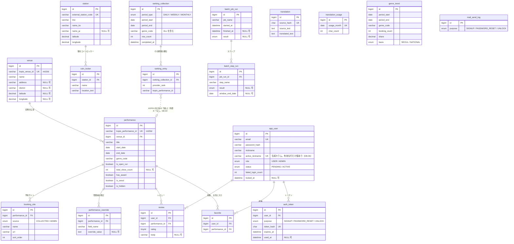
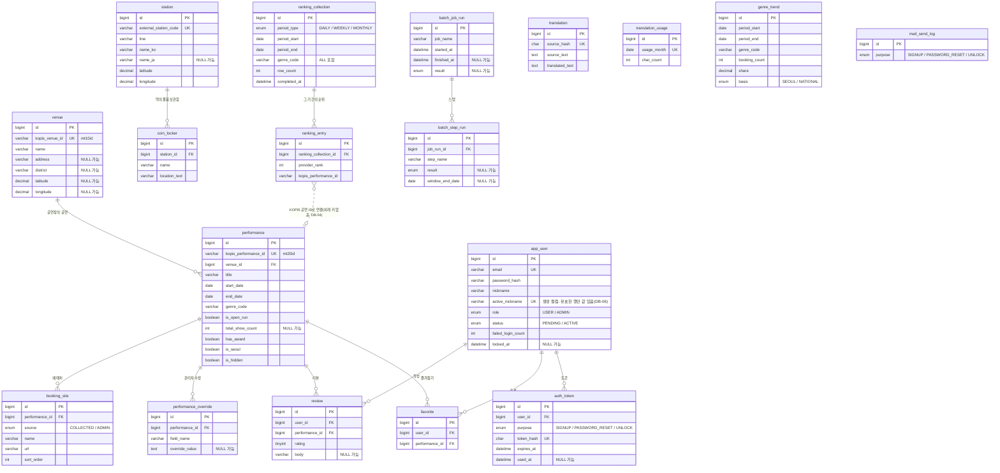

# 04. テーブル設計書

- 状態: 基本設計 承認（2026-11-06、Issue #15 コメント 6678921752）。型の長さ・照合順序・インデックスの最終形・Flyway のマイグレーション SQL は工程4（詳細設計）で書く
- 担当: db-designer
- 最終更新: 2026-11-06
- 前提: [01. 要件定義書](01-requirements.md)（F-01〜F-36、N-01〜N-08。R-62〜R-64 を反映）、[02. 画面設計書](02-screens.md)、[03. API 設計書](03-api.md)（**5. のデータ項目**、**6. の対応表**）、[05. バッチ設計書](05-batch.md)、ADR 0006〜0016（特に 0007・0008・0009・0012・0013）
- この設計書の 8. に、**要件 → テーブルの対応表**を 03 の 6. と同じ行（同じ要件 ID・同じ順番）で置く。2つの表を要件 ID で突き合わせると、要件 → 画面 → API → バッチ → テーブルの対応になる（Issue #15 コメント 6651238358 の 3.）
- `DB-xx` はこの設計書の設計判断の番号（9.）。`P-xx` は 02 の判断（人間が決定済み）
- 10.1 の Q-01〜Q-03 は解決済み（人間の決定: Issue #15 コメント 6677710885。それを受けた 03・05 の変更: コミット dc1f012）。Q-01 の決定（案 B）に合わせて DB-06 を変えた
- ゲート3 の reviewer の指摘（Issue #15 コメント 6678542365）と人間の決定（2026-11-06、コメント 6678516145）を反映した: 3. と 8. の要件 ID の一致（軽微2）、公演に結びつかない順位の行（軽微6。DB-04・10.2）。03 の 6. の変更（コミット 3d54b12）と 8. の行が一致することを確かめた

## 1. 方針

### 1.1 共通の決まり

| 項目 | 決まり |
|---|---|
| DB | MySQL 8.4。文字コードは utf8mb4。時刻は Asia/Seoul（`compose.yaml` の `TZ`）。日付の判定（「今日」）はすべて Asia/Seoul（03 の 1.1） |
| 名前 | テーブル・カラムは `snake_case`。テーブル名は単数形（`performance`、`review` など）。ユーザーだけは MySQL のシステムのテーブル `mysql.user` と紛らわしいため `app_user` とする |
| 主キー | すべて `id BIGINT AUTO_INCREMENT`。外部データの ID（KOPIS の `mt20id`・`mt10id`、駅の外部コード）は別のカラムに持ち、`UNIQUE` を付ける（取り込みの重複を防ぐ） |
| 作成・更新日時 | すべてのテーブルに `created_at DATETIME NOT NULL DEFAULT CURRENT_TIMESTAMP` と `updated_at DATETIME NOT NULL DEFAULT CURRENT_TIMESTAMP ON UPDATE CURRENT_TIMESTAMP` を付ける。追記だけの記録（メールの送信の記録、翻訳など）は、出来事の日時に `created_at` を使い、同じ意味のカラムを重ねて持たない（4. の各表に書く） |
| COMMENT | **すべてのテーブル・カラムに `COMMENT` を付ける**（`CLAUDE.md`）。内容はこの設計書の「説明」の列を基にする |
| 制約 | **外部キー・一意制約・`NOT NULL`・`CHECK` は DB でも定義する**（アプリだけに頼らない。`CLAUDE.md`）。`ON DELETE` の動きは 5. に明記する |
| 日時・日付 | 日時は `DATETIME`、日付は `DATE`。`TIMESTAMP` は使わない（2038 年の上限と、セッションのタイムゾーンによる変換を避けるため） |
| 真偽 | `BOOLEAN`（MySQL では `TINYINT(1)`）。カラム名は `is_` / `has_` で始める |
| 区分の値 | 値の種類が決まっていて変わらないもの（役割、トークンの用途など）は `ENUM` を使う。KOPIS のジャンルのように提供元が決める値は `VARCHAR` に提供元のコードをそのまま持つ（4.） |
| 座標 | `DECIMAL(9,6)`（緯度・経度。小数第6位 ≒ 0.1m）。理由は DB-12 |

### 1.2 この工程（工程3）で書く範囲

- ER 図、テーブル一覧、主なカラム（型は予定。決められるものは書く）、主キー・外部キー・一意制約・`CHECK`、主なインデックスとその理由、要件との対応。
- 型の長さの最終値、照合順序（collation）、インデックスの最終形、Flyway のマイグレーション SQL は工程4で書く（Issue #15 の「注意」）。

### 1.3 テーブルにしないもの

| もの | 置き場所 | 理由 |
|---|---|---|
| ログインのセッション | アプリのメモリ（サーブレットコンテナ） | ADR 0013 決定2。Spring Session JDBC は採らない（ADR 0013「検討した選択肢」）。セッションのテーブルは作らない |
| 表示言語（F-10）・ライト表示／ダーク表示（F-36） | ブラウザ（`localStorage`） | 03 の 6. のとおり。サーバーに保存する要件はない |
| ジャンル・公演の状態・区の表示の文言 | 画面の辞書 | 03 の 1.2、ADR 0007。DB にはコード（ジャンルの KOPIS のコード、区の原文の名前）だけを持つ |
| ソウルの 25 区の一覧 | アプリの定数 | 区の判定（03 の 4.2）で照らすだけで、変わらない。ほかのデータから参照されない |
| 地図の1日の読み込み回数（ADR 0006） | Google Cloud の割り当て | アプリでは数えない（05 の 2.） |
| バッチの二重起動の防止 | MySQL の名前付きロック（`GET_LOCK`） | 05 の 1.1。テーブルを使わない |
| reCAPTCHA の検証の結果 | 保存しない | API-37 の中で検証してすぐ使う（ADR 0011） |

Flyway が作る `flyway_schema_history` は Flyway の管理用で、この設計書の対象外とする。

## 2. ER 図

- 図では `created_at`・`updated_at` を省いた（すべてのテーブルにある）。
- `translation`・`translation_usage`・`genre_trend`・`mail_send_log` はほかのテーブルと外部キーで結ばない。`translation` は原文のハッシュで引く（DB-05）。

## 3. テーブル一覧

| No. | テーブル | 役割 | 主キー | 外部キー | 一意制約 | 要件 ID | API | バッチ |
|---|---|---|---|---|---|---|---|---|
| 1 | `venue` | 会場（KOPIS の施設）。区・座標 | `id` | — | `kopis_venue_id` | F-01, F-02, F-03, F-05〜F-08, F-11, N-01 | API-01〜06, 50, 51 | B-01（S1, S4） |
| 2 | `performance` | 公演（自動収集の値）と非表示 | `id` | `venue_id` → `venue` | `kopis_performance_id` | F-01〜F-03, F-07〜F-09, F-11, F-19〜F-21, F-26, F-27, F-29, F-31〜F-33, N-01, N-04 | API-01〜03, 05, 06, 10, 11, 20, 21, 43〜45, 50〜55 | B-01（S1, S3〜S5） |
| 3 | `booking_site` | 予約サイト（1つの公演に複数）。自動収集の分と管理者が修正した分 | `id` | `performance_id` → `performance` | (`performance_id`, `source`, `sort_order`) | F-03, F-04, F-08, F-11, F-26, N-01 | API-03, 51〜53 | B-01（S1, S4） |
| 4 | `performance_override` | 管理者の修正（項目ごとに1行） | `id` | `performance_id` → `performance` | (`performance_id`, `field_name`) | F-01〜F-04, F-07, F-08, F-11, F-26, F-32, N-01, N-04 | API-01〜03, 05, 43, 50〜53 | B-01（上書きしない。S7 の翻訳の対象） |
| 5 | `station` | 駅（ソウル交通公社 1〜8号線のソウルの駅。乗り換え駅は路線ごとに1行） | `id` | — | `external_station_code`、(`line`, `name_ko`) | F-05〜F-07, F-11, N-01, N-04 | API-04, 05 | B-02 |
| 6 | `coin_locker` | コインロッカー（駅に属する） | `id` | `station_id` → `station` | — | F-06, F-07, F-11, N-01, N-04 | API-04, 05 | B-02, B-01（S7） |
| 7 | `translation` | 原文ごとの日本語の翻訳 | `id` | — | `source_hash` | F-02, F-11, N-01 | 03 の 1.2 の全 API | B-01（S7） |
| 8 | `translation_usage` | 翻訳の月（Asia/Seoul）の文字数 | `id` | — | `usage_month` | F-11, N-01, N-07 | — | B-01（S7） |
| 9 | `ranking_collection` | 人気順位の収集の完了（期間の種類・期間・ジャンルの組ごとに1行） | `id` | — | (`period_type`, `genre_code`, `period_start`) | F-03, F-29, F-33 | API-03, 20, 21 | B-01（S2） |
| 10 | `ranking_entry` | 人気順位の行（提供元が返したすべての行） | `id` | `ranking_collection_id` → `ranking_collection` | (`ranking_collection_id`, `kopis_performance_id`) | F-03, F-09, F-29, F-33 | API-03, 20, 21 | B-01（S2, S4） |
| 11 | `genre_trend` | ジャンル別トレンド（直近30日の予約数・割合・基準） | `id` | — | (`period_start`, `period_end`, `genre_code`) | F-34 | API-22 | B-01（S6） |
| 12 | `app_user` | ユーザー（一般ユーザー・管理者。認証前の申込を含む） | `id` | — | `email`（認証前の行も含む）、`active_nickname`（有効な行のニックネームだけ。DB-06）、管理者は1行だけ（DB-07） | F-12〜F-18, F-23〜F-25, N-05 | API-10, 30〜42, 55 | B-03, B-04（期限の切れた認証前の行を削除） |
| 13 | `auth_token` | メールのリンクのトークン（会員登録の認証・パスワード再設定・ロック解除） | `id` | `user_id` → `app_user` | `token_hash` | F-12, F-14, F-15, F-18, N-05 | API-33〜38 | B-04（会員登録の認証のトークンの有効期限で削除する行を決める。トークンは `app_user` の削除の CASCADE で消える） |
| 14 | `favorite` | お気に入り | `id` | `user_id` → `app_user`、`performance_id` → `performance` | (`user_id`, `performance_id`) | F-09, F-18〜F-20 | API-03, 42〜45 | — |
| 15 | `review` | レビュー（評価と本文） | `id` | `user_id` → `app_user`、`performance_id` → `performance` | (`user_id`, `performance_id`) | F-03, F-09, F-17, F-18, F-21〜F-24, F-28, F-30 | API-01, 03, 10〜13, 42, 43, 55, 56 | — |
| 16 | `mail_send_log` | メールの送信の記録（直近 24 時間の数を数える） | `id` | — | — | F-12, F-14, F-15, N-06, N-07 | API-33, 35, 37 | — |
| 17 | `batch_job_run` | バッチの実行の記録（1回の実行に1行） | `id` | — | — | F-08, F-12, N-04 | — | B-01〜B-04 |
| 18 | `batch_step_run` | バッチのステップの実行の記録 | `id` | `job_run_id` → `batch_job_run` | (`job_run_id`, `step_name`) | F-08, F-12, N-04 | — | B-01〜B-04 |

## 4. テーブルごとの主なカラム

「型（予定）」の長さは工程4で確定する。どのテーブルにも 1.1 の `id`・`created_at`・`updated_at` がある（表では、意味を持たせるときだけ書く）。

### 4.1 `venue`（会場）

| カラム | 型（予定） | NULL | 既定 | 制約 | 説明 |
|---|---|---|---|---|---|
| `kopis_venue_id` | VARCHAR | 不可 | — | UNIQUE | KOPIS の施設 ID（`mt10id`） |
| `name` | VARCHAR | 不可 | — | — | 会場名（原文） |
| `address` | VARCHAR | 可 | NULL | — | 住所（`adres`。原文） |
| `district` | VARCHAR | 可 | NULL | — | 区の名前（原文。例: `종로구`）。住所から決める（03 の 4.2）。決められなければ NULL |
| `latitude` | DECIMAL(9,6) | 可 | NULL | CHECK（緯度と経度は両方 NULL か両方値あり） | 緯度（`la`）。ない会場もある（P-11） |
| `longitude` | DECIMAL(9,6) | 可 | NULL | 同上 | 経度（`lo`） |

- 会場は B-01 の S1・S4 で、まだ DB にない施設だけを追加する（05 の 3.3）。削除しない。

### 4.2 `performance`（公演）

自動収集の値を持つ。管理者が修正した値は `performance_override`（4.4）に持ち、表示には「修正した値があればそれ、なければこの表の値」を使う（03 の 4.10）。

| カラム | 型（予定） | NULL | 既定 | 制約 | 説明 |
|---|---|---|---|---|---|
| `kopis_performance_id` | VARCHAR | 不可 | — | UNIQUE | KOPIS の公演 ID（`mt20id`）。画面・API の公演 ID |
| `venue_id` | BIGINT | 不可 | — | FK → `venue.id` | 会場 |
| `title` | VARCHAR | 不可 | — | — | 公演名（原文） |
| `start_date` | DATE | 不可 | — | — | 公演開始日 |
| `end_date` | DATE | 不可 | — | — | 公演終了日。終わったかどうかは照会のたびにこの日と今日で判定する（03 の 1.6） |
| `genre_code` | VARCHAR | 不可 | — | — | ジャンルの KOPIS のコード（例: `AAAA`） |
| `cast_text` | TEXT | 可 | NULL | — | 出演者（原文） |
| `ticket_price` | TEXT | 可 | NULL | — | チケット価格（原文の文） |
| `schedule_text` | TEXT | 可 | NULL | — | 公演時間の案内（原文） |
| `runtime` | VARCHAR | 可 | NULL | — | 上演時間（原文。例: `1시간 30분`） |
| `age_limit` | VARCHAR | 可 | NULL | — | 観覧年齢（原文） |
| `poster_url` | VARCHAR | 可 | NULL | — | ポスターの URL |
| `is_open_run` | BOOLEAN | 不可 | FALSE | — | オープンランかどうか（`openrun`） |
| `total_show_count` | INT | 可 | NULL | CHECK（0 以上） | 開幕からの累計の上演回数（R-49。05 の 3.6）。まだ取れていなければ NULL |
| `has_award` | BOOLEAN | 不可 | FALSE | — | 受賞歴があるか（S3 が立てるだけで消さない。05 の 3.2） |
| `is_seoul` | BOOLEAN | 不可 | — | — | ソウルの公演か（05 の 3.3 の 6.） |
| `is_hidden` | BOOLEAN | 不可 | FALSE | — | 管理者が非表示にしたか（F-27）。B-01 は書き換えない |
| `kopis_updated_at` | DATETIME | 可 | NULL | — | KOPIS の最終更新日時 |
| `collected_at` | DATETIME | 不可 | — | — | この公演を最後に収集した日時（S1・S4 が更新する。`updated_at` は非表示の切り替えでも変わるので別に持つ） |

- 公演は削除しない（F-09 ②。03 の 5.）。

### 4.3 `booking_site`（予約サイト）

| カラム | 型（予定） | NULL | 既定 | 制約 | 説明 |
|---|---|---|---|---|---|
| `performance_id` | BIGINT | 不可 | — | FK → `performance.id` | 公演 |
| `source` | ENUM(`COLLECTED`, `ADMIN`) | 不可 | — | — | 自動収集の分か、管理者が修正した分か（DB-02） |
| `name` | VARCHAR | 不可 | — | — | 予約サイトの名前（原文） |
| `url` | VARCHAR | 不可 | — | — | 予約サイトの URL |
| `sort_order` | INT | 不可 | — | UNIQUE（`performance_id`, `source`, `sort_order`） | 並び順（提供元の順。管理者の分は入力の順） |

- B-01 は `source = COLLECTED` の行だけを、その公演の分ごとに入れ替える。`ADMIN` の行は変えない（F-26 ③）。

### 4.4 `performance_override`（管理者の修正）

| カラム | 型（予定） | NULL | 既定 | 制約 | 説明 |
|---|---|---|---|---|---|
| `performance_id` | BIGINT | 不可 | — | FK → `performance.id` | 公演 |
| `field_name` | VARCHAR | 不可 | — | UNIQUE（`performance_id`, `field_name`）。CHECK（下の値だけ） | 修正した項目 |
| `override_value` | TEXT | 可 | NULL | CHECK（`field_name = 'booking_sites'` のときだけ NULL、ほかは NULL 不可） | 修正した値（文字列で持ち、型はアプリで変換する） |
| `updated_at` | DATETIME | 不可 | 1.1 | — | 修正した日時（同じ項目を修正し直すと変わる） |

- `field_name` の値（P-13 の修正できる項目と 1対1）: `title`、`start_date`、`end_date`、`genre_code`、`cast_text`、`ticket_price`、`schedule_text`、`runtime`、`age_limit`、`is_open_run`、`booking_sites`。値は `performance` のカラム名とそろえる（`booking_sites` は 4.3 の `ADMIN` の行を使うことを示す）。
- 修正を取り消す（API-53）と、その行を削除する。`booking_sites` を取り消すときは、同じトランザクションで 4.3 の `ADMIN` の行も削除する（F-26 ⑤）。
- 修正した公演名などの日本語の翻訳は、`translation`（4.7）に原文として入り、次の B-01 の S7 で作られる（03 の 4.10）。

### 4.5 `station`（駅）

| カラム | 型（予定） | NULL | 既定 | 制約 | 説明 |
|---|---|---|---|---|---|
| `external_station_code` | VARCHAR | 不可 | — | UNIQUE | 外部の駅コード（座標のファイルの「고유역번호(외부역코드)」。乗り換え駅は路線ごとに別のコード） |
| `line` | VARCHAR | 不可 | — | UNIQUE（`line`, `name_ko`） | 路線（例: `1호선`。書き方はファイルを取得して工程4で決める） |
| `name_ko` | VARCHAR | 不可 | — | 同上 | 駅名（韓国語） |
| `name_ja` | VARCHAR | 可 | NULL | — | 駅名（日本語の公式表記。ADR 0009）。ない駅は `translation` の機械翻訳を使う |
| `latitude` | DECIMAL(9,6) | 不可 | — | — | 緯度 |
| `longitude` | DECIMAL(9,6) | 不可 | — | — | 経度 |

- B-02 が1つのトランザクションで全件入れ替える（05 の 4.3）。(`line`, `name_ko`) の一意制約は、コインロッカーの「호선・보관함명」と駅の「호선・역명」の結びつけ（05 の 4.3 の 4.）で、駅が1つに決まることを保証する。

### 4.6 `coin_locker`（コインロッカー）

| カラム | 型（予定） | NULL | 既定 | 制約 | 説明 |
|---|---|---|---|---|---|
| `station_id` | BIGINT | 不可 | — | FK → `station.id` | 属する駅。距離は駅の座標で判定する（F-06 ②、U-20） |
| `name` | VARCHAR | 不可 | — | — | 保管庫の名前（ファイルの「보관함명」。原文） |
| `location_text` | VARCHAR | 不可 | — | — | 位置の文章（「상세위치」。韓国語。例: `1번 출입구 주변`） |

- 一意制約は置かない。同じ駅に位置の違う保管庫が複数あり、ファイルの「연번」は版ごとに変わるので外部の ID として使えない。全件入れ替えなので重複は起きない（05 の 4.3 の 5.）。

### 4.7 `translation`（翻訳）

| カラム | 型（予定） | NULL | 既定 | 制約 | 説明 |
|---|---|---|---|---|---|
| `source_hash` | CHAR(64) | 不可 | — | UNIQUE | 原文の SHA-256（16進）。同じ原文は1行だけ（ADR 0007 3.） |
| `source_text` | TEXT | 不可 | — | — | 原文（韓国語） |
| `translated_text` | TEXT | 不可 | — | — | 日本語の翻訳 |
| `created_at` | DATETIME | 不可 | 1.1 | — | 翻訳した日時 |

- 公演名・会場名などの翻訳は、その原文のハッシュでこの表を引く（DB-05）。翻訳がない（行がない）ときは「翻訳がない」として返す（03 の 1.2）。

### 4.8 `translation_usage`（翻訳の月の文字数）

| カラム | 型（予定） | NULL | 既定 | 制約 | 説明 |
|---|---|---|---|---|---|
| `usage_month` | DATE | 不可 | — | UNIQUE。CHECK（月の1日） | 月（Asia/Seoul の暦の月。P-09）。その月の1日の日付で持つ |
| `char_count` | INT | 不可 | 0 | CHECK（0 以上） | その月に翻訳した文字数。翻訳が成功するたびに足す（05 の 3.7） |

### 4.9 `ranking_collection`（人気順位の収集の完了）

| カラム | 型（予定） | NULL | 既定 | 制約 | 説明 |
|---|---|---|---|---|---|
| `period_type` | ENUM(`DAILY`, `WEEKLY`, `MONTHLY`) | 不可 | — | UNIQUE（`period_type`, `genre_code`, `period_start`） | 期間の種類 |
| `genre_code` | VARCHAR | 不可 | — | 同上 | ジャンルのコード。全体は `ALL`（API-20 の `genre=ALL` と同じ。NULL にしないのは一意制約を効かせるため） |
| `period_start` | DATE | 不可 | — | 同上 | 期間の初日 |
| `period_end` | DATE | 不可 | — | CHECK（`period_start` 以上） | 期間の末日（DB-09） |
| `row_count` | INT | 不可 | — | CHECK（0 以上） | 保存した行の数（提供元が 0 件なら 0） |
| `completed_at` | DATETIME | 不可 | — | — | 収集を終えた日時（その組の順位を取得した日時を兼ねる） |

- B-01 の S2 は、組ごとに、この行の追加・更新と `ranking_entry` の入れ替えを**1つのトランザクション**で行う（05 の 3.4）。照会に失敗した組は、行も記録も変えない。
- API は、期間の種類とジャンルごとに、この表で `period_end` が今日より前の行のうち `period_start` が最も新しいものを「収集が終わっている直近の期間」とする（03 の 4.9）。行の有無で判断するので、0 件の期間と未収集の期間を見分けられる。

### 4.10 `ranking_entry`（人気順位の行）

| カラム | 型（予定） | NULL | 既定 | 制約 | 説明 |
|---|---|---|---|---|---|
| `ranking_collection_id` | BIGINT | 不可 | — | FK → `ranking_collection.id` | どの組（期間の種類・期間・ジャンル）の順位か |
| `provider_rank` | INT | 不可 | — | CHECK（1 以上） | 提供元の順位（`rnum`）。非表示の公演を除いた振り直しは API で照会のたびに行う（ADR 0008 4.） |
| `kopis_performance_id` | VARCHAR | 不可 | — | UNIQUE（`ranking_collection_id`, `kopis_performance_id`） | 公演 ID（`mt20id`）。`performance` とは外部キーで結ばない（DB-04） |

- 提供元が返したすべての行を保存する（上位10位だけではない。ADR 0008 3.）。カラム名を `rank` にしないのは、MySQL 8 の予約語のため。

### 4.11 `genre_trend`（ジャンル別トレンド）

| カラム | 型（予定） | NULL | 既定 | 制約 | 説明 |
|---|---|---|---|---|---|
| `period_start` | DATE | 不可 | — | UNIQUE（`period_start`, `period_end`, `genre_code`） | 集計期間の初日（前日までの直近30日の初日） |
| `period_end` | DATE | 不可 | — | 同上。CHECK（`period_start` 以上） | 集計期間の末日（前日） |
| `genre_code` | VARCHAR | 不可 | — | 同上 | ジャンルのコード |
| `booking_count` | INT | 不可 | — | CHECK（0 以上） | 予約数 |
| `share` | DECIMAL | 不可 | — | CHECK（0〜100） | 割合（%）。S6 が計算して保存する（DB-09） |
| `basis` | ENUM(`SEOUL`, `NATIONAL`) | 不可 | — | — | 集計の基準（ソウル / 全国。R-50） |

- S6 は集計期間の組で全部入れ替える（05 の 3.2）。API-22 は `period_end` が最も新しい期間を返す。

### 4.12 `app_user`（ユーザー）

| カラム | 型（予定） | NULL | 既定 | 制約 | 説明 |
|---|---|---|---|---|---|
| `email` | VARCHAR(254) | 不可 | — | UNIQUE | メールアドレス（03 の 4.6 で 254 文字以内）。一意制約は認証前の行にも効く（同じメールアドレスの申込し直しは行の置き換え。P-10） |
| `password_hash` | VARCHAR | 不可 | — | — | パスワードのハッシュ（`DelegatingPasswordEncoder` の形。既定は bcrypt。ADR 0013 決定6） |
| `nickname` | VARCHAR(20) | 不可 | — | —（一意制約は下の `active_nickname` に置く） | ニックネーム（1〜20 文字。P-05）。認証前の行は申込のときのニックネーム（押さえない）。管理者は画面に出ないが、NOT NULL のため B-03 で決めた値を入れる（工程4） |
| `active_nickname` | VARCHAR(20)。生成カラム（`GENERATED ALWAYS AS (CASE WHEN status = 'ACTIVE' THEN nickname END) VIRTUAL`） | 可 | （式で決まる） | UNIQUE | 有効な行のニックネーム。認証前の行は NULL。**有効なアカウントの間だけでニックネームの重複を防ぐ**（DB-06。03 の 4.7）。アプリは書き込まない（INSERT・UPDATE の列に入れない） |
| `role` | ENUM(`USER`, `ADMIN`) | 不可 | `USER` | 管理者は1行だけ（DB-07） | 役割（一般ユーザー / 管理者） |
| `status` | ENUM(`PENDING`, `ACTIVE`) | 不可 | `PENDING` | — | 状態（認証前 / 有効）。B-03 の管理者は `ACTIVE` で作る |
| `failed_login_count` | INT | 不可 | 0 | CHECK（0 以上） | 連続の失敗回数（F-14 ①②） |
| `locked_at` | DATETIME | 可 | NULL | — | ロックした日時。NULL でなければロック中（DB-08） |
| `created_at` | DATETIME | 不可 | 1.1 | — | 作成日時（会員登録の申込・置き換えの日時） |

- 退会（F-18）では行を削除する（退会した行を残さない。メールアドレス・ニックネームを再び使えるようにする。03 の 5.）。レビュー・お気に入り・トークンは外部キーで一緒に削除される（5.）。
- 認証前の申込もこの表に入れる（`status = PENDING`）。同じメールアドレスの申込し直しはこの行を置き換える（P-10）。**認証前の行はニックネームを押さえない**（人間の決定。Issue #15 コメント 6677710885 の Q-01 の B）: `active_nickname` が NULL なので、同じニックネームの認証前の行が何行あっても、有効な行と同じニックネームでも、一意制約に当たらない（MySQL の UNIQUE は NULL どうしを重複とみなさない）。
- 認証の完了（API-34）で `status` を `ACTIVE` にすると `active_nickname` に値が入り、そのときに同じニックネームの有効な行があれば一意制約の違反（エラー 1062）になる。API-34 はこれを「認証の時点でニックネームが使われている」と同じ扱い（その認証前の行を削除して 409）にする（03 の 4.7）。ニックネームの変更（API-40）も、有効な行の間でこの制約が効く。
- 認証前の行が削除されるのは、API-33 の置き換え（同じメールアドレス）、API-34 の 2.（ニックネームが使われていた）、B-04（期限の切れた行。05 の 6.）の3つ。どれもトークンは外部キーの CASCADE で一緒に消える（5.）。

### 4.13 `auth_token`（トークン）

| カラム | 型（予定） | NULL | 既定 | 制約 | 説明 |
|---|---|---|---|---|---|
| `user_id` | BIGINT | 不可 | — | FK → `app_user.id` | 対象のユーザー |
| `purpose` | ENUM(`SIGNUP`, `PASSWORD_RESET`, `UNLOCK`) | 不可 | — | — | 用途（会員登録の認証 / パスワード再設定 / ロック解除の再認証） |
| `token_hash` | CHAR(64) | 不可 | — | UNIQUE | トークンのハッシュ（SHA-256 の16進）。トークンそのものは保存しない（03 の 4.7） |
| `expires_at` | DATETIME | 不可 | — | — | 有効期限（24 時間・1 時間・1 時間。P-10） |
| `used_at` | DATETIME | 可 | NULL | — | 使った日時。NULL でなければ使用済み（1回使ったら無効） |

- B-04 は、認証前の行のうち、有効期限内の `SIGNUP` のトークンが1つもない行を削除する（05 の 6.2 の 3.）。この判定に `user_id`・`purpose`・`expires_at` を使う（6. のインデックス）。

### 4.14 `favorite`（お気に入り）

| カラム | 型（予定） | NULL | 既定 | 制約 | 説明 |
|---|---|---|---|---|---|
| `user_id` | BIGINT | 不可 | — | FK → `app_user.id`。UNIQUE（`user_id`, `performance_id`） | ユーザー |
| `performance_id` | BIGINT | 不可 | — | FK → `performance.id` | 公演（会場は登録できない。F-19 ②） |
| `created_at` | DATETIME | 不可 | 1.1 | — | 登録日時（API-43 の並び順） |

### 4.15 `review`（レビュー）

| カラム | 型（予定） | NULL | 既定 | 制約 | 説明 |
|---|---|---|---|---|---|
| `user_id` | BIGINT | 不可 | — | FK → `app_user.id`。UNIQUE（`user_id`, `performance_id`） | 投稿者（1人1公演1件。F-21 ⑤） |
| `performance_id` | BIGINT | 不可 | — | FK → `performance.id` | 公演 |
| `rating` | TINYINT | 不可 | — | CHECK（1〜5） | 評価（F-21 ③） |
| `body` | VARCHAR(1000) | 可 | NULL | — | 本文（任意。1,000 文字以内。P-05）。MySQL の `VARCHAR(n)` は文字数で数えるので、03 の 4.6（コードポイントで数える）と一致する |
| `created_at` | DATETIME | 不可 | 1.1 | — | 投稿日時（API-10・55 の並び順） |
| `updated_at` | DATETIME | 不可 | 1.1 | — | 更新日時 |

- 評価の平均・件数は保存せず、照会のたびに計算する（03 の 4.4。F-30 ③）。

### 4.16 `mail_send_log`（メールの送信の記録）

| カラム | 型（予定） | NULL | 既定 | 制約 | 説明 |
|---|---|---|---|---|---|
| `purpose` | ENUM(`SIGNUP`, `PASSWORD_RESET`, `UNLOCK`) | 不可 | — | — | 用途 |
| `created_at` | DATETIME | 不可 | 1.1 | — | 送った日時。直近 24 時間の数（03 の 4.8、P-08）はこのカラムで数える |

- 宛先・ユーザーは持たない（DB-11）。

### 4.17 `batch_job_run`（バッチの実行の記録）

| カラム | 型（予定） | NULL | 既定 | 制約 | 説明 |
|---|---|---|---|---|---|
| `job_name` | VARCHAR | 不可 | — | — | 処理の名前（`daily-collect`・`import-subway`・`create-admin`・`purge-expired-signups`。05 の 1.1） |
| `started_at` | DATETIME | 不可 | — | — | 開始日時 |
| `finished_at` | DATETIME | 可 | NULL | — | 終了日時。実行中は NULL |
| `result` | ENUM(`SUCCESS`, `PARTIAL_FAILURE`, `FAILURE`) | 可 | NULL | — | 結果（成功 / 一部失敗 / 失敗。05 の 1.1）。実行中は NULL |
| `error_message` | TEXT | 可 | NULL | — | エラーの内容 |

### 4.18 `batch_step_run`（バッチのステップの実行の記録）

| カラム | 型（予定） | NULL | 既定 | 制約 | 説明 |
|---|---|---|---|---|---|
| `job_run_id` | BIGINT | 不可 | — | FK → `batch_job_run.id`。UNIQUE（`job_run_id`, `step_name`） | どの実行のステップか |
| `step_name` | VARCHAR | 不可 | — | — | ステップ（B-01 は `S1`〜`S7`。B-02〜B-04 は1つのステップとして記録する。B-04 は削除した件数を `processed_count` に入れる） |
| `started_at` | DATETIME | 不可 | — | — | 開始日時 |
| `finished_at` | DATETIME | 可 | NULL | — | 終了日時 |
| `result` | ENUM(`SUCCESS`, `FAILURE`) | 可 | NULL | — | 結果。実行中は NULL |
| `processed_count` | INT | 可 | NULL | — | 処理した件数 |
| `summary` | TEXT | 可 | NULL | — | 件数の内訳（区を決められなかった会場の数、座標のない会場の数、取り込まなかった駅・コインロッカーの数と内容など。05 の 3.3・4.3） |
| `error_message` | TEXT | 可 | NULL | — | エラーの内容 |
| `window_end_date` | DATE | 可 | NULL | — | S1 が成功したときの収集の窓の末日（05 の 3.3 の 3.(b)・7.）。S1 以外は NULL |

- 「前回 S1 が成功した日」（`afterdate` に使う）は、`step_name = 'S1'` かつ `result = 'SUCCESS'` の最も新しい行の `started_at` の日付（Asia/Seoul）として求める（DB-10）。

## 5. 外部キーと削除の扱い

| 外部キー | ON DELETE | 理由 |
|---|---|---|
| `performance.venue_id` → `venue` | RESTRICT | 会場は削除しない。公演のある会場が消えないようにする |
| `booking_site.performance_id` → `performance` | RESTRICT | 公演は削除しない（F-09 ②）。誤って公演を削除できないようにする |
| `performance_override.performance_id` → `performance` | RESTRICT | 同上 |
| `favorite.performance_id` → `performance` | RESTRICT | 同上。お気に入り・レビューのある公演を消さない |
| `review.performance_id` → `performance` | RESTRICT | 同上 |
| `favorite.user_id` → `app_user` | **CASCADE** | 退会（行の削除）でお気に入りも一緒に削除する（F-18 ④） |
| `review.user_id` → `app_user` | **CASCADE** | 退会でレビューも一緒に削除する（F-18 ③）。評価にも含まれなくなる |
| `auth_token.user_id` → `app_user` | **CASCADE** | 退会でトークンも削除する（03 の 5.）。認証前の行の削除（API-33 の置き換え、API-34 の 2.、B-04）でもトークンを一緒に消す（03 の 4.7、05 の 6.2） |
| `coin_locker.station_id` → `station` | **CASCADE** | B-02 が駅を全件入れ替えるとき、属するコインロッカーも消す（同じトランザクションで入れ直す。05 の 4.3） |
| `ranking_entry.ranking_collection_id` → `ranking_collection` | **CASCADE** | 組の行を消すときはその順位の行も消す（S2 は組の行を更新し、順位の行を入れ替える） |
| `batch_step_run.job_run_id` → `batch_job_run` | **CASCADE** | 実行の記録を消すとき（運用で古い記録を消す場合）にステップも消す |

- ON UPDATE はすべて RESTRICT（主キーは変えない）。
- `ranking_entry` → `performance` は外部キーを置かない（DB-04）。

## 6. 主なインデックス（案）と理由

主キー・一意制約・外部キーのインデックス（MySQL が自動で作る）に加えて、次を置く。最終形は工程4で、実際のクエリ（MyBatis の XML）と合わせて決める。

| テーブル | インデックス | 理由（どのクエリのためか） |
|---|---|---|
| `performance` | (`is_hidden`, `end_date`, `start_date`) | 公開中の公演（03 の 1.6: 非表示でない・終了日 ≥ 今日・開始日 ≤ 今日 + 180 日）の絞り込み（API-01, 02, 05, 06） |
| `performance` | (`start_date`) | API-50 の並び順（公演開始日の新しい順）、API-01 の並び順（早い順） |
| `venue` | (`district`) | 区で絞る（API-01, 02。03 の 4.1） |
| `venue` | (`latitude`, `longitude`) | 地図の範囲・周辺の候補の絞り込み（API-01, 02, 05） |
| `station` | (`latitude`, `longitude`) | 周辺の駅の候補の絞り込み（API-04, 05）。駅は約 270 行なので全件の計算でも足りるが、範囲で先に絞れるようにする |
| `ranking_entry` | (`ranking_collection_id`, `provider_rank`) | 期間・ジャンルの順位を順位の順に読む（API-20, 21） |
| `ranking_entry` | (`kopis_performance_id`) | 公演詳細で、その公演が入っている順位を探す（API-03。4.3 の人気順位） |
| `review` | (`performance_id`, `created_at`) | 公演のレビューの一覧（新しい順。API-10, 55）と評価の集計（API-01, 03, 43） |
| `favorite` | (`user_id`, `created_at`) | お気に入りの一覧（登録の新しい順。API-43） |
| `auth_token` | (`user_id`, `purpose`, `expires_at`) | 申込し直し・再設定のときに、同じユーザー・用途の古いトークンを無効にする（API-33, 35, 37）。B-04 で、認証前の行ごとに「有効期限内の `SIGNUP` のトークンがあるか」を確かめる（05 の 6.2 の 3.。末尾の `expires_at` で期限の比較までインデックスで済む） |
| `app_user` | (`status`) | B-04 で認証前（`PENDING`）の行だけを読む（05 の 6.2 の 3.）。有効な行が大半で、認証前の行は少ない見込みなので、絞り込みに効く |
| `mail_send_log` | (`created_at`) | 直近 24 時間の送信数を数える（03 の 4.8） |
| `batch_job_run` | (`job_name`, `started_at`) | 処理ごとの最新の実行を見る（運用） |
| `batch_step_run` | (`step_name`, `result`, `started_at`) | 前回 S1 が成功した日と窓の末日を求める（05 の 3.3） |

- `ranking_collection` の一意制約は (`period_type`, `genre_code`, `period_start`) の順にし、「期間の種類・ジャンルごとの最新の完了した期間」（03 の 4.9）を同じインデックスで引けるようにする。
- 空間インデックス（`POINT`・`SPATIAL`）は使わない（DB-12）。
- 申込・認証の完了・ニックネームの変更での「有効なアカウントでニックネームが使われているか」（03 の 4.7。API-33, 34, 40）は、`active_nickname` の一意制約のインデックスを `WHERE active_nickname = ?` で引く（DB-06）。
- 管理者の修正した値（4.4）を反映した値で絞る条件（期間・ジャンル・キーワード）は、`performance` のインデックスだけでは効かない。公演は数千件の規模なので、工程4で実際のクエリと実行計画を見て決める（DB-01）。

## 7. 03 の 5. のデータ項目の割り当て

| 03 の 5. のデータ | 割り当て先 |
|---|---|
| 公演 | `performance`（KOPIS の公演 ID → `kopis_performance_id`、会場 → `venue_id`、公演名 → `title`、開始日・終了日 → `start_date`・`end_date`、ジャンル → `genre_code`、出演者 → `cast_text`、チケット価格 → `ticket_price`、公演時間の案内 → `schedule_text`、上演時間 → `runtime`、観覧年齢 → `age_limit`、ポスター → `poster_url`、オープンラン → `is_open_run`、累計の上演回数 → `total_show_count`、受賞歴 → `has_award`、ソウルか → `is_seoul`、KOPIS の最終更新日時 → `kopis_updated_at`、収集した日時 → `collected_at`、非表示 → `is_hidden`） |
| 予約サイト | `booking_site`（公演 → `performance_id`、名前 → `name`、URL → `url`、並び順 → `sort_order`。自動収集か修正かを `source` で分ける。DB-02） |
| 管理者の修正 | `performance_override`（公演 → `performance_id`、項目 → `field_name`、修正した値 → `override_value`、修正した日時 → `updated_at`）。予約サイトの修正した値は `booking_site` の `ADMIN` の行 |
| 会場 | `venue`（施設 ID → `kopis_venue_id`、会場名 → `name`、住所 → `address`、区 → `district`、緯度・経度 → `latitude`・`longitude`） |
| 駅 | `station`（路線 → `line`、駅名（韓国語）→ `name_ko`、駅名（日本語の公式表記）→ `name_ja`、緯度・経度、外部の駅コード → `external_station_code`） |
| コインロッカー | `coin_locker`（駅 → `station_id`、保管庫の名前 → `name`、位置の文章 → `location_text`） |
| 翻訳 | `translation`（原文のハッシュ → `source_hash`、原文 → `source_text`、日本語の翻訳 → `translated_text`、翻訳した日時 → `created_at`） |
| 翻訳の月の文字数 | `translation_usage`（月 → `usage_month`、文字数 → `char_count`） |
| 人気順位 | `ranking_entry`（提供元の順位 → `provider_rank`、公演 ID → `kopis_performance_id`）。期間の種類・期間の初日・末日・ジャンル・取得した日時は、親の `ranking_collection`（`period_type`・`period_start`・`period_end`・`genre_code`・`completed_at`）に持つ（DB-03） |
| 人気順位の収集の完了 | `ranking_collection`（期間の種類・初日・末日・ジャンル、収集を終えた日時 → `completed_at`、件数 → `row_count`。組ごとに1行） |
| ジャンル別トレンド | `genre_trend`（集計期間 → `period_start`・`period_end`、ジャンル → `genre_code`、予約数 → `booking_count`、割合 → `share`、基準 → `basis`） |
| ユーザー | `app_user`（メールアドレス → `email`、パスワードのハッシュ → `password_hash`、ニックネーム → `nickname`、役割 → `role`、状態 → `status`、連続の失敗回数 → `failed_login_count`、ロック中か → `locked_at`、作成日時 → `created_at`）。「ニックネームの重複は有効なアカウントの間だけで禁止」は `active_nickname` の一意制約、「メールアドレスの重複は認証前の行を含めて禁止」は `email` の一意制約（DB-06） |
| トークン | `auth_token`（用途 → `purpose`、ユーザー → `user_id`、トークンのハッシュ → `token_hash`、有効期限 → `expires_at`、使った日時 → `used_at`） |
| お気に入り | `favorite`（ユーザー・公演、登録日時 → `created_at`。(`user_id`, `performance_id`) で一意） |
| レビュー | `review`（ユーザー・公演、評価 → `rating`、本文 → `body`、投稿日時 → `created_at`、更新日時 → `updated_at`。(`user_id`, `performance_id`) で一意） |
| メールの送信の記録 | `mail_send_log`（送った日時 → `created_at`、用途 → `purpose`） |
| バッチの実行の記録 | `batch_job_run`（ジョブ、開始・終了日時、結果、エラーの内容）と `batch_step_run`（ステップ、開始・終了日時、結果、件数 → `processed_count`・`summary`、エラーの内容）。前回の収集が成功した日は `batch_step_run` から求める（DB-10）。「今回の窓の末日」（03 の 5.。05 の 3.3 の 3.(b)・7.）は `batch_step_run.window_end_date` |

03 の 5. にない項目で、この設計書が持つもの:

| 項目 | 理由 |
|---|---|
| `booking_site.source` | 予約サイトの管理者の修正を、自動収集の行と分けて持つため（DB-02。03 の 4.10・P-13 の「予約サイト（名前と URL）」の修正） |
| `app_user.active_nickname` | 03 の 4.7・5. の「ニックネームの重複は有効なアカウントの間だけで禁止」を DB の一意制約で守るための生成カラム（DB-06）。値は `nickname` と `status` から決まり、新しい事実は持たない |

## 8. 要件 → テーブルの対応表

03 の 6. と同じ行（F-01〜F-36、N-01〜N-08。同じ順番）で書く。画面・API・バッチの列は 03 の 6. を見る。

| 要件 ID | テーブル | 使い方 |
|---|---|---|
| F-01 | `performance`, `venue`, `performance_override` | 公開中の公演（非表示・終了日・開始日 ≤ 今日 + 180 日・ソウル）を会場の座標ごとに数える。値は修正を反映した値 |
| F-02 | `performance`, `venue`, `performance_override`, `translation` | 期間・区（`venue.district`）・地図の範囲（会場の座標）・会場・ジャンル・状態・キーワード（日本語表示では翻訳した公演名も） |
| F-03 | `performance`, `venue`, `performance_override`, `booking_site`, `review`, `ranking_collection`, `ranking_entry` | 公演詳細の項目、評価、人気順位（4.3 の P-02）。周辺の駅・コインロッカーは F-05・F-06 の行 |
| F-04 | `booking_site`, `performance_override` | 予約サイトの名前と URL（管理者の修正があれば `ADMIN` の行） |
| F-05 | `station`, `venue` | 会場の座標と駅の座標の距離（500m 以下） |
| F-06 | `coin_locker`, `station`, `venue` | コインロッカーが属する駅の座標で距離を判定し、位置の文章を返す |
| F-07 | `performance`, `venue`, `performance_override`, `station`, `coin_locker` | 現在地から 500m 以内の公開中の公演（会場ごと）・駅・コインロッカー |
| F-08 | `performance`, `venue`, `booking_site`, `performance_override`, `batch_job_run`, `batch_step_run` | 毎日の収集で追加・更新する（修正した項目・非表示は書き換えない）。前回の成功の日と窓の末日を記録する |
| F-09 | `performance`, `ranking_entry`, `favorite`, `review` | 公演を削除しない（外部キーは RESTRICT）。終わったかは `end_date` で判定。順位・お気に入り・レビューは終わった公演も対象 |
| F-10 | — | ブラウザに記憶する（03 の 6. と同じ。1.3） |
| F-11 | `translation`, `translation_usage`, `performance`, `performance_override`, `booking_site`, `venue`, `station`, `coin_locker` | 翻訳する原文（05 の 3.7 の S7 の対象: 公演の項目・管理者の修正した値・予約サイトの名前・会場名・駅名・コインロッカーの位置の文章）は各テーブルにあり、その原文のハッシュで `translation` を引く。公演名・会場名・駅名は原文も返す（②）。駅名は `station.name_ja`（公式表記）を優先。月の上限は `translation_usage` |
| F-12 | `app_user`, `auth_token`, `mail_send_log`, `batch_job_run`, `batch_step_run` | 認証前の行（`PENDING`。ニックネームは押さえない）と認証のトークン。メールの上限を数える。認証の完了で有効にし、ニックネームの重複は `active_nickname` の一意制約でも防ぐ（DB-06）。期限の切れた認証前の行は B-04 が削除し、その実行を記録する |
| F-13 | `app_user` | メールアドレス・パスワードのハッシュ・状態の確認 |
| F-14 | `app_user`, `auth_token`, `mail_send_log` | 失敗回数・ロック（`locked_at`）。ロック解除の再認証のトークンとメール |
| F-15 | `app_user`, `auth_token`, `mail_send_log` | パスワード再設定のトークンとメール。ロック解除・失敗回数の初期化 |
| F-16 | `app_user` | パスワードのハッシュの更新 |
| F-17 | `app_user`, `review` | ニックネーム（有効なアカウントの間で一意。`active_nickname`。DB-06）。レビューの投稿者として `review` から結んで表示する |
| F-18 | `app_user`, `review`, `favorite`, `auth_token` | 行の削除。外部キーの CASCADE でレビュー・お気に入り・トークンも削除する |
| F-19 | `favorite`, `performance` | (`user_id`, `performance_id`) で一意。登録・解除 |
| F-20 | `favorite`, `performance` | 自分のお気に入り（非表示を除き、終わった公演を含む） |
| F-21 | `review`, `performance` | 評価 1〜5（CHECK）、本文 1,000 文字以内、1人1公演1件（一意制約）、開始日以降（`start_date`） |
| F-22 | `review` | 自分の行の更新・削除 |
| F-23 | `review`, `app_user` | 未ログインには評価だけ、ログインしていれば本文・ニックネーム・投稿日 |
| F-24 | `app_user`, `review` | 役割（`role`）。自分のレビューかどうか（`review.user_id`） |
| F-25 | `app_user` | 管理者の行（`role = ADMIN`、1行だけ）。B-03 が作る |
| F-26 | `performance_override`, `booking_site`, `performance` | 項目ごとの修正の保存・取り消し。自動収集の値は `performance` に残る |
| F-27 | `performance` | `is_hidden`（B-01 は書き換えない） |
| F-28 | `review` | 管理者による行の削除 |
| F-29 | `ranking_collection`, `ranking_entry`, `performance` | 収集が終わっている直近の期間（R-62）の順位を、非表示を除いて振り直す |
| F-30 | `review` | 評価の平均・件数を照会のたびに計算する。保存しないので、投稿・編集・削除（API-11〜13）の結果は次の照会にそのまま反映される（③） |
| F-31 | `performance` | `has_award` |
| F-32 | `performance`, `performance_override` | `is_open_run`（修正できる）、`total_show_count` |
| F-33 | `ranking_collection`, `ranking_entry`, `performance` | 現在の期間と1つ前の期間の順位を比べる。1つ前の期間の完了の記録がなければ P-17 |
| F-34 | `genre_trend` | 最新の集計期間の割合と基準 |
| F-35 | — | ログアウト・自動ログアウトはセッション（アプリのメモリ。ADR 0013 決定2〜4）で行い、テーブルを使わない（03 の 6. と同じ。1.3。10.1 の Q-03） |
| F-36 | — | ブラウザに記憶する（03 の 6. と同じ。1.3） |
| N-01 | `translation`, `translation_usage`, `performance`, `performance_override`, `booking_site`, `venue`, `station`, `coin_locker` | F-11 と同じ |
| N-02 | — | 画面の対応（03 の 6. と同じ） |
| N-03 | — | 応答速度の目標を置かない（03 の 6. と同じ） |
| N-04 | `performance`, `performance_override`, `station`, `coin_locker`, `batch_job_run`, `batch_step_run` | 1日1回の更新（修正・非表示を保つ）、駅・コインロッカーの入れ替え、実行の記録 |
| N-05 | `app_user`, `auth_token` | ② パスワードのハッシュ、③ ロック、④ ルール（アプリで確認。03 の 4.6。R-64 の ASCII 8〜64 文字は最大 64 バイトで、ハッシュの列の長さは変わらない）、トークンのハッシュ。⑤ 自動ログアウトはセッション（テーブルなし） |
| N-06 | `mail_send_log` | ② メールの直近 24 時間の上限。① 地図の上限は Google の割り当て（テーブルなし） |
| N-07 | `translation_usage`, `mail_send_log` | 翻訳の月の上限、メールの1日の上限 |
| N-08 | — | リリース（03 の 6. と同じ） |

### 8.1 逆向きの確認（余分がないこと）

- 3. のすべてのテーブルに要件 ID がある（8. の表のどこかの行に出る）。`batch_job_run`・`batch_step_run` は F-08・N-04（収集の再実行・`afterdate`）と F-12（B-04 の実行の記録）、`ranking_collection` は F-29・F-33（R-62 の「収集が終わっている」の判断）、`mail_send_log` は N-06 ②・N-07、`translation_usage` は F-11 ①・N-07 のため。
- **3. の「要件 ID」の列とこの表は、テーブルと要件の組で一致させる**（ゲート3 の軽微2 で確かめた）。F-11・N-01 は、翻訳する原文を持つテーブル（05 の 3.7 の S7 の対象）を含める。
- 03 の 6. で「—」の要件（F-10, F-35, F-36, N-02, N-03, N-08）は、この表でも「—」。03 の 6. で「04 に記入」の要件は、この表ですべてテーブルがある（2つの表の「—」の行が一致する）。
- 03 の 6. のバッチの列の B-01〜B-04 は、3. のバッチの列のどこかに出る（B-04 は `app_user`・`auth_token`・`batch_job_run`・`batch_step_run`）。
- 要件にないデータ（例: 閲覧の履歴、検索条件の保存、通知、ログインの履歴、レビューの「いいね」）のテーブルは置いていない（X-04〜X-07）。

## 9. 設計判断（DB-xx）

| No. | 判断 | 理由 | 採らなかった案 |
|---|---|---|---|
| DB-01 | 管理者の修正は、`performance` と別のテーブル（`performance_override`）に**項目ごとに1行**で持つ | 03 の 4.10（自動収集の値と別に持ち、取り消すと消す）と 5.（項目ごと・修正した日時）にそのまま合う。B-01 は `performance` だけを書くので、修正した値を上書きする誤りが構造上起きない（F-26 ③）。修正の有無（SC-13）は行の有無で分かる | `performance` に `title_override` のような列を項目ごとに足す: 列が倍になり、項目ごとの修正日時も列が増える。値の表示はこちらが簡単だが、工程4で必要ならビューで同じことができる |
| DB-02 | 予約サイトの修正は、`booking_site` に `source`（`COLLECTED` / `ADMIN`）を持たせ、管理者の分を別の行で持つ。修正したことは `performance_override` の `booking_sites` の行で示す | 予約サイトは1つの公演に複数あり、1つの文字列に入れられない（JSON の文字列にすると型・検査が DB で効かない）。修正の印を `performance_override` に置くと、修正の有無・取り消しがほかの項目と同じ形になり、管理者が「予約サイトなし」に修正することもできる | 修正した一覧を JSON で `override_value` に入れる: DB の制約（NOT NULL・長さ）が効かない |
| DB-03 | 人気順位は「組」（`ranking_collection`）と「行」（`ranking_entry`）の2つのテーブルに分け、期間・ジャンルは組だけに持つ | 03 の 5. の「人気順位」と「人気順位の収集の完了」は、同じ組（期間の種類・期間・ジャンル）を持つ。組を1か所にすると重複がなくなり、S2 が組ごとに「行の入れ替え + 完了の記録」を1つのトランザクションで行う（05 の 3.4）形と一致する。行があるのに完了の記録がない状態が構造上起きない | 2つを別々の表にして、両方に期間・ジャンルを持つ: 同じ値を2か所に持ち、ずれるおそれがある |
| DB-04 | `ranking_entry` は公演を KOPIS の公演 ID（文字列）で持ち、`performance` への外部キーを置かない | S2 の時点では、順位に出た公演がまだ DB にないことがある（S4 で後から補う。05 の 3.2）。S4 が失敗しても順位は保存したい。`performance` に結びつかない順位の行の扱いは工程4で決める（03 の 4.9。画面に見える振る舞いが変わる場合は工程4で人間に確認する。ゲート3 の軽微6）。`performance.kopis_performance_id` の一意制約で結ぶ | 外部キーを置く: S2 の前に公演が必要になり、S2・S4 の順番と失敗の扱い（05）と合わない |
| DB-05 | 翻訳は `translation` に原文のハッシュ（SHA-256）ごとに1行で持ち、公演などのテーブルに翻訳の列を持たない | 「同じ原文は二度翻訳しない」（ADR 0007 3.）を一意制約で守れる。原文が変われば別のハッシュになり、自動で「翻訳がない」状態になる（05 の 3.3 の 4.）。管理者の修正した値・駅名・コインロッカーの位置の文章も同じ仕組みで引ける。`TEXT` の原文そのものには一意制約を付けにくいのでハッシュにする | 各テーブルに `title_ja` などの列を持つ: 列が多くなり、同じ原文の翻訳を使い回せず、原文が変わったときに翻訳を消す処理がいる |
| DB-06 | 認証前の会員登録の申込も `app_user` に `status = PENDING` で持つ。**メールアドレスの一意制約は認証前の行にも効かせ、ニックネームの一意制約は有効な行だけに効かせる**。後者は生成カラム `active_nickname`（`CASE WHEN status = 'ACTIVE' THEN nickname END`、`VIRTUAL`）に UNIQUE を付けて実現する | 人間の決定（Issue #15 コメント 6677710885 の Q-01 の B）と 03 の 4.7: 認証前の申込はニックネームを押さえず、有効なアカウントの間の重複は DB の一意制約でも防ぐ。MySQL 8.4 の UNIQUE は NULL どうしを重複とみなさないので、認証前の行（NULL）は何行でも入り、有効な行の間だけ重複が防がれる。認証の完了で `status` を変えた瞬間に制約が効くので、2つの申込がほぼ同時に有効になっても片方は失敗する（03 の 4.7 の 2. の競合）。生成カラムにした理由: ① 値の確認（API-33, 34, 40）が `WHERE active_nickname = ?` でそのインデックスを使える（式インデックスでは、問い合わせごとに同じ式を正確に書かないと使われない）、② 違反のときのキーの名前が列の名前で分かり、API-34 で 409 に変えやすい、③ `SHOW CREATE TABLE` で意図が読める。`VIRTUAL` にしたのは、値を行に保存しなくても InnoDB はセカンダリインデックスに値を持つので足りるため。メールアドレスは、同じメールアドレスの申込し直しを行の置き換えにする（P-10）ので、認証前の行も含めて一意にする | 申込を別のテーブルに持つ: 03 の 5. と合わない。テーブルが増える。／認証前の行もニックネームを押さえる（db-designer の以前の提案）: 人間が採らなかった（Q-01）。／式インデックス `UNIQUE ((CASE WHEN status = 'ACTIVE' THEN nickname END))`: 同じことができるが、上の ① ② の理由で生成カラムにした。／アプリの確認だけ: 03 の 4.7 の競合を防げず、`CLAUDE.md` に合わない |
| DB-07 | 管理者は1行だけであることを DB で保証する（`role = 'ADMIN'` のときだけ値を持つ式に一意制約を付ける。MySQL 8 の式インデックス。形は工程4） | F-25 ①（管理者アカウント1つ）を、B-03 の確認（05 の 5. の 3.）だけに頼らない | アプリの確認だけ: `CLAUDE.md` の「制約は DB でも定義する」に合わない |
| DB-08 | ロック中かどうかは `locked_at`（NULL でなければロック中）で持つ | 「ロック中かどうか」に加えて、いつロックしたかが運用の確認に使える。解除で NULL と失敗回数 0 にする | 真偽の列 `is_locked`: 日時が残らない |
| DB-09 | **正規化を崩すもの**: `ranking_collection.period_end`・`genre_trend.period_end`（初日と期間の種類から計算できる）、`genre_trend.share`（予約数から計算できる）、`genre_trend.basis`（同じ期間の行でみな同じ値） | `period_end`: 03 の 5. が初日・末日を求め、API が集計期間をそのまま返す。暦の週・月の末日の計算を SQL ごとに書かない。`share`: 05 の S6 が収集のときに計算して保存する設計。期間ごとに全部入れ替えるので、値がずれない。`basis`: S6 は1回の照会で1つの期間を取るので、同じ期間の行はいつも同じ値になる。期間の親テーブルを作るほどの利点がない | 計算で求める・親テーブルを作る |
| DB-10 | 「前回 S1 が成功した日」は列に持たず、`batch_step_run` の成功した S1 の行から求める。窓の末日は計算できないので `window_end_date` に持つ | 同じ事実を2か所に持たない。S1 が失敗したときは成功の行ができないので、05 の 3.3 の 7.（失敗したら記録を更新しない）と同じ動きになる | 状態を1行で持つテーブル: 実行の記録と同じ内容を重ねて持つ |
| DB-11 | メールの送信の記録に宛先・ユーザーを持たない | 上限の数え方（03 の 4.8）に要らない。退会したユーザーのメールアドレスを残さない（F-18） | 宛先を持つ: 個人情報が退会の後も残る |
| DB-12 | 座標は `DECIMAL(9,6)` で持ち、空間のデータ型・インデックスを使わない | 提供元の値が小数第6位（ADR 0009）で、`DECIMAL` なら丸めの誤差なしにそのまま持てる。距離はハバーサインの式で計算する（03 の 4.5）。駅は約 270 行、会場は約千行で、範囲での絞り込みは通常のインデックスで足りる | `POINT` + `SPATIAL INDEX`: SRID・軸の順番などの扱いが増え、この規模では利点が小さい。`DOUBLE`: 2進数の丸めの誤差がある |

## 10. 未決事項・ほかの設計書への申し送り

### 10.1 architect への確認（03・05 の記述）— すべて解決済み

| No. | 内容 | 関係 | 状態と 04 での扱い |
|---|---|---|---|
| Q-01 | 認証前の申込（`PENDING`）がニックネームを押さえるか。期限の切れた認証前の行をいつ消すか | 03 の 4.7、F-12 ③、P-10 | **解決**（人間の決定: Issue #15 コメント 6677710885。案 B。db-designer の提案は採らない。03 の 4.7・05 の 6. への反映: コミット dc1f012）。認証前の申込はニックネームを押さえず、認証の完了のときに有効なアカウントで使われていれば登録は失敗し、その認証前の行を削除する。期限の切れた認証前の行は B-04（`purge-expired-signups`、毎日 04:00）が削除する。04 では DB-06 を変え（`active_nickname` の一意制約）、3.・4.12・4.13・4.17・4.18・5.・6.・8. を合わせた |
| Q-02 | 05 の 3.3 の 7. が「今回の窓の末日」の記録を求めているが、03 の 5. の「バッチの実行の記録」の項目にない | 03 の 5.、05 の 3.3 | **解決**（03 の 5. に「今回の窓の末日」が足された。コミット dc1f012）。`batch_step_run.window_end_date` に持つ（7.） |
| Q-03 | 03 の 6. で F-35 のテーブルの列は「04 に記入」だが、セッションはアプリのメモリ（ADR 0013 決定2）なので、テーブルを使わない | 03 の 6.、ADR 0013 | **解決**（03 の 6. の F-35 が「—（セッションはメモリ。ADR 0013）」になった。コミット dc1f012）。8. も「—」 |

### 10.2 工程4（詳細設計）で決めること

- 型の長さ（`VARCHAR` の文字数、`share` の桁など）。KOPIS・駅のファイルの実際の値の長さを見て決める。
- **照合順序（collation）**: サーバーの既定は `utf8mb4_unicode_ci`（`compose.yaml`）。大文字・小文字やかな（ひらがな・カタカナ）、濁点の違いを同じとみなす場合がある。メールアドレス（大文字・小文字を同じとみなしてよいか）、ニックネームの一意制約（「Cat」と「cat」を同じニックネームとするか）、キーワード検索（F-02 ⑥）、ハッシュの列（`_bin` か `ascii`）について、列ごとに決める。ニックネームの扱いは利用者に見える振る舞いなので、人間の確認が要る（Issue #15 コメント 6677710885 で工程4へ送られた）。一意制約は `active_nickname`（生成カラム）に付くので、その照合順序を `nickname` と同じに明示する。
- DB-07（管理者は1行だけ）も DB-06 と同じく生成カラム + UNIQUE にするか、式インデックスにするか。
- 管理者の修正を反映した値を読む方法（ビューにするか、クエリごとに結ぶか）と、その値で絞るときのインデックス（DB-01・6.）。
- `ranking_entry` の一意制約を (`ranking_collection_id`, `provider_rank`) にも付けるか（`boxoffice` が同じ順位を複数返すことがあるかを、ADR 0008 の「注意点」の確認で見る）。
- **`performance` に結びつかない順位の行**（S4 が失敗した・まだ補っていない公演）の扱い（03 の 4.9、DB-04）。F-29 ⑤⑧（提供元のデータのまま、非表示の公演だけを除いて振り直す）との関係を見て決める。画面に見える振る舞い（順位の番号・件数）が変わる場合は、工程4で人間に確認する（ゲート3 の軽微6。人間の決定: Issue #15 コメント 6678516145）。テーブルの形（DB-04）は変わらない。
- `station.line` の値の書き方、`coin_locker` の結びつけの規則（05 の 4.4。ファイルを取得して決める）。
- 管理者の `nickname` に入れる値（B-03。画面には出ない）。
- 古い記録（`mail_send_log`、`batch_*`、有効なアカウントの使った・期限の切れた `auth_token`）を消すかどうか。消す機能は要件にないので、今は消さない（量は小さい）。期限の切れた認証前の行とそのトークンは B-04 が消す（05 の 6.）。
- B-04 と認証の完了（API-34）が期限の直前に同時に動いたときの行のロックの取り方（05 の 6.3。06 で決める。テーブルの形は変わらない）。

---

## 한국어

### 04. 테이블 설계서

- 상태: 기본설계 승인(2026-11-06, Issue #15 코멘트 6678921752). 타입 길이·콜레이션·인덱스의 최종 형태·Flyway 마이그레이션 SQL은 공정 4(상세설계)에서 쓴다
- 담당: db-designer
- 최종 갱신: 2026-11-06
- 전제: [01. 요건정의서](01-requirements.md)(F-01~F-36, N-01~N-08. R-62~R-64 반영), [02. 화면 설계서](02-screens.md), [03. API 설계서](03-api.md)(**5.의 데이터 항목**, **6.의 대응표**), [05. 배치 설계서](05-batch.md), ADR 0006~0016(특히 0007·0008·0009·0012·0013)
- 이 설계서의 8.에 **요건 → 테이블 대응표**를 03의 6.과 같은 행(같은 요건 ID·같은 순서)으로 둔다. 두 표를 요건 ID로 맞대면 요건 → 화면 → API → 배치 → 테이블의 대응이 된다(Issue #15 코멘트 6651238358의 3.)
- `DB-xx`는 이 설계서의 설계 판단 번호(9.). `P-xx`는 02의 판단(사람이 결정함)
- 10.1의 Q-01~Q-03은 해결됨(사람의 결정: Issue #15 코멘트 6677710885. 그에 따른 03·05 변경: 커밋 dc1f012). Q-01 결정(안 B)에 맞춰 DB-06을 바꿨다
- 게이트 3 reviewer 지적(Issue #15 코멘트 6678542365)과 사람의 결정(2026-11-06, 코멘트 6678516145)을 반영했다: 3.과 8.의 요건 ID 일치(경미 2), 공연과 연결되지 않는 순위 행(경미 6. DB-04·10.2). 03의 6. 변경(커밋 3d54b12)과 8.의 행이 일치함을 확인했다

### 1. 방침

#### 1.1 공통 규칙

| 항목 | 규칙 |
|---|---|
| DB | MySQL 8.4. 문자 코드는 utf8mb4. 시각은 Asia/Seoul(`compose.yaml`의 `TZ`). 날짜 판정("오늘")은 모두 Asia/Seoul(03의 1.1) |
| 이름 | 테이블·컬럼은 `snake_case`. 테이블 이름은 단수형(`performance`, `review` 등). 사용자만 MySQL 시스템 테이블 `mysql.user`와 헷갈리므로 `app_user`로 한다 |
| 기본 키 | 모두 `id BIGINT AUTO_INCREMENT`. 외부 데이터의 ID(KOPIS의 `mt20id`·`mt10id`, 역의 외부 코드)는 별도 컬럼에 두고 `UNIQUE`를 붙인다(수집 중복 방지) |
| 생성·수정 일시 | 모든 테이블에 `created_at DATETIME NOT NULL DEFAULT CURRENT_TIMESTAMP`와 `updated_at DATETIME NOT NULL DEFAULT CURRENT_TIMESTAMP ON UPDATE CURRENT_TIMESTAMP`를 붙인다. 추가만 하는 기록(메일 발송 기록, 번역 등)은 사건의 일시로 `created_at`을 쓰고, 같은 뜻의 컬럼을 겹쳐 두지 않는다(4.의 각 표에 쓴다) |
| COMMENT | **모든 테이블·컬럼에 `COMMENT`를 붙인다**(`CLAUDE.md`). 내용은 이 설계서의 "설명" 열을 바탕으로 한다 |
| 제약 | **외래 키·유일 제약·`NOT NULL`·`CHECK`는 DB에도 정의한다**(앱에만 의존하지 않음. `CLAUDE.md`). `ON DELETE` 동작은 5.에 명시한다 |
| 일시·날짜 | 일시는 `DATETIME`, 날짜는 `DATE`. `TIMESTAMP`는 쓰지 않는다(2038년 상한과 세션 타임존에 따른 변환을 피하기 위해) |
| 참거짓 | `BOOLEAN`(MySQL에서는 `TINYINT(1)`). 컬럼 이름은 `is_` / `has_`로 시작한다 |
| 구분 값 | 값의 종류가 정해져 있고 바뀌지 않는 것(역할, 토큰 용도 등)은 `ENUM`을 쓴다. KOPIS 장르처럼 제공처가 정하는 값은 `VARCHAR`에 제공처 코드를 그대로 둔다(4.) |
| 좌표 | `DECIMAL(9,6)`(위도·경도. 소수 여섯째 자리 ≒ 0.1m). 이유는 DB-12 |

#### 1.2 이 공정(공정 3)에서 쓰는 범위

- ER 다이어그램, 테이블 목록, 주요 컬럼(타입은 예정. 정할 수 있는 것은 쓴다), 기본 키·외래 키·유일 제약·`CHECK`, 주요 인덱스와 그 이유, 요건과의 대응.
- 타입 길이의 최종 값, 콜레이션, 인덱스의 최종 형태, Flyway 마이그레이션 SQL은 공정 4에서 쓴다(Issue #15의 "주의").

#### 1.3 테이블로 만들지 않는 것

| 것 | 위치 | 이유 |
|---|---|---|
| 로그인 세션 | 앱의 메모리(서블릿 컨테이너) | ADR 0013 결정 2. Spring Session JDBC는 쓰지 않는다(ADR 0013 "검토한 선택지"). 세션 테이블은 만들지 않는다 |
| 표시 언어(F-10)·라이트 표시/다크 표시(F-36) | 브라우저(`localStorage`) | 03의 6.대로. 서버에 저장하는 요건은 없다 |
| 장르·공연 상태·구의 표시 문구 | 화면 사전 | 03의 1.2, ADR 0007. DB에는 코드(장르의 KOPIS 코드, 구의 원문 이름)만 둔다 |
| 서울 25개 구 목록 | 앱 상수 | 구 판정(03의 4.2)에서 대조할 뿐이고 바뀌지 않는다. 다른 데이터에서 참조하지 않는다 |
| 지도의 하루 로드 횟수(ADR 0006) | Google Cloud 할당량 | 앱에서 세지 않는다(05의 2.) |
| 배치 이중 실행 방지 | MySQL 이름 있는 잠금(`GET_LOCK`) | 05의 1.1. 테이블을 쓰지 않는다 |
| reCAPTCHA 검증 결과 | 저장하지 않음 | API-37 안에서 검증하고 바로 쓴다(ADR 0011) |

Flyway가 만드는 `flyway_schema_history`는 Flyway 관리용이며 이 설계서의 대상이 아니다.

### 2. ER 다이어그램

- 다이어그램에서는 `created_at`·`updated_at`을 생략했다(모든 테이블에 있다).
- `translation`·`translation_usage`·`genre_trend`·`mail_send_log`는 다른 테이블과 외래 키로 연결하지 않는다. `translation`은 원문 해시로 찾는다(DB-05).

### 3. 테이블 목록

| No. | 테이블 | 역할 | 기본 키 | 외래 키 | 유일 제약 | 요건 ID | API | 배치 |
|---|---|---|---|---|---|---|---|---|
| 1 | `venue` | 공연장(KOPIS 시설). 구·좌표 | `id` | — | `kopis_venue_id` | F-01, F-02, F-03, F-05~F-08, F-11, N-01 | API-01~06, 50, 51 | B-01(S1, S4) |
| 2 | `performance` | 공연(자동 수집 값)과 숨김 | `id` | `venue_id` → `venue` | `kopis_performance_id` | F-01~F-03, F-07~F-09, F-11, F-19~F-21, F-26, F-27, F-29, F-31~F-33, N-01, N-04 | API-01~03, 05, 06, 10, 11, 20, 21, 43~45, 50~55 | B-01(S1, S3~S5) |
| 3 | `booking_site` | 예매처(한 공연에 여러 개). 자동 수집분과 관리자가 수정한 분 | `id` | `performance_id` → `performance` | (`performance_id`, `source`, `sort_order`) | F-03, F-04, F-08, F-11, F-26, N-01 | API-03, 51~53 | B-01(S1, S4) |
| 4 | `performance_override` | 관리자 수정(항목마다 1행) | `id` | `performance_id` → `performance` | (`performance_id`, `field_name`) | F-01~F-04, F-07, F-08, F-11, F-26, F-32, N-01, N-04 | API-01~03, 05, 43, 50~53 | B-01(덮어쓰지 않음. S7 번역 대상) |
| 5 | `station` | 역(서울교통공사 1~8호선의 서울 역. 환승역은 노선마다 1행) | `id` | — | `external_station_code`, (`line`, `name_ko`) | F-05~F-07, F-11, N-01, N-04 | API-04, 05 | B-02 |
| 6 | `coin_locker` | 물품보관함(역에 속함) | `id` | `station_id` → `station` | — | F-06, F-07, F-11, N-01, N-04 | API-04, 05 | B-02, B-01(S7) |
| 7 | `translation` | 원문별 일본어 번역 | `id` | — | `source_hash` | F-02, F-11, N-01 | 03의 1.2의 모든 API | B-01(S7) |
| 8 | `translation_usage` | 번역의 월(Asia/Seoul) 글자 수 | `id` | — | `usage_month` | F-11, N-01, N-07 | — | B-01(S7) |
| 9 | `ranking_collection` | 인기 순위 수집 완료(기간 종류·기간·장르 조합마다 1행) | `id` | — | (`period_type`, `genre_code`, `period_start`) | F-03, F-29, F-33 | API-03, 20, 21 | B-01(S2) |
| 10 | `ranking_entry` | 인기 순위 행(제공처가 돌려준 모든 행) | `id` | `ranking_collection_id` → `ranking_collection` | (`ranking_collection_id`, `kopis_performance_id`) | F-03, F-09, F-29, F-33 | API-03, 20, 21 | B-01(S2, S4) |
| 11 | `genre_trend` | 장르별 트렌드(최근 30일 예매 수·비중·기준) | `id` | — | (`period_start`, `period_end`, `genre_code`) | F-34 | API-22 | B-01(S6) |
| 12 | `app_user` | 사용자(일반 사용자·관리자. 인증 전 신청 포함) | `id` | — | `email`(인증 전 행 포함), `active_nickname`(유효한 행의 닉네임만. DB-06), 관리자는 1행만(DB-07) | F-12~F-18, F-23~F-25, N-05 | API-10, 30~42, 55 | B-03, B-04(기한이 지난 인증 전 행 삭제) |
| 13 | `auth_token` | 메일 링크 토큰(회원가입 인증·비밀번호 재설정·잠금 해제) | `id` | `user_id` → `app_user` | `token_hash` | F-12, F-14, F-15, F-18, N-05 | API-33~38 | B-04(회원가입 인증 토큰의 유효기간으로 삭제할 행을 정한다. 토큰은 `app_user` 삭제의 CASCADE로 지워진다) |
| 14 | `favorite` | 즐겨찾기 | `id` | `user_id` → `app_user`, `performance_id` → `performance` | (`user_id`, `performance_id`) | F-09, F-18~F-20 | API-03, 42~45 | — |
| 15 | `review` | 리뷰(평점과 본문) | `id` | `user_id` → `app_user`, `performance_id` → `performance` | (`user_id`, `performance_id`) | F-03, F-09, F-17, F-18, F-21~F-24, F-28, F-30 | API-01, 03, 10~13, 42, 43, 55, 56 | — |
| 16 | `mail_send_log` | 메일 발송 기록(최근 24시간 수를 센다) | `id` | — | — | F-12, F-14, F-15, N-06, N-07 | API-33, 35, 37 | — |
| 17 | `batch_job_run` | 배치 실행 기록(1회 실행에 1행) | `id` | — | — | F-08, F-12, N-04 | — | B-01~B-04 |
| 18 | `batch_step_run` | 배치 스텝 실행 기록 | `id` | `job_run_id` → `batch_job_run` | (`job_run_id`, `step_name`) | F-08, F-12, N-04 | — | B-01~B-04 |

### 4. 테이블별 주요 컬럼

"타입(예정)"의 길이는 공정 4에서 확정한다. 모든 테이블에 1.1의 `id`·`created_at`·`updated_at`이 있다(표에는 뜻을 부여할 때만 쓴다).

#### 4.1 `venue`(공연장)

| 컬럼 | 타입(예정) | NULL | 기본값 | 제약 | 설명 |
|---|---|---|---|---|---|
| `kopis_venue_id` | VARCHAR | 불가 | — | UNIQUE | KOPIS 시설 ID(`mt10id`) |
| `name` | VARCHAR | 불가 | — | — | 공연장명(원문) |
| `address` | VARCHAR | 가능 | NULL | — | 주소(`adres`. 원문) |
| `district` | VARCHAR | 가능 | NULL | — | 구 이름(원문. 예: `종로구`). 주소에서 정한다(03의 4.2). 정하지 못하면 NULL |
| `latitude` | DECIMAL(9,6) | 가능 | NULL | CHECK(위도와 경도는 둘 다 NULL이거나 둘 다 값 있음) | 위도(`la`). 없는 공연장도 있다(P-11) |
| `longitude` | DECIMAL(9,6) | 가능 | NULL | 위와 같음 | 경도(`lo`) |

- 공연장은 B-01의 S1·S4에서 아직 DB에 없는 시설만 추가한다(05의 3.3). 삭제하지 않는다.

#### 4.2 `performance`(공연)

자동 수집 값을 둔다. 관리자가 수정한 값은 `performance_override`(4.4)에 두고, 표시에는 "수정한 값이 있으면 그것, 없으면 이 표의 값"을 쓴다(03의 4.10).

| 컬럼 | 타입(예정) | NULL | 기본값 | 제약 | 설명 |
|---|---|---|---|---|---|
| `kopis_performance_id` | VARCHAR | 불가 | — | UNIQUE | KOPIS 공연 ID(`mt20id`). 화면·API의 공연 ID |
| `venue_id` | BIGINT | 불가 | — | FK → `venue.id` | 공연장 |
| `title` | VARCHAR | 불가 | — | — | 공연명(원문) |
| `start_date` | DATE | 불가 | — | — | 공연 시작일 |
| `end_date` | DATE | 불가 | — | — | 공연 종료일. 끝났는지는 조회할 때마다 이 날짜와 오늘로 판정한다(03의 1.6) |
| `genre_code` | VARCHAR | 불가 | — | — | 장르의 KOPIS 코드(예: `AAAA`) |
| `cast_text` | TEXT | 가능 | NULL | — | 출연진(원문) |
| `ticket_price` | TEXT | 가능 | NULL | — | 티켓 가격(원문 문장) |
| `schedule_text` | TEXT | 가능 | NULL | — | 공연 시간 안내(원문) |
| `runtime` | VARCHAR | 가능 | NULL | — | 상연 시간(원문. 예: `1시간 30분`) |
| `age_limit` | VARCHAR | 가능 | NULL | — | 관람 연령(원문) |
| `poster_url` | VARCHAR | 가능 | NULL | — | 포스터 URL |
| `is_open_run` | BOOLEAN | 불가 | FALSE | — | 오픈런 여부(`openrun`) |
| `total_show_count` | INT | 가능 | NULL | CHECK(0 이상) | 개막부터의 누계 상연 횟수(R-49. 05의 3.6). 아직 못 받았으면 NULL |
| `has_award` | BOOLEAN | 불가 | FALSE | — | 수상 이력 여부(S3가 세우기만 하고 지우지 않음. 05의 3.2) |
| `is_seoul` | BOOLEAN | 불가 | — | — | 서울 공연인지(05의 3.3의 6.) |
| `is_hidden` | BOOLEAN | 불가 | FALSE | — | 관리자가 숨겼는지(F-27). B-01은 고쳐 쓰지 않는다 |
| `kopis_updated_at` | DATETIME | 가능 | NULL | — | KOPIS 최종 수정 일시 |
| `collected_at` | DATETIME | 불가 | — | — | 이 공연을 마지막으로 수집한 일시(S1·S4가 갱신. `updated_at`은 숨김 전환으로도 바뀌므로 따로 둔다) |

- 공연은 삭제하지 않는다(F-09 ②. 03의 5.).

#### 4.3 `booking_site`(예매처)

| 컬럼 | 타입(예정) | NULL | 기본값 | 제약 | 설명 |
|---|---|---|---|---|---|
| `performance_id` | BIGINT | 불가 | — | FK → `performance.id` | 공연 |
| `source` | ENUM(`COLLECTED`, `ADMIN`) | 불가 | — | — | 자동 수집분인지 관리자가 수정한 분인지(DB-02) |
| `name` | VARCHAR | 불가 | — | — | 예매처 이름(원문) |
| `url` | VARCHAR | 불가 | — | — | 예매처 URL |
| `sort_order` | INT | 불가 | — | UNIQUE(`performance_id`, `source`, `sort_order`) | 순서(제공처 순서. 관리자 분은 입력 순서) |

- B-01은 `source = COLLECTED` 행만 그 공연 단위로 교체한다. `ADMIN` 행은 바꾸지 않는다(F-26 ③).

#### 4.4 `performance_override`(관리자 수정)

| 컬럼 | 타입(예정) | NULL | 기본값 | 제약 | 설명 |
|---|---|---|---|---|---|
| `performance_id` | BIGINT | 불가 | — | FK → `performance.id` | 공연 |
| `field_name` | VARCHAR | 불가 | — | UNIQUE(`performance_id`, `field_name`). CHECK(아래 값만) | 수정한 항목 |
| `override_value` | TEXT | 가능 | NULL | CHECK(`field_name = 'booking_sites'`일 때만 NULL, 그 밖에는 NULL 불가) | 수정한 값(문자열로 두고 타입은 앱에서 변환) |
| `updated_at` | DATETIME | 불가 | 1.1 | — | 수정한 일시(같은 항목을 다시 수정하면 바뀐다) |

- `field_name` 값(P-13의 수정할 수 있는 항목과 1:1): `title`, `start_date`, `end_date`, `genre_code`, `cast_text`, `ticket_price`, `schedule_text`, `runtime`, `age_limit`, `is_open_run`, `booking_sites`. 값은 `performance`의 컬럼 이름과 맞춘다(`booking_sites`는 4.3의 `ADMIN` 행을 쓴다는 표시).
- 수정을 취소하면(API-53) 그 행을 삭제한다. `booking_sites`를 취소할 때는 같은 트랜잭션에서 4.3의 `ADMIN` 행도 삭제한다(F-26 ⑤).
- 수정한 공연명 등의 일본어 번역은 `translation`(4.7)에 원문으로 들어가고, 다음 B-01의 S7에서 만들어진다(03의 4.10).

#### 4.5 `station`(역)

| 컬럼 | 타입(예정) | NULL | 기본값 | 제약 | 설명 |
|---|---|---|---|---|---|
| `external_station_code` | VARCHAR | 불가 | — | UNIQUE | 외부 역 코드(좌표 파일의 "고유역번호(외부역코드)". 환승역은 노선마다 다른 코드) |
| `line` | VARCHAR | 불가 | — | UNIQUE(`line`, `name_ko`) | 노선(예: `1호선`. 표기는 파일을 받아 공정 4에서 정한다) |
| `name_ko` | VARCHAR | 불가 | — | 위와 같음 | 역명(한국어) |
| `name_ja` | VARCHAR | 가능 | NULL | — | 역명(일본어 공식 표기. ADR 0009). 없는 역은 `translation`의 기계 번역을 쓴다 |
| `latitude` | DECIMAL(9,6) | 불가 | — | — | 위도 |
| `longitude` | DECIMAL(9,6) | 불가 | — | — | 경도 |

- B-02가 한 트랜잭션에서 전부 교체한다(05의 4.3). (`line`, `name_ko`) 유일 제약은 물품보관함의 "호선·보관함명"과 역의 "호선·역명"을 연결할 때(05의 4.3의 4.) 역이 하나로 정해지도록 보장한다.

#### 4.6 `coin_locker`(물품보관함)

| 컬럼 | 타입(예정) | NULL | 기본값 | 제약 | 설명 |
|---|---|---|---|---|---|
| `station_id` | BIGINT | 불가 | — | FK → `station.id` | 속한 역. 거리는 역 좌표로 판정한다(F-06 ②, U-20) |
| `name` | VARCHAR | 불가 | — | — | 보관함 이름(파일의 "보관함명". 원문) |
| `location_text` | VARCHAR | 불가 | — | — | 위치 문장("상세위치". 한국어. 예: `1번 출입구 주변`) |

- 유일 제약은 두지 않는다. 같은 역에 위치가 다른 보관함이 여럿 있고, 파일의 "연번"은 판마다 바뀌어 외부 ID로 쓸 수 없다. 전부 교체하므로 중복은 생기지 않는다(05의 4.3의 5.).

#### 4.7 `translation`(번역)

| 컬럼 | 타입(예정) | NULL | 기본값 | 제약 | 설명 |
|---|---|---|---|---|---|
| `source_hash` | CHAR(64) | 불가 | — | UNIQUE | 원문의 SHA-256(16진). 같은 원문은 1행만(ADR 0007 3.) |
| `source_text` | TEXT | 불가 | — | — | 원문(한국어) |
| `translated_text` | TEXT | 불가 | — | — | 일본어 번역 |
| `created_at` | DATETIME | 불가 | 1.1 | — | 번역한 일시 |

- 공연명·공연장명 등의 번역은 그 원문의 해시로 이 표를 찾는다(DB-05). 번역이 없으면(행이 없으면) "번역 없음"으로 돌려준다(03의 1.2).

#### 4.8 `translation_usage`(번역의 월 글자 수)

| 컬럼 | 타입(예정) | NULL | 기본값 | 제약 | 설명 |
|---|---|---|---|---|---|
| `usage_month` | DATE | 불가 | — | UNIQUE. CHECK(그 달의 1일) | 월(Asia/Seoul 달력의 월. P-09). 그 달 1일의 날짜로 둔다 |
| `char_count` | INT | 불가 | 0 | CHECK(0 이상) | 그 달에 번역한 글자 수. 번역이 성공할 때마다 더한다(05의 3.7) |

#### 4.9 `ranking_collection`(인기 순위 수집 완료)

| 컬럼 | 타입(예정) | NULL | 기본값 | 제약 | 설명 |
|---|---|---|---|---|---|
| `period_type` | ENUM(`DAILY`, `WEEKLY`, `MONTHLY`) | 불가 | — | UNIQUE(`period_type`, `genre_code`, `period_start`) | 기간 종류 |
| `genre_code` | VARCHAR | 불가 | — | 위와 같음 | 장르 코드. 전체는 `ALL`(API-20의 `genre=ALL`과 같음. NULL로 하지 않는 것은 유일 제약을 효과 있게 하기 위해서) |
| `period_start` | DATE | 불가 | — | 위와 같음 | 기간 첫날 |
| `period_end` | DATE | 불가 | — | CHECK(`period_start` 이상) | 기간 마지막 날(DB-09) |
| `row_count` | INT | 불가 | — | CHECK(0 이상) | 저장한 행 수(제공처가 0건이면 0) |
| `completed_at` | DATETIME | 불가 | — | — | 수집을 마친 일시(그 조합의 순위를 받은 일시를 겸한다) |

- B-01의 S2는 조합마다 이 행의 추가·갱신과 `ranking_entry` 교체를 **한 트랜잭션**으로 한다(05의 3.4). 조회에 실패한 조합은 행도 기록도 바꾸지 않는다.
- API는 기간 종류와 장르마다, 이 표에서 `period_end`가 오늘보다 앞인 행 중 `period_start`가 가장 최근인 것을 "수집이 끝난 가장 최근 기간"으로 한다(03의 4.9). 행 유무로 판단하므로 0건 기간과 미수집 기간을 구별할 수 있다.

#### 4.10 `ranking_entry`(인기 순위 행)

| 컬럼 | 타입(예정) | NULL | 기본값 | 제약 | 설명 |
|---|---|---|---|---|---|
| `ranking_collection_id` | BIGINT | 불가 | — | FK → `ranking_collection.id` | 어느 조합(기간 종류·기간·장르)의 순위인지 |
| `provider_rank` | INT | 불가 | — | CHECK(1 이상) | 제공처 순위(`rnum`). 숨긴 공연을 뺀 재부여는 API에서 조회할 때마다 한다(ADR 0008 4.) |
| `kopis_performance_id` | VARCHAR | 불가 | — | UNIQUE(`ranking_collection_id`, `kopis_performance_id`) | 공연 ID(`mt20id`). `performance`와 외래 키로 연결하지 않는다(DB-04) |

- 제공처가 돌려준 모든 행을 저장한다(상위 10위만이 아님. ADR 0008 3.). 컬럼 이름을 `rank`로 하지 않는 것은 MySQL 8의 예약어이기 때문이다.

#### 4.11 `genre_trend`(장르별 트렌드)

| 컬럼 | 타입(예정) | NULL | 기본값 | 제약 | 설명 |
|---|---|---|---|---|---|
| `period_start` | DATE | 불가 | — | UNIQUE(`period_start`, `period_end`, `genre_code`) | 집계 기간 첫날(전날까지 최근 30일의 첫날) |
| `period_end` | DATE | 불가 | — | 위와 같음. CHECK(`period_start` 이상) | 집계 기간 마지막 날(전날) |
| `genre_code` | VARCHAR | 불가 | — | 위와 같음 | 장르 코드 |
| `booking_count` | INT | 불가 | — | CHECK(0 이상) | 예매 수 |
| `share` | DECIMAL | 불가 | — | CHECK(0~100) | 비중(%). S6가 계산해 저장한다(DB-09) |
| `basis` | ENUM(`SEOUL`, `NATIONAL`) | 불가 | — | — | 집계 기준(서울 / 전국. R-50) |

- S6는 집계 기간 조합 단위로 전부 교체한다(05의 3.2). API-22는 `period_end`가 가장 최근인 기간을 돌려준다.

#### 4.12 `app_user`(사용자)

| 컬럼 | 타입(예정) | NULL | 기본값 | 제약 | 설명 |
|---|---|---|---|---|---|
| `email` | VARCHAR(254) | 불가 | — | UNIQUE | 이메일 주소(03의 4.6에서 254자 이내). 유일 제약은 인증 전 행에도 적용된다(같은 이메일 주소의 재신청은 행 교체. P-10) |
| `password_hash` | VARCHAR | 불가 | — | — | 비밀번호 해시(`DelegatingPasswordEncoder` 형식. 기본은 bcrypt. ADR 0013 결정 6) |
| `nickname` | VARCHAR(20) | 불가 | — | —(유일 제약은 아래 `active_nickname`에 둔다) | 닉네임(1~20자. P-05). 인증 전 행은 신청 때의 닉네임(차지하지 않음). 관리자는 화면에 나오지 않지만 NOT NULL이므로 B-03에서 정한 값을 넣는다(공정 4) |
| `active_nickname` | VARCHAR(20). 생성 컬럼(`GENERATED ALWAYS AS (CASE WHEN status = 'ACTIVE' THEN nickname END) VIRTUAL`) | 가능 | (식으로 정해짐) | UNIQUE | 유효한 행의 닉네임. 인증 전 행은 NULL. **유효한 계정 사이에서만 닉네임 중복을 막는다**(DB-06. 03의 4.7). 앱은 쓰지 않는다(INSERT·UPDATE 열에 넣지 않음) |
| `role` | ENUM(`USER`, `ADMIN`) | 불가 | `USER` | 관리자는 1행만(DB-07) | 역할(일반 사용자 / 관리자) |
| `status` | ENUM(`PENDING`, `ACTIVE`) | 불가 | `PENDING` | — | 상태(인증 전 / 유효). B-03의 관리자는 `ACTIVE`로 만든다 |
| `failed_login_count` | INT | 불가 | 0 | CHECK(0 이상) | 연속 실패 횟수(F-14 ①②) |
| `locked_at` | DATETIME | 가능 | NULL | — | 잠근 일시. NULL이 아니면 잠김(DB-08) |
| `created_at` | DATETIME | 불가 | 1.1 | — | 생성 일시(회원가입 신청·교체 일시) |

- 탈퇴(F-18)하면 행을 삭제한다(탈퇴한 행을 남기지 않음. 이메일 주소·닉네임을 다시 쓸 수 있게 한다. 03의 5.). 리뷰·즐겨찾기·토큰은 외래 키로 함께 삭제된다(5.).
- 인증 전 신청도 이 표에 넣는다(`status = PENDING`). 같은 이메일 주소로 다시 신청하면 이 행을 교체한다(P-10). **인증 전 행은 닉네임을 차지하지 않는다**(사람의 결정. Issue #15 코멘트 6677710885의 Q-01의 B): `active_nickname`이 NULL이므로, 같은 닉네임의 인증 전 행이 몇 개 있어도, 유효한 행과 같은 닉네임이어도 유일 제약에 걸리지 않는다(MySQL의 UNIQUE는 NULL끼리를 중복으로 보지 않는다).
- 인증 완료(API-34)에서 `status`를 `ACTIVE`로 하면 `active_nickname`에 값이 들어가고, 그때 같은 닉네임의 유효한 행이 있으면 유일 제약 위반(오류 1062)이 된다. API-34는 이것을 "인증 시점에 닉네임이 쓰이고 있음"과 같은 처리(그 인증 전 행을 삭제하고 409)로 한다(03의 4.7). 닉네임 변경(API-40)에도 유효한 행 사이에서 이 제약이 적용된다.
- 인증 전 행이 삭제되는 것은 API-33의 교체(같은 이메일 주소), API-34의 2.(닉네임이 쓰이고 있었음), B-04(기한이 지난 행. 05의 6.) 세 가지. 모두 토큰은 외래 키 CASCADE로 함께 지워진다(5.).

#### 4.13 `auth_token`(토큰)

| 컬럼 | 타입(예정) | NULL | 기본값 | 제약 | 설명 |
|---|---|---|---|---|---|
| `user_id` | BIGINT | 불가 | — | FK → `app_user.id` | 대상 사용자 |
| `purpose` | ENUM(`SIGNUP`, `PASSWORD_RESET`, `UNLOCK`) | 불가 | — | — | 용도(회원가입 인증 / 비밀번호 재설정 / 잠금 해제 재인증) |
| `token_hash` | CHAR(64) | 불가 | — | UNIQUE | 토큰 해시(SHA-256의 16진). 토큰 자체는 저장하지 않는다(03의 4.7) |
| `expires_at` | DATETIME | 불가 | — | — | 유효기간(24시간·1시간·1시간. P-10) |
| `used_at` | DATETIME | 가능 | NULL | — | 사용한 일시. NULL이 아니면 사용됨(한 번 쓰면 무효) |

- B-04는 인증 전 행 중 유효기간 안의 `SIGNUP` 토큰이 하나도 없는 행을 삭제한다(05의 6.2의 3.). 이 판정에 `user_id`·`purpose`·`expires_at`을 쓴다(6.의 인덱스).

#### 4.14 `favorite`(즐겨찾기)

| 컬럼 | 타입(예정) | NULL | 기본값 | 제약 | 설명 |
|---|---|---|---|---|---|
| `user_id` | BIGINT | 불가 | — | FK → `app_user.id`. UNIQUE(`user_id`, `performance_id`) | 사용자 |
| `performance_id` | BIGINT | 불가 | — | FK → `performance.id` | 공연(공연장은 등록할 수 없음. F-19 ②) |
| `created_at` | DATETIME | 불가 | 1.1 | — | 등록 일시(API-43의 정렬) |

#### 4.15 `review`(리뷰)

| 컬럼 | 타입(예정) | NULL | 기본값 | 제약 | 설명 |
|---|---|---|---|---|---|
| `user_id` | BIGINT | 불가 | — | FK → `app_user.id`. UNIQUE(`user_id`, `performance_id`) | 작성자(1인 1공연 1건. F-21 ⑤) |
| `performance_id` | BIGINT | 불가 | — | FK → `performance.id` | 공연 |
| `rating` | TINYINT | 불가 | — | CHECK(1~5) | 평점(F-21 ③) |
| `body` | VARCHAR(1000) | 가능 | NULL | — | 본문(선택. 1,000자 이내. P-05). MySQL의 `VARCHAR(n)`은 글자 수로 세므로 03의 4.6(코드포인트로 셈)과 일치한다 |
| `created_at` | DATETIME | 불가 | 1.1 | — | 작성 일시(API-10·55의 정렬) |
| `updated_at` | DATETIME | 불가 | 1.1 | — | 수정 일시 |

- 평점 평균·건수는 저장하지 않고 조회할 때마다 계산한다(03의 4.4. F-30 ③).

#### 4.16 `mail_send_log`(메일 발송 기록)

| 컬럼 | 타입(예정) | NULL | 기본값 | 제약 | 설명 |
|---|---|---|---|---|---|
| `purpose` | ENUM(`SIGNUP`, `PASSWORD_RESET`, `UNLOCK`) | 불가 | — | — | 용도 |
| `created_at` | DATETIME | 불가 | 1.1 | — | 보낸 일시. 최근 24시간 수(03의 4.8, P-08)는 이 컬럼으로 센다 |

- 수신자·사용자는 두지 않는다(DB-11).

#### 4.17 `batch_job_run`(배치 실행 기록)

| 컬럼 | 타입(예정) | NULL | 기본값 | 제약 | 설명 |
|---|---|---|---|---|---|
| `job_name` | VARCHAR | 불가 | — | — | 처리 이름(`daily-collect`·`import-subway`·`create-admin`·`purge-expired-signups`. 05의 1.1) |
| `started_at` | DATETIME | 불가 | — | — | 시작 일시 |
| `finished_at` | DATETIME | 가능 | NULL | — | 종료 일시. 실행 중에는 NULL |
| `result` | ENUM(`SUCCESS`, `PARTIAL_FAILURE`, `FAILURE`) | 가능 | NULL | — | 결과(성공 / 일부 실패 / 실패. 05의 1.1). 실행 중에는 NULL |
| `error_message` | TEXT | 가능 | NULL | — | 오류 내용 |

#### 4.18 `batch_step_run`(배치 스텝 실행 기록)

| 컬럼 | 타입(예정) | NULL | 기본값 | 제약 | 설명 |
|---|---|---|---|---|---|
| `job_run_id` | BIGINT | 불가 | — | FK → `batch_job_run.id`. UNIQUE(`job_run_id`, `step_name`) | 어느 실행의 스텝인지 |
| `step_name` | VARCHAR | 불가 | — | — | 스텝(B-01은 `S1`~`S7`. B-02~B-04는 하나의 스텝으로 기록한다. B-04는 삭제한 건수를 `processed_count`에 넣는다) |
| `started_at` | DATETIME | 불가 | — | — | 시작 일시 |
| `finished_at` | DATETIME | 가능 | NULL | — | 종료 일시 |
| `result` | ENUM(`SUCCESS`, `FAILURE`) | 가능 | NULL | — | 결과. 실행 중에는 NULL |
| `processed_count` | INT | 가능 | NULL | — | 처리한 건수 |
| `summary` | TEXT | 가능 | NULL | — | 건수 내역(구를 정하지 못한 공연장 수, 좌표 없는 공연장 수, 가져오지 않은 역·물품보관함의 수와 내용 등. 05의 3.3·4.3) |
| `error_message` | TEXT | 가능 | NULL | — | 오류 내용 |
| `window_end_date` | DATE | 가능 | NULL | — | S1이 성공했을 때 수집 창의 마지막 날(05의 3.3의 3.(b)·7.). S1 이외는 NULL |

- "지난번 S1이 성공한 날"(`afterdate`에 씀)은 `step_name = 'S1'` 그리고 `result = 'SUCCESS'`인 가장 최근 행의 `started_at` 날짜(Asia/Seoul)로 구한다(DB-10).

### 5. 외래 키와 삭제 처리

| 외래 키 | ON DELETE | 이유 |
|---|---|---|
| `performance.venue_id` → `venue` | RESTRICT | 공연장은 삭제하지 않는다. 공연이 있는 공연장이 사라지지 않게 한다 |
| `booking_site.performance_id` → `performance` | RESTRICT | 공연은 삭제하지 않는다(F-09 ②). 실수로 공연을 삭제할 수 없게 한다 |
| `performance_override.performance_id` → `performance` | RESTRICT | 위와 같음 |
| `favorite.performance_id` → `performance` | RESTRICT | 위와 같음. 즐겨찾기·리뷰가 있는 공연을 지우지 않는다 |
| `review.performance_id` → `performance` | RESTRICT | 위와 같음 |
| `favorite.user_id` → `app_user` | **CASCADE** | 탈퇴(행 삭제)하면 즐겨찾기도 함께 삭제한다(F-18 ④) |
| `review.user_id` → `app_user` | **CASCADE** | 탈퇴하면 리뷰도 함께 삭제한다(F-18 ③). 평점에도 포함되지 않게 된다 |
| `auth_token.user_id` → `app_user` | **CASCADE** | 탈퇴하면 토큰도 삭제한다(03의 5.). 인증 전 행 삭제(API-33의 교체, API-34의 2., B-04)에서도 토큰을 함께 지운다(03의 4.7, 05의 6.2) |
| `coin_locker.station_id` → `station` | **CASCADE** | B-02가 역을 전부 교체할 때 속한 물품보관함도 지운다(같은 트랜잭션에서 다시 넣는다. 05의 4.3) |
| `ranking_entry.ranking_collection_id` → `ranking_collection` | **CASCADE** | 조합 행을 지울 때는 그 순위 행도 지운다(S2는 조합 행을 갱신하고 순위 행을 교체한다) |
| `batch_step_run.job_run_id` → `batch_job_run` | **CASCADE** | 실행 기록을 지울 때(운영에서 오래된 기록을 지우는 경우) 스텝도 지운다 |

- ON UPDATE는 모두 RESTRICT(기본 키는 바꾸지 않는다).
- `ranking_entry` → `performance`는 외래 키를 두지 않는다(DB-04).

### 6. 주요 인덱스(안)와 이유

기본 키·유일 제약·외래 키의 인덱스(MySQL이 자동으로 만든다)에 더해 다음을 둔다. 최종 형태는 공정 4에서 실제 쿼리(MyBatis XML)에 맞춰 정한다.

| 테이블 | 인덱스 | 이유(어떤 쿼리를 위한 것인지) |
|---|---|---|
| `performance` | (`is_hidden`, `end_date`, `start_date`) | 공개 중인 공연(03의 1.6: 숨기지 않음·종료일 ≥ 오늘·시작일 ≤ 오늘 + 180일) 거르기(API-01, 02, 05, 06) |
| `performance` | (`start_date`) | API-50의 정렬(공연 시작일 최신순), API-01의 정렬(빠른 순) |
| `venue` | (`district`) | 구로 거르기(API-01, 02. 03의 4.1) |
| `venue` | (`latitude`, `longitude`) | 지도 범위·주변 후보 거르기(API-01, 02, 05) |
| `station` | (`latitude`, `longitude`) | 주변 역 후보 거르기(API-04, 05). 역은 약 270행이라 전부 계산해도 되지만 범위로 먼저 거를 수 있게 한다 |
| `ranking_entry` | (`ranking_collection_id`, `provider_rank`) | 기간·장르의 순위를 순위 순으로 읽기(API-20, 21) |
| `ranking_entry` | (`kopis_performance_id`) | 공연 상세에서 그 공연이 들어 있는 순위 찾기(API-03. 4.3의 인기 순위) |
| `review` | (`performance_id`, `created_at`) | 공연의 리뷰 목록(최신순. API-10, 55)과 평점 집계(API-01, 03, 43) |
| `favorite` | (`user_id`, `created_at`) | 즐겨찾기 목록(등록 최신순. API-43) |
| `auth_token` | (`user_id`, `purpose`, `expires_at`) | 재신청·재설정 때 같은 사용자·용도의 오래된 토큰을 무효로 하기(API-33, 35, 37). B-04에서 인증 전 행마다 "유효기간 안의 `SIGNUP` 토큰이 있는지"를 확인하기(05의 6.2의 3.. 끝의 `expires_at`으로 기한 비교까지 인덱스로 끝난다) |
| `app_user` | (`status`) | B-04에서 인증 전(`PENDING`) 행만 읽기(05의 6.2의 3.). 유효한 행이 대부분이고 인증 전 행은 적을 것으로 보이므로 거르기에 효과가 있다 |
| `mail_send_log` | (`created_at`) | 최근 24시간 발송 수 세기(03의 4.8) |
| `batch_job_run` | (`job_name`, `started_at`) | 처리별 최신 실행 보기(운영) |
| `batch_step_run` | (`step_name`, `result`, `started_at`) | 지난번 S1이 성공한 날과 창의 마지막 날 구하기(05의 3.3) |

- `ranking_collection`의 유일 제약은 (`period_type`, `genre_code`, `period_start`) 순서로 해서, "기간 종류·장르별 최신 완료 기간"(03의 4.9)을 같은 인덱스로 찾을 수 있게 한다.
- 공간 인덱스(`POINT`·`SPATIAL`)는 쓰지 않는다(DB-12).
- 신청·인증 완료·닉네임 변경에서 "유효한 계정이 닉네임을 쓰고 있는지"(03의 4.7. API-33, 34, 40)는 `active_nickname` 유일 제약의 인덱스를 `WHERE active_nickname = ?`로 찾는다(DB-06).
- 관리자 수정을 반영한 값으로 거르는 조건(기간·장르·키워드)은 `performance`의 인덱스만으로는 효과가 없다. 공연은 수천 건 규모이므로, 공정 4에서 실제 쿼리와 실행 계획을 보고 정한다(DB-01).

### 7. 03의 5. 데이터 항목 할당

| 03의 5. 데이터 | 할당 위치 |
|---|---|
| 공연 | `performance`(KOPIS 공연 ID → `kopis_performance_id`, 공연장 → `venue_id`, 공연명 → `title`, 시작일·종료일 → `start_date`·`end_date`, 장르 → `genre_code`, 출연진 → `cast_text`, 티켓 가격 → `ticket_price`, 공연 시간 안내 → `schedule_text`, 상연 시간 → `runtime`, 관람 연령 → `age_limit`, 포스터 → `poster_url`, 오픈런 → `is_open_run`, 누계 상연 횟수 → `total_show_count`, 수상 이력 → `has_award`, 서울 여부 → `is_seoul`, KOPIS 최종 수정 일시 → `kopis_updated_at`, 수집한 일시 → `collected_at`, 숨김 → `is_hidden`) |
| 예매처 | `booking_site`(공연 → `performance_id`, 이름 → `name`, URL → `url`, 순서 → `sort_order`. 자동 수집인지 수정인지를 `source`로 나눈다. DB-02) |
| 관리자 수정 | `performance_override`(공연 → `performance_id`, 항목 → `field_name`, 수정한 값 → `override_value`, 수정한 일시 → `updated_at`). 예매처의 수정한 값은 `booking_site`의 `ADMIN` 행 |
| 공연장 | `venue`(시설 ID → `kopis_venue_id`, 공연장명 → `name`, 주소 → `address`, 구 → `district`, 위도·경도 → `latitude`·`longitude`) |
| 역 | `station`(노선 → `line`, 역명(한국어) → `name_ko`, 역명(일본어 공식 표기) → `name_ja`, 위도·경도, 외부 역 코드 → `external_station_code`) |
| 물품보관함 | `coin_locker`(역 → `station_id`, 보관함 이름 → `name`, 위치 문장 → `location_text`) |
| 번역 | `translation`(원문 해시 → `source_hash`, 원문 → `source_text`, 일본어 번역 → `translated_text`, 번역한 일시 → `created_at`) |
| 번역의 월 글자 수 | `translation_usage`(월 → `usage_month`, 글자 수 → `char_count`) |
| 인기 순위 | `ranking_entry`(제공처 순위 → `provider_rank`, 공연 ID → `kopis_performance_id`). 기간 종류·기간 첫날·마지막 날·장르·받은 일시는 부모 `ranking_collection`(`period_type`·`period_start`·`period_end`·`genre_code`·`completed_at`)에 둔다(DB-03) |
| 인기 순위 수집 완료 | `ranking_collection`(기간 종류·첫날·마지막 날·장르, 수집을 마친 일시 → `completed_at`, 건수 → `row_count`. 조합마다 1행) |
| 장르별 트렌드 | `genre_trend`(집계 기간 → `period_start`·`period_end`, 장르 → `genre_code`, 예매 수 → `booking_count`, 비중 → `share`, 기준 → `basis`) |
| 사용자 | `app_user`(이메일 주소 → `email`, 비밀번호 해시 → `password_hash`, 닉네임 → `nickname`, 역할 → `role`, 상태 → `status`, 연속 실패 횟수 → `failed_login_count`, 잠김 여부 → `locked_at`, 생성 일시 → `created_at`). "닉네임 중복은 유효한 계정 사이에서만 금지"는 `active_nickname` 유일 제약, "이메일 주소 중복은 인증 전 행을 포함해 금지"는 `email` 유일 제약(DB-06) |
| 토큰 | `auth_token`(용도 → `purpose`, 사용자 → `user_id`, 토큰 해시 → `token_hash`, 유효기간 → `expires_at`, 사용한 일시 → `used_at`) |
| 즐겨찾기 | `favorite`(사용자·공연, 등록 일시 → `created_at`. (`user_id`, `performance_id`)로 유일) |
| 리뷰 | `review`(사용자·공연, 평점 → `rating`, 본문 → `body`, 작성 일시 → `created_at`, 수정 일시 → `updated_at`. (`user_id`, `performance_id`)로 유일) |
| 메일 발송 기록 | `mail_send_log`(보낸 일시 → `created_at`, 용도 → `purpose`) |
| 배치 실행 기록 | `batch_job_run`(잡, 시작·종료 일시, 결과, 오류 내용)과 `batch_step_run`(스텝, 시작·종료 일시, 결과, 건수 → `processed_count`·`summary`, 오류 내용). 지난번 수집이 성공한 날은 `batch_step_run`에서 구한다(DB-10). "이번 창의 마지막 날"(03의 5.. 05의 3.3의 3.(b)·7.)은 `batch_step_run.window_end_date` |

03의 5.에 없는 항목으로 이 설계서가 두는 것:

| 항목 | 이유 |
|---|---|
| `booking_site.source` | 예매처의 관리자 수정을 자동 수집 행과 나눠 두기 위해(DB-02. 03의 4.10·P-13의 "예매처(이름과 URL)" 수정) |
| `app_user.active_nickname` | 03의 4.7·5.의 "닉네임 중복은 유효한 계정 사이에서만 금지"를 DB 유일 제약으로 지키기 위한 생성 컬럼(DB-06). 값은 `nickname`과 `status`로 정해지며 새 사실을 갖지 않는다 |

### 8. 요건 → 테이블 대응표

03의 6.과 같은 행(F-01~F-36, N-01~N-08. 같은 순서)으로 쓴다. 화면·API·배치 열은 03의 6.을 본다.

| 요건 ID | 테이블 | 쓰는 방법 |
|---|---|---|
| F-01 | `performance`, `venue`, `performance_override` | 공개 중인 공연(숨김·종료일·시작일 ≤ 오늘 + 180일·서울)을 공연장 좌표별로 센다. 값은 수정을 반영한 값 |
| F-02 | `performance`, `venue`, `performance_override`, `translation` | 기간·구(`venue.district`)·지도 범위(공연장 좌표)·공연장·장르·상태·키워드(일본어 표시에서는 번역한 공연명도) |
| F-03 | `performance`, `venue`, `performance_override`, `booking_site`, `review`, `ranking_collection`, `ranking_entry` | 공연 상세 항목, 평점, 인기 순위(4.3의 P-02). 주변 역·물품보관함은 F-05·F-06 행 |
| F-04 | `booking_site`, `performance_override` | 예매처 이름과 URL(관리자 수정이 있으면 `ADMIN` 행) |
| F-05 | `station`, `venue` | 공연장 좌표와 역 좌표의 거리(500m 이하) |
| F-06 | `coin_locker`, `station`, `venue` | 물품보관함이 속한 역의 좌표로 거리를 판정하고 위치 문장을 돌려준다 |
| F-07 | `performance`, `venue`, `performance_override`, `station`, `coin_locker` | 현재 위치에서 500m 안의 공개 중인 공연(공연장별)·역·물품보관함 |
| F-08 | `performance`, `venue`, `booking_site`, `performance_override`, `batch_job_run`, `batch_step_run` | 매일 수집에서 추가·갱신한다(수정한 항목·숨김은 고쳐 쓰지 않음). 지난번 성공한 날과 창의 마지막 날을 기록한다 |
| F-09 | `performance`, `ranking_entry`, `favorite`, `review` | 공연을 삭제하지 않는다(외래 키는 RESTRICT). 끝났는지는 `end_date`로 판정. 순위·즐겨찾기·리뷰는 끝난 공연도 대상 |
| F-10 | — | 브라우저에 기억한다(03의 6.과 같음. 1.3) |
| F-11 | `translation`, `translation_usage`, `performance`, `performance_override`, `booking_site`, `venue`, `station`, `coin_locker` | 번역할 원문(05의 3.7의 S7 대상: 공연 항목·관리자가 수정한 값·예매처 이름·공연장명·역명·물품보관함 위치 문장)은 각 테이블에 있고, 그 원문 해시로 `translation`을 찾는다. 공연명·공연장명·역명은 원문도 돌려준다(②). 역명은 `station.name_ja`(공식 표기)를 우선. 월 상한은 `translation_usage` |
| F-12 | `app_user`, `auth_token`, `mail_send_log`, `batch_job_run`, `batch_step_run` | 인증 전 행(`PENDING`. 닉네임은 차지하지 않음)과 인증 토큰. 메일 상한을 센다. 인증 완료로 유효로 하고, 닉네임 중복은 `active_nickname` 유일 제약으로도 막는다(DB-06). 기한이 지난 인증 전 행은 B-04가 삭제하고 그 실행을 기록한다 |
| F-13 | `app_user` | 이메일 주소·비밀번호 해시·상태 확인 |
| F-14 | `app_user`, `auth_token`, `mail_send_log` | 실패 횟수·잠금(`locked_at`). 잠금 해제 재인증 토큰과 메일 |
| F-15 | `app_user`, `auth_token`, `mail_send_log` | 비밀번호 재설정 토큰과 메일. 잠금 해제·실패 횟수 초기화 |
| F-16 | `app_user` | 비밀번호 해시 갱신 |
| F-17 | `app_user`, `review` | 닉네임(유효한 계정 사이에서 유일. `active_nickname`. DB-06). 리뷰 작성자로 `review`에서 연결해 표시한다 |
| F-18 | `app_user`, `review`, `favorite`, `auth_token` | 행 삭제. 외래 키 CASCADE로 리뷰·즐겨찾기·토큰도 삭제한다 |
| F-19 | `favorite`, `performance` | (`user_id`, `performance_id`)로 유일. 등록·해제 |
| F-20 | `favorite`, `performance` | 내 즐겨찾기(숨김 제외, 끝난 공연 포함) |
| F-21 | `review`, `performance` | 평점 1~5(CHECK), 본문 1,000자 이내, 1인 1공연 1건(유일 제약), 시작일 이후(`start_date`) |
| F-22 | `review` | 내 행의 수정·삭제 |
| F-23 | `review`, `app_user` | 비로그인에게는 평점만, 로그인했으면 본문·닉네임·작성일 |
| F-24 | `app_user`, `review` | 역할(`role`). 내 리뷰인지(`review.user_id`) |
| F-25 | `app_user` | 관리자 행(`role = ADMIN`, 1행만). B-03이 만든다 |
| F-26 | `performance_override`, `booking_site`, `performance` | 항목별 수정 저장·취소. 자동 수집 값은 `performance`에 남는다 |
| F-27 | `performance` | `is_hidden`(B-01은 고쳐 쓰지 않음) |
| F-28 | `review` | 관리자의 행 삭제 |
| F-29 | `ranking_collection`, `ranking_entry`, `performance` | 수집이 끝난 가장 최근 기간(R-62)의 순위를, 숨김을 빼고 다시 매긴다 |
| F-30 | `review` | 평점 평균·건수를 조회할 때마다 계산한다. 저장하지 않으므로 작성·수정·삭제(API-11~13)의 결과는 다음 조회에 그대로 반영된다(③) |
| F-31 | `performance` | `has_award` |
| F-32 | `performance`, `performance_override` | `is_open_run`(수정 가능), `total_show_count` |
| F-33 | `ranking_collection`, `ranking_entry`, `performance` | 현재 기간과 하나 전 기간의 순위를 비교한다. 하나 전 기간의 완료 기록이 없으면 P-17 |
| F-34 | `genre_trend` | 최신 집계 기간의 비중과 기준 |
| F-35 | — | 로그아웃·자동 로그아웃은 세션(앱 메모리. ADR 0013 결정 2~4)으로 하며 테이블을 쓰지 않는다(03의 6.과 같음. 1.3. 10.1의 Q-03) |
| F-36 | — | 브라우저에 기억한다(03의 6.과 같음. 1.3) |
| N-01 | `translation`, `translation_usage`, `performance`, `performance_override`, `booking_site`, `venue`, `station`, `coin_locker` | F-11과 같음 |
| N-02 | — | 화면 대응(03의 6.과 같음) |
| N-03 | — | 응답 속도 목표를 두지 않는다(03의 6.과 같음) |
| N-04 | `performance`, `performance_override`, `station`, `coin_locker`, `batch_job_run`, `batch_step_run` | 하루 1회 갱신(수정·숨김 유지), 역·물품보관함 교체, 실행 기록 |
| N-05 | `app_user`, `auth_token` | ② 비밀번호 해시, ③ 잠금, ④ 규칙(앱에서 확인. 03의 4.6. R-64의 ASCII 8~64자는 최대 64바이트이며 해시 열 길이는 바뀌지 않는다), 토큰 해시. ⑤ 자동 로그아웃은 세션(테이블 없음) |
| N-06 | `mail_send_log` | ② 메일의 최근 24시간 상한. ① 지도 상한은 Google 할당량(테이블 없음) |
| N-07 | `translation_usage`, `mail_send_log` | 번역의 월 상한, 메일의 하루 상한 |
| N-08 | — | 릴리스(03의 6.과 같음) |

#### 8.1 역방향 확인(불필요한 것이 없음)

- 3.의 모든 테이블에 요건 ID가 있다(8. 표의 어느 행에 나온다). `batch_job_run`·`batch_step_run`은 F-08·N-04(수집 재실행·`afterdate`)와 F-12(B-04 실행 기록), `ranking_collection`은 F-29·F-33(R-62의 "수집이 끝남" 판단), `mail_send_log`는 N-06 ②·N-07, `translation_usage`는 F-11 ①·N-07을 위한 것이다.
- **3.의 "요건 ID" 열과 이 표는 테이블과 요건의 조합으로 일치시킨다**(게이트 3의 경미 2에서 확인했다). F-11·N-01은 번역할 원문을 가진 테이블(05의 3.7의 S7 대상)을 포함한다.
- 03의 6.에서 "—"인 요건(F-10, F-35, F-36, N-02, N-03, N-08)은 이 표에서도 "—". 03의 6.에서 "04에 기입"인 요건은 이 표에서 모두 테이블이 있다(두 표의 "—" 행이 일치한다).
- 03의 6. 배치 열의 B-01~B-04는 3. 배치 열의 어딘가에 나온다(B-04는 `app_user`·`auth_token`·`batch_job_run`·`batch_step_run`).
- 요건에 없는 데이터(예: 열람 이력, 검색 조건 저장, 알림, 로그인 이력, 리뷰 "좋아요")의 테이블은 두지 않았다(X-04~X-07).

### 9. 설계 판단 (DB-xx)

| No. | 판단 | 이유 | 채택하지 않은 안 |
|---|---|---|---|
| DB-01 | 관리자 수정은 `performance`와 별도 테이블(`performance_override`)에 **항목마다 1행**으로 둔다 | 03의 4.10(자동 수집 값과 따로 두고, 취소하면 지운다)과 5.(항목별·수정한 일시)에 그대로 맞는다. B-01은 `performance`만 쓰므로 수정한 값을 덮어쓰는 실수가 구조상 생기지 않는다(F-26 ③). 수정 여부(SC-13)는 행 유무로 알 수 있다 | `performance`에 `title_override` 같은 열을 항목마다 추가: 열이 두 배가 되고, 항목별 수정 일시도 열이 늘어난다. 값 표시는 이쪽이 간단하지만, 공정 4에서 필요하면 뷰로 같은 일을 할 수 있다 |
| DB-02 | 예매처 수정은 `booking_site`에 `source`(`COLLECTED` / `ADMIN`)를 두고 관리자 분을 별도 행으로 둔다. 수정했다는 것은 `performance_override`의 `booking_sites` 행으로 나타낸다 | 예매처는 한 공연에 여러 개라 하나의 문자열에 넣을 수 없다(JSON 문자열로 하면 타입·검사가 DB에서 효과가 없다). 수정 표시를 `performance_override`에 두면 수정 여부·취소가 다른 항목과 같은 형태가 되고, 관리자가 "예매처 없음"으로 수정할 수도 있다 | 수정한 목록을 JSON으로 `override_value`에 넣기: DB 제약(NOT NULL·길이)이 효과가 없다 |
| DB-03 | 인기 순위는 "조합"(`ranking_collection`)과 "행"(`ranking_entry`) 두 테이블로 나누고, 기간·장르는 조합에만 둔다 | 03의 5.의 "인기 순위"와 "인기 순위 수집 완료"는 같은 조합(기간 종류·기간·장르)을 가진다. 조합을 한 곳에 두면 중복이 없어지고, S2가 조합마다 "행 교체 + 완료 기록"을 한 트랜잭션으로 하는(05의 3.4) 형태와 일치한다. 행은 있는데 완료 기록이 없는 상태가 구조상 생기지 않는다 | 두 표를 따로 두고 양쪽에 기간·장르를 두기: 같은 값을 두 곳에 두어 어긋날 우려가 있다 |
| DB-04 | `ranking_entry`는 공연을 KOPIS 공연 ID(문자열)로 두고, `performance`로의 외래 키를 두지 않는다 | S2 시점에는 순위에 나온 공연이 아직 DB에 없을 수 있다(S4에서 나중에 보충. 05의 3.2). S4가 실패해도 순위는 저장하고 싶다. `performance`와 연결되지 않는 순위 행의 처리는 공정 4에서 정한다(03의 4.9. 화면에 보이는 동작이 바뀌는 경우는 공정 4에서 사람에게 확인한다. 게이트 3의 경미 6). `performance.kopis_performance_id`의 유일 제약으로 연결한다 | 외래 키를 둔다: S2 전에 공연이 필요해져 S2·S4의 순서와 실패 처리(05)와 맞지 않는다 |
| DB-05 | 번역은 `translation`에 원문 해시(SHA-256)마다 1행으로 두고, 공연 등의 테이블에 번역 열을 두지 않는다 | "같은 원문은 두 번 번역하지 않는다"(ADR 0007 3.)를 유일 제약으로 지킬 수 있다. 원문이 바뀌면 다른 해시가 되어 자동으로 "번역 없음" 상태가 된다(05의 3.3의 4.). 관리자가 수정한 값·역명·물품보관함 위치 문장도 같은 방법으로 찾을 수 있다. `TEXT` 원문 자체에는 유일 제약을 붙이기 어려워 해시로 한다 | 각 테이블에 `title_ja` 같은 열을 둔다: 열이 많아지고, 같은 원문의 번역을 재사용할 수 없으며, 원문이 바뀌었을 때 번역을 지우는 처리가 필요하다 |
| DB-06 | 인증 전 회원가입 신청도 `app_user`에 `status = PENDING`으로 둔다. **이메일 주소 유일 제약은 인증 전 행에도 적용하고, 닉네임 유일 제약은 유효한 행에만 적용한다**. 후자는 생성 컬럼 `active_nickname`(`CASE WHEN status = 'ACTIVE' THEN nickname END`, `VIRTUAL`)에 UNIQUE를 붙여 구현한다 | 사람의 결정(Issue #15 코멘트 6677710885의 Q-01의 B)과 03의 4.7: 인증 전 신청은 닉네임을 차지하지 않고, 유효한 계정 사이의 중복은 DB 유일 제약으로도 막는다. MySQL 8.4의 UNIQUE는 NULL끼리를 중복으로 보지 않으므로, 인증 전 행(NULL)은 몇 개든 들어가고 유효한 행 사이에서만 중복이 막힌다. 인증 완료로 `status`를 바꾸는 순간 제약이 적용되므로, 두 신청이 거의 동시에 유효가 되어도 한쪽은 실패한다(03의 4.7의 2.의 경합). 생성 컬럼으로 한 이유: ① 값 확인(API-33, 34, 40)이 `WHERE active_nickname = ?`로 그 인덱스를 쓸 수 있다(식 인덱스는 쿼리마다 같은 식을 정확히 써야 쓰인다), ② 위반 때 키 이름이 열 이름으로 드러나 API-34에서 409로 바꾸기 쉽다, ③ `SHOW CREATE TABLE`에서 의도를 읽을 수 있다. `VIRTUAL`로 한 것은 값을 행에 저장하지 않아도 InnoDB가 보조 인덱스에 값을 가지므로 충분하기 때문이다. 이메일 주소는 같은 이메일 주소의 재신청을 행 교체로 하므로(P-10) 인증 전 행을 포함해 유일하게 한다 | 신청을 별도 테이블에 둔다: 03의 5.와 맞지 않는다. 테이블이 늘어난다. / 인증 전 행도 닉네임을 차지한다(db-designer의 이전 제안): 사람이 채택하지 않았다(Q-01). / 식 인덱스 `UNIQUE ((CASE WHEN status = 'ACTIVE' THEN nickname END))`: 같은 일을 할 수 있지만 위 ①②의 이유로 생성 컬럼으로 했다. / 앱 확인만: 03의 4.7의 경합을 막지 못하고 `CLAUDE.md`와 맞지 않는다 |
| DB-07 | 관리자가 1행뿐임을 DB로 보장한다(`role = 'ADMIN'`일 때만 값을 갖는 식에 유일 제약. MySQL 8의 식 인덱스. 형태는 공정 4) | F-25 ①(관리자 계정 1개)을 B-03의 확인(05의 5.의 3.)에만 의존하지 않는다 | 앱 확인만: `CLAUDE.md`의 "제약은 DB에도 정의한다"와 맞지 않는다 |
| DB-08 | 잠김 여부는 `locked_at`(NULL이 아니면 잠김)으로 둔다 | "잠김 여부"에 더해 언제 잠갔는지 운영 확인에 쓸 수 있다. 해제하면 NULL과 실패 횟수 0으로 한다 | 참거짓 열 `is_locked`: 일시가 남지 않는다 |
| DB-09 | **정규화를 깨는 것**: `ranking_collection.period_end`·`genre_trend.period_end`(첫날과 기간 종류로 계산 가능), `genre_trend.share`(예매 수로 계산 가능), `genre_trend.basis`(같은 기간 행은 모두 같은 값) | `period_end`: 03의 5.가 첫날·마지막 날을 요구하고, API가 집계 기간을 그대로 돌려준다. 달력 주·월의 마지막 날 계산을 SQL마다 쓰지 않는다. `share`: 05의 S6가 수집할 때 계산해 저장하는 설계. 기간 단위로 전부 교체하므로 값이 어긋나지 않는다. `basis`: S6는 한 번의 조회로 한 기간을 받으므로 같은 기간 행은 항상 같은 값이 된다. 기간의 부모 테이블을 만들 만큼의 이점이 없다 | 계산으로 구한다·부모 테이블을 만든다 |
| DB-10 | "지난번 S1이 성공한 날"은 열로 두지 않고 `batch_step_run`의 성공한 S1 행에서 구한다. 창의 마지막 날은 계산할 수 없으므로 `window_end_date`에 둔다 | 같은 사실을 두 곳에 두지 않는다. S1이 실패하면 성공 행이 생기지 않으므로 05의 3.3의 7.(실패하면 기록을 갱신하지 않는다)과 같은 동작이 된다 | 상태를 1행으로 두는 테이블: 실행 기록과 같은 내용을 겹쳐 둔다 |
| DB-11 | 메일 발송 기록에 수신자·사용자를 두지 않는다 | 상한 세는 법(03의 4.8)에 필요 없다. 탈퇴한 사용자의 이메일 주소를 남기지 않는다(F-18) | 수신자를 둔다: 탈퇴 후에도 개인정보가 남는다 |
| DB-12 | 좌표는 `DECIMAL(9,6)`로 두고 공간 데이터 타입·인덱스를 쓰지 않는다 | 제공처 값이 소수 여섯째 자리(ADR 0009)이고, `DECIMAL`이면 반올림 오차 없이 그대로 둘 수 있다. 거리는 하버사인 공식으로 계산한다(03의 4.5). 역은 약 270행, 공연장은 약 천 행이라 범위 거르기는 일반 인덱스로 충분하다 | `POINT` + `SPATIAL INDEX`: SRID·축 순서 등 다룰 것이 늘고 이 규모에서는 이점이 작다. `DOUBLE`: 2진수 반올림 오차가 있다 |

### 10. 미결 사항·다른 설계서로의 인계

#### 10.1 architect에게 확인 (03·05의 기술) — 모두 해결됨

| No. | 내용 | 관련 | 상태와 04에서의 처리 |
|---|---|---|---|
| Q-01 | 인증 전 신청(`PENDING`)이 닉네임을 차지하는지. 기한이 지난 인증 전 행을 언제 지우는지 | 03의 4.7, F-12 ③, P-10 | **해결**(사람의 결정: Issue #15 코멘트 6677710885. 안 B. db-designer의 제안은 채택하지 않음. 03의 4.7·05의 6.에 반영: 커밋 dc1f012). 인증 전 신청은 닉네임을 차지하지 않고, 인증 완료 때 유효한 계정이 쓰고 있으면 가입은 실패하며 그 인증 전 행을 삭제한다. 기한이 지난 인증 전 행은 B-04(`purge-expired-signups`, 매일 04:00)가 삭제한다. 04에서는 DB-06을 바꾸고(`active_nickname` 유일 제약), 3.·4.12·4.13·4.17·4.18·5.·6.·8.을 맞췄다 |
| Q-02 | 05의 3.3의 7.이 "이번 창의 마지막 날" 기록을 요구하지만, 03의 5.의 "배치 실행 기록" 항목에 없다 | 03의 5., 05의 3.3 | **해결**(03의 5.에 "이번 창의 마지막 날"이 추가됨. 커밋 dc1f012). `batch_step_run.window_end_date`에 둔다(7.) |
| Q-03 | 03의 6.에서 F-35의 테이블 열은 "04에 기입"이지만, 세션은 앱 메모리(ADR 0013 결정 2)이므로 테이블을 쓰지 않는다 | 03의 6., ADR 0013 | **해결**(03의 6.의 F-35가 "—(세션은 메모리. ADR 0013)"이 됨. 커밋 dc1f012). 8.도 "—" |

#### 10.2 공정 4(상세설계)에서 정할 것

- 타입 길이(`VARCHAR` 글자 수, `share` 자릿수 등). KOPIS·역 파일의 실제 값 길이를 보고 정한다.
- **콜레이션**: 서버 기본은 `utf8mb4_unicode_ci`(`compose.yaml`). 대소문자나 가나(히라가나·가타카나), 탁점 차이를 같은 것으로 보는 경우가 있다. 이메일 주소(대소문자를 같게 봐도 되는지), 닉네임 유일 제약("Cat"과 "cat"을 같은 닉네임으로 볼지), 키워드 검색(F-02 ⑥), 해시 열(`_bin` 또는 `ascii`)에 대해 열마다 정한다. 닉네임 처리는 이용자에게 보이는 동작이므로 사람의 확인이 필요하다(Issue #15 코멘트 6677710885에서 공정 4로 넘겨짐). 유일 제약은 `active_nickname`(생성 컬럼)에 붙으므로 그 콜레이션을 `nickname`과 같게 명시한다.
- DB-07(관리자는 1행만)도 DB-06처럼 생성 컬럼 + UNIQUE로 할지, 식 인덱스로 할지.
- 관리자 수정을 반영한 값을 읽는 방법(뷰로 할지, 쿼리마다 연결할지)과 그 값으로 거를 때의 인덱스(DB-01·6.).
- `ranking_entry`의 유일 제약을 (`ranking_collection_id`, `provider_rank`)에도 붙일지(`boxoffice`가 같은 순위를 여러 개 돌려주는 경우가 있는지를 ADR 0008 "주의점" 확인에서 본다).
- **`performance`와 연결되지 않는 순위 행**(S4가 실패했거나 아직 보충하지 않은 공연)의 처리(03의 4.9, DB-04). F-29 ⑤⑧(제공처 데이터 그대로, 숨긴 공연만 빼고 다시 매긴다)과의 관계를 보고 정한다. 화면에 보이는 동작(순위 번호·건수)이 바뀌는 경우는 공정 4에서 사람에게 확인한다(게이트 3의 경미 6. 사람의 결정: Issue #15 코멘트 6678516145). 테이블 형태(DB-04)는 바뀌지 않는다.
- `station.line` 값의 표기, `coin_locker` 연결 규칙(05의 4.4. 파일을 받아 정한다).
- 관리자의 `nickname`에 넣을 값(B-03. 화면에는 나오지 않음).
- 오래된 기록(`mail_send_log`, `batch_*`, 유효한 계정의 사용했거나 기한이 지난 `auth_token`)을 지울지. 지우는 기능은 요건에 없으므로 지금은 지우지 않는다(양이 작다). 기한이 지난 인증 전 행과 그 토큰은 B-04가 지운다(05의 6.).
- B-04와 인증 완료(API-34)가 기한 직전에 동시에 돌 때의 행 잠금 방법(05의 6.3. 06에서 정한다. 테이블 형태는 바뀌지 않는다).
