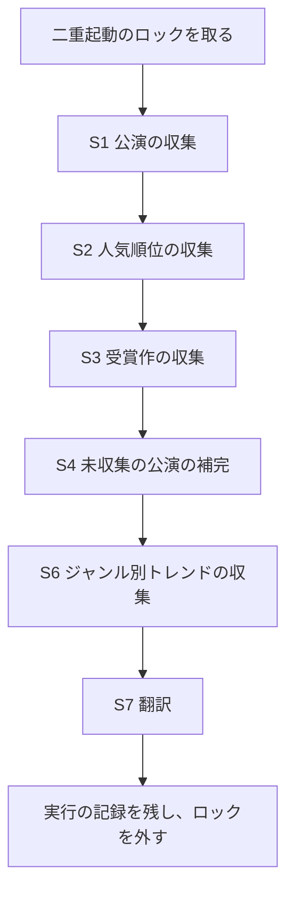
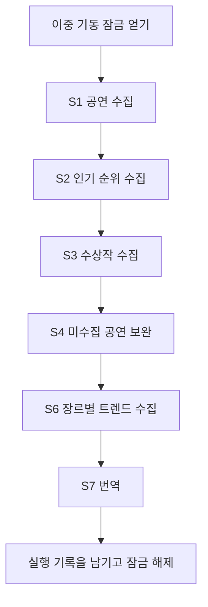

# 05. バッチ設計書

- 状態: 基本設計: 承認（2026-11-06、Issue #15 コメント 6678921752）。詳細設計: レビュー済み（工程4、Issue #20。ゲート4 の reviewer の判定は条件付き承認（2026-11-09）で、指摘を反映済み。人間の承認待ち）。Issue #36 でファイルの確認の結果と人間の決定を 4.2〜4.4・7 に反映（2026-11-19）、reviewer の確認待ち。Issue #38 で KOPIS の実際の呼び出しの確認の結果を 3.1〜3.6・7 に反映（2026-11-20）。Issue #38 の人間の決定1・2・確認3（2026-11-20）を反映し、S5 をなくした（3.6）、reviewer の確認待ち
- 担当: architect
- 最終更新: 2026-11-20
- 前提: [01. 要件定義書](01-requirements.md)（R-62・R-64 を反映）、[03. API 設計書](03-api.md)、ADR 0006〜0016（主に 0007・0008・0009・0012・0013。0016 はアイコンの ADR で、バッチには関係しない）
- ゲート3 の reviewer の指摘（Issue #15 コメント 6678542365）と人間の決定（2026-11-06、コメント 6678516145）を反映した: 3.3 の 3. が ADR 0008 2. の補強であることの明記（提案）、B-03 のパスワードのルール（軽微3。R-64）
- `P-xx` は 02 の判断（一覧は [02 の 8.](02-screens.md)）。この設計書が参照する P-08・P-09・P-11・P-12 は人間が決定した（2026-11-05、Issue #15 コメント 6651238358）
- 工程4（Issue #20）の確認2（2026-11-09 の人間の決定）を反映した: 名前のない予約サイトの保存の仕方（3.3 の 9.。04 の A-01）、S7 の対象に会場の住所を加え、名前のない予約サイトは対象外（3.7）
- 06（クラス設計。Issue #20 の順番3）の作成で、04 の 11.7 から回された事項を反映した（2026-11-09、reviewer の確認の前）: A-02（提供元の値が列の長さを超えるとき。3.3 の 10.・4.3）、A-06（S6 の割合の丸め。3.2）、A-07（B-02 の路線の値の整数への変換。4.3）。コマンドの形・クラス・トランザクションは 06 の 5.・6.
- Issue #36（B-02 の実装の前の確認。7.）で、人間が置いた4つのファイルを確かめた結果と、人間の決定（2026-11-19、Issue #36 のコメント「人間の決定（2026-11-19）」）を 4.2・4.3・4.4・7 に反映した（2026-11-19）: ファイル名・文字コード（CP949）・列の名前、駅住所の正しい出典（data.go.kr 15044231）、駅↔住所・多言語表記・コインロッカーの結びつけと名前の正規化、路線の `2호선(지선)`（A-07 に追加）、日本語の `?` と括弧の副名、福井（복정）駅を規則どおりソウルの駅として入れること。B-02 の実装（Issue #36）で分かったことも反映した（2026-11-19）: 多言語表記の8列目の `"` の中の改行（RFC 4180 のとおり読む。4.2）、コインロッカーの件数の結果 314（4.3 の 4.）
- Issue #38（B-01 の実装の前の確認。7.）で、実行 Claude が 2026-11-20 14:45〜14:58（KST）に実際の KOPIS を呼んで確かめた結果を反映した（2026-11-20）: `pblprfr` の期間の意味（3.3）、`boxoffice` の期間の指定・行数・空の応答（3.1・3.4）、ジャンルの数 G = 9（3.4）、結果コードと空の応答（3.5）、`prfawad` の条件（3.2 の S3）、`boxStatsCate` は全国基準・予約数の項目（3.2 の S6）、`prfstsPrfBy` の `prfdtcnt` は期間の中の回数（3.6）。ジャンルの名前の一覧と XML の読み方は 06（11 の U-02、7.1）
- Issue #38 の人間の決定（2026-11-20、コメント 7032205139）を反映した: 決定1（F-32 ② の廃止。01 の R-69・X-30）と決定2（S5 は作らない）で、B-01 から S5（上演回数の収集）をなくした。ステップの名前は振り直さず S5 を欠番にした（3.6）。確認3 で、S6 の全国基準・`ntssnmrssm`（3.2 の「S6 の詳細」）、S2 の 50 行・ページなし・1日 60 回・「全体」0 件は未集計（3.4）、ジャンルの数 9 と `BBBC` = `무용(서양/한국무용)`（3.4・06 の 11 の U-02）が承認された

## 1. バッチの一覧と実行の仕組み

| ID | 名前 | 起動 | タイミング | 機能名 | 要件 ID |
|---|---|---|---|---|---|
| B-01 | 日次収集（KOPIS の公演・統計と翻訳） | 自動 | 毎日 06:00（Asia/Seoul） | `collect`, `translation` | F-01, F-02, F-07, F-08, F-09, F-11, F-26 ③④, F-27 ③, F-29, F-31, F-32, F-33, F-34, N-01, N-04, N-07 |
| B-02 | 駅・コインロッカーの取り込み | 運営者が手で実行 | コインロッカーは四半期に1回、駅は年に1回または駅の開業・移転・廃止のとき（O-07。ADR 0009） | `surrounding` | F-05, F-06, F-07, F-11 ②, N-04 |
| B-03 | 管理者アカウントの登録 | 運営者が手で実行 | 本番の最初に1回（R-35） | `auth` | F-25 ③④, F-14 ⑦, F-15 ⑤, N-05 ② |
| B-04 | 期限の切れた認証前の申込の削除 | 自動 | 毎日 04:00（Asia/Seoul） | `auth` | F-12 |

### 1.1 実行の仕組み

- **自動の実行**: アプリ（Spring Boot）の中のスケジューラー（`@Scheduled` の cron、タイムゾーン `Asia/Seoul`）で起動する。新しいライブラリは使わない。
- **手での実行（運営者のコマンド）**: 同じアプリを、実行する処理の名前を引数に付けて起動する（例: `--catticket.task=daily-collect`）。その処理だけを行い、Web サーバーを起動せずに終了する。サーバーでは `docker compose run --rm` で一時的なコンテナとして動かす。コマンドの正確な形は 06 の 5.1、手順は運用手順（`docs/ops/`）に書く。処理の名前: `daily-collect`（B-01 の再実行）、`import-subway`（B-02）、`create-admin`（B-03）、`purge-expired-signups`（B-04 の再実行）。
  - 理由: 運営者のための API・画面を作ると、要件にない機能になる（管理者の機能は F-26〜F-28 だけ）。
- **二重起動の防止**: 各バッチは開始時に MySQL の名前付きロック（`GET_LOCK`）を取る。取れなければ（同じバッチが動いている）何もせずに終了し、ログに残す。
- **実行の記録**: バッチ・ステップごとに、開始・終了日時、結果（成功 / 一部失敗 / 失敗）、件数、エラーの内容を DB に残す（項目は 03 の 5.）。ログにも同じ内容を出す。失敗を知らせる機能（通知）は要件にないため作らない。運営者は記録とログで確かめる（運用手順）。

## 2. 「1日」「1か月」の区切り（基準時刻。01 7.3）

| 対象 | 区切り | 理由 | 状態 |
|---|---|---|---|
| サービスの「今日」（終わった公演、180 日後まで、公演の開始日以降のレビュー、公演中・公演予定） | Asia/Seoul の暦の日 | DB・サービスの時刻は Asia/Seoul（`CLAUDE.md`） | 確定 |
| 人気順位・人気急上昇の日・週・月 | Asia/Seoul の暦の日・週（月〜日）・月 | ADR 0008 3. | 確定（ADR 0008） |
| 地図の1日 300 回（ADR 0006） | **Google の割り当ての日（太平洋時間の 0 時に戻る。ソウルでは 16 時または 17 時）** | アプリでは数えず、Google Cloud の割り当てが止める。割り当ては「太平洋時間の 0 時に戻る」（公式: https://developers.google.com/maps/billing-and-pricing/manage-costs 、確認日 2026-11-05）。アプリから変えられない | 確定（提供元の基準） |
| メールの1日 400 通（ADR 0012） | **直近 24 時間**（送る時点から過去 24 時間の数） | Gmail の公式は「1日 500 通」とだけあり、暦の日か直近 24 時間かを書いていない（https://support.google.com/mail/answer/22839 、確認日 2026-11-05）。直近 24 時間で 400 通以下なら、どちらの意味でも 500 通を超えない | 決定（P-08） |
| 翻訳の月 180 万文字（ADR 0007） | **Asia/Seoul の暦の月** | Azure の公式に、月の無料枠の区切りの時刻の記載が見つからない（https://learn.microsoft.com/en-us/azure/ai-services/translator/service-limits 、確認日 2026-11-05）。アプリが数える上限なので、サービスの日付に合わせる。区切りがずれて Azure が先に `403001` を返しても F0 は課金されず、その回の翻訳を止めるだけ（3.7） | 決定（P-09） |

## 3. B-01 日次収集

### 3.1 タイミング

- 毎日 **06:00（Asia/Seoul）** に起動する。
- 理由: 日付が変わった後に「今日」から見た期間（前日の順位、180 日後までの窓）で収集するため。利用が少ない時間で、朝の利用の前に終わる。
- **前日分の順位がいつから返るか**（ADR 0008「注意点」。確認: 2026-11-20、Issue #38）: 14:47 には前日（11/19）の順位が返り、今日（11/20）の分は空の応答（`<boxofs/>`）だった。**06:00 の時点で前日分が返るかは未確認**（7. に残す）。
  - 前日分がまだないときも、エラーではなく空の応答になる。そのまま「0 件で完了」と記録すると、空の期間が表示の対象になる。これを防ぐため、3.4 の「全体が 0 件の期間は未集計」の規則で扱う（前日分がなければ、その期間は記録されず、R-62 のとおり1つ前の期間が表示される）。この規則があるので、06:00 に前日分がなくても誤った表示にはならない（表示が1日遅れるだけ）。
  - 時刻は 06:00 のままにする。7. の確認で 06:00 に前日分がない（または一部しかない）とわかったら、時刻を変えてこの設計書を更新する。
- 日付が変わってから B-01 の S2 が終わるまでは、直近の終わった期間（前日・先週・先月）の順位の収集が終わっていないので、人気順位・人気急上昇は1つ前の期間を、その集計期間と一緒に表示する（P-12、01 F-29 ④・F-33 ②、R-62。判断の方法は 03 の 4.9 と 3.4 の「収集の完了の記録」）。

### 3.2 処理の流れ

- S5 は欠番（3.6。上演回数の収集はやめた）。
- 各ステップは、前のステップが失敗しても実行する（S4 は S2・S3 で取れた分だけで行う）。どれかが失敗したら、バッチの結果は「一部失敗」にする。
- 各ステップの中で DB を書き換える単位（公演1件、順位の1期間・1ジャンルなど）ごとにトランザクションを分け、途中で止まっても書き終えた分は正しい状態で残す。

| ステップ | KOPIS のサービス（ADR 0008） | 処理 | 冪等性（何度実行しても同じ結果） | 要件 |
|---|---|---|---|---|
| S1 公演の収集 | `pblprfr` → `pblprfr/{mt20id}` → `prfplc/{mt10id}` | 3.3 | 公演 ID で追加・更新（上書き）。管理者の修正・非表示は書き換えない | F-01, F-02, F-08, F-09 ②, F-26 ③④, F-27 ③, F-32 ① |
| S2 人気順位の収集 | `boxoffice` | 3.4 | 期間の種類・期間の初日・ジャンルの組で、その組の行を全部入れ替え、同じトランザクションで収集の完了の記録を追加・更新する | F-29, F-33 |
| S3 受賞作の収集 | `prfawad` | S1 と同じ窓（3.3）を 31 日ずつ照会し、公演 ID が一致する公演を「受賞歴あり」にする。**確認済み（2026-11-20、Issue #38）**: 条件は `stdate`・`eddate`（S1 と同じく公演期間が重なる公演を返す）、`signgucode=11`（ソウルで絞れる）、`cpage`・`rows=100`（100 が上限。101 以上は結果コード `06`）。`afterdate` も効くが使わない（すでにある公演に後から受賞が付くことがあり、毎日すべてを見るため）。ページの終わりは 3.3 の 1. と同じ。ソウル・31 日で 19 件だったので、6 区間 × 1 ページ ≒ 6 回 | 「受賞歴あり」を立てるだけで、消さない（受賞歴は過去の事実のため） | F-31 |
| S4 未収集の公演の補完 | `pblprfr/{mt20id}` → `prfplc/{mt10id}` | S2・S3 の結果にあって DB にない公演 ID の、公演詳細と会場を取る（終わった公演も。ADR 0008 2.） | S1 と同じ | F-09 ④, F-29 ⑤ |
| S6 ジャンル別トレンドの収集 | `boxStatsCate` | 前日までの直近 30 日を1回照会し、ジャンルごとの予約数と割合を計算する。地域（ソウル）で絞れればソウル、絞れなければ全国とし、基準を一緒に保存する（R-50）。割合（%）は「そのジャンルの予約数 ÷ 全ジャンルの予約数 × 100」を**小数第6位に `HALF_UP` で丸めて**保存する（04 の 11.7 の A-06。決定: 06 の作成、2026-11-09）。全ジャンルの予約数の合計が 0 のときは割合を計算できないので保存せず（前の期間の行を残す）、そのことを記録に残す。**確認の結果と決定（2026-11-20、Issue #38）は表の下の「S6 の詳細」** | 集計期間の組で全部入れ替える | F-34 |
| S7 翻訳 | （Azure AI Translator） | 3.7 | 同じ原文は二度翻訳しない。翻訳済みの原文は対象にならない | F-02 ⑥, F-11, N-01, N-07 |

**S6 の詳細（確認: 2026-11-20、Issue #38。決定: architect、同日。人間が承認: 2026-11-20、Issue #38 コメント 7032205139 の確認3）**

- **基準は全国（`NATIONAL`）**: `area=11`・`signgucode=11` を付けても付けなくても、応答はバイト単位で同じだった。ソウルで絞れないので、R-50・R-55 のとおり全国の割合を「全国基準」として保存・表示する。地域の変数は送らない（効かないため）。保存する基準はいつも `NATIONAL`。
- **照会**: `stdate` = 今日 − 30 日、`eddate` = 今日 − 1 日（前日までの 30 日。ADR 0008 5.）。1回で全ジャンルの行が返る（ページなし）。
- **応答の行**（根要素 `box-statsofs`、行要素 `boxStatsof`）: `catenm`（ジャンルの名前）、`prfcnt`（公演数）、`prfdtcnt`（上演回数）、`ntssnmrssm`（販売枚数）、`cancelnmrssm`（取消枚数）、`totnmrssm`（総予約数 = 販売枚数 − 取消枚数）、`ntssamountsm`（販売額）。9 ジャンルの行のほかに、名前が `합계`（合計）の行がある。
- **「予約数」には `ntssnmrssm`（販売枚数）を使う**:
  - 理由: F-34 ① の「直近30日の、ジャンル別の予約の割合」は、直近 30 日に**行われた予約**の割合と読む。`ntssnmrssm` はその期間に販売（予約）された枚数で、負にならない。
  - `totnmrssm` を使わない理由: 期間の中の取消には、期間より前に予約された分の取消が入る（実例: 대중무용 は `ntssnmrssm` 2,758、`cancelnmrssm` 9,251 で、`totnmrssm` = −6,493）。負の値があると割合（0〜100%）が決まらず、0 にそろえるなどの手直しは推測の値になる。04 の `genre_trend.booking_count` も 0 以上（CHECK）。
  - `ntssnmrssm` の9行の合計は `합계` の行の `ntssnmrssm` と一致した（2026-10-21〜11-19 で 3,428,245）。
  - **KOPIS の画面との違い**: KOPIS（공연예술통합전산망）の Web の統計の画面の「예매수」は `totnmrssm`（販売枚数 − 取消枚数）の値である（Issue #38 の確認3 の人間の記述）。このサービスは `ntssnmrssm` を使うので、ジャンル別の予約数・割合は KOPIS の画面の「예매수」から計算した値と一致しない。これは上の理由による意図した違いで、誤りではない（テスト・運用で KOPIS の画面と比べるときは `ntssnmrssm` と比べる）。
- **計算**:
  1. `catenm` が `합계` の行（前後の空白を除いて比べる）は除く。
  2. 残りの行の `catenm` を `Genre`（06 の 11 の U-02 の一覧）でコードに変える。一覧にない名前があれば、その回は何も保存せず（前の期間の行を残す）、ステップを失敗にして名前を記録に残す（分母が変わり、すべての割合が変わるため。`Genre` の一覧を直す必要がある）。
  3. `ntssnmrssm` が数でない・空・負の行があれば、2. と同じく何も保存せずステップを失敗にし、ジャンルの名前と値を記録に残す（負は確認した範囲では起きておらず、起きたら提供元の値の意味が変わったとみなす）。
  4. 分母は 2.・3. を通った行の `ntssnmrssm` の合計（`합계` の行の値は使わない）。分母が 0 なら、上の表のとおり保存せず、記録に残す（ステップは成功）。
  5. 返った行のジャンルだけを保存する（予約数 0 のジャンルも、行があれば 0%で保存する。行がないジャンルは保存しない）。
- 同じ名前の行が2つ以上あるときも、2. と同じく何も保存せずステップを失敗にする（一意制約 `uk_genre_trend_end_start_genre` に当たる前に、理由の分かる失敗にする）。

### 3.3 S1 公演の収集

1. **収集の窓**: 今日から 180 日後まで（ADR 0008 2.）。KOPIS の1回の照会は最大 31 日なので、窓を 31 日ずつの 6 区間に分ける。地域はソウル（`signgucode=11`）、ジャンルは指定しない。1ページ 100 件で、最後のページまで照会する。
   - **確認済み（2026-11-20、Issue #38）**: `stdate`・`eddate` は、**公演期間が照会の期間と重なる公演**を返す（1日で照会した 100 件のうち 93 件は開始日が照会の日より前、94 件は終了日が後で、期間の外に完全に出るものは 0）。この窓の分け方で、窓と重なる公演を取りこぼさない。`pblprfr` は 31 日を超える期間でも結果コード `05` にならなかったが、31 日ずつに分けるまま（開発ガイドの上限に合わせる安全側。分けても重なる公演は上書きなので結果は同じ）。ソウル・31 日（2026-11-20〜12-20）で 1,173 件・12 ページ。
   - **最後のページの判定**: 返った行が 100 件より少ない、または空の応答（根要素だけの `<dbs/>`）なら、そのページで終わる。100 件ちょうどのときは次のページを照会する（次が `<dbs/>` なら終わり）。
2. **初回**（前回の成功の記録がない）: すべての区間を `afterdate` なしで照会する。
3. **2回目以降**: 次の2つの結果を合わせる。これは **ADR 0008 2. の補強**である。ADR 0008 2. は「`afterdate`（前回の収集が成功した日）を付け、追加・変更された公演だけを取る」としている。この設計では、(a) `afterdate` を**成功した日の前日**にすること、(b) 新しく窓に入った日を **`afterdate` なしで**問い合わせることを足した（理由はそれぞれの項目に書いた）。ADR 0008 の決定（収集の範囲・方法）とは矛盾しない。
   - (a) すべての区間を、`afterdate` = 前回 S1 が成功した日の前日で照会する（追加・変更された公演。1日ずらすのは、前回の実行中に変わった分を取りこぼさないため。重なって取っても上書きなので結果は同じ）。
   - (b) **前回の窓の末日の翌日〜今日 + 180 日**（今回新しく窓に入った日）を `afterdate` なしで照会する。理由: 長く前に登録され、その後変わっていない公演は (a) では取れないが、開始日が 180 日以内になったときに収集する必要がある（F-08 ②、R-59）。
4. 得た公演 ID ごとに公演詳細を照会し、**自動収集の値**を追加・更新する。管理者の修正した値（03 の 4.10）と非表示（F-27 ③）は書き換えない。韓国語の文が変わった項目は、日本語の翻訳がない状態になる（S7 で翻訳する）。
5. 会場（`mt10id`）がまだ DB にないときだけ、施設詳細を照会して会場を保存する（ADR 0008 2.）。このとき住所から区を決める（03 の 4.2。決められなかった会場の数を記録に残す）。座標（`la`・`lo`）がない会場も保存し、数を記録に残す（P-11）。
6. ソウルの公演かどうかは、公演の地域（`area`）または会場の住所が「서울특별시」であることで判断して保存する（F-01 ②。地図・検索は 03 の 1.6 で絞る）。
7. S1 がすべて成功したときだけ、「前回 S1 が成功した日」と「今回の窓の末日」を記録する。失敗したときは記録を更新しないので、次の実行で同じ範囲を取り直す。
8. 公演のデータは消さない（F-09 ②）。終わったかどうかは照会のときに日付で判定する（03 の 1.6）。
9. **予約サイト**（決定: Issue #20 の確認2、2026-11-09。04 の A-01）: 公演詳細の `relates` の各項目（`relatenm`: 名前、`relateurl`: URL）を、その公演の自動収集の予約サイト（04 の `booking_site` の `COLLECTED` の行）として、返された順に並び順 1, 2, … で保存する。公演詳細を保存するたびに、その公演の `COLLECTED` の行を消して入れ直す（同じ照会の結果なら何度実行しても同じ行になる。管理者の `ADMIN` の行は変えない）。
   - `relatenm` が空（前後の空白を除いて0文字）・ない項目は、名前を **NULL** で保存する（URL を名前の代わりにしない、推測の名前を付けない）。画面は固定の文言（韓国語「예매처」、日本語「予約サイト」）で表示する（02 の SC-02、03 の API-03）。
   - `relateurl` が空・ない項目は保存しない（リンクにできず、F-04 ① の「予約サイトへ移動できる」に使えないため）。保存しなかった数を記録に残す。
10. **提供元の値が列の長さを超えるとき**（決定: 06 の作成、2026-11-09。04 の 11.7 の A-02）: 保存の前にアプリで長さを確かめる（MySQL の strict モードでは長すぎる値の保存がエラーになり、その単位のトランザクションが失敗するため）。長さは Unicode の文字（コードポイント）で数える（`VARCHAR` の長さは文字数。04 の 11.2）。S4 も同じ。
    - **ID**（公演 ID `mt20id`・施設 ID `mt10id`。20 文字）が長すぎる・空: その公演（会場の ID なら、その会場の公演）を保存せず、数と ID を記録に残す（切り詰めると別の公演・会場の ID になるため）。
    - **ジャンル**: 公演詳細のジャンルの名前（`genrenm`）を、ジャンルの一覧（06 の `Genre`。一覧は 06 の 11 の U-02。2026-11-20 に確定）でコードに変える。一覧にない名前の公演は保存せず、数と名前を記録に残す（`genre_code` は必須で、推測のコードを入れないため）。
    - **URL**（ポスター・予約サイトの URL。2,000 文字）が長すぎる: ポスターは NULL で保存する。予約サイトはその項目を保存しない（3.3 の 9. の URL がない項目と同じ）。切り詰めた URL は開けないため。数を記録に残す。
    - **人が読む文**（公演名 500、上演時間・観覧年齢 200、会場名 200、住所 500、予約サイトの名前 200 文字。出演者・チケット価格・公演時間の案内は `TEXT` の 65,535 バイト）が長すぎる: 列の長さに収まるように後ろを切り詰めて保存し、数を記録に残す（公演そのものを保存しないより、ほとんどの内容を表示できる方がよいため。運営者は実行の記録で気づける）。切り詰めた文がそのまま S7 の翻訳の原文になる。

### 3.4 S2 人気順位の収集

- 期間の種類（日次・週次・月次）ごとに、今日から見た**現在の期間**と**直前の期間**（ADR 0008 3. の表）、ジャンル（全体（`catecode` を指定しない）と各ジャンル）ごとに `boxoffice` を照会する（`area=11`）。
- **照会の形（確認済み: 2026-11-20、Issue #38）**: `stdate`（期間の初日）・`eddate`（期間の末日）を `yyyyMMdd` で送る（どちらも必須。ないと結果コード `01`）。`date` という変数は送らない（`stdate` なしで `date` を送ると `01`）。期間の種類を指定する変数はなく、`stdate`〜`eddate` を集計した順位が返る（日・週（7 日）・月（31 日）のいずれも返った）。期間が 31 日を超えると結果コード `05`（3.5）。過去の期間も返る（2024-01 の月で確認。直前の期間は最大で約 62 日前なので足りる）。`area=11` の行の `area` は `서울`。
  - **1組で最大 50 行**（`rnum` 1〜50）。`cpage`・`rows` は効かない（`cpage=2&rows=50` でも同じ 50 行）。ページはなく、1組1回の照会で全部を取る。`cpage`・`rows` は送らない。
  - 50 行なので、非表示の公演を除いて振り直しても、上位 50 行のうち非表示が 40 件以下なら 10 件そろう（F-29 ⑧・F-33 ⑩）。それより少ないときは、ある分だけ表示する（ADR 0008 4. の 5.）。
- 提供元が返したすべての行を保存する（上位 10 位だけではない。ADR 0008 3.）。
- **空の応答（0 件）**: 行がないとき、`boxoffice` は結果コード `04` ではなく、根要素だけの `<boxofs/>` を返す（今日の日付・存在しない `catecode` で確認）。**まだ集計されていない期間（前日分がまだない）も同じ `<boxofs/>` になり、応答だけでは「本当に 0 件」と見分けられない**（3.1）。そこで次の規則で扱う（決定: architect、2026-11-20、Issue #38）。
  - 期間（期間の種類・期間の初日）ごとに、**全体（`catecode` なし）を先に照会**する。
  - **全体が 0 件** → その期間は「未集計」とみなし、その期間の全体・各ジャンルの組の行も記録も変えない（ジャンルの照会もしない）。ステップは失敗にせず、未集計の期間の数と期間を記録に残す。理由: ソウルの全ジャンルの予約が1日（1週・1か月）まるごと 0 件になることは考えにくく、0 件は集計前と考える方が安全。完了と記録すると、空の期間が「収集が終わっている直近の期間」になり、人気順位が空で表示される（R-62 の「1つ前の期間を表示」が働かない）。
  - **全体が 1 件以上** → 全体の組を保存して完了を記録し、続けて各ジャンルを照会する。ジャンルが 0 件なら、そのジャンルは **0 件として完了を記録する**（その期間に集計があることが全体で分かっているので、そのジャンルの予約がないと判断できる。例: 2026-10 月の `BBBR` は 0 件）。
  - 未集計とした期間は、翌日以降の実行で取り直される（現在の期間は翌日には直前の期間になり、毎日取り直す）。その間、API は R-62 のとおり収集が終わっている1つ前の期間を表示する。
- **収集の完了の記録（R-62。03 の 4.9）**: 期間の種類・期間・ジャンルの組ごとに、照会が成功したら、その組の行の入れ替えと「収集の完了の記録」（組、収集を終えた日時、件数）の追加・更新を**1つのトランザクション**で行う。0 件の扱いは上の「空の応答」のとおり（全体が 1 件以上の期間のジャンルだけ、0 件で完了を記録する）。照会に失敗した組と未集計とした期間の組は、行も記録も変えない（前の実行で保存した内容が残る）。API はこの記録で「順位の収集が終わっている直近の期間」を決める。
  - 行があるかどうかで判断しない理由: 0 件の期間（そのジャンルの予約がない）と、まだ収集していない期間を見分けられないため。
  - 入れ替えと記録を同じトランザクションにする理由: 行だけ新しく記録が古い（または逆）状態を API が読まないため。
- 全体の照会が失敗した（再試行の後も）期間は、その期間のジャンルの照会もしない（全体が 0 件か分からないため）。ステップは失敗にする（3.8）。
- 非表示の公演の除外と順位の振り直し、人気急上昇の計算は保存の時点では行わず、API（03 の API-20・API-21）で照会のたびに行う（ADR 0008 4.。非表示にした・解除したことがすぐ反映される）。
- 毎日、現在の期間と直前の期間の両方を取り直すので、ある日の S2 で現在の期間の照会に失敗しても、翌日の実行でその期間（翌日から見た直前の期間）が埋まる。人気急上昇の比べる期間が欠けるのは、同じ期間の照会が2日続けて失敗したときなどに限られる（そのときの画面の表示は 02 の P-17）。

**呼び出し回数の再計算（Issue #14 の決定コメントで 05 に回された事項）**

- 1日の順位の呼び出し = (ジャンルの数 G + 全体 1) × 期間の種類 3 × (現在・直前) 2 = **6 × (G + 1) 回**。
- ADR 0008 6. の「60 回（10 ジャンル × 3 期間 × 現在・直前）」は、「全体」を含めて 10 区分と数えた場合の値である。
- **G = 9 に確定（2026-11-20、Issue #38）**: `boxoffice` の `catecode` で行が返るジャンルは `AAAA`・`GGGA`・`CCCA`・`CCCC`・`CCCD`・`BBBC`・`BBBE`・`EEEA`・`EEEB` の 9 つ（2026-10 月・ソウル。`BBBR` は 0 件で、行の `cate` にも出ない）。行の `cate`、`pblprfr` の `genrenm`（ソウル 1,173 件）、`boxStatsCate` の `catenm` は同じ 9 つの名前（一覧は 06 の 11 の U-02）。`KID`（아동）・`OPEN`（오픈런）も `catecode` として通るが、ジャンルではない区分（行の `cate` は複数のジャンル）なので使わない。→ **1日 最大 60 回**（6 × 10）。全体が 0 件の期間（未集計）はジャンルを照会しないので、その分だけ減る。
- ページはない（1組1回。上の「照会の形」）。

### 3.5 KOPIS の呼び出しの制限への対応（ADR 0008 6.）

KOPIS は呼び出しの制限の数値を公開していない。次の値で呼ぶ。

| 項目 | 値 |
|---|---|
| 呼び出しの間隔 | 1回ごとに 0.5 秒あける（同時に複数を呼ばない） |
| タイムアウト | 接続 5 秒、読み込み 30 秒 |
| 再試行 | 通信のエラー・タイムアウト・HTTP 5xx・結果コード `03`（DB エラー）は、2 秒・4 秒・8 秒あけて最大 3 回 |
| 再試行しないもの | 結果コード `01`（要求の誤り）・`02`（キーの誤り）・`05`（期間が 31 日を超える）・`06`（`rows` が 100 を超える）と、ここにない結果コード。そのステップを失敗にする（`05`・`06` は作りの誤りで、何度呼んでも同じため。ここにないコードは意味が分からないので、呼び続けない） |
| データがない | 一覧（`pblprfr`・`boxoffice`・`prfawad`・`boxStatsCate`）は、根要素だけの空の応答（`<dbs/>`・`<boxofs/>`・`<box-statsofs/>`）が 0 件。詳細（`pblprfr/{mt20id}`・`prfplc/{mt10id}`）は結果コード `04` がない（存在しない ID）。どちらも失敗にしない。一覧で `04` が返ったときも 0 件として扱う。`boxoffice` の 0 件の扱いは 3.4 |
| 止める条件 | 同じステップで、再試行しても失敗した呼び出しが続けて 10 回になったら、そのステップを止めて失敗にする（制限に当たっているときに呼び続けないため） |

**結果コードと応答の形（確認: 2026-11-20、Issue #38）**

- エラーは HTTP 200・`application/xml` で、本文が `<dbs><db><returncode>NN</returncode><errmsg>…</errmsg><responsetime>yyyy-MM-dd HH:mm:ss</responsetime></db></dbs>`。**どのサービスでも根要素は `dbs`**（`boxoffice` のエラーも `dbs`）。確かめたコード: `01` INVALID REQUEST PARAMETER ERROR、`02` SERVICE KEY IS NOT REGISTERED ERROR、`04` NODATA ERROR、`05` 최대 31일까지 조회가능합니다.、`06` 최대 조회수는 100건까지 가능합니다.（`03` は起こせなかった。開発ガイドの DB エラーとして再試行のまま）。
- 成功の根要素・行要素は 06 の 7.1。読み方（エラーの見分け方を含む）も 06 の 7.1。
- `https` で呼ぶと HTTP 301 が返る。`http` で呼ぶ（ADR 0008 6. のとおり。リダイレクトに頼らない）。

**1日の呼び出し回数の見積もり**

| ステップ | 毎日 | 初回 |
|---|---|---|
| S1 公演目録 | (a) 6 区間 × 1〜2 ページ + (b) 1 区間 × 1〜数ページ ≒ 10〜20 回 | 6 区間 × 約 12 ページ ≒ 70 回（2026-11-20 の確認: 最初の 31 日で 12 ページ。先の区間ほど少ない見込み） |
| S1 公演詳細 | 追加・変更の分 ≒ 100 回（ADR 0007 の仮定） | ≒ 3,000 回 |
| S1 施設詳細 | 新しい会場の分（数回） | ≒ 1,000 回 |
| S2 順位 | 最大 60 回（G = 9 に確定。3.4） | 同じ |
| S3 受賞作 | 6 区間 × 1 ページ ≒ 6 回（3.2 の S3） | 同じ |
| S4 補完 | 数回 | 数十回 |
| S6 ジャンル別 | 1 回 | 同じ |
| **合計** | **≒ 200 回（間隔 0.5 秒で約 2 分）** | **≒ 4,200 回（約 35〜40 分）** |

### 3.6 S5（欠番。上演回数の収集をやめた）

- **S5 はない**（人間の決定1、2026-11-20、Issue #38 コメント 7032205139。01 の R-69・X-30）。F-32 ②（開幕からの累計の上演回数）を廃止したので、上演回数は収集も表示もしない。B-01 は `prfstsPrfBy` を呼ばない。
- **ステップの名前は振り直さない（S5 は欠番）**。B-01 のステップは S1〜S4・S6・S7 の6つ。
  - 理由: ステップの名前は実行の記録（03 の 5. の「バッチの実行の記録」、04 の `batch_step_run.step_name`）に入る値で、S6・S7 は 03・06・ADR・Issue #38 の確認の記録などで多く参照されている。振り直すと、同じ名前が前後で違うステップを指し、記録と文書の読み違いが起きる。欠番にすれば、ほかのステップの名前と参照は変わらない。
  - 欠番の S5 は、ほかのステップに使い回さない。将来ステップを足すときは S8 から付ける。
- F-32 ①（オープンランかどうか）は S1 で公演詳細の `openrun` から取る（3.2 の表）。

**確認の結果（2026-11-20、Issue #38。S5 をやめた理由の記録）**

- `prfstsPrfBy` の `prfdtcnt` は**累計ではなく、照会した期間の中の上演回数**。同じ公演で期間を変えると値が変わる（10/20〜11/19 と 11/13〜11/19 の両方にある 460 件のうち 49 件で違う。例: PF305639 は 3 と 1）。日ごとに足せる（PF304568 の 11/13〜11/19 の1日ずつの合計 37 と、7 日まとめての 37 が一致）。
- 照会の条件: `stdate`・`eddate`（最大 31 日）、`cpage`・`rows`（必須。`rows` は最大 100）。地域で絞れない（`area`・`signgucode`・`mt20id`・`prfplccd` は無視される）。`shprfnm`（公演名の部分一致）は効く。
- **古い期間のデータがない公演がある**（オープンラン PF185428（2014-09-11〜）は 2015-01 の照会に行がない）。**登録の公演期間の外の日にも回数がある**（PF304568 は登録の期間 10/27〜11/05 だが 11/13〜11/19 に 37 回）。そのため、開幕日から合計しても開幕からの累計になっているかを確かめられない。
- この結果を人間に報告し（ADR 0008 5.・01 7.3）、人間が F-32 ② の廃止を決めた（R-69）。

### 3.7 S7 翻訳（ADR 0007）

- **対象**（韓国語の文で、日本語の翻訳がまだないもの）: 公演名、出演者、チケット価格、公演時間の案内、上演時間、観覧年齢（管理者の修正した値を含む）、予約サイトの名前、会場名、**会場の住所**（決定: Issue #20 の確認2、2026-11-09）、コインロッカーの位置の文章、公式の日本語表記がない駅名（ADR 0009）。
- **対象にしないもの**: ジャンル・公演の状態・区の名前（画面の辞書）、公式の日本語表記がある駅名、レビュー・ニックネーム（F-11 ④）、出典の文言、**名前が NULL の予約サイト**（3.3 の 9.。翻訳する原文がなく、画面は辞書の固定の文言で表示する）。
- **順番**: 公演名 → 会場名 → 駅名 → それ以外（会場の住所はこの「それ以外」に入る）。理由: 日本語のキーワード検索（F-02 ⑥）と、原文を併記する項目（F-11 ②）を先に翻訳する。上限に近いときに大事なものから訳される。
- 会場の住所の英語の表記は KOPIS にないので使わない（使うには新しい API と ADR が要る）。住所も機械翻訳する。住所を足したことによる文字数の増え方は、会場の数（初回 約 1,000。3.5）× 住所の長さ（数十文字）で、初回に数万文字、毎日は新しい会場の分だけと見込む（ADR 0007 の月 180 万文字と下の速さの範囲に収まる）。
- 同じ原文は一度だけ翻訳し、結果を原文ごとに保存して使い回す（ADR 0007 3.）。

**上限と速さ（ADR 0007 4.。Azure の公式の制限: 1回 5 万文字まで、F0 は1時間 200 万文字で、1分あたり約 33,300 文字を超えないように均等に使う（確認日 2026-11-05））**

| 項目 | 値 |
|---|---|
| 1回の要求 | 1 万文字以内（原文を束ねて送る） |
| 速さ | 1 分あたり 3 万文字以内（要求の間をあける） |
| 月の上限（アプリ側） | 送る前に「今月（Asia/Seoul。P-09）の翻訳文字数 + この要求の文字数」が **180 万文字**を超えるなら、その月の翻訳を止める。翻訳が成功したら、その文字数を今月の数に足す |
| `403001`（無料の割り当てを超えた） | その回の S7 を止める（課金されない）。翻訳できなかった文は次の実行で再び対象になる |
| 429（要求が多すぎる） | 60 秒待って最大 3 回再試行し、だめならその回の S7 を止める |
| そのほかのエラー | 2 秒・4 秒・8 秒あけて最大 3 回再試行し、だめならその回の S7 を止める |

- 翻訳を止めた後も、それまでに翻訳した文は保存したまま表示に使う（02 の 3.4）。
- 時間の見積もり: 毎日 約 1.5 万文字（1 分以内）。初回 約 47 万文字（ADR 0007）は 3 万文字/分で約 16 分。

### 3.8 失敗したときの再実行

| 状況 | 扱い |
|---|---|
| ステップが失敗した | ほかのステップは続ける。バッチの結果を「一部失敗」にする |
| 翌日の自動の実行 | S1 は前回の成功の記録から取り直し、S2・S3・S6 は同じ期間を取り直して上書きするので、失敗した日の分も埋まる（ADR 0008 3.・6.）。S2 は組ごとに収集の完了の記録も付け直すので、埋まった期間はその時点から表示の対象になる（3.4）。S7 は翻訳がない文を毎回対象にする |
| すぐにやり直したい | 運営者がコマンド `daily-collect` で B-01 をもう一度実行する（1.1）。同じ日に何度実行しても結果は同じ |
| アプリが止まっていて 06:00 に動かなかった | 自動では取り戻さない。運営者が `daily-collect` を実行するか、翌日の実行に任せる |

## 4. B-02 駅・コインロッカーの取り込み（O-07。ADR 0009）

### 4.1 タイミング（O-07: 確定。ADR 0009 決定4）

- コインロッカー: **四半期に1回**。提供元（data.go.kr 15044234）の更新周期が「分期」のため。
- 駅（座標・住所・多言語表記）: **年に1回**、または駅の開業・移転・廃止があったとき。
- 運営者が提供元のページで新しい版が出たことを確かめ、ファイルを取得して実行する。確かめる時期（例: 1・4・7・10 月）は運用手順に書く。

### 4.2 ファイルの置き場所

- ADR 0009 の4つのファイル（駅の座標、駅の住所、コインロッカーの位置、駅名の多言語表記）を、リポジトリの `backend/src/main/resources/data/subway/` に置き、出典・基準日・利用条件を書いた `README.md` を同じ場所に置く。
- 新しい版は PR で入れ替える（変更の履歴と出典を残すため）。デプロイの後に `import-subway` を実行する。
- ファイルの文字コード（CP949 か UTF-8 か）と列の名前は、取得したときに確かめて README に書く（ADR 0009「注意点」）。

**確かめた結果（2026-11-19、Issue #36。人間が置いた版）**

| 用途 | ファイル名 | 出典（データのページ） | 行数（見出しを除く） | 列の名前（見出しの行） |
|---|---|---|---|---|
| 駅の座標 | `서울교통공사_1_8호선 역사 좌표(위경도) 정보_20250814.csv` | data.go.kr 15099316 | 276 | `연번`, `호선`, `고유역번호(외부역코드)`, `역명`, `위도`, `경도`, `작성일자`, `작성기준일` |
| 駅の住所 | `서울교통공사_역주소 및 전화번호_20250318.csv` | **data.go.kr 15044231**（서울교통공사_역주소 및 전화번호。ADR 0009 の「訂正」） | 289 | `연번`, `역번호`, `호선`, `역명`, `역전화번호`, `도로명주소`, `지번주소` |
| コインロッカーの位置 | `서울교통공사_물품보관함 위치정보_20260930.csv` | data.go.kr 15044234 | 341 | `연번`, `호선`, `보관함명`, `상세위치` |
| 駅名の多言語表記 | `서울교통공사_역명다국어표기_20241101.csv` | data.seoul.go.kr OA-2751 | 290 | `연번`, `호선`, `한글`, `한자`, `영문`, `중국어`, `일본어`、名前のない8列目（見出し・各行の末尾にカンマがあり、8列目ができる。ほとんどの行は空だが、2行（연번 96 `당고개`、259 `암사역사공원`）は注記が入っていて、`"` の中に改行を含む。値は使わない） |

- 文字コード: 4つとも **CP949**（BOM なし）。Java では `MS949`（java.io・java.lang の正式名。java.nio の正式名は `x-windows-949`、`MS949` はその別名で `Charset.forName` で使える。拡張の文字コードで `jdk.charsets` モジュールにある。実行の Docker イメージ `eclipse-temurin:21-jre` は完全な JRE なので含まれる）。確認先: Oracle「Java SE 21 Supported Encodings」 https://docs.oracle.com/en/java/javase/21/intl/supported-encodings.html （確認日 2026-11-19）。
- 行数は CSV の行（レコード）の数。`"` の中の改行で1行が複数の物理的な行にまたがるので、テキストの行数とは一致しないことがある。
- CSV の形（RFC 4180 のとおり）: 区切りはカンマ、値にカンマ・改行・`"` を含むときは `"` で囲み、`"` の中の `"` は `""` と書く（例: 상세위치 の `"2,3번 출입구 복도 사이"`、多言語表記の8列目の改行を含む注記）。1行目が見出し。列は**見出しの名前**で取る（列の順番に頼らない）。値は前後の空白を除いて使う（strip）。
- 「호선」の書き方: 座標は `1`〜`8`、住所は `1`〜`9`、コインロッカーは `1`〜`9` と `식물원`、多言語表記は `1호선`〜`9호선` と `2호선(지선)`（2号線の支線の駅。座標では `2`）。
- 駅名の書き方: 座標は括弧なし（例: `청량리`, `교대`, `서울`）。住所・多言語表記は括弧の副名つき（例: `청량리(서울시립대입구)`, `교대(법원, 검찰청)`・`교대(법원·검찰청)`）、多言語表記は `서울역`。改名で名前が違う駅もある（座標 `당고개` ↔ 住所 `불암산`。コードは同じ 409）。
- 보관함명の書き方: 駅名 + 任意の「역」+ 番号の範囲（括弧つきもある）+ 任意の英大文字（例: `서울역1~22`, `시청29~44`, `제기동`, `충정로(1~15)`, `충정로B`）。同じ駅に複数の行がある（番号の範囲ごと）。
- 日本語の文字化け: 多言語表記のファイルの日本語の列に `?`（0x3F）がある（17 行）。提供元が CP949 で書き出したときに、CP949 にない文字（長音「ー」、中黒「・」、一部の漢字）が `?` に置き換わったもの。元に戻せない。
- 長さの最大（A-02 の上限の内側）: 日本語の駅名 22 文字、보관함명 14 文字、상세위치 39 文字。

### 4.3 処理の流れ

1. 4つのファイルを読む。どれかがない・読めないとき、見出しに 4.2 の列の名前（多言語表記の名前のない8列目を除く）がないときは、DB を変えずに失敗にする。
2. 駅: 座標のファイルから 1〜8 号線の駅を取り、住所のファイルと結びつけ、**住所が「서울특별시」で始まる駅だけ**を残す（F-05 ②⑥、X-24）。住所と結びつかない駅は、ソウルかどうか分からないので取り込まず、名前を記録に残す。
   - **路線（「호선」）の値は 1〜8 の整数に変える**（決定: 06 の作成、2026-11-09。04 の 11.7 の A-07。2026-11-19 に `(지선)` を追加）: 前後の空白を除き、**末尾の「(지선)」を除き**、末尾の「호선」を除き、残りが数字だけなら整数にする（例: `1`・`01`・`1호선`・`01호선` → 1、`2호선(지선)` → 2）。数字にならない値（`경의중앙선`・`식물원` など）と、1〜8 でない値の行は取り込まない（1〜8号線の外。数を記録に残す）。座標・コインロッカー・多言語表記のファイルの「호선」を同じ規則で変えてから結びつける（住所のファイルの「호선」は使わない。下の結びつけはコードと名前で行う）。
     - 理由: 多言語表記のファイルの `2호선(지선)` は 2号線の支線（신설동・용두・신답・용답・도림천・양천구청・신정네거리・까치산）で、座標のファイルでは `2`。除かないと 1〜8号線の駅の日本語が取れない。「(지선)」は支線を表す書き方で、路線の番号は変わらない。
   - **駅↔住所の結びつけ（2026-11-19 決定）**:
     1. 座標の `고유역번호(외부역코드)` と住所の `역번호` が同じ行で結ぶ（文字列として比べる。路線・名前は見ない）。今の版では 276 駅のうち 275 駅が結びつく。名前が違う駅（당고개 / 불암산）もコードで結びつく。
     2. コードで結びつかない駅は、**名前で探す**: 座標の駅名と、住所の `역명` を「名前の正規化」（下）にかけて同じになる住所の行を、路線を問わずすべて取る。1行以上あり、それらの「ソウルかどうか」がすべて同じなら、それを使う（記録に「名前で結びつけた駅」として名前を残す）。0行、またはソウルとソウル外が混ざるときは、結びつかない駅とする。
        - 今の版では 2号線の `까치산`（コード 200）が該当する。住所のファイルには 5号線の `까치산`（2519）しかないが、同じ駅（乗り換え駅）なので住所は同じ。住所は 서울특별시 강서구 → ソウル。
        - 理由: (路線, 名前) で結ぶ方法は、住所のファイルの括弧の副名のため 70 駅が結びつかない。コードを先に使い、コードのない駅だけ名前に頼ると、名前の書き方の違い・改名の影響を最小にできる。乗り換え駅は路線が違っても同じ場所なので、名前で探すときは路線を問わない。
     3. 住所のファイルの `역번호` が重複するとき（同じコードの行が2つ以上）はファイルの誤りとして失敗にする（結びつけ先が1つに決まらないため）。
   - **ソウルの判定**: 結びついた住所の行の `도로명주소` が「서울특별시」で始まるか（strip した後）。`도로명주소` が空の行は住所がないものとし、結びつかない駅と同じに扱う（今の版に空はない）。
     - 今の版の見込み: ソウルの駅 261（コード 260 + 名前 1）、ソウル外 15（지축, 미사, 하남풍산, 하남시청, 하남검단산, 장암, 철산, 광명사거리, 남위례, 산성, 남한산성입구, 단대오거리, 신흥, 수진, 모란）、結びつかない 0。
     - **8号線 福井（복정）駅は、規則どおりソウルの駅として入れる**（人間の決定、2026-11-19、Issue #36 のコメント。A案）。住所のファイル（15044231）で `도로명주소` が「서울특별시 송파구 송파대로 지하6(장지동)」のため。例外（名前での除外など）は作らない。福井駅のコインロッカーも入れる。01 の F-05 ⑥・X-24 の例（「8号線 福井駅」）は 8号線 牡丹（모란）駅に直す（Issue #41、requirements-analyst）。
   - **保存する値**: 外部の駅コード = 座標の `고유역번호(외부역코드)`、路線 = 上の整数、駅名（韓国語）= 座標の `역명`（括弧なしのまま）、緯度・経度 = 座標の `위도`・`경도`。緯度・経度が数でない・空、緯度が -90〜90・経度が -180〜180 の外、外部の駅コード・駅名が空のときは、ファイルの誤りとして失敗にする。保存する駅どうしで外部の駅コード、または (路線, 駅名) が重複するときも失敗にする（04 の一意制約に当たる前に、理由の分かる失敗にする）。
   - **値の長さ**（決定: 06 の作成、2026-11-09。04 の 11.7 の A-02）: 外部の駅コード（20 文字）、駅名（韓国語 50・日本語 100 文字）、保管庫の名前（200 文字）、位置の文章（500 文字）を超える値が1つでもあれば、ファイルの誤りとみなして入れ替えずに失敗にする（6. の 0 件と同じ扱い。切り詰めない。人がファイルを確かめて直し、もう一度実行する。4.4）。確かめるのは**保存する行の値**（取り込まない行は確かめない）。長さはコードポイントで数える。
3. 駅名の日本語: 多言語表記のファイルの日本語表記を使う。ない駅は日本語なしで保存し、B-01 の S7 で翻訳する。
   - **結びつけ**: (路線, 正規化した名前) で結ぶ。路線は上の規則の整数、名前は多言語表記の `한글` と座標の `역명` をそれぞれ「名前の正規化」にかける。多言語表記のファイルの中で同じキーが2行以上あるときは、ファイルの誤りとして失敗にする（今の版にはない）。
   - **名前の正規化**（駅↔住所の名前での結びつけ、多言語表記、コインロッカーで共通）: ① 前後の空白を除く ② 末尾の括弧の副名（`(…)` または全角の `（…）`。前の空白も）を除く ③ 末尾の「역」を除く（`서울역` → `서울`）④ 前後の空白を除く。比べるときだけ使い、保存する駅名は変えない。
   - **日本語の値の整え方**: ① 前後の空白を除く ② **末尾の括弧の副名を除く**（`ワンシムニ(ソンドン区庁)` → `ワンシムニ`。前の空白も除く）③ 残りに `?` または U+FFFD（変換できない文字）があれば、**文字化けとみなして日本語なし**にする（S7 で翻訳する。記録に駅名を残す）④ 空になったら日本語なし。
     - 括弧の副名を除く理由: 韓国語の駅名（座標の `역명`）は括弧なしなので、日本語もそろえる（F-11 ② で翻訳と原文を並べるため）。
     - 文字化けを日本語なしにする理由: 壊れた文字（`クロ?デジタルダンジ` など）を画面に出さないため。元の文字は分からないので直さない。② の後で確かめるので、括弧の中だけが壊れていた駅（왕십리(2・5号線)、낙성대）は括弧を除いた日本語を使える。
     - 今の版の見込み: 日本語あり 247、文字化けで日本語なし 12（구로디지털단지、고속터미널(3・7)、교대(3)、남부터미널、가락시장(3・8)、경찰병원、월드컵경기장、상봉、어린이대공원、가산디지털단지）、多言語表記に名前がなく日本語なし 2（7号線の 뚝섬유원지・총신대입구。多言語表記側の名前が違う）。
4. コインロッカー: 位置のファイルの「호선・보관함명」を駅の「호선・역명」に結びつけ、その駅に属させる（座標は駅の座標。U-20）。結びつかない行は取り込まず、件数と内容を記録に残す（ADR 0009 決定3）。
   - **보관함명の正規化（2026-11-19 決定）**: ① 前後の空白を除く ② 末尾から、`(数字~数字)`、`数字~数字`、数字の並び、英大文字の並び、空白を、どれにも当たらなくなるまで繰り返し除く（例: `서울역1~22` → `서울역`、`충정로(1~15)` → `충정로`、`충정로B` → `충정로`）③ 上の「名前の正規化」をかける（`서울역` → `서울`）。
   - **結びつけ**: (路線, 正規化した보관함명) を、座標のファイルの **1〜8号線のすべての駅**の (路線, 正規化した駅名) と比べる。
     - 結びついた駅を保存する（ソウル）→ その駅のコインロッカーとして入れる。保管庫の名前は `보관함명` の原文（正規化しない）、位置の文章は `상세위치`。보관함명・상세위치が空ならファイルの誤りとして失敗にする。
     - 結びついた駅を保存しない（ソウル外・住所と結びつかない）→ 取り込まず数を記録（今の版の見込み 9 行: 지축, 철산, 광명사거리, 산성, 남한산성입구, 단대오거리, 신흥, 수진, 모란）。
     - どの駅とも結びつかない → 取り込まず、件数と内容（路線・보관함명・상세위치）を記録（今の版の見込み 1 行: 7号線 `이수`。駅名は `총신대입구`）。別名の表は作らない（1 行のために手で保つ表を増やさない。記録を見て人が判断する）。
     - 1〜8号線の外（`9`・`식물원`）→ 取り込まず数を記録（今の版 17 行）。
   - 今の版の結果（2026-11-19、B-02 の実装で確かめた）: 入れる **314** 行（末尾の英大文字の除去で `충정로B` も 충정로 に結びつく）+ 1〜8号線の外 17 + 結びついた駅を保存しない 9 + 結びつかない 1（`이수`）= 341（ファイルの行数と一致）。駅は 保存 261（うち `까치산` は名前で結びつけた 1）+ ソウル外 15 = 276。
5. 1つのトランザクションで、駅とコインロッカーをすべて入れ替える（削除して入れ直す）。何度実行しても同じ結果になる。駅・コインロッカーはほかのデータから参照されないので、入れ替えても影響がない。
6. 結果（駅の数、コインロッカーの数、取り込まなかった駅・コインロッカーの数）を記録とログに出す。駅の数が 0 件になるときは、ファイルの誤りとみなして入れ替えずに失敗にする。件数の名前は 06 の 5.4（`StepSummary`）。
7. コインロッカーの位置の文章の日本語は、次の B-01 の S7 で翻訳する（ADR 0009 決定3）。

### 4.4 失敗したとき

- 失敗したときは DB を変えない（トランザクションを戻す）ので、前の版のデータで表示が続く。原因（ファイル・結びつけの規則）を直して、もう一度実行する。
- 結びつかないコインロッカーが多い場合の結びつけの規則（名前の書き方の違いなど）は、ファイルを取得して確かめてから決め、この設計書に書き足す（ADR 0009「注意点」）。→ **決めた（2026-11-19）**: 4.3 の 4. の「보관함명の正規化」。今の版で結びつかないのは 1 行（`이수`）。
- 新しい版で、結びつかないコインロッカーが増えた（目安: 1〜8号線の行の 5% を超える）、または名前で結びつけた駅・文字化けの日本語が増えたときは、運営者が記録を見て、書き方の変化かどうかを確かめる。規則を変えるときはこの設計書を直してから実装を変える（バッチは失敗にしない。決まった規則で入れられる分は入れる）。

## 5. B-03 管理者アカウントの登録（R-35）

**確定（設計）**。管理者アカウントは画面から作らず、運営者がサーバーで登録する（F-25 ③、X-25）。

1. 運営者は、サーバーの `.env` に管理者のメールアドレス（`CATTICKET_ADMIN_EMAIL`）と初期パスワード（`CATTICKET_ADMIN_PASSWORD`）を書き、コマンド `create-admin` を実行する。
2. 入力を確かめる: メールアドレスは必須で形が正しいこと（管理者もロック解除の再認証・パスワード再設定でメールを使うため。F-14 ⑦、F-15 ⑤）、パスワードはルール（英字・数字・記号（ASCII の文字）だけで 8〜64 文字、英字と数字を両方含む。N-05 ④、R-64。記号の範囲は 03 の 4.6）を満たすこと。満たさなければ何もせずに失敗にする。
3. 管理者がすでにいるときは、何もせずに終了する（管理者は1つだけ。F-25 ①。既存の管理者のパスワードは上書きしない。変えるときは F-15 の再設定を使う）。
4. 同じメールアドレスの一般ユーザーがいるときは、何もせずに失敗にする。
5. 管理者を、役割「管理者」、状態「有効」（メールの認証は済んだものとする）、失敗回数 0 で作る。パスワードはハッシュにして保存する（ADR 0013 決定6、N-05 ②）。
6. 実行の後、運営者は `.env` から初期パスワードを消す（手順は運用手順）。

**この方法にする理由**

- Flyway のマイグレーションで作る方法は、リポジトリが公開されているため、パスワードのハッシュとメールアドレスがリポジトリに残る。テストの DB にも作られてしまう。
- 運営者が SQL を直接実行する方法は、パスワードのハッシュをアプリの外で作る道具が必要になり、ハッシュの方式（ADR 0013）とずれるおそれがある。
- アプリの起動のたびに環境変数から作る方法は、初期パスワードを `.env` に置き続けることになる。コマンドなら1回だけ使って消せる。

## 6. B-04 期限の切れた認証前の申込の削除

**確定（設計）**。会員登録の認証のリンク（24 時間。P-10）の期限が切れた認証前の申込を削除する。人間の決定（Issue #15 コメント 6677710885 の Q-01 の B）で認証前の申込はニックネームを押さえないため（03 の 4.7）、削除の目的は他人の登録を妨げないことではなく、**使われないメールアドレス・パスワードのハッシュを持ち続けないこと（記録の整理）**である。

### 6.1 タイミング

- 毎日 **04:00（Asia/Seoul）** に起動する（1.1 のスケジューラー）。B-01（06:00）と重ならない時刻にした（ロックは別なので重なっても動くが、記録を読みやすくするため）。
- 期限の切れた行は、期限から最長でおよそ1日残る。残っている間の動き（03 の 4.7）: 同じメールアドレスの申込し直しは置き換えで受け付ける（P-10）。そのメールアドレスでのログインは「認証が済んでいない」を返す。ニックネームは押さえないので、ほかの人の申込・認証・ニックネームの変更を妨げない。

### 6.2 処理の流れ

1. 二重起動のロック（`GET_LOCK`）を取る（1.1）。
2. 削除の基準の時刻として、実行の時刻を1つ決める。
3. **認証前**のアカウントのうち、**会員登録の認証のトークンの有効期限が基準の時刻より前**のもの（有効期限内の会員登録の認証のトークンが1つもないもの）を削除する。トークンも一緒に削除する（外部キーの削除の扱いは 04）。有効なアカウント（一般ユーザー・管理者）は対象にしない。
4. 削除した件数を、実行の記録（03 の 5.）とログに残し、ロックを外す。

- 1つのトランザクションで削除する（件数は多くない見込み。多くなったら工程4・実装で分割を考える）。
- 外部 API を使わないので、呼び出しの制限への対応はない。

### 6.3 冪等性と失敗したとき

- **冪等性**: 削除の条件は「認証前」かつ「期限が切れている」だけで決まり、何度実行しても、残る行は同じ（2回目以降は、その間に新しく期限が切れた行だけが消える）。
- **競合**: 認証の完了（API-34）は期限内のトークンだけを受け付ける（03 の 4.7）。B-04 は期限の切れた行だけを消すので、認証できる申込を消すことはない。期限の直前に認証の完了と B-04 が同時に動いたときの行のロックの取り方は 03 の 9.2（D-05）で決め、クラスとトランザクションは 06 の 6.3 に書いた。
- **失敗したとき**: トランザクションを戻し、記録を「失敗」にする。次の日の実行で同じ行を消すので、再実行は必須ではない。すぐ消したいときは運営者が `purge-expired-signups` を手で実行する（1.1）。

## 7. 実装の前に確かめること

| 事項 | 確かめた結果で変わるもの | 出どころ |
|---|---|---|
| `pblprfr` の `stdate`・`eddate` が「公演期間が重なる公演」を返すか | 3.3 の窓の照会の方法 | この設計書。**確認済み（2026-11-20、Issue #38）**: 重なる公演を返す。31 日ずつの分け方のまま（3.3 の 1.） |
| `boxoffice` の期間の指定方法・`date` の扱い・返す行数・過去の照会の範囲・前日分を返す時刻 | 3.1 の時刻、3.4 の回数 | ADR 0008「注意点」。**確認済み（2026-11-20、Issue #38）**: `stdate`・`eddate` で日・週・月を指定でき、`date` は使わない。1組最大 50 行・ページなし。過去（2024-01）も返る。0 件は `<boxofs/>`。前日分は 14:47 には返った（3.4）。**06:00 の時点で前日分が返るかは未確認**（下の行） |
| `boxoffice` の前日分が 06:00 の時点で返るか（全部そろっているか） | 3.1 の時刻 | 上の行の残り。**未確認**。確かめ方: 実行 Claude が 06:00〜06:10 に前日の全体（`catecode` なし）を照会し、同じ日の 12:00 以降の照会と行（`rnum`・`mt20id`）を比べる。空、または行が違えば、06:00 には前日分がそろっていない。結果で時刻を決め直す（3.1）。確かめる前でも、3.4 の「全体が 0 件の期間は未集計」で誤った表示にはならない（一部だけそろっている場合は防げないので、この確認が要る） |
| ジャンルの数 G（共通コードの一覧、`boxoffice` の `catecode`） | 3.4 の回数（60 回か 66 回か） | ADR 0008「注意点」、Issue #14。**確認済み（2026-11-20、Issue #38）**: G = 9、1日 最大 60 回（3.4）。名前の一覧は 06 の 11 の U-02（`BBBC` の名前は `무용(서양/한국무용)`） |
| `prfstsPrfBy` の `prfdtcnt` が累計か | 3.6 の方法（得られなければ作業を止めて報告） | ADR 0008「注意点」。**確認済み（2026-11-20、Issue #38）**: 累計ではなく期間の中の回数。日ごとに足せるが、古い期間のデータがない公演があり、開幕からの累計を確かめられない。作業を止めて人間に報告し、人間が F-32 ② の廃止を決めた（R-69。2026-11-20、Issue #38 コメント 7032205139）。**S5 はなくなった（3.6）** |
| `boxStatsCate` をソウルで絞れるか | S6 の基準（ソウル / 全国） | ADR 0008「注意点」。**確認済み（2026-11-20、Issue #38）**: 絞れない → 全国基準（R-50）。予約数は `ntssnmrssm`、`합계` の行は除く（3.2 の「S6 の詳細」） |
| `prfawad` の照会の条件 | S3 の回数 | ADR 0008「注意点」。**確認済み（2026-11-20、Issue #38）**: `signgucode=11` で絞れ、`rows` は最大 100。6 区間 × 1 ページ ≒ 6 回（3.2 の S3） |
| 結果コードの要素名・0 件の応答・根要素と行要素の名前 | 06 の 4.9・7.1 の XML の読み方 | 06 の 11 の U-02。**確認済み（2026-11-20、Issue #38）**: 3.5 の「結果コードと応答の形」、06 の 7.1 |
| 駅・コインロッカーのファイルの文字コード・列・結びつけ | 4.2・4.3 | ADR 0009「注意点」。**確認済み**（2026-11-19、Issue #36）: 4.2 の「確かめた結果」と 4.3。01 の F-05 ⑥・X-24 の例（福井駅）と住所のファイルが食い違ったため作業を止めて報告し、人間が A案（住所どおりソウルの駅）に決めた（4.3 の 2.。01 の例は Issue #41 で直す） |

確かめた結果、要件を満たせないとわかった場合は、推測で埋めずに作業を止めて人間に報告する（01 7.3）。

---

## 한국어

### 05. 배치 설계서

- 상태: 기본설계: 승인(2026-11-06, Issue #15 코멘트 6678921752). 상세설계: 리뷰 완료(공정 4, Issue #20. 관문 4의 reviewer 판정은 조건부 승인(2026-11-09)이며, 지적을 반영함. 사람의 승인 대기). Issue #36에서 파일 확인 결과와 사람의 결정을 4.2~4.4·7에 반영(2026-11-19), reviewer 확인 대기. Issue #38에서 KOPIS 실제 호출 확인 결과를 3.1~3.6·7에 반영(2026-11-20). Issue #38의 사람의 결정 1·2·확인 3(2026-11-20)을 반영해 S5를 없앴다(3.6), reviewer 확인 대기
- 담당: architect
- 최종 갱신: 2026-11-20
- 전제: [01. 요건정의서](01-requirements.md)(R-62·R-64 반영), [03. API 설계서](03-api.md), ADR 0006~0016(주로 0007·0008·0009·0012·0013. 0016은 아이콘 ADR로 배치와는 관계없다)
- 관문 3 reviewer의 지적(Issue #15 코멘트 6678542365)과 사람의 결정(2026-11-06, 코멘트 6678516145)을 반영했다: 3.3의 3.이 ADR 0008 2.의 보강임을 명시(제안), B-03의 비밀번호 규칙(경미 3. R-64)
- `P-xx`는 02의 판단(목록은 [02의 8.](02-screens.md)). 이 설계서가 참조하는 P-08·P-09·P-11·P-12는 사람이 결정했다(2026-11-05, Issue #15 코멘트 6651238358)
- 공정 4(Issue #20) 확인 2(2026-11-09 사람의 결정)를 반영했다: 이름 없는 예매처의 저장 방법(3.3의 9.. 04의 A-01), S7 대상에 공연장 주소를 더하고 이름 없는 예매처는 대상에서 뺌(3.7)
- 06(클래스 설계. Issue #20의 순서 3) 작성에서 04의 11.7에서 넘어온 사항을 반영했다(2026-11-09, reviewer 확인 전): A-02(제공처의 값이 열 길이를 넘을 때. 3.3의 10.·4.3), A-06(S6 비중의 반올림. 3.2), A-07(B-02 노선 값의 정수 변환. 4.3). 명령 형태·클래스·트랜잭션은 06의 5.·6.
- Issue #36(B-02 구현 전 확인. 7.)에서 사람이 둔 파일 4개를 확인한 결과와 사람의 결정(2026-11-19, Issue #36 코멘트 "사람의 결정(2026-11-19)")을 4.2·4.3·4.4·7에 반영했다(2026-11-19): 파일 이름·문자 코드(CP949)·열 이름, 역 주소의 올바른 출처(data.go.kr 15044231), 역↔주소·다국어 표기·물품보관함 연결과 이름 정규화, 노선 `2호선(지선)`(A-07에 추가), 일본어의 `?`와 괄호 부제, 복정역을 규칙대로 서울 역으로 넣는 것. B-02 구현(Issue #36)에서 알게 된 것도 반영했다(2026-11-19): 다국어 표기 8번째 열의 `"` 안 줄바꿈(RFC 4180대로 읽음. 4.2), 물품보관함 건수 결과 314(4.3의 4.)
- Issue #38(B-01 구현 전 확인. 7.)에서 실행 Claude가 2026-11-20 14:45~14:58(KST)에 실제 KOPIS를 불러 확인한 결과를 반영했다(2026-11-20): `pblprfr` 기간의 의미(3.3), `boxoffice`의 기간 지정·행 수·빈 응답(3.1·3.4), 장르 수 G = 9(3.4), 결과 코드와 빈 응답(3.5), `prfawad` 조건(3.2의 S3), `boxStatsCate`는 전국 기준·예매 수 항목(3.2의 S6), `prfstsPrfBy`의 `prfdtcnt`는 기간 안의 횟수(3.6). 장르 이름 목록과 XML 읽는 법은 06(11의 U-02, 7.1)
- Issue #38의 사람의 결정(2026-11-20, 코멘트 7032205139)을 반영했다: 결정 1(F-32 ② 폐지. 01의 R-69·X-30)과 결정 2(S5는 만들지 않음)로 B-01에서 S5(상연 횟수 수집)를 없앴다. 스텝 이름은 다시 매기지 않고 S5를 결번으로 했다(3.6). 확인 3에서 S6의 전국 기준·`ntssnmrssm`(3.2의 "S6 상세"), S2의 50행·페이지 없음·하루 60회·"전체" 0건은 미집계(3.4), 장르 수 9와 `BBBC` = `무용(서양/한국무용)`(3.4·06의 11의 U-02)이 승인되었다

### 1. 배치 목록과 실행 구조

| ID | 이름 | 기동 | 시점 | 기능명 | 요건 ID |
|---|---|---|---|---|---|
| B-01 | 일간 수집(KOPIS 공연·통계와 번역) | 자동 | 매일 06:00(Asia/Seoul) | `collect`, `translation` | F-01, F-02, F-07, F-08, F-09, F-11, F-26 ③④, F-27 ③, F-29, F-31, F-32, F-33, F-34, N-01, N-04, N-07 |
| B-02 | 역·물품보관함 수집 | 운영자가 수동 실행 | 물품보관함은 분기에 1번, 역은 1년에 1번 또는 역 개통·이전·폐지 때(O-07. ADR 0009) | `surrounding` | F-05, F-06, F-07, F-11 ②, N-04 |
| B-03 | 관리자 계정 등록 | 운영자가 수동 실행 | 운영 처음에 1번(R-35) | `auth` | F-25 ③④, F-14 ⑦, F-15 ⑤, N-05 ② |
| B-04 | 기한이 지난 인증 전 신청 삭제 | 자동 | 매일 04:00(Asia/Seoul) | `auth` | F-12 |

#### 1.1 실행 구조

- **자동 실행**: 앱(Spring Boot) 안의 스케줄러(`@Scheduled` cron, 타임존 `Asia/Seoul`)로 기동한다. 새 라이브러리는 쓰지 않는다.
- **수동 실행(운영자 명령)**: 같은 앱을, 실행할 처리 이름을 인수로 붙여 기동한다(예: `--catticket.task=daily-collect`). 그 처리만 하고, 웹 서버를 기동하지 않고 끝난다. 서버에서는 `docker compose run --rm`으로 임시 컨테이너로 돌린다. 명령의 정확한 형태는 06의 5.1, 절차는 운영 절차(`docs/ops/`)에 쓴다. 처리 이름: `daily-collect`(B-01 재실행), `import-subway`(B-02), `create-admin`(B-03), `purge-expired-signups`(B-04 재실행).
  - 이유: 운영자용 API·화면을 만들면 요건에 없는 기능이 된다(관리자 기능은 F-26~F-28뿐).
- **이중 기동 방지**: 각 배치는 시작할 때 MySQL 이름 있는 잠금(`GET_LOCK`)을 얻는다. 얻지 못하면(같은 배치가 돌고 있음) 아무것도 하지 않고 끝내며 로그에 남긴다.
- **실행 기록**: 배치·스텝별로 시작·종료 일시, 결과(성공 / 일부 실패 / 실패), 건수, 오류 내용을 DB에 남긴다(항목은 03의 5.). 로그에도 같은 내용을 낸다. 실패를 알리는 기능(알림)은 요건에 없으므로 만들지 않는다. 운영자는 기록과 로그로 확인한다(운영 절차).

### 2. "하루", "한 달"의 구분 (기준 시각. 01 7.3)

| 대상 | 구분 | 이유 | 상태 |
|---|---|---|---|
| 서비스의 "오늘"(끝난 공연, 180일 후까지, 공연 시작일 이후 리뷰, 공연 중·공연 예정) | Asia/Seoul 달력의 날 | DB·서비스 시각은 Asia/Seoul(`CLAUDE.md`) | 확정 |
| 인기 순위·인기 급상승의 일·주·월 | Asia/Seoul 달력의 날·주(월~일)·월 | ADR 0008 3. | 확정(ADR 0008) |
| 지도 하루 300회(ADR 0006) | **Google 할당량의 날(태평양 시간 0시에 초기화. 서울에서는 16시 또는 17시)** | 앱에서는 세지 않고 Google Cloud 할당량이 멈춘다. 할당량은 "태평양 시간 0시에 초기화"(공식: https://developers.google.com/maps/billing-and-pricing/manage-costs , 확인일 2026-11-05). 앱에서 바꿀 수 없다 | 확정(제공처 기준) |
| 메일 하루 400통(ADR 0012) | **최근 24시간**(보내는 시점에서 지난 24시간의 수) | Gmail 공식은 "하루 500통"이라고만 하고 달력의 날인지 최근 24시간인지 쓰지 않았다(https://support.google.com/mail/answer/22839 , 확인일 2026-11-05). 최근 24시간에 400통 이하면 어느 뜻이든 500통을 넘지 않는다 | 결정(P-08) |
| 번역 월 180만 자(ADR 0007) | **Asia/Seoul 달력의 월** | Azure 공식에서 월 무료 한도의 경계 시각 기재를 찾지 못했다(https://learn.microsoft.com/en-us/azure/ai-services/translator/service-limits , 확인일 2026-11-05). 앱이 세는 상한이므로 서비스 날짜에 맞춘다. 경계가 어긋나 Azure가 먼저 `403001`을 돌려줘도 F0은 과금되지 않고 그 회차 번역을 멈출 뿐(3.7) | 결정(P-09) |

### 3. B-01 일간 수집

#### 3.1 시점

- 매일 **06:00(Asia/Seoul)**에 기동한다.
- 이유: 날짜가 바뀐 뒤 "오늘"에서 본 기간(전날 순위, 180일 후까지의 창)으로 수집하기 위해. 이용이 적은 시간이고, 아침 이용 전에 끝난다.
- **전날 분 순위가 언제부터 오는지**(ADR 0008 "주의점". 확인: 2026-11-20, Issue #38): 14:47에는 전날(11/19) 순위가 왔고, 오늘(11/20) 분은 빈 응답(`<boxofs/>`)이었다. **06:00 시점에 전날 분이 오는지는 미확인**(7.에 남긴다).
  - 전날 분이 아직 없을 때도 오류가 아니라 빈 응답이 온다. 그대로 "0건으로 완료"라고 기록하면 빈 기간이 표시 대상이 된다. 이를 막기 위해 3.4의 "전체가 0건인 기간은 미집계" 규칙으로 다룬다(전날 분이 없으면 그 기간은 기록되지 않고, R-62대로 하나 앞 기간이 표시된다). 이 규칙이 있으므로 06:00에 전날 분이 없어도 잘못된 표시는 되지 않는다(표시가 하루 늦어질 뿐).
  - 시각은 06:00 그대로 둔다. 7.의 확인에서 06:00에 전날 분이 없다(또는 일부만 있다)고 판명되면 시각을 바꾸고 이 설계서를 갱신한다.
- 날짜가 바뀐 뒤 B-01의 S2가 끝날 때까지는 가장 최근에 끝난 기간(전날·지난주·지난달)의 순위 수집이 끝나지 않았으므로, 인기 순위·인기 급상승은 하나 앞 기간을 그 집계 기간과 함께 보여준다(P-12, 01 F-29 ④·F-33 ②, R-62. 판단 방법은 03의 4.9와 3.4의 "수집 완료 기록").

#### 3.2 처리 흐름

- S5는 결번(3.6. 상연 횟수 수집은 그만뒀다).
- 각 스텝은 앞 스텝이 실패해도 실행한다(S4는 S2·S3에서 얻은 만큼으로 한다). 어느 하나가 실패하면 배치 결과를 "일부 실패"로 한다.
- 각 스텝 안에서 DB를 고쳐 쓰는 단위(공연 1건, 순위의 1기간·1장르 등)마다 트랜잭션을 나눠, 도중에 멈춰도 다 쓴 부분은 올바른 상태로 남긴다.

| 스텝 | KOPIS 서비스(ADR 0008) | 처리 | 멱등성(몇 번 실행해도 같은 결과) | 요건 |
|---|---|---|---|---|
| S1 공연 수집 | `pblprfr` → `pblprfr/{mt20id}` → `prfplc/{mt10id}` | 3.3 | 공연 ID로 추가·갱신(덮어쓰기). 관리자 수정·숨김은 고쳐 쓰지 않는다 | F-01, F-02, F-08, F-09 ②, F-26 ③④, F-27 ③, F-32 ① |
| S2 인기 순위 수집 | `boxoffice` | 3.4 | 기간 종류·기간 첫날·장르의 조합으로 그 조합의 행을 모두 바꾸고, 같은 트랜잭션에서 수집 완료 기록을 추가·갱신한다 | F-29, F-33 |
| S3 수상작 수집 | `prfawad` | S1과 같은 창(3.3)을 31일씩 조회해, 공연 ID가 일치하는 공연을 "수상 이력 있음"으로 한다. **확인 완료(2026-11-20, Issue #38)**: 조건은 `stdate`·`eddate`(S1과 같이 공연 기간이 겹치는 공연을 돌려준다), `signgucode=11`(서울로 거를 수 있다), `cpage`·`rows=100`(100이 상한. 101 이상은 결과 코드 `06`). `afterdate`도 듣지만 쓰지 않는다(이미 있는 공연에 나중에 수상이 붙을 수 있어 매일 전부를 보기 위해). 페이지의 끝은 3.3의 1.과 같다. 서울·31일에 19건이었으므로 6구간 × 1페이지 ≒ 6회 | "수상 이력 있음"을 세우기만 하고 지우지 않는다(수상 이력은 과거의 사실이므로) | F-31 |
| S4 미수집 공연 보완 | `pblprfr/{mt20id}` → `prfplc/{mt10id}` | S2·S3 결과에 있고 DB에 없는 공연 ID의 공연상세와 공연장을 가져온다(끝난 공연도. ADR 0008 2.) | S1과 같음 | F-09 ④, F-29 ⑤ |
| S6 장르별 트렌드 수집 | `boxStatsCate` | 전날까지 최근 30일을 1번 조회해 장르별 예매 수와 비중을 계산한다. 지역(서울)으로 거를 수 있으면 서울, 없으면 전국으로 하고 기준을 함께 저장한다(R-50). 비중(%)은 "그 장르의 예매 수 ÷ 전 장르의 예매 수 × 100"을 **소수 여섯째 자리로 `HALF_UP` 반올림해** 저장한다(04의 11.7의 A-06. 결정: 06 작성, 2026-11-09). 전 장르 예매 수의 합계가 0이면 비중을 계산할 수 없으므로 저장하지 않고(이전 기간의 행을 남긴다), 그 사실을 기록에 남긴다. **확인 결과와 결정(2026-11-20, Issue #38)은 표 아래 "S6 상세"** | 집계 기간 조합으로 모두 바꾼다 | F-34 |
| S7 번역 | (Azure AI Translator) | 3.7 | 같은 원문은 두 번 번역하지 않는다. 번역된 원문은 대상이 되지 않는다 | F-02 ⑥, F-11, N-01, N-07 |

**S6 상세(확인: 2026-11-20, Issue #38. 결정: architect, 같은 날. 사람이 승인: 2026-11-20, Issue #38 코멘트 7032205139의 확인 3)**

- **기준은 전국(`NATIONAL`)**: `area=11`·`signgucode=11`을 붙여도 붙이지 않아도 응답이 바이트 단위로 같았다. 서울로 거를 수 없으므로 R-50·R-55대로 전국 비중을 "전국 기준"으로 저장·표시한다. 지역 변수는 보내지 않는다(듣지 않으므로). 저장하는 기준은 항상 `NATIONAL`.
- **조회**: `stdate` = 오늘 − 30일, `eddate` = 오늘 − 1일(전날까지 30일. ADR 0008 5.). 한 번에 전 장르 행이 온다(페이지 없음).
- **응답 행**(루트 요소 `box-statsofs`, 행 요소 `boxStatsof`): `catenm`(장르 이름), `prfcnt`(공연 수), `prfdtcnt`(상연 횟수), `ntssnmrssm`(판매 매수), `cancelnmrssm`(취소 매수), `totnmrssm`(총예매 수 = 판매 매수 − 취소 매수), `ntssamountsm`(판매액). 9장르 행 외에 이름이 `합계`인 행이 있다.
- **"예매 수"에는 `ntssnmrssm`(판매 매수)을 쓴다**:
  - 이유: F-34 ①의 "최근 30일의 장르별 예매 비중"은 최근 30일에 **이루어진 예매**의 비중으로 읽는다. `ntssnmrssm`은 그 기간에 판매(예매)된 매수이고 음수가 되지 않는다.
  - `totnmrssm`을 쓰지 않는 이유: 기간 안의 취소에는 기간보다 전에 예매된 분의 취소가 들어간다(실례: 대중무용은 `ntssnmrssm` 2,758, `cancelnmrssm` 9,251로 `totnmrssm` = −6,493). 음수가 있으면 비중(0~100%)이 정해지지 않고, 0으로 맞추는 등의 손질은 추측한 값이 된다. 04의 `genre_trend.booking_count`도 0 이상(CHECK).
  - `ntssnmrssm` 9행의 합계는 `합계` 행의 `ntssnmrssm`과 일치했다(2026-10-21~11-19에 3,428,245).
  - **KOPIS 화면과의 차이**: KOPIS(공연예술통합전산망) 웹 통계 화면의 "예매수"는 `totnmrssm`(판매 매수 − 취소 매수) 값이다(Issue #38 확인 3의 사람의 기술). 이 서비스는 `ntssnmrssm`을 쓰므로, 장르별 예매 수·비중은 KOPIS 화면의 "예매수"로 계산한 값과 일치하지 않는다. 이는 위 이유에 따른 의도된 차이이며 오류가 아니다(테스트·운영에서 KOPIS 화면과 비교할 때는 `ntssnmrssm`과 비교한다).
- **계산**:
  1. `catenm`이 `합계`인 행(앞뒤 공백을 빼고 비교)은 뺀다.
  2. 남은 행의 `catenm`을 `Genre`(06의 11의 U-02 목록)로 코드로 바꾼다. 목록에 없는 이름이 있으면 그 회차는 아무것도 저장하지 않고(이전 기간의 행을 남긴다) 스텝을 실패로 하며 이름을 기록에 남긴다(분모가 바뀌어 모든 비중이 바뀌므로. `Genre` 목록을 고쳐야 한다).
  3. `ntssnmrssm`이 수가 아니거나 비었거나 음수인 행이 있으면 2.와 같이 아무것도 저장하지 않고 스텝을 실패로 하며, 장르 이름과 값을 기록에 남긴다(음수는 확인한 범위에서는 일어나지 않았고, 일어나면 제공처 값의 의미가 바뀐 것으로 본다).
  4. 분모는 2.·3.을 통과한 행의 `ntssnmrssm` 합계(`합계` 행의 값은 쓰지 않는다). 분모가 0이면 위 표대로 저장하지 않고 기록에 남긴다(스텝은 성공).
  5. 돌아온 행의 장르만 저장한다(예매 수 0인 장르도 행이 있으면 0%로 저장한다. 행이 없는 장르는 저장하지 않는다).
- 같은 이름의 행이 2개 이상일 때도 2.와 같이 아무것도 저장하지 않고 스텝을 실패로 한다(유일 제약 `uk_genre_trend_end_start_genre`에 걸리기 전에 이유를 알 수 있는 실패로 한다).

#### 3.3 S1 공연 수집

1. **수집 창**: 오늘부터 180일 후까지(ADR 0008 2.). KOPIS 1번 조회는 최대 31일이므로 창을 31일씩 6구간으로 나눈다. 지역은 서울(`signgucode=11`), 장르는 지정하지 않는다. 1페이지 100건으로 마지막 페이지까지 조회한다.
   - **확인 완료(2026-11-20, Issue #38)**: `stdate`·`eddate`는 **공연 기간이 조회 기간과 겹치는 공연**을 돌려준다(하루로 조회한 100건 중 93건은 시작일이 조회일보다 앞, 94건은 종료일이 뒤이고, 기간 밖으로 완전히 나가는 것은 0). 이 창 나누기로 창과 겹치는 공연을 놓치지 않는다. `pblprfr`는 31일을 넘는 기간에서도 결과 코드 `05`가 되지 않았지만 31일씩 나누는 것을 유지한다(개발가이드 상한에 맞추는 안전한 쪽. 나눠도 겹치는 공연은 덮어쓰므로 결과는 같다). 서울·31일(2026-11-20~12-20)에 1,173건·12페이지.
   - **마지막 페이지 판정**: 돌아온 행이 100건보다 적거나 빈 응답(루트 요소뿐인 `<dbs/>`)이면 그 페이지에서 끝낸다. 딱 100건일 때는 다음 페이지를 조회한다(다음이 `<dbs/>`면 끝).
2. **첫 실행**(지난 성공 기록이 없음): 모든 구간을 `afterdate` 없이 조회한다.
3. **두 번째부터**: 다음 두 결과를 합친다. 이것은 **ADR 0008 2.의 보강**이다. ADR 0008 2.는 "`afterdate`(지난 수집이 성공한 날)를 붙여 추가·변경된 공연만 가져온다"고 한다. 이 설계에서는 (a) `afterdate`를 **성공한 날의 전날**로 하는 것, (b) 새로 창에 들어온 날을 **`afterdate` 없이** 조회하는 것을 더했다(이유는 각 항목에 썼다). ADR 0008의 결정(수집 범위·방법)과 모순되지 않는다.
   - (a) 모든 구간을 `afterdate` = 지난번 S1이 성공한 날의 전날로 조회한다(추가·변경된 공연. 하루 당기는 것은 지난 실행 중에 바뀐 것을 놓치지 않기 위해. 겹쳐 가져와도 덮어쓰므로 결과는 같다).
   - (b) **지난 창 마지막 날의 다음 날 ~ 오늘 + 180일**(이번에 새로 창에 들어온 날)을 `afterdate` 없이 조회한다. 이유: 오래전에 등록되고 그 뒤 바뀌지 않은 공연은 (a)로는 가져올 수 없지만, 시작일이 180일 안이 되었을 때 수집해야 한다(F-08 ②, R-59).
4. 얻은 공연 ID마다 공연상세를 조회해 **자동 수집 값**을 추가·갱신한다. 관리자가 수정한 값(03의 4.10)과 숨김(F-27 ③)은 고쳐 쓰지 않는다. 한국어 글이 바뀐 항목은 일본어 번역이 없는 상태가 된다(S7에서 번역).
5. 공연장(`mt10id`)이 아직 DB에 없을 때만 시설상세를 조회해 공연장을 저장한다(ADR 0008 2.). 이때 주소로 구를 정한다(03의 4.2. 정하지 못한 공연장 수를 기록에 남긴다). 좌표(`la`·`lo`)가 없는 공연장도 저장하고 수를 기록에 남긴다(P-11).
6. 서울 공연인지는 공연 지역(`area`) 또는 공연장 주소가 "서울특별시"인지로 판단해 저장한다(F-01 ②. 지도·검색은 03의 1.6으로 거른다).
7. S1이 모두 성공했을 때만 "지난번 S1이 성공한 날"과 "이번 창의 마지막 날"을 기록한다. 실패하면 기록을 갱신하지 않으므로 다음 실행에서 같은 범위를 다시 가져온다.
8. 공연 데이터는 지우지 않는다(F-09 ②). 끝났는지는 조회할 때 날짜로 판정한다(03의 1.6).
9. **예매처**(결정: Issue #20 확인 2, 2026-11-09. 04의 A-01): 공연상세 `relates`의 각 항목(`relatenm`: 이름, `relateurl`: URL)을 그 공연의 자동 수집 예매처(04의 `booking_site`의 `COLLECTED` 행)로, 돌려받은 순서대로 정렬 순서 1, 2, …로 저장한다. 공연상세를 저장할 때마다 그 공연의 `COLLECTED` 행을 지우고 다시 넣는다(같은 조회 결과라면 몇 번 실행해도 같은 행이 된다. 관리자의 `ADMIN` 행은 바꾸지 않는다).
   - `relatenm`이 비었거나(앞뒤 공백을 빼고 0자) 없는 항목은 이름을 **NULL**로 저장한다(URL을 이름 대신 쓰지 않고, 추측한 이름을 붙이지 않는다). 화면은 고정 문구(한국어 "예매처", 일본어 "予約サイト")로 표시한다(02의 SC-02, 03의 API-03).
   - `relateurl`이 비었거나 없는 항목은 저장하지 않는다(링크로 만들 수 없어 F-04 ①의 "예매처로 이동할 수 있다"에 쓸 수 없으므로). 저장하지 않은 수를 기록에 남긴다.
10. **제공처의 값이 열 길이를 넘을 때**(결정: 06 작성, 2026-11-09. 04의 11.7의 A-02): 저장하기 전에 앱에서 길이를 확인한다(MySQL strict 모드에서는 너무 긴 값의 저장이 오류가 되어 그 단위의 트랜잭션이 실패하므로). 길이는 Unicode 문자(코드 포인트)로 센다(`VARCHAR`의 길이는 문자 수. 04의 11.2). S4도 같다.
    - **ID**(공연 ID `mt20id`·시설 ID `mt10id`. 20자)가 너무 길거나 비었음: 그 공연(공연장 ID라면 그 공연장의 공연)을 저장하지 않고, 수와 ID를 기록에 남긴다(잘라 내면 다른 공연·공연장의 ID가 되므로).
    - **장르**: 공연상세의 장르 이름(`genrenm`)을 장르 목록(06의 `Genre`. 목록은 06의 11의 U-02. 2026-11-20에 확정)으로 코드로 바꾼다. 목록에 없는 이름의 공연은 저장하지 않고, 수와 이름을 기록에 남긴다(`genre_code`는 필수이고, 추측한 코드를 넣지 않기 위해).
    - **URL**(포스터·예매처 URL. 2,000자)이 너무 김: 포스터는 NULL로 저장한다. 예매처는 그 항목을 저장하지 않는다(3.3의 9.의 URL이 없는 항목과 같다). 잘라 낸 URL은 열 수 없으므로. 수를 기록에 남긴다.
    - **사람이 읽는 글**(공연명 500, 상연 시간·관람 연령 200, 공연장명 200, 주소 500, 예매처 이름 200자. 출연진·티켓 가격·공연 시간 안내는 `TEXT`의 65,535바이트)이 너무 김: 열 길이에 들어가도록 뒤를 잘라 저장하고, 수를 기록에 남긴다(공연 자체를 저장하지 않는 것보다 내용 대부분을 표시할 수 있는 편이 좋으므로. 운영자는 실행 기록으로 알아챌 수 있다). 잘라 낸 글이 그대로 S7 번역의 원문이 된다.

#### 3.4 S2 인기 순위 수집

- 기간 종류(일간·주간·월간)마다, 오늘에서 본 **현재 기간**과 **직전 기간**(ADR 0008 3.의 표), 장르(전체(`catecode` 미지정)와 각 장르)마다 `boxoffice`를 조회한다(`area=11`).
- **조회 형태(확인 완료: 2026-11-20, Issue #38)**: `stdate`(기간 첫날)·`eddate`(기간 마지막 날)를 `yyyyMMdd`로 보낸다(둘 다 필수. 없으면 결과 코드 `01`). `date`라는 변수는 보내지 않는다(`stdate` 없이 `date`를 보내면 `01`). 기간 종류를 지정하는 변수는 없고 `stdate`~`eddate`를 집계한 순위가 온다(일·주(7일)·월(31일) 모두 왔다). 기간이 31일을 넘으면 결과 코드 `05`(3.5). 과거 기간도 온다(2024-01 월로 확인. 직전 기간은 최대 약 62일 전이므로 충분하다). `area=11` 행의 `area`는 `서울`.
  - **조합 하나에 최대 50행**(`rnum` 1~50). `cpage`·`rows`는 듣지 않는다(`cpage=2&rows=50`이어도 같은 50행). 페이지는 없고 조합 하나를 1번 조회로 모두 가져온다. `cpage`·`rows`는 보내지 않는다.
  - 50행이므로 숨긴 공연을 빼고 다시 매겨도, 상위 50행 중 숨긴 것이 40건 이하면 10건이 채워진다(F-29 ⑧·F-33 ⑩). 그보다 적으면 있는 만큼 표시한다(ADR 0008 4.의 5.).
- 제공처가 돌려준 모든 행을 저장한다(상위 10위만이 아님. ADR 0008 3.).
- **빈 응답(0건)**: 행이 없을 때 `boxoffice`는 결과 코드 `04`가 아니라 루트 요소뿐인 `<boxofs/>`를 돌려준다(오늘 날짜·존재하지 않는 `catecode`로 확인). **아직 집계되지 않은 기간(전날 분이 아직 없음)도 같은 `<boxofs/>`가 되어, 응답만으로는 "정말 0건"인지 구별할 수 없다**(3.1). 그래서 다음 규칙으로 다룬다(결정: architect, 2026-11-20, Issue #38).
  - 기간(기간 종류·기간 첫날)마다 **전체(`catecode` 없음)를 먼저 조회**한다.
  - **전체가 0건** → 그 기간은 "미집계"로 보고, 그 기간의 전체·각 장르 조합의 행도 기록도 바꾸지 않는다(장르 조회도 하지 않는다). 스텝은 실패로 하지 않고, 미집계 기간의 수와 기간을 기록에 남긴다. 이유: 서울 전 장르의 예매가 하루(1주·1개월) 통째로 0건이 되는 일은 생각하기 어렵고, 0건은 집계 전으로 보는 편이 안전하다. 완료로 기록하면 빈 기간이 "수집이 끝난 가장 최근 기간"이 되어 인기 순위가 비어 표시된다(R-62의 "하나 앞 기간을 표시"가 작동하지 않는다).
  - **전체가 1건 이상** → 전체 조합을 저장해 완료를 기록하고, 이어서 각 장르를 조회한다. 장르가 0건이면 그 장르는 **0건으로 완료를 기록한다**(그 기간에 집계가 있다는 것을 전체로 알 수 있으므로 그 장르의 예매가 없다고 판단할 수 있다. 예: 2026-10월의 `BBBR`은 0건).
  - 미집계로 한 기간은 다음 날 이후 실행에서 다시 가져온다(현재 기간은 다음 날에는 직전 기간이 되고 매일 다시 가져온다). 그동안 API는 R-62대로 수집이 끝난 하나 앞 기간을 표시한다.
- **수집 완료 기록(R-62. 03의 4.9)**: 기간 종류·기간·장르의 조합마다 조회가 성공하면, 그 조합의 행 교체와 "수집 완료 기록"(조합, 수집을 마친 일시, 건수)의 추가·갱신을 **하나의 트랜잭션**으로 한다. 0건의 처리는 위 "빈 응답"대로(전체가 1건 이상인 기간의 장르만 0건으로 완료를 기록한다). 조회에 실패한 조합과 미집계로 한 기간의 조합은 행도 기록도 바꾸지 않는다(이전 실행에서 저장한 내용이 남는다). API는 이 기록으로 "순위 수집이 끝난 가장 최근 기간"을 정한다.
  - 행이 있는지로 판단하지 않는 이유: 0건인 기간(그 장르의 예매가 없음)과 아직 수집하지 않은 기간을 구별할 수 없기 때문.
  - 교체와 기록을 같은 트랜잭션으로 하는 이유: 행만 새롭고 기록은 오래된(또는 그 반대) 상태를 API가 읽지 않게 하기 위해.
- 전체 조회가 (재시도 후에도) 실패한 기간은 그 기간의 장르 조회도 하지 않는다(전체가 0건인지 알 수 없으므로). 스텝은 실패로 한다(3.8).
- 숨긴 공연 제외와 순위 다시 매기기, 인기 급상승 계산은 저장 시점에 하지 않고 API(03의 API-20·API-21)에서 조회할 때마다 한다(ADR 0008 4.. 숨기거나 해제한 것이 바로 반영된다).
- 매일 현재 기간과 직전 기간을 둘 다 다시 가져오므로, 어느 날의 S2에서 현재 기간 조회에 실패해도 다음 날 실행에서 그 기간(다음 날에서 본 직전 기간)이 채워진다. 인기 급상승의 비교 기간이 빠지는 것은 같은 기간의 조회가 이틀 연속 실패했을 때 등으로 한정된다(그때의 화면 표시는 02의 P-17).

**호출 횟수 재계산(Issue #14 결정 코멘트에서 05로 넘긴 사항)**

- 하루 순위 호출 = (장르 수 G + 전체 1) × 기간 종류 3 × (현재·직전) 2 = **6 × (G + 1)회**.
- ADR 0008 6.의 "60회(10장르 × 3기간 × 현재·직전)"는 "전체"를 포함해 10구분으로 셌을 때의 값이다.
- **G = 9로 확정(2026-11-20, Issue #38)**: `boxoffice`의 `catecode`로 행이 오는 장르는 `AAAA`·`GGGA`·`CCCA`·`CCCC`·`CCCD`·`BBBC`·`BBBE`·`EEEA`·`EEEB`의 9개(2026-10월·서울. `BBBR`은 0건이고 행의 `cate`에도 나오지 않는다). 행의 `cate`, `pblprfr`의 `genrenm`(서울 1,173건), `boxStatsCate`의 `catenm`은 같은 9개 이름(목록은 06의 11의 U-02). `KID`(아동)·`OPEN`(오픈런)도 `catecode`로 통하지만 장르가 아닌 구분(행의 `cate`가 여러 장르)이므로 쓰지 않는다. → **하루 최대 60회**(6 × 10). 전체가 0건인 기간(미집계)은 장르를 조회하지 않으므로 그만큼 줄어든다.
- 페이지는 없다(조합 하나에 1회. 위 "조회 형태").

#### 3.5 KOPIS 호출 제한 대응 (ADR 0008 6.)

KOPIS는 호출 제한 수치를 공개하지 않는다. 다음 값으로 부른다.

| 항목 | 값 |
|---|---|
| 호출 간격 | 1번마다 0.5초 둔다(동시에 여러 개를 부르지 않음) |
| 타임아웃 | 연결 5초, 읽기 30초 |
| 재시도 | 통신 오류·타임아웃·HTTP 5xx·결과 코드 `03`(DB 오류)은 2초·4초·8초 간격으로 최대 3번 |
| 재시도하지 않는 것 | 결과 코드 `01`(요청 오류)·`02`(키 오류)·`05`(기간이 31일 초과)·`06`(`rows`가 100 초과)과 여기에 없는 결과 코드. 그 스텝을 실패로 한다(`05`·`06`은 만듦새의 오류라 몇 번 불러도 같으므로. 여기에 없는 코드는 의미를 알 수 없으므로 계속 부르지 않는다) |
| 데이터 없음 | 목록(`pblprfr`·`boxoffice`·`prfawad`·`boxStatsCate`)은 루트 요소뿐인 빈 응답(`<dbs/>`·`<boxofs/>`·`<box-statsofs/>`)이 0건. 상세(`pblprfr/{mt20id}`·`prfplc/{mt10id}`)는 결과 코드 `04`가 없음(존재하지 않는 ID). 둘 다 실패로 하지 않는다. 목록에서 `04`가 오더라도 0건으로 다룬다. `boxoffice` 0건의 처리는 3.4 |
| 멈추는 조건 | 같은 스텝에서 재시도해도 실패한 호출이 연속 10번이 되면 그 스텝을 멈추고 실패로 한다(제한에 걸렸을 때 계속 부르지 않기 위해) |

**결과 코드와 응답 형태(확인: 2026-11-20, Issue #38)**

- 오류는 HTTP 200·`application/xml`이고, 본문이 `<dbs><db><returncode>NN</returncode><errmsg>…</errmsg><responsetime>yyyy-MM-dd HH:mm:ss</responsetime></db></dbs>`. **어느 서비스든 루트 요소는 `dbs`**(`boxoffice`의 오류도 `dbs`). 확인한 코드: `01` INVALID REQUEST PARAMETER ERROR, `02` SERVICE KEY IS NOT REGISTERED ERROR, `04` NODATA ERROR, `05` 최대 31일까지 조회가능합니다., `06` 최대 조회수는 100건까지 가능합니다.(`03`은 일으킬 수 없었다. 개발가이드의 DB 오류로 재시도 그대로).
- 성공 시 루트 요소·행 요소는 06의 7.1. 읽는 법(오류 구별 방법 포함)도 06의 7.1.
- `https`로 부르면 HTTP 301이 온다. `http`로 부른다(ADR 0008 6.대로. 리다이렉트에 기대지 않는다).

**하루 호출 횟수 추정**

| 스텝 | 매일 | 첫 실행 |
|---|---|---|
| S1 공연목록 | (a) 6구간 × 1~2페이지 + (b) 1구간 × 1~몇 페이지 ≒ 10~20회 | 6구간 × 약 12페이지 ≒ 70회(2026-11-20 확인: 처음 31일에 12페이지. 뒤 구간일수록 적을 것으로 본다) |
| S1 공연상세 | 추가·변경분 ≒ 100회(ADR 0007의 가정) | ≒ 3,000회 |
| S1 시설상세 | 새 공연장분(몇 회) | ≒ 1,000회 |
| S2 순위 | 최대 60회(G = 9로 확정. 3.4) | 같음 |
| S3 수상작 | 6구간 × 1페이지 ≒ 6회(3.2의 S3) | 같음 |
| S4 보완 | 몇 회 | 수십 회 |
| S6 장르별 | 1회 | 같음 |
| **합계** | **≒ 200회(간격 0.5초로 약 2분)** | **≒ 4,200회(약 35~40분)** |

#### 3.6 S5 (결번. 상연 횟수 수집을 그만둠)

- **S5는 없다**(사람의 결정 1, 2026-11-20, Issue #38 코멘트 7032205139. 01의 R-69·X-30). F-32 ②(개막부터의 누계 상연 횟수)를 폐지했으므로 상연 횟수는 수집도 표시도 하지 않는다. B-01은 `prfstsPrfBy`를 부르지 않는다.
- **스텝 이름은 다시 매기지 않는다(S5는 결번)**. B-01의 스텝은 S1~S4·S6·S7의 6개.
  - 이유: 스텝 이름은 실행 기록(03의 5.의 "배치 실행 기록", 04의 `batch_step_run.step_name`)에 들어가는 값이고, S6·S7은 03·06·ADR·Issue #38의 확인 기록 등에서 많이 참조된다. 다시 매기면 같은 이름이 전후로 다른 스텝을 가리켜 기록과 문서를 잘못 읽게 된다. 결번으로 하면 다른 스텝의 이름과 참조는 바뀌지 않는다.
  - 결번인 S5는 다른 스텝에 다시 쓰지 않는다. 앞으로 스텝을 더할 때는 S8부터 붙인다.
- F-32 ①(오픈런 여부)은 S1에서 공연상세의 `openrun`으로 가져온다(3.2의 표).

**확인 결과(2026-11-20, Issue #38. S5를 그만둔 이유의 기록)**

- `prfstsPrfBy`의 `prfdtcnt`는 **누계가 아니라 조회한 기간 안의 상연 횟수**. 같은 공연이라도 기간을 바꾸면 값이 바뀐다(10/20~11/19와 11/13~11/19 양쪽에 있는 460건 중 49건이 다르다. 예: PF305639는 3과 1). 날마다 더할 수 있다(PF304568의 11/13~11/19 하루씩 합계 37과 7일 묶음의 37이 일치).
- 조회 조건: `stdate`·`eddate`(최대 31일), `cpage`·`rows`(필수. `rows`는 최대 100). 지역으로 거를 수 없다(`area`·`signgucode`·`mt20id`·`prfplccd`는 무시된다). `shprfnm`(공연명 부분 일치)은 듣는다.
- **오래된 기간의 데이터가 없는 공연이 있다**(오픈런 PF185428(2014-09-11~)은 2015-01 조회에 행이 없다). **등록된 공연 기간 밖의 날에도 횟수가 있다**(PF304568은 등록 기간 10/27~11/05이지만 11/13~11/19에 37회). 그래서 개막일부터 합계해도 개막부터의 누계가 되었는지 확인할 수 없다.
- 이 결과를 사람에게 보고했고(ADR 0008 5.·01 7.3), 사람이 F-32 ② 폐지를 정했다(R-69).

#### 3.7 S7 번역 (ADR 0007)

- **대상**(한국어 글 중 일본어 번역이 아직 없는 것): 공연명, 출연진, 티켓 가격, 공연 시간 안내, 상연 시간, 관람 연령(관리자가 수정한 값 포함), 예매처 이름, 공연장명, **공연장 주소**(결정: Issue #20 확인 2, 2026-11-09), 물품보관함 위치 설명, 공식 일본어 표기가 없는 역명(ADR 0009).
- **대상이 아닌 것**: 장르·공연 상태·구 이름(화면 사전), 공식 일본어 표기가 있는 역명, 리뷰·닉네임(F-11 ④), 출처 문구, **이름이 NULL인 예매처**(3.3의 9.. 번역할 원문이 없고, 화면은 사전의 고정 문구로 표시한다).
- **순서**: 공연명 → 공연장명 → 역명 → 그 밖(공연장 주소는 이 "그 밖"에 들어간다). 이유: 일본어 키워드 검색(F-02 ⑥)과 원문을 병기하는 항목(F-11 ②)을 먼저 번역한다. 상한에 가까울 때 중요한 것부터 번역된다.
- 공연장 주소의 영어 표기는 KOPIS에 없으므로 쓰지 않는다(쓰려면 새 API와 ADR이 필요하다). 주소도 기계 번역한다. 주소를 더해 늘어나는 글자 수는 공연장 수(첫 실행 약 1,000. 3.5) × 주소 길이(수십 자)로, 첫 실행에 수만 자, 매일은 새 공연장분뿐으로 본다(ADR 0007의 월 180만 자와 아래 속도 범위 안에 든다).
- 같은 원문은 한 번만 번역하고 결과를 원문별로 저장해 다시 쓴다(ADR 0007 3.).

**상한과 속도(ADR 0007 4.. Azure 공식 제한: 1번에 5만 자까지, F0은 시간당 200만 자이고 분당 약 33,300자를 넘지 않도록 고르게 쓴다(확인일 2026-11-05))**

| 항목 | 값 |
|---|---|
| 요청 1번 | 1만 자 이내(원문을 묶어 보낸다) |
| 속도 | 분당 3만 자 이내(요청 사이를 띄운다) |
| 월 상한(앱 쪽) | 보내기 전에 "이번 달(Asia/Seoul. P-09) 번역 글자 수 + 이 요청의 글자 수"가 **180만 자**를 넘으면 그달 번역을 멈춘다. 번역이 성공하면 그 글자 수를 이번 달 수에 더한다 |
| `403001`(무료 할당 초과) | 그 회차의 S7을 멈춘다(과금되지 않음). 번역하지 못한 글은 다음 실행에서 다시 대상이 된다 |
| 429(요청이 너무 많음) | 60초 기다려 최대 3번 재시도하고, 안 되면 그 회차의 S7을 멈춘다 |
| 그 밖의 오류 | 2초·4초·8초 간격으로 최대 3번 재시도하고, 안 되면 그 회차의 S7을 멈춘다 |

- 번역을 멈춘 뒤에도 그때까지 번역한 글은 저장한 채 표시에 쓴다(02의 3.4).
- 시간 추정: 매일 약 1.5만 자(1분 안). 첫 실행 약 47만 자(ADR 0007)는 분당 3만 자로 약 16분.

#### 3.8 실패했을 때의 재실행

| 상황 | 처리 |
|---|---|
| 스텝이 실패함 | 다른 스텝은 계속한다. 배치 결과를 "일부 실패"로 한다 |
| 다음 날 자동 실행 | S1은 지난 성공 기록부터 다시 가져오고, S2·S3·S6은 같은 기간을 다시 가져와 덮어쓰므로 실패한 날의 분도 채워진다(ADR 0008 3.·6.). S2는 조합마다 수집 완료 기록도 다시 붙이므로, 채워진 기간은 그 시점부터 표시 대상이 된다(3.4). S7은 번역이 없는 글을 매번 대상으로 한다 |
| 바로 다시 하고 싶음 | 운영자가 명령 `daily-collect`로 B-01을 한 번 더 실행한다(1.1). 같은 날 몇 번 실행해도 결과는 같다 |
| 앱이 멈춰 있어 06:00에 돌지 않음 | 자동으로 되찾지 않는다. 운영자가 `daily-collect`를 실행하거나 다음 날 실행에 맡긴다 |

### 4. B-02 역·물품보관함 수집 (O-07. ADR 0009)

#### 4.1 시점 (O-07: 확정. ADR 0009 결정 4)

- 물품보관함: **분기에 1번**. 제공처(data.go.kr 15044234)의 갱신 주기가 "분기"이기 때문.
- 역(좌표·주소·다국어 표기): **1년에 1번**, 또는 역 개통·이전·폐지가 있을 때.
- 운영자가 제공처 페이지에서 새 판이 나온 것을 확인하고 파일을 받아 실행한다. 확인하는 시기(예: 1·4·7·10월)는 운영 절차에 쓴다.

#### 4.2 파일 위치

- ADR 0009의 파일 4개(역 좌표, 역 주소, 물품보관함 위치, 역명 다국어 표기)를 저장소의 `backend/src/main/resources/data/subway/`에 두고, 출처·기준일·이용 조건을 쓴 `README.md`를 같은 곳에 둔다.
- 새 판은 PR로 바꾼다(변경 이력과 출처를 남기기 위해). 배포 뒤에 `import-subway`를 실행한다.
- 파일의 문자 코드(CP949인지 UTF-8인지)와 열 이름은 받았을 때 확인해 README에 쓴다(ADR 0009 "주의점").

**확인한 결과(2026-11-19, Issue #36. 사람이 둔 판)**

| 용도 | 파일 이름 | 출처(데이터 페이지) | 행 수(머리글 제외) | 열 이름(머리글 행) |
|---|---|---|---|---|
| 역 좌표 | `서울교통공사_1_8호선 역사 좌표(위경도) 정보_20250814.csv` | data.go.kr 15099316 | 276 | `연번`, `호선`, `고유역번호(외부역코드)`, `역명`, `위도`, `경도`, `작성일자`, `작성기준일` |
| 역 주소 | `서울교통공사_역주소 및 전화번호_20250318.csv` | **data.go.kr 15044231**(서울교통공사_역주소 및 전화번호. ADR 0009의 "정정") | 289 | `연번`, `역번호`, `호선`, `역명`, `역전화번호`, `도로명주소`, `지번주소` |
| 물품보관함 위치 | `서울교통공사_물품보관함 위치정보_20260930.csv` | data.go.kr 15044234 | 341 | `연번`, `호선`, `보관함명`, `상세위치` |
| 역명 다국어 표기 | `서울교통공사_역명다국어표기_20241101.csv` | data.seoul.go.kr OA-2751 | 290 | `연번`, `호선`, `한글`, `한자`, `영문`, `중국어`, `일본어`, 이름 없는 8번째 열(머리글·각 행 끝에 쉼표가 있어 8번째 열이 생긴다. 대부분의 행은 비었지만 2행(연번 96 `당고개`, 259 `암사역사공원`)은 주석이 들어 있고 `"` 안에 줄바꿈을 포함한다. 값은 쓰지 않는다) |

- 문자 코드: 4개 모두 **CP949**(BOM 없음). Java에서는 `MS949`(java.io·java.lang의 정식 이름. java.nio의 정식 이름은 `x-windows-949`이고 `MS949`는 그 별칭이라 `Charset.forName`에서 쓸 수 있다. 확장 문자 코드로 `jdk.charsets` 모듈에 있다. 실행 Docker 이미지 `eclipse-temurin:21-jre`는 완전한 JRE라 포함된다). 확인처: Oracle "Java SE 21 Supported Encodings" https://docs.oracle.com/en/java/javase/21/intl/supported-encodings.html (확인일 2026-11-19).
- 행 수는 CSV 행(레코드)의 수. `"` 안의 줄바꿈으로 한 행이 여러 물리적인 줄에 걸치므로 텍스트 줄 수와 일치하지 않을 수 있다.
- CSV 형태(RFC 4180대로): 구분자는 쉼표, 값에 쉼표·줄바꿈·`"`가 있으면 `"`로 감싸고, `"` 안의 `"`는 `""`로 쓴다(예: 상세위치의 `"2,3번 출입구 복도 사이"`, 다국어 표기 8번째 열의 줄바꿈을 포함한 주석). 1행이 머리글. 열은 **머리글 이름**으로 꺼낸다(열 순서에 기대지 않는다). 값은 앞뒤 공백을 빼고 쓴다(strip).
- "호선" 표기: 좌표는 `1`~`8`, 주소는 `1`~`9`, 물품보관함은 `1`~`9`와 `식물원`, 다국어 표기는 `1호선`~`9호선`과 `2호선(지선)`(2호선 지선 역. 좌표에서는 `2`).
- 역명 표기: 좌표는 괄호 없음(예: `청량리`, `교대`, `서울`). 주소·다국어 표기는 괄호 부제 포함(예: `청량리(서울시립대입구)`, `교대(법원, 검찰청)`·`교대(법원·검찰청)`), 다국어 표기는 `서울역`. 개명으로 이름이 다른 역도 있다(좌표 `당고개` ↔ 주소 `불암산`. 코드는 같은 409).
- 보관함명 표기: 역명 + 선택적 "역" + 번호 범위(괄호가 붙기도 함) + 선택적 영문 대문자(예: `서울역1~22`, `시청29~44`, `제기동`, `충정로(1~15)`, `충정로B`). 같은 역에 여러 행이 있다(번호 범위마다).
- 일본어 깨짐: 다국어 표기 파일의 일본어 열에 `?`(0x3F)가 있다(17행). 제공처가 CP949로 내보낼 때 CP949에 없는 문자(장음 "ー", 가운뎃점 "・", 일부 한자)가 `?`로 바뀐 것. 되돌릴 수 없다.
- 길이 최대(A-02 상한 안): 일본어 역명 22자, 보관함명 14자, 상세위치 39자.

#### 4.3 처리 흐름

1. 파일 4개를 읽는다. 어느 하나가 없거나 읽을 수 없을 때, 머리글에 4.2의 열 이름(다국어 표기의 이름 없는 8번째 열 제외)이 없을 때는 DB를 바꾸지 않고 실패로 한다.
2. 역: 좌표 파일에서 1~8호선 역을 가져와 주소 파일과 연결하고, **주소가 "서울특별시"로 시작하는 역만** 남긴다(F-05 ②⑥, X-24). 주소와 연결되지 않는 역은 서울인지 알 수 없으므로 넣지 않고 이름을 기록에 남긴다.
   - **노선("호선") 값은 1~8의 정수로 바꾼다**(결정: 06 작성, 2026-11-09. 04의 11.7의 A-07. 2026-11-19에 `(지선)` 추가): 앞뒤 공백을 빼고, **끝의 "(지선)"을 빼고**, 끝의 "호선"을 빼고, 나머지가 숫자뿐이면 정수로 한다(예: `1`·`01`·`1호선`·`01호선` → 1, `2호선(지선)` → 2). 숫자가 되지 않는 값(`경의중앙선`·`식물원` 등)과 1~8이 아닌 값의 행은 넣지 않는다(1~8호선 밖. 수를 기록에 남긴다). 좌표·물품보관함·다국어 표기 파일의 "호선"을 같은 규칙으로 바꾼 뒤 연결한다(주소 파일의 "호선"은 쓰지 않는다. 아래 연결은 코드와 이름으로 한다).
     - 이유: 다국어 표기 파일의 `2호선(지선)`은 2호선 지선(신설동·용두·신답·용답·도림천·양천구청·신정네거리·까치산)이고 좌표 파일에서는 `2`. 빼지 않으면 1~8호선 역의 일본어를 얻지 못한다. "(지선)"은 지선을 나타내는 표기이고 노선 번호는 바뀌지 않는다.
   - **역↔주소 연결(2026-11-19 결정)**:
     1. 좌표의 `고유역번호(외부역코드)`와 주소의 `역번호`가 같은 행으로 연결한다(문자열로 비교. 노선·이름은 보지 않음). 지금 판에서는 276역 중 275역이 연결된다. 이름이 다른 역(당고개 / 불암산)도 코드로 연결된다.
     2. 코드로 연결되지 않는 역은 **이름으로 찾는다**: 좌표의 역명과, 주소의 `역명`을 "이름 정규화"(아래)에 걸어 같아지는 주소 행을 노선과 상관없이 모두 가져온다. 1행 이상 있고 그 행들의 "서울인지"가 모두 같으면 그것을 쓴다(기록에 "이름으로 연결한 역"으로 이름을 남긴다). 0행이거나 서울과 서울 밖이 섞이면 연결되지 않는 역으로 한다.
        - 지금 판에서는 2호선 `까치산`(코드 200)이 해당한다. 주소 파일에는 5호선 `까치산`(2519)만 있지만 같은 역(환승역)이라 주소가 같다. 주소는 서울특별시 강서구 → 서울.
        - 이유: (노선, 이름)으로 연결하면 주소 파일의 괄호 부제 때문에 70역이 연결되지 않는다. 코드를 먼저 쓰고 코드가 없는 역만 이름에 기대면 이름 표기 차이·개명의 영향을 가장 작게 할 수 있다. 환승역은 노선이 달라도 같은 곳이므로 이름으로 찾을 때는 노선을 묻지 않는다.
     3. 주소 파일의 `역번호`가 중복될 때(같은 코드의 행이 2개 이상)는 파일 오류로 실패로 한다(연결 대상이 하나로 정해지지 않으므로).
   - **서울 판정**: 연결된 주소 행의 `도로명주소`가 "서울특별시"로 시작하는지(strip한 뒤). `도로명주소`가 빈 행은 주소가 없는 것으로 보고 연결되지 않는 역과 같이 다룬다(지금 판에는 빈 값이 없다).
     - 지금 판의 예상: 서울 역 261(코드 260 + 이름 1), 서울 밖 15(지축, 미사, 하남풍산, 하남시청, 하남검단산, 장암, 철산, 광명사거리, 남위례, 산성, 남한산성입구, 단대오거리, 신흥, 수진, 모란), 연결 안 됨 0.
     - **8호선 복정역은 규칙대로 서울 역으로 넣는다**(사람의 결정, 2026-11-19, Issue #36 코멘트. A안). 주소 파일(15044231)에서 `도로명주소`가 "서울특별시 송파구 송파대로 지하6(장지동)"이기 때문. 예외(이름으로 빼기 등)는 만들지 않는다. 복정역 물품보관함도 넣는다. 01의 F-05 ⑥·X-24 예시("8호선 복정역")는 8호선 모란역으로 고친다(Issue #41, requirements-analyst).
   - **저장하는 값**: 외부 역 코드 = 좌표의 `고유역번호(외부역코드)`, 노선 = 위의 정수, 역명(한국어) = 좌표의 `역명`(괄호 없는 그대로), 위도·경도 = 좌표의 `위도`·`경도`. 위도·경도가 수가 아니거나 비었을 때, 위도가 -90~90·경도가 -180~180 밖일 때, 외부 역 코드·역명이 비었을 때는 파일 오류로 실패로 한다. 저장할 역끼리 외부 역 코드, 또는 (노선, 역명)이 겹칠 때도 실패로 한다(04의 유일 제약에 걸리기 전에 이유를 알 수 있는 실패로 한다).
   - **값의 길이**(결정: 06 작성, 2026-11-09. 04의 11.7의 A-02): 외부 역 코드(20자), 역명(한국어 50·일본어 100자), 보관함 이름(200자), 위치 문장(500자)을 넘는 값이 하나라도 있으면 파일 오류로 보고 교체하지 않고 실패로 한다(6.의 0건과 같은 처리. 잘라 내지 않는다. 사람이 파일을 확인해 고치고 다시 실행한다. 4.4). 확인하는 것은 **저장할 행의 값**(넣지 않는 행은 확인하지 않음). 길이는 코드 포인트로 센다.
3. 역명 일본어: 다국어 표기 파일의 일본어 표기를 쓴다. 없는 역은 일본어 없이 저장하고 B-01의 S7에서 번역한다.
   - **연결**: (노선, 정규화한 이름)으로 연결한다. 노선은 위 규칙의 정수, 이름은 다국어 표기의 `한글`과 좌표의 `역명`을 각각 "이름 정규화"에 건다. 다국어 표기 파일 안에서 같은 키가 2행 이상이면 파일 오류로 실패로 한다(지금 판에는 없다).
   - **이름 정규화**(역↔주소의 이름 연결, 다국어 표기, 물품보관함 공통): ① 앞뒤 공백을 뺀다 ② 끝의 괄호 부제(`(…)` 또는 전각 `（…）`. 앞의 공백도)를 뺀다 ③ 끝의 "역"을 뺀다(`서울역` → `서울`) ④ 앞뒤 공백을 뺀다. 비교할 때만 쓰고 저장하는 역명은 바꾸지 않는다.
   - **일본어 값 다듬기**: ① 앞뒤 공백을 뺀다 ② **끝의 괄호 부제를 뺀다**(`ワンシムニ(ソンドン区庁)` → `ワンシムニ`. 앞의 공백도 뺀다) ③ 남은 값에 `?` 또는 U+FFFD(변환할 수 없는 문자)가 있으면 **깨진 것으로 보고 일본어 없음**으로 한다(S7에서 번역. 기록에 역명을 남긴다) ④ 비면 일본어 없음.
     - 괄호 부제를 빼는 이유: 한국어 역명(좌표의 `역명`)이 괄호 없으므로 일본어도 맞춘다(F-11 ②에서 번역과 원문을 나란히 놓기 위해).
     - 깨진 값을 일본어 없음으로 하는 이유: 깨진 문자(`クロ?デジタルダンジ` 등)를 화면에 내지 않기 위해. 원래 문자는 알 수 없으므로 고치지 않는다. ② 뒤에 확인하므로 괄호 안만 깨진 역(왕십리(2·5호선), 낙성대)은 괄호를 뺀 일본어를 쓸 수 있다.
     - 지금 판의 예상: 일본어 있음 247, 깨져서 일본어 없음 12(구로디지털단지, 고속터미널(3·7), 교대(3), 남부터미널, 가락시장(3·8), 경찰병원, 월드컵경기장, 상봉, 어린이대공원, 가산디지털단지), 다국어 표기에 이름이 없어 일본어 없음 2(7호선 뚝섬유원지·총신대입구. 다국어 표기 쪽 이름이 다름).
4. 물품보관함: 위치 파일의 "호선·보관함명"을 역의 "호선·역명"에 연결해 그 역에 속하게 한다(좌표는 역 좌표. U-20). 연결되지 않는 행은 넣지 않고 건수와 내용을 기록에 남긴다(ADR 0009 결정 3).
   - **보관함명 정규화(2026-11-19 결정)**: ① 앞뒤 공백을 뺀다 ② 끝에서부터 `(숫자~숫자)`, `숫자~숫자`, 숫자의 나열, 영문 대문자의 나열, 공백을 어느 것에도 해당하지 않을 때까지 되풀이해 뺀다(예: `서울역1~22` → `서울역`, `충정로(1~15)` → `충정로`, `충정로B` → `충정로`) ③ 위의 "이름 정규화"를 건다(`서울역` → `서울`).
   - **연결**: (노선, 정규화한 보관함명)을 좌표 파일의 **1~8호선 모든 역**의 (노선, 정규화한 역명)과 비교한다.
     - 연결된 역을 저장함(서울) → 그 역의 물품보관함으로 넣는다. 보관함 이름은 `보관함명` 원문(정규화하지 않음), 위치 문장은 `상세위치`. 보관함명·상세위치가 비었으면 파일 오류로 실패로 한다.
     - 연결된 역을 저장하지 않음(서울 밖·주소와 연결 안 됨) → 넣지 않고 수를 기록(지금 판의 예상 9행: 지축, 철산, 광명사거리, 산성, 남한산성입구, 단대오거리, 신흥, 수진, 모란).
     - 어느 역과도 연결되지 않음 → 넣지 않고 건수와 내용(노선·보관함명·상세위치)을 기록(지금 판의 예상 1행: 7호선 `이수`. 역명은 `총신대입구`). 별칭 표는 만들지 않는다(1행을 위해 손으로 관리하는 표를 늘리지 않는다. 기록을 보고 사람이 판단한다).
     - 1~8호선 밖(`9`·`식물원`) → 넣지 않고 수를 기록(지금 판 17행).
   - 지금 판의 결과(2026-11-19, B-02 구현에서 확인): 넣는 것 **314**행(끝의 영문 대문자 제거로 `충정로B`도 충정로에 연결됨) + 1~8호선 밖 17 + 연결된 역을 저장하지 않음 9 + 연결 안 됨 1(`이수`) = 341(파일 행 수와 일치). 역은 저장 261(그중 `까치산`은 이름으로 연결한 1) + 서울 밖 15 = 276.
5. 트랜잭션 하나로 역과 물품보관함을 모두 바꾼다(지우고 다시 넣음). 몇 번 실행해도 같은 결과가 된다. 역·물품보관함은 다른 데이터에서 참조되지 않으므로 바꿔도 영향이 없다.
6. 결과(역 수, 물품보관함 수, 넣지 않은 역·물품보관함 수)를 기록과 로그에 낸다. 역 수가 0건이 되면 파일 오류로 보고 바꾸지 않고 실패로 한다. 건수 이름은 06의 5.4(`StepSummary`).
7. 물품보관함 위치 설명의 일본어는 다음 B-01의 S7에서 번역한다(ADR 0009 결정 3).

#### 4.4 실패했을 때

- 실패하면 DB를 바꾸지 않으므로(트랜잭션을 되돌림) 이전 판 데이터로 표시가 이어진다. 원인(파일·연결 규칙)을 고쳐 다시 실행한다.
- 연결되지 않는 물품보관함이 많을 때의 연결 규칙(이름 표기 차이 등)은 파일을 받아 확인한 뒤 정하고 이 설계서에 더한다(ADR 0009 "주의점"). → **정했다(2026-11-19)**: 4.3의 4.의 "보관함명 정규화". 지금 판에서 연결되지 않는 것은 1행(`이수`).
- 새 판에서 연결되지 않는 물품보관함이 늘거나(기준: 1~8호선 행의 5% 초과), 이름으로 연결한 역·깨진 일본어가 늘면, 운영자가 기록을 보고 표기가 바뀐 것인지 확인한다. 규칙을 바꿀 때는 이 설계서를 먼저 고친 뒤 구현을 바꾼다(배치는 실패로 하지 않는다. 정해진 규칙으로 넣을 수 있는 것은 넣는다).

### 5. B-03 관리자 계정 등록 (R-35)

**확정(설계)**. 관리자 계정은 화면에서 만들지 않고 운영자가 서버에서 등록한다(F-25 ③, X-25).

1. 운영자는 서버의 `.env`에 관리자 이메일 주소(`CATTICKET_ADMIN_EMAIL`)와 초기 비밀번호(`CATTICKET_ADMIN_PASSWORD`)를 쓰고, 명령 `create-admin`을 실행한다.
2. 입력을 확인한다: 이메일 주소는 필수이고 형식이 맞을 것(관리자도 잠금 해제 재인증·비밀번호 재설정에 메일을 쓰므로. F-14 ⑦, F-15 ⑤), 비밀번호는 규칙(영문·숫자·기호(ASCII 문자)만으로 8~64자, 영문과 숫자를 모두 포함. N-05 ④, R-64. 기호의 범위는 03의 4.6)을 충족할 것. 충족하지 않으면 아무것도 하지 않고 실패로 한다.
3. 관리자가 이미 있으면 아무것도 하지 않고 끝낸다(관리자는 1개뿐. F-25 ①. 기존 관리자의 비밀번호는 덮어쓰지 않는다. 바꿀 때는 F-15 재설정을 쓴다).
4. 같은 이메일 주소의 일반 사용자가 있으면 아무것도 하지 않고 실패로 한다.
5. 관리자를 역할 "관리자", 상태 "유효"(메일 인증은 끝난 것으로 함), 실패 횟수 0으로 만든다. 비밀번호는 해시로 저장한다(ADR 0013 결정 6, N-05 ②).
6. 실행 뒤 운영자는 `.env`에서 초기 비밀번호를 지운다(절차는 운영 절차).

**이 방법으로 하는 이유**

- Flyway 마이그레이션으로 만드는 방법은 저장소가 공개되어 있어 비밀번호 해시와 이메일 주소가 저장소에 남는다. 테스트 DB에도 만들어진다.
- 운영자가 SQL을 직접 실행하는 방법은 비밀번호 해시를 앱 밖에서 만드는 도구가 필요해, 해시 방식(ADR 0013)과 어긋날 수 있다.
- 앱을 기동할 때마다 환경변수로 만드는 방법은 초기 비밀번호를 `.env`에 계속 두게 된다. 명령이라면 한 번만 쓰고 지울 수 있다.

### 6. B-04 기한이 지난 인증 전 신청 삭제

**확정(설계)**. 회원가입 인증 링크(24시간. P-10)의 기한이 지난 인증 전 신청을 삭제한다. 사람의 결정(Issue #15 코멘트 6677710885의 Q-01의 B)으로 인증 전 신청은 닉네임을 차지하지 않으므로(03의 4.7), 삭제의 목적은 다른 사람의 가입을 막지 않는 것이 아니라 **쓰이지 않는 이메일 주소·비밀번호 해시를 계속 갖고 있지 않는 것(기록 정리)**이다.

#### 6.1 시점

- 매일 **04:00(Asia/Seoul)**에 기동한다(1.1의 스케줄러). B-01(06:00)과 겹치지 않는 시각으로 했다(잠금은 따로라 겹쳐도 돌지만, 기록을 읽기 쉽게 하기 위해).
- 기한이 지난 행은 기한부터 최대 약 하루 남는다. 남아 있는 동안의 동작(03의 4.7): 같은 이메일 주소의 재신청은 교체로 받는다(P-10). 그 이메일 주소로 로그인하면 "인증이 끝나지 않음"을 돌려준다. 닉네임은 차지하지 않으므로 다른 사람의 신청·인증·닉네임 변경을 막지 않는다.

#### 6.2 처리 흐름

1. 이중 기동 잠금(`GET_LOCK`)을 얻는다(1.1).
2. 삭제 기준 시각으로 실행 시각을 하나 정한다.
3. **인증 전** 계정 중 **회원가입 인증 토큰의 유효 기한이 기준 시각보다 앞**인 것(유효 기한 안의 회원가입 인증 토큰이 하나도 없는 것)을 삭제한다. 토큰도 함께 삭제한다(외래 키 삭제 처리는 04). 유효한 계정(일반 사용자·관리자)은 대상으로 하지 않는다.
4. 삭제한 건수를 실행 기록(03의 5.)과 로그에 남기고 잠금을 푼다.

- 하나의 트랜잭션으로 삭제한다(건수는 많지 않을 것으로 본다. 많아지면 공정 4·구현에서 분할을 검토한다).
- 외부 API를 쓰지 않으므로 호출 제한 대응은 없다.

#### 6.3 멱등성과 실패했을 때

- **멱등성**: 삭제 조건은 "인증 전"이고 "기한이 지남"만으로 정해지며, 몇 번 실행해도 남는 행은 같다(두 번째 이후는 그사이 새로 기한이 지난 행만 지워진다).
- **경합**: 인증 완료(API-34)는 기한 안의 토큰만 받는다(03의 4.7). B-04는 기한이 지난 행만 지우므로 인증할 수 있는 신청을 지우는 일은 없다. 기한 직전에 인증 완료와 B-04가 동시에 돌 때의 행 잠금 방법은 03의 9.2(D-05)에서 정했고, 클래스와 트랜잭션은 06의 6.3에 썼다.
- **실패했을 때**: 트랜잭션을 되돌리고 기록을 "실패"로 한다. 다음 날 실행에서 같은 행을 지우므로 재실행은 필수가 아니다. 바로 지우고 싶을 때는 운영자가 `purge-expired-signups`를 수동으로 실행한다(1.1).

### 7. 구현 전에 확인할 것

| 사항 | 확인 결과로 바뀌는 것 | 출처 |
|---|---|---|
| `pblprfr`의 `stdate`·`eddate`가 "공연 기간이 겹치는 공연"을 돌려주는지 | 3.3 창 조회 방법 | 이 설계서. **확인 완료(2026-11-20, Issue #38)**: 겹치는 공연을 돌려준다. 31일씩 나누는 방식 그대로(3.3의 1.) |
| `boxoffice`의 기간 지정 방법·`date` 처리·돌려주는 행 수·과거 조회 범위·전날 분을 돌려주는 시각 | 3.1 시각, 3.4 횟수 | ADR 0008 "주의점". **확인 완료(2026-11-20, Issue #38)**: `stdate`·`eddate`로 일·주·월을 지정할 수 있고 `date`는 쓰지 않는다. 조합 하나에 최대 50행·페이지 없음. 과거(2024-01)도 온다. 0건은 `<boxofs/>`. 전날 분은 14:47에는 왔다(3.4). **06:00 시점에 전날 분이 오는지는 미확인**(아래 행) |
| `boxoffice`의 전날 분이 06:00 시점에 오는지(모두 갖춰졌는지) | 3.1 시각 | 위 행의 나머지. **미확인**. 확인 방법: 실행 Claude가 06:00~06:10에 전날 전체(`catecode` 없음)를 조회하고, 같은 날 12:00 이후 조회와 행(`rnum`·`mt20id`)을 비교한다. 비었거나 행이 다르면 06:00에는 전날 분이 갖춰지지 않은 것. 결과로 시각을 다시 정한다(3.1). 확인 전이라도 3.4의 "전체가 0건인 기간은 미집계"로 잘못된 표시는 되지 않는다(일부만 갖춰진 경우는 막을 수 없으므로 이 확인이 필요하다) |
| 장르 수 G(공통코드 목록, `boxoffice`의 `catecode`) | 3.4 횟수(60회인지 66회인지) | ADR 0008 "주의점", Issue #14. **확인 완료(2026-11-20, Issue #38)**: G = 9, 하루 최대 60회(3.4). 이름 목록은 06의 11의 U-02(`BBBC`의 이름은 `무용(서양/한국무용)`) |
| `prfstsPrfBy`의 `prfdtcnt`가 누계인지 | 3.6 방법(얻을 수 없으면 작업을 멈추고 보고) | ADR 0008 "주의점". **확인 완료(2026-11-20, Issue #38)**: 누계가 아니라 기간 안의 횟수. 날마다 더할 수 있지만 오래된 기간의 데이터가 없는 공연이 있어 개막부터의 누계를 확인할 수 없다. 작업을 멈추고 사람에게 보고했고, 사람이 F-32 ② 폐지를 정했다(R-69. 2026-11-20, Issue #38 코멘트 7032205139). **S5는 없어졌다(3.6)** |
| `boxStatsCate`를 서울로 거를 수 있는지 | S6 기준(서울 / 전국) | ADR 0008 "주의점". **확인 완료(2026-11-20, Issue #38)**: 거를 수 없음 → 전국 기준(R-50). 예매 수는 `ntssnmrssm`, `합계` 행은 뺀다(3.2의 "S6 상세") |
| `prfawad` 조회 조건 | S3 횟수 | ADR 0008 "주의점". **확인 완료(2026-11-20, Issue #38)**: `signgucode=11`로 거를 수 있고 `rows`는 최대 100. 6구간 × 1페이지 ≒ 6회(3.2의 S3) |
| 결과 코드 요소명·0건 응답·루트 요소와 행 요소 이름 | 06의 4.9·7.1의 XML 읽는 법 | 06의 11의 U-02. **확인 완료(2026-11-20, Issue #38)**: 3.5의 "결과 코드와 응답 형태", 06의 7.1 |
| 역·물품보관함 파일의 문자 코드·열·연결 | 4.2·4.3 | ADR 0009 "주의점". **확인 완료**(2026-11-19, Issue #36): 4.2의 "확인한 결과"와 4.3. 01의 F-05 ⑥·X-24 예시(복정역)와 주소 파일이 어긋나 작업을 멈추고 보고했고, 사람이 A안(주소대로 서울 역)으로 정했다(4.3의 2.. 01의 예시는 Issue #41에서 고침) |

확인 결과 요건을 충족할 수 없다고 판명되면 추측으로 메우지 않고 작업을 멈추고 사람에게 보고한다(01 7.3).
