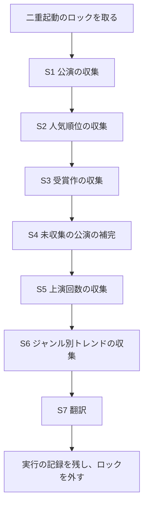
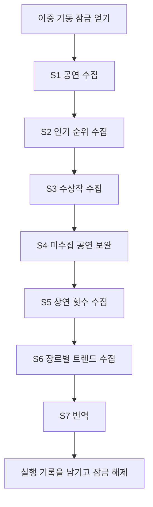

# 05. バッチ設計書

- 状態: 基本設計（レビュー待ち）
- 担当: architect
- 最終更新: 2026-11-06
- 前提: [01. 要件定義書](01-requirements.md)（R-62 を反映）、[03. API 設計書](03-api.md)、ADR 0007・0008・0009・0012・0013
- `P-xx` は 02 の判断（一覧は [02 の 8.](02-screens.md)）。この設計書が参照する P-08・P-09・P-11・P-12 は人間が決定した（2026-11-05、Issue #15 コメント 6651238358）

## 1. バッチの一覧と実行の仕組み

| ID | 名前 | 起動 | タイミング | 機能名 | 要件 ID |
|---|---|---|---|---|---|
| B-01 | 日次収集（KOPIS の公演・統計と翻訳） | 自動 | 毎日 06:00（Asia/Seoul） | `collect`, `translation` | F-01, F-02, F-07, F-08, F-09, F-11, F-26 ③④, F-27 ③, F-29, F-31, F-32, F-33, F-34, N-01, N-04, N-07 |
| B-02 | 駅・コインロッカーの取り込み | 運営者が手で実行 | コインロッカーは四半期に1回、駅は年に1回または駅の開業・移転・廃止のとき（O-07。ADR 0009） | `surrounding` | F-05, F-06, F-07, F-11 ②, N-04 |
| B-03 | 管理者アカウントの登録 | 運営者が手で実行 | 本番の最初に1回（R-35） | `auth` | F-25 ③④, F-14 ⑦, F-15 ⑤, N-05 ② |
| B-04 | 期限の切れた認証前の申込の削除 | 自動 | 毎日 04:00（Asia/Seoul） | `auth` | F-12 |

### 1.1 実行の仕組み

- **自動の実行**: アプリ（Spring Boot）の中のスケジューラー（`@Scheduled` の cron、タイムゾーン `Asia/Seoul`）で起動する。新しいライブラリは使わない。
- **手での実行（運営者のコマンド）**: 同じアプリを、実行する処理の名前を引数に付けて起動する（例: `--catticket.task=daily-collect`）。その処理だけを行い、Web サーバーを起動せずに終了する。サーバーでは `docker compose run --rm` で一時的なコンテナとして動かす。コマンドの正確な形は 06、手順は運用手順（`docs/ops/`）に書く。処理の名前: `daily-collect`（B-01 の再実行）、`import-subway`（B-02）、`create-admin`（B-03）、`purge-expired-signups`（B-04 の再実行）。
  - 理由: 運営者のための API・画面を作ると、要件にない機能になる（管理者の機能は F-26〜F-28 だけ）。
- **二重起動の防止**: 各バッチは開始時に MySQL の名前付きロック（`GET_LOCK`）を取る。取れなければ（同じバッチが動いている）何もせずに終了し、ログに残す。
- **実行の記録**: バッチ・ステップごとに、開始・終了日時、結果（成功 / 一部失敗 / 失敗）、件数、エラーの内容を DB に残す（項目は 03 の 5.）。ログにも同じ内容を出す。失敗を知らせる機能（通知）は要件にないため作らない。運営者は記録とログで確かめる（運用手順）。

## 2. 「1日」「1か月」の区切り（基準時刻。01 7.3）

| 対象 | 区切り | 理由 | 状態 |
|---|---|---|---|
| サービスの「今日」（終わった公演、180 日後まで、公演の開始日以降のレビュー、公演中・公演予定） | Asia/Seoul の暦の日 | DB・サービスの時刻は Asia/Seoul（`CLAUDE.md`） | 確定 |
| 人気順位・人気急上昇の日・週・月 | Asia/Seoul の暦の日・週（月〜日）・月 | ADR 0008 3. | 確定（ADR 0008） |
| 地図の1日 300 回（ADR 0006） | **Google の割り当ての日（太平洋時間の 0 時に戻る。ソウルでは 16 時または 17 時）** | アプリでは数えず、Google Cloud の割り当てが止める。割り当ては「太平洋時間の 0 時に戻る」（公式: https://developers.google.com/maps/billing-and-pricing/manage-costs 、確認日 2026-11-05）。アプリから変えられない | 確定（提供元の基準） |
| メールの1日 400 通（ADR 0012） | **直近 24 時間**（送る時点から過去 24 時間の数） | Gmail の公式は「1日 500 通」とだけあり、暦の日か直近 24 時間かを書いていない（https://support.google.com/mail/answer/22839 、確認日 2026-11-05）。直近 24 時間で 400 通以下なら、どちらの意味でも 500 通を超えない | 決定（P-08） |
| 翻訳の月 180 万文字（ADR 0007） | **Asia/Seoul の暦の月** | Azure の公式に、月の無料枠の区切りの時刻の記載が見つからない（https://learn.microsoft.com/en-us/azure/ai-services/translator/service-limits 、確認日 2026-11-05）。アプリが数える上限なので、サービスの日付に合わせる。区切りがずれて Azure が先に `403001` を返しても F0 は課金されず、その回の翻訳を止めるだけ（3.7） | 決定（P-09） |

## 3. B-01 日次収集

### 3.1 タイミング

- 毎日 **06:00（Asia/Seoul）** に起動する。
- 理由: 日付が変わった後に「今日」から見た期間（前日の順位、180 日後までの窓）で収集するため。利用が少ない時間で、朝の利用の前に終わる。KOPIS が前日分の順位をいつから返すかは未確認（ADR 0008「注意点」）なので、実装の前に確かめ、必要なら時刻を変える（変えたら、この設計書を更新する）。
- 日付が変わってから B-01 の S2 が終わるまでは、直近の終わった期間（前日・先週・先月）の順位の収集が終わっていないので、人気順位・人気急上昇は1つ前の期間を、その集計期間と一緒に表示する（P-12、01 F-29 ④・F-33 ②、R-62。判断の方法は 03 の 4.9 と 3.4 の「収集の完了の記録」）。

### 3.2 処理の流れ

- 各ステップは、前のステップが失敗しても実行する（S4 は S2・S3 で取れた分だけで行う）。どれかが失敗したら、バッチの結果は「一部失敗」にする。
- 各ステップの中で DB を書き換える単位（公演1件、順位の1期間・1ジャンルなど）ごとにトランザクションを分け、途中で止まっても書き終えた分は正しい状態で残す。

| ステップ | KOPIS のサービス（ADR 0008） | 処理 | 冪等性（何度実行しても同じ結果） | 要件 |
|---|---|---|---|---|
| S1 公演の収集 | `pblprfr` → `pblprfr/{mt20id}` → `prfplc/{mt10id}` | 3.3 | 公演 ID で追加・更新（上書き）。管理者の修正・非表示は書き換えない | F-01, F-02, F-08, F-09 ②, F-26 ③④, F-27 ③, F-32 ① |
| S2 人気順位の収集 | `boxoffice` | 3.4 | 期間の種類・期間の初日・ジャンルの組で、その組の行を全部入れ替え、同じトランザクションで収集の完了の記録を追加・更新する | F-29, F-33 |
| S3 受賞作の収集 | `prfawad` | S1 と同じ窓（3.3）を 31 日ずつ照会し、公演 ID が一致する公演を「受賞歴あり」にする | 「受賞歴あり」を立てるだけで、消さない（受賞歴は過去の事実のため） | F-31 |
| S4 未収集の公演の補完 | `pblprfr/{mt20id}` → `prfplc/{mt10id}` | S2・S3 の結果にあって DB にない公演 ID の、公演詳細と会場を取る（終わった公演も。ADR 0008 2.） | S1 と同じ | F-09 ④, F-29 ⑤ |
| S5 上演回数の収集 | `prfstsPrfBy` | 3.6 | 公演ごとの累計の値を上書き | F-32 ② |
| S6 ジャンル別トレンドの収集 | `boxStatsCate` | 前日までの直近 30 日を1回照会し、ジャンルごとの予約数と割合を計算する。地域（ソウル）で絞れればソウル、絞れなければ全国とし、基準を一緒に保存する（R-50） | 集計期間の組で全部入れ替える | F-34 |
| S7 翻訳 | （Azure AI Translator） | 3.7 | 同じ原文は二度翻訳しない。翻訳済みの原文は対象にならない | F-02 ⑥, F-11, N-01, N-07 |

### 3.3 S1 公演の収集

1. **収集の窓**: 今日から 180 日後まで（ADR 0008 2.）。KOPIS の1回の照会は最大 31 日なので、窓を 31 日ずつの 6 区間に分ける。地域はソウル（`signgucode=11`）、ジャンルは指定しない。1ページ 100 件で、最後のページまで照会する。
2. **初回**（前回の成功の記録がない）: すべての区間を `afterdate` なしで照会する。
3. **2回目以降**: 次の2つの結果を合わせる。
   - (a) すべての区間を、`afterdate` = 前回 S1 が成功した日の前日で照会する（追加・変更された公演。1日ずらすのは、前回の実行中に変わった分を取りこぼさないため。重なって取っても上書きなので結果は同じ）。
   - (b) **前回の窓の末日の翌日〜今日 + 180 日**（今回新しく窓に入った日）を `afterdate` なしで照会する。理由: 長く前に登録され、その後変わっていない公演は (a) では取れないが、開始日が 180 日以内になったときに収集する必要がある（F-08 ②、R-59）。
4. 得た公演 ID ごとに公演詳細を照会し、**自動収集の値**を追加・更新する。管理者の修正した値（03 の 4.10）と非表示（F-27 ③）は書き換えない。韓国語の文が変わった項目は、日本語の翻訳がない状態になる（S7 で翻訳する）。
5. 会場（`mt10id`）がまだ DB にないときだけ、施設詳細を照会して会場を保存する（ADR 0008 2.）。このとき住所から区を決める（03 の 4.2。決められなかった会場の数を記録に残す）。座標（`la`・`lo`）がない会場も保存し、数を記録に残す（P-11）。
6. ソウルの公演かどうかは、公演の地域（`area`）または会場の住所が「서울특별시」であることで判断して保存する（F-01 ②。地図・検索は 03 の 1.6 で絞る）。
7. S1 がすべて成功したときだけ、「前回 S1 が成功した日」と「今回の窓の末日」を記録する。失敗したときは記録を更新しないので、次の実行で同じ範囲を取り直す。
8. 公演のデータは消さない（F-09 ②）。終わったかどうかは照会のときに日付で判定する（03 の 1.6）。

### 3.4 S2 人気順位の収集

- 期間の種類（日次・週次・月次）ごとに、今日から見た**現在の期間**と**直前の期間**（ADR 0008 3. の表）、ジャンル（全体（`catecode` を指定しない）と各ジャンル）ごとに `boxoffice` を照会する（`area=11`）。
- 提供元が返したすべての行を保存する（上位 10 位だけではない。ADR 0008 3.）。
- **収集の完了の記録（R-62。03 の 4.9）**: 期間の種類・期間・ジャンルの組ごとに、照会（全ページ）が成功したら、その組の行の入れ替えと「収集の完了の記録」（組、収集を終えた日時、件数）の追加・更新を**1つのトランザクション**で行う。提供元が 0 件（結果コード `04`）を返したときも、0 件として完了を記録する。照会に失敗した組は、行も記録も変えない（前の実行で保存した内容が残る）。API はこの記録で「順位の収集が終わっている直近の期間」を決める。
  - 行があるかどうかで判断しない理由: 0 件の期間（そのジャンルの予約がない）と、まだ収集していない期間を見分けられないため。
  - 入れ替えと記録を同じトランザクションにする理由: 行だけ新しく記録が古い（または逆）状態を API が読まないため。
- 非表示の公演の除外と順位の振り直し、人気急上昇の計算は保存の時点では行わず、API（03 の API-20・API-21）で照会のたびに行う（ADR 0008 4.。非表示にした・解除したことがすぐ反映される）。
- 毎日、現在の期間と直前の期間の両方を取り直すので、ある日の S2 で現在の期間の照会に失敗しても、翌日の実行でその期間（翌日から見た直前の期間）が埋まる。人気急上昇の比べる期間が欠けるのは、同じ期間の照会が2日続けて失敗したときなどに限られる（そのときの画面の表示は 02 の P-17）。

**呼び出し回数の再計算（Issue #14 の決定コメントで 05 に回された事項）**

- 1日の順位の呼び出し = (ジャンルの数 G + 全体 1) × 期間の種類 3 × (現在・直前) 2 = **6 × (G + 1) 回**。
- ADR 0008 6. の「60 回（10 ジャンル × 3 期間 × 現在・直前）」は、「全体」を含めて 10 区分と数えた場合の値である。`docs/kopis-api.md` 4. で分かっているジャンルは 9 つ（`AAAA`・`GGGA`・`CCCA`・`CCCC`・`CCCD`・`BBBC`・`BBBE`・`EEEA`・`EEEB`）なので、G = 9 なら 6 × 10 = **60 回**。共通コードの一覧（`kopis_openapi_code_v3.7`）でジャンルが 10 あれば 6 × 11 = **66 回**になる。
- G は実装の前に共通コードの一覧と `boxoffice` の `catecode` の値で確定する（ADR 0008「注意点」）。`boxoffice` のジャンルの区分が公演のジャンルと違う場合は、その区分で数え直し、この設計書を更新する。
- `boxoffice` は1期間1回の照会で取れる前提（ADR 0008 3.）。ページがある場合は、ページの数だけ増える。

### 3.5 KOPIS の呼び出しの制限への対応（ADR 0008 6.）

KOPIS は呼び出しの制限の数値を公開していない。次の値で呼ぶ。

| 項目 | 値 |
|---|---|
| 呼び出しの間隔 | 1回ごとに 0.5 秒あける（同時に複数を呼ばない） |
| タイムアウト | 接続 5 秒、読み込み 30 秒 |
| 再試行 | 通信のエラー・タイムアウト・HTTP 5xx・結果コード `03`（DB エラー）は、2 秒・4 秒・8 秒あけて最大 3 回 |
| 再試行しないもの | 結果コード `01`（要求の誤り）・`02`（キーの誤り）。そのステップを失敗にする |
| データがない | 結果コード `04` は 0 件として扱う（失敗にしない） |
| 止める条件 | 同じステップで、再試行しても失敗した呼び出しが続けて 10 回になったら、そのステップを止めて失敗にする（制限に当たっているときに呼び続けないため） |

**1日の呼び出し回数の見積もり**

| ステップ | 毎日 | 初回 |
|---|---|---|
| S1 公演目録 | (a) 6 区間 × 1〜2 ページ + (b) 1 区間 × 1〜数ページ ≒ 10〜20 回 | 6 区間 × 最大 30 ページ ≒ 180 回 |
| S1 公演詳細 | 追加・変更の分 ≒ 100 回（ADR 0007 の仮定） | ≒ 3,000 回 |
| S1 施設詳細 | 新しい会場の分（数回） | ≒ 1,000 回 |
| S2 順位 | 60 回（G = 9）または 66 回（G = 10） | 同じ |
| S3 受賞作 | 6 区間 × ページ数（≒ 6〜12 回） | 同じ |
| S4 補完 | 数回 | 数十回 |
| S5 上演回数 | 3.6 の確認の結果による | 同じ |
| S6 ジャンル別 | 1 回 | 同じ |
| **合計（S5 を除く）** | **≒ 200 回（間隔 0.5 秒で約 2 分）** | **≒ 4,300 回（約 40 分）** |

### 3.6 S5 上演回数の収集

- 対象は公開中の公演（03 の 1.6）。値は**開幕からの累計の上演回数**（R-49）。
- `prfstsPrfBy` の `prfdtcnt` が累計の値か、照会した期間の中の回数かは未確認（ADR 0008「注意点」）。実装の前に確かめ、
  - 累計なら、公演ごとに1回照会して上書きする。
  - 期間の中の回数なら、開幕日から今日までを 31 日ずつ照会して合計する（呼び出しが増えるので、呼び出し回数の見積もりをこの設計書に足す）。
  - 累計を得られないとわかった場合は、推測で別の値を出さず、作業を止めて人間に報告する（ADR 0008 5.）。

### 3.7 S7 翻訳（ADR 0007）

- **対象**（韓国語の文で、日本語の翻訳がまだないもの）: 公演名、出演者、チケット価格、公演時間の案内、上演時間、観覧年齢（管理者の修正した値を含む）、予約サイトの名前、会場名、コインロッカーの位置の文章、公式の日本語表記がない駅名（ADR 0009）。
- **対象にしないもの**: ジャンル・公演の状態・区の名前（画面の辞書）、公式の日本語表記がある駅名、レビュー・ニックネーム（F-11 ④）、出典の文言。
- **順番**: 公演名 → 会場名 → 駅名 → それ以外。理由: 日本語のキーワード検索（F-02 ⑥）と、原文を併記する項目（F-11 ②）を先に翻訳する。上限に近いときに大事なものから訳される。
- 同じ原文は一度だけ翻訳し、結果を原文ごとに保存して使い回す（ADR 0007 3.）。

**上限と速さ（ADR 0007 4.。Azure の公式の制限: 1回 5 万文字まで、F0 は1時間 200 万文字で、1分あたり約 33,300 文字を超えないように均等に使う（確認日 2026-11-05））**

| 項目 | 値 |
|---|---|
| 1回の要求 | 1 万文字以内（原文を束ねて送る） |
| 速さ | 1 分あたり 3 万文字以内（要求の間をあける） |
| 月の上限（アプリ側） | 送る前に「今月（Asia/Seoul。P-09）の翻訳文字数 + この要求の文字数」が **180 万文字**を超えるなら、その月の翻訳を止める。翻訳が成功したら、その文字数を今月の数に足す |
| `403001`（無料の割り当てを超えた） | その回の S7 を止める（課金されない）。翻訳できなかった文は次の実行で再び対象になる |
| 429（要求が多すぎる） | 60 秒待って最大 3 回再試行し、だめならその回の S7 を止める |
| そのほかのエラー | 2 秒・4 秒・8 秒あけて最大 3 回再試行し、だめならその回の S7 を止める |

- 翻訳を止めた後も、それまでに翻訳した文は保存したまま表示に使う（02 の 3.4）。
- 時間の見積もり: 毎日 約 1.5 万文字（1 分以内）。初回 約 47 万文字（ADR 0007）は 3 万文字/分で約 16 分。

### 3.8 失敗したときの再実行

| 状況 | 扱い |
|---|---|
| ステップが失敗した | ほかのステップは続ける。バッチの結果を「一部失敗」にする |
| 翌日の自動の実行 | S1 は前回の成功の記録から取り直し、S2・S3・S6 は同じ期間を取り直して上書きするので、失敗した日の分も埋まる（ADR 0008 3.・6.）。S2 は組ごとに収集の完了の記録も付け直すので、埋まった期間はその時点から表示の対象になる（3.4）。S7 は翻訳がない文を毎回対象にする |
| すぐにやり直したい | 運営者がコマンド `daily-collect` で B-01 をもう一度実行する（1.1）。同じ日に何度実行しても結果は同じ |
| アプリが止まっていて 06:00 に動かなかった | 自動では取り戻さない。運営者が `daily-collect` を実行するか、翌日の実行に任せる |

## 4. B-02 駅・コインロッカーの取り込み（O-07。ADR 0009）

### 4.1 タイミング（O-07: 確定。ADR 0009 決定4）

- コインロッカー: **四半期に1回**。提供元（data.go.kr 15044234）の更新周期が「分期」のため。
- 駅（座標・住所・多言語表記）: **年に1回**、または駅の開業・移転・廃止があったとき。
- 運営者が提供元のページで新しい版が出たことを確かめ、ファイルを取得して実行する。確かめる時期（例: 1・4・7・10 月）は運用手順に書く。

### 4.2 ファイルの置き場所

- ADR 0009 の4つのファイル（駅の座標、駅の住所、コインロッカーの位置、駅名の多言語表記）を、リポジトリの `backend/src/main/resources/data/subway/` に置き、出典・基準日・利用条件を書いた `README.md` を同じ場所に置く。
- 新しい版は PR で入れ替える（変更の履歴と出典を残すため）。デプロイの後に `import-subway` を実行する。
- ファイルの文字コード（CP949 か UTF-8 か）と列の名前は、取得したときに確かめて README に書く（ADR 0009「注意点」）。

### 4.3 処理の流れ

1. 4つのファイルを読む。どれかがない・読めないときは、DB を変えずに失敗にする。
2. 駅: 座標のファイルから 1〜8 号線の駅を取り、住所のファイルと結びつけ、**住所が「서울특별시」で始まる駅だけ**を残す（F-05 ②⑥、X-24）。住所と結びつかない駅は、ソウルかどうか分からないので取り込まず、名前を記録に残す。
3. 駅名の日本語: 多言語表記のファイルの日本語表記を使う。ない駅は日本語なしで保存し、B-01 の S7 で翻訳する。
4. コインロッカー: 位置のファイルの「호선・보관함명」を駅の「호선・역명」に結びつけ、その駅に属させる（座標は駅の座標。U-20）。結びつかない行は取り込まず、件数と内容を記録に残す（ADR 0009 決定3）。
5. 1つのトランザクションで、駅とコインロッカーをすべて入れ替える（削除して入れ直す）。何度実行しても同じ結果になる。駅・コインロッカーはほかのデータから参照されないので、入れ替えても影響がない。
6. 結果（駅の数、コインロッカーの数、取り込まなかった駅・コインロッカーの数）を記録とログに出す。駅の数が 0 件になるときは、ファイルの誤りとみなして入れ替えずに失敗にする。
7. コインロッカーの位置の文章の日本語は、次の B-01 の S7 で翻訳する（ADR 0009 決定3）。

### 4.4 失敗したとき

- 失敗したときは DB を変えない（トランザクションを戻す）ので、前の版のデータで表示が続く。原因（ファイル・結びつけの規則）を直して、もう一度実行する。
- 結びつかないコインロッカーが多い場合の結びつけの規則（名前の書き方の違いなど）は、ファイルを取得して確かめてから決め、この設計書に書き足す（ADR 0009「注意点」）。

## 5. B-03 管理者アカウントの登録（R-35）

**確定（設計）**。管理者アカウントは画面から作らず、運営者がサーバーで登録する（F-25 ③、X-25）。

1. 運営者は、サーバーの `.env` に管理者のメールアドレス（`CATTICKET_ADMIN_EMAIL`）と初期パスワード（`CATTICKET_ADMIN_PASSWORD`）を書き、コマンド `create-admin` を実行する。
2. 入力を確かめる: メールアドレスは必須で形が正しいこと（管理者もロック解除の再認証・パスワード再設定でメールを使うため。F-14 ⑦、F-15 ⑤）、パスワードはルール（8 文字以上、英字と数字を含む。N-05 ④）を満たすこと。満たさなければ何もせずに失敗にする。
3. 管理者がすでにいるときは、何もせずに終了する（管理者は1つだけ。F-25 ①。既存の管理者のパスワードは上書きしない。変えるときは F-15 の再設定を使う）。
4. 同じメールアドレスの一般ユーザーがいるときは、何もせずに失敗にする。
5. 管理者を、役割「管理者」、状態「有効」（メールの認証は済んだものとする）、失敗回数 0 で作る。パスワードはハッシュにして保存する（ADR 0013 決定6、N-05 ②）。
6. 実行の後、運営者は `.env` から初期パスワードを消す（手順は運用手順）。

**この方法にする理由**

- Flyway のマイグレーションで作る方法は、リポジトリが公開されているため、パスワードのハッシュとメールアドレスがリポジトリに残る。テストの DB にも作られてしまう。
- 運営者が SQL を直接実行する方法は、パスワードのハッシュをアプリの外で作る道具が必要になり、ハッシュの方式（ADR 0013）とずれるおそれがある。
- アプリの起動のたびに環境変数から作る方法は、初期パスワードを `.env` に置き続けることになる。コマンドなら1回だけ使って消せる。

## 6. B-04 期限の切れた認証前の申込の削除

**確定（設計）**。会員登録の認証のリンク（24 時間。P-10）の期限が切れた認証前の申込を削除する。人間の決定（Issue #15 コメント 6677710885 の Q-01 の B）で認証前の申込はニックネームを押さえないため（03 の 4.7）、削除の目的は他人の登録を妨げないことではなく、**使われないメールアドレス・パスワードのハッシュを持ち続けないこと（記録の整理）**である。

### 6.1 タイミング

- 毎日 **04:00（Asia/Seoul）** に起動する（1.1 のスケジューラー）。B-01（06:00）と重ならない時刻にした（ロックは別なので重なっても動くが、記録を読みやすくするため）。
- 期限の切れた行は、期限から最長でおよそ1日残る。残っている間の動き（03 の 4.7）: 同じメールアドレスの申込し直しは置き換えで受け付ける（P-10）。そのメールアドレスでのログインは「認証が済んでいない」を返す。ニックネームは押さえないので、ほかの人の申込・認証・ニックネームの変更を妨げない。

### 6.2 処理の流れ

1. 二重起動のロック（`GET_LOCK`）を取る（1.1）。
2. 削除の基準の時刻として、実行の時刻を1つ決める。
3. **認証前**のアカウントのうち、**会員登録の認証のトークンの有効期限が基準の時刻より前**のもの（有効期限内の会員登録の認証のトークンが1つもないもの）を削除する。トークンも一緒に削除する（外部キーの削除の扱いは 04）。有効なアカウント（一般ユーザー・管理者）は対象にしない。
4. 削除した件数を、実行の記録（03 の 5.）とログに残し、ロックを外す。

- 1つのトランザクションで削除する（件数は多くない見込み。多くなったら工程4・実装で分割を考える）。
- 外部 API を使わないので、呼び出しの制限への対応はない。

### 6.3 冪等性と失敗したとき

- **冪等性**: 削除の条件は「認証前」かつ「期限が切れている」だけで決まり、何度実行しても、残る行は同じ（2回目以降は、その間に新しく期限が切れた行だけが消える）。
- **競合**: 認証の完了（API-34）は期限内のトークンだけを受け付ける（03 の 4.7）。B-04 は期限の切れた行だけを消すので、認証できる申込を消すことはない。期限の直前に認証の完了と B-04 が同時に動いたときの行のロックの取り方は 06（工程4）で決める。
- **失敗したとき**: トランザクションを戻し、記録を「失敗」にする。次の日の実行で同じ行を消すので、再実行は必須ではない。すぐ消したいときは運営者が `purge-expired-signups` を手で実行する（1.1）。

## 7. 実装の前に確かめること

| 事項 | 確かめた結果で変わるもの | 出どころ |
|---|---|---|
| `pblprfr` の `stdate`・`eddate` が「公演期間が重なる公演」を返すか | 3.3 の窓の照会の方法 | この設計書 |
| `boxoffice` の期間の指定方法・`date` の扱い・返す行数・過去の照会の範囲・前日分を返す時刻 | 3.1 の時刻、3.4 の回数 | ADR 0008「注意点」 |
| ジャンルの数 G（共通コードの一覧、`boxoffice` の `catecode`） | 3.4 の回数（60 回か 66 回か） | ADR 0008「注意点」、Issue #14 |
| `prfstsPrfBy` の `prfdtcnt` が累計か | 3.6 の方法（得られなければ作業を止めて報告） | ADR 0008「注意点」 |
| `boxStatsCate` をソウルで絞れるか | S6 の基準（ソウル / 全国） | ADR 0008「注意点」 |
| `prfawad` の照会の条件 | S3 の回数 | ADR 0008「注意点」 |
| 駅・コインロッカーのファイルの文字コード・列・結びつけ | 4.2・4.3 | ADR 0009「注意点」 |

確かめた結果、要件を満たせないとわかった場合は、推測で埋めずに作業を止めて人間に報告する（01 7.3）。

---

## 한국어

### 05. 배치 설계서

- 상태: 기본설계(리뷰 대기)
- 담당: architect
- 최종 갱신: 2026-11-06
- 전제: [01. 요건정의서](01-requirements.md)(R-62 반영), [03. API 설계서](03-api.md), ADR 0007·0008·0009·0012·0013
- `P-xx`는 02의 판단(목록은 [02의 8.](02-screens.md)). 이 설계서가 참조하는 P-08·P-09·P-11·P-12는 사람이 결정했다(2026-11-05, Issue #15 코멘트 6651238358)

### 1. 배치 목록과 실행 구조

| ID | 이름 | 기동 | 시점 | 기능명 | 요건 ID |
|---|---|---|---|---|---|
| B-01 | 일간 수집(KOPIS 공연·통계와 번역) | 자동 | 매일 06:00(Asia/Seoul) | `collect`, `translation` | F-01, F-02, F-07, F-08, F-09, F-11, F-26 ③④, F-27 ③, F-29, F-31, F-32, F-33, F-34, N-01, N-04, N-07 |
| B-02 | 역·물품보관함 수집 | 운영자가 수동 실행 | 물품보관함은 분기에 1번, 역은 1년에 1번 또는 역 개통·이전·폐지 때(O-07. ADR 0009) | `surrounding` | F-05, F-06, F-07, F-11 ②, N-04 |
| B-03 | 관리자 계정 등록 | 운영자가 수동 실행 | 운영 처음에 1번(R-35) | `auth` | F-25 ③④, F-14 ⑦, F-15 ⑤, N-05 ② |
| B-04 | 기한이 지난 인증 전 신청 삭제 | 자동 | 매일 04:00(Asia/Seoul) | `auth` | F-12 |

#### 1.1 실행 구조

- **자동 실행**: 앱(Spring Boot) 안의 스케줄러(`@Scheduled` cron, 타임존 `Asia/Seoul`)로 기동한다. 새 라이브러리는 쓰지 않는다.
- **수동 실행(운영자 명령)**: 같은 앱을, 실행할 처리 이름을 인수로 붙여 기동한다(예: `--catticket.task=daily-collect`). 그 처리만 하고, 웹 서버를 기동하지 않고 끝난다. 서버에서는 `docker compose run --rm`으로 임시 컨테이너로 돌린다. 명령의 정확한 형태는 06, 절차는 운영 절차(`docs/ops/`)에 쓴다. 처리 이름: `daily-collect`(B-01 재실행), `import-subway`(B-02), `create-admin`(B-03), `purge-expired-signups`(B-04 재실행).
  - 이유: 운영자용 API·화면을 만들면 요건에 없는 기능이 된다(관리자 기능은 F-26~F-28뿐).
- **이중 기동 방지**: 각 배치는 시작할 때 MySQL 이름 있는 잠금(`GET_LOCK`)을 얻는다. 얻지 못하면(같은 배치가 돌고 있음) 아무것도 하지 않고 끝내며 로그에 남긴다.
- **실행 기록**: 배치·스텝별로 시작·종료 일시, 결과(성공 / 일부 실패 / 실패), 건수, 오류 내용을 DB에 남긴다(항목은 03의 5.). 로그에도 같은 내용을 낸다. 실패를 알리는 기능(알림)은 요건에 없으므로 만들지 않는다. 운영자는 기록과 로그로 확인한다(운영 절차).

### 2. "하루", "한 달"의 구분 (기준 시각. 01 7.3)

| 대상 | 구분 | 이유 | 상태 |
|---|---|---|---|
| 서비스의 "오늘"(끝난 공연, 180일 후까지, 공연 시작일 이후 리뷰, 공연 중·공연 예정) | Asia/Seoul 달력의 날 | DB·서비스 시각은 Asia/Seoul(`CLAUDE.md`) | 확정 |
| 인기 순위·인기 급상승의 일·주·월 | Asia/Seoul 달력의 날·주(월~일)·월 | ADR 0008 3. | 확정(ADR 0008) |
| 지도 하루 300회(ADR 0006) | **Google 할당량의 날(태평양 시간 0시에 초기화. 서울에서는 16시 또는 17시)** | 앱에서는 세지 않고 Google Cloud 할당량이 멈춘다. 할당량은 "태평양 시간 0시에 초기화"(공식: https://developers.google.com/maps/billing-and-pricing/manage-costs , 확인일 2026-11-05). 앱에서 바꿀 수 없다 | 확정(제공처 기준) |
| 메일 하루 400통(ADR 0012) | **최근 24시간**(보내는 시점에서 지난 24시간의 수) | Gmail 공식은 "하루 500통"이라고만 하고 달력의 날인지 최근 24시간인지 쓰지 않았다(https://support.google.com/mail/answer/22839 , 확인일 2026-11-05). 최근 24시간에 400통 이하면 어느 뜻이든 500통을 넘지 않는다 | 결정(P-08) |
| 번역 월 180만 자(ADR 0007) | **Asia/Seoul 달력의 월** | Azure 공식에서 월 무료 한도의 경계 시각 기재를 찾지 못했다(https://learn.microsoft.com/en-us/azure/ai-services/translator/service-limits , 확인일 2026-11-05). 앱이 세는 상한이므로 서비스 날짜에 맞춘다. 경계가 어긋나 Azure가 먼저 `403001`을 돌려줘도 F0은 과금되지 않고 그 회차 번역을 멈출 뿐(3.7) | 결정(P-09) |

### 3. B-01 일간 수집

#### 3.1 시점

- 매일 **06:00(Asia/Seoul)**에 기동한다.
- 이유: 날짜가 바뀐 뒤 "오늘"에서 본 기간(전날 순위, 180일 후까지의 창)으로 수집하기 위해. 이용이 적은 시간이고, 아침 이용 전에 끝난다. KOPIS가 전날 분 순위를 언제부터 돌려주는지는 미확인(ADR 0008 "주의점")이므로 구현 전에 확인하고, 필요하면 시각을 바꾼다(바꾸면 이 설계서를 갱신한다).
- 날짜가 바뀐 뒤 B-01의 S2가 끝날 때까지는 가장 최근에 끝난 기간(전날·지난주·지난달)의 순위 수집이 끝나지 않았으므로, 인기 순위·인기 급상승은 하나 앞 기간을 그 집계 기간과 함께 보여준다(P-12, 01 F-29 ④·F-33 ②, R-62. 판단 방법은 03의 4.9와 3.4의 "수집 완료 기록").

#### 3.2 처리 흐름

- 각 스텝은 앞 스텝이 실패해도 실행한다(S4는 S2·S3에서 얻은 만큼으로 한다). 어느 하나가 실패하면 배치 결과를 "일부 실패"로 한다.
- 각 스텝 안에서 DB를 고쳐 쓰는 단위(공연 1건, 순위의 1기간·1장르 등)마다 트랜잭션을 나눠, 도중에 멈춰도 다 쓴 부분은 올바른 상태로 남긴다.

| 스텝 | KOPIS 서비스(ADR 0008) | 처리 | 멱등성(몇 번 실행해도 같은 결과) | 요건 |
|---|---|---|---|---|
| S1 공연 수집 | `pblprfr` → `pblprfr/{mt20id}` → `prfplc/{mt10id}` | 3.3 | 공연 ID로 추가·갱신(덮어쓰기). 관리자 수정·숨김은 고쳐 쓰지 않는다 | F-01, F-02, F-08, F-09 ②, F-26 ③④, F-27 ③, F-32 ① |
| S2 인기 순위 수집 | `boxoffice` | 3.4 | 기간 종류·기간 첫날·장르의 조합으로 그 조합의 행을 모두 바꾸고, 같은 트랜잭션에서 수집 완료 기록을 추가·갱신한다 | F-29, F-33 |
| S3 수상작 수집 | `prfawad` | S1과 같은 창(3.3)을 31일씩 조회해, 공연 ID가 일치하는 공연을 "수상 이력 있음"으로 한다 | "수상 이력 있음"을 세우기만 하고 지우지 않는다(수상 이력은 과거의 사실이므로) | F-31 |
| S4 미수집 공연 보완 | `pblprfr/{mt20id}` → `prfplc/{mt10id}` | S2·S3 결과에 있고 DB에 없는 공연 ID의 공연상세와 공연장을 가져온다(끝난 공연도. ADR 0008 2.) | S1과 같음 | F-09 ④, F-29 ⑤ |
| S5 상연 횟수 수집 | `prfstsPrfBy` | 3.6 | 공연별 누계 값을 덮어쓴다 | F-32 ② |
| S6 장르별 트렌드 수집 | `boxStatsCate` | 전날까지 최근 30일을 1번 조회해 장르별 예매 수와 비중을 계산한다. 지역(서울)으로 거를 수 있으면 서울, 없으면 전국으로 하고 기준을 함께 저장한다(R-50) | 집계 기간 조합으로 모두 바꾼다 | F-34 |
| S7 번역 | (Azure AI Translator) | 3.7 | 같은 원문은 두 번 번역하지 않는다. 번역된 원문은 대상이 되지 않는다 | F-02 ⑥, F-11, N-01, N-07 |

#### 3.3 S1 공연 수집

1. **수집 창**: 오늘부터 180일 후까지(ADR 0008 2.). KOPIS 1번 조회는 최대 31일이므로 창을 31일씩 6구간으로 나눈다. 지역은 서울(`signgucode=11`), 장르는 지정하지 않는다. 1페이지 100건으로 마지막 페이지까지 조회한다.
2. **첫 실행**(지난 성공 기록이 없음): 모든 구간을 `afterdate` 없이 조회한다.
3. **두 번째부터**: 다음 두 결과를 합친다.
   - (a) 모든 구간을 `afterdate` = 지난번 S1이 성공한 날의 전날로 조회한다(추가·변경된 공연. 하루 당기는 것은 지난 실행 중에 바뀐 것을 놓치지 않기 위해. 겹쳐 가져와도 덮어쓰므로 결과는 같다).
   - (b) **지난 창 마지막 날의 다음 날 ~ 오늘 + 180일**(이번에 새로 창에 들어온 날)을 `afterdate` 없이 조회한다. 이유: 오래전에 등록되고 그 뒤 바뀌지 않은 공연은 (a)로는 가져올 수 없지만, 시작일이 180일 안이 되었을 때 수집해야 한다(F-08 ②, R-59).
4. 얻은 공연 ID마다 공연상세를 조회해 **자동 수집 값**을 추가·갱신한다. 관리자가 수정한 값(03의 4.10)과 숨김(F-27 ③)은 고쳐 쓰지 않는다. 한국어 글이 바뀐 항목은 일본어 번역이 없는 상태가 된다(S7에서 번역).
5. 공연장(`mt10id`)이 아직 DB에 없을 때만 시설상세를 조회해 공연장을 저장한다(ADR 0008 2.). 이때 주소로 구를 정한다(03의 4.2. 정하지 못한 공연장 수를 기록에 남긴다). 좌표(`la`·`lo`)가 없는 공연장도 저장하고 수를 기록에 남긴다(P-11).
6. 서울 공연인지는 공연 지역(`area`) 또는 공연장 주소가 "서울특별시"인지로 판단해 저장한다(F-01 ②. 지도·검색은 03의 1.6으로 거른다).
7. S1이 모두 성공했을 때만 "지난번 S1이 성공한 날"과 "이번 창의 마지막 날"을 기록한다. 실패하면 기록을 갱신하지 않으므로 다음 실행에서 같은 범위를 다시 가져온다.
8. 공연 데이터는 지우지 않는다(F-09 ②). 끝났는지는 조회할 때 날짜로 판정한다(03의 1.6).

#### 3.4 S2 인기 순위 수집

- 기간 종류(일간·주간·월간)마다, 오늘에서 본 **현재 기간**과 **직전 기간**(ADR 0008 3.의 표), 장르(전체(`catecode` 미지정)와 각 장르)마다 `boxoffice`를 조회한다(`area=11`).
- 제공처가 돌려준 모든 행을 저장한다(상위 10위만이 아님. ADR 0008 3.).
- **수집 완료 기록(R-62. 03의 4.9)**: 기간 종류·기간·장르의 조합마다 조회(전체 페이지)가 성공하면, 그 조합의 행 교체와 "수집 완료 기록"(조합, 수집을 마친 일시, 건수)의 추가·갱신을 **하나의 트랜잭션**으로 한다. 제공처가 0건(결과 코드 `04`)을 돌려줘도 0건으로 완료를 기록한다. 조회에 실패한 조합은 행도 기록도 바꾸지 않는다(이전 실행에서 저장한 내용이 남는다). API는 이 기록으로 "순위 수집이 끝난 가장 최근 기간"을 정한다.
  - 행이 있는지로 판단하지 않는 이유: 0건인 기간(그 장르의 예매가 없음)과 아직 수집하지 않은 기간을 구별할 수 없기 때문.
  - 교체와 기록을 같은 트랜잭션으로 하는 이유: 행만 새롭고 기록은 오래된(또는 그 반대) 상태를 API가 읽지 않게 하기 위해.
- 숨긴 공연 제외와 순위 다시 매기기, 인기 급상승 계산은 저장 시점에 하지 않고 API(03의 API-20·API-21)에서 조회할 때마다 한다(ADR 0008 4.. 숨기거나 해제한 것이 바로 반영된다).
- 매일 현재 기간과 직전 기간을 둘 다 다시 가져오므로, 어느 날의 S2에서 현재 기간 조회에 실패해도 다음 날 실행에서 그 기간(다음 날에서 본 직전 기간)이 채워진다. 인기 급상승의 비교 기간이 빠지는 것은 같은 기간의 조회가 이틀 연속 실패했을 때 등으로 한정된다(그때의 화면 표시는 02의 P-17).

**호출 횟수 재계산(Issue #14 결정 코멘트에서 05로 넘긴 사항)**

- 하루 순위 호출 = (장르 수 G + 전체 1) × 기간 종류 3 × (현재·직전) 2 = **6 × (G + 1)회**.
- ADR 0008 6.의 "60회(10장르 × 3기간 × 현재·직전)"는 "전체"를 포함해 10구분으로 셌을 때의 값이다. `docs/kopis-api.md` 4.에서 알려진 장르는 9개(`AAAA`·`GGGA`·`CCCA`·`CCCC`·`CCCD`·`BBBC`·`BBBE`·`EEEA`·`EEEB`)이므로 G = 9이면 6 × 10 = **60회**. 공통코드 목록(`kopis_openapi_code_v3.7`)에서 장르가 10개면 6 × 11 = **66회**가 된다.
- G는 구현 전에 공통코드 목록과 `boxoffice`의 `catecode` 값으로 확정한다(ADR 0008 "주의점"). `boxoffice`의 장르 구분이 공연 장르와 다르면 그 구분으로 다시 세고 이 설계서를 갱신한다.
- `boxoffice`는 기간 1개를 1번 조회로 가져올 수 있다는 전제(ADR 0008 3.). 페이지가 있으면 페이지 수만큼 늘어난다.

#### 3.5 KOPIS 호출 제한 대응 (ADR 0008 6.)

KOPIS는 호출 제한 수치를 공개하지 않는다. 다음 값으로 부른다.

| 항목 | 값 |
|---|---|
| 호출 간격 | 1번마다 0.5초 둔다(동시에 여러 개를 부르지 않음) |
| 타임아웃 | 연결 5초, 읽기 30초 |
| 재시도 | 통신 오류·타임아웃·HTTP 5xx·결과 코드 `03`(DB 오류)은 2초·4초·8초 간격으로 최대 3번 |
| 재시도하지 않는 것 | 결과 코드 `01`(요청 오류)·`02`(키 오류). 그 스텝을 실패로 한다 |
| 데이터 없음 | 결과 코드 `04`는 0건으로 다룬다(실패로 하지 않음) |
| 멈추는 조건 | 같은 스텝에서 재시도해도 실패한 호출이 연속 10번이 되면 그 스텝을 멈추고 실패로 한다(제한에 걸렸을 때 계속 부르지 않기 위해) |

**하루 호출 횟수 추정**

| 스텝 | 매일 | 첫 실행 |
|---|---|---|
| S1 공연목록 | (a) 6구간 × 1~2페이지 + (b) 1구간 × 1~몇 페이지 ≒ 10~20회 | 6구간 × 최대 30페이지 ≒ 180회 |
| S1 공연상세 | 추가·변경분 ≒ 100회(ADR 0007의 가정) | ≒ 3,000회 |
| S1 시설상세 | 새 공연장분(몇 회) | ≒ 1,000회 |
| S2 순위 | 60회(G = 9) 또는 66회(G = 10) | 같음 |
| S3 수상작 | 6구간 × 페이지 수(≒ 6~12회) | 같음 |
| S4 보완 | 몇 회 | 수십 회 |
| S5 상연 횟수 | 3.6 확인 결과에 따름 | 같음 |
| S6 장르별 | 1회 | 같음 |
| **합계(S5 제외)** | **≒ 200회(간격 0.5초로 약 2분)** | **≒ 4,300회(약 40분)** |

#### 3.6 S5 상연 횟수 수집

- 대상은 공개 중인 공연(03의 1.6). 값은 **개막부터의 누계 상연 횟수**(R-49).
- `prfstsPrfBy`의 `prfdtcnt`가 누계 값인지, 조회한 기간 안의 횟수인지는 미확인(ADR 0008 "주의점"). 구현 전에 확인하고,
  - 누계라면 공연마다 1번 조회해 덮어쓴다.
  - 기간 안의 횟수라면 개막일부터 오늘까지를 31일씩 조회해 합계를 낸다(호출이 늘어나므로 호출 횟수 추정을 이 설계서에 더한다).
  - 누계를 얻을 수 없다고 판명되면 추측으로 다른 값을 내지 않고 작업을 멈추고 사람에게 보고한다(ADR 0008 5.).

#### 3.7 S7 번역 (ADR 0007)

- **대상**(한국어 글 중 일본어 번역이 아직 없는 것): 공연명, 출연진, 티켓 가격, 공연 시간 안내, 상연 시간, 관람 연령(관리자가 수정한 값 포함), 예매처 이름, 공연장명, 물품보관함 위치 설명, 공식 일본어 표기가 없는 역명(ADR 0009).
- **대상이 아닌 것**: 장르·공연 상태·구 이름(화면 사전), 공식 일본어 표기가 있는 역명, 리뷰·닉네임(F-11 ④), 출처 문구.
- **순서**: 공연명 → 공연장명 → 역명 → 그 밖. 이유: 일본어 키워드 검색(F-02 ⑥)과 원문을 병기하는 항목(F-11 ②)을 먼저 번역한다. 상한에 가까울 때 중요한 것부터 번역된다.
- 같은 원문은 한 번만 번역하고 결과를 원문별로 저장해 다시 쓴다(ADR 0007 3.).

**상한과 속도(ADR 0007 4.. Azure 공식 제한: 1번에 5만 자까지, F0은 시간당 200만 자이고 분당 약 33,300자를 넘지 않도록 고르게 쓴다(확인일 2026-11-05))**

| 항목 | 값 |
|---|---|
| 요청 1번 | 1만 자 이내(원문을 묶어 보낸다) |
| 속도 | 분당 3만 자 이내(요청 사이를 띄운다) |
| 월 상한(앱 쪽) | 보내기 전에 "이번 달(Asia/Seoul. P-09) 번역 글자 수 + 이 요청의 글자 수"가 **180만 자**를 넘으면 그달 번역을 멈춘다. 번역이 성공하면 그 글자 수를 이번 달 수에 더한다 |
| `403001`(무료 할당 초과) | 그 회차의 S7을 멈춘다(과금되지 않음). 번역하지 못한 글은 다음 실행에서 다시 대상이 된다 |
| 429(요청이 너무 많음) | 60초 기다려 최대 3번 재시도하고, 안 되면 그 회차의 S7을 멈춘다 |
| 그 밖의 오류 | 2초·4초·8초 간격으로 최대 3번 재시도하고, 안 되면 그 회차의 S7을 멈춘다 |

- 번역을 멈춘 뒤에도 그때까지 번역한 글은 저장한 채 표시에 쓴다(02의 3.4).
- 시간 추정: 매일 약 1.5만 자(1분 안). 첫 실행 약 47만 자(ADR 0007)는 분당 3만 자로 약 16분.

#### 3.8 실패했을 때의 재실행

| 상황 | 처리 |
|---|---|
| 스텝이 실패함 | 다른 스텝은 계속한다. 배치 결과를 "일부 실패"로 한다 |
| 다음 날 자동 실행 | S1은 지난 성공 기록부터 다시 가져오고, S2·S3·S6은 같은 기간을 다시 가져와 덮어쓰므로 실패한 날의 분도 채워진다(ADR 0008 3.·6.). S2는 조합마다 수집 완료 기록도 다시 붙이므로, 채워진 기간은 그 시점부터 표시 대상이 된다(3.4). S7은 번역이 없는 글을 매번 대상으로 한다 |
| 바로 다시 하고 싶음 | 운영자가 명령 `daily-collect`로 B-01을 한 번 더 실행한다(1.1). 같은 날 몇 번 실행해도 결과는 같다 |
| 앱이 멈춰 있어 06:00에 돌지 않음 | 자동으로 되찾지 않는다. 운영자가 `daily-collect`를 실행하거나 다음 날 실행에 맡긴다 |

### 4. B-02 역·물품보관함 수집 (O-07. ADR 0009)

#### 4.1 시점 (O-07: 확정. ADR 0009 결정 4)

- 물품보관함: **분기에 1번**. 제공처(data.go.kr 15044234)의 갱신 주기가 "분기"이기 때문.
- 역(좌표·주소·다국어 표기): **1년에 1번**, 또는 역 개통·이전·폐지가 있을 때.
- 운영자가 제공처 페이지에서 새 판이 나온 것을 확인하고 파일을 받아 실행한다. 확인하는 시기(예: 1·4·7·10월)는 운영 절차에 쓴다.

#### 4.2 파일 위치

- ADR 0009의 파일 4개(역 좌표, 역 주소, 물품보관함 위치, 역명 다국어 표기)를 저장소의 `backend/src/main/resources/data/subway/`에 두고, 출처·기준일·이용 조건을 쓴 `README.md`를 같은 곳에 둔다.
- 새 판은 PR로 바꾼다(변경 이력과 출처를 남기기 위해). 배포 뒤에 `import-subway`를 실행한다.
- 파일의 문자 코드(CP949인지 UTF-8인지)와 열 이름은 받았을 때 확인해 README에 쓴다(ADR 0009 "주의점").

#### 4.3 처리 흐름

1. 파일 4개를 읽는다. 어느 하나가 없거나 읽을 수 없으면 DB를 바꾸지 않고 실패로 한다.
2. 역: 좌표 파일에서 1~8호선 역을 가져와 주소 파일과 연결하고, **주소가 "서울특별시"로 시작하는 역만** 남긴다(F-05 ②⑥, X-24). 주소와 연결되지 않는 역은 서울인지 알 수 없으므로 넣지 않고 이름을 기록에 남긴다.
3. 역명 일본어: 다국어 표기 파일의 일본어 표기를 쓴다. 없는 역은 일본어 없이 저장하고 B-01의 S7에서 번역한다.
4. 물품보관함: 위치 파일의 "호선·보관함명"을 역의 "호선·역명"에 연결해 그 역에 속하게 한다(좌표는 역 좌표. U-20). 연결되지 않는 행은 넣지 않고 건수와 내용을 기록에 남긴다(ADR 0009 결정 3).
5. 트랜잭션 하나로 역과 물품보관함을 모두 바꾼다(지우고 다시 넣음). 몇 번 실행해도 같은 결과가 된다. 역·물품보관함은 다른 데이터에서 참조되지 않으므로 바꿔도 영향이 없다.
6. 결과(역 수, 물품보관함 수, 넣지 않은 역·물품보관함 수)를 기록과 로그에 낸다. 역 수가 0건이 되면 파일 오류로 보고 바꾸지 않고 실패로 한다.
7. 물품보관함 위치 설명의 일본어는 다음 B-01의 S7에서 번역한다(ADR 0009 결정 3).

#### 4.4 실패했을 때

- 실패하면 DB를 바꾸지 않으므로(트랜잭션을 되돌림) 이전 판 데이터로 표시가 이어진다. 원인(파일·연결 규칙)을 고쳐 다시 실행한다.
- 연결되지 않는 물품보관함이 많을 때의 연결 규칙(이름 표기 차이 등)은 파일을 받아 확인한 뒤 정하고 이 설계서에 더한다(ADR 0009 "주의점").

### 5. B-03 관리자 계정 등록 (R-35)

**확정(설계)**. 관리자 계정은 화면에서 만들지 않고 운영자가 서버에서 등록한다(F-25 ③, X-25).

1. 운영자는 서버의 `.env`에 관리자 이메일 주소(`CATTICKET_ADMIN_EMAIL`)와 초기 비밀번호(`CATTICKET_ADMIN_PASSWORD`)를 쓰고, 명령 `create-admin`을 실행한다.
2. 입력을 확인한다: 이메일 주소는 필수이고 형식이 맞을 것(관리자도 잠금 해제 재인증·비밀번호 재설정에 메일을 쓰므로. F-14 ⑦, F-15 ⑤), 비밀번호는 규칙(8자 이상, 영문과 숫자 포함. N-05 ④)을 충족할 것. 충족하지 않으면 아무것도 하지 않고 실패로 한다.
3. 관리자가 이미 있으면 아무것도 하지 않고 끝낸다(관리자는 1개뿐. F-25 ①. 기존 관리자의 비밀번호는 덮어쓰지 않는다. 바꿀 때는 F-15 재설정을 쓴다).
4. 같은 이메일 주소의 일반 사용자가 있으면 아무것도 하지 않고 실패로 한다.
5. 관리자를 역할 "관리자", 상태 "유효"(메일 인증은 끝난 것으로 함), 실패 횟수 0으로 만든다. 비밀번호는 해시로 저장한다(ADR 0013 결정 6, N-05 ②).
6. 실행 뒤 운영자는 `.env`에서 초기 비밀번호를 지운다(절차는 운영 절차).

**이 방법으로 하는 이유**

- Flyway 마이그레이션으로 만드는 방법은 저장소가 공개되어 있어 비밀번호 해시와 이메일 주소가 저장소에 남는다. 테스트 DB에도 만들어진다.
- 운영자가 SQL을 직접 실행하는 방법은 비밀번호 해시를 앱 밖에서 만드는 도구가 필요해, 해시 방식(ADR 0013)과 어긋날 수 있다.
- 앱을 기동할 때마다 환경변수로 만드는 방법은 초기 비밀번호를 `.env`에 계속 두게 된다. 명령이라면 한 번만 쓰고 지울 수 있다.

### 6. B-04 기한이 지난 인증 전 신청 삭제

**확정(설계)**. 회원가입 인증 링크(24시간. P-10)의 기한이 지난 인증 전 신청을 삭제한다. 사람의 결정(Issue #15 코멘트 6677710885의 Q-01의 B)으로 인증 전 신청은 닉네임을 차지하지 않으므로(03의 4.7), 삭제의 목적은 다른 사람의 가입을 막지 않는 것이 아니라 **쓰이지 않는 이메일 주소·비밀번호 해시를 계속 갖고 있지 않는 것(기록 정리)**이다.

#### 6.1 시점

- 매일 **04:00(Asia/Seoul)**에 기동한다(1.1의 스케줄러). B-01(06:00)과 겹치지 않는 시각으로 했다(잠금은 따로라 겹쳐도 돌지만, 기록을 읽기 쉽게 하기 위해).
- 기한이 지난 행은 기한부터 최대 약 하루 남는다. 남아 있는 동안의 동작(03의 4.7): 같은 이메일 주소의 재신청은 교체로 받는다(P-10). 그 이메일 주소로 로그인하면 "인증이 끝나지 않음"을 돌려준다. 닉네임은 차지하지 않으므로 다른 사람의 신청·인증·닉네임 변경을 막지 않는다.

#### 6.2 처리 흐름

1. 이중 기동 잠금(`GET_LOCK`)을 얻는다(1.1).
2. 삭제 기준 시각으로 실행 시각을 하나 정한다.
3. **인증 전** 계정 중 **회원가입 인증 토큰의 유효 기한이 기준 시각보다 앞**인 것(유효 기한 안의 회원가입 인증 토큰이 하나도 없는 것)을 삭제한다. 토큰도 함께 삭제한다(외래 키 삭제 처리는 04). 유효한 계정(일반 사용자·관리자)은 대상으로 하지 않는다.
4. 삭제한 건수를 실행 기록(03의 5.)과 로그에 남기고 잠금을 푼다.

- 하나의 트랜잭션으로 삭제한다(건수는 많지 않을 것으로 본다. 많아지면 공정 4·구현에서 분할을 검토한다).
- 외부 API를 쓰지 않으므로 호출 제한 대응은 없다.

#### 6.3 멱등성과 실패했을 때

- **멱등성**: 삭제 조건은 "인증 전"이고 "기한이 지남"만으로 정해지며, 몇 번 실행해도 남는 행은 같다(두 번째 이후는 그사이 새로 기한이 지난 행만 지워진다).
- **경합**: 인증 완료(API-34)는 기한 안의 토큰만 받는다(03의 4.7). B-04는 기한이 지난 행만 지우므로 인증할 수 있는 신청을 지우는 일은 없다. 기한 직전에 인증 완료와 B-04가 동시에 돌 때의 행 잠금 방법은 06(공정 4)에서 정한다.
- **실패했을 때**: 트랜잭션을 되돌리고 기록을 "실패"로 한다. 다음 날 실행에서 같은 행을 지우므로 재실행은 필수가 아니다. 바로 지우고 싶을 때는 운영자가 `purge-expired-signups`를 수동으로 실행한다(1.1).

### 7. 구현 전에 확인할 것

| 사항 | 확인 결과로 바뀌는 것 | 출처 |
|---|---|---|
| `pblprfr`의 `stdate`·`eddate`가 "공연 기간이 겹치는 공연"을 돌려주는지 | 3.3 창 조회 방법 | 이 설계서 |
| `boxoffice`의 기간 지정 방법·`date` 처리·돌려주는 행 수·과거 조회 범위·전날 분을 돌려주는 시각 | 3.1 시각, 3.4 횟수 | ADR 0008 "주의점" |
| 장르 수 G(공통코드 목록, `boxoffice`의 `catecode`) | 3.4 횟수(60회인지 66회인지) | ADR 0008 "주의점", Issue #14 |
| `prfstsPrfBy`의 `prfdtcnt`가 누계인지 | 3.6 방법(얻을 수 없으면 작업을 멈추고 보고) | ADR 0008 "주의점" |
| `boxStatsCate`를 서울로 거를 수 있는지 | S6 기준(서울 / 전국) | ADR 0008 "주의점" |
| `prfawad` 조회 조건 | S3 횟수 | ADR 0008 "주의점" |
| 역·물품보관함 파일의 문자 코드·열·연결 | 4.2·4.3 | ADR 0009 "주의점" |

확인 결과 요건을 충족할 수 없다고 판명되면 추측으로 메우지 않고 작업을 멈추고 사람에게 보고한다(01 7.3).
