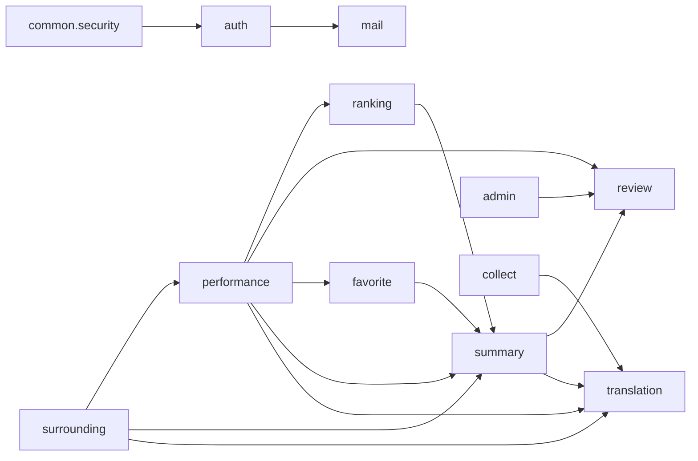

# 06. クラス設計書

- 状態: レビュー済み（工程4、Issue #20。ゲート4 の reviewer の判定は条件付き承認（2026-11-09）で、指摘（軽微1〜7・提案8〜10）を反映済み。人間の承認待ち）
- 担当: architect
- 入力: `01-requirements.md`、`02-screens.md`、`03-api.md`（API 仕様の詳細）、`04-tables.md` と `backend/src/main/resources/db/migration/V1__create_schema.sql`、`05-batch.md`、ADR 0001〜0016。
- 対象: バックエンド（`backend/`、Spring Boot）だけ。Angular のクラス設計は対象外（工程5で frontend-dev が `02`・`03`・`07` から作る）。
- 04 の 11.7 で architect に残された A-02〜A-07 はこの文書の 9 で決めた。03・05 に関わる分は 03（8.5・8.8）と 05（3.2・3.3・4.3）にも反映した。
- 外部サービス・Spring の仕様は公式ドキュメントで確認した（確認日 2026-11-09）。確認先は各節に書く。

## 1. 方針

### 1.1 レイヤー

- `Controller → Service → Mapper` の一方向だけ（`CLAUDE.md`）。Controller は入力チェック（Bean Validation）とレスポンス変換だけ。業務ロジック・トランザクションは Service。SQL は Mapper XML に書き、値は `#{}` だけ使う（`${}` は使わない）。
- 機能をまたぐ呼び出しは **Service → 他機能の Service** だけ許す（他機能の Mapper を直接呼ばない）。依存の向きは 2.2 の図のとおりで、循環させない。
- バッチ（`collect` など）も同じ。ジョブクラス → Service → Mapper。外部 API のクライアントは Service から呼ぶ（Mapper と同じ層の扱い）。
- 依存性はコンストラクタ注入だけ（`@Autowired` のフィールド注入は使わない）。Bean は `final` フィールド + コンストラクタ 1 つ。
- API のリクエスト・レスポンスは `record`（`dto` サブパッケージ）。Mapper の結果・引数も `record`（`row` サブパッケージ）。DB の行の record を API にそのまま返さない。

### 1.2 命名

- パッケージ: `com.catticket.{機能}`。機能名は 03 の 2（`performance`, `surrounding`, `review`, `ranking`, `auth`, `account`, `favorite`, `admin`）と、内部用の `collect`, `translation`, `mail`, `summary`, `common`。
- クラス: `{機能}Controller` / `{機能}Service` / `{機能}Mapper`。1 機能に Service が複数あるときは `{機能}{役割}Service`（例: `AuthLoginService`）。
- Mapper XML: `src/main/resources/mapper/{機能}/{機能}Mapper.xml`（`application.yml` の `mybatis.mapper-locations: classpath:mapper/**/*.xml` に合う）。複数機能で使う SQL 断片は `mapper/common/SharedSql.xml`（namespace `com.catticket.common.db.SharedSql`）に置き、`<include refid="com.catticket.common.db.SharedSql.publicCondition"/>` のように完全名で参照する。
- メソッド名: 取得 `find…`（0〜1 件は `Optional`、一覧は `List`）、件数 `count…`、存在確認 `exists…`、更新 `insert…` / `update…` / `delete…` / `upsert…`。行ロック付きは末尾に `ForUpdate`。

### 1.3 使うライブラリ（追加は ADR とスターターの範囲だけ）

新しいライブラリは追加しない。`build.gradle` に足すのは次だけで、すべて ADR 0001〜0016 で決めたもの、または Spring Boot 標準スターター（Spring Boot が依存のバージョンを管理する `spring-boot-starter-*`。確認先: Spring Boot リファレンス「Build Systems > Starters」、2026-11-09）。

| 追加する依存 | 種類 | 根拠 | 用途 |
|---|---|---|---|
| `spring-boot-starter-security` | 標準スターター | ADR 0013 | セッション認証、CSRF、パスワードのハッシュ（bcrypt） |
| `spring-boot-starter-mail` | 標準スターター | ADR 0012 | Gmail SMTP の送信（`JavaMailSender`） |
| `spring-boot-starter-restclient` | 標準スターター | ADR 0007・0011（Spring の HTTP クライアントで呼ぶと決めた）、ADR 0008（`RestClient` と明記） | KOPIS・Azure Translator・reCAPTCHA の呼び出し |
| `tools.jackson.dataformat:jackson-dataformat-xml`（バージョンは Spring Boot の管理に従い書かない） | Jackson のモジュール（Boot が管理） | ADR 0008（KOPIS の XML を Jackson で読む） | KOPIS の XML レスポンスの読み取り（`collect.client` の `XmlMapper` だけで使う。Spring MVC の XML のメッセージコンバーターは 3.1 の `WebMvcConfig` で外す） |
| `spring-boot-starter-security-test`（testImplementation） | 標準スターター | ADR 0013 | `@WebMvcTest` での認証・CSRF のテスト |

既にある依存（`spring-boot-starter-webmvc`、`spring-boot-starter-validation`、`mybatis-spring-boot-starter`、Flyway、MySQL ドライバ、テスト用スターター）はそのまま使う。

使わないもの（ADR がないため）: Spring Batch、ShedLock、Quartz、CSV ライブラリ（OpenCSV など）、Lombok、MapStruct、Resilience4j、`spring-boot-starter-restclient-test`・`spring-boot-starter-mail-test`（テストは spring-test の `MockRestServiceServer` と Mockito で足りる）。CSV は JDK だけで読む（5.5）。再試行・待ち時間は自前の小さなクラス（`common.batch.Retry`・`Sleeper`）で書く。

## 2. パッケージ

### 2.1 一覧

| パッケージ | 中身 | 対応 API・バッチ |
|---|---|---|
| `com.catticket` | `CatticketApplication`（起動。5.1） | — |
| `com.catticket.performance` | 公演の検索・地図・詳細、会場候補 | API-01, 02, 03, 06 |
| `com.catticket.surrounding` | 会場・現在地の周辺（駅・ロッカー・会場）と、駅・コインロッカーのファイルの取り込み（05 の 1 の表で B-02 の機能名は `surrounding`） | API-04, 05、B-02 |
| `com.catticket.review` | レビュー | API-10〜13 |
| `com.catticket.ranking` | ランキング・急上昇・ジャンル動向 | API-20〜22 |
| `com.catticket.auth` | ログイン・会員登録・パスワード再設定・ロック解除・管理者作成・期限切れの削除 | API-30〜38、B-03、B-04 |
| `com.catticket.account` | ニックネーム・パスワード変更、退会 | API-40〜42 |
| `com.catticket.favorite` | お気に入り | API-43〜45 |
| `com.catticket.admin` | 管理者の公演管理・レビュー管理 | API-50〜56 |
| `com.catticket.collect` | KOPIS の収集（B-01 の S1〜S6）と B-01 全体の流れ | B-01 |
| `com.catticket.translation` | Azure Translator の翻訳（B-01 の S7）と翻訳の参照 | B-01 S7、API の `lang=ja` |
| `com.catticket.mail` | メール送信と送信記録・上限 | API-33, 35, 37 |
| `com.catticket.summary` | 公演のカード（`PerformanceSummary`）の組み立て。翻訳と評価をまとめて引く（3.5） | API-01, 05, 20, 21, 43 |
| `com.catticket.common.*` | 共通（3） | 全体 |

各機能パッケージの中:

- 直下: `{機能}Controller`、`{機能}Service`（複数可）、`{機能}Mapper`、その機能だけの部品。
- `dto`: API のリクエスト・レスポンスの `record`。
- `row`: Mapper の結果・引数の `record`。
- `client`: 外部 API のクライアント（`collect.client`、`translation.client`、`auth.client`）。
- `batch`: バッチのジョブ（`collect.batch`、`surrounding.batch`、`auth.batch`。5）。

`common` のサブパッケージ: `config`（設定・Bean）、`error`（例外・エラー応答）、`validation`（入力チェック）、`security`（認証・セッション）、`display`（表示用の共通部品）、`db`（DB の共通部品）、`text`（文字列）、`geo`（距離）、`time`（時刻）、`batch`（バッチの共通部品）、`code`（コード値の enum）。

### 2.2 機能間の依存



- `summary` は 03 の 2 の機能名ではなく、内部の部品のパッケージ（`collect`・`translation`・`mail` と同じ扱い）。公演のカードを返す API が 4 つの機能（`performance`・`surrounding`・`ranking`・`favorite`）にまたがり、`performance` に置くと `performance → ranking → performance` の循環になるため分けた。

- 矢印は「Service が相手の Service を呼ぶ」。逆向きは作らない（例: `review` は `performance` を呼ばず、公演が表示できるか（非表示でないか。03 の 1.6 の「表示できる公演」）は自分の Mapper の SQL（`ReviewMapper.findVisiblePerformanceId`。4.3）で確かめる。レビューは終わった公演にも書けるので `SharedSql.publicCondition` は使わない）。
- `account` は `auth` の Service を呼ばず、自分の Mapper で `app_user` を更新する（ニックネーム・パスワード・退会は `account` の責務。03 の 2）。セッションの終了は `common.security.LoginSessionManager` を使う。
- すべての機能は `common` を使ってよい。`common` は機能パッケージに依存しない（例外: `common.security.SessionUserFilter` → `auth.AuthSessionService`。認証の読み込みだけ）。

## 3. 共通（`com.catticket.common`）

### 3.1 設定・時刻・起動

| クラス | パッケージ | 役割 |
|---|---|---|
| `CatticketProperties` | `common.config` | `@ConfigurationProperties("catticket")` の `record`（入れ子の record: `Kopis`, `Azure`, `Recaptcha`, `Mail`, `Admin`, `Subway`, `Scheduler`, `publicBaseUrl`, `task`）。キーは 8 |
| `ClockConfig` | `common.config` | `Clock` の Bean（`Clock.system(ZoneId.of("Asia/Seoul"))`） |
| `HttpClientConfig` | `common.config` | 外部 API ごとの `RestClient`（`@Qualifier("kopisRestClient")` など。7） |
| `JacksonConfig` | `common.config` | `JsonMapperBuilderCustomizer`（3.3 の型の厳しさ） |
| `WebMvcConfig` | `common.config` | `WebMvcConfigurer`。API のリクエスト・レスポンスを JSON だけにする（下の「JSON だけにする」） |
| `DateTimes` | `common.time` | `OffsetDateTime toApi(LocalDateTime)`（+09:00、秒で切り捨て）、`LocalDate today(Clock)`、`LocalDateTime now(Clock)`（秒で切り捨て。DB の `DATETIME` は秒まで） |

- **「今日」・今の時刻（03 の 7.1）**: Service の公開メソッドの最初に `LocalDateTime now = DateTimes.now(clock)`（と `today`）を1回だけ求め、その中の判定と保存（`created_at` など）すべてに渡す。Mapper の SQL で `NOW()`・`CURRENT_DATE` を使わない（テストで `Clock.fixed` に差し替えられるようにし、1回のリクエストの中で値をそろえるため）。DB の既定値（`DEFAULT CURRENT_TIMESTAMP`）にも頼らず、INSERT・UPDATE で値を渡す。
- 時刻の型: DB の `DATETIME` ↔ Java の `LocalDateTime`（Asia/Seoul の壁時計の時刻）。`DATE` ↔ `LocalDate`。API に出すときだけ `DateTimes.toApi` で `OffsetDateTime` にする。
- JDBC の接続は `connectionTimeZone=Asia/Seoul&forceConnectionTimeZoneToSession=true`（A-05。9）。
- **JSON だけにする（03 の 1.1・7.1・7.3。`WebMvcConfig`）**: KOPIS のために `jackson-dataformat-xml` がクラスパスにあると、Spring MVC はクラスパスの検出で Jackson の XML のメッセージコンバーター（`JacksonXmlHttpMessageConverter`）を既定で登録し、XML の本文を受け付け、`Accept: application/xml` に XML で返してしまう。これを次の2つで防ぐ。
  1. `configureMessageConverters(HttpMessageConverters.ServerBuilder builder)` で `builder.configureMessageConvertersList(list -> list.removeIf(c -> c instanceof JacksonXmlHttpMessageConverter))` とし、MVC の一覧から XML のコンバーターを除く。これで `Content-Type: application/xml` などの本文は `HttpMediaTypeNotSupportedException` → 415 `UNSUPPORTED_MEDIA_TYPE`（3.2）になる。List を受け取る旧い `configureMessageConverters(List)`・`extendMessageConverters(List)` は Spring Framework 7.0 で非推奨（削除予定）なので使わない。
  2. `configureContentNegotiation(c -> c.ignoreAcceptHeader(true).defaultContentType(MediaType.APPLICATION_JSON))` とし、`Accept` の値にかかわらず JSON（UTF-8）で返す（`Accept: application/xml` でも JSON。406 にしない。03 の 7.3 に 406 のコードはない）。
  - `RestClient`（KOPIS など）のコンバーターには影響しない（KOPIS の XML は `KopisClient` が `XmlMapper` で読む。4.9）。
  - 確認先: Spring Framework 7.0 Javadoc の `WebMvcConfigurer`（`configureMessageConverters(HttpMessageConverters.ServerBuilder)`、List 版の非推奨）、`HttpMessageConverters.Builder`（`configureMessageConvertersList` は 7.0.3 から）、`ContentNegotiationConfigurer`（`ignoreAcceptHeader`・`defaultContentType`）、Spring Framework リファレンス「Message Converters」（確認日 2026-11-09）。
  - テスト（`@WebMvcTest`。7.2）: ① 本文のある API（例: API-11・API-31）に `Content-Type: application/xml` で XML の本文を送ると 415・`code = UNSUPPORTED_MEDIA_TYPE`、② GET の API（例: API-01）に `Accept: application/xml` を付けても 200 で `Content-Type: application/json` の本文、③ `Content-Type: text/plain` の本文も 415。

### 3.2 例外とエラーの応答（03 の 7.3）

**クラス**（`common.error`）

| クラス | 内容 |
|---|---|
| `ErrorCode`（enum） | 03 の 7.3 のコードすべて。各値は `HttpStatus status` と英語の `message`（例: `LOGIN_FAILED(UNAUTHORIZED, "Email or password is incorrect")`） |
| `ApiException`（`RuntimeException`） | `ApiException(ErrorCode code)`。業務の条件のエラーはすべてこれを Service が投げる |
| `RequestValidationException`（`ApiException` の子） | `RequestValidationException(List<FieldErrorItem> errors)`。コードはいつも `VALIDATION_FAILED`。Bean Validation で書けないチェック（API-52 の本文の解析など）で使う |
| `ErrorResponse`（record） | `code`, `message`, `List<FieldErrorItem> errors`（いつも配列。ないときは `List.of()`） |
| `FieldErrorItem`（record） | `field`, `reason`（03 の 7.3 の `errors[].reason`） |
| `GlobalExceptionHandler` | `@RestControllerAdvice`。下の表で例外を `ErrorResponse` に変える |
| `ApiErrorController` | `/error`（Spring Boot の既定のエラーの応答）を `ErrorResponse` にする。サーブレットのフィルターで起きた例外の受け皿 |
| `JsonAuthenticationEntryPoint` | Spring Security の未ログイン → 401 `UNAUTHENTICATED` |
| `JsonAccessDeniedHandler` | Spring Security の拒否 → `CsrfException` なら 403 `CSRF_INVALID`、それ以外は 403 `FORBIDDEN` |
| `ErrorResponseWriter` | 上の2つのハンドラーが JSON（UTF-8）を書くための部品（`JsonMapper` を使う） |

**例外 → 応答の対応**

| 例外（起きる場所） | ステータス | `code` | `errors` |
|---|---|---|---|
| `ApiException`（Service） | `ErrorCode.status` | その `ErrorCode` | `[]` |
| `RequestValidationException`（Service・Controller の解析） | 400 | `VALIDATION_FAILED` | 渡された項目 |
| `MethodArgumentNotValidException`（`@Valid @RequestBody`） | 400 | `VALIDATION_FAILED` | 各 `FieldError`: `field` = 本文の経路（例: `bookingSites[0].url`）、`reason` = 制約の `message`（3.3） |
| `BindException`（`@Valid` のクエリの record） | 400 | `VALIDATION_FAILED` | 制約の誤りは上と同じ。型の変換の失敗（`FieldError.isBindingFailure()`）は `reason` = `TYPE`。クエリは `field` から `[n]` を除く（`genre[1]` → `genre`） |
| `HandlerMethodValidationException`（`@RequestParam` などの制約） | 400 | `VALIDATION_FAILED` | パラメーター名と制約の `message` |
| `MissingServletRequestParameterException` | 400 | `VALIDATION_FAILED` | `REQUIRED` |
| `MethodArgumentTypeMismatchException`（パス・クエリの型） | 400 | `VALIDATION_FAILED` | `TYPE` |
| `HttpMessageNotReadableException`（JSON が読めない・型が違う） | 400 | `MALFORMED_REQUEST` | `[]` |
| `HttpMediaTypeNotSupportedException` | 415 | `UNSUPPORTED_MEDIA_TYPE` | `[]` |
| `HttpRequestMethodNotSupportedException` | 405 | `METHOD_NOT_ALLOWED` | `[]` |
| `NoResourceFoundException`・`NoHandlerFoundException` | 404 | `NOT_FOUND` | `[]` |
| `AuthenticationException`（Spring Security。`JsonAuthenticationEntryPoint`） | 401 | `UNAUTHENTICATED` | `[]` |
| `CsrfException`（`JsonAccessDeniedHandler`） | 403 | `CSRF_INVALID` | `[]` |
| `AccessDeniedException`（`JsonAccessDeniedHandler`。役割が違う） | 403 | `FORBIDDEN` | `[]` |
| そのほかすべて（`DataAccessException`・`RestClientException` などで Service が変えなかったもの） | 500 | `INTERNAL_ERROR` | `[]`（例外はログに ERROR で残す。応答に例外の内容を入れない） |

- `errors` は同じ（`field`, `reason`）の組を1つにまとめる（同じ項目に2つの制約が同じ理由で当たったとき）。
- 415 は、MVC のメッセージコンバーターが JSON だけになっていることが前提（3.1 の「JSON だけにする」。XML のコンバーターが残っていると XML の本文が 415 にならない）。`WebMvcConfig` は `@WebMvcTest` でも読み込まれるので、415 のテストは Controller のテストで書く（3.1 のテスト ①〜③）。
- Service で外部 API・DB の例外を業務のコードに変えるもの: `DuplicateKeyException` → 409 系（4.3・4.5・4.6）、`MailException` → 503 `MAIL_SEND_FAILED`（4.11）、reCAPTCHA の呼び出しの失敗 → 503 `RECAPTCHA_UNAVAILABLE`（4.5）。ほかの DB の例外は変えず 500。
- MyBatis（Spring の例外の変換）での MySQL のエラー: 1062 → `DuplicateKeyException`、1213・1205 → `PessimisticLockingFailureException` の子（`CannotAcquireLockException` など）。どの一意制約に当たったかは `common.db.DbErrors.isDuplicateKey(ex, "uk_…")`（例外のメッセージに制約名が入る）で見分ける。
- ログ: 4xx は INFO（入力の誤りの詳細は出さない）、5xx は ERROR（スタックトレース付き）。パスワード・トークン・メールアドレスはログに出さない。

### 3.3 入力チェック（`common.validation`）

**制約のアノテーション**: すべての制約の `message` に 03 の 7.3 の `reason` のコードをそのまま書く（例: `@NotNull(message = "REQUIRED")`）。`GlobalExceptionHandler` は `getDefaultMessage()` を `reason` に使う（文言の変換はしない）。

| アノテーション | 種類 | `reason` | 内容 |
|---|---|---|---|
| `@NotNull`・`@NotBlank` | 標準 | `REQUIRED` | 必須 |
| `@CodePointLength(min, max)` | 独自（`CodePointLengthValidator`） | `LENGTH` | コードポイントで数える（標準の `@Size` は UTF-16 の単位で数えるので文字列には使わない。リストの要素の数は `@Size(message = "LENGTH")`） |
| `@NoControlChars(allowNewlines = false)` | 独自 | `FORMAT` | 一般カテゴリ Cc を含まない（`allowNewlines` なら LF・CR だけ許す。03 の 7.1） |
| `@PasswordRule` | 独自（`PasswordRuleValidator`） | `PASSWORD_RULE` | 03 の 4.6 のルール。`null`・空は通す（必須は `@NotNull(message = "REQUIRED")` と組む）。判定の本体は `common.validation.PasswordPolicy.matches(String)`（`AuthLoginService`・`AccountService`・`AuthAdminService` も使う。下の「判定の部品」） |
| `@OneOf(values)` / `@OneOfEnum(Genre.class)` | 独自 | `INVALID_VALUE` | 決まった値の一覧（ジャンル・区・`status`・`period`・`lang`・`visibility`） |
| `@Email` + `@Pattern("^[^@\\s]+@[^@\\s]+\\.[^@\\s]+$")` + `@CodePointLength(max = 254)` | 標準 + 独自 | `FORMAT` / `LENGTH` | メールアドレス（03 の API-33） |
| `@Min`・`@Max`・`@DecimalMin`・`@DecimalMax` | 標準 | `RANGE` | 数値・座標の範囲 |
| `@Pattern(regexp = "true\|false")` | 標準 | `TYPE` | 真偽のクエリ（`includeEnded`）。文字列で受けて Service に渡す前に `Boolean` にする |
| `@ValidPerformanceFilter` | 独自（クラスに付ける） | `DATE_ORDER`・`CONFLICT`・`INCOMPLETE`・`RANGE` | API-01・02 の組み合わせ（03 の 4.1・8.1）。`from` > `to` は `to` に `DATE_ORDER`。区・地図の範囲・会場の同時の指定は指定した項目ごとに `CONFLICT`。地図の範囲の4つの一部だけは `INCOMPLETE`。南西 > 北東は `RANGE` |

- **判定の部品**（`common.validation`、Spring に依存しない。2.2 の「`common` は機能パッケージに依存しない」と「`account` は `auth` を呼ばない」を守るため `common` に置く）:
  - `PasswordPolicy`: `boolean matches(String password)`（03 の 4.6 のルール）。`@PasswordRule` の `PasswordRuleValidator`、`AuthLoginService`（4.5）、`AccountService`（4.6）、`AuthAdminService`（5.5）が使う。
  - `EmailRule`: `boolean isValid(String email)`（03 の API-33 の規則: 上の `@Email` + `@Pattern` + 254 文字以内と同じ判定）。Bean Validation のない場所（B-03 の `AuthAdminService`）で使う。
- **前後の空白・NFKC**: record のコンパクトコンストラクターで行う（Bean Validation より前に値が決まる）。例: `SignupRequest` は `email = Texts.stripToNull(email)`、`nickname = Nicknames.normalize(nickname)`（NFKC → strip → 空なら `null`）。パスワード・トークン・レビュー本文は変えない（03 の 7.1）。
- **クエリの record**（`common.validation`）: `PageQuery(Integer page, Integer size)`（`@Min(0) @Max(10000)`、`@Min(1) @Max(100)`、`message = "RANGE"`。`null` は既定値 0・20 にするメソッド `page()`・`size()`）、`LangQuery(String lang)`（`@OneOf({"ko","ja"})`、`null` は `ko`。`Lang lang()` を返す）。繰り返しのクエリは `List<String>` で受け、コンパクトコンストラクターで重複を除く（`LinkedHashSet`）。
- **座標**: `BigDecimal` で受ける（`NaN`・`Infinity` は型の変換で失敗し `TYPE`）。
- **パスの ID**（`common.validation.PathIds`）: 公演 ID・会場 ID は `^[A-Za-z0-9]{1,20}$`（04 の `kopis_*_id` の長さ）に合わなければ Service を呼ばずに 404（`PERFORMANCE_NOT_FOUND`・`VENUE_NOT_FOUND`）。レビュー ID は文字列で受けて `^[1-9][0-9]{0,18}$` かつ `Long` に入るか → 合わなければ 404 `REVIEW_NOT_FOUND`。API-45（お気に入りの解除）は形が合わなくても 204（03 の 8.7）。
- **JSON の型の厳しさ**（`JacksonConfig`）: 数値の項目への文字列、真偽の項目への文字列・数値、整数の項目への小数は `HttpMessageNotReadableException`（→ `MALFORMED_REQUEST`）にする。`spring.jackson.deserialization.accept-float-as-int=false` と、`JsonMapperBuilderCustomizer` で文字列 → 数値・真偽の型の変換（coercion）を `Fail` にする。Jackson 3 の正確なメソッド名は実装のときに Jackson の公式ドキュメントで確かめる（11 の U-01）。

### 3.4 セキュリティとセッション（`common.security`、ADR 0013、03 の 7.4）

**クラス**

| クラス | 役割 |
|---|---|
| `SecurityConfig` | `SecurityFilterChain` の Bean と、下の Bean |
| `SessionPrincipal`（record、`Serializable`） | セッションに保存するもの: `long userId`, `String passwordHash` |
| `SessionUser`（record） | リクエストごとの利用者: `long userId`, `Role role`, `String nickname`（管理者は `null`）。Controller は `@AuthenticationPrincipal SessionUser user` で受ける（未ログインは `null`） |
| `Role`（enum） | `USER`, `ADMIN`（`ROLE_USER`・`ROLE_ADMIN` の権限にする） |
| `SessionUserFilter`（`OncePerRequestFilter`。`@Component` にしない） | 7.4 のセッションの確認（下） |
| `LoginSessionManager` | `establish(SessionUser user, String passwordHash, HttpServletRequest, HttpServletResponse)`、`terminate(HttpServletRequest, HttpServletResponse)` |

**`SecurityConfig` の設定**

- `csrf(c -> c.spa().csrfTokenRepository(csrfTokenRepository))`。`csrfTokenRepository` は `CookieCsrfTokenRepository.withHttpOnlyFalse()` の Bean（`LoginSessionManager` と同じものを使う）。
- `formLogin`・`httpBasic` は無効。`sessionManagement` は既定（必要なときに作る）。`securityContext` は既定（明示の保存。`HttpSessionSecurityContextRepository` の Bean を `LoginSessionManager` と共有）。
- `logout`: `logoutRequestMatcher(PathPatternRequestMatcher.withDefaults().matcher(HttpMethod.POST, "/api/auth/logout"))`、`logoutSuccessHandler(new HttpStatusReturningLogoutSuccessHandler(HttpStatus.NO_CONTENT))`、`deleteCookies("JSESSIONID")`。API-32 は Controller を作らない（ログインしていなくても 204）。
- `exceptionHandling`: `JsonAuthenticationEntryPoint`、`JsonAccessDeniedHandler`。
- `addFilterBefore(new SessionUserFilter(authSessionService, securityContextRepository), AuthorizationFilter.class)`。
- `PasswordEncoder`: `PasswordEncoderFactories.createDelegatingPasswordEncoder()`（bcrypt。ADR 0013）。

**認可の規則**（上から順に当てる）

| 規則 | パス |
|---|---|
| `hasRole("ADMIN")` | `/api/admin/**` |
| `hasRole("USER")` | `/api/me/**`、POST `/api/performances/*/reviews`、PUT・DELETE `/api/reviews/*` |
| `permitAll()` | ほかすべて（GET の API、認証の POST、`/error`） |

- 管理者が「一般」の API を呼ぶと `hasRole("USER")` に当たらず 403 `FORBIDDEN`（03 の 7.3）。未ログインは 401。

**`SessionUserFilter` の処理**（03 の 7.4 の 1.〜3.）

1. セッションの `SecurityContext` に `SessionPrincipal` がなければ何もしない（未ログイン）。
2. `authSessionService.findSessionUser(userId)` で行を読む（主キー。`Optional<SessionUserRow>`）。
3. 行がない・`status` が `ACTIVE` でない・パスワードのハッシュがセッションの値と違う（`MessageDigest.isEqual` で比べる）→ `session.invalidate()` し、`SecurityContextHolder.clearContext()`（未ログインとして続ける）。
4. それ以外 → そのリクエストだけの `Authentication`（principal = `SessionUser`、権限 `ROLE_{role}`）を `SecurityContextHolder` に入れる。セッションには保存しない（明示の保存なので、セッションには `SessionPrincipal` だけが残る）。

**`LoginSessionManager`**

- `establish`: ① セッションがあれば `request.changeSessionId()`、なければ作る（セッション固定攻撃の対策）→ ② `SessionPrincipal` の `Authentication` を `securityContextRepository.saveContext` で保存 → ③ `csrfTokenRepository.saveToken(null, request, response)` で CSRF の Cookie を消す（ログインの成功で消す Spring Security の既定と同じ動き。7.4）。
- `terminate`（API-41・42 の後）: `SecurityContextLogoutHandler`、`CookieClearingLogoutHandler("JSESSIONID")`、`CsrfLogoutHandler(csrfTokenRepository)` を順に呼ぶ。
- **API-30 の CSRF の Cookie（03 の 7.4 で 06 に残した事項）**: `AuthController.me` が引数で `CsrfToken csrfToken` を受け、`csrfToken.getToken()` を呼ぶ。遅延されていたトークンが読み込まれ、`CookieCsrfTokenRepository` が応答に `XSRF-TOKEN` を付ける（Spring Security リファレンス「Cross Site Request Forgery」、確認日 2026-11-09: https://docs.spring.io/spring-security/reference/servlet/exploits/csrf.html ）。

**Cookie**（8 の `application.yml`）: セッションの有効時間 30 分、`http-only: true`、`secure: ${SESSION_COOKIE_SECURE:true}`（ローカルの http だけ `false`）、`same-site: lax`。`server.forward-headers-strategy: native`（Nginx の後ろで `https` と判断させ、CSRF の Cookie にも `Secure` が付く。ADR 0010）。

### 3.5 表示の共通部品（`common.display`）

| クラス | 内容 |
|---|---|
| `LocalizedText`（record） | `value`, `original`, `translated`（03 の 7.2） |
| `Rating`（record） | `BigDecimal average`, `long count`。`Rating.of(long sum, long count)`: 0 件なら `average = null`、ほかは `sum / count` を小数第1位で `HALF_UP` |
| `Period`（record） | `LocalDate start`, `LocalDate end` |
| `PageResponse<T>`（record） | `items`, `page`, `size`, `totalElements`, `totalPages`。`PageResponse.of(List<T>, PageQuery, long total)`（`totalPages = ceil(total / size)`） |
| `PerformanceStatus`（enum） | `ONGOING`, `UPCOMING`, `ENDED`。`of(LocalDate start, LocalDate end, LocalDate today)`（03 の 1.6） |
| `VenueRef`（record） | `venueId`, `LocalizedText name` |
| `PerformanceSummary`（record） | 03 の 7.2 の項目 |
| `PerformanceSummaryRow`（record） | SQL の結果（`long id`（`performance.id`。内部の ID で API には出さない）、`performanceId`（KOPIS の公演 ID）、修正を反映した公演名・期間・ジャンル、会場 ID・名前、ポスター、受賞歴） |
| `ReviewItem`（record） | 03 の 7.2 |
| `LocalizedTextFactory` | `LocalizedText of(String original, Lang lang, Map<String, String> translations)`（`lang = ko` か翻訳がなければ `value = original`, `translated = false`）。駅名は `ofStation(String nameKo, String nameJa, Lang, Map)`（`name_ja` → 翻訳 → 原文。03 の 7.2） |

**`com.catticket.summary.PerformanceSummaryAssembler`**（`@Component`）

- `List<PerformanceSummary> assemble(List<PerformanceSummaryRow> rows, Lang lang, LocalDate today, boolean withRating)`。
- 処理: ① `lang = ja` なら、行の公演名・会場名を集めて `TranslationLookupService.lookup(Collection<String> originals)` を1回呼ぶ（`Map<原文, 翻訳>`）→ ② `withRating` なら、行の内部の ID（`PerformanceSummaryRow.id`）を集めて `ReviewService.findRatingStats(Collection<Long> performanceIds)` を1回呼ぶ（`Map<内部の公演 ID, RatingStat(sum, count)>`。ない公演は 0 件）→ ③ 行の順番のまま `PerformanceSummary` にする（`status` は `PerformanceStatus.of`、`rating` は `withRating = false` なら `null`。03 の 7.2）。
- 翻訳を引くのは `lang = ja` のときだけ（4.10）。1行ずつ引かない（N+1 にしない）。

### 3.6 そのほかの共通部品

| クラス | パッケージ | 内容 |
|---|---|---|
| `Texts` | `common.text` | `stripToNull(String)`、`codePointLength(String)`、`hasControlChars(String, boolean allowNewlines)`、`truncateCodePoints(String, int)`、`truncateUtf8Bytes(String, int)` |
| `Nicknames` | `common.text` | `normalize(String)`: NFKC → `strip()` → 空なら `null`（03 の 7.1） |
| `Hashes` | `common.text` | `sha256Hex(String)`: UTF-8 のバイトの SHA-256 を小文字の16進 64 文字（翻訳の `source_hash`、トークンの `token_hash`。04） |
| `Likes` | `common.db` | `contains(String)`: `\`・`%`・`_` を `\` でエスケープして `%…%` にする（SQL は `LIKE #{kw} ESCAPE '\\'`） |
| `DbErrors` | `common.db` | `isDuplicateKey(DataAccessException, String keyName)`、`isLockFailure(DataAccessException)`（1213・1205） |
| `SharedSql.xml` | `mapper/common/` | `publicCondition`（03 の 1.6 の「公開中の公演」: 非表示でない・ソウル・…。04 の `performance_effective` の列で書く）、`summaryColumns`（`PerformanceSummaryRow` の列。内部の ID `pe.id` を含む） |
| `GeoDistance` | `common.geo` | `double meters(lat1, lng1, lat2, lng2)`（ハバーサイン、半径 6,371,000 m。03 の 7.2） |
| `GeoBounds`（record） | `common.geo` | `around(BigDecimal lat, BigDecimal lng, int meters)`: SQL の前の絞り込み用の緯度経度の四角（600 m で取り、Java で 500 m を正確に判定する） |
| `Genre`（enum） | `common.code` | ジャンル（値は 05 の 7 の確認で確定する。分かっているのは 05 の 3.4 の 9 個）。`code`（`AAAA` など）と KOPIS の名前（`genrenm`）。`fromKopisName(String)` は `Optional` |
| `SeoulDistrict`（enum） | `common.code` | 25 区（コードと韓国語の名前） |
| `Lang`（enum） | `common.code` | `KO`, `JA` |
| `PeriodType`（enum） | `common.code` | `DAILY`, `WEEKLY`, `MONTHLY` |

## 4. 機能ごとのクラス

- 表の「API」は 03 の API ID。振る舞い（判定の順番・並び順・エラー）は 03 の 8. が正で、ここではどのクラス・メソッドが受け持つかを書く。
- Controller のメソッドの戻り値は DTO の record（`ResponseEntity` は 201・204 のときだけ）。`@Transactional` は 6 にまとめて書く（下の表の「Tx」は `RO` = `@Transactional(readOnly = true)`、`RW` = `@Transactional`、`—` = 付けない）。
- Mapper の XML は `mapper/{機能}/{機能}Mapper.xml`。SQL の列名・テーブル名は 04 と V1 のとおり。

### 4.1 公演・会場（`performance`）

**`PerformanceController`**（`/api`）

| API | メソッド |
|---|---|
| API-01 | `PageResponse<PerformanceSummary> search(@Valid PerformanceFilterQuery filter, @Valid PageQuery page)` — `GET /performances` |
| API-02 | `MarkersResponse markers(@Valid PerformanceFilterQuery filter)` — `GET /performances/markers` |
| API-03 | `PerformanceDetailResponse detail(@PathVariable String performanceId, @Valid LangQuery lang, @AuthenticationPrincipal SessionUser user)` — `GET /performances/{performanceId}`。`PathIds` で形を確かめる（3.3） |
| API-06 | `VenueCandidatesResponse venues(@Valid VenueSearchQuery query)` — `GET /venues` |

**DTO**（`performance.dto`）: `PerformanceFilterQuery`（`lang`, `from`, `to`, `List<String> district`, `swLat`, `swLng`, `neLat`, `neLng`, `venueId`, `List<String> genre`, `List<String> status`, `keyword`。`@ValidPerformanceFilter`。`toCondition(LocalDate today)` で下の `PerformanceCondition` にする）、`MarkersResponse(List<MarkerItem> markers)`、`MarkerItem(venueId, LocalizedText name, BigDecimal latitude, BigDecimal longitude, int performanceCount)`、`PerformanceDetailResponse`（03 の API-03 の項目。入れ子に `VenueDetail`, `BookingSiteItem`, `RankingBadge`, `Viewer`）、`VenueSearchQuery(keyword, lang)`、`VenueCandidatesResponse(List<VenueCandidate> items)`。

**`PerformanceService`**

| メソッド | Tx | 内容 |
|---|---|---|
| `PageResponse<PerformanceSummary> search(PerformanceFilterQuery, PageQuery)` | RO | `today` を求め → `count` → `search`（LIMIT/OFFSET）→ `PerformanceSummaryAssembler.assemble(rows, lang, today, true)` |
| `MarkersResponse markers(PerformanceFilterQuery)` | RO | `findMarkers` → 会場名の翻訳 |
| `PerformanceDetailResponse getDetail(String performanceId, Lang lang, SessionUser user)` | RO | `findVisibleDetail`（なければ 404 `PERFORMANCE_NOT_FOUND`）→ `findBookingSites` → `ReviewService.findRatingStats` → `RankingService.findRankingsOf(id, genre, today)` → `user` が一般なら `FavoriteService.isFavorite`・`ReviewService.findMine` → 翻訳（公演名・会場名・住所・出演者などの原文をまとめて1回）→ 組み立て |
| `VenueCandidatesResponse findVenueCandidates(String keyword, Lang lang)` | RO | `findVenueCandidates` |
| `List<PerformanceSummaryRow> findPublicByVenueIds(Collection<String> venueIds, LocalDate today)` | RO | API-05 用（`surrounding` から呼ぶ） |

- `PerformanceCondition`（record、`performance.row`）: `today`, `from`, `to`, `districts`, 地図の範囲の4つ, `venueId`, `genres`, `statuses`, `keywordLike`（`Likes.contains` 済み、指定なしは `null`）, `lang`, `limit`, `offset`。

**`PerformanceMapper`**（`mapper/performance/PerformanceMapper.xml`）

| メソッド | SQL の役割 |
|---|---|
| `List<PerformanceSummaryRow> search(PerformanceCondition)` | `performance_effective pe JOIN venue v`。`SharedSql.publicCondition` + 条件（`<if>`・`<foreach>`）。キーワードは `pe.title LIKE #{keywordLike} ESCAPE '\\'`、`lang = ja` のときだけ `LEFT JOIN translation t ON t.source_hash = SHA2(pe.title, 256)` して `OR t.translated_text LIKE …`。`ORDER BY pe.start_date, pe.kopis_performance_id LIMIT #{limit} OFFSET #{offset}` |
| `long count(PerformanceCondition)` | 上と同じ条件で `COUNT(*)` |
| `List<MarkerRow> findMarkers(PerformanceCondition)` | 同じ条件 + 座標のある会場だけ。`GROUP BY v.id ORDER BY v.kopis_venue_id`、`COUNT(*)` |
| `Optional<PerformanceDetailRow> findVisibleDetail(String kopisPerformanceId)` | `performance_effective` + 会場。非表示を除く（03 の API-03） |
| `List<BookingSiteRow> findBookingSites(long performanceId, String source)` | `source` は `booking_sites` の修正の行があれば `ADMIN`、なければ `COLLECTED`（04 の DB-02。Service が `findVisibleDetail` の結果の「修正あり」で決める）。`ORDER BY sort_order` |
| `List<VenueCandidateRow> findVenueCandidates(String keywordLike, Lang lang)` | 公開中の公演がある会場（`EXISTS` + `publicCondition`）。`ORDER BY v.name, v.kopis_venue_id LIMIT 20` |
| `List<PerformanceSummaryRow> findPublicByVenueIds(Collection<String> venueIds, LocalDate today)` | API-05 の会場の公演。並び順は API-01 と同じ |

### 4.2 周辺（`surrounding`）

**`SurroundingController`**（`/api`）

| API | メソッド |
|---|---|
| API-04 | `VenueSurroundingsResponse venueSurroundings(@PathVariable String venueId, @Valid LangQuery lang)` — `GET /venues/{venueId}/surroundings` |
| API-05 | `LocationSurroundingsResponse aroundLocation(@Valid LocationQuery query)` — `GET /surroundings`（`LocationQuery(BigDecimal lat, BigDecimal lng, String lang)`） |

**DTO**（`surrounding.dto`）: `VenueSurroundingsResponse(VenueInfo venue, boolean hasLocation, List<StationItem> stations, List<LockerItem> lockers)`、`LocationSurroundingsResponse(List<NearbyVenue> venues, stations, lockers)`、`StationItem`、`LockerItem`、`NearbyVenue(venueId, name, latitude, longitude, int distanceMeters, List<PerformanceSummary> performances)`。

**`SurroundingService`**（すべて RO）

- `VenueSurroundingsResponse getVenueSurroundings(String venueId, Lang lang)`: `findVenue`（なければ 404 `VENUE_NOT_FOUND`）→ 座標がなければ `hasLocation = false`、`[]` → `GeoBounds.around(…, 600)` で `findStationsInBounds` → `GeoDistance` で 500 m 以内（丸める前の値で `<= 500`。03 の 4.5）→ `findLockersByStationIds` → 並べ替え（03 の 8.2）→ 駅名・位置の文章・住所の翻訳。
- `LocationSurroundingsResponse getAroundLocation(BigDecimal lat, BigDecimal lng, Lang lang)`: 駅・ロッカーは上と同じ。会場は `findPublicVenuesInBounds` → 500 m 以内 → `PerformanceService.findPublicByVenueIds` → `PerformanceSummaryAssembler.assemble(…, true)` → 会場ごとにまとめる。
- 距離の計算・並べ替えは小さな部品 `NearbyFilter`（`surrounding` パッケージ、Spring に依存しない）に分け、単体テストで境目（499.9・500.0・500.1 m）を確かめる。

**`SurroundingMapper`**（`mapper/surrounding/SurroundingMapper.xml`）: `Optional<VenueRow> findVenue(String kopisVenueId)`、`List<StationRow> findStationsInBounds(GeoBounds)`、`List<LockerRow> findLockersByStationIds(Collection<Long> stationIds)`、`List<VenueLocationRow> findPublicVenuesInBounds(GeoBounds, LocalDate today)`（公開中の公演がある会場。`EXISTS` + `publicCondition`）。

### 4.3 レビュー（`review`）

**`ReviewController`**（`/api`）

| API | メソッド |
|---|---|
| API-10 | `PageResponse<ReviewItem> list(@PathVariable String performanceId, @Valid PageQuery page, @AuthenticationPrincipal SessionUser user)` |
| API-11 | `ResponseEntity<ReviewItem> create(@PathVariable String performanceId, @Valid @RequestBody ReviewRequest body, @AuthenticationPrincipal SessionUser user)` — 201 |
| API-12 | `ReviewItem update(@PathVariable String reviewId, @Valid @RequestBody ReviewRequest body, @AuthenticationPrincipal SessionUser user)` |
| API-13 | `ResponseEntity<Void> delete(@PathVariable String reviewId, @AuthenticationPrincipal SessionUser user)` — 204 |

- `ReviewRequest(Integer rating, String body)`: `rating` は `@NotNull @Min(1) @Max(5)`、`body` は `@CodePointLength(max = 1000) @NoControlChars(allowNewlines = true)`。前後の空白は除かない。`null`・空・空白だけ（`isBlank`）なら Service で `null` にして保存する（03 の API-11）。

**`ReviewService`**

| メソッド | Tx | 内容 |
|---|---|---|
| `PageResponse<ReviewItem> listVisible(String performanceId, PageQuery, SessionUser)` | RO | 公演が非表示でないか（`findVisiblePerformanceId`。なければ 404 `PERFORMANCE_NOT_FOUND`）→ 一覧。未ログインは本文・ニックネーム・日時を `null`（03 の 7.2） |
| `ReviewItem create(String performanceId, ReviewRequest, SessionUser)` | RW | 公演（なければ 404）→ 今日 < 開始日なら 400 `REVIEW_NOT_OPEN` → 投稿済みの事前の確認（409）→ INSERT。`DuplicateKeyException`（`uk_review_user_performance`）も 409 `REVIEW_ALREADY_EXISTS` |
| `ReviewItem update(long reviewId, ReviewRequest, SessionUser)` | RW | `findForUpdate`（なし・公演が非表示 → 404 `REVIEW_NOT_FOUND`）→ 自分のでなければ 403 `FORBIDDEN` → UPDATE（`updated_at = now`） |
| `void delete(long reviewId, SessionUser)` | RW | update と同じ確認 → DELETE |
| `Optional<ReviewItem> findMine(long performanceId, long userId)` | RO | API-03 の `viewer.myReview` |
| `Map<Long, RatingStat> findRatingStats(Collection<Long> performanceIds)` | RO | `SUM(rating)`・`COUNT(*)`（03 の 7.2 の `Rating`）。引数・キーは内部の ID（`performance.id`。`review.performance_id` と同じ）。KOPIS の ID からの変換はしない（呼ぶ側の行が内部の ID を持つ: `PerformanceSummaryRow.id`、API-03 は `PerformanceDetailRow.id`）。空の引数なら SQL を呼ばずに空の `Map` |
| `PageResponse<ReviewItem> listAll(long performanceId, PageQuery)` | RO | API-55（`admin` から呼ぶ。全部の項目、非表示の公演でも返す。公演の存在は `admin` が先に確かめる） |
| `void deleteAny(long reviewId)` | RW | API-56（なければ 404 `REVIEW_NOT_FOUND`） |

- `created_at`・`updated_at` は Service の `now`（3.1）。

**`ReviewMapper`**（`mapper/review/ReviewMapper.xml`）: `Optional<Long> findVisiblePerformanceId(String kopisPerformanceId)`（`publicCondition` ではなく「非表示でない」だけ。03 の 8.3）、`Optional<LocalDate> findEffectiveStartDate(long performanceId)`、`List<ReviewRow> findPage(long performanceId, int limit, int offset)`（並び順は 03 の 3.）、`long countByPerformance(long performanceId)`、`boolean existsByUserAndPerformance(long userId, long performanceId)`、`void insert(ReviewInsert)`（`useGeneratedKeys`）、`Optional<ReviewOwnerRow> findForUpdate(long reviewId)`（`FOR UPDATE`、公演の非表示を JOIN で読む）、`void update(ReviewUpdate)`、`int delete(long reviewId)`、`List<RatingStatRow> sumAndCount(Collection<Long> performanceIds)`（`RatingStatRow(long performanceId, long sum, long count)`。`performanceId` は内部の ID。`WHERE performance_id IN (<foreach>) GROUP BY performance_id`）、`Optional<ReviewRow> findByUserAndPerformance(long userId, long performanceId)`。

### 4.4 ランキング（`ranking`）

**`RankingController`**（`/api`）

| API | メソッド |
|---|---|
| API-20 | `RankingResponse rankings(@Valid RankingQuery query)` — `GET /rankings`（`period`, `genre`, `lang`） |
| API-21 | `RisingResponse rising(@Valid RankingQuery query)` — `GET /rankings/rising` |
| API-22 | `GenreTrendResponse genreTrends()` — `GET /genre-trends`（クエリなし） |

- `RankingQuery(String period, String genre, String lang)`: `period` は `@NotNull(message = "REQUIRED") @OneOf({"daily","weekly","monthly"})`、`genre` は `ALL`（既定）か `Genre` のコード（`INVALID_VALUE`）。
- DTO（`ranking.dto`）: `RankingResponse(periodType, genre, Period period, List<RankingItem> items)`、`RankingItem(int rank, PerformanceSummary performance)`、`RisingResponse(periodType, genre, availability, currentPeriod, previousPeriod, List<RisingItem> items)`、`RisingItem(int rank, String movement, Integer rise, PerformanceSummary performance)`、`GenreTrendResponse(Period period, String basis, List<GenreTrendItem> items)`、`GenreTrendItem(genre, long bookingCount, BigDecimal share)`、`RankingBadge(periodType, genre, int rank, Period period)`（API-03 用）。

**`RankingService`**（すべて RO）

| メソッド | 内容 |
|---|---|
| `RankingResponse getRanking(PeriodType, String genre, Lang)` | `findLatestCompleted`（表示できる期間。03 の 4.9）→ `findTopVisible` → 順位を 1 から振り直す（9.1）→ `PerformanceSummaryAssembler.assemble(…, false)` |
| `RisingResponse getRising(PeriodType, String genre, Lang)` | 現在の期間 → `RankingPeriods.previous(type, start)` で直前の期間 → `findCollection` → `RisingCalculator.calculate(current, previous)` |
| `List<RankingBadge> findRankingsOf(String performanceId, String genre, LocalDate today)` | API-03 の 6 つの組（3 期間 × `ALL`・その公演のジャンル）それぞれで `getRanking` と同じ上位 10 位を求め、入っているものだけ |
| `GenreTrendResponse getGenreTrend()` | `findLatestGenreTrendPeriod`（末日が最も新しい期間）→ `findGenreTrends`。割合の大きい順 → コードの順。割合は小数第1位で `HALF_UP`（03 の API-22） |

- `RankingPeriods`（Spring に依存しない）: 期間の種類ごとの暦の計算（日次・週次（月〜日）・月次。03 の 4.9）。
- `RisingCalculator`（Spring に依存しない）: 入力は現在・直前の振り直し後の上位 10 位、出力は `availability`（`NO_RANKING` / `NO_PREVIOUS_RANKING` / `AVAILABLE` / `NO_RISE`）と行（`movement` = `NEW` / `UP` / `NONE`、`rise`）。03 の 9.3 の4つの場合を単体テストで確かめる。

**`RankingMapper`**（`mapper/ranking/RankingMapper.xml`）

| メソッド | SQL の役割 |
|---|---|
| `Optional<CollectionRow> findLatestCompleted(PeriodType, String genreCode, LocalDate today)` | `WHERE period_type = #{…} AND genre_code = #{…} AND period_end < #{today} ORDER BY period_start DESC LIMIT 1`（完了の記録のある期間。04 の `ranking_collection`） |
| `Optional<CollectionRow> findCollection(PeriodType, String genreCode, LocalDate periodStart)` | 直前の期間の完了の記録 |
| `List<RankingEntryRow> findTopVisible(long collectionId, int limit)` | `ranking_entry` JOIN `performance_effective` + 会場。非表示を除き `ORDER BY provider_rank, kopis_performance_id LIMIT 10`（03 の 9.1） |
| `Optional<Period> findLatestGenreTrendPeriod()`・`List<GenreTrendRow> findGenreTrends(Period)` | 04 の `genre_trend`（`ORDER BY period_end DESC LIMIT 1` は `uk_genre_trend_end_start_genre` で引く） |
| `List<RankingEntryRow>` の行 | 公演が `performance` に結びつかない順位の行は JOIN で落ちる（03 の 9.1 の D-01） |

### 4.5 認証・申込（`auth`）

**`AuthController`**（`/api`）

| API | メソッド |
|---|---|
| API-30 | `MeResponse me(@AuthenticationPrincipal SessionUser user, CsrfToken csrfToken)` — `GET /auth/me`。最初に `csrfToken.getToken()` を呼ぶ（3.4） |
| API-31 | `MeResponse login(@Valid @RequestBody LoginRequest body, HttpServletRequest req, HttpServletResponse res)` — `POST /auth/login`。`AuthLoginService.login` → `LoginSessionManager.establish` |
| API-32 | なし（`SecurityConfig` の `logout`。3.4） |
| API-33 | `ResponseEntity<Void> signup(@Valid @RequestBody SignupRequest body)` — `POST /signup`、204 |
| API-34 | `ResponseEntity<Void> verify(@RequestBody(required = false) TokenRequest body)` — `POST /signup/verify`、204。`@Valid` を付けない（形の誤りも `TOKEN_INVALID`。Service で確かめる） |
| API-35 | `ResponseEntity<Void> requestPasswordReset(@Valid @RequestBody EmailRequest body)` — `POST /password-reset`、204 |
| API-36 | `ResponseEntity<Void> confirmPasswordReset(@Valid @RequestBody PasswordResetConfirmRequest body)` — `POST /password-reset/confirm`、204。制約は `newPassword` だけ（`token` は Service で確かめる） |
| API-37 | `ResponseEntity<Void> requestUnlock(@Valid @RequestBody UnlockRequest body)` — `POST /unlock`、204 |
| API-38 | `ResponseEntity<Void> confirmUnlock(@RequestBody(required = false) TokenRequest body)` — `POST /unlock/confirm`、204 |

**DTO**（`auth.dto`）: `MeResponse(boolean authenticated, String role, String nickname)`（`MeResponse.anonymous()`・`MeResponse.of(SessionUser)`）、`LoginRequest(email, password)`（`email` は strip して `@NotBlank`、`password` は `@NotEmpty`。形・長さ・ルールは確かめない）、`SignupRequest(email, password, nickname)`、`TokenRequest(String token)`、`EmailRequest(email)`、`PasswordResetConfirmRequest(token, newPassword)`、`UnlockRequest(email, recaptchaToken)`（`recaptchaToken` は `@NotEmpty @CodePointLength(min = 1, max = 10000)`）。

**Service**

| クラス・メソッド | Tx | 内容（03 の 8.5） |
|---|---|---|
| `AuthLoginService.login(String email, String password)` → `LoginResult(SessionUser user, String passwordHash)` | `@Transactional(noRollbackFor = ApiException.class)` | `findUserByEmailForUpdate` → ない: ダミーのハッシュ（起動時に1回作る）と `passwordEncoder.matches` してから 401 `LOGIN_FAILED` → `locked_at` あり: `ACCOUNT_LOCKED` → `PasswordPolicy.matches` に合わないか `matches` が偽: 有効なら `updateLoginFailure`（5 回目で `locked_at = now`、`ACCOUNT_LOCKED`、ほかは `LOGIN_FAILED`）、認証前は `LOGIN_FAILED` → 合う: 認証前は `EMAIL_NOT_VERIFIED`、有効は `resetLoginFailure` |
| `AuthSignupService.apply(SignupRequest)` | `TransactionTemplate`（6.2） | 03 の API-33 の ①〜⑦。1回だけやり直す（6.2） |
| `AuthSignupService.verify(String token)` | `TransactionTemplate`（6.3） | 03 の 9.2 の API-34 |
| `AuthPasswordResetService.request(String email)` | RW | ① `MailService.ensureWithinDailyLimit` → ② `findActiveUserByEmail`（ない・認証前は何もしない）→ `findUserByIdForUpdate` → `AuthTokenService.issue(PASSWORD_RESET, 1h)` → `MailService.send` |
| `AuthPasswordResetService.confirm(String token, String newPassword)` | RW | トークンの形 → `findTokenByHash`（ロックしない）→ ユーザー `FOR UPDATE` → トークン `FOR UPDATE` で再確認（用途・未使用・期限）→ `updatePasswordAndUnlock`（ハッシュ・`locked_at = NULL`・回数 0）→ `markTokenUsed` → `markUnusedTokensUsed(userId, PASSWORD_RESET)` |
| `AuthUnlockService.request(String email, String recaptchaToken)` | — （中で RW を呼ぶ） | ① `MailService.ensureWithinDailyLimit`（RO）→ ② `RecaptchaClient.verify`（**トランザクションの外**。外部の呼び出しの間 DB の接続・行ロックを持たない）→ ③ `AuthUnlockService.issueIfLocked(email)` |
| `AuthUnlockService` の ③（private `issueIfLocked(String email, LocalDateTime now)`） | `TransactionTemplate`（RW） | 有効でロック中のときだけ、ユーザー `FOR UPDATE` → `AuthTokenService.issue(UNLOCK, 1h)` → `MailService.send`。同じクラスの中の呼び出しでは `@Transactional` が効かないので `TransactionTemplate` で書く |
| `AuthUnlockService.confirm(String token)` | RW | API-36 と同じ順（用途 `UNLOCK`）→ `unlock`（`locked_at = NULL`・回数 0）→ `markTokenUsed`。ロックが解けていても 204 |
| `AuthTokenService.issue(long userId, TokenPurpose, Duration ttl, LocalDateTime now)` → `String rawToken` | `@Transactional(propagation = MANDATORY)` | `markUnusedTokensUsed(userId, purpose, now)` → `SecureRandom` 32 バイト → Base64URL（パディングなし、43 文字）→ `insertToken(userId, purpose, Hashes.sha256Hex(raw), now + ttl, now)`（03 の 7.6） |
| `AuthTokenService.isWellFormed(String token)` | — | `^[A-Za-z0-9_-]{43}$` |
| `AuthSessionService.findSessionUser(long userId)` → `Optional<SessionUserRow>` | RO | 3.4 の `SessionUserFilter` 用（`id`, `role`, `status`, `nickname`, `password_hash`） |
| `AuthAdminService.createAdmin(String email, String password)` | RW | B-03（5.5） |
| `AuthPurgeService.purgeExpiredSignups(LocalDateTime t)` → `int` | RW | B-04（5.6、03 の 9.2） |

- `TokenPurpose`（enum）: `SIGNUP`, `PASSWORD_RESET`, `UNLOCK`（04 の `auth_token.purpose`）。`UserStatus`: `PENDING`, `ACTIVE`。
- パスワードのルールの判定は `common.validation.PasswordPolicy`（3.3。`auth` には置かない）。
- `auth.client.RecaptchaClient`: `RecaptchaResult verify(String token)`。`tokenProperties.valid` が真なら `PASSED`、偽なら `FAILED`（→ 400 `RECAPTCHA_FAILED`）。429・5xx・タイムアウト・通信の失敗は `RecaptchaUnavailableException`（→ 503 `RECAPTCHA_UNAVAILABLE`）。再試行しない（03 の 7.5）。

**`AuthMapper`**（`mapper/auth/AuthMapper.xml`）

| メソッド | SQL の役割 |
|---|---|
| `Optional<SessionUserRow> findUserById(long id)` | 主キーで読む（`SessionUserFilter`） |
| `Optional<UserRow> findUserByEmailForUpdate(String email)` | `uk_app_user_email` で `FOR UPDATE`（行がなければギャップのロック。6.2） |
| `Optional<UserRow> findUserByIdForUpdate(long id)` | 主キーで `FOR UPDATE` |
| `boolean existsActiveNickname(String nickname)` | 有効なアカウントの `nickname` を照合順序 `utf8mb4_0900_as_ci` で比べる（04 の D-02） |
| `void insertPendingUser(PendingUserInsert)` | 認証前の行（`useGeneratedKeys`） |
| `int replacePendingUser(PendingUserUpdate)` | 同じメールの認証前の行のパスワード・ニックネーム・`updated_at` を置き換え（`WHERE id = ? AND status = 'PENDING'`） |
| `int activateUser(long id, LocalDateTime now)` | `UPDATE … SET status = 'ACTIVE' WHERE id = ? AND status = 'PENDING'` |
| `int deletePendingUser(long id)` | `DELETE … WHERE id = ? AND status = 'PENDING'`（トークンは CASCADE） |
| `void updateLoginFailure(long id, int count, LocalDateTime lockedAt)`・`void resetLoginFailure(long id)` | 失敗回数・ロック |
| `void updatePasswordAndUnlock(long id, String hash, LocalDateTime now)`・`void unlock(long id, LocalDateTime now)` | API-36・38 |
| `Optional<TokenRow> findTokenByHash(String hash)`・`Optional<TokenRow> findTokenByHashForUpdate(String hash)` | `uk_auth_token_token_hash` |
| `void insertToken(TokenInsert)`・`int markTokenUsed(long id, LocalDateTime now)`・`int markUnusedTokensUsed(long userId, TokenPurpose, LocalDateTime now)` | 03 の 7.6 |
| `boolean existsAdmin()`・`boolean existsUserByEmail(String email)`・`void insertAdmin(AdminInsert)` | B-03 |
| `List<Long> findPurgeCandidateIds(LocalDateTime t)`・`int deletePurgeCandidates(Collection<Long> ids, LocalDateTime t)` | B-04（03 の 9.2 の SQL。ID の一覧は `<foreach>` で `#{}`） |

### 4.6 アカウント（`account`）

**`AccountController`**（`/api/me`）

| API | メソッド |
|---|---|
| API-40 | `NicknameResponse changeNickname(@Valid @RequestBody NicknameRequest body, @AuthenticationPrincipal SessionUser user)` — `PUT /nickname`。保存した値（NFKC の後）を返す |
| API-41 | `ResponseEntity<Void> changePassword(@Valid @RequestBody PasswordChangeRequest body, SessionUser user, req, res)` — `PUT /password`、204。成功の後に `LoginSessionManager.terminate` |
| API-42 | `ResponseEntity<Void> withdraw(@Valid @RequestBody WithdrawRequest body, SessionUser user, req, res)` — `DELETE`、204。成功の後に `terminate` |

**`AccountService`**（すべて RW。ユーザーの行を `FOR UPDATE` で読んでから判定する）

- `String changeNickname(long userId, String nickname)`: `existsActiveNicknameOfOthers(userId, nickname)` → 409 `NICKNAME_ALREADY_USED` → `updateNickname`。`DuplicateKeyException`（`uk_app_user_active_nickname`）も 409（03 の API-40）。
- `void changePassword(long userId, String current, String next)`: `passwordEncoder.matches(current, hash)` が偽 → 400 `CURRENT_PASSWORD_INCORRECT`（ログインの失敗回数は変えない）→ `updatePassword`。
- `void withdraw(long userId, String current)`: 同じ確認 → `deleteUser`（レビュー・お気に入り・トークンは外部キーの CASCADE。04 の 5.）。
- 現在のパスワードがルールに合わない（72 バイトを超えるなど）ときは、ハッシュと比べずに「合わない」とする（`common.validation.PasswordPolicy`。API-31 と同じ）。

**`AccountMapper`**（`mapper/account/AccountMapper.xml`）: `Optional<AccountRow> findForUpdate(long userId)`、`boolean existsActiveNicknameOfOthers(long userId, String nickname)`、`void updateNickname(long userId, String nickname, LocalDateTime now)`、`void updatePassword(long userId, String hash, LocalDateTime now)`、`int deleteUser(long userId)`。

### 4.7 お気に入り（`favorite`）

**`FavoriteController`**（`/api/me/favorites`）

| API | メソッド |
|---|---|
| API-43 | `PageResponse<FavoriteItem> list(@Valid LangQuery lang, @Valid PageQuery page, SessionUser user)` |
| API-44 | `ResponseEntity<Void> add(@PathVariable String performanceId, SessionUser user)` — PUT、204 |
| API-45 | `ResponseEntity<Void> remove(@PathVariable String performanceId, SessionUser user)` — DELETE、204（ID の形が違っても 204） |

**`FavoriteService`**

| メソッド | Tx | 内容 |
|---|---|---|
| `PageResponse<FavoriteItem> list(long userId, Lang, PageQuery)` | RO | `count`（`findPage` と同じ条件）→ `findPage`（非表示を除く。終わった公演は出す）→ `PerformanceSummaryAssembler.assemble(…, true)` → `FavoriteItem(favoritedAt, performance)` |
| `void add(long userId, String performanceId)` | RW | 公演が非表示でない（404）→ 登録済みなら何もしない → INSERT。`DuplicateKeyException`（`uk_favorite_user_performance`）は成功とみなす |
| `void remove(long userId, String performanceId)` | RW | DELETE（0 件でも成功） |
| `boolean isFavorite(long userId, long performanceId)` | RO | API-03 の `viewer.isFavorite` |

**`FavoriteMapper`**（`mapper/favorite/FavoriteMapper.xml`）: `List<FavoriteRow> findPage(long userId, int limit, int offset)`（`favorite f JOIN performance_effective pe ON pe.id = f.performance_id JOIN venue v`、`WHERE f.user_id = #{userId} AND pe.is_hidden = FALSE`（終わった公演は除かない）。`ORDER BY f.created_at DESC, f.id DESC`。03 の API-43）、`long count(long userId)`（**`findPage` と同じ FROM・WHERE**（非表示の公演を除く）で `COUNT(*)`。03 の API-43 の `totalElements`・`totalPages` が一覧に出る行の数と一致するようにする。条件は XML の `<sql id="visibleFavoriteFrom">` を2つで `<include>` して食い違わないようにする）、`Optional<Long> findVisiblePerformanceId(String kopisPerformanceId)`、`boolean exists(long userId, long performanceId)`、`void insert(long userId, long performanceId, LocalDateTime now)`、`int delete(long userId, String kopisPerformanceId)`。

### 4.8 管理（`admin`）

**`AdminController`**（`/api/admin`）

| API | メソッド |
|---|---|
| API-50 | `PageResponse<AdminPerformanceItem> search(@Valid AdminSearchQuery query, @Valid PageQuery page)` — `GET /performances` |
| API-51 | `AdminPerformanceDetail detail(@PathVariable String performanceId)` |
| API-52 | `AdminPerformanceDetail patch(@PathVariable String performanceId, @RequestBody ObjectNode body)` — PATCH |
| API-53 | `ResponseEntity<Void> clearOverride(@PathVariable String performanceId, @PathVariable String field)` — 204 |
| API-54 | `VisibilityResponse setVisibility(@PathVariable String performanceId, @Valid @RequestBody VisibilityRequest body)` — PUT（`VisibilityRequest(@NotNull(message = "REQUIRED") Boolean hidden)`） |
| API-55 | `PageResponse<ReviewItem> reviews(@PathVariable String performanceId, @Valid PageQuery page)` |
| API-56 | `ResponseEntity<Void> deleteReview(@PathVariable String reviewId)` — 204 |

- `AdminSearchQuery(keyword, visibility, includeEnded)`: `keyword` は strip・0〜100 文字・制御文字なし、`visibility` は `@OneOf({"all","visible","hidden"})`（既定 `all`）、`includeEnded` は `@Pattern("true|false", message = "TYPE")`（既定 `false`）。
- API-53 の `field` は `OverridableField.fromApiName(field)` が空なら 400（`field` に `INVALID_VALUE`）。03 の 7.4 の ④ 入力が ⑤ 存在より先なので、公演の 404 より先に確かめる。

**部品**

- `OverridableField`（enum）: 03 の 8.8 の表の 11 個。`apiName`（`ticketPrice`）、`dbField`（`ticket_price`）、`Kind`（`SINGLE_LINE`, `MULTI_LINE`, `DATE`, `GENRE`, `BOOLEAN`, `BOOKING_SITES`）、最大文字数。
- `AdminPatchParser`（Spring に依存しない）: `ParsedPatch parse(ObjectNode body)` → `ParsedPatch(Map<OverridableField, Object> values, List<BookingSiteInput> bookingSites, List<FieldErrorItem> errors)`。03 の 8.8 の決まり: 項目が0個 → `field = ""` に `REQUIRED`、値が `null` → `REQUIRED`、知らない項目 → `UNKNOWN_FIELD`、型が違う（文字列の項目に数値など）→ `MALFORMED_REQUEST`（`ApiException` をすぐ投げる。7.1）、文字列は strip してから長さ・制御文字、日付は `YYYY-MM-DD`（`FORMAT`）、ジャンル（`INVALID_VALUE`）、`bookingSites` は 0〜10 件（`LENGTH`）・各要素の `name`（1〜100、制御文字なし）・`url`（1〜2,000、`^https?://` で始まる絶対 URL。`java.net.URI` で読めること。`FORMAT`）。`errors` の `field` は `bookingSites[0].url` の形。
- 型の違いを `MALFORMED_REQUEST` にするのは、03 の 7.1（項目の型が違うときは 400 `MALFORMED_REQUEST`）に合わせるため。

**`AdminPerformanceService`**

| メソッド | Tx | 内容 |
|---|---|---|
| `PageResponse<AdminPerformanceItem> search(AdminSearchQuery, PageQuery)` | RO | `search`・`count`。`status` は `PerformanceStatus.of` |
| `AdminPerformanceDetail getDetail(String performanceId)` | RO | `findPerformance`（ない → 404。非表示でも返す）→ `findOverrides` → `findBookingSites(COLLECTED / ADMIN)` → `fields` の 11 個を組み立てる |
| `AdminPerformanceDetail applyPatch(String performanceId, ObjectNode body)` | RW | `AdminPatchParser.parse`（型の違いはここで 400）→ `findPerformanceIdForUpdate`（ない → 404）→ `findPerformance`・`findOverrides`（ロックしない読み。下の「ロックと読み」）→ `errors` があれば `RequestValidationException` → 修正の後の開始日 ≤ 終了日（違えば `startDate`・`endDate` のうち本文にある方に `DATE_ORDER`）→ 項目ごとに `upsertOverride` → `bookingSites` があれば `deleteBookingSites(id, ADMIN)` → `insertBookingSites` → `upsertOverride(booking_sites, NULL)` → `getDetail` と同じ形で返す |
| `void clearOverride(String performanceId, OverridableField field)` | RW | `findPerformanceIdForUpdate`（404）→ `findPerformance`・`findOverrides`（ロックしない読み）→ 取り消した後の期間の確認（`DATE_ORDER` を `field` に）→ `deleteOverride` → `bookingSites` なら `deleteBookingSites(id, ADMIN)` |
| `VisibilityResponse setVisibility(String performanceId, boolean hidden)` | RW | `updateHidden`（0 件 → 404） |
| `PageResponse<ReviewItem> listReviews(String performanceId, PageQuery)` | RO | `findPerformance`（404）→ `ReviewService.listAll` |
| `void deleteReview(long reviewId)` | — | `ReviewService.deleteAny`（RW はその中） |

- 順番の理由: 03 の API-52 は「公演がある（404）→ チェック」。本文の解析（型）は Controller の外の部品で先に行うが、項目ごとの誤り（`VALIDATION_FAILED`）は存在の確認の後に投げる。
- `upsertOverride` は `updated_at = #{now}` を明示する（`overriddenAt` が値の同じ修正でも変わる。03 の API-52）。
- **ロックと読み（API-52・53）**: ロックは `performance` の1行だけに取る（`findPerformanceIdForUpdate` = `SELECT id FROM performance WHERE kopis_performance_id = #{…} FOR UPDATE`。一意制約 `uk_performance_kopis_performance_id` の1行のロック）。値（自動収集の値・修正）は、ロックの後にロックしない読み（`findPerformance`・`findOverrides`）で読む。多くの表を結んだ SQL に `FOR UPDATE` を付けると、結んだ表（`performance_override` の11の行・`venue`）の行とギャップまでロックされるため、そうしない。同じ公演を書き換える処理（API-52・53）はどれも先にこの行をロックするので、ロックを取った後の読みは前の処理のコミットの後の値になる（REPEATABLE READ の読みの時点は、トランザクションの中の最初のロックしない読みで決まる。最初の文がこのロックなので、読みの時点はロックの後）。順番は 6.1 の `performance` → `performance_override` → `booking_site`。

**`AdminMapper`**（`mapper/admin/AdminMapper.xml`）

| メソッド | SQL の役割 |
|---|---|
| `List<AdminPerformanceRow> search(AdminSearchCondition)`・`long count(…)` | `performance_effective` + 会場（1.6 の公開の条件を使わない）。キーワードは `pe.title LIKE #{kw} ESCAPE '\\' OR pe.kopis_performance_id COLLATE utf8mb4_0900_as_ci LIKE #{kw} ESCAPE '\\'`（A-03）。`hasOverride` は `EXISTS (SELECT 1 FROM performance_override …)`。`ORDER BY pe.start_date DESC, pe.kopis_performance_id` |
| `Optional<AdminPerformanceRow> findPerformance(String kopisPerformanceId)` | 自動収集の値（`performance`）と修正を反映した値（`performance_effective`）の両方。ロックしない |
| `Optional<Long> findPerformanceIdForUpdate(String kopisPerformanceId)` | `SELECT id FROM performance WHERE kopis_performance_id = #{kopisPerformanceId} FOR UPDATE`（ほかの表を結ばない。4.8 の「ロックと読み」） |
| `List<OverrideRow> findOverrides(long performanceId)` | `performance_override` |
| `List<BookingSiteRow> findBookingSites(long performanceId, String source)` | `booking_site` |
| `void upsertOverride(long performanceId, String fieldName, String value, LocalDateTime now)` | `INSERT … VALUES (…) AS n ON DUPLICATE KEY UPDATE override_value = n.override_value, updated_at = n.updated_at` |
| `int deleteOverride(long performanceId, String fieldName)` | |
| `int deleteBookingSites(long performanceId, String source)`・`void insertBookingSites(long performanceId, String source, List<BookingSiteInput>, LocalDateTime now)` | `ADMIN` の行（並び順は配列の順 1, 2, …） |
| `int updateHidden(String kopisPerformanceId, boolean hidden, LocalDateTime now)` | `performance.is_hidden` |

### 4.9 収集（`collect`、B-01 の S1〜S6）

**`collect.client.KopisClient`**（ADR 0008、`docs/kopis-api.md` は参考）

| メソッド | KOPIS のサービス |
|---|---|
| `KopisPage<KopisPerformanceListItem> listPerformances(LocalDate from, LocalDate to, LocalDate afterDate, int page)` | `pblprfr`（`signgucode=11`、`rows=100`、日付は `yyyyMMdd`） |
| `Optional<KopisPerformanceDetail> getPerformance(String mt20id)` | `pblprfr/{mt20id}` |
| `Optional<KopisVenueDetail> getVenue(String mt10id)` | `prfplc/{mt10id}` |
| `List<KopisBoxOfficeItem> boxOffice(PeriodType, Period, Optional<String> catecode)` | `boxoffice`（`area=11`） |
| `KopisPage<KopisAwardItem> awards(LocalDate from, LocalDate to, int page)` | `prfawad` |
| `Optional<Integer> showCount(String mt20id, …)` | `prfstsPrfBy`（形は 05 の 3.6 の確認の後に決める） |
| `List<KopisGenreStat> genreStats(Period)` | `boxStatsCate` |

- XML は `jackson-dataformat-xml` の `XmlMapper` で record（`collect.client.xml`）に読む。結果コード `01`・`02` → `KopisFatalException`（再試行しない）、`03`・通信の失敗・タイムアウト・5xx → `KopisRetryableException`、`04` → 0 件。
- 呼び出しの間隔（0.5 秒）・再試行（2・4・8 秒、最大 3 回）は `KopisCallPolicy` が持つ（`Sleeper` を使う。テストでは待たない）。同じステップで再試行の後も失敗した呼び出しが続けて 10 回になったら `StepAbortedException`（05 の 3.5）。
- API キーは `catticket.kopis.api-key`（環境変数 `KOPIS_API_KEY`）。クエリの `service` に付ける。ログに URL を出すときはキーを伏せる。

**ステップのクラス**（`collect` パッケージ。それぞれ `StepResult run(BatchContext ctx)`）

| クラス | ステップ | 主なメソッド・内容 |
|---|---|---|
| `PerformanceCollectStep` | S1 | 窓の計算（`CollectWindows.plan(today, lastSuccess)`: 6 区間、(a)・(b)。05 の 3.3）→ 目録 → 公演ごとに `PerformanceSaveService.saveFromKopis(detail, now)`（公演1件で1トランザクション）→ 全部成功なら `window_end_date` を記録 |
| `RankingCollectStep` | S2 | 期間の種類 × 現在・直前 × ジャンル（全体 + `Genre`）ごとに `RankingSaveService.replace(collectionKey, items, now)`（組ごとに1トランザクション。行の入れ替えと `ranking_collection` の追加・更新） |
| `AwardCollectStep` | S3 | 窓を 31 日ずつ → `markAwarded(kopisIds)`（立てるだけ） |
| `MissingPerformanceStep` | S4 | S2・S3 で見た ID のうち DB にないもの → `saveFromKopis`（S1 と同じ） |
| `ShowCountStep` | S5 | 公開中の公演ごとに `updateTotalShowCount` |
| `GenreTrendStep` | S6 | `GenreTrendCalculator.calculate(stats)`（割合は小数第6位 `HALF_UP`、合計 0 なら空。05 の S6）→ `GenreTrendSaveService.replace(period, rows, basis, now)` |

- `PerformanceSaveService.saveFromKopis(KopisPerformanceDetail, LocalDateTime now)` → `SaveOutcome`（`@Transactional`）: `ProviderValues` で 05 の 3.3 の 10.（A-02）の判定（ID の長さ・空 → 保存しない、`Genre.fromKopisName` が空 → 保存しない、URL が長い → NULL・項目を保存しない、文が長い → `Texts.truncateCodePoints`・`TEXT` の列は `Texts.truncateUtf8Bytes(…, 65535)`）→ 会場がなければ `KopisClient.getVenue` → `DistrictParser.parse(address)`（25 区。決められなければ NULL）→ `upsertVenue` → `upsertPerformance`（`is_hidden`・`has_award`・`total_show_count` は更新しない）→ `deleteBookingSites(id, COLLECTED)` → `insertBookingSites`（名前が空なら NULL、URL が空なら保存しない）。外部の呼び出し（会場）はトランザクションの前に済ませる（`PerformanceCollectStep` が先に `getVenue` を呼んで渡す）。
- 件数の内訳（保存しなかった公演、切り詰めた数、区を決められなかった会場、座標のない会場など）は `StepSummary`（`Map<String, Long>`）に数え、`batch_step_run.summary` に JSON の文字列で保存する。

**`CollectMapper`**（`mapper/collect/CollectMapper.xml`）: `Optional<Long> findVenueIdByKopisId`、`void upsertVenue`、`Optional<Long> findPerformanceIdByKopisId`、`void upsertPerformance`（`INSERT … AS n ON DUPLICATE KEY UPDATE`。管理者の修正は別テーブルなので触れない）、`int deleteBookingSites(long performanceId, String source)`、`void insertBookingSites(…)`、`int markAwarded(Collection<String> kopisIds, LocalDateTime now)`、`void updateTotalShowCount(…)`、`List<String> findPublicKopisIds(LocalDate today)`、`Set<String> findExistingKopisIds(Collection<String>)`、`Optional<Long> findCollectionId(…)`・`void upsertRankingCollection(…)`・`int deleteRankingEntries(long collectionId)`・`void insertRankingEntries(…)`、`int deleteGenreTrends(Period)`・`void insertGenreTrends(…)`。

### 4.10 翻訳（`translation`）

**`TranslationLookupService`**（API 用、RO）: `Map<String, String> lookup(Collection<String> originals)` — 空・`null` を除き、`Hashes.sha256Hex` で `TranslationMapper.findByHashes` を1回呼ぶ。

**`TranslationService.translatePending(LocalDateTime now)`** → `StepResult`（S7。メソッドには `@Transactional` を付けず、束ごとに `TranslationBatchWriter.save`（RW）を呼ぶ）

1. 対象を種類の順に読む（`findUntranslatedTitles` → `findUntranslatedVenueNames` → `findUntranslatedStationNames` → `findUntranslatedOthers`。05 の 3.7 の対象。`performance` の自動収集の値と `performance_override` の修正の値の両方。同じ原文は1つにまとめる。名前が NULL の予約サイトは対象にしない）。
2. 束にする: 1回 1 万文字（コードポイント）以内・1,000 要素以内（Azure の公式の制限は 1 回 5 万文字・1,000 要素。確認日 2026-11-09）。1つの原文が 1 万文字を超えるときは、その原文だけで1回にする（5 万文字以内。`TEXT` の文は長くても数千文字の見込み）。
3. 送る前に `TranslationUsageMapper.findChars(month)` + 束の文字数 > 1,800,000 → 止める（結果は `SUCCESS`、内訳に「月の上限」。05 の 3.7）。
4. `AzureTranslatorClient.translate(List<String>)` → 応答は入力と同じ順。
5. `TranslationBatchWriter.save(pairs, chars, month, now)`（RW）: `insertTranslations`（`ON DUPLICATE KEY UPDATE id = id`。同じ原文がすでにあれば何もしない）→ `addUsage(month, chars)`（`INSERT … ON DUPLICATE KEY UPDATE char_count = char_count + …`）。
6. 速さ: 1 分あたり 3 万文字以内になるよう、送った文字数 n のあとに `n / 30,000` 分（ミリ秒に直す）待つ（`Sleeper`）。
7. 失敗: `403001` → その回の S7 を止めて `FAILURE`。429 → 60 秒待って最大 3 回。そのほか → 2・4・8 秒で最大 3 回。だめなら止めて `FAILURE`（05 の 3.7）。それまでに保存した翻訳は残る。

**`translation.client.AzureTranslatorClient`**: `List<String> translate(List<String> texts)`。`POST https://api.cognitive.microsofttranslator.com/translate?api-version=3.0&from=ko&to=ja`、ヘッダー `Ocp-Apim-Subscription-Key`・`Ocp-Apim-Subscription-Region`（リソースが地域のとき）、本文 `[{"Text": "…"}]`。応答の `[i].translations[0].text`。エラーの本文の `error.code` が `403001` → `TranslatorQuotaExceededException`、HTTP 429 → `TranslatorThrottledException`、ほか → `TranslatorException`（確認先: Microsoft Learn「Translator v3.0 translate」「Service limits」、確認日 2026-11-09）。

**`TranslationMapper`**（`mapper/translation/TranslationMapper.xml`）: `List<TranslationRow> findByHashes(Collection<String> hashes)`、`List<String> findUntranslatedTitles(int limit)` などの種類ごとの読み（`LEFT JOIN translation t ON t.source_hash = SHA2(x, 256) WHERE t.id IS NULL`）、`void insertTranslations(List<TranslationInsert>)`。**`TranslationUsageMapper`**: `long findChars(LocalDate month)`、`void addUsage(LocalDate month, long chars, LocalDateTime now)`。

### 4.11 メール（`mail`）

**`MailService`**

| メソッド | Tx | 内容 |
|---|---|---|
| `void ensureWithinDailyLimit(LocalDateTime now)` | RO（呼び出し元のトランザクションがあれば参加） | `countSince(now - 24h)` ≥ 400 → 503 `MAIL_LIMIT_REACHED`（ログに WARN） |
| `void send(MailKind kind, String to, String rawToken, LocalDateTime now)` | `@Transactional(propagation = MANDATORY)` | `MailContentFactory.create(kind, rawToken)` → `JavaMailSender.send(SimpleMailMessage)`。`MailException` → 503 `MAIL_SEND_FAILED`（呼び出し元のトランザクションが戻り、トークン・申込も保存されない。03 の 4.8）→ 成功なら `insertLog(kind, now)` |

- `MailKind`（enum）: `SIGNUP`（リンク `/signup/verify`、24 時間）、`PASSWORD_RESET`（`/password-reset/confirm`、1 時間）、`UNLOCK`（`/unlock/confirm`、1 時間）。`mail_send_log.purpose` と同じ値。
- `MailContentFactory`: 差出人 `catticket.mail.from`（= `MAIL_USERNAME`）、文字コード UTF-8（`spring.mail.default-encoding`）、本文はプレーンテキスト。リンクは `{catticket.public-base-url}{パス}?token={rawToken}`（トークンは Base64URL なので URL エンコード不要）。

**メールの文面**（03 の 7.6 で 06 に残した事項。韓国語 → 日本語の順に1通に併記）

| 種類 | 件名 |
|---|---|
| `SIGNUP` | `[CatTicket] 회원가입 메일 인증 / 会員登録のメール認証` |
| `PASSWORD_RESET` | `[CatTicket] 비밀번호 재설정 / パスワードの再設定` |
| `UNLOCK` | `[CatTicket] 계정 잠금 해제 / アカウントのロック解除` |

本文（`SIGNUP` の例。ほかは1行目の用件と有効期限を変える）:

```text
CatTicket 회원가입을 완료하려면 아래 링크를 열어 주세요.
{リンク}
이 링크는 24시간 동안 유효합니다.
요청하지 않으셨다면 이 메일을 무시해 주세요.

----

CatTicket の会員登録を完了するには、下のリンクを開いてください。
{リンク}
このリンクの有効期限は 24 時間です。
お申し込みに心当たりがない場合は、このメールを破棄してください。
```

- `PASSWORD_RESET`: 「비밀번호를 재설정하려면 아래 링크를 열어 주세요. / パスワードを再設定するには、下のリンクを開いてください。」、有効期限 1시간 / 1 時間。
- `UNLOCK`: 「계정 잠금을 해제하려면 아래 링크를 열어 주세요. / アカウントのロックを解除するには、下のリンクを開いてください。」、有効期限 1시간 / 1 時間。
- 件名・本文にトークン以外の秘密の情報（パスワードなど）を入れない（03 の 7.6）。ニックネーム・メールアドレスも本文に書かない（申込の本人でない人に届いたときに情報を出さないため）。

**`MailMapper`**（`mapper/mail/MailMapper.xml`）: `long countSince(LocalDateTime since)`（`idx_mail_send_log_created`）、`void insertLog(MailKind purpose, LocalDateTime now)`。

## 5. バッチ（05）

### 5.1 起動の方法とコマンド（05 の 1.1）

- **自動**: `common.batch.ScheduledTasks`（`@ConditionalOnProperty(name = "catticket.scheduler.enabled", havingValue = "true")`、`@EnableScheduling` は `common.config.SchedulingConfig`）。
  - `@Scheduled(cron = "0 0 6 * * *", zone = "Asia/Seoul")` → `DailyCollectJob.run()`（B-01）
  - `@Scheduled(cron = "0 0 4 * * *", zone = "Asia/Seoul")` → `PurgeExpiredSignupsJob.run()`（B-04）
  - Spring の既定のスケジューラーは1スレッドなので、B-01 の実行中は B-04 が待つ（時刻が離れているので通常は起きない。二重起動は 5.2 のロックが防ぐ）。
- **手での実行**: `--catticket.task={名前}` を付けてアプリを起動する。`TaskName`（enum）: `daily-collect`（B-01）、`import-subway`（B-02）、`create-admin`（B-03）、`purge-expired-signups`（B-04）。
  - `CatticketApplication.main`: 引数に `--catticket.task=` があれば `SpringApplication.setWebApplicationType(WebApplicationType.NONE)` と既定のプロパティ `catticket.scheduler.enabled=false` を設定して起動し、`System.exit(SpringApplication.exit(context))` で終わる。なければ通常の Web アプリとして起動する。
  - `common.batch.TaskRunner`（`ApplicationRunner`, `ExitCodeGenerator`、`@ConditionalOnProperty("catticket.task")`）: 名前から `BatchJob` を選んで実行し、終了コードを返す。0 = 成功、1 = 失敗、2 = 一部失敗、3 = ロックが取れなかった（同じバッチが実行中）、64 = 知らない名前。
  - ローカル: `cd backend && ./gradlew bootRun --args='--catticket.task=import-subway'`
  - サーバー: `docker compose --profile app run --rm app --catticket.task=import-subway`（Dockerfile の `ENTRYPOINT` が exec 形式（`["java", "-jar", "app.jar"]`）で、後ろの引数がアプリに渡ること。Dockerfile は実行 Claude の担当。11 の U-07）。手順は `docs/ops/`。

### 5.2 バッチの共通部品（`common.batch`）

| クラス | 内容 |
|---|---|
| `BatchJob`（interface） | `TaskName name()`、`JobResult run()` |
| `BatchJobRunner` | `JobResult execute(TaskName, Function<BatchContext, JobResult> body)`: ① `JobLock.tryAcquire(name)`（取れなければ `JobResult.LOCKED`、記録は作らずログに WARN）→ ② `BatchRunRecorder.start` → ③ 本体 → ④ `finish` → ⑤ ロックを外す（`finally`） |
| `BatchContext`（record） | `jobRunId`, `now`（ジョブの開始時刻。全ステップで同じ）, `today` |
| `JobLock` | `GET_LOCK('catticket-{task}', 0)`。MyBatis の `SqlSessionFactory.openSession()` で専用の接続を開き、ジョブの終わりまで持ち続けて `RELEASE_LOCK` してから閉じる（名前付きロックは接続（セッション）に付き、コミット・ロールバックでは外れないため。MySQL 8.4 リファレンス「Locking Functions」、確認日 2026-11-09）。`1` = 取れた、`0`・`NULL` = 取れない |
| `JobLockMapper` | `Integer getLock(String name)`（`SELECT GET_LOCK(#{name}, 0)`）、`Integer releaseLock(String name)` |
| `BatchRunRecorder` | `long start(TaskName, LocalDateTime)`、`StepRun startStep(long jobRunId, String stepName, LocalDateTime)`、`finishStep(StepRun, StepResult, LocalDateTime)`、`finish(long jobRunId, JobResult, String errorMessage, LocalDateTime)`。すべて `REQUIRES_NEW`（ステップの失敗のロールバックで記録が消えないように） |
| `BatchRunMapper` | `insertJobRun`、`updateJobRun`、`insertStepRun`、`updateStepRun`、`Optional<LastS1> findLastSuccessfulS1()`（`step_name = 'S1' AND result = 'SUCCESS' ORDER BY started_at DESC LIMIT 1` で、成功した日と `window_end_date`） |
| `StepResult`（record） | `success`, `processedCount`, `StepSummary summary`, `errorMessage` |
| `JobResult`（enum） | `SUCCESS`, `PARTIAL_FAILURE`, `FAILURE`, `LOCKED` |
| `Retry` | `<T> T call(Supplier<T>, List<Duration> waits, Predicate<Exception> retryable)`（2・4・8 秒など） |
| `Sleeper`（interface）・`ThreadSleeper` | 待ち時間。テストでは記録だけする実装に替える |

- ステップの記録の `summary` は `StepSummary` を Jackson で JSON の文字列にしたもの（例: `{"saved":120,"skippedGenre":2,"truncated":1}`）。`error_message` にはスタックトレースを入れない（例外のクラス名とメッセージの1行。API キーを含めない）。
- `catticket-{task}` のロック名は最長 31 文字（`catticket-purge-expired-signups`。MySQL の上限 64 文字以内）。
- ステップの名前（`batch_step_run.step_name`）: B-01 は `S1`〜`S7`。B-02〜B-04 は1つのステップとして記録し（04 の `batch_step_run.step_name`）、名前は処理の名前と同じ（`import-subway`、`create-admin`、`purge-expired-signups`）。B-04 は消した件数を `processed_count` に入れる。
- 「前回 S1 が成功した日」は `findLastSuccessfulS1` の `started_at` の日付（04 の DB-10）。

### 5.3 B-01 日次収集（`collect.batch.DailyCollectJob`）

- `run()`: `BatchJobRunner.execute(DAILY_COLLECT, ctx -> …)` の中で S1〜S7 を順に呼ぶ（05 の 3.2）。各ステップは `try` で囲み、例外は `StepResult` の失敗にして次へ進む。1つでも失敗なら `PARTIAL_FAILURE`、すべて成功なら `SUCCESS`。
- ステップのクラスは 4.9（S1〜S6）と `translation.TranslationStep`（S7。`TranslationService.translatePending` を呼ぶ）。
- S4 の入力（S2・S3 で見た公演 ID）は `DailyCollectJob` がメモリで受け渡す（`StepResult` とは別に `Set<String>`）。
- 再実行（`daily-collect`）は同じクラス。冪等性は 05 の 3.2 の表のとおり（追加・更新・入れ替え）。

### 5.4 B-02 駅・コインロッカーの取り込み（`surrounding.batch.SubwayImportJob`）

- `run()`: `BatchJobRunner.execute(IMPORT_SUBWAY, ctx -> subwayImportService.importAll(ctx))`。結果は `SUCCESS` か `FAILURE`。
- `SubwayFileReader`（JDK だけ。`BufferedReader` + 自前の CSV の分割（引用符 `"` と `""` に対応））: `List<Map<String, String>> read(Resource, Charset)`。列の名前（ヘッダー）で値を取る。ファイルの場所と文字コードは `catticket.subway.*`（8）。
- `SubwayRowConverter`（Spring に依存しない）: 05 の 4.3 の 2.〜4. の規則。`OptionalInt parseLine(String)`（A-07: strip → 末尾の「호선」を除く → 数字だけ → 1〜8）、長さの確認（A-02: 超えたら `SubwayFileException`）、住所が「서울특별시」で始まるか、多言語表記の結びつけ、コインロッカーの「호선・역명」の結びつけ。結果は `SubwayImportPlan(stations, lockers, StepSummary)`。
- `SubwayImportService.importAll(BatchContext)`: 読み込み・変換はトランザクションの外 → 駅が 0 件・`SubwayFileException` なら DB を変えずに失敗 → `SubwayImportWriter.replaceAll(plan, now)`（RW。`deleteAllLockers` → `deleteAllStations` → `insertStations`（`useGeneratedKeys`）→ `insertLockers`）。
- `SubwayImportMapper`（`mapper/surrounding/SubwayImportMapper.xml`）: `deleteAllLockers()`、`deleteAllStations()`、`insertStations(List<StationInsert>)`、`insertLockers(List<LockerInsert>)`。
- 列の名前・結びつけのキーはファイルを取得してから決める（05 の 7、11 の U-03）。

### 5.5 B-03 管理者アカウントの登録（`auth.batch.CreateAdminJob`）

- `run()`: `BatchJobRunner.execute(CREATE_ADMIN, …)` → `AuthAdminService.createAdmin(props.admin().email(), props.admin().password(), now)`。
- `AuthAdminService.createAdmin`（RW）: 05 の 5 の 2.〜5.。① メールアドレスの形（API-33 と同じ規則。`EmailRule`）・`PasswordPolicy` → 満たさなければ `FAILURE`（ログにパスワードを出さない）② `existsAdmin()` → いれば何もせず `SUCCESS`（ログに「既にいる」）③ `existsUserByEmail` → あれば `FAILURE` ④ `insertAdmin`（`role = 'ADMIN'`, `status = 'ACTIVE'`, ニックネーム `catticket-admin`（04 の H-08。API には出さない）, `password_hash = passwordEncoder.encode(password)`）。`uk_app_user_admin_singleton` の違反（同時の実行）は `FAILURE`。
- メールアドレスの形の規則は、API-33 の制約（3.3）と同じものを `common.validation.EmailRule.isValid(String)` にまとめ、Bean Validation のない場所（B-03）でも使う（`PasswordPolicy` と同じく `common.validation`。3.3）。

### 5.6 B-04 期限の切れた認証前の申込の削除（`auth.batch.PurgeExpiredSignupsJob`）

- `run()`: `BatchJobRunner.execute(PURGE_EXPIRED_SIGNUPS, ctx -> …)` → `AuthPurgeService.purgeExpiredSignups(ctx.now())`。
- `AuthPurgeService.purgeExpiredSignups(LocalDateTime t)`（RW。1つのトランザクション）: `findPurgeCandidateIds(t)`（ロックしない読み）→ 0 件なら終わり → `deletePurgeCandidates(ids, t)`（03 の 9.2 の DELETE）→ 消した件数を `StepResult` に入れる。
- 1213・1205 は `FAILURE` として記録する（再試行しない。翌日に同じ行を消す。05 の 6.3）。
- `DELETE … WHERE id IN (…)` が主キーで行をロックすることは、実装のときに `EXPLAIN` で確かめる（`status` のインデックスの範囲をロックしない。必要なら `FORCE INDEX (PRIMARY)`。11 の U-05）。

## 6. トランザクションとロック

### 6.1 決まり

- `@Transactional` は Service の public メソッドにだけ付ける（Controller・Mapper・クライアントに付けない）。参照だけのメソッドは `readOnly = true`。
- 分離レベルは MySQL の既定（REPEATABLE READ）。変えない。
- 同じクラスの中のメソッドの呼び出しでは `@Transactional` が効かない（Spring のプロキシ）。トランザクションを分けたいときは別のクラスにするか `TransactionTemplate` を使う（4.5 の `AuthUnlockService`・`AuthSignupService`）。
- **外部の呼び出し（SMTP 以外）はトランザクションの外**で行う（KOPIS・Azure・reCAPTCHA の待ち時間の間、DB の接続と行ロックを持たない）。SMTP は 03 の 4.8（送信が失敗したら何も保存しない）のため、トランザクションの中で送る（SMTP の待ちは 8 のタイムアウトで最大およそ 25 秒）。
- 行ロック（`FOR UPDATE`）の順番: **`app_user` → `auth_token`**（03 の 9.2）。公演の修正は **`performance` → `performance_override` → `booking_site`**。
- `noRollbackFor`: `AuthLoginService.login` だけ（失敗回数・ロックの更新を、`LOGIN_FAILED`・`ACCOUNT_LOCKED` を投げても残すため）。

### 6.2 API ごとの範囲

| API | Service のメソッド | 範囲 | ロック |
|---|---|---|---|
| API-01〜06, 10, 20〜22, 30, 43, 50, 51, 55 | 各 Service の参照 | RO | なし |
| API-11 | `ReviewService.create` | RW | なし（一意制約で重複を防ぐ） |
| API-12, 13 | `ReviewService.update`・`delete` | RW | `review` の行 `FOR UPDATE` |
| API-31 | `AuthLoginService.login` | RW（`noRollbackFor = ApiException.class`） | `app_user` の行 |
| API-33 | `AuthSignupService.apply` | `TransactionTemplate`（下） | `app_user`（メールアドレス）→ `auth_token` |
| API-34 | `AuthSignupService.verify` | `TransactionTemplate`（6.3） | `app_user` → `auth_token` |
| API-35 | `AuthPasswordResetService.request` | RW | `app_user` → `auth_token` |
| API-36 | `AuthPasswordResetService.confirm` | RW | `app_user` → `auth_token` |
| API-37 | `AuthUnlockService.request` | ① 上限の確認（RO）→ ② reCAPTCHA（トランザクションなし）→ ③ 発行（RW） | ③ で `app_user` → `auth_token` |
| API-38 | `AuthUnlockService.confirm` | RW | `app_user` → `auth_token` |
| API-40〜42 | `AccountService.*` | RW | `app_user` の行（API-42 の DELETE は CASCADE で `auth_token`・`review`・`favorite`） |
| API-44, 45 | `FavoriteService.add`・`remove` | RW | なし（一意制約） |
| API-52, 53 | `AdminPerformanceService.applyPatch`・`clearOverride` | RW | `performance` の行だけ `FOR UPDATE`（`findPerformanceIdForUpdate`。同じ公演の修正を順番に。値はロックしない読み。4.8 の「ロックと読み」） |
| API-54 | `AdminPerformanceService.setVisibility` | RW | UPDATE の行ロック |
| API-56 | `ReviewService.deleteAny` | RW | DELETE の行ロック |

**API-33 のやり直し（A-04。03 の API-33）**

```text
AuthSignupService.apply(req):
  for attempt in 1..2:
    try:
      return transactionTemplate.execute(status -> applyOnce(req, now))
    catch PessimisticLockingFailureException (1213・1205)
          or DuplicateKeyException on uk_app_user_email:
      if attempt == 2: throw ApiException(INTERNAL_ERROR)
      // 1回目: トランザクションは戻っている（メールは送る前）。最初からやり直す

applyOnce(req, now):
  mailService.ensureWithinDailyLimit(now)               // ① 503
  user = authMapper.findUserByEmailForUpdate(email)      // ② 行があれば行ロック、なければギャップのロック
  if user is ACTIVE: throw 409 EMAIL_ALREADY_REGISTERED
  if authMapper.existsActiveNickname(nickname): throw 409 NICKNAME_ALREADY_USED   // ③
  if user is PENDING: authMapper.replacePendingUser(...)   // ④ 置き換え
  else:              authMapper.insertPendingUser(...)
  raw = authTokenService.issue(userId, SIGNUP, 24h, now)  // ⑤ 古いトークンは使用済み
  mailService.send(SIGNUP, email, raw, now)              // ⑥ 失敗は 503、全体が戻る
                                                         // ⑦ 送信の記録は send の中
```

- `now` は `apply` の最初に1回だけ求め、やり直しでも同じ値を使う（03 の 7.1）。
- 409・503 の `ApiException` はやり直さない（そのまま返す）。やり直しの対象は 1213・1205 と、`uk_app_user_email` の重複だけ。ほかの一意制約（`uk_app_user_active_nickname` などは認証前の行では起きない）はやり直さず 500。

### 6.3 D-05: API-34 と B-04（03 の 9.2）

**API-34（`AuthSignupService.verify`）**

```text
verify(token):
  if !authTokenService.isWellFormed(token): throw 400 TOKEN_INVALID
  hash = Hashes.sha256Hex(token); now = DateTimes.now(clock)
  try:
    outcome = transactionTemplate.execute(status -> {
      t = authMapper.findTokenByHash(hash)                  // 1. ロックしない読み
      if t empty: throw TOKEN_INVALID
      u = authMapper.findUserByIdForUpdate(t.userId)        // 2. app_user をロック
      if u empty: throw TOKEN_INVALID
      t2 = authMapper.findTokenByHashForUpdate(hash)        // 3. auth_token をロックして読み直す
      if t2 empty or t2.purpose != SIGNUP or t2.usedAt != null
         or !t2.expiresAt.isAfter(now) or u.status != PENDING: throw TOKEN_INVALID
      if authMapper.existsActiveNickname(u.nickname):       // 4.
        authMapper.deletePendingUser(u.id)                   //    トークンは CASCADE
        return NICKNAME_TAKEN                                //    例外にせずコミットする
      authMapper.activateUser(u.id, now)                     // 5.
      authMapper.markTokenUsed(t2.id, now)
      return ACTIVATED
    })
  catch DuplicateKeyException on uk_app_user_active_nickname:  // 5. の一意制約の違反（戻った後）
    transactionTemplate.executeWithoutResult(s -> authMapper.deletePendingUser(userId))
    throw 409 NICKNAME_TAKEN_AT_VERIFICATION
  catch PessimisticLockingFailureException:                  // 1213・1205
    throw 500 INTERNAL_ERROR                                 // 再試行しない（03 の 9.2）
  if outcome == NICKNAME_TAKEN: throw 409 NICKNAME_TAKEN_AT_VERIFICATION
```

- 4. の 409 は、行の削除をコミットしてから返す必要があるので、トランザクションの中では例外を投げず結果の値で返し、コミットの後に `ApiException` を投げる。
- 5. の一意制約の違反の後の削除に使う `userId` は、1. で読んだ値（ラムダの外の変数に入れておく）。削除の SQL は `status = 'PENDING'` を条件に含むので、ほかの処理が有効にした行は消さない。

**B-04（`AuthPurgeService.purgeExpiredSignups`）**: 5.6 のとおり、1つのトランザクションで候補の読み（ロックなし）→ 条件付きの DELETE（主キーで行ロック、`status = 'PENDING'` と `NOT EXISTS` を DELETE の中で確かめ直す）。ロックの順番は `app_user`（DELETE）→ `auth_token`（CASCADE）で API-34 と同じ。

### 6.4 バッチ

| バッチ | トランザクションの単位 |
|---|---|
| B-01 S1・S4 | 公演1件（`PerformanceSaveService.saveFromKopis`）。会場の保存も同じトランザクション |
| B-01 S2 | 期間の種類・期間・ジャンルの組1つ（`RankingSaveService.replace`） |
| B-01 S3 | 1回の照会の結果（`markAwarded`） |
| B-01 S5 | 公演1件 |
| B-01 S6 | 集計期間1つ（`GenreTrendSaveService.replace`） |
| B-01 S7 | 翻訳の束1つ（`TranslationBatchWriter.save`） |
| B-02 | 全体で1つ（`SubwayImportWriter.replaceAll`） |
| B-03 | 1つ（`AuthAdminService.createAdmin`） |
| B-04 | 1つ（`AuthPurgeService.purgeExpiredSignups`） |
| 実行の記録 | `BatchRunRecorder` の各メソッドが `REQUIRES_NEW` |

## 7. 外部のクライアントとテスト

### 7.1 クライアントの一覧

| 外部サービス | クラス | 作り方 | タイムアウト | 失敗の扱い |
|---|---|---|---|---|
| KOPIS（ADR 0008） | `collect.client.KopisClient` | `RestClient`（`HttpClientConfig` の `@Qualifier("kopisRestClient")`。基底 URL `catticket.kopis.base-url`） | 接続 5 秒・読み込み 30 秒（05 の 3.5） | 4.9 |
| Azure AI Translator（ADR 0007） | `translation.client.AzureTranslatorClient` | `RestClient`（`azureRestClient`） | 接続 5 秒・読み込み 30 秒 | 4.10 |
| reCAPTCHA Enterprise（ADR 0011） | `auth.client.RecaptchaClient` | `RestClient`（`recaptchaRestClient`） | 接続 3 秒・読み込み 5 秒 | 4.5（503 `RECAPTCHA_UNAVAILABLE`） |
| Gmail SMTP（ADR 0012） | `MailService` が `JavaMailSender` を使う（Spring Boot の自動構成） | `spring.mail.*`（8） | 接続 5 秒・読み込み 10 秒・書き込み 10 秒 | 4.11（503 `MAIL_SEND_FAILED`、再試行しない） |
| ソウル交通公社などのファイル（ADR 0009） | `surrounding.batch.SubwayFileReader` | クラスパスのファイル（`Resource`） | — | 5.4 |

- `RestClient` は `RestClient.Builder`（Spring Boot が用意する Bean）から作り、`requestFactory` に `JdkClientHttpRequestFactory`（JDK の `HttpClient`。接続のタイムアウトは `HttpClient.Builder.connectTimeout`、読み込みは `setReadTimeout`）を渡す。新しい HTTP のライブラリは使わない。
- タイムアウトの理由: reCAPTCHA は利用者が待つ API の中で呼ぶので短くする（5 秒で返らなければ 503 にして利用者にやり直してもらう）。Azure の読み込み 30 秒は、公式の「1 回の要求の最大の待ち時間は 15 秒」より長くし、混んでいるときの遅れを許すため（確認先: Microsoft Learn「Translator service limits」、確認日 2026-11-09）。SMTP の既定は無限に待つので必ず設定する（確認先: Spring Boot リファレンス「Sending Email」、確認日 2026-11-09）。値を合わせて最悪およそ 25 秒（API-33 の応答の遅れの上限）。
- API キー・パスワードはログに出さない。KOPIS のキーはクエリに入るので、`KopisClient` のログは URL からキーを除いて出す。

### 7.2 テストでの置き換え（`CLAUDE.md` の「テスト」）

| 対象 | テストの種類 | 置き換え |
|---|---|---|
| `KopisClient`・`AzureTranslatorClient`・`RecaptchaClient` | 単体（Spring を起動しない） | `MockRestServiceServer.bindTo(RestClient.builder())` で作った `RestClient` を渡す（spring-test に含まれる。`spring-boot-starter-test` の範囲）。応答は `src/test/resources/external/{kopis,azure,recaptcha}/*.xml|json` のファイル |
| `MailService` | 単体 | `JavaMailSender` を Mockito のモックにする（送った `SimpleMailMessage` を確かめる。`MailSendException` を投げさせて 503 を確かめる） |
| Service | 単体 | Mapper・クライアント・`Clock`（`Clock.fixed`）・`Sleeper`（待たない実装）を Mockito で替える |
| Mapper | `@MybatisTest`（実際の MySQL の `test_catticket`。`@AutoConfigureTestDatabase(replace = NONE)`） | Flyway が V1 を適用した DB。データは各テストで入れる |
| Controller | `@WebMvcTest` + `@Import(SecurityConfig.class)` + spring-security-test（`with(csrf())`、`with(user(...))` の代わりに `SessionUser` の `Authentication` を入れる小さな部品 `TestAuth`）。JSON 以外の本文の 415・`Accept: application/xml` でも JSON（3.1 の「JSON だけにする」のテスト ①〜③）を含める | Service を `@MockitoBean` |
| バッチの部品（`SubwayRowConverter`・`RisingCalculator`・`GenreTrendCalculator`・`CollectWindows`・`AdminPatchParser`・`NearbyFilter`・`PasswordPolicy`・`EmailRule`） | 単体（`PasswordPolicy`・`EmailRule` のテストは `common/validation/`） | なし（Spring に依存しない）。駅のファイルは `src/test/resources/data/subway-sample/` |

- 外部 API を実際に呼ぶテストは書かない。テストの設定（`src/test/resources/application.yml` など）で `catticket.scheduler.enabled=false` にし、`catticket.task` を設定しない。API キーなどは空の値（`""`）で起動できるようにする（`CatticketProperties` は起動時に必須を確かめない。使う時点で空なら失敗）。
- 結合・E2E のテストは qa-engineer（`backend/src/test/java/com/catticket/it/`）。単体のテストの場所は `backend/src/test/java/com/catticket/{機能}/`。

## 8. 設定

### 8.1 `application.yml` のキー

```yaml
spring:
  datasource:
    # 既存の値（createDatabaseIfNotExist=true）に A-05 の2つを足す
    url: jdbc:mysql://${DB_HOST:127.0.0.1}:${DB_PORT:3306}/${DB_NAME}?createDatabaseIfNotExist=true&connectionTimeZone=Asia/Seoul&forceConnectionTimeZoneToSession=true
  jackson:
    deserialization:
      accept-float-as-int: false
  mail:
    host: smtp.gmail.com
    port: 587
    username: ${MAIL_USERNAME:}
    password: ${MAIL_APP_PASSWORD:}
    default-encoding: UTF-8
    properties:
      "[mail.smtp.auth]": true
      "[mail.smtp.starttls.enable]": true
      "[mail.smtp.starttls.required]": true
      "[mail.smtp.connectiontimeout]": 5000
      "[mail.smtp.timeout]": 10000
      "[mail.smtp.writetimeout]": 10000
server:
  forward-headers-strategy: native
  servlet:
    session:
      timeout: 30m
      cookie:
        http-only: true
        secure: ${SESSION_COOKIE_SECURE:true}
        same-site: lax
mybatis:
  mapper-locations: classpath:mapper/**/*.xml
  configuration:
    map-underscore-to-camel-case: true
catticket:
  public-base-url: ${CATTICKET_PUBLIC_BASE_URL:http://localhost:4200}
  scheduler:
    enabled: true
  kopis:
    base-url: http://www.kopis.or.kr/openApi/restful
    api-key: ${KOPIS_API_KEY:}          # 既存の kopis.api-key をここへ移す
    interval: 500ms
  azure:
    translator-endpoint: https://api.cognitive.microsofttranslator.com
    translator-key: ${AZURE_TRANSLATOR_KEY:}
    translator-region: ${AZURE_TRANSLATOR_REGION:}
    request-max-chars: 10000
    chars-per-minute: 30000
    monthly-limit-chars: 1800000
  recaptcha:
    project-id: ${RECAPTCHA_PROJECT_ID:}
    api-key: ${RECAPTCHA_API_KEY:}
    site-key: ${RECAPTCHA_SITE_KEY:}
  mail:
    from: ${MAIL_USERNAME:}
    daily-limit: 400
  admin:
    email: ${CATTICKET_ADMIN_EMAIL:}
    password: ${CATTICKET_ADMIN_PASSWORD:}
  subway:
    station-location: classpath:data/subway/{ファイル名}   # ファイルを取得してから決める（U-03）
    station-address: classpath:data/subway/{ファイル名}
    locker: classpath:data/subway/{ファイル名}
    station-name-ja: classpath:data/subway/{ファイル名}
    charset: UTF-8                       # ファイルごとに変えられるようにする（CP949 の場合）
```

- 既存の設定（`spring.application.name`、`spring.config.import`（`.env` の読み込み）、`spring.datasource.username`・`password`、`mybatis`）は残す。上はこの文書で足す・変えるキー（`mybatis` は確認のため既存の値を再掲）。既存の最上位の `kopis.api-key` は `catticket.kopis.api-key` に移して消す。
- 秘密の値（キー・パスワード）は既定値を空にし、`.env` → 環境変数で渡す（`CLAUDE.md` の「セキュリティ」）。ファイルに値を書かない。
- `catticket.task` は手での実行のときだけコマンドの引数で渡す（5.1）。

### 8.2 環境変数

| 環境変数 | 使う場所 | 内容 | 新規 |
|---|---|---|---|
| `DB_HOST`, `DB_PORT`, `DB_NAME`, `DB_USER`, `DB_PASSWORD` | `spring.datasource` | 既存 | — |
| `KOPIS_API_KEY` | `catticket.kopis.api-key` | 既存（キーの名前だけ移す） | — |
| `AZURE_TRANSLATOR_KEY` | `catticket.azure.translator-key` | Azure Translator のキー | 新規 |
| `AZURE_TRANSLATOR_REGION` | `catticket.azure.translator-region` | リソースの地域（グローバルのリソースなら空） | 新規 |
| `RECAPTCHA_PROJECT_ID` | `catticket.recaptcha.project-id` | Google Cloud のプロジェクト ID | 新規 |
| `RECAPTCHA_API_KEY` | `catticket.recaptcha.api-key` | `CreateAssessment` の API キー（サーバー用。フロントエンドに出さない） | 新規 |
| `RECAPTCHA_SITE_KEY` | `catticket.recaptcha.site-key` | サイトキー（評価の本文に入れる。フロントエンドのビルドの設定にも同じ値を入れる。11 の U-08） | 新規 |
| `MAIL_USERNAME` | `spring.mail.username`, `catticket.mail.from` | Gmail のアドレス | 新規 |
| `MAIL_APP_PASSWORD` | `spring.mail.password` | Gmail のアプリ パスワード | 新規 |
| `CATTICKET_PUBLIC_BASE_URL` | `catticket.public-base-url` | メールのリンクの公開の URL（ADR 0010） | 新規 |
| `CATTICKET_ADMIN_EMAIL`, `CATTICKET_ADMIN_PASSWORD` | `catticket.admin.*` | B-03 だけで使う（05 の 5。実行の後に消す） | 新規 |
| `SESSION_COOKIE_SECURE` | `server.servlet.session.cookie.secure` | ローカルの http で `false`。本番は設定しない（既定 `true`） | 新規 |

- `.env.example` への追加は実行 Claude の担当（11 の U-07）。

## 9. 04 の 11.7 から渡された事項（A-02〜A-07）の決定

| ID | 決めたこと | 理由 | 反映した場所 |
|---|---|---|---|
| A-02 | 提供元の値が列の長さを超えるとき（長さはコードポイント）: **B-01（S1・S4）**: ID が長い・空 → その公演（会場）を保存せず記録。`genrenm` が `Genre` にない → 保存せず記録。URL が長い → ポスターは NULL、予約サイトはその項目を保存しない。人が読む文 → 後ろを切り詰めて保存し記録（`TEXT` は 65,535 バイト）。**B-02**: どれか1つでも超えたらファイルの誤りとして入れ替えずに失敗 | ID・URL は切り詰めると別物・開けないものになる。文は切り詰めても大部分を表示できる。B-02 は人が用意するファイルなので、黙って直さずに人に直させる | 05 の 3.3 の 10.・4.3 の 2.、06 の 4.9（`ProviderValues`）・5.4（`SubwayRowConverter`） |
| A-03 | API-50 のキーワードを公演 ID と比べるときも大文字・小文字を無視する（`kopis_performance_id COLLATE utf8mb4_0900_as_ci LIKE`）。**利用者（管理者）に見える変更**（`pf27` で `PF270001` が出る） | 公演名と同じ比べ方にそろえ、管理者が ID の大文字を気にせず探せる。列の照合順序は変えない（04 のまま） | 03 の API-50、06 の 4.8 |
| A-04 | API-33 の同じメールアドレスの初めての申込が同時に来て 1213・1062（`uk_app_user_email`）になったら、トランザクションを戻して最初から**1回だけ**やり直す。2回目も同じなら 500 `INTERNAL_ERROR` | 戻した時点ではメールを送っていない。やり直すと先の行が見つかり、P-10 の置き換えになる（利用者は普通の成功を受け取る）。何度もやり直すと待ちが長くなるので1回にした | 03 の API-33、06 の 6.2 |
| A-05 | JDBC の URL に `connectionTimeZone=Asia/Seoul&forceConnectionTimeZoneToSession=true` を付ける（接続のセッションの `time_zone` を Asia/Seoul にする）。さらに、業務の日時（`created_at` など）はアプリが `Clock`（Asia/Seoul）から求めた値を INSERT・UPDATE で渡す | DB の既定値（`CURRENT_TIMESTAMP`）を使う行があっても、アプリの時刻と同じ時計になる（確認先: MySQL Connector/J Developer Guide の「Preserving Time Instants」と接続のプロパティ `connectionTimeZone`・`forceConnectionTimeZoneToSession`、確認日 2026-11-09）。`LocalDateTime` ↔ `DATETIME` は変換されない。本番の MySQL の TZ は実行 Claude の担当（11 の U-07） | 06 の 3.1・8.1 |
| A-06 | S6 の割合は「ジャンルの予約数 ÷ 全ジャンルの予約数 × 100」を小数第6位に `HALF_UP`（`BigDecimal`）。合計 0 なら保存せず前の期間を残し、記録に残す | 列 `DECIMAL(9,6)` と同じ桁で、丸めを DB に任せない。API は小数第1位に `HALF_UP`（03 の API-22） | 05 の 3.2 の S6、06 の 4.9（`GenreTrendCalculator`） |
| A-07 | B-02 の「호선」の値: strip → 末尾の「호선」を除く → 数字だけなら整数 → 1〜8 だけ。ほかの行は取り込まず数を記録。コインロッカーのファイルも同じ規則 | `1`・`01`・`1호선` などの書き方の違いを吸収しつつ、1〜8 号線の外（`경의중앙선` など）を確実に除く。実際の書き方はファイルの取得のときに確かめる（U-03） | 05 の 4.3 の 2.、06 の 5.4 |

## 10. 要件 → 画面 → API → テーブル → クラスの対応表

- 画面・API・バッチの列は 03 の 6.、テーブルの列は 04 の 8. と同じ（行は F-01〜F-36、N-01〜N-08）。この表で足したのは「クラス」の列。Controller・Service は主なものだけを書く（Mapper は同じ機能の `{機能}Mapper`）。
- テーブルの列の `override` は `performance_override`、`*_run` は `batch_job_run`・`batch_step_run`。

| 要件 | 画面 | API・バッチ | テーブル | クラス |
|---|---|---|---|---|
| F-01 | SC-01 | API-01, 02、B-01 | `performance`, `venue`, `override` | `PerformanceController`・`PerformanceService`・`PerformanceMapper`、`PerformanceCollectStep` |
| F-02 | SC-01 | API-01, 02, 06、B-01 | `performance`, `venue`, `override`, `translation` | `PerformanceService`（`search`・`markers`・`findVenueCandidates`）、`ValidPerformanceFilter`、`DistrictParser`、`TranslationService` |
| F-03 | SC-02, SC-99 | API-03、B-01 | `performance`, `venue`, `override`, `booking_site`, `review`, `ranking_collection`, `ranking_entry` | `PerformanceService.getDetail`、`RankingService.findRankingsOf`、`ReviewService.findRatingStats` |
| F-04 | SC-02 | API-03、B-01 | `booking_site`, `override` | `PerformanceMapper.findBookingSites`、`PerformanceSaveService` |
| F-05 | SC-01, SC-02 | API-04、B-02 | `station`, `venue` | `SurroundingController`・`SurroundingService`・`NearbyFilter`、`SubwayImportJob` |
| F-06 | SC-01, SC-02 | API-04、B-02 | `coin_locker`, `station`, `venue` | `SurroundingService`、`SubwayRowConverter` |
| F-07 | SC-01 | API-05、B-01, B-02 | `performance`, `venue`, `override`, `station`, `coin_locker` | `SurroundingService.getAroundLocation`、`PerformanceService.findPublicByVenueIds`、`PerformanceSummaryAssembler` |
| F-08 | SC-01, SC-02 | API-01〜03、B-01 | `performance`, `venue`, `booking_site`, `override`, `*_run` | `DailyCollectJob`、`PerformanceCollectStep`、`CollectWindows`、`BatchRunRecorder` |
| F-09 | SC-01, SC-02, SC-03, SC-11 | API-01〜03, 05, 20, 43、B-01 | `performance`, `ranking_entry`, `favorite`, `review` | `SharedSql.publicCondition`、`PerformanceStatus`、`CollectMapper`（削除しない） |
| F-10 | 全画面 | 全 API（`lang`） | — | `LangQuery`、`LocalizedTextFactory` |
| F-11 | 全画面 | 全 API、B-01（S7）, B-02 | `translation`, `translation_usage`, `performance`, `override`, `booking_site`, `venue`, `station`, `coin_locker` | `TranslationLookupService`、`LocalizedTextFactory`、`TranslationService`・`AzureTranslatorClient` |
| F-12 | SC-04, SC-05, SC-06 | API-33, 34, 31、B-04 | `app_user`, `auth_token`, `mail_send_log`, `*_run` | `AuthController`、`AuthSignupService`、`AuthTokenService`、`MailService`、`PurgeExpiredSignupsJob`・`AuthPurgeService` |
| F-13 | SC-04 | API-30, 31 | `app_user` | `AuthController.me`・`login`、`AuthLoginService`、`LoginSessionManager` |
| F-14 | SC-04, SC-08, SC-09, SC-10 | API-31, 36, 37, 38 | `app_user`, `auth_token`, `mail_send_log` | `AuthLoginService`、`AuthUnlockService`・`RecaptchaClient`、`AuthPasswordResetService` |
| F-15 | SC-07, SC-08 | API-35, 36 | `app_user`, `auth_token`, `mail_send_log` | `AuthPasswordResetService`、`MailService` |
| F-16 | SC-12 | API-41 | `app_user` | `AccountController.changePassword`・`AccountService`、`SessionUserFilter` |
| F-17 | SC-05, SC-12, SC-02 | API-33, 40, 10 | `app_user`, `review` | `Nicknames`、`AccountService.changeNickname`、`AuthSignupService`、`ReviewService.listVisible` |
| F-18 | SC-12 | API-42 | `app_user`, `review`, `favorite`, `auth_token` | `AccountService.withdraw`、`LoginSessionManager.terminate` |
| F-19 | SC-02, SC-11 | API-03, 44, 45 | `favorite`, `performance` | `FavoriteController`・`FavoriteService`、`PerformanceService.getDetail` |
| F-20 | SC-11 | API-43 | `favorite`, `performance` | `FavoriteService.list`、`PerformanceSummaryAssembler` |
| F-21 | SC-02 | API-03, 11 | `review`, `performance` | `ReviewController.create`・`ReviewService.create` |
| F-22 | SC-02 | API-12, 13 | `review` | `ReviewService.update`・`delete` |
| F-23 | SC-02 | API-10 | `review`, `app_user` | `ReviewService.listVisible` |
| F-24 | 全画面, SC-99 | 全 API の認可 | `app_user`, `review` | `SecurityConfig`、`SessionUserFilter`、`JsonAuthenticationEntryPoint`・`JsonAccessDeniedHandler`、`ReviewService`（自分のか） |
| F-25 | SC-04, SC-13, SC-14 | API-30, 31, 50〜56、B-03 | `app_user` | `SecurityConfig`（`/api/admin/**`）、`CreateAdminJob`・`AuthAdminService` |
| F-26 | SC-13, SC-14 | API-50〜53、B-01 | `override`, `booking_site`, `performance` | `AdminController`、`AdminPerformanceService`、`AdminPatchParser`、`OverridableField`、`CollectMapper.upsertPerformance` |
| F-27 | SC-13, SC-14 | API-50, 51, 54、B-01 | `performance` | `AdminPerformanceService.setVisibility`、`SharedSql.publicCondition` |
| F-28 | SC-02, SC-14 | API-55, 56 | `review` | `AdminPerformanceService.listReviews`・`deleteReview`、`ReviewService.listAll`・`deleteAny` |
| F-29 | SC-03, SC-02 | API-20, 03、B-01（S2） | `ranking_collection`, `ranking_entry`, `performance` | `RankingController`・`RankingService.getRanking`、`RankingPeriods`、`RankingCollectStep`・`RankingSaveService` |
| F-30 | SC-01, SC-02, SC-11 | API-01, 03, 43, 11〜13 | `review` | `ReviewService.findRatingStats`、`Rating` |
| F-31 | SC-01, SC-02, SC-03, SC-11 | API-01, 03, 20, 21, 43、B-01（S3） | `performance` | `PerformanceSummaryAssembler`、`AwardCollectStep` |
| F-32 | SC-02 | API-03、B-01（S1, S5） | `performance`, `override` | `PerformanceService.getDetail`、`ShowCountStep` |
| F-33 | SC-03 | API-21、B-01（S2） | `ranking_collection`, `ranking_entry`, `performance` | `RankingService.getRising`、`RisingCalculator` |
| F-34 | SC-03 | API-22、B-01（S6） | `genre_trend` | `RankingService.getGenreTrend`、`GenreTrendStep`・`GenreTrendCalculator` |
| F-35 | CM-01, SC-04 | API-30, 32 | — | `AuthController.me`、`SecurityConfig`（`logout`）、`server.servlet.session.timeout` |
| F-36 | 全画面 | — | — | —（ブラウザだけ。バックエンドのクラスはない） |
| N-01 | 全画面 | 全 API、B-01（S7）, B-02 | F-11 と同じ | F-11 と同じ |
| N-02 | 全画面 | — | — | —（フロントエンド） |
| N-03 | — | — | — | — |
| N-04 | — | B-01, B-02 | `performance`, `override`, `station`, `coin_locker`, `*_run` | `ScheduledTasks`、`TaskRunner`、`BatchJobRunner`・`JobLock`、`SubwayImportService` |
| N-05 | SC-04, SC-05, SC-08, SC-12 | API-31, 33, 36, 41、B-03 | `app_user`, `auth_token` | `PasswordPolicy`・`@PasswordRule`、`PasswordEncoder`（`SecurityConfig`）、`AuthLoginService`、`AuthTokenService`、`SecurityConfig`（CSRF） |
| N-06 | SC-01, SC-05, SC-07, SC-09 | API-33, 35, 37 | `mail_send_log` | `MailService.ensureWithinDailyLimit` |
| N-07 | — | 03 の 4.8、B-01（S7） | `translation_usage`, `mail_send_log` | `TranslationService`（月の上限）、`MailService` |
| N-08 | — | — | — | —（リリース。工程7） |

### 10.1 逆向きの確認（余分がないこと）

- 4 のすべての Controller のメソッドは 03 の API に対応し、03 のすべての API（API-01〜06, 10〜13, 20〜22, 30〜38, 40〜45, 50〜56）に受け持つクラスがある（API-32 は `SecurityConfig` の `logout`）。03 にない API のメソッドは置いていない。
- 5 のジョブは 05 の B-01〜B-04 だけ。運営者のための API・画面は置いていない（05 の 1.1）。
- 要件 ID のない機能のクラス（通知、メールの再送、検索条件の保存など）は置いていない。共通の部品（`common.*`、`summary`）は上の表のいずれかの行で使う。
- テーブルは V1 の 18 個とビュー `performance_effective` を使い、06 で新しいテーブル・列は要らない（db-designer に渡すものはない）。

## 11. 工程5の前に確かめること・未決事項

| ID | 事項 | 誰が・いつ | 決まらないと困るもの |
|---|---|---|---|
| U-01 | Jackson 3（`tools.jackson`）で、文字列 → 数値・真偽の型の変換を失敗にする設定のメソッド名と、`jackson-dataformat-xml` の読み取りのアノテーションの名前（Jackson 2 から変わったもの） | backend-dev（実装のとき、Jackson の公式ドキュメントで確かめる）。新しいライブラリは要らない | 3.3、4.9 |
| U-02 | KOPIS の結果コードの要素名・ジャンルの名前（`genrenm`）の一覧（05 の 7）、`prfstsPrfBy` の意味（05 の 3.6） | backend-dev（05 の 7 の確認）。要件を満たせないときは止めて報告 | 4.9 の `KopisClient`・`Genre` |
| U-03 | 駅・コインロッカーのファイルの名前・文字コード・列の名前・結びつけのキー（05 の 4.2・4.3・7） | ファイルを取得したとき（backend-dev。結果は 05 と `data/subway/README.md`） | 5.4、8.1 の `catticket.subway.*` |
| U-04 | 接続の `@@session.time_zone` が `Asia/Seoul` になること（A-05） | backend-dev（Mapper のテストで `SELECT @@session.time_zone` を確かめる） | 3.1 |
| U-05 | API-01・50・B-04 の SQL の `EXPLAIN`（B-04 の DELETE が主キーでロックすること） | backend-dev（実装のとき） | 5.6、6.3 |
| U-06 | Spring Security の `csrf.spa()` と共有の `CookieCsrfTokenRepository` の組み合わせで、`LoginSessionManager.establish` の Cookie の消去が期待どおりか | backend-dev（`@WebMvcTest` で確かめる） | 3.4 |
| U-07 | Dockerfile の `ENTRYPOINT` を exec 形式にすること、`.env.example` に 8.2 の新しい環境変数を足すこと、本番の MySQL を Asia/Seoul にすること | 実行 Claude（担当のファイル） | 5.1、8.2、A-05 |
| U-08 | reCAPTCHA のサイトキーをフロントエンドのビルドの設定に入れる方法 | frontend-dev（工程5。フロントエンドのクラス設計は 06 の対象外） | API-37 の画面 |
| U-09 | A-03（API-50 で公演 ID の大文字・小文字を無視）は管理者に見える変更。人間に伝える | 実行 Claude → 人間 | — |

- db-designer に渡すもの: なし（新しいテーブル・列・インデックスは要らない。U-05 の `EXPLAIN` でインデックスが要るとわかったら db-designer に渡す）。

---

## 한국어

### 06. 클래스 설계서

- 상태: 리뷰 완료(공정 4, Issue #20. 관문 4의 reviewer 판정은 조건부 승인(2026-11-09)이며, 지적(경미 1~7·제안 8~10)을 반영함. 사람의 승인 대기)
- 담당: architect
- 입력: `01-requirements.md`, `02-screens.md`, `03-api.md`(API 사양 상세), `04-tables.md`와 `backend/src/main/resources/db/migration/V1__create_schema.sql`, `05-batch.md`, ADR 0001~0016.
- 대상: 백엔드(`backend/`, Spring Boot)만. Angular 클래스 설계는 대상 외(공정 5에서 frontend-dev가 `02`·`03`·`07`로 만든다).
- 04의 11.7에서 architect에게 남겨진 A-02~A-07은 이 문서의 9에서 정했다. 03·05에 관련된 부분은 03(8.5·8.8)과 05(3.2·3.3·4.3)에도 반영했다.
- 외부 서비스·Spring 사양은 공식 문서로 확인했다(확인일 2026-11-09). 확인처는 각 절에 쓴다.
- 코드 블록(의사 코드·YAML·메일 본문)은 일본어 부분과 같으므로 여기서는 다시 싣지 않고 해당 절을 가리킨다.

#### 1. 방침

**1.1 계층**

- `Controller → Service → Mapper` 한 방향만(`CLAUDE.md`). Controller는 입력 검사(Bean Validation)와 응답 변환만. 업무 로직·트랜잭션은 Service. SQL은 Mapper XML에 쓰고 값은 `#{}`만 쓴다(`${}` 금지).
- 기능을 넘는 호출은 **Service → 다른 기능의 Service**만 허용(다른 기능의 Mapper를 직접 부르지 않음). 의존 방향은 2.2의 그림대로이며 순환시키지 않는다.
- 배치(`collect` 등)도 같다. 잡 클래스 → Service → Mapper. 외부 API 클라이언트는 Service에서 부른다(Mapper와 같은 계층 취급).
- 의존성은 생성자 주입만(`@Autowired` 필드 주입 금지). Bean은 `final` 필드 + 생성자 1개.
- API 요청·응답은 `record`(`dto` 서브 패키지). Mapper 결과·인자도 `record`(`row` 서브 패키지). DB 행 record를 API로 그대로 반환하지 않는다.

**1.2 명명**

- 패키지: `com.catticket.{기능}`. 기능명은 03의 2(`performance`, `surrounding`, `review`, `ranking`, `auth`, `account`, `favorite`, `admin`)와 내부용 `collect`, `translation`, `mail`, `summary`, `common`.
- 클래스: `{기능}Controller` / `{기능}Service` / `{기능}Mapper`. 한 기능에 Service가 여럿이면 `{기능}{역할}Service`(예: `AuthLoginService`).
- Mapper XML: `src/main/resources/mapper/{기능}/{기능}Mapper.xml`(`mybatis.mapper-locations: classpath:mapper/**/*.xml`과 맞음). 여러 기능에서 쓰는 SQL 조각은 `mapper/common/SharedSql.xml`(namespace `com.catticket.common.db.SharedSql`)에 두고 `<include refid="com.catticket.common.db.SharedSql.publicCondition"/>`처럼 완전한 이름으로 참조한다.
- 메서드명: 조회 `find…`(0~1건은 `Optional`, 목록은 `List`), 건수 `count…`, 존재 확인 `exists…`, 갱신 `insert…`/`update…`/`delete…`/`upsert…`. 행 잠금이 있으면 끝에 `ForUpdate`.

**1.3 사용하는 라이브러리(추가는 ADR과 스타터 범위만)**

새 라이브러리는 추가하지 않는다. `build.gradle`에 더하는 것은 아래뿐이며, 모두 ADR 0001~0016에서 정한 것이거나 Spring Boot 표준 스타터(Spring Boot가 의존성 버전을 관리하는 `spring-boot-starter-*`. 확인처: Spring Boot 레퍼런스 "Build Systems > Starters", 2026-11-09)다.

| 추가 의존성 | 종류 | 근거 | 용도 |
|---|---|---|---|
| `spring-boot-starter-security` | 표준 스타터 | ADR 0013 | 세션 인증, CSRF, 비밀번호 해시(bcrypt) |
| `spring-boot-starter-mail` | 표준 스타터 | ADR 0012 | Gmail SMTP 발송(`JavaMailSender`) |
| `spring-boot-starter-restclient` | 표준 스타터 | ADR 0007·0011(Spring HTTP 클라이언트로 호출하기로 정함), ADR 0008(`RestClient`라고 명시) | KOPIS·Azure Translator·reCAPTCHA 호출 |
| `tools.jackson.dataformat:jackson-dataformat-xml`(버전은 Spring Boot 관리를 따르며 쓰지 않음) | Jackson 모듈(Boot가 관리) | ADR 0008(KOPIS XML을 Jackson으로 읽음) | KOPIS XML 응답 읽기(`collect.client`의 `XmlMapper`에서만 씀. Spring MVC의 XML 메시지 컨버터는 3.1의 `WebMvcConfig`에서 뺀다) |
| `spring-boot-starter-security-test`(testImplementation) | 표준 스타터 | ADR 0013 | `@WebMvcTest`에서 인증·CSRF 테스트 |

기존 의존성(`spring-boot-starter-webmvc`, `spring-boot-starter-validation`, `mybatis-spring-boot-starter`, Flyway, MySQL 드라이버, 테스트 스타터)은 그대로 쓴다.

쓰지 않는 것(ADR이 없으므로): Spring Batch, ShedLock, Quartz, CSV 라이브러리(OpenCSV 등), Lombok, MapStruct, Resilience4j, `spring-boot-starter-restclient-test`·`spring-boot-starter-mail-test`(테스트는 spring-test의 `MockRestServiceServer`와 Mockito로 충분). CSV는 JDK만으로 읽는다(5.4). 재시도·대기는 직접 만든 작은 클래스(`common.batch.Retry`·`Sleeper`)로 쓴다.

#### 2. 패키지

**2.1 목록**

| 패키지 | 내용 | 대응 API·배치 |
|---|---|---|
| `com.catticket` | `CatticketApplication`(기동. 5.1) | — |
| `com.catticket.performance` | 공연 검색·지도·상세, 공연장 후보 | API-01, 02, 03, 06 |
| `com.catticket.surrounding` | 공연장·현재 위치 주변(역·물품보관함·공연장)과 역·물품보관함 파일 수집(05의 1 표에서 B-02의 기능명은 `surrounding`) | API-04, 05, B-02 |
| `com.catticket.review` | 리뷰 | API-10~13 |
| `com.catticket.ranking` | 순위·급상승·장르 동향 | API-20~22 |
| `com.catticket.auth` | 로그인·회원가입·비밀번호 재설정·잠금 해제·관리자 생성·기한 지난 신청 삭제 | API-30~38, B-03, B-04 |
| `com.catticket.account` | 닉네임·비밀번호 변경, 탈퇴 | API-40~42 |
| `com.catticket.favorite` | 즐겨찾기 | API-43~45 |
| `com.catticket.admin` | 관리자의 공연 관리·리뷰 관리 | API-50~56 |
| `com.catticket.collect` | KOPIS 수집(B-01의 S1~S6)과 B-01 전체 흐름 | B-01 |
| `com.catticket.translation` | Azure Translator 번역(B-01의 S7)과 번역 조회 | B-01 S7, API의 `lang=ja` |
| `com.catticket.mail` | 메일 발송과 발송 기록·상한 | API-33, 35, 37 |
| `com.catticket.summary` | 공연 카드(`PerformanceSummary`) 조립. 번역과 평점을 한 번에 조회(3.5) | API-01, 05, 20, 21, 43 |
| `com.catticket.common.*` | 공통(3) | 전체 |

각 기능 패키지 안:

- 바로 아래: `{기능}Controller`, `{기능}Service`(여럿 가능), `{기능}Mapper`, 그 기능만의 부품.
- `dto`: API 요청·응답 `record`.
- `row`: Mapper 결과·인자 `record`.
- `client`: 외부 API 클라이언트(`collect.client`, `translation.client`, `auth.client`).
- `batch`: 배치 잡(`collect.batch`, `surrounding.batch`, `auth.batch`. 5).

`common` 서브 패키지: `config`(설정·Bean), `error`(예외·오류 응답), `validation`(입력 검사), `security`(인증·세션), `display`(표시용 공통 부품), `db`(DB 공통 부품), `text`(문자열), `geo`(거리), `time`(시각), `batch`(배치 공통 부품), `code`(코드 값 enum).

**2.2 기능 간 의존**

의존 그림(Mermaid)은 일본어 부분 2.2와 같다. 화살표는 "Service가 상대 Service를 부른다": performance → ranking·review·favorite·summary·translation, surrounding → performance·summary·translation, ranking → summary, favorite → summary, summary → review·translation, admin → review, auth → mail, collect → translation, common.security → auth.

- `summary`는 03의 2의 기능명이 아니라 내부 부품 패키지(`collect`·`translation`·`mail`과 같은 취급). 공연 카드를 반환하는 API가 4개 기능(`performance`·`surrounding`·`ranking`·`favorite`)에 걸쳐 있고, `performance`에 두면 `performance → ranking → performance` 순환이 되므로 분리했다.
- 역방향은 만들지 않는다(예: `review`는 `performance`를 부르지 않고, 공연을 표시할 수 있는지(숨김이 아닌지. 03의 1.6의 "표시할 수 있는 공연")는 자기 Mapper의 SQL(`ReviewMapper.findVisiblePerformanceId`. 4.3)로 확인한다. 리뷰는 끝난 공연에도 쓸 수 있으므로 `SharedSql.publicCondition`은 쓰지 않는다).
- `account`는 `auth`의 Service를 부르지 않고 자기 Mapper로 `app_user`를 갱신한다(닉네임·비밀번호·탈퇴는 `account`의 책임. 03의 2). 세션 종료는 `common.security.LoginSessionManager`를 쓴다.
- 모든 기능은 `common`을 써도 된다. `common`은 기능 패키지에 의존하지 않는다(예외: `common.security.SessionUserFilter` → `auth.AuthSessionService`. 인증 로딩만).

#### 3. 공통(`com.catticket.common`)

**3.1 설정·시각·기동**

| 클래스 | 패키지 | 역할 |
|---|---|---|
| `CatticketProperties` | `common.config` | `@ConfigurationProperties("catticket")` `record`(중첩 record: `Kopis`, `Azure`, `Recaptcha`, `Mail`, `Admin`, `Subway`, `Scheduler`, `publicBaseUrl`, `task`). 키는 8 |
| `ClockConfig` | `common.config` | `Clock` Bean(`Clock.system(ZoneId.of("Asia/Seoul"))`) |
| `HttpClientConfig` | `common.config` | 외부 API별 `RestClient`(`@Qualifier("kopisRestClient")` 등. 7) |
| `JacksonConfig` | `common.config` | `JsonMapperBuilderCustomizer`(3.3의 타입 엄격함) |
| `WebMvcConfig` | `common.config` | `WebMvcConfigurer`. API 요청·응답을 JSON만으로 한다(아래 "JSON만으로 하기") |
| `DateTimes` | `common.time` | `OffsetDateTime toApi(LocalDateTime)`(+09:00, 초 단위 절사), `LocalDate today(Clock)`, `LocalDateTime now(Clock)`(초 단위 절사. DB `DATETIME`은 초까지) |

- **"오늘"·현재 시각(03의 7.1)**: Service 공개 메서드 시작에서 `LocalDateTime now = DateTimes.now(clock)`(과 `today`)를 한 번만 구하고, 그 안의 판정과 저장(`created_at` 등) 모두에 넘긴다. Mapper SQL에서 `NOW()`·`CURRENT_DATE`를 쓰지 않는다(테스트에서 `Clock.fixed`로 바꿀 수 있게 하고, 한 요청 안에서 값을 맞추기 위해). DB 기본값(`DEFAULT CURRENT_TIMESTAMP`)에도 기대지 않고 INSERT·UPDATE에서 값을 넘긴다.
- 시각 타입: DB `DATETIME` ↔ Java `LocalDateTime`(Asia/Seoul 벽시계 시각). `DATE` ↔ `LocalDate`. API로 낼 때만 `DateTimes.toApi`로 `OffsetDateTime`으로 바꾼다.
- JDBC 접속은 `connectionTimeZone=Asia/Seoul&forceConnectionTimeZoneToSession=true`(A-05. 9).
- **JSON만으로 하기(03의 1.1·7.1·7.3. `WebMvcConfig`)**: KOPIS 때문에 `jackson-dataformat-xml`이 클래스패스에 있으면, Spring MVC는 클래스패스 감지로 Jackson XML 메시지 컨버터(`JacksonXmlHttpMessageConverter`)를 기본 등록하여, XML 본문을 받아들이고 `Accept: application/xml`에 XML로 응답해 버린다. 이를 다음 두 가지로 막는다.
  1. `configureMessageConverters(HttpMessageConverters.ServerBuilder builder)`에서 `builder.configureMessageConvertersList(list -> list.removeIf(c -> c instanceof JacksonXmlHttpMessageConverter))`로 MVC 목록에서 XML 컨버터를 뺀다. 이로써 `Content-Type: application/xml` 등의 본문은 `HttpMediaTypeNotSupportedException` → 415 `UNSUPPORTED_MEDIA_TYPE`(3.2)이 된다. List를 받는 옛 `configureMessageConverters(List)`·`extendMessageConverters(List)`는 Spring Framework 7.0에서 비권장(삭제 예정)이므로 쓰지 않는다.
  2. `configureContentNegotiation(c -> c.ignoreAcceptHeader(true).defaultContentType(MediaType.APPLICATION_JSON))`으로 `Accept` 값과 관계없이 JSON(UTF-8)으로 응답한다(`Accept: application/xml`이어도 JSON. 406으로 하지 않는다. 03의 7.3에 406 코드는 없다).
  - `RestClient`(KOPIS 등)의 컨버터에는 영향이 없다(KOPIS XML은 `KopisClient`가 `XmlMapper`로 읽는다. 4.9).
  - 확인처: Spring Framework 7.0 Javadoc의 `WebMvcConfigurer`(`configureMessageConverters(HttpMessageConverters.ServerBuilder)`, List 판의 비권장), `HttpMessageConverters.Builder`(`configureMessageConvertersList`는 7.0.3부터), `ContentNegotiationConfigurer`(`ignoreAcceptHeader`·`defaultContentType`), Spring Framework 레퍼런스 "Message Converters"(확인일 2026-11-09).
  - 테스트(`@WebMvcTest`. 7.2): ① 본문이 있는 API(예: API-11·API-31)에 `Content-Type: application/xml`로 XML 본문을 보내면 415·`code = UNSUPPORTED_MEDIA_TYPE`, ② GET API(예: API-01)에 `Accept: application/xml`을 붙여도 200이고 `Content-Type: application/json` 본문, ③ `Content-Type: text/plain` 본문도 415.

**3.2 예외와 오류 응답(03의 7.3)**

클래스(`common.error`)

| 클래스 | 내용 |
|---|---|
| `ErrorCode`(enum) | 03의 7.3 코드 전부. 각 값은 `HttpStatus status`와 영어 `message`(예: `LOGIN_FAILED(UNAUTHORIZED, "Email or password is incorrect")`) |
| `ApiException`(`RuntimeException`) | `ApiException(ErrorCode code)`. 업무 조건 오류는 모두 Service가 이것을 던진다 |
| `RequestValidationException`(`ApiException`의 자식) | `RequestValidationException(List<FieldErrorItem> errors)`. 코드는 항상 `VALIDATION_FAILED`. Bean Validation으로 쓸 수 없는 검사(API-52 본문 해석 등)에서 쓴다 |
| `ErrorResponse`(record) | `code`, `message`, `List<FieldErrorItem> errors`(항상 배열. 없으면 `List.of()`) |
| `FieldErrorItem`(record) | `field`, `reason`(03의 7.3의 `errors[].reason`) |
| `GlobalExceptionHandler` | `@RestControllerAdvice`. 아래 표대로 예외를 `ErrorResponse`로 바꾼다 |
| `ApiErrorController` | `/error`(Spring Boot 기본 오류 응답)를 `ErrorResponse`로 한다. 서블릿 필터에서 생긴 예외의 받침 |
| `JsonAuthenticationEntryPoint` | Spring Security 미로그인 → 401 `UNAUTHENTICATED` |
| `JsonAccessDeniedHandler` | Spring Security 거부 → `CsrfException`이면 403 `CSRF_INVALID`, 그 외는 403 `FORBIDDEN` |
| `ErrorResponseWriter` | 위 두 핸들러가 JSON(UTF-8)을 쓰기 위한 부품(`JsonMapper` 사용) |

예외 → 응답 대응

| 예외(발생 위치) | 상태 | `code` | `errors` |
|---|---|---|---|
| `ApiException`(Service) | `ErrorCode.status` | 그 `ErrorCode` | `[]` |
| `RequestValidationException`(Service·Controller 해석) | 400 | `VALIDATION_FAILED` | 넘겨받은 항목 |
| `MethodArgumentNotValidException`(`@Valid @RequestBody`) | 400 | `VALIDATION_FAILED` | 각 `FieldError`: `field` = 본문 경로(예: `bookingSites[0].url`), `reason` = 제약의 `message`(3.3) |
| `BindException`(`@Valid` 쿼리 record) | 400 | `VALIDATION_FAILED` | 제약 오류는 위와 같음. 타입 변환 실패(`FieldError.isBindingFailure()`)는 `reason` = `TYPE`. 쿼리는 `field`에서 `[n]`을 뺀다(`genre[1]` → `genre`) |
| `HandlerMethodValidationException`(`@RequestParam` 등의 제약) | 400 | `VALIDATION_FAILED` | 파라미터명과 제약의 `message` |
| `MissingServletRequestParameterException` | 400 | `VALIDATION_FAILED` | `REQUIRED` |
| `MethodArgumentTypeMismatchException`(경로·쿼리 타입) | 400 | `VALIDATION_FAILED` | `TYPE` |
| `HttpMessageNotReadableException`(JSON을 못 읽음·타입 다름) | 400 | `MALFORMED_REQUEST` | `[]` |
| `HttpMediaTypeNotSupportedException` | 415 | `UNSUPPORTED_MEDIA_TYPE` | `[]` |
| `HttpRequestMethodNotSupportedException` | 405 | `METHOD_NOT_ALLOWED` | `[]` |
| `NoResourceFoundException`·`NoHandlerFoundException` | 404 | `NOT_FOUND` | `[]` |
| `AuthenticationException`(Spring Security. `JsonAuthenticationEntryPoint`) | 401 | `UNAUTHENTICATED` | `[]` |
| `CsrfException`(`JsonAccessDeniedHandler`) | 403 | `CSRF_INVALID` | `[]` |
| `AccessDeniedException`(`JsonAccessDeniedHandler`. 역할이 다름) | 403 | `FORBIDDEN` | `[]` |
| 그 밖의 전부(`DataAccessException`·`RestClientException` 등 Service가 바꾸지 않은 것) | 500 | `INTERNAL_ERROR` | `[]`(예외는 ERROR로 로그. 응답에 예외 내용을 넣지 않음) |

- `errors`는 같은 (`field`, `reason`) 쌍을 하나로 합친다.
- 415는 MVC 메시지 컨버터가 JSON만으로 되어 있는 것이 전제(3.1의 "JSON만으로 하기". XML 컨버터가 남아 있으면 XML 본문이 415가 되지 않는다). `WebMvcConfig`는 `@WebMvcTest`에서도 읽히므로 415 테스트는 Controller 테스트로 쓴다(3.1의 테스트 ①~③).
- Service에서 외부 API·DB 예외를 업무 코드로 바꾸는 것: `DuplicateKeyException` → 409 계열(4.3·4.5·4.6), `MailException` → 503 `MAIL_SEND_FAILED`(4.11), reCAPTCHA 호출 실패 → 503 `RECAPTCHA_UNAVAILABLE`(4.5). 그 밖의 DB 예외는 바꾸지 않고 500.
- MyBatis(Spring 예외 변환)에서 MySQL 오류: 1062 → `DuplicateKeyException`, 1213·1205 → `PessimisticLockingFailureException`의 자식(`CannotAcquireLockException` 등). 어느 유일 제약인지는 `common.db.DbErrors.isDuplicateKey(ex, "uk_…")`(예외 메시지에 제약명이 들어 있음)로 구분한다.
- 로그: 4xx는 INFO(입력 오류 상세는 내지 않음), 5xx는 ERROR(스택 트레이스 포함). 비밀번호·토큰·이메일 주소는 로그에 내지 않는다.

**3.3 입력 검사(`common.validation`)**

제약 어노테이션: 모든 제약의 `message`에 03의 7.3 `reason` 코드를 그대로 쓴다(예: `@NotNull(message = "REQUIRED")`). `GlobalExceptionHandler`는 `getDefaultMessage()`를 `reason`으로 쓴다(문구 변환 없음).

| 어노테이션 | 종류 | `reason` | 내용 |
|---|---|---|---|
| `@NotNull`·`@NotBlank` | 표준 | `REQUIRED` | 필수 |
| `@CodePointLength(min, max)` | 자체(`CodePointLengthValidator`) | `LENGTH` | 코드 포인트로 센다(표준 `@Size`는 UTF-16 단위로 세므로 문자열에 쓰지 않음. 리스트 요소 수는 `@Size(message = "LENGTH")`) |
| `@NoControlChars(allowNewlines = false)` | 자체 | `FORMAT` | 일반 범주 Cc를 포함하지 않음(`allowNewlines`면 LF·CR만 허용. 03의 7.1) |
| `@PasswordRule` | 자체(`PasswordRuleValidator`) | `PASSWORD_RULE` | 03의 4.6 규칙. `null`·빈 값은 통과(필수는 `@NotNull(message = "REQUIRED")`와 조합). 판정 본체는 `common.validation.PasswordPolicy.matches(String)`(`AuthLoginService`·`AccountService`·`AuthAdminService`도 사용. 아래 "판정 부품") |
| `@OneOf(values)` / `@OneOfEnum(Genre.class)` | 자체 | `INVALID_VALUE` | 정해진 값 목록(장르·구·`status`·`period`·`lang`·`visibility`) |
| `@Email` + `@Pattern("^[^@\\s]+@[^@\\s]+\\.[^@\\s]+$")` + `@CodePointLength(max = 254)` | 표준 + 자체 | `FORMAT` / `LENGTH` | 이메일 주소(03의 API-33) |
| `@Min`·`@Max`·`@DecimalMin`·`@DecimalMax` | 표준 | `RANGE` | 수치·좌표 범위 |
| `@Pattern(regexp = "true\|false")` | 표준 | `TYPE` | 진위 쿼리(`includeEnded`). 문자열로 받아 Service에 넘기기 전에 `Boolean`으로 바꾼다 |
| `@ValidPerformanceFilter` | 자체(클래스에 붙임) | `DATE_ORDER`·`CONFLICT`·`INCOMPLETE`·`RANGE` | API-01·02 조합(03의 4.1·8.1). `from` > `to`는 `to`에 `DATE_ORDER`. 구·지도 범위·공연장 동시 지정은 지정한 항목마다 `CONFLICT`. 지도 범위 4개 중 일부만은 `INCOMPLETE`. 남서 > 북동은 `RANGE` |

- **판정 부품**(`common.validation`, Spring 비의존. 2.2의 "`common`은 기능 패키지에 의존하지 않는다"와 "`account`는 `auth`를 부르지 않는다"를 지키기 위해 `common`에 둔다):
  - `PasswordPolicy`: `boolean matches(String password)`(03의 4.6 규칙). `@PasswordRule`의 `PasswordRuleValidator`, `AuthLoginService`(4.5), `AccountService`(4.6), `AuthAdminService`(5.5)가 쓴다.
  - `EmailRule`: `boolean isValid(String email)`(03의 API-33 규칙: 위의 `@Email` + `@Pattern` + 254자 이내와 같은 판정). Bean Validation이 없는 곳(B-03의 `AuthAdminService`)에서 쓴다.
- **앞뒤 공백·NFKC**: record의 compact 생성자에서 한다(Bean Validation보다 먼저 값이 정해진다). 예: `SignupRequest`는 `email = Texts.stripToNull(email)`, `nickname = Nicknames.normalize(nickname)`(NFKC → strip → 비면 `null`). 비밀번호·토큰·리뷰 본문은 바꾸지 않는다(03의 7.1).
- **쿼리 record**(`common.validation`): `PageQuery(Integer page, Integer size)`(`@Min(0) @Max(10000)`, `@Min(1) @Max(100)`, `message = "RANGE"`. `null`은 기본값 0·20으로 하는 메서드 `page()`·`size()`), `LangQuery(String lang)`(`@OneOf({"ko","ja"})`, `null`은 `ko`. `Lang lang()` 반환). 반복 쿼리는 `List<String>`으로 받아 compact 생성자에서 중복 제거(`LinkedHashSet`).
- **좌표**: `BigDecimal`로 받는다(`NaN`·`Infinity`는 타입 변환에서 실패해 `TYPE`).
- **경로 ID**(`common.validation.PathIds`): 공연 ID·공연장 ID는 `^[A-Za-z0-9]{1,20}$`(04의 `kopis_*_id` 길이)에 맞지 않으면 Service를 부르지 않고 404(`PERFORMANCE_NOT_FOUND`·`VENUE_NOT_FOUND`). 리뷰 ID는 문자열로 받아 `^[1-9][0-9]{0,18}$`이고 `Long`에 들어가는지 → 아니면 404 `REVIEW_NOT_FOUND`. API-45(즐겨찾기 해제)는 형식이 틀려도 204(03의 8.7).
- **JSON 타입 엄격함**(`JacksonConfig`): 수치 항목에 문자열, 진위 항목에 문자열·수치, 정수 항목에 소수는 `HttpMessageNotReadableException`(→ `MALFORMED_REQUEST`)으로 한다. `spring.jackson.deserialization.accept-float-as-int=false`와, `JsonMapperBuilderCustomizer`로 문자열 → 수치·진위 변환(coercion)을 `Fail`로 한다. Jackson 3의 정확한 메서드명은 구현 때 Jackson 공식 문서로 확인한다(11의 U-01).

**3.4 보안과 세션(`common.security`, ADR 0013, 03의 7.4)**

클래스

| 클래스 | 역할 |
|---|---|
| `SecurityConfig` | `SecurityFilterChain` Bean과 아래 Bean |
| `SessionPrincipal`(record, `Serializable`) | 세션에 저장하는 것: `long userId`, `String passwordHash` |
| `SessionUser`(record) | 요청마다의 이용자: `long userId`, `Role role`, `String nickname`(관리자는 `null`). Controller는 `@AuthenticationPrincipal SessionUser user`로 받는다(미로그인은 `null`) |
| `Role`(enum) | `USER`, `ADMIN`(`ROLE_USER`·`ROLE_ADMIN` 권한으로) |
| `SessionUserFilter`(`OncePerRequestFilter`. `@Component`로 하지 않음) | 7.4의 세션 확인(아래) |
| `LoginSessionManager` | `establish(SessionUser user, String passwordHash, HttpServletRequest, HttpServletResponse)`, `terminate(HttpServletRequest, HttpServletResponse)` |

`SecurityConfig` 설정

- `csrf(c -> c.spa().csrfTokenRepository(csrfTokenRepository))`. `csrfTokenRepository`는 `CookieCsrfTokenRepository.withHttpOnlyFalse()` Bean(`LoginSessionManager`와 같은 것을 씀).
- `formLogin`·`httpBasic`은 비활성. `sessionManagement`는 기본(필요할 때 생성). `securityContext`는 기본(명시적 저장. `HttpSessionSecurityContextRepository` Bean을 `LoginSessionManager`와 공유).
- `logout`: `logoutRequestMatcher(PathPatternRequestMatcher.withDefaults().matcher(HttpMethod.POST, "/api/auth/logout"))`, `logoutSuccessHandler(new HttpStatusReturningLogoutSuccessHandler(HttpStatus.NO_CONTENT))`, `deleteCookies("JSESSIONID")`. API-32는 Controller를 만들지 않는다(로그인하지 않았어도 204).
- `exceptionHandling`: `JsonAuthenticationEntryPoint`, `JsonAccessDeniedHandler`.
- `addFilterBefore(new SessionUserFilter(authSessionService, securityContextRepository), AuthorizationFilter.class)`.
- `PasswordEncoder`: `PasswordEncoderFactories.createDelegatingPasswordEncoder()`(bcrypt. ADR 0013).

인가 규칙(위에서부터 적용)

| 규칙 | 경로 |
|---|---|
| `hasRole("ADMIN")` | `/api/admin/**` |
| `hasRole("USER")` | `/api/me/**`, POST `/api/performances/*/reviews`, PUT·DELETE `/api/reviews/*` |
| `permitAll()` | 그 밖의 전부(GET API, 인증 POST, `/error`) |

- 관리자가 "일반" API를 부르면 `hasRole("USER")`에 맞지 않아 403 `FORBIDDEN`(03의 7.3). 미로그인은 401.

`SessionUserFilter` 처리(03의 7.4의 1.~3.)

1. 세션의 `SecurityContext`에 `SessionPrincipal`이 없으면 아무것도 안 함(미로그인).
2. `authSessionService.findSessionUser(userId)`로 행을 읽는다(기본 키. `Optional<SessionUserRow>`).
3. 행이 없음·`status`가 `ACTIVE`가 아님·비밀번호 해시가 세션 값과 다름(`MessageDigest.isEqual`로 비교) → `session.invalidate()`, `SecurityContextHolder.clearContext()`(미로그인으로 계속).
4. 그 밖 → 그 요청만의 `Authentication`(principal = `SessionUser`, 권한 `ROLE_{role}`)을 `SecurityContextHolder`에 넣는다. 세션에는 저장하지 않는다(명시적 저장이므로 세션에는 `SessionPrincipal`만 남음).

`LoginSessionManager`

- `establish`: ① 세션이 있으면 `request.changeSessionId()`, 없으면 생성(세션 고정 공격 대책) → ② `SessionPrincipal`의 `Authentication`을 `securityContextRepository.saveContext`로 저장 → ③ `csrfTokenRepository.saveToken(null, request, response)`로 CSRF Cookie 삭제(로그인 성공 시 지우는 Spring Security 기본과 같은 동작. 7.4).
- `terminate`(API-41·42 후): `SecurityContextLogoutHandler`, `CookieClearingLogoutHandler("JSESSIONID")`, `CsrfLogoutHandler(csrfTokenRepository)`를 차례로 부른다.
- **API-30의 CSRF Cookie(03의 7.4에서 06에 남긴 사항)**: `AuthController.me`가 인자로 `CsrfToken csrfToken`을 받아 `csrfToken.getToken()`을 부른다. 지연된 토큰이 로드되고 `CookieCsrfTokenRepository`가 응답에 `XSRF-TOKEN`을 붙인다(Spring Security 레퍼런스 "Cross Site Request Forgery", 확인일 2026-11-09: https://docs.spring.io/spring-security/reference/servlet/exploits/csrf.html ).

Cookie(8의 `application.yml`): 세션 유효 시간 30분, `http-only: true`, `secure: ${SESSION_COOKIE_SECURE:true}`(로컬 http만 `false`), `same-site: lax`. `server.forward-headers-strategy: native`(Nginx 뒤에서 `https`로 판단하게 해 CSRF Cookie에도 `Secure`가 붙는다. ADR 0010).

**3.5 표시 공통 부품(`common.display`)**

| 클래스 | 내용 |
|---|---|
| `LocalizedText`(record) | `value`, `original`, `translated`(03의 7.2) |
| `Rating`(record) | `BigDecimal average`, `long count`. `Rating.of(long sum, long count)`: 0건이면 `average = null`, 그 밖은 `sum / count`를 소수 첫째 자리로 `HALF_UP` |
| `Period`(record) | `LocalDate start`, `LocalDate end` |
| `PageResponse<T>`(record) | `items`, `page`, `size`, `totalElements`, `totalPages`. `PageResponse.of(List<T>, PageQuery, long total)`(`totalPages = ceil(total / size)`) |
| `PerformanceStatus`(enum) | `ONGOING`, `UPCOMING`, `ENDED`. `of(LocalDate start, LocalDate end, LocalDate today)`(03의 1.6) |
| `VenueRef`(record) | `venueId`, `LocalizedText name` |
| `PerformanceSummary`(record) | 03의 7.2 항목 |
| `PerformanceSummaryRow`(record) | SQL 결과(`long id`(`performance.id`. 내부 ID로 API에는 내지 않음), `performanceId`(KOPIS 공연 ID), 수정을 반영한 공연명·기간·장르, 공연장 ID·이름, 포스터, 수상 이력) |
| `ReviewItem`(record) | 03의 7.2 |
| `LocalizedTextFactory` | `LocalizedText of(String original, Lang lang, Map<String, String> translations)`(`lang = ko`이거나 번역이 없으면 `value = original`, `translated = false`). 역명은 `ofStation(String nameKo, String nameJa, Lang, Map)`(`name_ja` → 번역 → 원문. 03의 7.2) |

`com.catticket.summary.PerformanceSummaryAssembler`(`@Component`)

- `List<PerformanceSummary> assemble(List<PerformanceSummaryRow> rows, Lang lang, LocalDate today, boolean withRating)`.
- 처리: ① `lang = ja`면 행의 공연명·공연장명을 모아 `TranslationLookupService.lookup(Collection<String> originals)`를 한 번 부른다(`Map<원문, 번역>`) → ② `withRating`이면 행의 내부 ID(`PerformanceSummaryRow.id`)를 모아 `ReviewService.findRatingStats(Collection<Long> performanceIds)`를 한 번 부른다(`Map<내부 공연 ID, RatingStat(sum, count)>`. 없는 공연은 0건) → ③ 행 순서대로 `PerformanceSummary`로 한다(`status`는 `PerformanceStatus.of`, `rating`은 `withRating = false`면 `null`. 03의 7.2).
- 번역 조회는 `lang = ja`일 때만(4.10). 한 행씩 조회하지 않는다(N+1 금지).

**3.6 그 밖의 공통 부품**

| 클래스 | 패키지 | 내용 |
|---|---|---|
| `Texts` | `common.text` | `stripToNull(String)`, `codePointLength(String)`, `hasControlChars(String, boolean allowNewlines)`, `truncateCodePoints(String, int)`, `truncateUtf8Bytes(String, int)` |
| `Nicknames` | `common.text` | `normalize(String)`: NFKC → `strip()` → 비면 `null`(03의 7.1) |
| `Hashes` | `common.text` | `sha256Hex(String)`: UTF-8 바이트의 SHA-256을 소문자 16진 64자(번역 `source_hash`, 토큰 `token_hash`. 04) |
| `Likes` | `common.db` | `contains(String)`: `\`·`%`·`_`를 `\`로 이스케이프해 `%…%`로(SQL은 `LIKE #{kw} ESCAPE '\\'`) |
| `DbErrors` | `common.db` | `isDuplicateKey(DataAccessException, String keyName)`, `isLockFailure(DataAccessException)`(1213·1205) |
| `SharedSql.xml` | `mapper/common/` | `publicCondition`(03의 1.6 "공개 중인 공연": 숨김 아님·서울·…. 04의 `performance_effective` 열로 씀), `summaryColumns`(`PerformanceSummaryRow` 열. 내부 ID `pe.id`를 포함) |
| `GeoDistance` | `common.geo` | `double meters(lat1, lng1, lat2, lng2)`(하버사인, 반지름 6,371,000 m. 03의 7.2) |
| `GeoBounds`(record) | `common.geo` | `around(BigDecimal lat, BigDecimal lng, int meters)`: SQL 사전 필터용 위경도 사각형(600 m로 잡고 Java에서 500 m를 정확히 판정) |
| `Genre`(enum) | `common.code` | 장르(값은 05의 7 확인으로 확정. 알려진 것은 05의 3.4의 9개). `code`(`AAAA` 등)와 KOPIS 이름(`genrenm`). `fromKopisName(String)`은 `Optional` |
| `SeoulDistrict`(enum) | `common.code` | 25개 구(코드와 한국어 이름) |
| `Lang`(enum) | `common.code` | `KO`, `JA` |
| `PeriodType`(enum) | `common.code` | `DAILY`, `WEEKLY`, `MONTHLY` |

#### 4. 기능별 클래스

- 표의 "API"는 03의 API ID. 동작(판정 순서·정렬·오류)은 03의 8.이 기준이고, 여기서는 어느 클래스·메서드가 맡는지를 쓴다.
- Controller 메서드의 반환값은 DTO record(`ResponseEntity`는 201·204일 때만). `@Transactional`은 6에 모아 쓴다(아래 표의 "Tx"는 `RO` = `@Transactional(readOnly = true)`, `RW` = `@Transactional`, `—` = 붙이지 않음).
- Mapper XML은 `mapper/{기능}/{기능}Mapper.xml`. SQL의 열 이름·테이블 이름은 04와 V1대로.

**4.1 공연·공연장(`performance`)**

`PerformanceController`(`/api`)

| API | 메서드 |
|---|---|
| API-01 | `PageResponse<PerformanceSummary> search(@Valid PerformanceFilterQuery filter, @Valid PageQuery page)` — `GET /performances` |
| API-02 | `MarkersResponse markers(@Valid PerformanceFilterQuery filter)` — `GET /performances/markers` |
| API-03 | `PerformanceDetailResponse detail(@PathVariable String performanceId, @Valid LangQuery lang, @AuthenticationPrincipal SessionUser user)` — `GET /performances/{performanceId}`. `PathIds`로 형식 확인(3.3) |
| API-06 | `VenueCandidatesResponse venues(@Valid VenueSearchQuery query)` — `GET /venues` |

DTO(`performance.dto`): `PerformanceFilterQuery`(`lang`, `from`, `to`, `List<String> district`, `swLat`, `swLng`, `neLat`, `neLng`, `venueId`, `List<String> genre`, `List<String> status`, `keyword`. `@ValidPerformanceFilter`. `toCondition(LocalDate today)`로 아래 `PerformanceCondition`으로 만든다), `MarkersResponse(List<MarkerItem> markers)`, `MarkerItem(venueId, LocalizedText name, BigDecimal latitude, BigDecimal longitude, int performanceCount)`, `PerformanceDetailResponse`(03의 API-03 항목. 중첩 `VenueDetail`, `BookingSiteItem`, `RankingBadge`, `Viewer`), `VenueSearchQuery(keyword, lang)`, `VenueCandidatesResponse(List<VenueCandidate> items)`.

`PerformanceService`

| 메서드 | Tx | 내용 |
|---|---|---|
| `PageResponse<PerformanceSummary> search(PerformanceFilterQuery, PageQuery)` | RO | `today`를 구하고 → `count` → `search`(LIMIT/OFFSET) → `PerformanceSummaryAssembler.assemble(rows, lang, today, true)` |
| `MarkersResponse markers(PerformanceFilterQuery)` | RO | `findMarkers` → 공연장명 번역 |
| `PerformanceDetailResponse getDetail(String performanceId, Lang lang, SessionUser user)` | RO | `findVisibleDetail`(없으면 404 `PERFORMANCE_NOT_FOUND`) → `findBookingSites` → `ReviewService.findRatingStats` → `RankingService.findRankingsOf(id, genre, today)` → `user`가 일반이면 `FavoriteService.isFavorite`·`ReviewService.findMine` → 번역(공연명·공연장명·주소·출연자 등의 원문을 모아 1번) → 조립 |
| `VenueCandidatesResponse findVenueCandidates(String keyword, Lang lang)` | RO | `findVenueCandidates` |
| `List<PerformanceSummaryRow> findPublicByVenueIds(Collection<String> venueIds, LocalDate today)` | RO | API-05용(`surrounding`에서 호출) |

- `PerformanceCondition`(record, `performance.row`): `today`, `from`, `to`, `districts`, 지도 범위 4개, `venueId`, `genres`, `statuses`, `keywordLike`(`Likes.contains` 적용 완료, 지정 없음은 `null`), `lang`, `limit`, `offset`.

`PerformanceMapper`(`mapper/performance/PerformanceMapper.xml`)

| 메서드 | SQL 역할 |
|---|---|
| `List<PerformanceSummaryRow> search(PerformanceCondition)` | `performance_effective pe JOIN venue v`. `SharedSql.publicCondition` + 조건(`<if>`·`<foreach>`). 키워드는 `pe.title LIKE #{keywordLike} ESCAPE '\\'`, `lang = ja`일 때만 `LEFT JOIN translation t ON t.source_hash = SHA2(pe.title, 256)` 하고 `OR t.translated_text LIKE …`. `ORDER BY pe.start_date, pe.kopis_performance_id LIMIT #{limit} OFFSET #{offset}` |
| `long count(PerformanceCondition)` | 위와 같은 조건으로 `COUNT(*)` |
| `List<MarkerRow> findMarkers(PerformanceCondition)` | 같은 조건 + 좌표가 있는 공연장만. `GROUP BY v.id ORDER BY v.kopis_venue_id`, `COUNT(*)` |
| `Optional<PerformanceDetailRow> findVisibleDetail(String kopisPerformanceId)` | `performance_effective` + 공연장. 숨김 제외(03의 API-03) |
| `List<BookingSiteRow> findBookingSites(long performanceId, String source)` | `source`는 `booking_sites` 수정 행이 있으면 `ADMIN`, 없으면 `COLLECTED`(04의 DB-02. Service가 `findVisibleDetail` 결과의 "수정 있음"으로 정한다). `ORDER BY sort_order` |
| `List<VenueCandidateRow> findVenueCandidates(String keywordLike, Lang lang)` | 공개 중인 공연이 있는 공연장(`EXISTS` + `publicCondition`). `ORDER BY v.name, v.kopis_venue_id LIMIT 20` |
| `List<PerformanceSummaryRow> findPublicByVenueIds(Collection<String> venueIds, LocalDate today)` | API-05의 공연장 공연. 정렬은 API-01과 같음 |

**4.2 주변(`surrounding`)**

`SurroundingController`(`/api`)

| API | 메서드 |
|---|---|
| API-04 | `VenueSurroundingsResponse venueSurroundings(@PathVariable String venueId, @Valid LangQuery lang)` — `GET /venues/{venueId}/surroundings` |
| API-05 | `LocationSurroundingsResponse aroundLocation(@Valid LocationQuery query)` — `GET /surroundings`(`LocationQuery(BigDecimal lat, BigDecimal lng, String lang)`) |

DTO(`surrounding.dto`): `VenueSurroundingsResponse(VenueInfo venue, boolean hasLocation, List<StationItem> stations, List<LockerItem> lockers)`, `LocationSurroundingsResponse(List<NearbyVenue> venues, stations, lockers)`, `StationItem`, `LockerItem`, `NearbyVenue(venueId, name, latitude, longitude, int distanceMeters, List<PerformanceSummary> performances)`.

`SurroundingService`(모두 RO)

- `VenueSurroundingsResponse getVenueSurroundings(String venueId, Lang lang)`: `findVenue`(없으면 404 `VENUE_NOT_FOUND`) → 좌표가 없으면 `hasLocation = false`, `[]` → `GeoBounds.around(…, 600)`로 `findStationsInBounds` → `GeoDistance`로 500 m 이내(반올림 전 값으로 `<= 500`. 03의 4.5) → `findLockersByStationIds` → 정렬(03의 8.2) → 역명·위치 문장·주소 번역.
- `LocationSurroundingsResponse getAroundLocation(BigDecimal lat, BigDecimal lng, Lang lang)`: 역·물품보관함은 위와 같음. 공연장은 `findPublicVenuesInBounds` → 500 m 이내 → `PerformanceService.findPublicByVenueIds` → `PerformanceSummaryAssembler.assemble(…, true)` → 공연장별로 묶는다.
- 거리 계산·정렬은 작은 부품 `NearbyFilter`(`surrounding` 패키지, Spring 비의존)로 나누고 단위 테스트로 경계(499.9·500.0·500.1 m)를 확인한다.

`SurroundingMapper`(`mapper/surrounding/SurroundingMapper.xml`): `Optional<VenueRow> findVenue(String kopisVenueId)`, `List<StationRow> findStationsInBounds(GeoBounds)`, `List<LockerRow> findLockersByStationIds(Collection<Long> stationIds)`, `List<VenueLocationRow> findPublicVenuesInBounds(GeoBounds, LocalDate today)`(공개 중인 공연이 있는 공연장. `EXISTS` + `publicCondition`).

**4.3 리뷰(`review`)**

`ReviewController`(`/api`)

| API | 메서드 |
|---|---|
| API-10 | `PageResponse<ReviewItem> list(@PathVariable String performanceId, @Valid PageQuery page, @AuthenticationPrincipal SessionUser user)` |
| API-11 | `ResponseEntity<ReviewItem> create(@PathVariable String performanceId, @Valid @RequestBody ReviewRequest body, @AuthenticationPrincipal SessionUser user)` — 201 |
| API-12 | `ReviewItem update(@PathVariable String reviewId, @Valid @RequestBody ReviewRequest body, @AuthenticationPrincipal SessionUser user)` |
| API-13 | `ResponseEntity<Void> delete(@PathVariable String reviewId, @AuthenticationPrincipal SessionUser user)` — 204 |

- `ReviewRequest(Integer rating, String body)`: `rating`은 `@NotNull @Min(1) @Max(5)`, `body`는 `@CodePointLength(max = 1000) @NoControlChars(allowNewlines = true)`. 앞뒤 공백은 제거하지 않는다. `null`·빈 값·공백뿐(`isBlank`)이면 Service에서 `null`로 저장한다(03의 API-11).

`ReviewService`

| 메서드 | Tx | 내용 |
|---|---|---|
| `PageResponse<ReviewItem> listVisible(String performanceId, PageQuery, SessionUser)` | RO | 공연이 숨김이 아닌지(`findVisiblePerformanceId`. 없으면 404 `PERFORMANCE_NOT_FOUND`) → 목록. 미로그인은 본문·닉네임·일시를 `null`(03의 7.2) |
| `ReviewItem create(String performanceId, ReviewRequest, SessionUser)` | RW | 공연(없으면 404) → 오늘 < 시작일이면 400 `REVIEW_NOT_OPEN` → 기존 투고 사전 확인(409) → INSERT. `DuplicateKeyException`(`uk_review_user_performance`)도 409 `REVIEW_ALREADY_EXISTS` |
| `ReviewItem update(long reviewId, ReviewRequest, SessionUser)` | RW | `findForUpdate`(없음·공연이 숨김 → 404 `REVIEW_NOT_FOUND`) → 자기 것이 아니면 403 `FORBIDDEN` → UPDATE(`updated_at = now`) |
| `void delete(long reviewId, SessionUser)` | RW | update와 같은 확인 → DELETE |
| `Optional<ReviewItem> findMine(long performanceId, long userId)` | RO | API-03의 `viewer.myReview` |
| `Map<Long, RatingStat> findRatingStats(Collection<Long> performanceIds)` | RO | `SUM(rating)`·`COUNT(*)`(03의 7.2의 `Rating`). 인수·키는 내부 ID(`performance.id`. `review.performance_id`와 같음). KOPIS ID에서 변환하지 않는다(부르는 쪽 행이 내부 ID를 가짐: `PerformanceSummaryRow.id`, API-03은 `PerformanceDetailRow.id`). 인수가 비었으면 SQL을 부르지 않고 빈 `Map` |
| `PageResponse<ReviewItem> listAll(long performanceId, PageQuery)` | RO | API-55(`admin`에서 호출. 전 항목, 숨김 공연도 반환. 공연 존재는 `admin`이 먼저 확인) |
| `void deleteAny(long reviewId)` | RW | API-56(없으면 404 `REVIEW_NOT_FOUND`) |

- `created_at`·`updated_at`은 Service의 `now`(3.1).

`ReviewMapper`(`mapper/review/ReviewMapper.xml`): `Optional<Long> findVisiblePerformanceId(String kopisPerformanceId)`(`publicCondition`이 아니라 "숨김 아님"만. 03의 8.3), `Optional<LocalDate> findEffectiveStartDate(long performanceId)`, `List<ReviewRow> findPage(long performanceId, int limit, int offset)`(정렬은 03의 3.), `long countByPerformance(long performanceId)`, `boolean existsByUserAndPerformance(long userId, long performanceId)`, `void insert(ReviewInsert)`(`useGeneratedKeys`), `Optional<ReviewOwnerRow> findForUpdate(long reviewId)`(`FOR UPDATE`, 공연 숨김 여부를 JOIN으로 읽음), `void update(ReviewUpdate)`, `int delete(long reviewId)`, `List<RatingStatRow> sumAndCount(Collection<Long> performanceIds)`(`RatingStatRow(long performanceId, long sum, long count)`. `performanceId`는 내부 ID. `WHERE performance_id IN (<foreach>) GROUP BY performance_id`), `Optional<ReviewRow> findByUserAndPerformance(long userId, long performanceId)`.

**4.4 순위(`ranking`)**

`RankingController`(`/api`)

| API | 메서드 |
|---|---|
| API-20 | `RankingResponse rankings(@Valid RankingQuery query)` — `GET /rankings`(`period`, `genre`, `lang`) |
| API-21 | `RisingResponse rising(@Valid RankingQuery query)` — `GET /rankings/rising` |
| API-22 | `GenreTrendResponse genreTrends()` — `GET /genre-trends`(쿼리 없음) |

- `RankingQuery(String period, String genre, String lang)`: `period`는 `@NotNull(message = "REQUIRED") @OneOf({"daily","weekly","monthly"})`, `genre`는 `ALL`(기본) 또는 `Genre` 코드(`INVALID_VALUE`).
- DTO(`ranking.dto`): `RankingResponse(periodType, genre, Period period, List<RankingItem> items)`, `RankingItem(int rank, PerformanceSummary performance)`, `RisingResponse(periodType, genre, availability, currentPeriod, previousPeriod, List<RisingItem> items)`, `RisingItem(int rank, String movement, Integer rise, PerformanceSummary performance)`, `GenreTrendResponse(Period period, String basis, List<GenreTrendItem> items)`, `GenreTrendItem(genre, long bookingCount, BigDecimal share)`, `RankingBadge(periodType, genre, int rank, Period period)`(API-03용).

`RankingService`(모두 RO)

| 메서드 | 내용 |
|---|---|
| `RankingResponse getRanking(PeriodType, String genre, Lang)` | `findLatestCompleted`(표시할 수 있는 기간. 03의 4.9) → `findTopVisible` → 순위를 1부터 다시 매김(9.1) → `PerformanceSummaryAssembler.assemble(…, false)` |
| `RisingResponse getRising(PeriodType, String genre, Lang)` | 현재 기간 → `RankingPeriods.previous(type, start)`로 직전 기간 → `findCollection` → `RisingCalculator.calculate(current, previous)` |
| `List<RankingBadge> findRankingsOf(String performanceId, String genre, LocalDate today)` | API-03의 6개 조합(3기간 × `ALL`·그 공연의 장르) 각각에서 `getRanking`과 같은 상위 10위를 구해, 들어 있는 것만 |
| `GenreTrendResponse getGenreTrend()` | `findLatestGenreTrendPeriod`(말일이 가장 새로운 기간) → `findGenreTrends`. 비중이 큰 순 → 코드 순. 비중은 소수 첫째 자리로 `HALF_UP`(03의 API-22) |

- `RankingPeriods`(Spring 비의존): 기간 종류별 달력 계산(일간·주간(월~일)·월간. 03의 4.9).
- `RisingCalculator`(Spring 비의존): 입력은 현재·직전의 다시 매긴 상위 10위, 출력은 `availability`(`NO_RANKING` / `NO_PREVIOUS_RANKING` / `AVAILABLE` / `NO_RISE`)와 행(`movement` = `NEW` / `UP` / `NONE`, `rise`). 03의 9.3의 4가지 경우를 단위 테스트로 확인한다.

`RankingMapper`(`mapper/ranking/RankingMapper.xml`)

| 메서드 | SQL 역할 |
|---|---|
| `Optional<CollectionRow> findLatestCompleted(PeriodType, String genreCode, LocalDate today)` | `WHERE period_type = #{…} AND genre_code = #{…} AND period_end < #{today} ORDER BY period_start DESC LIMIT 1`(완료 기록이 있는 기간. 04의 `ranking_collection`) |
| `Optional<CollectionRow> findCollection(PeriodType, String genreCode, LocalDate periodStart)` | 직전 기간의 완료 기록 |
| `List<RankingEntryRow> findTopVisible(long collectionId, int limit)` | `ranking_entry` JOIN `performance_effective` + 공연장. 숨김을 빼고 `ORDER BY provider_rank, kopis_performance_id LIMIT 10`(03의 9.1) |
| `Optional<Period> findLatestGenreTrendPeriod()`·`List<GenreTrendRow> findGenreTrends(Period)` | 04의 `genre_trend`(`ORDER BY period_end DESC LIMIT 1`은 `uk_genre_trend_end_start_genre`로 조회) |
| `List<RankingEntryRow>`의 행 | 공연이 `performance`에 연결되지 않는 순위 행은 JOIN에서 빠진다(03의 9.1의 D-01) |

**4.5 인증·신청(`auth`)**

`AuthController`(`/api`)

| API | 메서드 |
|---|---|
| API-30 | `MeResponse me(@AuthenticationPrincipal SessionUser user, CsrfToken csrfToken)` — `GET /auth/me`. 먼저 `csrfToken.getToken()`을 부른다(3.4) |
| API-31 | `MeResponse login(@Valid @RequestBody LoginRequest body, HttpServletRequest req, HttpServletResponse res)` — `POST /auth/login`. `AuthLoginService.login` → `LoginSessionManager.establish` |
| API-32 | 없음(`SecurityConfig`의 `logout`. 3.4) |
| API-33 | `ResponseEntity<Void> signup(@Valid @RequestBody SignupRequest body)` — `POST /signup`, 204 |
| API-34 | `ResponseEntity<Void> verify(@RequestBody(required = false) TokenRequest body)` — `POST /signup/verify`, 204. `@Valid`를 붙이지 않는다(형식 오류도 `TOKEN_INVALID`. Service에서 확인) |
| API-35 | `ResponseEntity<Void> requestPasswordReset(@Valid @RequestBody EmailRequest body)` — `POST /password-reset`, 204 |
| API-36 | `ResponseEntity<Void> confirmPasswordReset(@Valid @RequestBody PasswordResetConfirmRequest body)` — `POST /password-reset/confirm`, 204. 제약은 `newPassword`만(`token`은 Service에서 확인) |
| API-37 | `ResponseEntity<Void> requestUnlock(@Valid @RequestBody UnlockRequest body)` — `POST /unlock`, 204 |
| API-38 | `ResponseEntity<Void> confirmUnlock(@RequestBody(required = false) TokenRequest body)` — `POST /unlock/confirm`, 204 |

DTO(`auth.dto`): `MeResponse(boolean authenticated, String role, String nickname)`(`MeResponse.anonymous()`·`MeResponse.of(SessionUser)`), `LoginRequest(email, password)`(`email`은 strip 후 `@NotBlank`, `password`는 `@NotEmpty`. 형식·길이·규칙은 확인하지 않음), `SignupRequest(email, password, nickname)`, `TokenRequest(String token)`, `EmailRequest(email)`, `PasswordResetConfirmRequest(token, newPassword)`, `UnlockRequest(email, recaptchaToken)`(`recaptchaToken`은 `@NotEmpty @CodePointLength(min = 1, max = 10000)`).

Service

| 클래스·메서드 | Tx | 내용(03의 8.5) |
|---|---|---|
| `AuthLoginService.login(String email, String password)` → `LoginResult(SessionUser user, String passwordHash)` | `@Transactional(noRollbackFor = ApiException.class)` | `findUserByEmailForUpdate` → 없음: 더미 해시(기동 시 1번 만듦)와 `passwordEncoder.matches` 한 뒤 401 `LOGIN_FAILED` → `locked_at` 있음: `ACCOUNT_LOCKED` → `PasswordPolicy.matches`에 맞지 않거나 `matches`가 거짓: 유효 계정이면 `updateLoginFailure`(5번째에 `locked_at = now`, `ACCOUNT_LOCKED`, 그 외 `LOGIN_FAILED`), 인증 전은 `LOGIN_FAILED` → 맞음: 인증 전은 `EMAIL_NOT_VERIFIED`, 유효는 `resetLoginFailure` |
| `AuthSignupService.apply(SignupRequest)` | `TransactionTemplate`(6.2) | 03의 API-33 ①~⑦. 1번만 다시 시도(6.2) |
| `AuthSignupService.verify(String token)` | `TransactionTemplate`(6.3) | 03의 9.2의 API-34 |
| `AuthPasswordResetService.request(String email)` | RW | ① `MailService.ensureWithinDailyLimit` → ② `findActiveUserByEmail`(없음·인증 전은 아무것도 안 함) → `findUserByIdForUpdate` → `AuthTokenService.issue(PASSWORD_RESET, 1h)` → `MailService.send` |
| `AuthPasswordResetService.confirm(String token, String newPassword)` | RW | 토큰 형식 → `findTokenByHash`(잠그지 않음) → 사용자 `FOR UPDATE` → 토큰 `FOR UPDATE`로 재확인(용도·미사용·기한) → `updatePasswordAndUnlock`(해시·`locked_at = NULL`·횟수 0) → `markTokenUsed` → `markUnusedTokensUsed(userId, PASSWORD_RESET)` |
| `AuthUnlockService.request(String email, String recaptchaToken)` | —(안에서 RW 호출) | ① `MailService.ensureWithinDailyLimit`(RO) → ② `RecaptchaClient.verify`(**트랜잭션 밖**. 외부 호출 동안 DB 접속·행 잠금을 갖지 않음) → ③ `AuthUnlockService.issueIfLocked(email)` |
| `AuthUnlockService`의 ③(private `issueIfLocked(String email, LocalDateTime now)`) | `TransactionTemplate`(RW) | 유효하고 잠금 중일 때만 사용자 `FOR UPDATE` → `AuthTokenService.issue(UNLOCK, 1h)` → `MailService.send`. 같은 클래스 안의 호출에서는 `@Transactional`이 듣지 않으므로 `TransactionTemplate`으로 쓴다 |
| `AuthUnlockService.confirm(String token)` | RW | API-36과 같은 순서(용도 `UNLOCK`) → `unlock`(`locked_at = NULL`·횟수 0) → `markTokenUsed`. 이미 잠금이 풀려 있어도 204 |
| `AuthTokenService.issue(long userId, TokenPurpose, Duration ttl, LocalDateTime now)` → `String rawToken` | `@Transactional(propagation = MANDATORY)` | `markUnusedTokensUsed(userId, purpose, now)` → `SecureRandom` 32바이트 → Base64URL(패딩 없음, 43자) → `insertToken(userId, purpose, Hashes.sha256Hex(raw), now + ttl, now)`(03의 7.6) |
| `AuthTokenService.isWellFormed(String token)` | — | `^[A-Za-z0-9_-]{43}$` |
| `AuthSessionService.findSessionUser(long userId)` → `Optional<SessionUserRow>` | RO | 3.4의 `SessionUserFilter`용(`id`, `role`, `status`, `nickname`, `password_hash`) |
| `AuthAdminService.createAdmin(String email, String password)` | RW | B-03(5.5) |
| `AuthPurgeService.purgeExpiredSignups(LocalDateTime t)` → `int` | RW | B-04(5.6, 03의 9.2) |

- `TokenPurpose`(enum): `SIGNUP`, `PASSWORD_RESET`, `UNLOCK`(04의 `auth_token.purpose`). `UserStatus`: `PENDING`, `ACTIVE`.
- 비밀번호 규칙 판정은 `common.validation.PasswordPolicy`(3.3. `auth`에는 두지 않는다).
- `auth.client.RecaptchaClient`: `RecaptchaResult verify(String token)`. `tokenProperties.valid`가 참이면 `PASSED`, 거짓이면 `FAILED`(→ 400 `RECAPTCHA_FAILED`). 429·5xx·타임아웃·통신 실패는 `RecaptchaUnavailableException`(→ 503 `RECAPTCHA_UNAVAILABLE`). 재시도하지 않는다(03의 7.5).

`AuthMapper`(`mapper/auth/AuthMapper.xml`)

| 메서드 | SQL 역할 |
|---|---|
| `Optional<SessionUserRow> findUserById(long id)` | 기본 키로 읽기(`SessionUserFilter`) |
| `Optional<UserRow> findUserByEmailForUpdate(String email)` | `uk_app_user_email`로 `FOR UPDATE`(행이 없으면 갭 잠금. 6.2) |
| `Optional<UserRow> findUserByIdForUpdate(long id)` | 기본 키로 `FOR UPDATE` |
| `boolean existsActiveNickname(String nickname)` | 유효 계정의 `nickname`을 콜레이션 `utf8mb4_0900_as_ci`로 비교(04의 D-02) |
| `void insertPendingUser(PendingUserInsert)` | 인증 전 행(`useGeneratedKeys`) |
| `int replacePendingUser(PendingUserUpdate)` | 같은 이메일의 인증 전 행의 비밀번호·닉네임·`updated_at`을 교체(`WHERE id = ? AND status = 'PENDING'`) |
| `int activateUser(long id, LocalDateTime now)` | `UPDATE … SET status = 'ACTIVE' WHERE id = ? AND status = 'PENDING'` |
| `int deletePendingUser(long id)` | `DELETE … WHERE id = ? AND status = 'PENDING'`(토큰은 CASCADE) |
| `void updateLoginFailure(long id, int count, LocalDateTime lockedAt)`·`void resetLoginFailure(long id)` | 실패 횟수·잠금 |
| `void updatePasswordAndUnlock(long id, String hash, LocalDateTime now)`·`void unlock(long id, LocalDateTime now)` | API-36·38 |
| `Optional<TokenRow> findTokenByHash(String hash)`·`Optional<TokenRow> findTokenByHashForUpdate(String hash)` | `uk_auth_token_token_hash` |
| `void insertToken(TokenInsert)`·`int markTokenUsed(long id, LocalDateTime now)`·`int markUnusedTokensUsed(long userId, TokenPurpose, LocalDateTime now)` | 03의 7.6 |
| `boolean existsAdmin()`·`boolean existsUserByEmail(String email)`·`void insertAdmin(AdminInsert)` | B-03 |
| `List<Long> findPurgeCandidateIds(LocalDateTime t)`·`int deletePurgeCandidates(Collection<Long> ids, LocalDateTime t)` | B-04(03의 9.2의 SQL. ID 목록은 `<foreach>`로 `#{}`) |

**4.6 계정(`account`)**

`AccountController`(`/api/me`)

| API | 메서드 |
|---|---|
| API-40 | `NicknameResponse changeNickname(@Valid @RequestBody NicknameRequest body, @AuthenticationPrincipal SessionUser user)` — `PUT /nickname`. 저장한 값(NFKC 후)을 반환 |
| API-41 | `ResponseEntity<Void> changePassword(@Valid @RequestBody PasswordChangeRequest body, SessionUser user, req, res)` — `PUT /password`, 204. 성공 후 `LoginSessionManager.terminate` |
| API-42 | `ResponseEntity<Void> withdraw(@Valid @RequestBody WithdrawRequest body, SessionUser user, req, res)` — `DELETE`, 204. 성공 후 `terminate` |

`AccountService`(모두 RW. 사용자 행을 `FOR UPDATE`로 읽은 뒤 판정)

- `String changeNickname(long userId, String nickname)`: `existsActiveNicknameOfOthers(userId, nickname)` → 409 `NICKNAME_ALREADY_USED` → `updateNickname`. `DuplicateKeyException`(`uk_app_user_active_nickname`)도 409(03의 API-40).
- `void changePassword(long userId, String current, String next)`: `passwordEncoder.matches(current, hash)`가 거짓 → 400 `CURRENT_PASSWORD_INCORRECT`(로그인 실패 횟수는 바꾸지 않음) → `updatePassword`.
- `void withdraw(long userId, String current)`: 같은 확인 → `deleteUser`(리뷰·즐겨찾기·토큰은 외래 키 CASCADE. 04의 5.).
- 현재 비밀번호가 규칙에 맞지 않으면(72바이트 초과 등) 해시와 비교하지 않고 "맞지 않음"으로 한다(`common.validation.PasswordPolicy`. API-31과 같음).

`AccountMapper`(`mapper/account/AccountMapper.xml`): `Optional<AccountRow> findForUpdate(long userId)`, `boolean existsActiveNicknameOfOthers(long userId, String nickname)`, `void updateNickname(long userId, String nickname, LocalDateTime now)`, `void updatePassword(long userId, String hash, LocalDateTime now)`, `int deleteUser(long userId)`.

**4.7 즐겨찾기(`favorite`)**

`FavoriteController`(`/api/me/favorites`)

| API | 메서드 |
|---|---|
| API-43 | `PageResponse<FavoriteItem> list(@Valid LangQuery lang, @Valid PageQuery page, SessionUser user)` |
| API-44 | `ResponseEntity<Void> add(@PathVariable String performanceId, SessionUser user)` — PUT, 204 |
| API-45 | `ResponseEntity<Void> remove(@PathVariable String performanceId, SessionUser user)` — DELETE, 204(ID 형식이 달라도 204) |

`FavoriteService`

| 메서드 | Tx | 내용 |
|---|---|---|
| `PageResponse<FavoriteItem> list(long userId, Lang, PageQuery)` | RO | `count`(`findPage`와 같은 조건) → `findPage`(숨김 제외. 끝난 공연은 포함) → `PerformanceSummaryAssembler.assemble(…, true)` → `FavoriteItem(favoritedAt, performance)` |
| `void add(long userId, String performanceId)` | RW | 공연이 숨김이 아님(404) → 이미 등록이면 아무것도 안 함 → INSERT. `DuplicateKeyException`(`uk_favorite_user_performance`)은 성공으로 본다 |
| `void remove(long userId, String performanceId)` | RW | DELETE(0건도 성공) |
| `boolean isFavorite(long userId, long performanceId)` | RO | API-03의 `viewer.isFavorite` |

`FavoriteMapper`(`mapper/favorite/FavoriteMapper.xml`): `List<FavoriteRow> findPage(long userId, int limit, int offset)`(`favorite f JOIN performance_effective pe ON pe.id = f.performance_id JOIN venue v`, `WHERE f.user_id = #{userId} AND pe.is_hidden = FALSE`(끝난 공연은 빼지 않음). `ORDER BY f.created_at DESC, f.id DESC`. 03의 API-43), `long count(long userId)`(**`findPage`와 같은 FROM·WHERE**(숨긴 공연 제외)로 `COUNT(*)`. 03의 API-43의 `totalElements`·`totalPages`가 목록에 나오는 행 수와 일치하게 한다. 조건은 XML의 `<sql id="visibleFavoriteFrom">`을 두 곳에서 `<include>`해 어긋나지 않게 한다), `Optional<Long> findVisiblePerformanceId(String kopisPerformanceId)`, `boolean exists(long userId, long performanceId)`, `void insert(long userId, long performanceId, LocalDateTime now)`, `int delete(long userId, String kopisPerformanceId)`.

**4.8 관리(`admin`)**

`AdminController`(`/api/admin`)

| API | 메서드 |
|---|---|
| API-50 | `PageResponse<AdminPerformanceItem> search(@Valid AdminSearchQuery query, @Valid PageQuery page)` — `GET /performances` |
| API-51 | `AdminPerformanceDetail detail(@PathVariable String performanceId)` |
| API-52 | `AdminPerformanceDetail patch(@PathVariable String performanceId, @RequestBody ObjectNode body)` — PATCH |
| API-53 | `ResponseEntity<Void> clearOverride(@PathVariable String performanceId, @PathVariable String field)` — 204 |
| API-54 | `VisibilityResponse setVisibility(@PathVariable String performanceId, @Valid @RequestBody VisibilityRequest body)` — PUT(`VisibilityRequest(@NotNull(message = "REQUIRED") Boolean hidden)`) |
| API-55 | `PageResponse<ReviewItem> reviews(@PathVariable String performanceId, @Valid PageQuery page)` |
| API-56 | `ResponseEntity<Void> deleteReview(@PathVariable String reviewId)` — 204 |

- `AdminSearchQuery(keyword, visibility, includeEnded)`: `keyword`는 strip·0~100자·제어 문자 없음, `visibility`는 `@OneOf({"all","visible","hidden"})`(기본 `all`), `includeEnded`는 `@Pattern("true|false", message = "TYPE")`(기본 `false`).
- API-53의 `field`는 `OverridableField.fromApiName(field)`가 비면 400(`field`에 `INVALID_VALUE`). 03의 7.4에서 ④ 입력이 ⑤ 존재보다 앞이므로 공연 404보다 먼저 확인한다.

부품

- `OverridableField`(enum): 03의 8.8 표의 11개. `apiName`(`ticketPrice`), `dbField`(`ticket_price`), `Kind`(`SINGLE_LINE`, `MULTI_LINE`, `DATE`, `GENRE`, `BOOLEAN`, `BOOKING_SITES`), 최대 글자 수.
- `AdminPatchParser`(Spring 비의존): `ParsedPatch parse(ObjectNode body)` → `ParsedPatch(Map<OverridableField, Object> values, List<BookingSiteInput> bookingSites, List<FieldErrorItem> errors)`. 03의 8.8 규칙: 항목 0개 → `field = ""`에 `REQUIRED`, 값이 `null` → `REQUIRED`, 모르는 항목 → `UNKNOWN_FIELD`, 타입이 다름(문자열 항목에 수치 등) → `MALFORMED_REQUEST`(`ApiException`을 바로 던짐. 7.1), 문자열은 strip 후 길이·제어 문자, 날짜는 `YYYY-MM-DD`(`FORMAT`), 장르(`INVALID_VALUE`), `bookingSites`는 0~10건(`LENGTH`)·각 요소 `name`(1~100, 제어 문자 없음)·`url`(1~2,000, `^https?://`로 시작하는 절대 URL. `java.net.URI`로 읽을 수 있을 것. `FORMAT`). `errors`의 `field`는 `bookingSites[0].url` 형태.
- 타입 차이를 `MALFORMED_REQUEST`로 하는 것은 03의 7.1(항목 타입이 다르면 400 `MALFORMED_REQUEST`)에 맞추기 위해서다.

`AdminPerformanceService`

| 메서드 | Tx | 내용 |
|---|---|---|
| `PageResponse<AdminPerformanceItem> search(AdminSearchQuery, PageQuery)` | RO | `search`·`count`. `status`는 `PerformanceStatus.of` |
| `AdminPerformanceDetail getDetail(String performanceId)` | RO | `findPerformance`(없음 → 404. 숨김이어도 반환) → `findOverrides` → `findBookingSites(COLLECTED / ADMIN)` → `fields` 11개 조립 |
| `AdminPerformanceDetail applyPatch(String performanceId, ObjectNode body)` | RW | `AdminPatchParser.parse`(타입 차이는 여기서 400) → `findPerformanceIdForUpdate`(없음 → 404) → `findPerformance`·`findOverrides`(잠그지 않는 읽기. 아래 "잠금과 읽기") → `errors`가 있으면 `RequestValidationException` → 수정 후 시작일 ≤ 종료일(아니면 `startDate`·`endDate` 중 본문에 있는 쪽에 `DATE_ORDER`) → 항목별 `upsertOverride` → `bookingSites`가 있으면 `deleteBookingSites(id, ADMIN)` → `insertBookingSites` → `upsertOverride(booking_sites, NULL)` → `getDetail`과 같은 형태로 반환 |
| `void clearOverride(String performanceId, OverridableField field)` | RW | `findPerformanceIdForUpdate`(404) → `findPerformance`·`findOverrides`(잠그지 않는 읽기) → 취소 후 기간 확인(`DATE_ORDER`를 `field`에) → `deleteOverride` → `bookingSites`면 `deleteBookingSites(id, ADMIN)` |
| `VisibilityResponse setVisibility(String performanceId, boolean hidden)` | RW | `updateHidden`(0건 → 404) |
| `PageResponse<ReviewItem> listReviews(String performanceId, PageQuery)` | RO | `findPerformance`(404) → `ReviewService.listAll` |
| `void deleteReview(long reviewId)` | — | `ReviewService.deleteAny`(RW는 그 안) |

- 순서의 이유: 03의 API-52는 "공연이 있음(404) → 검사". 본문 해석(타입)은 먼저 하지만, 항목별 오류(`VALIDATION_FAILED`)는 존재 확인 뒤에 던진다.
- `upsertOverride`는 `updated_at = #{now}`를 명시한다(값이 같은 수정이라도 `overriddenAt`이 바뀐다. 03의 API-52).
- **잠금과 읽기(API-52·53)**: 잠금은 `performance`의 1행에만 건다(`findPerformanceIdForUpdate` = `SELECT id FROM performance WHERE kopis_performance_id = #{…} FOR UPDATE`. 유일 제약 `uk_performance_kopis_performance_id`의 1행 잠금). 값(자동 수집 값·수정)은 잠근 뒤 잠그지 않는 읽기(`findPerformance`·`findOverrides`)로 읽는다. 여러 표를 조인한 SQL에 `FOR UPDATE`를 붙이면 조인한 표(`performance_override`의 11개 행·`venue`)의 행과 갭까지 잠기므로 그렇게 하지 않는다. 같은 공연을 고치는 처리(API-52·53)는 모두 먼저 이 행을 잠그므로, 잠금을 얻은 뒤의 읽기는 앞 처리의 커밋 후 값이 된다(REPEATABLE READ의 읽기 시점은 트랜잭션 안의 첫 잠그지 않는 읽기에서 정해진다. 첫 문장이 이 잠금이므로 읽기 시점은 잠금 뒤). 순서는 6.1의 `performance` → `performance_override` → `booking_site`.

`AdminMapper`(`mapper/admin/AdminMapper.xml`)

| 메서드 | SQL 역할 |
|---|---|
| `List<AdminPerformanceRow> search(AdminSearchCondition)`·`long count(…)` | `performance_effective` + 공연장(1.6의 공개 조건을 쓰지 않음). 키워드는 `pe.title LIKE #{kw} ESCAPE '\\' OR pe.kopis_performance_id COLLATE utf8mb4_0900_as_ci LIKE #{kw} ESCAPE '\\'`(A-03). `hasOverride`는 `EXISTS (SELECT 1 FROM performance_override …)`. `ORDER BY pe.start_date DESC, pe.kopis_performance_id` |
| `Optional<AdminPerformanceRow> findPerformance(String kopisPerformanceId)` | 자동 수집 값(`performance`)과 수정을 반영한 값(`performance_effective`) 둘 다. 잠그지 않는다 |
| `Optional<Long> findPerformanceIdForUpdate(String kopisPerformanceId)` | `SELECT id FROM performance WHERE kopis_performance_id = #{kopisPerformanceId} FOR UPDATE`(다른 표를 조인하지 않는다. 4.8의 "잠금과 읽기") |
| `List<OverrideRow> findOverrides(long performanceId)` | `performance_override` |
| `List<BookingSiteRow> findBookingSites(long performanceId, String source)` | `booking_site` |
| `void upsertOverride(long performanceId, String fieldName, String value, LocalDateTime now)` | `INSERT … VALUES (…) AS n ON DUPLICATE KEY UPDATE override_value = n.override_value, updated_at = n.updated_at` |
| `int deleteOverride(long performanceId, String fieldName)` | |
| `int deleteBookingSites(long performanceId, String source)`·`void insertBookingSites(long performanceId, String source, List<BookingSiteInput>, LocalDateTime now)` | `ADMIN` 행(정렬은 배열 순서 1, 2, …) |
| `int updateHidden(String kopisPerformanceId, boolean hidden, LocalDateTime now)` | `performance.is_hidden` |

**4.9 수집(`collect`, B-01의 S1~S6)**

`collect.client.KopisClient`(ADR 0008, `docs/kopis-api.md`는 참고)

| 메서드 | KOPIS 서비스 |
|---|---|
| `KopisPage<KopisPerformanceListItem> listPerformances(LocalDate from, LocalDate to, LocalDate afterDate, int page)` | `pblprfr`(`signgucode=11`, `rows=100`, 날짜는 `yyyyMMdd`) |
| `Optional<KopisPerformanceDetail> getPerformance(String mt20id)` | `pblprfr/{mt20id}` |
| `Optional<KopisVenueDetail> getVenue(String mt10id)` | `prfplc/{mt10id}` |
| `List<KopisBoxOfficeItem> boxOffice(PeriodType, Period, Optional<String> catecode)` | `boxoffice`(`area=11`) |
| `KopisPage<KopisAwardItem> awards(LocalDate from, LocalDate to, int page)` | `prfawad` |
| `Optional<Integer> showCount(String mt20id, …)` | `prfstsPrfBy`(형태는 05의 3.6 확인 뒤 정함) |
| `List<KopisGenreStat> genreStats(Period)` | `boxStatsCate` |

- XML은 `jackson-dataformat-xml`의 `XmlMapper`로 record(`collect.client.xml`)에 읽는다. 결과 코드 `01`·`02` → `KopisFatalException`(재시도 안 함), `03`·통신 실패·타임아웃·5xx → `KopisRetryableException`, `04` → 0건.
- 호출 간격(0.5초)·재시도(2·4·8초, 최대 3번)는 `KopisCallPolicy`가 갖는다(`Sleeper` 사용. 테스트에서는 기다리지 않음). 같은 스텝에서 재시도 후에도 실패한 호출이 연속 10번이 되면 `StepAbortedException`(05의 3.5).
- API 키는 `catticket.kopis.api-key`(환경 변수 `KOPIS_API_KEY`). 쿼리의 `service`에 붙인다. 로그에 URL을 낼 때는 키를 가린다.

스텝 클래스(`collect` 패키지. 각각 `StepResult run(BatchContext ctx)`)

| 클래스 | 스텝 | 주요 메서드·내용 |
|---|---|---|
| `PerformanceCollectStep` | S1 | 창 계산(`CollectWindows.plan(today, lastSuccess)`: 6구간, (a)·(b). 05의 3.3) → 목록 → 공연별 `PerformanceSaveService.saveFromKopis(detail, now)`(공연 1건에 트랜잭션 1개) → 모두 성공이면 `window_end_date` 기록 |
| `RankingCollectStep` | S2 | 기간 종류 × 현재·직전 × 장르(전체 + `Genre`)별 `RankingSaveService.replace(collectionKey, items, now)`(조합마다 트랜잭션 1개. 행 교체와 `ranking_collection` 추가·갱신) |
| `AwardCollectStep` | S3 | 창을 31일씩 → `markAwarded(kopisIds)`(세우기만) |
| `MissingPerformanceStep` | S4 | S2·S3에서 본 ID 중 DB에 없는 것 → `saveFromKopis`(S1과 같음) |
| `ShowCountStep` | S5 | 공개 중인 공연별 `updateTotalShowCount` |
| `GenreTrendStep` | S6 | `GenreTrendCalculator.calculate(stats)`(비중은 소수 여섯째 자리 `HALF_UP`, 합계 0이면 비움. 05의 S6) → `GenreTrendSaveService.replace(period, rows, basis, now)` |

- `PerformanceSaveService.saveFromKopis(KopisPerformanceDetail, LocalDateTime now)` → `SaveOutcome`(`@Transactional`): `ProviderValues`로 05의 3.3의 10.(A-02) 판정(ID 길이·빈 값 → 저장 안 함, `Genre.fromKopisName`이 비면 → 저장 안 함, URL이 김 → NULL·항목 저장 안 함, 문장이 김 → `Texts.truncateCodePoints`·`TEXT` 열은 `Texts.truncateUtf8Bytes(…, 65535)`) → 공연장이 없으면 `KopisClient.getVenue` → `DistrictParser.parse(address)`(25구. 정하지 못하면 NULL) → `upsertVenue` → `upsertPerformance`(`is_hidden`·`has_award`·`total_show_count`는 갱신 안 함) → `deleteBookingSites(id, COLLECTED)` → `insertBookingSites`(이름이 비면 NULL, URL이 비면 저장 안 함). 외부 호출(공연장)은 트랜잭션 전에 끝낸다(`PerformanceCollectStep`이 먼저 `getVenue`를 불러 넘긴다).
- 건수 내역(저장하지 않은 공연, 잘라낸 수, 구를 정하지 못한 공연장, 좌표 없는 공연장 등)은 `StepSummary`(`Map<String, Long>`)에 세어 `batch_step_run.summary`에 JSON 문자열로 저장한다.

`CollectMapper`(`mapper/collect/CollectMapper.xml`): `Optional<Long> findVenueIdByKopisId`, `void upsertVenue`, `Optional<Long> findPerformanceIdByKopisId`, `void upsertPerformance`(`INSERT … AS n ON DUPLICATE KEY UPDATE`. 관리자 수정은 별도 테이블이므로 건드리지 않음), `int deleteBookingSites(long performanceId, String source)`, `void insertBookingSites(…)`, `int markAwarded(Collection<String> kopisIds, LocalDateTime now)`, `void updateTotalShowCount(…)`, `List<String> findPublicKopisIds(LocalDate today)`, `Set<String> findExistingKopisIds(Collection<String>)`, `Optional<Long> findCollectionId(…)`·`void upsertRankingCollection(…)`·`int deleteRankingEntries(long collectionId)`·`void insertRankingEntries(…)`, `int deleteGenreTrends(Period)`·`void insertGenreTrends(…)`.

**4.10 번역(`translation`)**

`TranslationLookupService`(API용, RO): `Map<String, String> lookup(Collection<String> originals)` — 빈 값·`null`을 빼고 `Hashes.sha256Hex`로 `TranslationMapper.findByHashes`를 1번 부른다.

`TranslationService.translatePending(LocalDateTime now)` → `StepResult`(S7. 메서드에는 `@Transactional`을 붙이지 않고 묶음마다 `TranslationBatchWriter.save`(RW)를 부른다)

1. 대상을 종류 순으로 읽는다(`findUntranslatedTitles` → `findUntranslatedVenueNames` → `findUntranslatedStationNames` → `findUntranslatedOthers`. 05의 3.7의 대상. `performance`의 자동 수집 값과 `performance_override`의 수정 값 둘 다. 같은 원문은 하나로 합친다. 이름이 NULL인 예매처는 대상 외).
2. 묶는다: 1회 1만 자(코드 포인트) 이내·1,000요소 이내(Azure 공식 제한은 1회 5만 자·1,000요소. 확인일 2026-11-09). 원문 하나가 1만 자를 넘으면 그 원문만으로 1회(5만 자 이내. `TEXT` 문장은 길어도 수천 자로 예상).
3. 보내기 전에 `TranslationUsageMapper.findChars(month)` + 묶음 글자 수 > 1,800,000 → 멈춘다(결과는 `SUCCESS`, 내역에 "월 상한". 05의 3.7).
4. `AzureTranslatorClient.translate(List<String>)` → 응답은 입력과 같은 순서.
5. `TranslationBatchWriter.save(pairs, chars, month, now)`(RW): `insertTranslations`(`ON DUPLICATE KEY UPDATE id = id`. 같은 원문이 이미 있으면 아무것도 안 함) → `addUsage(month, chars)`(`INSERT … ON DUPLICATE KEY UPDATE char_count = char_count + …`).
6. 속도: 분당 3만 자 이내가 되도록, 보낸 글자 수 n 뒤에 `n / 30,000`분(밀리초로 환산) 기다린다(`Sleeper`).
7. 실패: `403001` → 그 회의 S7을 멈추고 `FAILURE`. 429 → 60초 기다려 최대 3번. 그 밖 → 2·4·8초로 최대 3번. 안 되면 멈추고 `FAILURE`(05의 3.7). 그때까지 저장한 번역은 남는다.

`translation.client.AzureTranslatorClient`: `List<String> translate(List<String> texts)`. `POST https://api.cognitive.microsofttranslator.com/translate?api-version=3.0&from=ko&to=ja`, 헤더 `Ocp-Apim-Subscription-Key`·`Ocp-Apim-Subscription-Region`(리소스가 지역일 때), 본문 `[{"Text": "…"}]`. 응답의 `[i].translations[0].text`. 오류 본문의 `error.code`가 `403001` → `TranslatorQuotaExceededException`, HTTP 429 → `TranslatorThrottledException`, 그 밖 → `TranslatorException`(확인처: Microsoft Learn "Translator v3.0 translate" "Service limits", 확인일 2026-11-09).

`TranslationMapper`(`mapper/translation/TranslationMapper.xml`): `List<TranslationRow> findByHashes(Collection<String> hashes)`, `List<String> findUntranslatedTitles(int limit)` 등 종류별 조회(`LEFT JOIN translation t ON t.source_hash = SHA2(x, 256) WHERE t.id IS NULL`), `void insertTranslations(List<TranslationInsert>)`. `TranslationUsageMapper`: `long findChars(LocalDate month)`, `void addUsage(LocalDate month, long chars, LocalDateTime now)`.

**4.11 메일(`mail`)**

`MailService`

| 메서드 | Tx | 내용 |
|---|---|---|
| `void ensureWithinDailyLimit(LocalDateTime now)` | RO(호출한 쪽 트랜잭션이 있으면 참여) | `countSince(now - 24h)` ≥ 400 → 503 `MAIL_LIMIT_REACHED`(로그 WARN) |
| `void send(MailKind kind, String to, String rawToken, LocalDateTime now)` | `@Transactional(propagation = MANDATORY)` | `MailContentFactory.create(kind, rawToken)` → `JavaMailSender.send(SimpleMailMessage)`. `MailException` → 503 `MAIL_SEND_FAILED`(호출한 쪽 트랜잭션이 롤백되어 토큰·신청도 저장되지 않음. 03의 4.8) → 성공이면 `insertLog(kind, now)` |

- `MailKind`(enum): `SIGNUP`(링크 `/signup/verify`, 24시간), `PASSWORD_RESET`(`/password-reset/confirm`, 1시간), `UNLOCK`(`/unlock/confirm`, 1시간). `mail_send_log.purpose`와 같은 값.
- `MailContentFactory`: 보내는 사람 `catticket.mail.from`(= `MAIL_USERNAME`), 문자 코드 UTF-8(`spring.mail.default-encoding`), 본문은 일반 텍스트. 링크는 `{catticket.public-base-url}{경로}?token={rawToken}`(토큰은 Base64URL이므로 URL 인코딩 불필요).

메일 문안(03의 7.6에서 06에 남긴 사항. 한국어 → 일본어 순으로 한 통에 병기): 제목은 일본어 부분 4.11의 표, 본문은 같은 절의 코드 블록과 같다(이미 한국어·일본어 병기).

- `PASSWORD_RESET`·`UNLOCK`은 첫 줄 용건과 유효 기간(1시간 / 1 時間)을 바꾼다(문안은 일본어 부분 4.11).
- 제목·본문에 토큰 외의 비밀 정보(비밀번호 등)를 넣지 않는다(03의 7.6). 닉네임·이메일 주소도 본문에 쓰지 않는다(신청 본인이 아닌 사람에게 갔을 때 정보를 내지 않기 위해).

`MailMapper`(`mapper/mail/MailMapper.xml`): `long countSince(LocalDateTime since)`(`idx_mail_send_log_created`), `void insertLog(MailKind purpose, LocalDateTime now)`.

#### 5. 배치(05)

**5.1 기동 방법과 명령(05의 1.1)**

- **자동**: `common.batch.ScheduledTasks`(`@ConditionalOnProperty(name = "catticket.scheduler.enabled", havingValue = "true")`, `@EnableScheduling`은 `common.config.SchedulingConfig`).
  - `@Scheduled(cron = "0 0 6 * * *", zone = "Asia/Seoul")` → `DailyCollectJob.run()`(B-01)
  - `@Scheduled(cron = "0 0 4 * * *", zone = "Asia/Seoul")` → `PurgeExpiredSignupsJob.run()`(B-04)
  - Spring 기본 스케줄러는 스레드 1개이므로 B-01 실행 중에는 B-04가 기다린다(시각이 떨어져 있어 보통은 일어나지 않음. 이중 기동은 5.2의 잠금이 막는다).
- **수동 실행**: `--catticket.task={이름}`을 붙여 앱을 기동한다. `TaskName`(enum): `daily-collect`(B-01), `import-subway`(B-02), `create-admin`(B-03), `purge-expired-signups`(B-04).
  - `CatticketApplication.main`: 인자에 `--catticket.task=`가 있으면 `SpringApplication.setWebApplicationType(WebApplicationType.NONE)`과 기본 프로퍼티 `catticket.scheduler.enabled=false`를 설정해 기동하고 `System.exit(SpringApplication.exit(context))`로 끝난다. 없으면 보통의 웹 앱으로 기동한다.
  - `common.batch.TaskRunner`(`ApplicationRunner`, `ExitCodeGenerator`, `@ConditionalOnProperty("catticket.task")`): 이름으로 `BatchJob`을 골라 실행하고 종료 코드를 반환한다. 0 = 성공, 1 = 실패, 2 = 일부 실패, 3 = 잠금을 얻지 못함(같은 배치 실행 중), 64 = 모르는 이름.
  - 로컬: `cd backend && ./gradlew bootRun --args='--catticket.task=import-subway'`
  - 서버: `docker compose --profile app run --rm app --catticket.task=import-subway`(Dockerfile의 `ENTRYPOINT`가 exec 형식(`["java", "-jar", "app.jar"]`)이어서 뒤의 인자가 앱에 전달될 것. Dockerfile은 실행 Claude 담당. 11의 U-07). 절차는 `docs/ops/`.

**5.2 배치 공통 부품(`common.batch`)**

| 클래스 | 내용 |
|---|---|
| `BatchJob`(interface) | `TaskName name()`, `JobResult run()` |
| `BatchJobRunner` | `JobResult execute(TaskName, Function<BatchContext, JobResult> body)`: ① `JobLock.tryAcquire(name)`(얻지 못하면 `JobResult.LOCKED`, 기록은 만들지 않고 로그 WARN) → ② `BatchRunRecorder.start` → ③ 본체 → ④ `finish` → ⑤ 잠금 해제(`finally`) |
| `BatchContext`(record) | `jobRunId`, `now`(잡 시작 시각. 모든 스텝에서 같음), `today` |
| `JobLock` | `GET_LOCK('catticket-{task}', 0)`. MyBatis `SqlSessionFactory.openSession()`으로 전용 접속을 열어 잡이 끝날 때까지 유지하고 `RELEASE_LOCK` 후 닫는다(이름 잠금은 접속(세션)에 붙고 커밋·롤백으로 풀리지 않으므로. MySQL 8.4 레퍼런스 "Locking Functions", 확인일 2026-11-09). `1` = 얻음, `0`·`NULL` = 못 얻음 |
| `JobLockMapper` | `Integer getLock(String name)`(`SELECT GET_LOCK(#{name}, 0)`), `Integer releaseLock(String name)` |
| `BatchRunRecorder` | `long start(TaskName, LocalDateTime)`, `StepRun startStep(long jobRunId, String stepName, LocalDateTime)`, `finishStep(StepRun, StepResult, LocalDateTime)`, `finish(long jobRunId, JobResult, String errorMessage, LocalDateTime)`. 모두 `REQUIRES_NEW`(스텝 실패의 롤백으로 기록이 사라지지 않도록) |
| `BatchRunMapper` | `insertJobRun`, `updateJobRun`, `insertStepRun`, `updateStepRun`, `Optional<LastS1> findLastSuccessfulS1()`(`step_name = 'S1' AND result = 'SUCCESS' ORDER BY started_at DESC LIMIT 1`로 성공한 날과 `window_end_date`) |
| `StepResult`(record) | `success`, `processedCount`, `StepSummary summary`, `errorMessage` |
| `JobResult`(enum) | `SUCCESS`, `PARTIAL_FAILURE`, `FAILURE`, `LOCKED` |
| `Retry` | `<T> T call(Supplier<T>, List<Duration> waits, Predicate<Exception> retryable)`(2·4·8초 등) |
| `Sleeper`(interface)·`ThreadSleeper` | 대기 시간. 테스트에서는 기록만 하는 구현으로 바꾼다 |

- 스텝 기록의 `summary`는 `StepSummary`를 Jackson으로 JSON 문자열로 한 것(예: `{"saved":120,"skippedGenre":2,"truncated":1}`). `error_message`에는 스택 트레이스를 넣지 않는다(예외 클래스명과 메시지 한 줄. API 키를 포함하지 않음).
- `catticket-{task}` 잠금 이름은 최장 31자(`catticket-purge-expired-signups`. MySQL 상한 64자 이내).
- 스텝 이름(`batch_step_run.step_name`): B-01은 `S1`~`S7`. B-02~B-04는 스텝 하나로 기록하고(04의 `batch_step_run.step_name`), 이름은 처리 이름과 같다(`import-subway`, `create-admin`, `purge-expired-signups`). B-04는 삭제 건수를 `processed_count`에 넣는다.
- "지난번 S1이 성공한 날"은 `findLastSuccessfulS1`의 `started_at` 날짜(04의 DB-10).

**5.3 B-01 일간 수집(`collect.batch.DailyCollectJob`)**

- `run()`: `BatchJobRunner.execute(DAILY_COLLECT, ctx -> …)` 안에서 S1~S7을 차례로 부른다(05의 3.2). 각 스텝은 `try`로 감싸고, 예외는 `StepResult` 실패로 하고 다음으로 진행한다. 하나라도 실패면 `PARTIAL_FAILURE`, 모두 성공이면 `SUCCESS`.
- 스텝 클래스는 4.9(S1~S6)와 `translation.TranslationStep`(S7. `TranslationService.translatePending` 호출).
- S4의 입력(S2·S3에서 본 공연 ID)은 `DailyCollectJob`이 메모리로 넘긴다(`StepResult`와 별도의 `Set<String>`).
- 재실행(`daily-collect`)은 같은 클래스. 멱등성은 05의 3.2 표대로(추가·갱신·교체).

**5.4 B-02 역·물품보관함 수집(`surrounding.batch.SubwayImportJob`)**

- `run()`: `BatchJobRunner.execute(IMPORT_SUBWAY, ctx -> subwayImportService.importAll(ctx))`. 결과는 `SUCCESS` 또는 `FAILURE`.
- `SubwayFileReader`(JDK만. `BufferedReader` + 자체 CSV 분할(따옴표 `"`와 `""` 대응)): `List<Map<String, String>> read(Resource, Charset)`. 열 이름(헤더)으로 값을 꺼낸다. 파일 위치와 문자 코드는 `catticket.subway.*`(8).
- `SubwayRowConverter`(Spring 비의존): 05의 4.3의 2.~4. 규칙. `OptionalInt parseLine(String)`(A-07: strip → 끝의 "호선" 제거 → 숫자만 → 1~8), 길이 확인(A-02: 넘으면 `SubwayFileException`), 주소가 "서울특별시"로 시작하는지, 다국어 표기 연결, 물품보관함의 "호선·역명" 연결. 결과는 `SubwayImportPlan(stations, lockers, StepSummary)`.
- `SubwayImportService.importAll(BatchContext)`: 읽기·변환은 트랜잭션 밖 → 역이 0건·`SubwayFileException`이면 DB를 바꾸지 않고 실패 → `SubwayImportWriter.replaceAll(plan, now)`(RW. `deleteAllLockers` → `deleteAllStations` → `insertStations`(`useGeneratedKeys`) → `insertLockers`).
- `SubwayImportMapper`(`mapper/surrounding/SubwayImportMapper.xml`): `deleteAllLockers()`, `deleteAllStations()`, `insertStations(List<StationInsert>)`, `insertLockers(List<LockerInsert>)`.
- 열 이름·연결 키는 파일을 받은 뒤 정한다(05의 7, 11의 U-03).

**5.5 B-03 관리자 계정 등록(`auth.batch.CreateAdminJob`)**

- `run()`: `BatchJobRunner.execute(CREATE_ADMIN, …)` → `AuthAdminService.createAdmin(props.admin().email(), props.admin().password(), now)`.
- `AuthAdminService.createAdmin`(RW): 05의 5의 2.~5.. ① 이메일 형식(API-33과 같은 규칙. `EmailRule`)·`PasswordPolicy` → 충족하지 않으면 `FAILURE`(로그에 비밀번호를 내지 않음) ② `existsAdmin()` → 있으면 아무것도 안 하고 `SUCCESS`(로그에 "이미 있음") ③ `existsUserByEmail` → 있으면 `FAILURE` ④ `insertAdmin`(`role = 'ADMIN'`, `status = 'ACTIVE'`, 닉네임 `catticket-admin`(04의 H-08. API에는 내지 않음), `password_hash = passwordEncoder.encode(password)`). `uk_app_user_admin_singleton` 위반(동시 실행)은 `FAILURE`.
- 이메일 형식 규칙은 API-33 제약(3.3)과 같은 것을 `common.validation.EmailRule.isValid(String)`로 모아, Bean Validation이 없는 곳(B-03)에서도 쓴다(`PasswordPolicy`와 같이 `common.validation`. 3.3).

**5.6 B-04 기한 지난 인증 전 신청 삭제(`auth.batch.PurgeExpiredSignupsJob`)**

- `run()`: `BatchJobRunner.execute(PURGE_EXPIRED_SIGNUPS, ctx -> …)` → `AuthPurgeService.purgeExpiredSignups(ctx.now())`.
- `AuthPurgeService.purgeExpiredSignups(LocalDateTime t)`(RW. 트랜잭션 1개): `findPurgeCandidateIds(t)`(잠그지 않는 읽기) → 0건이면 끝 → `deletePurgeCandidates(ids, t)`(03의 9.2의 DELETE) → 삭제 건수를 `StepResult`에 넣는다.
- 1213·1205는 `FAILURE`로 기록한다(재시도 안 함. 다음 날 같은 행을 지운다. 05의 6.3).
- `DELETE … WHERE id IN (…)`이 기본 키로 행을 잠그는지는 구현 때 `EXPLAIN`으로 확인한다(`status` 인덱스 범위를 잠그지 않음. 필요하면 `FORCE INDEX (PRIMARY)`. 11의 U-05).

#### 6. 트랜잭션과 잠금

**6.1 규칙**

- `@Transactional`은 Service의 public 메서드에만 붙인다(Controller·Mapper·클라이언트에 붙이지 않음). 조회만 하는 메서드는 `readOnly = true`.
- 격리 수준은 MySQL 기본(REPEATABLE READ). 바꾸지 않는다.
- 같은 클래스 안의 메서드 호출에서는 `@Transactional`이 듣지 않는다(Spring 프록시). 트랜잭션을 나누려면 다른 클래스로 하거나 `TransactionTemplate`을 쓴다(4.5의 `AuthUnlockService`·`AuthSignupService`).
- **외부 호출(SMTP 외)은 트랜잭션 밖**에서 한다(KOPIS·Azure·reCAPTCHA 대기 동안 DB 접속과 행 잠금을 갖지 않음). SMTP는 03의 4.8(발송이 실패하면 아무것도 저장하지 않음) 때문에 트랜잭션 안에서 보낸다(SMTP 대기는 8의 타임아웃으로 최대 약 25초).
- 행 잠금(`FOR UPDATE`) 순서: **`app_user` → `auth_token`**(03의 9.2). 공연 수정은 **`performance` → `performance_override` → `booking_site`**.
- `noRollbackFor`: `AuthLoginService.login`만(`LOGIN_FAILED`·`ACCOUNT_LOCKED`를 던져도 실패 횟수·잠금 갱신을 남기기 위해).

**6.2 API별 범위**

| API | Service 메서드 | 범위 | 잠금 |
|---|---|---|---|
| API-01~06, 10, 20~22, 30, 43, 50, 51, 55 | 각 Service 조회 | RO | 없음 |
| API-11 | `ReviewService.create` | RW | 없음(유일 제약으로 중복 방지) |
| API-12, 13 | `ReviewService.update`·`delete` | RW | `review` 행 `FOR UPDATE` |
| API-31 | `AuthLoginService.login` | RW(`noRollbackFor = ApiException.class`) | `app_user` 행 |
| API-33 | `AuthSignupService.apply` | `TransactionTemplate`(아래) | `app_user`(이메일) → `auth_token` |
| API-34 | `AuthSignupService.verify` | `TransactionTemplate`(6.3) | `app_user` → `auth_token` |
| API-35 | `AuthPasswordResetService.request` | RW | `app_user` → `auth_token` |
| API-36 | `AuthPasswordResetService.confirm` | RW | `app_user` → `auth_token` |
| API-37 | `AuthUnlockService.request` | ① 상한 확인(RO) → ② reCAPTCHA(트랜잭션 없음) → ③ 발행(RW) | ③에서 `app_user` → `auth_token` |
| API-38 | `AuthUnlockService.confirm` | RW | `app_user` → `auth_token` |
| API-40~42 | `AccountService.*` | RW | `app_user` 행(API-42의 DELETE는 CASCADE로 `auth_token`·`review`·`favorite`) |
| API-44, 45 | `FavoriteService.add`·`remove` | RW | 없음(유일 제약) |
| API-52, 53 | `AdminPerformanceService.applyPatch`·`clearOverride` | RW | `performance` 행만 `FOR UPDATE`(`findPerformanceIdForUpdate`. 같은 공연의 수정을 차례로. 값은 잠그지 않는 읽기. 4.8의 "잠금과 읽기") |
| API-54 | `AdminPerformanceService.setVisibility` | RW | UPDATE의 행 잠금 |
| API-56 | `ReviewService.deleteAny` | RW | DELETE의 행 잠금 |

API-33 재시도(A-04. 03의 API-33): 의사 코드는 일본어 부분 6.2와 같다. 요점: `apply`는 최대 2번 `transactionTemplate.execute(applyOnce)`를 부르고, `PessimisticLockingFailureException`(1213·1205) 또는 `uk_app_user_email`의 `DuplicateKeyException`이면 1번째는 처음부터 다시(롤백되었고 메일은 보내기 전), 2번째도 같으면 500 `INTERNAL_ERROR`. `applyOnce`는 ① 메일 상한(503) → ② `findUserByEmailForUpdate`(행이 있으면 행 잠금, 없으면 갭 잠금)·ACTIVE면 409 `EMAIL_ALREADY_REGISTERED` → ③ `existsActiveNickname`이면 409 `NICKNAME_ALREADY_USED` → ④ PENDING이면 `replacePendingUser`, 없으면 `insertPendingUser` → ⑤ `authTokenService.issue(userId, SIGNUP, 24h, now)`(이전 토큰은 사용 완료) → ⑥ `mailService.send`(실패는 503, 전체 롤백) → ⑦ 발송 기록은 `send` 안.

- `now`는 `apply` 시작에서 한 번만 구하고 재시도에서도 같은 값을 쓴다(03의 7.1).
- 409·503의 `ApiException`은 재시도하지 않는다(그대로 반환). 재시도 대상은 1213·1205와 `uk_app_user_email` 중복뿐. 다른 유일 제약(`uk_app_user_active_nickname` 등은 인증 전 행에서는 일어나지 않음)은 재시도하지 않고 500.

**6.3 D-05: API-34와 B-04(03의 9.2)**

API-34(`AuthSignupService.verify`): 의사 코드는 일본어 부분 6.3과 같다. 요점: 토큰 형식이 틀리면 400 `TOKEN_INVALID` → 트랜잭션 안에서 1. `findTokenByHash`(잠그지 않는 읽기. 없으면 `TOKEN_INVALID`) → 2. `findUserByIdForUpdate`(`app_user` 잠금. 없으면 `TOKEN_INVALID`) → 3. `findTokenByHashForUpdate`(`auth_token` 잠금 후 다시 읽기. 없음·용도가 `SIGNUP` 아님·`usedAt` 있음·`expiresAt` ≤ now·사용자가 PENDING 아님 → `TOKEN_INVALID`) → 4. `existsActiveNickname`이면 `deletePendingUser`(토큰은 CASCADE)하고 예외 없이 결과 값 `NICKNAME_TAKEN`으로 커밋 → 5. `activateUser` + `markTokenUsed`. 트랜잭션 밖에서: `uk_app_user_active_nickname`의 `DuplicateKeyException`이면 별도 트랜잭션으로 `deletePendingUser(userId)` 후 409 `NICKNAME_TAKEN_AT_VERIFICATION`, `PessimisticLockingFailureException`(1213·1205)이면 500 `INTERNAL_ERROR`(재시도 안 함. 03의 9.2), 결과가 `NICKNAME_TAKEN`이면 409 `NICKNAME_TAKEN_AT_VERIFICATION`.

- 4.의 409는 행 삭제를 커밋한 뒤 반환해야 하므로, 트랜잭션 안에서는 예외를 던지지 않고 결과 값으로 반환하고 커밋 후에 `ApiException`을 던진다.
- 5.의 유일 제약 위반 뒤 삭제에 쓰는 `userId`는 1.에서 읽은 값(람다 밖 변수에 넣어 둔다). 삭제 SQL은 `status = 'PENDING'`을 조건에 포함하므로 다른 처리가 유효로 만든 행은 지우지 않는다.

B-04(`AuthPurgeService.purgeExpiredSignups`): 5.6대로, 트랜잭션 1개에서 후보 읽기(잠금 없음) → 조건부 DELETE(기본 키로 행 잠금, `status = 'PENDING'`과 `NOT EXISTS`를 DELETE 안에서 다시 확인). 잠금 순서는 `app_user`(DELETE) → `auth_token`(CASCADE)으로 API-34와 같다.

**6.4 배치**

| 배치 | 트랜잭션 단위 |
|---|---|
| B-01 S1·S4 | 공연 1건(`PerformanceSaveService.saveFromKopis`). 공연장 저장도 같은 트랜잭션 |
| B-01 S2 | 기간 종류·기간·장르 조합 1개(`RankingSaveService.replace`) |
| B-01 S3 | 1회 조회 결과(`markAwarded`) |
| B-01 S5 | 공연 1건 |
| B-01 S6 | 집계 기간 1개(`GenreTrendSaveService.replace`) |
| B-01 S7 | 번역 묶음 1개(`TranslationBatchWriter.save`) |
| B-02 | 전체 1개(`SubwayImportWriter.replaceAll`) |
| B-03 | 1개(`AuthAdminService.createAdmin`) |
| B-04 | 1개(`AuthPurgeService.purgeExpiredSignups`) |
| 실행 기록 | `BatchRunRecorder`의 각 메서드가 `REQUIRES_NEW` |

#### 7. 외부 클라이언트와 테스트

**7.1 클라이언트 목록**

| 외부 서비스 | 클래스 | 만드는 법 | 타임아웃 | 실패 처리 |
|---|---|---|---|---|
| KOPIS(ADR 0008) | `collect.client.KopisClient` | `RestClient`(`HttpClientConfig`의 `@Qualifier("kopisRestClient")`. 기본 URL `catticket.kopis.base-url`) | 접속 5초·읽기 30초(05의 3.5) | 4.9 |
| Azure AI Translator(ADR 0007) | `translation.client.AzureTranslatorClient` | `RestClient`(`azureRestClient`) | 접속 5초·읽기 30초 | 4.10 |
| reCAPTCHA Enterprise(ADR 0011) | `auth.client.RecaptchaClient` | `RestClient`(`recaptchaRestClient`) | 접속 3초·읽기 5초 | 4.5(503 `RECAPTCHA_UNAVAILABLE`) |
| Gmail SMTP(ADR 0012) | `MailService`가 `JavaMailSender`를 쓴다(Spring Boot 자동 구성) | `spring.mail.*`(8) | 접속 5초·읽기 10초·쓰기 10초 | 4.11(503 `MAIL_SEND_FAILED`, 재시도 안 함) |
| 서울교통공사 등의 파일(ADR 0009) | `surrounding.batch.SubwayFileReader` | 클래스패스 파일(`Resource`) | — | 5.4 |

- `RestClient`는 `RestClient.Builder`(Spring Boot가 준비하는 Bean)로 만들고, `requestFactory`에 `JdkClientHttpRequestFactory`(JDK `HttpClient`. 접속 타임아웃은 `HttpClient.Builder.connectTimeout`, 읽기는 `setReadTimeout`)를 넘긴다. 새 HTTP 라이브러리는 쓰지 않는다.
- 타임아웃의 이유: reCAPTCHA는 이용자가 기다리는 API 안에서 부르므로 짧게 한다(5초 안에 돌아오지 않으면 503으로 하고 이용자가 다시 시도). Azure 읽기 30초는 공식 "1회 요청의 최대 대기 시간 15초"보다 길게 해 혼잡할 때의 지연을 허용하기 위해(확인처: Microsoft Learn "Translator service limits", 확인일 2026-11-09). SMTP 기본값은 무한 대기이므로 반드시 설정한다(확인처: Spring Boot 레퍼런스 "Sending Email", 확인일 2026-11-09). 값을 합쳐 최악 약 25초(API-33 응답 지연의 상한).
- API 키·비밀번호는 로그에 내지 않는다. KOPIS 키는 쿼리에 들어가므로 `KopisClient` 로그는 URL에서 키를 빼고 낸다.

**7.2 테스트에서의 대체(`CLAUDE.md`의 "테스트")**

| 대상 | 테스트 종류 | 대체 |
|---|---|---|
| `KopisClient`·`AzureTranslatorClient`·`RecaptchaClient` | 단위(Spring 기동 안 함) | `MockRestServiceServer.bindTo(RestClient.builder())`로 만든 `RestClient`를 넘긴다(spring-test에 포함. `spring-boot-starter-test` 범위). 응답은 `src/test/resources/external/{kopis,azure,recaptcha}/*.xml|json` 파일 |
| `MailService` | 단위 | `JavaMailSender`를 Mockito 목으로(보낸 `SimpleMailMessage` 확인. `MailSendException`을 던지게 해 503 확인) |
| Service | 단위 | Mapper·클라이언트·`Clock`(`Clock.fixed`)·`Sleeper`(기다리지 않는 구현)를 Mockito로 바꾼다 |
| Mapper | `@MybatisTest`(실제 MySQL의 `test_catticket`. `@AutoConfigureTestDatabase(replace = NONE)`) | Flyway가 V1을 적용한 DB. 데이터는 각 테스트에서 넣는다 |
| Controller | `@WebMvcTest` + `@Import(SecurityConfig.class)` + spring-security-test(`with(csrf())`, `with(user(...))` 대신 `SessionUser`의 `Authentication`을 넣는 작은 부품 `TestAuth`). JSON이 아닌 본문의 415·`Accept: application/xml`이어도 JSON(3.1의 "JSON만으로 하기"의 테스트 ①~③)을 포함한다 | Service를 `@MockitoBean` |
| 배치 부품(`SubwayRowConverter`·`RisingCalculator`·`GenreTrendCalculator`·`CollectWindows`·`AdminPatchParser`·`NearbyFilter`·`PasswordPolicy`·`EmailRule`) | 단위(`PasswordPolicy`·`EmailRule` 테스트는 `common/validation/`) | 없음(Spring 비의존). 역 파일은 `src/test/resources/data/subway-sample/` |

- 외부 API를 실제로 부르는 테스트는 쓰지 않는다. 테스트 설정(`src/test/resources/application.yml` 등)에서 `catticket.scheduler.enabled=false`로 하고 `catticket.task`를 설정하지 않는다. API 키 등은 빈 값(`""`)으로 기동할 수 있게 한다(`CatticketProperties`는 기동 시 필수를 확인하지 않음. 쓰는 시점에 비어 있으면 실패).
- 결합·E2E 테스트는 qa-engineer(`backend/src/test/java/com/catticket/it/`). 단위 테스트 위치는 `backend/src/test/java/com/catticket/{기능}/`.

#### 8. 설정

**8.1 `application.yml` 키**: YAML 블록은 일본어 부분 8.1과 같다. 요점: `spring.datasource.url`에 기존 값(`createDatabaseIfNotExist=true`)과 A-05의 `connectionTimeZone=Asia/Seoul&forceConnectionTimeZoneToSession=true`, `spring.jackson.deserialization.accept-float-as-int: false`, `spring.mail.*`(smtp.gmail.com:587, STARTTLS 필수, UTF-8, 타임아웃 5000/10000/10000 ms), `server.forward-headers-strategy: native`, `server.servlet.session.timeout: 30m`과 Cookie(`http-only`, `secure: ${SESSION_COOKIE_SECURE:true}`, `same-site: lax`), `mybatis`(기존), `catticket.*`(`public-base-url`, `scheduler.enabled`, `kopis.*`(기본 URL·키·간격 500ms), `azure.*`(엔드포인트·키·지역·1회 10000자·분당 30000자·월 1800000자), `recaptcha.*`, `mail.from`·`daily-limit: 400`, `admin.*`, `subway.*`(파일 경로·문자 코드. 파일명은 받은 뒤 정함. U-03)).

- 기존 설정(`spring.application.name`, `spring.config.import`(`.env` 읽기), `spring.datasource.username`·`password`, `mybatis`)은 남긴다. 위는 이 문서에서 더하거나 바꾸는 키(`mybatis`는 확인을 위해 기존 값을 다시 실음). 기존 최상위 `kopis.api-key`는 `catticket.kopis.api-key`로 옮기고 지운다.
- 비밀 값(키·비밀번호)은 기본값을 비우고 `.env` → 환경 변수로 넘긴다(`CLAUDE.md`의 "보안"). 파일에 값을 쓰지 않는다.
- `catticket.task`는 수동 실행 때만 명령 인자로 넘긴다(5.1).

**8.2 환경 변수**

| 환경 변수 | 쓰는 곳 | 내용 | 신규 |
|---|---|---|---|
| `DB_HOST`, `DB_PORT`, `DB_NAME`, `DB_USER`, `DB_PASSWORD` | `spring.datasource` | 기존 | — |
| `KOPIS_API_KEY` | `catticket.kopis.api-key` | 기존(키 이름만 옮김) | — |
| `AZURE_TRANSLATOR_KEY` | `catticket.azure.translator-key` | Azure Translator 키 | 신규 |
| `AZURE_TRANSLATOR_REGION` | `catticket.azure.translator-region` | 리소스 지역(글로벌 리소스면 빈 값) | 신규 |
| `RECAPTCHA_PROJECT_ID` | `catticket.recaptcha.project-id` | Google Cloud 프로젝트 ID | 신규 |
| `RECAPTCHA_API_KEY` | `catticket.recaptcha.api-key` | `CreateAssessment`의 API 키(서버용. 프론트엔드에 내지 않음) | 신규 |
| `RECAPTCHA_SITE_KEY` | `catticket.recaptcha.site-key` | 사이트 키(평가 본문에 넣는다. 프론트엔드 빌드 설정에도 같은 값. 11의 U-08) | 신규 |
| `MAIL_USERNAME` | `spring.mail.username`, `catticket.mail.from` | Gmail 주소 | 신규 |
| `MAIL_APP_PASSWORD` | `spring.mail.password` | Gmail 앱 비밀번호 | 신규 |
| `CATTICKET_PUBLIC_BASE_URL` | `catticket.public-base-url` | 메일 링크의 공개 URL(ADR 0010) | 신규 |
| `CATTICKET_ADMIN_EMAIL`, `CATTICKET_ADMIN_PASSWORD` | `catticket.admin.*` | B-03에서만 쓴다(05의 5. 실행 후 지운다) | 신규 |
| `SESSION_COOKIE_SECURE` | `server.servlet.session.cookie.secure` | 로컬 http에서 `false`. 운영은 설정하지 않음(기본 `true`) | 신규 |

- `.env.example`에 추가하는 것은 실행 Claude 담당(11의 U-07).

#### 9. 04의 11.7에서 넘겨받은 사항(A-02~A-07) 결정

| ID | 정한 것 | 이유 | 반영한 곳 |
|---|---|---|---|
| A-02 | 제공처 값이 열 길이를 넘을 때(길이는 코드 포인트): **B-01(S1·S4)**: ID가 길거나 비면 → 그 공연(공연장)을 저장하지 않고 기록. `genrenm`이 `Genre`에 없으면 → 저장하지 않고 기록. URL이 길면 → 포스터는 NULL, 예매처는 그 항목을 저장하지 않음. 사람이 읽는 문장 → 뒤를 잘라 저장하고 기록(`TEXT`는 65,535바이트). **B-02**: 하나라도 넘으면 파일 오류로 보고 교체하지 않고 실패 | ID·URL은 자르면 다른 것·열 수 없는 것이 된다. 문장은 잘라도 대부분을 표시할 수 있다. B-02는 사람이 준비하는 파일이므로 조용히 고치지 않고 사람이 고치게 한다 | 05의 3.3의 10.·4.3의 2., 06의 4.9(`ProviderValues`)·5.4(`SubwayRowConverter`) |
| A-03 | API-50 키워드를 공연 ID와 비교할 때도 대소문자를 무시한다(`kopis_performance_id COLLATE utf8mb4_0900_as_ci LIKE`). **이용자(관리자)에게 보이는 변경**(`pf27`로 `PF270001`이 나온다) | 공연명과 같은 비교 방식으로 맞추고, 관리자가 ID 대문자를 신경 쓰지 않고 찾을 수 있다. 열 콜레이션은 바꾸지 않는다(04 그대로) | 03의 API-50, 06의 4.8 |
| A-04 | API-33에서 같은 이메일의 첫 신청이 동시에 와서 1213·1062(`uk_app_user_email`)가 되면 트랜잭션을 롤백하고 처음부터 **1번만** 다시 한다. 2번째도 같으면 500 `INTERNAL_ERROR` | 롤백 시점에는 메일을 보내지 않았다. 다시 하면 앞의 행이 발견되어 P-10의 교체가 된다(이용자는 보통의 성공을 받음). 여러 번 재시도하면 대기가 길어지므로 1번으로 했다 | 03의 API-33, 06의 6.2 |
| A-05 | JDBC URL에 `connectionTimeZone=Asia/Seoul&forceConnectionTimeZoneToSession=true`를 붙인다(접속 세션의 `time_zone`을 Asia/Seoul로). 또한 업무 일시(`created_at` 등)는 앱이 `Clock`(Asia/Seoul)으로 구한 값을 INSERT·UPDATE에서 넘긴다 | DB 기본값(`CURRENT_TIMESTAMP`)을 쓰는 행이 있어도 앱 시각과 같은 시계가 된다(확인처: MySQL Connector/J Developer Guide "Preserving Time Instants"와 접속 프로퍼티 `connectionTimeZone`·`forceConnectionTimeZoneToSession`, 확인일 2026-11-09). `LocalDateTime` ↔ `DATETIME`은 변환되지 않는다. 운영 MySQL TZ는 실행 Claude 담당(11의 U-07) | 06의 3.1·8.1 |
| A-06 | S6 비중은 "장르 예매 수 ÷ 전 장르 예매 수 × 100"을 소수 여섯째 자리로 `HALF_UP`(`BigDecimal`). 합계 0이면 저장하지 않고 이전 기간을 남기며 기록 | 열 `DECIMAL(9,6)`과 같은 자릿수로, 반올림을 DB에 맡기지 않는다. API는 소수 첫째 자리 `HALF_UP`(03의 API-22) | 05의 3.2의 S6, 06의 4.9(`GenreTrendCalculator`) |
| A-07 | B-02의 "호선" 값: strip → 끝의 "호선" 제거 → 숫자만이면 정수 → 1~8만. 그 밖의 행은 들이지 않고 수를 기록. 물품보관함 파일도 같은 규칙 | `1`·`01`·`1호선` 등 표기 차이를 흡수하면서 1~8호선 밖(`경의중앙선` 등)을 확실히 뺀다. 실제 표기는 파일을 받을 때 확인(U-03) | 05의 4.3의 2., 06의 5.4 |

#### 10. 요건 → 화면 → API → 테이블 → 클래스 대응표

- 화면·API·배치 열은 03의 6., 테이블 열은 04의 8.과 같다(행은 F-01~F-36, N-01~N-08). 이 표에서 더한 것은 "클래스" 열. Controller·Service는 주요한 것만 쓴다(Mapper는 같은 기능의 `{기능}Mapper`).
- 테이블 열의 `override`는 `performance_override`, `*_run`은 `batch_job_run`·`batch_step_run`.

| 요건 | 화면 | API·배치 | 테이블 | 클래스 |
|---|---|---|---|---|
| F-01 | SC-01 | API-01, 02, B-01 | `performance`, `venue`, `override` | `PerformanceController`·`PerformanceService`·`PerformanceMapper`, `PerformanceCollectStep` |
| F-02 | SC-01 | API-01, 02, 06, B-01 | `performance`, `venue`, `override`, `translation` | `PerformanceService`(`search`·`markers`·`findVenueCandidates`), `ValidPerformanceFilter`, `DistrictParser`, `TranslationService` |
| F-03 | SC-02, SC-99 | API-03, B-01 | `performance`, `venue`, `override`, `booking_site`, `review`, `ranking_collection`, `ranking_entry` | `PerformanceService.getDetail`, `RankingService.findRankingsOf`, `ReviewService.findRatingStats` |
| F-04 | SC-02 | API-03, B-01 | `booking_site`, `override` | `PerformanceMapper.findBookingSites`, `PerformanceSaveService` |
| F-05 | SC-01, SC-02 | API-04, B-02 | `station`, `venue` | `SurroundingController`·`SurroundingService`·`NearbyFilter`, `SubwayImportJob` |
| F-06 | SC-01, SC-02 | API-04, B-02 | `coin_locker`, `station`, `venue` | `SurroundingService`, `SubwayRowConverter` |
| F-07 | SC-01 | API-05, B-01, B-02 | `performance`, `venue`, `override`, `station`, `coin_locker` | `SurroundingService.getAroundLocation`, `PerformanceService.findPublicByVenueIds`, `PerformanceSummaryAssembler` |
| F-08 | SC-01, SC-02 | API-01~03, B-01 | `performance`, `venue`, `booking_site`, `override`, `*_run` | `DailyCollectJob`, `PerformanceCollectStep`, `CollectWindows`, `BatchRunRecorder` |
| F-09 | SC-01, SC-02, SC-03, SC-11 | API-01~03, 05, 20, 43, B-01 | `performance`, `ranking_entry`, `favorite`, `review` | `SharedSql.publicCondition`, `PerformanceStatus`, `CollectMapper`(삭제하지 않음) |
| F-10 | 전 화면 | 전 API(`lang`) | — | `LangQuery`, `LocalizedTextFactory` |
| F-11 | 전 화면 | 전 API, B-01(S7), B-02 | `translation`, `translation_usage`, `performance`, `override`, `booking_site`, `venue`, `station`, `coin_locker` | `TranslationLookupService`, `LocalizedTextFactory`, `TranslationService`·`AzureTranslatorClient` |
| F-12 | SC-04, SC-05, SC-06 | API-33, 34, 31, B-04 | `app_user`, `auth_token`, `mail_send_log`, `*_run` | `AuthController`, `AuthSignupService`, `AuthTokenService`, `MailService`, `PurgeExpiredSignupsJob`·`AuthPurgeService` |
| F-13 | SC-04 | API-30, 31 | `app_user` | `AuthController.me`·`login`, `AuthLoginService`, `LoginSessionManager` |
| F-14 | SC-04, SC-08, SC-09, SC-10 | API-31, 36, 37, 38 | `app_user`, `auth_token`, `mail_send_log` | `AuthLoginService`, `AuthUnlockService`·`RecaptchaClient`, `AuthPasswordResetService` |
| F-15 | SC-07, SC-08 | API-35, 36 | `app_user`, `auth_token`, `mail_send_log` | `AuthPasswordResetService`, `MailService` |
| F-16 | SC-12 | API-41 | `app_user` | `AccountController.changePassword`·`AccountService`, `SessionUserFilter` |
| F-17 | SC-05, SC-12, SC-02 | API-33, 40, 10 | `app_user`, `review` | `Nicknames`, `AccountService.changeNickname`, `AuthSignupService`, `ReviewService.listVisible` |
| F-18 | SC-12 | API-42 | `app_user`, `review`, `favorite`, `auth_token` | `AccountService.withdraw`, `LoginSessionManager.terminate` |
| F-19 | SC-02, SC-11 | API-03, 44, 45 | `favorite`, `performance` | `FavoriteController`·`FavoriteService`, `PerformanceService.getDetail` |
| F-20 | SC-11 | API-43 | `favorite`, `performance` | `FavoriteService.list`, `PerformanceSummaryAssembler` |
| F-21 | SC-02 | API-03, 11 | `review`, `performance` | `ReviewController.create`·`ReviewService.create` |
| F-22 | SC-02 | API-12, 13 | `review` | `ReviewService.update`·`delete` |
| F-23 | SC-02 | API-10 | `review`, `app_user` | `ReviewService.listVisible` |
| F-24 | 전 화면, SC-99 | 전 API의 인가 | `app_user`, `review` | `SecurityConfig`, `SessionUserFilter`, `JsonAuthenticationEntryPoint`·`JsonAccessDeniedHandler`, `ReviewService`(자기 것인지) |
| F-25 | SC-04, SC-13, SC-14 | API-30, 31, 50~56, B-03 | `app_user` | `SecurityConfig`(`/api/admin/**`), `CreateAdminJob`·`AuthAdminService` |
| F-26 | SC-13, SC-14 | API-50~53, B-01 | `override`, `booking_site`, `performance` | `AdminController`, `AdminPerformanceService`, `AdminPatchParser`, `OverridableField`, `CollectMapper.upsertPerformance` |
| F-27 | SC-13, SC-14 | API-50, 51, 54, B-01 | `performance` | `AdminPerformanceService.setVisibility`, `SharedSql.publicCondition` |
| F-28 | SC-02, SC-14 | API-55, 56 | `review` | `AdminPerformanceService.listReviews`·`deleteReview`, `ReviewService.listAll`·`deleteAny` |
| F-29 | SC-03, SC-02 | API-20, 03, B-01(S2) | `ranking_collection`, `ranking_entry`, `performance` | `RankingController`·`RankingService.getRanking`, `RankingPeriods`, `RankingCollectStep`·`RankingSaveService` |
| F-30 | SC-01, SC-02, SC-11 | API-01, 03, 43, 11~13 | `review` | `ReviewService.findRatingStats`, `Rating` |
| F-31 | SC-01, SC-02, SC-03, SC-11 | API-01, 03, 20, 21, 43, B-01(S3) | `performance` | `PerformanceSummaryAssembler`, `AwardCollectStep` |
| F-32 | SC-02 | API-03, B-01(S1, S5) | `performance`, `override` | `PerformanceService.getDetail`, `ShowCountStep` |
| F-33 | SC-03 | API-21, B-01(S2) | `ranking_collection`, `ranking_entry`, `performance` | `RankingService.getRising`, `RisingCalculator` |
| F-34 | SC-03 | API-22, B-01(S6) | `genre_trend` | `RankingService.getGenreTrend`, `GenreTrendStep`·`GenreTrendCalculator` |
| F-35 | CM-01, SC-04 | API-30, 32 | — | `AuthController.me`, `SecurityConfig`(`logout`), `server.servlet.session.timeout` |
| F-36 | 전 화면 | — | — | —(브라우저만. 백엔드 클래스 없음) |
| N-01 | 전 화면 | 전 API, B-01(S7), B-02 | F-11과 같음 | F-11과 같음 |
| N-02 | 전 화면 | — | — | —(프론트엔드) |
| N-03 | — | — | — | — |
| N-04 | — | B-01, B-02 | `performance`, `override`, `station`, `coin_locker`, `*_run` | `ScheduledTasks`, `TaskRunner`, `BatchJobRunner`·`JobLock`, `SubwayImportService` |
| N-05 | SC-04, SC-05, SC-08, SC-12 | API-31, 33, 36, 41, B-03 | `app_user`, `auth_token` | `PasswordPolicy`·`@PasswordRule`, `PasswordEncoder`(`SecurityConfig`), `AuthLoginService`, `AuthTokenService`, `SecurityConfig`(CSRF) |
| N-06 | SC-01, SC-05, SC-07, SC-09 | API-33, 35, 37 | `mail_send_log` | `MailService.ensureWithinDailyLimit` |
| N-07 | — | 03의 4.8, B-01(S7) | `translation_usage`, `mail_send_log` | `TranslationService`(월 상한), `MailService` |
| N-08 | — | — | — | —(릴리스. 공정 7) |

**10.1 역방향 확인(불필요한 것이 없음)**

- 4의 모든 Controller 메서드는 03의 API에 대응하고, 03의 모든 API(API-01~06, 10~13, 20~22, 30~38, 40~45, 50~56)에 맡는 클래스가 있다(API-32는 `SecurityConfig`의 `logout`). 03에 없는 API의 메서드는 두지 않았다.
- 5의 잡은 05의 B-01~B-04뿐. 운영자를 위한 API·화면은 두지 않았다(05의 1.1).
- 요건 ID가 없는 기능의 클래스(알림, 메일 재발송, 검색 조건 저장 등)는 두지 않았다. 공통 부품(`common.*`, `summary`)은 위 표의 어느 행에서 쓴다.
- 테이블은 V1의 18개와 뷰 `performance_effective`를 쓰고, 06에서 새 테이블·열은 필요 없다(db-designer에게 넘길 것 없음).

#### 11. 공정 5 전에 확인할 것·미결 사항

| ID | 사항 | 누가·언제 | 정해지지 않으면 곤란한 것 |
|---|---|---|---|
| U-01 | Jackson 3(`tools.jackson`)에서 문자열 → 수치·진위 변환을 실패로 하는 설정의 메서드명과, `jackson-dataformat-xml` 읽기 어노테이션 이름(Jackson 2에서 바뀐 것) | backend-dev(구현 때 Jackson 공식 문서로 확인). 새 라이브러리는 필요 없음 | 3.3, 4.9 |
| U-02 | KOPIS 결과 코드 요소명·장르 이름(`genrenm`) 목록(05의 7), `prfstsPrfBy`의 의미(05의 3.6) | backend-dev(05의 7 확인). 요건을 채울 수 없으면 멈추고 보고 | 4.9의 `KopisClient`·`Genre` |
| U-03 | 역·물품보관함 파일의 이름·문자 코드·열 이름·연결 키(05의 4.2·4.3·7) | 파일을 받을 때(backend-dev. 결과는 05와 `data/subway/README.md`) | 5.4, 8.1의 `catticket.subway.*` |
| U-04 | 접속의 `@@session.time_zone`이 `Asia/Seoul`이 되는지(A-05) | backend-dev(Mapper 테스트에서 `SELECT @@session.time_zone` 확인) | 3.1 |
| U-05 | API-01·50·B-04 SQL의 `EXPLAIN`(B-04의 DELETE가 기본 키로 잠그는지) | backend-dev(구현 때) | 5.6, 6.3 |
| U-06 | Spring Security `csrf.spa()`와 공유 `CookieCsrfTokenRepository` 조합에서 `LoginSessionManager.establish`의 Cookie 삭제가 기대대로인지 | backend-dev(`@WebMvcTest`로 확인) | 3.4 |
| U-07 | Dockerfile `ENTRYPOINT`를 exec 형식으로, `.env.example`에 8.2의 새 환경 변수 추가, 운영 MySQL을 Asia/Seoul로 | 실행 Claude(담당 파일) | 5.1, 8.2, A-05 |
| U-08 | reCAPTCHA 사이트 키를 프론트엔드 빌드 설정에 넣는 방법 | frontend-dev(공정 5. 프론트엔드 클래스 설계는 06 대상 외) | API-37 화면 |
| U-09 | A-03(API-50에서 공연 ID 대소문자 무시)은 관리자에게 보이는 변경. 사람에게 전한다 | 실행 Claude → 사람 | — |

- db-designer에게 넘길 것: 없음(새 테이블·열·인덱스 불필요. U-05의 `EXPLAIN`에서 인덱스가 필요하다고 판명되면 db-designer에게 넘긴다).
