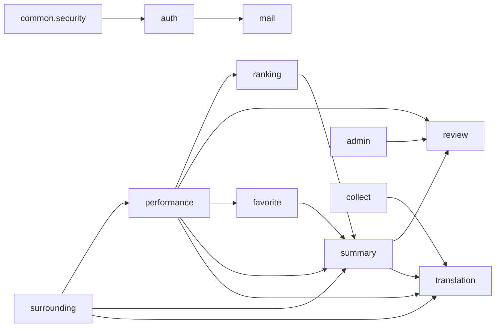

# 06. クラス設計書

- 状態: レビュー済み（工程4、Issue #20。ゲート4 の reviewer の判定は条件付き承認（2026-11-09）で、ゲート4 の reviewer の指摘のうち 06 に関わるもの（軽微・提案）を反映済み。人間の承認待ち）。Issue #23（PR #32、共通部品の実装）で人間が決めた D-1〜D-4（コメント 6760227708）を 3.2・3.3・3.6・4.1・4.7・4.8・11 に反映（2026-11-10）。PR #32 の reviewer の判定は条件付き承認で、06 への指摘（U-01・U-04・U-06・U-07 の更新、4.5・7.2・8.1・3.2 の追記）を反映済み（2026-11-10。人間の確認待ち）。Issue #23 の決定 E-2・E-3（コメント 6783513546）を 3.3・11 に反映（2026-11-11）。Issue #36 で駅・コインロッカーのファイルの確認の結果と人間の決定（2026-11-19、Issue #36 のコメント）を 4.9・5.2・5.4・8.1・9 の A-07・11 の U-03 に反映（2026-11-19）。同じ Issue の実装（コミット 061e657・9f8ea15）で分かったこと（引用符の中の改行、手での実行の起動の方法・devtools・`SecurityConfig`、`StepSummary` の JSON、`error_message` の整え方、`JobLock` のテスト用のメソッド、U-11）を 3.4・5.1・5.2・5.4・11 に反映（2026-11-19）、reviewer の確認待ち。Issue #38 で、`JobLock` の `RELEASE_LOCK` の戻り値の扱いと失敗した接続の捨て方、ジョブの `error_message` に最初に失敗したステップの理由を書くことを 5.2 に追記（2026-11-20。決定の根拠は Issue #36 のコメント 7031400502）、reviewer の確認待ち。Issue #38 で KOPIS の実際の呼び出しの確認の結果（05 の 3.1〜3.6・7）を 3.6 の `Genre`・4.9・5.3・6.4・7.1・11 の U-02 に反映（2026-11-20。ジャンルの一覧、結果コードと XML の読み方、S2 の未集計の期間、S6 の予約数）、reviewer の確認待ち。Issue #38 の人間の決定1・2（2026-11-20、コメント 7032205139。01 の R-69・X-30）で S5（上演回数）をなくし、`showCount`・`ShowCountStep`・`totalShowCount`・S5 用の Mapper のメソッドを外した（4.8・4.9・5.2・5.3・6.4・7.1・10・11 の U-02。S5 は欠番で、ステップの名前は振り直さない。05 の 3.6）、reviewer の確認待ち。Issue #38 の KOPIS のクライアントの実装（コミット 97ba154）で backend-dev が決めたこと（`KopisCallPolicy` の `startStep()` と失敗の数え方、05 の 3.5 にない失敗の扱い、`KopisPerformanceDetail` の `@JsonCreator`、`KopisEnvelope`・`KopisGenreStat`・`StepAbortedException` の形、`updatedate` の小数の秒）を確認して 4.9・7.1 に書き、直す点を 11 の U-12 にした（2026-11-24）、reviewer の確認待ち。Issue #38 の S1〜S4・S6 の実装（コミット 274d3fa・0c58ad4）で backend-dev が決めたこと（`saveFromKopis` の引数、`KopisPerformanceImporter`、`findVenueByKopisId`、S2〜S4 の入力、数えるだけのもの、`DistrictParser`、`StepResult.windowEndDate`）を確認して 4.9・5.2・5.3・6.4 に書き、U-11 を解消し、直す点を U-13（S4 の受賞歴。05 の 3.2）・U-14 にした（2026-11-24）。Issue #38 の S7 の実装（コミット e495d44・4f92571）で backend-dev が決めたこと（読む件数、再試行の数え方、速さの待ち、同じ原文のまとめ、空の文、内訳、DB の例外、対象がないとき）を確認して 4.10 に書き、直す点（照合順序、長すぎる原文、再試行しないエラー）を U-15 にした（2026-11-24）、reviewer の確認待ち。PR #46 の reviewer の軽微1（コメント 7123152330）で、U-12〜U-15 を解消（コミット 72d601f・ce393bd・d281b89。architect がコードを確認）にし、4.9・4.10 の「今のコードは…直す」を直した後の書き方にした（2026-11-24）。PR #46 の reviewer の重大2（コメント 7123152330）と Issue #38 の人間の決定（コメント 7123543509 の決定3、7152704798 の決定1・2・5）で、KOPIS の呼び出しの方針（05 の 3.5 の改訂）を 3.1・4.9（`KopisClient` の遮断の印、`KopisCallPolicy` の作り直し、`StepAbortedException` をなくす、ステップ側の扱い、S1 の続き、テストの表）・5.2・5.3・7.1・8.1・8.2・10・11（U-16〜U-18）に反映した（2026-11-25）。人間が承認（2026-11-25、Issue #38 コメント 7153821340 の決定1）。U-16 は決定2 で B（01 の R-70）、U-17 は決定3 で db-designer が V3 に入れた（コミット 5e237e7）ので解消。U-18 は ①・③ が済み、② が工程7 に残る、reviewer の確認待ち。Issue #38 の実装（8ab09a2・75855d6・26d07e5）の backend-dev の報告で読み方が分かれた所を決めた（2026-11-25）: 4.9 の HTTP 4xx で結果コードの XML のときはその結果コードで扱う（こちらが正。05 の 3.5 を合わせた。`KopisClientTest` に 2 件追加）、`startStep` の前の `call`（割り当て 0）を 4.9 に、`processedCount` の数と NULL の範囲（B-02 の失敗を含む）を 5.2・5.4 に書いた。承認済みの値・方針は変えていない
- 担当: architect
- 入力: `01-requirements.md`、`02-screens.md`、`03-api.md`（API 仕様の詳細）、`04-tables.md` と `backend/src/main/resources/db/migration/V1__create_schema.sql`、`05-batch.md`、ADR 0001〜0016。
- 対象: バックエンド（`backend/`、Spring Boot）だけ。Angular のクラス設計は対象外（工程5で frontend-dev が `02`・`03`・`07` から作る）。
- 04 の 11.7 で architect に残された A-02〜A-07 はこの文書の 9 で決めた。03・05 に関わる分は 03（8.5・8.8）と 05（3.2・3.3・4.3）にも反映した。
- 外部サービス・Spring の仕様は公式ドキュメントで確認した（確認日 2026-11-09）。確認先は各節に書く。

## 1. 方針

### 1.1 レイヤー

- `Controller → Service → Mapper` の一方向だけ（`CLAUDE.md`）。Controller は入力チェック（Bean Validation）とレスポンス変換だけ。業務ロジック・トランザクションは Service。SQL は Mapper XML に書き、値は `#{}` だけ使う（`${}` は使わない）。
- 機能をまたぐ呼び出しは **Service → 他機能の Service** だけ許す（他機能の Mapper を直接呼ばない）。依存の向きは 2.2 の図のとおりで、循環させない。
- バッチ（`collect` など）も同じ。ジョブクラス → Service → Mapper。外部 API のクライアントは Service から呼ぶ（Mapper と同じ層の扱い）。
- 依存性はコンストラクタ注入だけ（`@Autowired` のフィールド注入は使わない）。Bean は `final` フィールド + コンストラクタ 1 つ。
- API のリクエスト・レスポンスは `record`（`dto` サブパッケージ）。Mapper の結果・引数も `record`（`row` サブパッケージ）。DB の行の record を API にそのまま返さない。

### 1.2 命名

- パッケージ: `com.catticket.{機能}`。機能名は 03 の 2（`performance`, `surrounding`, `review`, `ranking`, `auth`, `account`, `favorite`, `admin`）と、内部用の `collect`, `translation`, `mail`, `summary`, `common`。
- クラス: `{機能}Controller` / `{機能}Service` / `{機能}Mapper`。1 機能に Service が複数あるときは `{機能}{役割}Service`（例: `AuthLoginService`）。
- Mapper XML: `src/main/resources/mapper/{機能}/{機能}Mapper.xml`（`application.yml` の `mybatis.mapper-locations: classpath:mapper/**/*.xml` に合う）。複数機能で使う SQL 断片は `mapper/common/SharedSql.xml`（namespace `com.catticket.common.db.SharedSql`）に置き、`<include refid="com.catticket.common.db.SharedSql.publicCondition"/>` のように完全名で参照する。
- メソッド名: 取得 `find…`（0〜1 件は `Optional`、一覧は `List`）、件数 `count…`、存在確認 `exists…`、更新 `insert…` / `update…` / `delete…` / `upsert…`。行ロック付きは末尾に `ForUpdate`。

### 1.3 使うライブラリ（追加は ADR とスターターの範囲だけ）

新しいライブラリは追加しない。`build.gradle` に足すのは次だけで、すべて ADR 0001〜0016 で決めたもの、または Spring Boot 標準スターター（Spring Boot が依存のバージョンを管理する `spring-boot-starter-*`。確認先: Spring Boot リファレンス「Build Systems > Starters」、2026-11-09）。

| 追加する依存 | 種類 | 根拠 | 用途 |
|---|---|---|---|
| `spring-boot-starter-security` | 標準スターター | ADR 0013 | セッション認証、CSRF、パスワードのハッシュ（bcrypt） |
| `spring-boot-starter-mail` | 標準スターター | ADR 0012 | Gmail SMTP の送信（`JavaMailSender`） |
| `spring-boot-starter-restclient` | 標準スターター | ADR 0007・0011（Spring の HTTP クライアントで呼ぶと決めた）、ADR 0008（`RestClient` と明記） | KOPIS・Azure Translator・reCAPTCHA の呼び出し |
| `tools.jackson.dataformat:jackson-dataformat-xml`（バージョンは Spring Boot の管理に従い書かない） | Jackson のモジュール（Boot が管理） | ADR 0008（KOPIS の XML を Jackson で読む） | KOPIS の XML レスポンスの読み取り（`collect.client` の `XmlMapper` だけで使う。Spring MVC の XML のメッセージコンバーターは 3.1 の `WebMvcConfig` で外す） |
| `spring-boot-starter-security-test`（testImplementation） | 標準スターター | ADR 0013 | `@WebMvcTest` での認証・CSRF のテスト |

既にある依存（`spring-boot-starter-webmvc`、`spring-boot-starter-validation`、`mybatis-spring-boot-starter`、Flyway、MySQL ドライバ、テスト用スターター）はそのまま使う。

使わないもの（ADR がないため）: Spring Batch、ShedLock、Quartz、CSV ライブラリ（OpenCSV など）、Lombok、MapStruct、Resilience4j、`spring-boot-starter-restclient-test`・`spring-boot-starter-mail-test`（テストは spring-test の `MockRestServiceServer` と Mockito で足りる）。CSV は JDK だけで読む（5.5）。再試行・待ち時間は自前の小さなクラス（`common.batch.Retry`・`Sleeper`）で書く。

## 2. パッケージ

### 2.1 一覧

| パッケージ | 中身 | 対応 API・バッチ |
|---|---|---|
| `com.catticket` | `CatticketApplication`（起動。5.1） | — |
| `com.catticket.performance` | 公演の検索・地図・詳細、会場候補 | API-01, 02, 03, 06 |
| `com.catticket.surrounding` | 会場・現在地の周辺（駅・ロッカー・会場）と、駅・コインロッカーのファイルの取り込み（05 の 1 の表で B-02 の機能名は `surrounding`） | API-04, 05、B-02 |
| `com.catticket.review` | レビュー | API-10〜13 |
| `com.catticket.ranking` | ランキング・急上昇・ジャンル動向 | API-20〜22 |
| `com.catticket.auth` | ログイン・会員登録・パスワード再設定・ロック解除・管理者作成・期限切れの削除 | API-30〜38、B-03、B-04 |
| `com.catticket.account` | ニックネーム・パスワード変更、退会 | API-40〜42 |
| `com.catticket.favorite` | お気に入り | API-43〜45 |
| `com.catticket.admin` | 管理者の公演管理・レビュー管理 | API-50〜56 |
| `com.catticket.collect` | KOPIS の収集（B-01 の S1〜S4・S6。S5 は欠番）と B-01 全体の流れ | B-01 |
| `com.catticket.translation` | Azure Translator の翻訳（B-01 の S7）と翻訳の参照 | B-01 S7、API の `lang=ja` |
| `com.catticket.mail` | メール送信と送信記録・上限 | API-33, 35, 37 |
| `com.catticket.summary` | 公演のカード（`PerformanceSummary`）の組み立て。翻訳と評価をまとめて引く（3.5） | API-01, 05, 20, 21, 43 |
| `com.catticket.common.*` | 共通（3） | 全体 |

各機能パッケージの中:

- 直下: `{機能}Controller`、`{機能}Service`（複数可）、`{機能}Mapper`、その機能だけの部品。
- `dto`: API のリクエスト・レスポンスの `record`。
- `row`: Mapper の結果・引数の `record`。
- `client`: 外部 API のクライアント（`collect.client`、`translation.client`、`auth.client`）。
- `batch`: バッチのジョブ（`collect.batch`、`surrounding.batch`、`auth.batch`。5）。

`common` のサブパッケージ: `config`（設定・Bean）、`error`（例外・エラー応答）、`validation`（入力チェック）、`security`（認証・セッション）、`display`（表示用の共通部品）、`db`（DB の共通部品）、`text`（文字列）、`geo`（距離）、`time`（時刻）、`batch`（バッチの共通部品）、`code`（コード値の enum）。

### 2.2 機能間の依存



- `summary` は 03 の 2 の機能名ではなく、内部の部品のパッケージ（`collect`・`translation`・`mail` と同じ扱い）。公演のカードを返す API が 4 つの機能（`performance`・`surrounding`・`ranking`・`favorite`）にまたがり、`performance` に置くと `performance → ranking → performance` の循環になるため分けた。

- 矢印は「Service が相手の Service を呼ぶ」。逆向きは作らない（例: `review` は `performance` を呼ばず、公演が表示できるか（非表示でないか。03 の 1.6 の「表示できる公演」）は自分の Mapper の SQL（`ReviewMapper.findVisiblePerformanceId`。4.3）で確かめる。レビューは終わった公演にも書けるので `SharedSql.publicCondition` は使わない）。
- `account` は `auth` の Service を呼ばず、自分の Mapper で `app_user` を更新する（ニックネーム・パスワード・退会は `account` の責務。03 の 2）。セッションの終了は `common.security.LoginSessionManager` を使う。
- すべての機能は `common` を使ってよい。`common` は機能パッケージに依存しない（例外: `common.security.SessionUserFilter` → `auth.AuthSessionService`。認証の読み込みだけ）。

## 3. 共通（`com.catticket.common`）

### 3.1 設定・時刻・起動

| クラス | パッケージ | 役割 |
|---|---|---|
| `CatticketProperties` | `common.config` | `@ConfigurationProperties("catticket")` の `record`（入れ子の record: `Kopis`, `Azure`, `Recaptcha`, `Mail`, `Admin`, `Subway`, `Scheduler`, `publicBaseUrl`, `task`。`Kopis` の中に `CallLimit`（2026-11-25。8.1））。キーは 8 |
| `ClockConfig` | `common.config` | `Clock` の Bean（`Clock.system(ZoneId.of("Asia/Seoul"))`） |
| `HttpClientConfig` | `common.config` | 外部 API ごとの `RestClient`（`@Qualifier("kopisRestClient")` など。7） |
| `JacksonConfig` | `common.config` | `JsonMapperBuilderCustomizer`（3.3 の型の厳しさ） |
| `WebMvcConfig` | `common.config` | `WebMvcConfigurer`。API のリクエスト・レスポンスを JSON だけにする（下の「JSON だけにする」） |
| `DateTimes` | `common.time` | `OffsetDateTime toApi(LocalDateTime)`（+09:00、秒で切り捨て）、`LocalDate today(Clock)`、`LocalDateTime now(Clock)`（秒で切り捨て。DB の `DATETIME` は秒まで） |

- **「今日」・今の時刻（03 の 7.1）**: Service の公開メソッドの最初に `LocalDateTime now = DateTimes.now(clock)`（と `today`）を1回だけ求め、その中の判定と保存（`created_at` など）すべてに渡す。Mapper の SQL で `NOW()`・`CURRENT_DATE` を使わない（テストで `Clock.fixed` に差し替えられるようにし、1回のリクエストの中で値をそろえるため）。DB の既定値（`DEFAULT CURRENT_TIMESTAMP`）にも頼らず、INSERT・UPDATE で値を渡す。
- 時刻の型: DB の `DATETIME` ↔ Java の `LocalDateTime`（Asia/Seoul の壁時計の時刻）。`DATE` ↔ `LocalDate`。API に出すときだけ `DateTimes.toApi` で `OffsetDateTime` にする。
- JDBC の接続は `connectionTimeZone=Asia/Seoul&forceConnectionTimeZoneToSession=true`（A-05。9）。
- **JSON だけにする（03 の 1.1・7.1・7.3。`WebMvcConfig`）**: KOPIS のために `jackson-dataformat-xml` がクラスパスにあると、Spring MVC はクラスパスの検出で Jackson の XML のメッセージコンバーター（`JacksonXmlHttpMessageConverter`）を既定で登録し、XML の本文を受け付け、`Accept: application/xml` に XML で返してしまう。これを次の2つで防ぐ。
  1. `configureMessageConverters(HttpMessageConverters.ServerBuilder builder)` で `builder.configureMessageConvertersList(list -> list.removeIf(c -> c instanceof JacksonXmlHttpMessageConverter))` とし、MVC の一覧から XML のコンバーターを除く。これで `Content-Type: application/xml` などの本文は `HttpMediaTypeNotSupportedException` → 415 `UNSUPPORTED_MEDIA_TYPE`（3.2）になる。List を受け取る旧い `configureMessageConverters(List)`・`extendMessageConverters(List)` は Spring Framework 7.0 で非推奨（削除予定）なので使わない。
  2. `configureContentNegotiation(c -> c.ignoreAcceptHeader(true).defaultContentType(MediaType.APPLICATION_JSON))` とし、`Accept` の値にかかわらず JSON（UTF-8）で返す（`Accept: application/xml` でも JSON。406 にしない。03 の 7.3 に 406 のコードはない）。
  - `RestClient`（KOPIS など）のコンバーターには影響しない（KOPIS の XML は `KopisClient` が `XmlMapper` で読む。4.9）。
  - 確認先: Spring Framework 7.0 Javadoc の `WebMvcConfigurer`（`configureMessageConverters(HttpMessageConverters.ServerBuilder)`、List 版の非推奨）、`HttpMessageConverters.Builder`（`configureMessageConvertersList` は 7.0.3 から）、`ContentNegotiationConfigurer`（`ignoreAcceptHeader`・`defaultContentType`）、Spring Framework リファレンス「Message Converters」（確認日 2026-11-09）。
  - テスト（`@WebMvcTest`。7.2）: ① 本文のある API（例: API-11・API-31）に `Content-Type: application/xml` で XML の本文を送ると 415・`code = UNSUPPORTED_MEDIA_TYPE`、② GET の API（例: API-01）に `Accept: application/xml` を付けても 200 で `Content-Type: application/json` の本文、③ `Content-Type: text/plain` の本文も 415。

### 3.2 例外とエラーの応答（03 の 7.3）

**クラス**（`common.error`）

| クラス | 内容 |
|---|---|
| `ErrorCode`（enum） | 03 の 7.3 のコードすべて。各値は `HttpStatus status` と英語の `message`（例: `LOGIN_FAILED(UNAUTHORIZED, "Email or password is incorrect")`） |
| `ApiException`（`RuntimeException`） | `ApiException(ErrorCode code)`。業務の条件のエラーはすべてこれを Service が投げる |
| `RequestValidationException`（`ApiException` の子） | `RequestValidationException(List<FieldErrorItem> errors)`。コードはいつも `VALIDATION_FAILED`。Bean Validation で書けないチェック（API-52 の本文の解析など）で使う |
| `ErrorResponse`（record） | `code`, `message`, `List<FieldErrorItem> errors`（いつも配列。ないときは `List.of()`） |
| `FieldErrorItem`（record） | `field`, `reason`（03 の 7.3 の `errors[].reason`） |
| `GlobalExceptionHandler` | `@RestControllerAdvice`。下の表で例外を `ErrorResponse` に変える |
| `ApiErrorController` | `/error`（Spring Boot の既定のエラーの応答）を `ErrorResponse` にする。サーブレットのフィルターで起きた例外の受け皿 |
| `JsonAuthenticationEntryPoint` | Spring Security の未ログイン → 401 `UNAUTHENTICATED` |
| `JsonAccessDeniedHandler` | Spring Security の拒否 → `CsrfException` なら 403 `CSRF_INVALID`、それ以外は 403 `FORBIDDEN` |
| `ErrorResponseWriter` | 上の2つのハンドラーが JSON（UTF-8）を書くための部品（`JsonMapper` を使う） |

**例外 → 応答の対応**

| 例外（起きる場所） | ステータス | `code` | `errors` |
|---|---|---|---|
| `ApiException`（Service） | `ErrorCode.status` | その `ErrorCode` | `[]` |
| `RequestValidationException`（Service・Controller の解析） | 400 | `VALIDATION_FAILED` | 渡された項目 |
| `MethodArgumentNotValidException`（`@Valid @RequestBody`） | 400 | `VALIDATION_FAILED` | 各 `FieldError`: `field` = 本文の経路（例: `bookingSites[0].url`）、`reason` = 制約の `message`（3.3） |
| `BindException`（`@Valid` のクエリの record。`MethodArgumentNotValidException` はこの子なので、本文と同じハンドラーで受ける） | 400 | `VALIDATION_FAILED` | 制約の誤りは上と同じ。型の変換の失敗（`FieldError.isBindingFailure()`）は `reason` = `TYPE`。クエリは `field` から `[n]` を除く（`genre[1]` → `genre`） |
| `HandlerMethodValidationException`（メソッドの検証。引数に直接の制約がある Controller のメソッド。3.3 の「クエリの record が 2 つ以上あるメソッド」） | 400 | `VALIDATION_FAILED` | `@RequestParam`・`@PathVariable` などの引数は `field` = アノテーションの `name` があればそれ、なければ引数名（03 の 7.3 の `field` はクエリ・パスの名前なので、Java の引数名と違うときもリクエストの名前にする）、`reason` = 制約の `message`。`@Valid` の record・本文の誤り（`ParameterErrors`）は上の `BindException`・`MethodArgumentNotValidException` の行と同じに変える（クエリは `[n]` を除き、本文は経路のまま） |
| `MissingServletRequestParameterException` | 400 | `VALIDATION_FAILED` | `REQUIRED` |
| `MethodArgumentTypeMismatchException`（パス・クエリの型） | 400 | `VALIDATION_FAILED` | `TYPE` |
| `HttpMessageNotReadableException`（JSON が読めない・型が違う） | 400 | `MALFORMED_REQUEST` | `[]` |
| `HttpMediaTypeNotSupportedException` | 415 | `UNSUPPORTED_MEDIA_TYPE` | `[]` |
| `HttpRequestMethodNotSupportedException` | 405 | `METHOD_NOT_ALLOWED` | `[]` |
| `NoResourceFoundException`・`NoHandlerFoundException` | 404 | `NOT_FOUND` | `[]` |
| `AuthenticationException`（Spring Security。`JsonAuthenticationEntryPoint`） | 401 | `UNAUTHENTICATED` | `[]` |
| `CsrfException`（`JsonAccessDeniedHandler`） | 403 | `CSRF_INVALID` | `[]` |
| `AccessDeniedException`（`JsonAccessDeniedHandler`。役割が違う） | 403 | `FORBIDDEN` | `[]` |
| そのほかすべて（`DataAccessException`・`RestClientException` などで Service が変えなかったもの） | 500 | `INTERNAL_ERROR` | `[]`（例外はログに ERROR で残す。応答に例外の内容を入れない） |

- `errors` は同じ（`field`, `reason`）の組を1つにまとめる（同じ項目に2つの制約が同じ理由で当たったとき）。
- 415 は、MVC のメッセージコンバーターが JSON だけになっていることが前提（3.1 の「JSON だけにする」。XML のコンバーターが残っていると XML の本文が 415 にならない）。`WebMvcConfig` は `@WebMvcTest` でも読み込まれるので、415 のテストは Controller のテストで書く（3.1 のテスト ①〜③）。
- Service で外部 API・DB の例外を業務のコードに変えるもの: `DuplicateKeyException` → 409 系（4.3・4.5・4.6）、`MailException` → 503 `MAIL_SEND_FAILED`（4.11）、reCAPTCHA の呼び出しの失敗 → 503 `RECAPTCHA_UNAVAILABLE`（4.5）。ほかの DB の例外は変えず 500。
- MyBatis（Spring の例外の変換）での MySQL のエラー: 1062 → `DuplicateKeyException`、1213・1205 → `PessimisticLockingFailureException` の子（`CannotAcquireLockException` など）。どの一意制約に当たったかは `common.db.DbErrors.isDuplicateKey(ex, "uk_…")`（例外のメッセージに制約名が入る）で見分ける。
- ログ: 4xx は INFO（入力の誤りの詳細は出さない）、5xx は ERROR（スタックトレース付き）。パスワード・トークン・メールアドレスはログに出さない。

### 3.3 入力チェック（`common.validation`）

**制約のアノテーション**: すべての制約の `message` に 03 の 7.3 の `reason` のコードをそのまま書く（例: `@NotNull(message = "REQUIRED")`）。`GlobalExceptionHandler` は `getDefaultMessage()` を `reason` に使う（文言の変換はしない）。

| アノテーション | 種類 | `reason` | 内容 |
|---|---|---|---|
| `@NotNull`・`@NotBlank` | 標準 | `REQUIRED` | 必須 |
| `@CodePointLength(min, max)` | 独自（`CodePointLengthValidator`） | `LENGTH` | コードポイントで数える（標準の `@Size` は UTF-16 の単位で数えるので文字列には使わない。リストの要素の数は `@Size(message = "LENGTH")`） |
| `@NoControlChars(allowNewlines = false)` | 独自（`NoControlCharsValidator`） | `FORMAT` | 一般カテゴリ Cc を含まない（`allowNewlines` なら LF・CR だけ許す。03 の 7.1）。判定は `Texts.hasControlChars(String, boolean)`（3.6）。`null` は通す |
| `@PasswordRule` | 独自（`PasswordRuleValidator`） | `PASSWORD_RULE` | 03 の 4.6 のルール。`null`・空は通す（必須は `@NotNull(message = "REQUIRED")` と組む）。判定の本体は `common.validation.PasswordPolicy.matches(String)`（`AuthLoginService`・`AccountService`・`AuthAdminService` も使う。下の「判定の部品」） |
| `@OneOf(values)` | 独自（`OneOfValidator`） | `INVALID_VALUE` | `values` の文字列のどれかと完全に一致する（03 に書いた値のとおり）。`null` は通す。`status`・`period`・`lang`・`visibility` |
| `@OneOfEnum(Genre.class)` / `@OneOfEnum(SeoulDistrict.class)` | 独自（`OneOfEnumValidator`） | `INVALID_VALUE` | enum の値のどれか。`null` は通す。比べる値: enum が `common.code.ApiCode` を実装していれば `apiValue()`、していなければ定数の名前（`name()`）。**区は韓国語の名前で比べる**（`SeoulDistrict` は `ApiCode` を実装し、`apiValue()` は `koreanName` を返す。03 の API-01 の `district` は `종로구` などの名前）。ジャンルは定数の名前（= コード `AAAA` など。`Genre` は `ApiCode` を実装しない）。繰り返しのクエリは `List<@OneOfEnum(SeoulDistrict.class) String> district` のように要素に付ける |
| `@Email` + `@Pattern("^[^@\\s]+@[^@\\s]+\\.[^@\\s]+$")` + `@CodePointLength(max = 254)` | 標準 + 独自 | `FORMAT` / `LENGTH` | メールアドレス（03 の API-33） |
| `@Min`・`@Max`・`@DecimalMin`・`@DecimalMax` | 標準 | `RANGE` | 数値・座標の範囲 |
| `@Pattern(regexp = "true\|false")` | 標準 | `TYPE` | 真偽のクエリ（`includeEnded`）。文字列で受けて Service に渡す前に `Boolean` にする |
| `@ValidPerformanceFilter` | 独自（クラスに付ける） | `DATE_ORDER`・`CONFLICT`・`INCOMPLETE`・`RANGE` | API-01・02 の組み合わせ（03 の 4.1・8.1）。`from` > `to` は `to` に `DATE_ORDER`。区・地図の範囲・会場の同時の指定は指定した項目ごとに `CONFLICT`。地図の範囲の4つの一部だけは `INCOMPLETE`。南西 > 北東は `RANGE` |

- **判定の部品**（`common.validation`、Spring に依存しない。2.2 の「`common` は機能パッケージに依存しない」と「`account` は `auth` を呼ばない」を守るため `common` に置く）:
  - `PasswordPolicy`: `boolean matches(String password)`（03 の 4.6 のルール）。`@PasswordRule` の `PasswordRuleValidator`、`AuthLoginService`（4.5）、`AccountService`（4.6）、`AuthAdminService`（5.5）が使う。
  - `EmailRule`: `boolean isValid(String email)`（03 の API-33 の規則: 上の `@Email` + `@Pattern` + 254 文字以内と同じ判定）。Bean Validation のない場所（B-03 の `AuthAdminService`）で使う。
- **前後の空白・NFKC**: record のコンパクトコンストラクターで行う（Bean Validation より前に値が決まる）。例: `SignupRequest` は `email = Texts.stripToNull(email)`、`nickname = Nicknames.normalize(nickname)`（NFKC → strip → 空なら `null`）。パスワード・トークン・レビュー本文は変えない（03 の 7.1）。
- **クエリの record**（`common.validation`）: `PageQuery(Integer page, Integer size)`（`@Min(0) @Max(10000)`、`@Min(1) @Max(100)`、`message = "RANGE"`。`null` は既定値 0・20 にするメソッド `page()`・`size()`）、`LangQuery(String lang)`（`@OneOf({"ko","ja"})`。record の部品の `lang()` は受け取った `String` のまま。`Lang` は `Lang toLang()` で返し、`null` は `KO`。Controller は `lang.toLang()` を Service に渡す。record の部品と同じ名前で型の違うメソッドは書けないため、名前を分ける。決定: Issue #23 の D-2）。繰り返しのクエリは `List<String>` で受け、コンパクトコンストラクターで重複を除く（`LinkedHashSet`）。
- **クエリの record が 2 つ以上ある Controller のメソッドは、メソッドの検証が適用されるようにする**（決定: Issue #23 の D-4）。
  - 理由: Spring MVC は、引数に直接の制約がないメソッドでは `@Valid` の引数を1つずつ検証し、最初に誤りのあった引数で `MethodArgumentNotValidException` を投げる。ほかのクエリの record の誤りは返らず、03 の 7.3 の「複数の項目が誤っていれば、`errors` にすべて入れる」を満たさない。引数に直接の制約（`@Min`・`@NotNull` などの `@Constraint`）が1つ以上あると、メソッドの検証になり、すべての引数の制約と `@Valid` の中の制約をまとめて調べて `HandlerMethodValidationException` を1回投げる（`@Valid` だけでは制約ではないのでメソッドの検証にならない）。
  - 方法: **引数に直接の制約を1つ以上付ける**。直接の制約を付ける `@RequestParam` などがないときは、`PageQuery` の引数を `@Valid @NotNull(message = "REQUIRED") PageQuery page` にする（クエリの record は Spring がいつも作るので `null` にならず、この `@NotNull` は失敗しない。メソッドの検証にするためだけに付ける。`PageQuery` がないメソッドは、ほかのクエリの record の1つに付ける）。対象は 4. の API-01・API-43・API-50。
  - Controller のクラスに `@Validated` を付けない（付けると AOP のプロキシでの検証になり、Spring MVC のメソッドの検証が使われない）。
  - 応答: `GlobalExceptionHandler` が `HandlerMethodValidationException` の `getParameterValidationResults()` を1つずつ見て、`ParameterErrors`（`@Valid` の record）は `BindException` と同じ変え方（項目名から `[n]` を除く）、ほかは引数の名前と `message` にする（3.2）。
  - 型の変換の失敗（`page=abc` など）は検証の前の結び付け（binding）で起き、その record の `MethodArgumentNotValidException`（`reason` = `TYPE`）がすぐ投げられる（メソッドの検証の対象にならない）。このときは型の誤りのあった最初の record の誤りだけが返り、ほかの引数の制約の誤りは入らない（03 の 7.3 の例外のとおり。Issue #23 の E-2）。
  - テスト（`@WebMvcTest`）: 2 つ以上のクエリの record の誤りが1回の応答にまとまること。共通部品ではテスト用の Controller で確かめた: `queryRecordsAreAggregatedWithMethodValidation`（直接の制約のある `@RequestParam` を足した形）、`queryRecordsAreAggregatedWithNotNullPageQuery`（`@Valid @NotNull PageQuery` の形。4. の API-01・43・50 と同じ）。区を韓国語の名前で比べること（D-3）は `districtIsComparedByKoreanName`（いずれも `ErrorResponseWebMvcTest$Validation`。Issue #23 の E-3）。各機能の Controller のテストでは、API-01・43・50 で2つの record に誤りのある値を送り、`errors` に両方が入ることを確かめる。
  - 確認先: Spring Framework 7.0 リファレンス「Web on Servlet Stack > Annotated Controllers > Validation」（https://docs.spring.io/spring-framework/reference/web/webmvc/mvc-controller/ann-validation.html 。表示の版 7.0.10）、`ModelAttributeMethodProcessor` のソース（v7.0.10。型の変換の失敗はすぐ投げる）。確認日 2026-11-10。
- **座標**: `BigDecimal` で受ける（`NaN`・`Infinity` は型の変換で失敗し `TYPE`）。
- **パスの ID**（`common.validation.PathIds`）: 公演 ID・会場 ID は `^[A-Za-z0-9]{1,20}$`（04 の `kopis_*_id` の長さ）に合わなければ Service を呼ばずに 404（`PERFORMANCE_NOT_FOUND`・`VENUE_NOT_FOUND`）。レビュー ID は文字列で受けて `^[1-9][0-9]{0,18}$` かつ `Long` に入るか → 合わなければ 404 `REVIEW_NOT_FOUND`。API-45（お気に入りの解除）は形が合わなくても 204（03 の 8.7）。
- **JSON の型の厳しさ**（`JacksonConfig`）: 数値の項目への文字列、真偽の項目への文字列・数値、整数の項目への小数は `HttpMessageNotReadableException`（→ `MALFORMED_REQUEST`）にする。`spring.jackson.deserialization.accept-float-as-int=false` と、`JsonMapperBuilderCustomizer`（`org.springframework.boot.jackson.autoconfigure`）で文字列 → 数値・真偽の型の変換（coercion）を `Fail` にする（`builder.withCoercionConfig(LogicalType.Integer / Float / Boolean, c -> c.setCoercion(CoercionInputShape.String, CoercionAction.Fail) …)`。真偽は `CoercionInputShape.Integer` も `Fail`）。**空文字列・空白だけの文字列も `Fail` にする**（`CoercionInputShape.EmptyString` を `Fail`、`setAcceptBlankAsEmpty(false)`）: Jackson の既定では空文字列 `""` は `String` とは別の形で、数値・真偽の項目に黙って `null` が入る（実装のテストで確かめた）ため。テスト: `ErrorResponseWebMvcTest$StrictJsonTypes`（`emptyStringForIntegerIsMalformed`・`blankStringForDecimalIsMalformed`・`emptyStringForBooleanIsMalformed`・`blankStringForIntegerAndBooleanIsMalformed` など）。メソッド名の確認は 11 の U-01（解消）。

### 3.4 セキュリティとセッション（`common.security`、ADR 0013、03 の 7.4）

**クラス**

| クラス | 役割 |
|---|---|
| `SecurityConfig` | `SecurityFilterChain` の Bean と、下の Bean。`securityFilterChain` は `@ConditionalOnWebApplication(type = SERVLET)` を付け、サーブレットの Web アプリのときだけ作る（手での実行（5.1）は `WebApplicationType.NONE` で `HttpSecurity` の Bean がないため。2026-11-19、Issue #36 の実装で判明）。`PasswordEncoder` などほかの Bean は条件を付けない（B-03 が使う） |
| `SessionPrincipal`（record、`Serializable`） | セッションに保存するもの: `long userId`, `String passwordHash` |
| `SessionUser`（record） | リクエストごとの利用者: `long userId`, `Role role`, `String nickname`（管理者は `null`）。Controller は `@AuthenticationPrincipal SessionUser user` で受ける（未ログインは `null`） |
| `Role`（enum） | `USER`, `ADMIN`（`ROLE_USER`・`ROLE_ADMIN` の権限にする） |
| `SessionUserFilter`（`OncePerRequestFilter`。`@Component` にしない） | 7.4 のセッションの確認（下） |
| `LoginSessionManager` | `establish(SessionUser user, String passwordHash, HttpServletRequest, HttpServletResponse)`、`terminate(HttpServletRequest, HttpServletResponse)` |

**`SecurityConfig` の設定**

- `csrf(c -> c.spa().csrfTokenRepository(csrfTokenRepository))`。`csrfTokenRepository` は `CookieCsrfTokenRepository.withHttpOnlyFalse()` の Bean（`LoginSessionManager` と同じものを使う）。
- `formLogin`・`httpBasic` は無効。`sessionManagement` は既定（必要なときに作る）。`securityContext` は既定（明示の保存。`HttpSessionSecurityContextRepository` の Bean を `LoginSessionManager` と共有）。
- `logout`: `logoutRequestMatcher(PathPatternRequestMatcher.withDefaults().matcher(HttpMethod.POST, "/api/auth/logout"))`、`logoutSuccessHandler(new HttpStatusReturningLogoutSuccessHandler(HttpStatus.NO_CONTENT))`、`deleteCookies("JSESSIONID")`。API-32 は Controller を作らない（ログインしていなくても 204）。
- `exceptionHandling`: `JsonAuthenticationEntryPoint`、`JsonAccessDeniedHandler`。
- `addFilterBefore(new SessionUserFilter(authSessionService, securityContextRepository), AuthorizationFilter.class)`。
- `PasswordEncoder`: `PasswordEncoderFactories.createDelegatingPasswordEncoder()`（bcrypt。ADR 0013）。

**認可の規則**（上から順に当てる）

| 規則 | パス |
|---|---|
| `hasRole("ADMIN")` | `/api/admin/**` |
| `hasRole("USER")` | `/api/me/**`、POST `/api/performances/*/reviews`、PUT・DELETE `/api/reviews/*` |
| `permitAll()` | ほかすべて（GET の API、認証の POST、`/error`） |

- 管理者が「一般」の API を呼ぶと `hasRole("USER")` に当たらず 403 `FORBIDDEN`（03 の 7.3）。未ログインは 401。

**`SessionUserFilter` の処理**（03 の 7.4 の 1.〜3.）

1. セッションの `SecurityContext` に `SessionPrincipal` がなければ何もしない（未ログイン）。
2. `authSessionService.findSessionUser(userId)` で行を読む（主キー。`Optional<SessionUserRow>`）。
3. 行がない・`status` が `ACTIVE` でない・パスワードのハッシュがセッションの値と違う（`MessageDigest.isEqual` で比べる）→ `session.invalidate()` し、`SecurityContextHolder.clearContext()`（未ログインとして続ける）。
4. それ以外 → そのリクエストだけの `Authentication`（principal = `SessionUser`、権限 `ROLE_{role}`）を `SecurityContextHolder` に入れる。セッションには保存しない（明示の保存なので、セッションには `SessionPrincipal` だけが残る）。

**`LoginSessionManager`**

- `establish`: ① セッションがあれば `request.changeSessionId()`、なければ作る（セッション固定攻撃の対策）→ ② `SessionPrincipal` の `Authentication` を `securityContextRepository.saveContext` で保存 → ③ `csrfTokenRepository.saveToken(null, request, response)` で CSRF の Cookie を消す（ログインの成功で消す Spring Security の既定と同じ動き。7.4）。
- `terminate`（API-41・42 の後）: `SecurityContextLogoutHandler`、`CookieClearingLogoutHandler("JSESSIONID")`、`CsrfLogoutHandler(csrfTokenRepository)` を順に呼ぶ。
- **API-30 の CSRF の Cookie（03 の 7.4 で 06 に残した事項）**: `AuthController.me` が引数で `CsrfToken csrfToken` を受け、`csrfToken.getToken()` を呼ぶ。遅延されていたトークンが読み込まれ、`CookieCsrfTokenRepository` が応答に `XSRF-TOKEN` を付ける（Spring Security リファレンス「Cross Site Request Forgery」、確認日 2026-11-09: https://docs.spring.io/spring-security/reference/servlet/exploits/csrf.html ）。

**Cookie**（8 の `application.yml`）: セッションの有効時間 30 分、`http-only: true`、`secure: ${SESSION_COOKIE_SECURE:true}`（ローカルの http だけ `false`）、`same-site: lax`。`server.forward-headers-strategy: native`（Nginx の後ろで `https` と判断させ、CSRF の Cookie にも `Secure` が付く。ADR 0010）。

### 3.5 表示の共通部品（`common.display`）

| クラス | 内容 |
|---|---|
| `LocalizedText`（record） | `value`, `original`, `translated`（03 の 7.2） |
| `Rating`（record） | `BigDecimal average`, `long count`。`Rating.of(long sum, long count)`: 0 件なら `average = null`、ほかは `sum / count` を小数第1位で `HALF_UP` |
| `Period`（record） | `LocalDate start`, `LocalDate end` |
| `PageResponse<T>`（record） | `items`, `page`, `size`, `totalElements`, `totalPages`。`PageResponse.of(List<T>, PageQuery, long total)`（`totalPages = ceil(total / size)`） |
| `PerformanceStatus`（enum） | `ONGOING`, `UPCOMING`, `ENDED`。`of(LocalDate start, LocalDate end, LocalDate today)`（03 の 1.6） |
| `VenueRef`（record） | `venueId`, `LocalizedText name` |
| `PerformanceSummary`（record） | 03 の 7.2 の項目 |
| `PerformanceSummaryRow`（record） | SQL の結果（`long id`（`performance.id`。内部の ID で API には出さない）、`performanceId`（KOPIS の公演 ID）、修正を反映した公演名・期間・ジャンル、会場 ID・名前、ポスター、受賞歴） |
| `ReviewItem`（record） | 03 の 7.2 |
| `LocalizedTextFactory` | `LocalizedText of(String original, Lang lang, Map<String, String> translations)`（`lang = ko` か翻訳がなければ `value = original`, `translated = false`）。駅名は `ofStation(String nameKo, String nameJa, Lang, Map)`（`name_ja` → 翻訳 → 原文。03 の 7.2） |

**`com.catticket.summary.PerformanceSummaryAssembler`**（`@Component`）

- `List<PerformanceSummary> assemble(List<PerformanceSummaryRow> rows, Lang lang, LocalDate today, boolean withRating)`。
- 処理: ① `lang = ja` なら、行の公演名・会場名を集めて `TranslationLookupService.lookup(Collection<String> originals)` を1回呼ぶ（`Map<原文, 翻訳>`）→ ② `withRating` なら、行の内部の ID（`PerformanceSummaryRow.id`）を集めて `ReviewService.findRatingStats(Collection<Long> performanceIds)` を1回呼ぶ（`Map<内部の公演 ID, RatingStat(sum, count)>`。ない公演は 0 件）→ ③ 行の順番のまま `PerformanceSummary` にする（`status` は `PerformanceStatus.of`、`rating` は `withRating = false` なら `null`。03 の 7.2）。
- 翻訳を引くのは `lang = ja` のときだけ（4.10）。1行ずつ引かない（N+1 にしない）。

### 3.6 そのほかの共通部品

| クラス | パッケージ | 内容 |
|---|---|---|
| `Texts` | `common.text` | `stripToNull(String)`、`codePointLength(String)`、`hasControlChars(String, boolean allowNewlines)`、`truncateCodePoints(String, int)`、`truncateUtf8Bytes(String, int)` |
| `Nicknames` | `common.text` | `normalize(String)`: NFKC → `strip()` → 空なら `null`（03 の 7.1） |
| `Hashes` | `common.text` | `sha256Hex(String)`: UTF-8 のバイトの SHA-256 を小文字の16進 64 文字（翻訳の `source_hash`、トークンの `token_hash`。04） |
| `Likes` | `common.db` | `contains(String)`: `\`・`%`・`_` を `\` でエスケープして `%…%` にする（SQL は `LIKE #{kw} ESCAPE '\\'`） |
| `DbErrors` | `common.db` | `isDuplicateKey(DataAccessException, String keyName)`、`isLockFailure(DataAccessException)`（1213・1205） |
| `SharedSql.xml` | `mapper/common/` | `publicCondition`（03 の 1.6 の「公開中の公演」: 非表示でない・ソウル・…。04 の `performance_effective` の列で書く）、`summaryColumns`（`PerformanceSummaryRow` の列。内部の ID `pe.id` を含む） |
| `GeoDistance` | `common.geo` | `double meters(lat1, lng1, lat2, lng2)`（ハバーサイン、半径 6,371,000 m。03 の 7.2） |
| `GeoBounds`（record） | `common.geo` | `around(BigDecimal lat, BigDecimal lng, int meters)`: SQL の前の絞り込み用の緯度経度の四角（600 m で取り、Java で 500 m を正確に判定する） |
| `Genre`（enum） | `common.code` | ジャンル（9 個。**一覧は 11 の U-02**。2026-11-20 に実際の KOPIS で確定、Issue #38）。`code`（`AAAA` など）と KOPIS の名前（`genrenm`。`boxoffice` の `cate`・`boxStatsCate` の `catenm` も同じ名前）。`fromKopisName(String)` は `Optional`（前後の空白を除いて完全一致で比べる） |
| `SeoulDistrict`（enum） | `common.code` | 25 区。定数の名前（ローマ字。例: `JONGNO`）と韓国語の名前（`koreanName`。例: `종로구`）。API・DB（`venue.district`）で使う値は韓国語の名前。`ApiCode` を実装し、`apiValue()` は `koreanName` を返す（3.3 の `@OneOfEnum`）。`static Optional<SeoulDistrict> fromKoreanName(String)`（`Genre.fromKopisName` と同じく、見つからなければ `Optional.empty()`。`null` も空）。決定: Issue #23 の D-3 |
| `ApiCode`（interface） | `common.code` | `String apiValue()`: API で受け取る値。定数の名前と違う値で受ける enum だけが実装する（今は `SeoulDistrict` だけ）。`@OneOfEnum` が比べる値を決めるのに使う（3.3） |
| `Lang`（enum） | `common.code` | `KO`, `JA` |
| `PeriodType`（enum） | `common.code` | `DAILY`, `WEEKLY`, `MONTHLY` |

## 4. 機能ごとのクラス

- 表の「API」は 03 の API ID。振る舞い（判定の順番・並び順・エラー）は 03 の 8. が正で、ここではどのクラス・メソッドが受け持つかを書く。
- Controller のメソッドの戻り値は DTO の record（`ResponseEntity` は 201・204 のときだけ）。`@Transactional` は 6 にまとめて書く（下の表の「Tx」は `RO` = `@Transactional(readOnly = true)`、`RW` = `@Transactional`、`—` = 付けない）。
- Mapper の XML は `mapper/{機能}/{機能}Mapper.xml`。SQL の列名・テーブル名は 04 と V1 のとおり。

### 4.1 公演・会場（`performance`）

**`PerformanceController`**（`/api`）

| API | メソッド |
|---|---|
| API-01 | `PageResponse<PerformanceSummary> search(@Valid PerformanceFilterQuery filter, @Valid @NotNull(message = "REQUIRED") PageQuery page)` — `GET /performances`。`@NotNull` はメソッドの検証にするため（3.3） |
| API-02 | `MarkersResponse markers(@Valid PerformanceFilterQuery filter)` — `GET /performances/markers` |
| API-03 | `PerformanceDetailResponse detail(@PathVariable String performanceId, @Valid LangQuery lang, @AuthenticationPrincipal SessionUser user)` — `GET /performances/{performanceId}`。`PathIds` で形を確かめる（3.3） |
| API-06 | `VenueCandidatesResponse venues(@Valid VenueSearchQuery query)` — `GET /venues` |

**DTO**（`performance.dto`）: `PerformanceFilterQuery`（`lang`, `from`, `to`, `List<String> district`, `swLat`, `swLng`, `neLat`, `neLng`, `venueId`, `List<String> genre`, `List<String> status`, `keyword`。`@ValidPerformanceFilter`。`district` の要素は `@OneOfEnum(SeoulDistrict.class)`（韓国語の名前で比べる）、`genre` の要素は `@OneOfEnum(Genre.class)`（3.3）。`toCondition(LocalDate today)` で下の `PerformanceCondition` にする）、`MarkersResponse(List<MarkerItem> markers)`、`MarkerItem(venueId, LocalizedText name, BigDecimal latitude, BigDecimal longitude, int performanceCount)`、`PerformanceDetailResponse`（03 の API-03 の項目。入れ子に `VenueDetail`, `BookingSiteItem`, `RankingBadge`, `Viewer`）、`VenueSearchQuery(keyword, lang)`、`VenueCandidatesResponse(List<VenueCandidate> items)`。

**`PerformanceService`**

| メソッド | Tx | 内容 |
|---|---|---|
| `PageResponse<PerformanceSummary> search(PerformanceFilterQuery, PageQuery)` | RO | `today` を求め → `count` → `search`（LIMIT/OFFSET）→ `PerformanceSummaryAssembler.assemble(rows, lang, today, true)` |
| `MarkersResponse markers(PerformanceFilterQuery)` | RO | `findMarkers` → 会場名の翻訳 |
| `PerformanceDetailResponse getDetail(String performanceId, Lang lang, SessionUser user)` | RO | `findVisibleDetail`（なければ 404 `PERFORMANCE_NOT_FOUND`）→ `findBookingSites` → `ReviewService.findRatingStats` → `RankingService.findRankingsOf(id, genre, today)` → `user` が一般なら `FavoriteService.isFavorite`・`ReviewService.findMine` → 翻訳（公演名・会場名・住所・出演者などの原文をまとめて1回）→ 組み立て |
| `VenueCandidatesResponse findVenueCandidates(String keyword, Lang lang)` | RO | `findVenueCandidates` |
| `List<PerformanceSummaryRow> findPublicByVenueIds(Collection<String> venueIds, LocalDate today)` | RO | API-05 用（`surrounding` から呼ぶ） |

- `PerformanceCondition`（record、`performance.row`）: `today`, `from`, `to`, `districts`, 地図の範囲の4つ, `venueId`, `genres`, `statuses`, `keywordLike`（`Likes.contains` 済み、指定なしは `null`）, `lang`, `limit`, `offset`。

**`PerformanceMapper`**（`mapper/performance/PerformanceMapper.xml`）

| メソッド | SQL の役割 |
|---|---|
| `List<PerformanceSummaryRow> search(PerformanceCondition)` | `performance_effective pe JOIN venue v`。`SharedSql.publicCondition` + 条件（`<if>`・`<foreach>`）。キーワードは `pe.title LIKE #{keywordLike} ESCAPE '\\'`、`lang = ja` のときだけ `LEFT JOIN translation t ON t.source_hash = SHA2(pe.title, 256)` して `OR t.translated_text LIKE …`。`ORDER BY pe.start_date, pe.kopis_performance_id LIMIT #{limit} OFFSET #{offset}` |
| `long count(PerformanceCondition)` | 上と同じ条件で `COUNT(*)` |
| `List<MarkerRow> findMarkers(PerformanceCondition)` | 同じ条件 + 座標のある会場だけ。`GROUP BY v.id ORDER BY v.kopis_venue_id`、`COUNT(*)` |
| `Optional<PerformanceDetailRow> findVisibleDetail(String kopisPerformanceId)` | `performance_effective` + 会場。非表示を除く（03 の API-03） |
| `List<BookingSiteRow> findBookingSites(long performanceId, String source)` | `source` は `booking_sites` の修正の行があれば `ADMIN`、なければ `COLLECTED`（04 の DB-02。Service が `findVisibleDetail` の結果の「修正あり」で決める）。`ORDER BY sort_order` |
| `List<VenueCandidateRow> findVenueCandidates(String keywordLike, Lang lang)` | 公開中の公演がある会場（`EXISTS` + `publicCondition`）。`ORDER BY v.name, v.kopis_venue_id LIMIT 20` |
| `List<PerformanceSummaryRow> findPublicByVenueIds(Collection<String> venueIds, LocalDate today)` | API-05 の会場の公演。並び順は API-01 と同じ |

### 4.2 周辺（`surrounding`）

**`SurroundingController`**（`/api`）

| API | メソッド |
|---|---|
| API-04 | `VenueSurroundingsResponse venueSurroundings(@PathVariable String venueId, @Valid LangQuery lang)` — `GET /venues/{venueId}/surroundings` |
| API-05 | `LocationSurroundingsResponse aroundLocation(@Valid LocationQuery query)` — `GET /surroundings`（`LocationQuery(BigDecimal lat, BigDecimal lng, String lang)`） |

**DTO**（`surrounding.dto`）: `VenueSurroundingsResponse(VenueInfo venue, boolean hasLocation, List<StationItem> stations, List<LockerItem> lockers)`、`LocationSurroundingsResponse(List<NearbyVenue> venues, stations, lockers)`、`StationItem`、`LockerItem`、`NearbyVenue(venueId, name, latitude, longitude, int distanceMeters, List<PerformanceSummary> performances)`。

**`SurroundingService`**（すべて RO）

- `VenueSurroundingsResponse getVenueSurroundings(String venueId, Lang lang)`: `findVenue`（なければ 404 `VENUE_NOT_FOUND`）→ 座標がなければ `hasLocation = false`、`[]` → `GeoBounds.around(…, 600)` で `findStationsInBounds` → `GeoDistance` で 500 m 以内（丸める前の値で `<= 500`。03 の 4.5）→ `findLockersByStationIds` → 並べ替え（03 の 8.2）→ 駅名・位置の文章・住所の翻訳。
- `LocationSurroundingsResponse getAroundLocation(BigDecimal lat, BigDecimal lng, Lang lang)`: 駅・ロッカーは上と同じ。会場は `findPublicVenuesInBounds` → 500 m 以内 → `PerformanceService.findPublicByVenueIds` → `PerformanceSummaryAssembler.assemble(…, true)` → 会場ごとにまとめる。
- 距離の計算・並べ替えは小さな部品 `NearbyFilter`（`surrounding` パッケージ、Spring に依存しない）に分け、単体テストで境目（499.9・500.0・500.1 m）を確かめる。

**`SurroundingMapper`**（`mapper/surrounding/SurroundingMapper.xml`）: `Optional<VenueRow> findVenue(String kopisVenueId)`、`List<StationRow> findStationsInBounds(GeoBounds)`、`List<LockerRow> findLockersByStationIds(Collection<Long> stationIds)`、`List<VenueLocationRow> findPublicVenuesInBounds(GeoBounds, LocalDate today)`（公開中の公演がある会場。`EXISTS` + `publicCondition`）。

### 4.3 レビュー（`review`）

**`ReviewController`**（`/api`）

| API | メソッド |
|---|---|
| API-10 | `PageResponse<ReviewItem> list(@PathVariable String performanceId, @Valid PageQuery page, @AuthenticationPrincipal SessionUser user)` |
| API-11 | `ResponseEntity<ReviewItem> create(@PathVariable String performanceId, @Valid @RequestBody ReviewRequest body, @AuthenticationPrincipal SessionUser user)` — 201 |
| API-12 | `ReviewItem update(@PathVariable String reviewId, @Valid @RequestBody ReviewRequest body, @AuthenticationPrincipal SessionUser user)` |
| API-13 | `ResponseEntity<Void> delete(@PathVariable String reviewId, @AuthenticationPrincipal SessionUser user)` — 204 |

- `ReviewRequest(Integer rating, String body)`: `rating` は `@NotNull @Min(1) @Max(5)`、`body` は `@CodePointLength(max = 1000) @NoControlChars(allowNewlines = true)`。前後の空白は除かない。`null`・空・空白だけ（`isBlank`）なら Service で `null` にして保存する（03 の API-11）。

**`ReviewService`**

| メソッド | Tx | 内容 |
|---|---|---|
| `PageResponse<ReviewItem> listVisible(String performanceId, PageQuery, SessionUser)` | RO | 公演が非表示でないか（`findVisiblePerformanceId`。なければ 404 `PERFORMANCE_NOT_FOUND`）→ 一覧。未ログインは本文・ニックネーム・日時を `null`（03 の 7.2） |
| `ReviewItem create(String performanceId, ReviewRequest, SessionUser)` | RW | 公演（なければ 404）→ 今日 < 開始日なら 400 `REVIEW_NOT_OPEN` → 投稿済みの事前の確認（409）→ INSERT。`DuplicateKeyException`（`uk_review_user_performance`）も 409 `REVIEW_ALREADY_EXISTS` |
| `ReviewItem update(long reviewId, ReviewRequest, SessionUser)` | RW | `findForUpdate`（なし・公演が非表示 → 404 `REVIEW_NOT_FOUND`）→ 自分のでなければ 403 `FORBIDDEN` → UPDATE（`updated_at = now`） |
| `void delete(long reviewId, SessionUser)` | RW | update と同じ確認 → DELETE |
| `Optional<ReviewItem> findMine(long performanceId, long userId)` | RO | API-03 の `viewer.myReview` |
| `Map<Long, RatingStat> findRatingStats(Collection<Long> performanceIds)` | RO | `SUM(rating)`・`COUNT(*)`（03 の 7.2 の `Rating`）。引数・キーは内部の ID（`performance.id`。`review.performance_id` と同じ）。KOPIS の ID からの変換はしない（呼ぶ側の行が内部の ID を持つ: `PerformanceSummaryRow.id`、API-03 は `PerformanceDetailRow.id`）。空の引数なら SQL を呼ばずに空の `Map` |
| `PageResponse<ReviewItem> listAll(long performanceId, PageQuery)` | RO | API-55（`admin` から呼ぶ。全部の項目、非表示の公演でも返す。公演の存在は `admin` が先に確かめる） |
| `void deleteAny(long reviewId)` | RW | API-56（なければ 404 `REVIEW_NOT_FOUND`） |

- `created_at`・`updated_at` は Service の `now`（3.1）。

**`ReviewMapper`**（`mapper/review/ReviewMapper.xml`）: `Optional<Long> findVisiblePerformanceId(String kopisPerformanceId)`（`publicCondition` ではなく「非表示でない」だけ。03 の 8.3）、`Optional<LocalDate> findEffectiveStartDate(long performanceId)`、`List<ReviewRow> findPage(long performanceId, int limit, int offset)`（並び順は 03 の 3.）、`long countByPerformance(long performanceId)`、`boolean existsByUserAndPerformance(long userId, long performanceId)`、`void insert(ReviewInsert)`（`useGeneratedKeys`）、`Optional<ReviewOwnerRow> findForUpdate(long reviewId)`（`FOR UPDATE`、公演の非表示を JOIN で読む）、`void update(ReviewUpdate)`、`int delete(long reviewId)`、`List<RatingStatRow> sumAndCount(Collection<Long> performanceIds)`（`RatingStatRow(long performanceId, long sum, long count)`。`performanceId` は内部の ID。`WHERE performance_id IN (<foreach>) GROUP BY performance_id`）、`Optional<ReviewRow> findByUserAndPerformance(long userId, long performanceId)`。

### 4.4 ランキング（`ranking`）

**`RankingController`**（`/api`）

| API | メソッド |
|---|---|
| API-20 | `RankingResponse rankings(@Valid RankingQuery query)` — `GET /rankings`（`period`, `genre`, `lang`） |
| API-21 | `RisingResponse rising(@Valid RankingQuery query)` — `GET /rankings/rising` |
| API-22 | `GenreTrendResponse genreTrends()` — `GET /genre-trends`（クエリなし） |

- `RankingQuery(String period, String genre, String lang)`: `period` は `@NotNull(message = "REQUIRED") @OneOf({"daily","weekly","monthly"})`、`genre` は `ALL`（既定）か `Genre` のコード（`INVALID_VALUE`）。
- DTO（`ranking.dto`）: `RankingResponse(periodType, genre, Period period, List<RankingItem> items)`、`RankingItem(int rank, PerformanceSummary performance)`、`RisingResponse(periodType, genre, availability, currentPeriod, previousPeriod, List<RisingItem> items)`、`RisingItem(int rank, String movement, Integer rise, PerformanceSummary performance)`、`GenreTrendResponse(Period period, String basis, List<GenreTrendItem> items)`、`GenreTrendItem(genre, long bookingCount, BigDecimal share)`、`RankingBadge(periodType, genre, int rank, Period period)`（API-03 用）。

**`RankingService`**（すべて RO）

| メソッド | 内容 |
|---|---|
| `RankingResponse getRanking(PeriodType, String genre, Lang)` | `findLatestCompleted`（表示できる期間。03 の 4.9）→ `findTopVisible` → 順位を 1 から振り直す（9.1）→ `PerformanceSummaryAssembler.assemble(…, false)` |
| `RisingResponse getRising(PeriodType, String genre, Lang)` | 現在の期間 → `RankingPeriods.previous(type, start)` で直前の期間 → `findCollection` → `RisingCalculator.calculate(current, previous)` |
| `List<RankingBadge> findRankingsOf(String performanceId, String genre, LocalDate today)` | API-03 の 6 つの組（3 期間 × `ALL`・その公演のジャンル）それぞれで `getRanking` と同じ上位 10 位を求め、入っているものだけ |
| `GenreTrendResponse getGenreTrend()` | `findLatestGenreTrendPeriod`（末日が最も新しい期間）→ `findGenreTrends`。割合の大きい順 → コードの順。割合は小数第1位で `HALF_UP`（03 の API-22） |

- `RankingPeriods`（Spring に依存しない）: 期間の種類ごとの暦の計算（日次・週次（月〜日）・月次。03 の 4.9）。S2 が使う `collectTargets(today)` も持つ（4.9。2026-11-20、Issue #38）。
- `RisingCalculator`（Spring に依存しない）: 入力は現在・直前の振り直し後の上位 10 位、出力は `availability`（`NO_RANKING` / `NO_PREVIOUS_RANKING` / `AVAILABLE` / `NO_RISE`）と行（`movement` = `NEW` / `UP` / `NONE`、`rise`）。03 の 9.3 の4つの場合を単体テストで確かめる。

**`RankingMapper`**（`mapper/ranking/RankingMapper.xml`）

| メソッド | SQL の役割 |
|---|---|
| `Optional<CollectionRow> findLatestCompleted(PeriodType, String genreCode, LocalDate today)` | `WHERE period_type = #{…} AND genre_code = #{…} AND period_end < #{today} ORDER BY period_start DESC LIMIT 1`（完了の記録のある期間。04 の `ranking_collection`） |
| `Optional<CollectionRow> findCollection(PeriodType, String genreCode, LocalDate periodStart)` | 直前の期間の完了の記録 |
| `List<RankingEntryRow> findTopVisible(long collectionId, int limit)` | `ranking_entry` JOIN `performance_effective` + 会場。非表示を除き `ORDER BY provider_rank, kopis_performance_id LIMIT 10`（03 の 9.1） |
| `Optional<Period> findLatestGenreTrendPeriod()`・`List<GenreTrendRow> findGenreTrends(Period)` | 04 の `genre_trend`（`ORDER BY period_end DESC LIMIT 1` は `uk_genre_trend_end_start_genre` で引く） |
| `List<RankingEntryRow>` の行 | 公演が `performance` に結びつかない順位の行は JOIN で落ちる（03 の 9.1 の D-01） |

### 4.5 認証・申込（`auth`）

**`AuthController`**（`/api`）

| API | メソッド |
|---|---|
| API-30 | `MeResponse me(@AuthenticationPrincipal SessionUser user, CsrfToken csrfToken)` — `GET /auth/me`。最初に `csrfToken.getToken()` を呼ぶ（3.4） |
| API-31 | `MeResponse login(@Valid @RequestBody LoginRequest body, HttpServletRequest req, HttpServletResponse res)` — `POST /auth/login`。`AuthLoginService.login` → `LoginSessionManager.establish` |
| API-32 | なし（`SecurityConfig` の `logout`。3.4） |
| API-33 | `ResponseEntity<Void> signup(@Valid @RequestBody SignupRequest body)` — `POST /signup`、204 |
| API-34 | `ResponseEntity<Void> verify(@RequestBody(required = false) TokenRequest body)` — `POST /signup/verify`、204。`@Valid` を付けない（形の誤りも `TOKEN_INVALID`。Service で確かめる） |
| API-35 | `ResponseEntity<Void> requestPasswordReset(@Valid @RequestBody EmailRequest body)` — `POST /password-reset`、204 |
| API-36 | `ResponseEntity<Void> confirmPasswordReset(@Valid @RequestBody PasswordResetConfirmRequest body)` — `POST /password-reset/confirm`、204。制約は `newPassword` だけ（`token` は Service で確かめる） |
| API-37 | `ResponseEntity<Void> requestUnlock(@Valid @RequestBody UnlockRequest body)` — `POST /unlock`、204 |
| API-38 | `ResponseEntity<Void> confirmUnlock(@RequestBody(required = false) TokenRequest body)` — `POST /unlock/confirm`、204 |

**DTO**（`auth.dto`）: `MeResponse(boolean authenticated, String role, String nickname)`（`MeResponse.anonymous()`・`MeResponse.of(SessionUser)`）、`LoginRequest(email, password)`（`email` は strip して `@NotBlank`、`password` は `@NotEmpty`。形・長さ・ルールは確かめない）、`SignupRequest(email, password, nickname)`、`TokenRequest(String token)`、`EmailRequest(email)`、`PasswordResetConfirmRequest(token, newPassword)`、`UnlockRequest(email, recaptchaToken)`（`recaptchaToken` は `@NotEmpty @CodePointLength(min = 1, max = 10000)`）。

**Service**

| クラス・メソッド | Tx | 内容（03 の 8.5） |
|---|---|---|
| `AuthLoginService.login(String email, String password)` → `LoginResult(SessionUser user, String passwordHash)` | `@Transactional(noRollbackFor = ApiException.class)` | `findUserByEmailForUpdate` → ない: ダミーのハッシュ（起動時に1回作る）と `passwordEncoder.matches` してから 401 `LOGIN_FAILED` → `locked_at` あり: `ACCOUNT_LOCKED` → `PasswordPolicy.matches` に合わないか `matches` が偽: 有効なら `updateLoginFailure`（5 回目で `locked_at = now`、`ACCOUNT_LOCKED`、ほかは `LOGIN_FAILED`）、認証前は `LOGIN_FAILED` → 合う: 認証前は `EMAIL_NOT_VERIFIED`、有効は `resetLoginFailure` |
| `AuthSignupService.apply(SignupRequest)` | `TransactionTemplate`（6.2） | 03 の API-33 の ①〜⑦。1回だけやり直す（6.2） |
| `AuthSignupService.verify(String token)` | `TransactionTemplate`（6.3） | 03 の 9.2 の API-34 |
| `AuthPasswordResetService.request(String email)` | RW | ① `MailService.ensureWithinDailyLimit` → ② `findActiveUserByEmail`（ない・認証前は何もしない）→ `findUserByIdForUpdate` → `AuthTokenService.issue(PASSWORD_RESET, 1h)` → `MailService.send` |
| `AuthPasswordResetService.confirm(String token, String newPassword)` | RW | トークンの形 → `findTokenByHash`（ロックしない）→ ユーザー `FOR UPDATE` → トークン `FOR UPDATE` で再確認（用途・未使用・期限）→ `updatePasswordAndUnlock`（ハッシュ・`locked_at = NULL`・回数 0）→ `markTokenUsed` → `markUnusedTokensUsed(userId, PASSWORD_RESET)` |
| `AuthUnlockService.request(String email, String recaptchaToken)` | — （中で RW を呼ぶ） | ① `MailService.ensureWithinDailyLimit`（RO）→ ② `RecaptchaClient.verify`（**トランザクションの外**。外部の呼び出しの間 DB の接続・行ロックを持たない）→ ③ `AuthUnlockService.issueIfLocked(email)` |
| `AuthUnlockService` の ③（private `issueIfLocked(String email, LocalDateTime now)`） | `TransactionTemplate`（RW） | 有効でロック中のときだけ、ユーザー `FOR UPDATE` → `AuthTokenService.issue(UNLOCK, 1h)` → `MailService.send`。同じクラスの中の呼び出しでは `@Transactional` が効かないので `TransactionTemplate` で書く |
| `AuthUnlockService.confirm(String token)` | RW | API-36 と同じ順（用途 `UNLOCK`）→ `unlock`（`locked_at = NULL`・回数 0）→ `markTokenUsed`。ロックが解けていても 204 |
| `AuthTokenService.issue(long userId, TokenPurpose, Duration ttl, LocalDateTime now)` → `String rawToken` | `@Transactional(propagation = MANDATORY)` | `markUnusedTokensUsed(userId, purpose, now)` → `SecureRandom` 32 バイト → Base64URL（パディングなし、43 文字）→ `insertToken(userId, purpose, Hashes.sha256Hex(raw), now + ttl, now)`（03 の 7.6） |
| `AuthTokenService.isWellFormed(String token)` | — | `^[A-Za-z0-9_-]{43}$` |
| `AuthSessionService.findSessionUser(long userId)` → `Optional<SessionUserRow>` | RO | 3.4 の `SessionUserFilter` 用（`id`, `role`, `status`, `nickname`, `password_hash`） |
| `AuthAdminService.createAdmin(String email, String password)` | RW | B-03（5.5） |
| `AuthPurgeService.purgeExpiredSignups(LocalDateTime t)` → `int` | RW | B-04（5.6、03 の 9.2） |

- `TokenPurpose`（enum）: `SIGNUP`, `PASSWORD_RESET`, `UNLOCK`（04 の `auth_token.purpose`）。`UserStatus`（enum、`com.catticket.auth` の直下。`auth` だけの部品なので 2.1 の「直下: その機能だけの部品」に置く。`SessionUserRow.status` の型）: `PENDING`, `ACTIVE`。
- パスワードのルールの判定は `common.validation.PasswordPolicy`（3.3。`auth` には置かない）。
- `auth.client.RecaptchaClient`: `RecaptchaResult verify(String token)`。`tokenProperties.valid` が真なら `PASSED`、偽なら `FAILED`（→ 400 `RECAPTCHA_FAILED`）。429・5xx・タイムアウト・通信の失敗は `RecaptchaUnavailableException`（→ 503 `RECAPTCHA_UNAVAILABLE`）。再試行しない（03 の 7.5）。

**`AuthMapper`**（`mapper/auth/AuthMapper.xml`）

| メソッド | SQL の役割 |
|---|---|
| `Optional<SessionUserRow> findUserById(long id)` | 主キーで読む（`SessionUserFilter`） |
| `Optional<UserRow> findUserByEmailForUpdate(String email)` | `uk_app_user_email` で `FOR UPDATE`（行がなければギャップのロック。6.2） |
| `Optional<UserRow> findUserByIdForUpdate(long id)` | 主キーで `FOR UPDATE` |
| `boolean existsActiveNickname(String nickname)` | 有効なアカウントの `nickname` を照合順序 `utf8mb4_0900_as_ci` で比べる（04 の D-02） |
| `void insertPendingUser(PendingUserInsert)` | 認証前の行（`useGeneratedKeys`） |
| `int replacePendingUser(PendingUserUpdate)` | 同じメールの認証前の行のパスワード・ニックネーム・`updated_at` を置き換え（`WHERE id = ? AND status = 'PENDING'`） |
| `int activateUser(long id, LocalDateTime now)` | `UPDATE … SET status = 'ACTIVE' WHERE id = ? AND status = 'PENDING'` |
| `int deletePendingUser(long id)` | `DELETE … WHERE id = ? AND status = 'PENDING'`（トークンは CASCADE） |
| `void updateLoginFailure(long id, int count, LocalDateTime lockedAt)`・`void resetLoginFailure(long id)` | 失敗回数・ロック |
| `void updatePasswordAndUnlock(long id, String hash, LocalDateTime now)`・`void unlock(long id, LocalDateTime now)` | API-36・38 |
| `Optional<TokenRow> findTokenByHash(String hash)`・`Optional<TokenRow> findTokenByHashForUpdate(String hash)` | `uk_auth_token_token_hash` |
| `void insertToken(TokenInsert)`・`int markTokenUsed(long id, LocalDateTime now)`・`int markUnusedTokensUsed(long userId, TokenPurpose, LocalDateTime now)` | 03 の 7.6 |
| `boolean existsAdmin()`・`boolean existsUserByEmail(String email)`・`void insertAdmin(AdminInsert)` | B-03 |
| `List<Long> findPurgeCandidateIds(LocalDateTime t)`・`int deletePurgeCandidates(Collection<Long> ids, LocalDateTime t)` | B-04（03 の 9.2 の SQL。ID の一覧は `<foreach>` で `#{}`） |

### 4.6 アカウント（`account`）

**`AccountController`**（`/api/me`）

| API | メソッド |
|---|---|
| API-40 | `NicknameResponse changeNickname(@Valid @RequestBody NicknameRequest body, @AuthenticationPrincipal SessionUser user)` — `PUT /nickname`。保存した値（NFKC の後）を返す |
| API-41 | `ResponseEntity<Void> changePassword(@Valid @RequestBody PasswordChangeRequest body, SessionUser user, req, res)` — `PUT /password`、204。成功の後に `LoginSessionManager.terminate` |
| API-42 | `ResponseEntity<Void> withdraw(@Valid @RequestBody WithdrawRequest body, SessionUser user, req, res)` — `DELETE`、204。成功の後に `terminate` |

**`AccountService`**（すべて RW。ユーザーの行を `FOR UPDATE` で読んでから判定する）

- `String changeNickname(long userId, String nickname)`: `existsActiveNicknameOfOthers(userId, nickname)` → 409 `NICKNAME_ALREADY_USED` → `updateNickname`。`DuplicateKeyException`（`uk_app_user_active_nickname`）も 409（03 の API-40）。
- `void changePassword(long userId, String current, String next)`: `passwordEncoder.matches(current, hash)` が偽 → 400 `CURRENT_PASSWORD_INCORRECT`（ログインの失敗回数は変えない）→ `updatePassword`。
- `void withdraw(long userId, String current)`: 同じ確認 → `deleteUser`（レビュー・お気に入り・トークンは外部キーの CASCADE。04 の 5.）。
- 現在のパスワードがルールに合わない（72 バイトを超えるなど）ときは、ハッシュと比べずに「合わない」とする（`common.validation.PasswordPolicy`。API-31 と同じ）。

**`AccountMapper`**（`mapper/account/AccountMapper.xml`）: `Optional<AccountRow> findForUpdate(long userId)`、`boolean existsActiveNicknameOfOthers(long userId, String nickname)`、`void updateNickname(long userId, String nickname, LocalDateTime now)`、`void updatePassword(long userId, String hash, LocalDateTime now)`、`int deleteUser(long userId)`。

### 4.7 お気に入り（`favorite`）

**`FavoriteController`**（`/api/me/favorites`）

| API | メソッド |
|---|---|
| API-43 | `PageResponse<FavoriteItem> list(@Valid LangQuery lang, @Valid @NotNull(message = "REQUIRED") PageQuery page, SessionUser user)`。`@NotNull` はメソッドの検証にするため（3.3） |
| API-44 | `ResponseEntity<Void> add(@PathVariable String performanceId, SessionUser user)` — PUT、204 |
| API-45 | `ResponseEntity<Void> remove(@PathVariable String performanceId, SessionUser user)` — DELETE、204（ID の形が違っても 204） |

**`FavoriteService`**

| メソッド | Tx | 内容 |
|---|---|---|
| `PageResponse<FavoriteItem> list(long userId, Lang, PageQuery)` | RO | `count`（`findPage` と同じ条件）→ `findPage`（非表示を除く。終わった公演は出す）→ `PerformanceSummaryAssembler.assemble(…, true)` → `FavoriteItem(favoritedAt, performance)` |
| `void add(long userId, String performanceId)` | RW | 公演が非表示でない（404）→ 登録済みなら何もしない → INSERT。`DuplicateKeyException`（`uk_favorite_user_performance`）は成功とみなす |
| `void remove(long userId, String performanceId)` | RW | DELETE（0 件でも成功） |
| `boolean isFavorite(long userId, long performanceId)` | RO | API-03 の `viewer.isFavorite` |

**`FavoriteMapper`**（`mapper/favorite/FavoriteMapper.xml`）: `List<FavoriteRow> findPage(long userId, int limit, int offset)`（`favorite f JOIN performance_effective pe ON pe.id = f.performance_id JOIN venue v`、`WHERE f.user_id = #{userId} AND pe.is_hidden = FALSE`（終わった公演は除かない）。`ORDER BY f.created_at DESC, f.id DESC`。03 の API-43）、`long count(long userId)`（**`findPage` と同じ FROM・WHERE**（非表示の公演を除く）で `COUNT(*)`。03 の API-43 の `totalElements`・`totalPages` が一覧に出る行の数と一致するようにする。条件は XML の `<sql id="visibleFavoriteFrom">` を2つで `<include>` して食い違わないようにする）、`Optional<Long> findVisiblePerformanceId(String kopisPerformanceId)`、`boolean exists(long userId, long performanceId)`、`void insert(long userId, long performanceId, LocalDateTime now)`、`int delete(long userId, String kopisPerformanceId)`。

### 4.8 管理（`admin`）

**`AdminController`**（`/api/admin`）

| API | メソッド |
|---|---|
| API-50 | `PageResponse<AdminPerformanceItem> search(@Valid AdminSearchQuery query, @Valid @NotNull(message = "REQUIRED") PageQuery page)` — `GET /performances`。`@NotNull` はメソッドの検証にするため（3.3） |
| API-51 | `AdminPerformanceDetail detail(@PathVariable String performanceId)` |
| API-52 | `AdminPerformanceDetail patch(@PathVariable String performanceId, @RequestBody ObjectNode body)` — PATCH |
| API-53 | `ResponseEntity<Void> clearOverride(@PathVariable String performanceId, @PathVariable String field)` — 204 |
| API-54 | `VisibilityResponse setVisibility(@PathVariable String performanceId, @Valid @RequestBody VisibilityRequest body)` — PUT（`VisibilityRequest(@NotNull(message = "REQUIRED") Boolean hidden)`） |
| API-55 | `PageResponse<ReviewItem> reviews(@PathVariable String performanceId, @Valid PageQuery page)` |
| API-56 | `ResponseEntity<Void> deleteReview(@PathVariable String reviewId)` — 204 |

- `AdminSearchQuery(keyword, visibility, includeEnded)`: `keyword` は strip・0〜100 文字・制御文字なし、`visibility` は `@OneOf({"all","visible","hidden"})`（既定 `all`）、`includeEnded` は `@Pattern("true|false", message = "TYPE")`（既定 `false`）。
- API-53 の `field` は `OverridableField.fromApiName(field)` が空なら 400（`field` に `INVALID_VALUE`）。03 の 7.4 の ④ 入力が ⑤ 存在より先なので、公演の 404 より先に確かめる。

**部品**

- `OverridableField`（enum）: 03 の 8.8 の表の 11 個。`apiName`（`ticketPrice`）、`dbField`（`ticket_price`）、`Kind`（`SINGLE_LINE`, `MULTI_LINE`, `DATE`, `GENRE`, `BOOLEAN`, `BOOKING_SITES`）、最大文字数。
- `AdminPatchParser`（Spring に依存しない）: `ParsedPatch parse(ObjectNode body)` → `ParsedPatch(Map<OverridableField, Object> values, List<BookingSiteInput> bookingSites, List<FieldErrorItem> errors)`。03 の 8.8 の決まり: 項目が0個 → `field = ""` に `REQUIRED`、値が `null` → `REQUIRED`、知らない項目 → `UNKNOWN_FIELD`、型が違う（文字列の項目に数値など）→ `MALFORMED_REQUEST`（`ApiException` をすぐ投げる。7.1）、文字列は strip してから長さ・制御文字、日付は `YYYY-MM-DD`（`FORMAT`）、ジャンル（`INVALID_VALUE`）、`bookingSites` は 0〜10 件（`LENGTH`）・各要素の `name`（1〜100、制御文字なし）・`url`（1〜2,000、`^https?://` で始まる絶対 URL。`java.net.URI` で読めること。`FORMAT`）。`errors` の `field` は `bookingSites[0].url` の形。
- 型の違いを `MALFORMED_REQUEST` にするのは、03 の 7.1（項目の型が違うときは 400 `MALFORMED_REQUEST`）に合わせるため。
- **API-51〜53 はビューを使わない**（04 の 11.3）: 自動収集の値は `performance`（+ 会場）から、修正は `performance_override` から別々に読み、修正を反映した値が要るところは Java で組み立てる（API-50 の一覧だけはビュー `performance_effective`）。
- `AdminEffectiveValues`（record。Spring に依存しない）: `static AdminEffectiveValues of(AdminPerformanceRow collected, List<OverrideRow> overrides)`。項目ごとに「修正の行があれば `override_value` を 03 の 8.8 の形（日付は `YYYY-MM-DD`、真偽は `true` / `false`）から型に戻した値、なければ自動収集の値」（ビューの `CASE` と同じ規則）。主に使うのは `LocalDate startDate()`・`LocalDate endDate()`。`withPatch(Map<OverridableField, Object> values)`（API-52 の本文を当てた後の値）・`without(OverridableField field)`（API-53 で取り消した後の値）で新しい値を返す。単体テストで、ビューと同じ結果になる場合（修正なし・開始日だけ修正・両方修正）を確かめる。

**`AdminPerformanceService`**

| メソッド | Tx | 内容 |
|---|---|---|
| `PageResponse<AdminPerformanceItem> search(AdminSearchQuery, PageQuery)` | RO | `search`・`count`。`status` は `PerformanceStatus.of` |
| `AdminPerformanceDetail getDetail(String performanceId)` | RO | `findPerformance`（自動収集の値。ない → 404。非表示でも返す）→ `findOverrides`（修正の値と日時）→ `findBookingSites(COLLECTED / ADMIN)` → `fields` の 11 個を組み立てる（`collected` = `AdminPerformanceRow`、`override`・`overriddenAt` = `OverrideRow`）。`status` は `AdminEffectiveValues.of(row, overrides)` の開始日・終了日で `PerformanceStatus.of` |
| `AdminPerformanceDetail applyPatch(String performanceId, ObjectNode body)` | RW | `AdminPatchParser.parse`（型の違いはここで 400）→ `findPerformanceIdForUpdate`（ない → 404）→ `findPerformance`・`findOverrides`（ロックしない読み。下の「ロックと読み」）→ `errors` があれば `RequestValidationException` → 修正の後の開始日 ≤ 終了日（`AdminEffectiveValues.of(row, overrides).withPatch(values)` の開始日・終了日で比べる。違えば `startDate`・`endDate` のうち本文にある方に `DATE_ORDER`）→ 項目ごとに `upsertOverride` → `bookingSites` があれば `deleteBookingSites(id, ADMIN)` → `insertBookingSites` → `upsertOverride(booking_sites, NULL)` → `getDetail` と同じ形で返す |
| `void clearOverride(String performanceId, OverridableField field)` | RW | `findPerformanceIdForUpdate`（404）→ `findPerformance`・`findOverrides`（ロックしない読み）→ 取り消した後の期間の確認（`AdminEffectiveValues.of(row, overrides).without(field)` の開始日 ≤ 終了日。違えば `DATE_ORDER` を `field` に）→ `deleteOverride` → `bookingSites` なら `deleteBookingSites(id, ADMIN)` |
| `VisibilityResponse setVisibility(String performanceId, boolean hidden)` | RW | `updateHidden`（0 件 → 404） |
| `PageResponse<ReviewItem> listReviews(String performanceId, PageQuery)` | RO | `findPerformanceId`（ない → 404。非表示でも続ける。修正の値は要らない）→ `ReviewService.listAll(id, page)` |
| `void deleteReview(long reviewId)` | — | `ReviewService.deleteAny`（RW はその中） |

- 順番の理由: 03 の API-52 は「公演がある（404）→ チェック」。本文の解析（型）は Controller の外の部品で先に行うが、項目ごとの誤り（`VALIDATION_FAILED`）は存在の確認の後に投げる。
- `upsertOverride` は `updated_at = #{now}` を明示する（`overriddenAt` が値の同じ修正でも変わる。03 の API-52）。
- **ロックと読み（API-52・53）**: ロックは `performance` の1行だけに取る（`findPerformanceIdForUpdate` = `SELECT id FROM performance WHERE kopis_performance_id = #{…} FOR UPDATE`。一意制約 `uk_performance_kopis_performance_id` の1行のロック）。値（自動収集の値・修正）は、ロックの後にロックしない読み（`findPerformance`・`findOverrides`）で読む。多くの表を結んだ SQL に `FOR UPDATE` を付けると、結んだ表（`performance_override` の11の行・`venue`）の行とギャップまでロックされるため、そうしない。同じ公演を書き換える処理（API-52・53）はどれも先にこの行をロックするので、ロックを取った後の読みは前の処理のコミットの後の値になる（REPEATABLE READ の読みの時点は、トランザクションの中の最初のロックしない読みで決まる。最初の文がこのロックなので、読みの時点はロックの後）。順番は 6.1 の `performance` → `performance_override` → `booking_site`。

**`AdminMapper`**（`mapper/admin/AdminMapper.xml`）

| メソッド | SQL の役割 |
|---|---|
| `List<AdminPerformanceListRow> search(AdminSearchCondition)`・`long count(…)` | `performance_effective` + 会場（1.6 の公開の条件を使わない）。キーワードは `pe.title LIKE #{kw} ESCAPE '\\' OR pe.kopis_performance_id COLLATE utf8mb4_0900_as_ci LIKE #{kw} ESCAPE '\\'`（A-03）。`hasOverride` は `EXISTS (SELECT 1 FROM performance_override …)`。`ORDER BY pe.start_date DESC, pe.kopis_performance_id`。`AdminPerformanceListRow`（record）: `String kopisPerformanceId`, `String title`, `String venueName`, `LocalDate startDate`, `LocalDate endDate`, `boolean isHidden`, `boolean hasOverride`（`title`・期間は修正を反映した値。Service が `AdminPerformanceItem`（03 の API-50 のレスポンス）に変える: `kopisPerformanceId` → `performanceId`、ほかは同じ名前、`status` は `PerformanceStatus.of(startDate, endDate, today)` で足す） |
| `Optional<AdminPerformanceRow> findPerformance(String kopisPerformanceId)` | `performance p JOIN venue v`。**自動収集の値だけ**（ビューを使わない。04 の 11.3）。ロックしない。`AdminPerformanceRow`: `long id`, `kopisPerformanceId`, `isHidden`, 修正できる 10 項目の自動収集の値（`title`, `startDate`, `endDate`, `genreCode`, `castText`, `ticketPrice`, `scheduleText`, `runtime`, `ageLimit`, `isOpenRun`。予約サイトは `findBookingSites`）、会場（`kopisVenueId`, `name`, `address`）、`posterUrl`, `hasAward` |
| `Optional<Long> findPerformanceId(String kopisPerformanceId)` | `SELECT id FROM performance WHERE kopis_performance_id = …`（API-55 の存在の確認。ロックしない） |
| `Optional<Long> findPerformanceIdForUpdate(String kopisPerformanceId)` | `SELECT id FROM performance WHERE kopis_performance_id = #{kopisPerformanceId} FOR UPDATE`（ほかの表を結ばない。4.8 の「ロックと読み」） |
| `List<OverrideRow> findOverrides(long performanceId)` | `performance_override`（`OverrideRow(fieldName, overrideValue, updatedAt)`。`booking_sites` の行も含む） |
| `List<BookingSiteRow> findBookingSites(long performanceId, String source)` | `booking_site` |
| `void upsertOverride(long performanceId, String fieldName, String value, LocalDateTime now)` | `INSERT … VALUES (…) AS n ON DUPLICATE KEY UPDATE override_value = n.override_value, updated_at = n.updated_at` |
| `int deleteOverride(long performanceId, String fieldName)` | |
| `int deleteBookingSites(long performanceId, String source)`・`void insertBookingSites(long performanceId, String source, List<BookingSiteInput>, LocalDateTime now)` | `ADMIN` の行（並び順は配列の順 1, 2, …） |
| `int updateHidden(String kopisPerformanceId, boolean hidden, LocalDateTime now)` | `performance.is_hidden` |

### 4.9 収集（`collect`、B-01 の S1〜S4・S6）

**`collect.client.KopisClient`**（ADR 0008、`docs/kopis-api.md` は参考）

| メソッド | KOPIS のサービス |
|---|---|
| `KopisPage<KopisPerformanceListItem> listPerformances(LocalDate from, LocalDate to, LocalDate afterDate, int page)` | `pblprfr`（`stdate`・`eddate`・`cpage`・`rows=100`・`signgucode=11`、`afterDate` が null でなければ `afterdate`。日付は `yyyyMMdd`）。最後のページの判定は 05 の 3.3 の 1.（`KopisPage.isLast()` = 行が 100 件より少ない） |
| `Optional<KopisPerformanceDetail> getPerformance(String mt20id)` | `pblprfr/{mt20id}`。結果コード `04` → `Optional.empty()` |
| `Optional<KopisVenueDetail> getVenue(String mt10id)` | `prfplc/{mt10id}`。`04` → `Optional.empty()` |
| `List<KopisBoxOfficeItem> boxOffice(Period period, Optional<Genre> genre)` | `boxoffice`（`stdate`・`eddate`・`area=11`、ジャンルがあれば `catecode` = `Genre.code()`。`cpage`・`rows` は送らない）。最大 50 行・ページなし（05 の 3.4）。空の応答 → 空のリスト。期間の種類は `stdate`〜`eddate` で決まるので引数に持たない（集計の期間の種類は呼ぶ側の `collectionKey` が持つ） |
| `KopisPage<KopisAwardItem> awards(LocalDate from, LocalDate to, int page)` | `prfawad`（`stdate`・`eddate`・`cpage`・`rows=100`・`signgucode=11`。`afterdate` は送らない。05 の 3.2 の S3） |
| `List<KopisGenreStat> genreStats(Period period)` | `boxStatsCate`（`stdate` = `period.start`・`eddate` = `period.end`。地域の変数は送らない（効かない。05 の 3.2 の「S6 の詳細」））。`합계` の行も含めて返し、除くのは `GenreTrendCalculator` |

- XML の読み方（根要素・行要素の名前、エラーの見分け方、空の応答、値の整え方）は 7.1 の「KOPIS の XML の読み方」。結果コードの扱い（05 の 3.5）: `01`・`02`・`05`・`06`・それ以外の知らないコード → `KopisFatalException`（再試行しない。メッセージは `KOPIS {service} returncode={code} errmsg={errmsg}`）、`03`・通信の失敗・タイムアウト・5xx → `KopisRetryableException`、`04` → 詳細は `Optional.empty()`、一覧は 0 件。
- **05 の 3.5 の表にない失敗**（2026-11-24、Issue #38 の実装（コミット 97ba154）で backend-dev が決め、architect が確認）:
  - HTTP 3xx → `KopisFatalException`（`KOPIS {service} HTTP {status}`）。`https` で呼んだときの 301 など作りの誤り（05 の 3.5）で、何度呼んでも同じため。
  - **HTTP 4xx・遮断の印**（2026-11-25 改訂。05 の 3.5 の「遮断の印」。前の「4xx → `KopisFatalException`、429 も再試行しない」を置き換える）: 下の「`KopisClient` の遮断の印」。
  - 本文が空・XML として読めない（途中で切れた応答、保守中の HTML など）、木にはなったが封筒の record に読めない → `KopisRetryableException`（`KOPIS {service} unreadable response: …`）。通信の失敗と同じく一時的なことがあるため。続けば実行の中の 5 回で止まる（下の `KopisCallPolicy`）。ただし本文に `Request Blocked` を含むものは遮断の印（下）。
  - **XML として読めたが行要素も結果コードもない**（例: 整形式の保守中のページ `<html>…</html>`）→ `KopisRetryableException`（`KOPIS {service} unexpected response: no row element`）。判定: 7.1 の「読む手順」の 6.。**0 件と扱わない**理由: S1 の目録の最初のページが 0 件に見えると、その区間を取り終えたとして `window_end_date` まで記録し、取りこぼしが翌日に直らないため（97ba154 では 0 件にしていたのを 72d601f で直した。11 の U-12）。
  - API キー（`catticket.kopis.api-key`）が空 → 呼ばずに `KopisFatalException`（`KOPIS api key is not set (catticket.kopis.api-key)`）。`KopisCallPolicy` を通さないので、続けての失敗の数には入らない（ステップが1回目で失敗にすればよい）。7.2 のとおり起動時には確かめない。
  - ログ・例外のメッセージには URL のキーを伏せた形だけを出す（`RestClientException` のメッセージは URL を含むので使わず、原因の I/O の例外のクラス名とメッセージ（キーを伏せたもの）を使う）。
- **呼び出しの方針の改訂**（2026-11-25。05 の 3.5。PR #46 の reviewer の重大2、Issue #38 の人間の決定 7123543509 の決定3・7152704798 の決定1・2）: 間隔 7 秒、再試行 30・60 秒（最大 2 回）、遮断の印と実行の中で続けて 5 回の失敗で**実行の全体**の KOPIS の呼び出しを止める、1回の実行の上限は `KopisCallPolicy` が持つ（`Sleeper` を使う。テストでは待たない）。前の決まり（2026-11-24、コミット 97ba154: 間隔 0.5 秒、2・4・8 秒で最大 3 回、`startStep()` で数を戻しステップごとに 10 回で `StepAbortedException`）は使わない。**`StepAbortedException` はなくす**（下の `KopisStoppedException`・`KopisCallLimitException` に替える）。HTTP のクライアント（`HttpClientConfig` の JDK `HttpClient`）は変えない。

**`KopisClient` の遮断の印**（05 の 3.5 の「遮断の印」。2026-11-25）

応答の本文をバイトで受けた後（今の作りのまま、状態が 2xx 以外でも本文を読む）、次の順で判定する。

1. 本文を UTF-8 の文字列にして、`Request Blocked` を含む（大文字・小文字を区別しない。`text.toLowerCase(Locale.ROOT).contains("request blocked")`）→ 状態によらず `KopisBlockedException`（`KOPIS {service} blocked: HTTP {status} (Request Blocked)`）。
2. HTTP 403・429 → `KopisBlockedException`（`KOPIS {service} blocked: HTTP {status}`）。
3. ほかの HTTP 4xx: 本文が結果コードの応答（7.1 の「読む手順」の 3. の判定。`KopisXmlReader` に結果コードだけを読むメソッド `Optional<KopisResult> readResultCode(String service, byte[] body)` を足す。読めない・空・結果コードがない → 空）なら、その結果コードの扱い（上の「結果コードの扱い」。HTTP 200 と同じ読み方で、`01`・`02`・`05`・`06`・知らないコード → `KopisFatalException`、`03` → `KopisRetryableException`（再試行する）、`04` → 詳細は `Optional.empty()`・一覧は 0 件。**こちらが正**: 2026-11-25 に 05 の 3.5 の表を合わせた（行「結果コードの XML が返った HTTP 4xx」））。空なら `KopisBlockedException`（`KOPIS {service} blocked: HTTP {status} (non-XML body)`）。
4. HTTP 5xx → `KopisRetryableException`（今のまま）。3xx → `KopisFatalException`（今のまま）。2xx → 今の読み方（7.1）。
- `KopisBlockedException`（`collect.client`、`RuntimeException`）は `KopisRetryableException`・`KopisFatalException` の子に**しない**（ステップの単位の `catch (KopisRetryableException | KopisFatalException e)` で捕まらないようにするため）。`KopisCallPolicy` が受けて `KopisStoppedException` に変えるので、ステップには出ない。
- メッセージにキー・URL を入れない（今のまま）。本文は入れない（HTML が長く、ログで分かれば足りる。WARN のログに本文の先頭 200 文字を出してよい。キーは含まれない）。

**`KopisCallPolicy`**（`collect.client`。singleton の `@Component`。`KopisClient` のすべての呼び出し（API キーが空のときを除く）が `call` を通る。公開のメソッドはすべて `synchronized`）

状態は実行（ジョブ）ごとに持つ。singleton に持ってよい理由は前と同じ（KOPIS を呼ぶのは B-01 だけで、B-01 は `JobLock`（`catticket-daily-collect`）で同時に1つしか動かず、ステップは順に動く）。

| メソッド | 内容 |
|---|---|
| `KopisCallPolicy(Retry retry, Sleeper sleeper, CatticketProperties props)` | `props.kopis().interval()`・`callLimit()` を読む。`interval` が null・負、`callLimit` が null、`perRun` ≤ 0、ステップの上限が負 → `IllegalStateException`（起動を失敗させる）。後ろのステップの上限の和 ≥ `perRun`（S1 の割り当てが 0 になる）→ WARN。起動時に INFO: `KOPIS calls: interval={interval}, per-run={perRun}, S2={s2}, S3={s3}, S4={s4}, S6={s6} (S1 up to {perRun − 和})` |
| `void startJob()` | 実行の初めに1回（5.3 の `DailyCollectJob`）。止めた印（理由・メッセージ・止めたステップ）、実行の送信の数、続けての失敗の数、今のステップを戻す。**これ以外では戻さない** |
| `void startStep(String stepName)` | KOPIS のステップの初めに（`DailyCollectJob` が呼ぶ。ステップのクラスは呼ばない）。`stepName` は `S1`・`S2`・`S3`・`S4`・`S6`（ほか → `IllegalArgumentException`）。ステップの送信の数を 0 にし、割り当てを決める（下）。止めた印・続けての失敗の数は戻さない。**`startStep` の前**（アプリの起動の後・`startJob()` の後で、まだ `startStep` を呼んでいない。今のステップがない）は割り当て 0 として扱い、`call` は送らずに `KopisCallLimitException`（メッセージの `{step}` は `null`）。`startStep` を忘れた・B-01 の外から呼んだといった作りの誤りで、上限の外の送信をしないための安全側の扱い（2026-11-25、コミット 75855d6 で backend-dev が決め、architect が確認）。ふだんの流れ（5.3）では起きない |
| `boolean stopped()` | 止めたか |
| `String stopMessage()` | 止めた理由: `{止めたステップ}: {KopisStoppedException のメッセージ}`（止めていなければ null） |
| `int allowance()` | 今のステップの残りの回数（割り当て − ステップの送信の数。0 以上） |
| `int stepCalls()`・`int runCalls()`・`int perRun()` | 今のステップの送信の数・今の実行の送信の数・1回の上限 |
| `<T> T call(Supplier<T> attempt)` | 1回の呼び出し（下の「`call` の流れ」） |

- **定数**: `RETRY_WAITS` = 30 秒・60 秒（最大 2 回）、`MAX_CONSECUTIVE_FAILURES` = 5、KOPIS のステップの順 `S1, S2, S3, S4, S6`。間隔は設定 `catticket.kopis.interval`（7 秒）、上限は設定 `catticket.kopis.call-limit`（8.1）。
- **割り当て**（05 の 3.5 の「1回の実行の上限」）: `allowance = max(0, min(cap(step), perRun − runCalls − Σ cap(後ろのステップ)))`。`cap(S1)` は上限なし（計算は `long` で、`cap(S1)` を `perRun` として扱えばよい）。例（本番: `perRun` 1,500、S2 70・S3 20・S4 200・S6 5）: S1 = 1,205。S1 が 1,205 回使った後は S2 = 70、S3 = 20、S4 = 200、S6 = 5。S1 が 100 回しか使わなくても S2 = min(70, 1,500 − 100 − 225) = 70（使い残しは回さない）。開発（20、S2 4・S3 2・S4 2・S6 1）: S1 = 11。
- **`call` の流れ**:
  1. 止めた印がある → 送らずに `KopisStoppedException`（`KOPIS calls stopped in this run: {stopMessage}`。理由は止めたときと同じ）。待たない。
  2. 送信の前（再試行の送信の前も）に、ステップの送信の数 ≥ 割り当て → 送らずに `KopisCallLimitException`（`KOPIS call limit reached in {step}: {stepCalls}/{割り当て} (run {runCalls}/{perRun})`）。続けての失敗の数は変えない（送っていないので失敗ではない）。
  3. 1回目の送信の前に、アプリの中で前の送信があれば `interval` 待つ（前と同じく、起動して最初の送信は待たない）。再試行の送信の前は `Retry` の待ち（30・60 秒）だけ（どちらも 7 秒以上なので間隔を守る）。
  4. ステップと実行の送信の数を1足して送る。全体は `retry.call(sending, RETRY_WAITS, e -> e instanceof KopisRetryableException)` で、`sending` は「2. の確かめ → 数を足す → `attempt.get()`」の `Supplier`（再試行のたびに 2. を確かめる）。
  5. 値が返った → 続けての失敗の数を 0 にして返す（`04` の `Optional.empty()`・0 件も成功）。
  6. `KopisBlockedException` → 止めた印を付ける（理由 `BLOCKED`、止めたステップ = 今のステップ）。ERROR のログ（`KOPIS blocked in {step}; stopping all KOPIS calls in this run: {メッセージ}`）。元の例外を原因にした `KopisStoppedException`（`KOPIS blocked: {元のメッセージ}`）を投げる。再試行しない（`Retry` の判定は `KopisRetryableException` だけ）。
  7. `KopisRetryableException`（再試行の後）・`KopisFatalException` → 続けての失敗の数を1足す。5 になったら止めた印を付け（理由 `CONSECUTIVE_FAILURES`）、ERROR のログ、元の例外を原因にした `KopisStoppedException`（`KOPIS calls stopped after 5 consecutive failures; last: {元のメッセージ}`）。5 未満なら元の例外をそのまま投げる（ステップの単位が `failed` に数える）。
  8. `KopisCallLimitException`（再試行の途中で 2. に当たった）→ そのまま投げる。
- **例外**（`collect.client`、どれも `RuntimeException`。`KopisRetryableException`・`KopisFatalException` の子にしない）:
  - `KopisBlockedException`（上）。
  - `KopisStoppedException`: `KopisStopReason reason()`（enum `KopisStopReason`: `BLOCKED`・`CONSECUTIVE_FAILURES`）。
  - `KopisCallLimitException`。
- **ステップ側の扱い**（S1〜S4・S6。前の「`StepAbortedException` は単位で捕まえない」を置き換える）:
  - `KopisRetryableException`・`KopisFatalException` は今のまま、ステップが決めた単位（S1・S4 は公演1件・会場1件・目録の1区間、S2 は組、S3 は1区間、S6 はステップ全体）で捕まえて `failed` に数え、次の単位へ進む。
  - **`KopisStoppedException`・`KopisCallLimitException` は単位で捕まえない**（`KopisPerformanceImporter`・`UnitFailures` も）。ステップの `run` の**一番外**で捕まえ、`KopisCallLimitException` なら `summary.increment("callLimitReached")`、それまでの件数を残したまま `StepResult.failure(処理した数, summary, BatchRunRecorder.describe(e))` を返す（S1 は `s1Failure`。下の表）。WARN のログを出す。これは PR #46 の reviewer の提案4（止まったステップの件数を残す）を取り入れたもの。
  - ほかの例外（DB の失敗など）は今のまま捕まえずに `DailyCollectJob` の `try` まで出す（そのステップの `summary` は残らない）。
  - ステップのクラスは `startStep` を呼ばない（`DailyCollectJob` が呼ぶ。5.3）。前の「`run` の最初に `startStep()` を呼ぶ」決まりと、そのテストはなくす。
- API キーは `catticket.kopis.api-key`（環境変数 `KOPIS_API_KEY`）。クエリの `service` に付ける。ログに URL を出すときはキーを伏せる。

**ステップのクラス**（`collect` パッケージ。S1・S6 は `StepResult run(BatchContext ctx)`、S2・S3 は `StepResult run(BatchContext ctx, Set<String> ids)`（見た公演 ID を `ids` に足す）、S4 は `StepResult run(BatchContext ctx, Set<String> rankingIds, Set<String> awardIds)`。ID の受け渡しは 5.3。2026-11-24 確認）

| クラス | ステップ | 主なメソッド・内容 |
|---|---|---|
| `PerformanceCollectStep` | S1 | （2026-11-25 改訂。05 の 3.3 の 1.・7.・12.）① 窓の計算（`CollectWindows.plan(today, batchRunMapper.findLastSuccessfulS1())`: 6 区間、(a)・(b)。05 の 3.3）と基準日（`CollectWindows.baseDate(today, batchRunMapper.findLatestS1Before(ctx.jobRunId()))`）→ ② **区間ごとに**: 目録の全ページ（`MAX_PAGES` = 1000 を超えたらその区間を失敗。05 の 3.3 の 1.）→ その区間の ID（重複を除き、見つけた順。この実行ですでに扱った ID も除く）を `CollectMapper.findKopisIdsCollectedSince(ids, baseDate.atStartOfDay())`（`LOOKUP_CHUNK` = 500 件ずつ）で引き、返った ID は `alreadyCollected` に数えて飛ばす → 残りの ID ごとに `KopisPerformanceImporter.importOne(id, false, now, …)`（公演1件で1トランザクション）→ 次の区間 → ③ 全部成功なら `StepResult.s1Success(saved, summary, plan.windowEnd(), baseDate)`（`window_end_date` と基準日を記録。5.2）。単位の失敗があれば `StepResult.s1Failure(saved, summary, failures.message(), baseDate)`。`KopisStoppedException`・`KopisCallLimitException` は `run` の一番外で捕まえて `s1Failure(saved, summary, describe(e), baseDate)`（上の「ステップ側の扱い」） |
| `RankingCollectStep` | S2 | 期間の種類 × 現在・直前の 6 期間ごとに、① 全体（`boxOffice(period, Optional.empty())`）を照会 → 0 件なら**未集計**として、その期間は何も保存せず（ジャンルも照会しない）`StepSummary` の `notYetAvailable` を1足し、`addDetail("notYetAvailable", "{DAILY|WEEKLY|MONTHLY}|{期間の初日}")` → ② 1 件以上なら全体の組を `RankingSaveService.replace(collectionKey, items, now)`、続けて `Genre` の 9 個を順に照会して、0 件も含めて組ごとに `replace`（組ごとに1トランザクション。行の入れ替えと `ranking_collection` の追加・更新。05 の 3.4）。全体の照会が失敗した期間はジャンルを照会しない。件数: `collected`（`replace` した組の数）、`notYetAvailable`、`failed`（照会に失敗した組の数。1 以上ならステップは失敗）、`rows`（保存した行の数）、`skippedRow`（05 の 3.4 の「保存しない行」。`toEntries` で除く）。`replace` した組の行の公演 ID を `ids`（`rankingIds`）に足す |
| `AwardCollectStep` | S3 | 窓（`CollectWindows.window(today)`）を 31 日ずつ、ページの上限は S1 と同じ → 1回の照会の結果ごとに `markAwarded(kopisIds)`（立てるだけ）→ 受賞作の公演 ID を `ids`（`awardIds`）に足す（DB にない ID も足す。S4 が使う）。件数: `listed`・`marked`・`skippedId`・`failed` |
| `MissingPerformanceStep` | S4 | `rankingIds` ∪ `awardIds`（`rankingIds` の順、続けて `awardIds`。使えない ID は除く）のうち DB にないもの（`findExistingKopisIds` を `LOOKUP_CHUNK` = 500 件ずつ）→ ID ごとに `KopisPerformanceImporter.importOne(id, awardIds.contains(id), now, …)`（S1 と同じ。受賞作なら保存と同じトランザクションで受賞歴を立てる。05 の 3.2 の「S3 と S4 の受賞歴」。`awarded` の引数は ce393bd で足した: 11 の U-13）。件数: `candidates`・`missing`・`saved`・`awardMarked` など |
| `GenreTrendStep` | S6 | 期間 = `Period(today − 30 日, today − 1 日)` → `genreStats(period)` → `GenreTrendCalculator.calculate(stats)` → 空でなければ `GenreTrendSaveService.replace(period, rows, GenreTrendBasis.NATIONAL, now)`。`InvalidGenreStatException` → 何も保存せずステップを失敗（`errorMessage` に例外のメッセージ）。件数: `saved`（保存した行の数）、`zeroTotal`（分母が 0 で保存しなかったら 1） |

**`GenreTrendCalculator`**（`collect`。Spring に依存しない。05 の 3.2 の「S6 の詳細」）

- `List<GenreTrendRow> calculate(List<KopisGenreStat> stats)`。`KopisGenreStat(String catenm, String ntssnmrssm)`（7.1 のとおり XML の値は文字列のまま受ける。使う2つだけを持ち、`totnmrssm` などは `ignoreUnknown` で読まない）。`GenreTrendRow(Genre genre, long bookingCount, BigDecimal share)`。
- 手順: ① `catenm` を strip して `합계` の行を除く ② 残りを `Genre.fromKopisName` で変える。空 → `InvalidGenreStatException("unknown genre: {catenm}")` ③ 同じ `Genre` が2行 → `InvalidGenreStatException("duplicate genre: {catenm}")` ④ `ntssnmrssm` を strip して `Long.parseLong`。失敗・空・負 → `InvalidGenreStatException("invalid ntssnmrssm: {catenm}={値}")` ⑤ 分母 = ④ の合計。0 なら空のリストを返す ⑥ `share = bookingCount × 100 ÷ 分母` を `BigDecimal` で小数第6位に `HALF_UP`（A-06）。並びは入力の順。
- `totnmrssm` など、ほかの数の項目は読まない（負の値でも失敗にしない）。
- `InvalidGenreStatException`（`collect`。`RuntimeException`）。
- `GenreTrendBasis`（enum、`collect`）: `SEOUL`, `NATIONAL`（04 の `genre_trend.basis`）。今は `NATIONAL` だけを使う（ソウルで絞れないため。05 の 3.2）。

**`RankingCollectStep` の期間**（05 の 3.4、ADR 0008 3.）: 4.4 の `ranking.RankingPeriods`（Spring に依存しない暦の計算）に `static List<RankingTarget> collectTargets(LocalDate today)` を足して使う。`RankingTarget(PeriodType type, Period period)` の 6 つ（日次: 前日・前々日、週次: 先週の月〜日・その前の週、月次: 先月・先々月。この順）。暦の計算を2か所に作らないため。`collect` から使うのはこの計算の部品だけで、`ranking` の Service は呼ばない（2.2 の矢印は Service の呼び出しなので増やさない）。単体テストで月の変わり目・年の変わり目・月曜日を確かめる。

**`KopisPerformanceImporter`**（`collect`、`@Component`。2026-11-24、Issue #38 の実装（274d3fa）で backend-dev が S1・S4 の共通の流れを切り出し、architect が確認）: S1 と S4 で同じ「公演詳細 → 公演場 → 保存」を1か所にする（05 の 3.2 の表の S4「S1 と同じ」）。依存は `KopisClient`・`CollectMapper`・`PerformanceSaveService`。トランザクションを持たない（外部の呼び出しをトランザクションの外にするため。6.1）。
- `void importOne(String mt20id, boolean awarded, LocalDateTime now, StepSummary summary, UnitFailures failures)`（package-private。`awarded` は U-13 で足した引数。S1 は `false`）:
  1. `getPerformance(mt20id)`。`KopisRetryableException`・`KopisFatalException` → `failures.record("performance {mt20id}", e)` で終わり。空（`04`）→ `detailNotFound` で終わり。
  2. `ProviderValues.performance(detail)` で先に確かめる（保存しない公演のために施設詳細を呼ばないため）。保存しない → その理由（05 の 3.3 の 11.）を数えて終わり。同じ確かめは `saveFromKopis` の中でもう一度行う（そこが正。こちらは呼び出しを減らすためだけ）。
  3. `findVenueByKopisId(mt10id)` が空なら `getVenue(mt10id)`。例外 → `failures.record("venue {mt10id} of {mt20id}", e)` で終わり。空（`04`）→ `venueNotFound` で終わり。
  4. `saveFromKopis(detail, newVenue, awarded, now)`（会場が DB にあるときの `newVenue` は null）→ `SaveOutcome` の notes を数える。
  - `KopisStoppedException`・`KopisCallLimitException` は捕まえない（ステップの一番外まで出す。上の「ステップ側の扱い」）。
- `UnitFailures`（`collect`、package-private）: ステップの中で失敗した単位を数える。`record(unit, e)` が `failed` を1足し、内容に単位を足し、WARN を出す。`message()` = `{数} failed; first: {最初の単位}: {describe(e)}`（`StepResult` の `errorMessage`）。
- 層の決まりとの関係: ステップ・`KopisPerformanceImporter` は Service と同じ層（バッチの処理の流れ）で、`CollectMapper` の読み（ロックなし）と `markAwarded`（1文）を直接呼んでよい。書く処理が2文以上になるものは `@Transactional` の Service（`PerformanceSaveService` など）を通す。

- `PerformanceSaveService.saveFromKopis(KopisPerformanceDetail detail, KopisVenueDetail newVenue, boolean awarded, LocalDateTime now)` → `SaveOutcome`（`@Transactional`。2026-11-24 確認: 公演場の照会をトランザクションの外にするため、呼ぶ側（`KopisPerformanceImporter`）が先に `getVenue` を呼んで渡す。`awarded` は U-13 で足した）: `ProviderValues.performance` で 05 の 3.3 の 10.・11. の判定（ID の長さ・空・ジャンル・公演名・期間 → 保存しない、URL が長い → NULL・項目を保存しない、文が長い → `Texts.truncateCodePoints`・`TEXT` の列は `Texts.truncateUtf8Bytes(…, 65535)`）→ `newVenue` が null でなければ `ProviderValues.venue`（会場名がない → 保存しない。`DistrictParser.parse(address)`、座標）→ `upsertVenue` → `findVenueByKopisId`（null を渡されたのに会場がない → `venueNotFound` で保存しない）→ ソウルの判定（`area` が `서울특별시`、または会場の住所が `서울특별시` で始まる。05 の 3.3 の 6.）→ `upsertPerformance`（`is_hidden`・`has_award` は更新しない）→ `findPerformanceIdByKopisId` → `deleteBookingSites(id, COLLECTED)` → `insertBookingSites`（名前が空なら NULL、URL が空なら保存しない。空のリストなら呼ばない）→ **`awarded` なら `markAwarded(List.of(mt20id), now)`**（戻り値が 1 なら `awardMarked` を数える。05 の 3.2 の「S3 と S4 の受賞歴」）。
- 件数の内訳（保存しなかった公演、切り詰めた数、区を決められなかった会場、座標のない会場など）は `StepSummary`（5.2）に数え、`batch_step_run.summary` に JSON の文字列で保存する。
- **`StepSummary` の名前（S1〜S4。2026-11-24 確認）**: 失敗に数えるのは `failed` だけ（1 以上ならステップは失敗）。ほかは記録だけ（05 の 3.3 の 11.）。
  - 保存しない（内容あり）: `detailNotFound`（`{mt20id}`）、`venueNotFound`（`{mt20id}|{mt10id}`）、`skippedId`、`skippedVenueId`、`skippedGenre`（`{mt20id}|{genrenm}`）、`skippedInvalid`（`{mt20id}|{項目}`）、`skippedVenueInvalid`（`{mt10id}|fcltynm`）、S2 の `skippedRow`（`{組}|{rnum}|{mt20id}`）。
  - 保存した（記録だけ）: `saved`、`venueSaved`、`truncated`（`{ID}|{項目}`）、`posterUrlTooLong`、`bookingSiteNoUrl`、`bookingSiteUrlTooLong`、`venueNoDistrict`、`venueNoLocation`、`awardMarked`（S4。U-13）。
  - 流れの数: S1 `ranges`・`pages`・`listed`・`alreadyCollected`（基準日より後に収集済みで飛ばした数。05 の 3.3 の 12.。2026-11-25）、S3 `listed`・`marked`、S4 `candidates`・`missing`。
  - 呼び出しの数（2026-11-25。05 の 3.5）: `kopisCalls`（そのステップの送信の数。`DailyCollectJob` が入れる。5.3）、`callLimitReached`（上限で止まったら 1。ステップが入れる）。どちらも記録だけで、`failed` には入れない（上限で止まったステップは `KopisCallLimitException` で失敗になる）。
  - 内容に入れる提供元の値は 50 コードポイントで切る（`ProviderValues.detailValue`。null は `null`）。
- **`DistrictParser`**（`collect`、Spring に依存しない）: `static Optional<SeoulDistrict> parse(String address)`。規則は 05 の 3.3 の 5. の「区の決め方」（`서울특별시` の後ろの最初の語が 25 区の名前と完全に一致。間の空白はなくてよい）。語の区切りは空白文字（正規表現 `\s+`。Java の文字列では `"\\s+"` と書く。274d3fa の `"\s+"` は Java 15 以降の文字列のエスケープで半角の空白1文字になり、タブなどで区切れなかったので ce393bd で直した: 11 の U-14）。

**`CollectMapper`**（`mapper/collect/CollectMapper.xml`）: `Optional<CollectVenueRow> findVenueByKopisId(String kopisVenueId)`（`CollectVenueRow(long id, String address)`。住所はソウルの判定（05 の 3.3 の 6.）に使う。2026-11-24 確認。前の名前 `findVenueIdByKopisId` は使わない）、`void upsertVenue`、`Optional<Long> findPerformanceIdByKopisId`、`void upsertPerformance`（`INSERT … AS n ON DUPLICATE KEY UPDATE`。管理者の修正は別テーブルなので触れない）、`int deleteBookingSites(long performanceId, String source)`、`void insertBookingSites(…)`、`int markAwarded(Collection<String> kopisIds, LocalDateTime now)`、`Set<String> findExistingKopisIds(Collection<String>)`、`Optional<Long> findCollectionId(…)`・`void upsertRankingCollection(…)`・`int deleteRankingEntries(long collectionId)`・`void insertRankingEntries(…)`、`int deleteGenreTrends(Period)`・`void insertGenreTrends(…)`。上演回数のメソッドは作らない（S5 はない。05 の 3.6）。
- 2026-11-25 に足す: `Set<String> findKopisIdsCollectedSince(@Param("kopisIds") Collection<String> kopisIds, @Param("since") LocalDateTime since)`（`SELECT kopis_performance_id FROM performance WHERE kopis_performance_id IN (…) AND collected_at >= #{since}`。S1 の続き。05 の 3.3 の 12.）。空の集合を渡したら SQL を実行せずに空を返す（呼ぶ側で確かめる。`findExistingKopisIds` と同じ）。

**`CollectWindows.baseDate`**（2026-11-25。05 の 3.3 の 12.。Spring に依存しない）: `static LocalDate baseDate(LocalDate today, Optional<PreviousS1> previous)`。前の S1 がない → `today`。前の S1 の `result` が `SUCCESS` → `today`。前の S1 の `collectBaseDate` が null → `today`。`collectBaseDate` が `today` より後（時計の誤りなど）→ `today`。それ以外（`FAILURE`、または `result` が null で終わりが記録されていない）→ `collectBaseDate`。`CollectPlan` は変えない（基準日は `PerformanceCollectStep` が別に持つ）。

**呼び出しの方針のテスト**（2026-11-25。backend-dev が書く単体テストと `@MybatisTest`。テストでは待たない `Sleeper`・`Clock.fixed` を使う。応答のファイルは 7.1）

| テストのクラス | 確かめること |
|---|---|
| `KopisCallPolicyTest`（単体。`Retry` は本物、`Sleeper` は待った時間を記録するだけ） | ① 間隔: 起動して最初の送信は待たず、2回目から送信ごとに 7 秒待つ。② 再試行: `KopisRetryableException` は 30・60 秒待って最大 3 回送り（`stepCalls` = 3）、再試行の前に 7 秒の間隔は足さない。`KopisFatalException` は再試行しない。③ **遮断の印**: `KopisBlockedException` → 1回だけ送り、`KopisStoppedException`（`reason` = `BLOCKED`、原因は元の例外）。その後の `call` は `Supplier` を呼ばず、待たずに `KopisStoppedException`。`startStep("S3")` の後も止まったまま。`startJob()` の後は呼べる。④ **続けての失敗**: 失敗 4 回の後の成功で数が 0 に戻る。S2 で 4 回・`startStep("S3")` の後に 1 回 → 5 回目で `KopisStoppedException`（`CONSECUTIVE_FAILURES`。ステップをまたいで数える）。4 回目までは元の例外がそのまま出る。⑤ **割り当て**: 本番の値（1,500・70・20・200・5）で S1 = 1,205、S1 が 1,205 回使った後の S2〜S6 がそれぞれ 70・20・200・5、S1 が 100 回の後の S2 も 70。開発の値（20・4・2・2・1）で S1 = 11。⑥ **上限**: 割り当てを使い切った次の `call` は送らずに `KopisCallLimitException`（続けての失敗の数は変わらない）。再試行の途中で割り当てに当たったら、その再試行を送らずに `KopisCallLimitException`。次の `startStep` で新しい割り当てで呼べる。⑦ 1回の実行の送信の合計が `perRun` を超えない（S1〜S6 を順に、どのステップも割り当てまで使う）。⑧ 設定の誤り（`perRun` 0、負の上限、`interval` null）→ コンストラクタが `IllegalStateException`。⑨ 知らないステップ名 → `IllegalArgumentException` |
| `KopisClientTest`（`MockRestServiceServer`） | HTTP 400 + `blocked-400.html` → `KopisBlockedException`（メッセージに `Request Blocked`、キーなし）。403・429（本文は空・XML のどちらでも）→ `KopisBlockedException`。404 + HTML・400 + 空の本文 → `KopisBlockedException`（`non-XML body`）。400 + 結果コード `01` の XML → `KopisFatalException`（遮断ではない）。**2026-11-25 に足す**: 400 + 詳細の `04` の XML（`getPerformance`）→ `Optional.empty()`、400 + 結果コード `03` の XML（本文はテストの中の文字列でよい。`03` の実物はない）→ `KopisRetryableException` で再試行の対象（`KopisCallPolicy` を通すときは 3 回送る）。どちらも遮断ではない（05 の 3.5 の表の「結果コードの XML が返った HTTP 4xx」）。200 + `blocked-200.html`（同じ本文）→ `KopisBlockedException`。503 + `Request Blocked` → `KopisBlockedException`。200 + `maintenance.html`（`Request Blocked` なし）→ `KopisRetryableException`（今のまま）。503（本文なし）→ `KopisRetryableException`。301 → `KopisFatalException` |
| `KopisXmlReaderTest` | `readResultCode`: 結果コードの XML → コード・`errmsg`。成功の XML（行あり・`<dbs/>`）・HTML・空・途中で切れた本文 → 空 |
| `DailyCollectJobTest`（単体。ステップ・`KopisCallPolicy`・`BatchRunRecorder` はモック） | ① `startJob()` が S1 より前に1回だけ呼ばれ、各 KOPIS のステップの前に `startStep("{名前}")`（`InOrder`）。② **遮断で止まる**: S2 の実行中に止まった（S2 の後 `stopped()` が真）→ S3・S4・S6 の `run` を呼ばず、それぞれ `finishStep` に失敗（`errorMessage` が `skipped: KOPIS calls stopped in this run at S2: …`、`summary` が `{"kopisCalls":0}`）。S1 で止まった → S2〜S6 を呼ばない。③ **S7 は動く**: どちらの場合も `TranslationStep.run` を呼ぶ。結果は `PARTIAL_FAILURE`。④ 割り当てが 0 のステップ → `run` を呼ばずに失敗（`skipped: no KOPIS call allowance left (…)`）、後ろのステップは呼ぶ。⑤ KOPIS のステップの結果の `summary` に `kopisCalls` = `policy.stepCalls()` が入る（ステップが例外で終わり `summary` がないときも、`kopisCalls` だけの `summary` を作る）。⑥ 止まっていなければ今のまま全部のステップを順に呼ぶ |
| `PerformanceCollectStepTest`（単体） | ① **区間ごとに保存**: 1つ目の区間の目録の後、2つ目の区間の目録より前に1つ目の区間の公演の `importOne` を呼ぶ（`InOrder`）。② **続き**: `findKopisIdsCollectedSince` が返した ID は `importOne` を呼ばず、`alreadyCollected` に数える。渡す `since` が基準日の 0 時。2つの区間に出た同じ ID は1回だけ扱う。③ **上限**: 目録・詳細の途中で `KopisCallLimitException` → `StepResult` は失敗、`windowEndDate` は null、`collectBaseDate` は基準日、`callLimitReached` = 1、それまでの `saved` が残る。`KopisStoppedException` でも同じ（`callLimitReached` はなし）。④ **再開して終わる**: 前の S1 が `FAILURE`・基準日 11-25、今日 11-27 で全部成功 → `s1Success` の `windowEndDate` = 11-27 + 180 日、`collectBaseDate` = 11-25。⑤ 前の S1 が `SUCCESS` → 基準日は今日 |
| `CollectWindowsTest`（単体） | `baseDate`: 前がない・`SUCCESS`・基準日 null・基準日が今日より後 → 今日。`FAILURE` + 基準日 → その日。`result` null + 基準日 → その日 |
| `RankingCollectStepTest`・`AwardCollectStepTest`・`MissingPerformanceStepTest`・`GenreTrendStepTest`（単体） | `KopisStoppedException`・`KopisCallLimitException` を途中の単位で投げさせる → `run` が例外を出さずに失敗の `StepResult` を返し、それまでの件数（S2 は保存した組の数、S4 は `saved`）と `callLimitReached`（上限のとき）が `summary` に残る。S2・S3 は、それまでに見た ID を `ids` に足したまま。前の「`run` の最初に `startStep()`」のテストは消す |
| `KopisPerformanceImporterTest`（単体） | `getPerformance`・`getVenue` が `KopisStoppedException`・`KopisCallLimitException` → 捕まえずにそのまま出る（`failures` に数えない） |
| `BatchRunMapperTest`（`@MybatisTest`） | ① `updateStepRun` が `collect_base_date` を書く（null なら NULL）。② `findLastSuccessfulS1` の `successDate` が `collect_base_date`、列が NULL の古い行は `DATE(started_at)`。③ `findLatestS1Before(jobRunId)`: その実行より前の S1 の最も新しい行（`id` が最大）の `result`・`collect_base_date`。`SUCCESS`・`FAILURE`・`result` NULL の行、ほかのステップの行・同じ実行の行は対象外、ない → 空 |
| `BatchRunRecorderTest`（単体） | `finishStep` が `StepResult.collectBaseDate` を `updateStepRun` に渡す |
| `StepResultTest`（単体） | `windowEndDate` があって `collectBaseDate` が null → `IllegalArgumentException`。失敗で `windowEndDate` がある → `IllegalArgumentException`（今のまま） |
| `CollectMapperTest`（`@MybatisTest`） | `findKopisIdsCollectedSince`: `collected_at` が `since` ちょうど・後の ID だけが返る。前の ID・DB にない ID は返らない |
| `KopisCallLimitConfigTest`（単体。Spring を起動しない） | `YamlPropertySourceLoader` で `application.yml` を読み、`Binder` で `catticket.kopis` を結び付ける → `interval` = 7 秒、`call-limit` が開発の値（20・4・2・2・1）。`application-prod.yml` を重ねる → 本番の値（1,500・70・20・200・5）。**プロファイルなしの既定が開発の値であること**を固定する |

### 4.10 翻訳（`translation`）

**`TranslationLookupService`**（API 用、RO）: `Map<String, String> lookup(Collection<String> originals)` — `null` と空文字列（0 文字）を除き（S7 の対象にならず、翻訳がないため）、`Hashes.sha256Hex` で `TranslationMapper.findByHashes` を1回呼ぶ。除いた後に何も残らなければ呼ばずに空の `Map` を返す（空の `IN` は SQL の誤り）。空白だけの文は除かない（S7 が対象にするので、翻訳があれば引ける）。

**`TranslationService.translatePending(LocalDateTime now)`** → `StepResult`（S7。メソッドには `@Transactional` を付けず、束ごとに `TranslationBatchWriter.save`（RW）を呼ぶ）

（1.〜9. のうち、もとの設計になかった点は 2026-11-24、Issue #38 の実装（コミット e495d44・4f92571）で backend-dev が決め、architect が確認した。直した点は 11 の U-15。d281b89 で解消）

1. 対象を種類の順に読む（`findUntranslatedTitles` → `findUntranslatedVenueNames` → `findUntranslatedStationNames` → `findUntranslatedOthers`。05 の 3.7 の対象。`performance` の自動収集の値と `performance_override` の修正の値の両方。同じ原文は1つにまとめる。名前が NULL の予約サイトは対象にしない）。
   - **読む件数**: 種類ごとに `READ_LIMIT` = 1,000 件ずつ読む（`ORDER BY` 原文・`LIMIT #{limit}`）。読んだ分を束にして送り・保存すると、その原文は次の読みに出なくなるので、同じ種類をもう一度読んで続ける。読んだ原文がすべてこの実行で扱った原文（`Set<String> sent`）なら、次の種類へ進む。1,000 件ずつにする理由: 初回（数千〜1 万件の見込み）でもメモリに全部を持たないため。`sent` は、保存したのに読みに出続ける原文があっても同じものを送り続けないための保険（2. の `tooLong` で送らなかった原文も入れる）。
   - **同じ原文のまとめ**: SQL の中で候補を `UNION ALL` で並べ、`SELECT DISTINCT` で1つにする。比べるときの照合順序は二進にする（`COLLATE`）。列の照合順序（`utf8mb4_0900_as_ci`。04 の 11.2）のままだと、大文字・小文字（全角・半角など）だけ違う原文が1つにまとまり、片方しか返らないため。04 の `translation.source_hash` は「原文の UTF-8 のバイト列の SHA-256。加工しない」（04 の 11.2.7）で、バイトが違えば別の行になる。まとめる単位もバイトが同じものにそろえれば、一意キー（`uk_translation_source_hash`）と矛盾しない。`COLLATE` はバイト列を変えないので、SQL の `SHA2(…, 256)` は Java の `Hashes.sha256Hex` と同じ値になる。
     - **照合順序は `utf8mb4_0900_bin`（NO PAD）にする**: e495d44・4f92571 の `utf8mb4_bin` は PAD SPACE で、末尾の空白だけ違う原文（`abc` と `abc `）を同じとみなして1つにまとめる（MySQL 8.4 公式「The binary Collation Compared to _bin Collations」、確認日 2026-11-24）。まとまっても、片方を保存した後の読み直しでもう片方が出る（`LEFT JOIN` で翻訳済みを除いてから `DISTINCT` するため）ので翻訳は漏れないが、まとめる単位を 04 のハッシュ（末尾の空白も区別する）とそろえるため d281b89 で直した（11 の U-15 ①。軽微）。
   - **対象にしない文**: `NULL` と空文字列（`CHAR_LENGTH(…) > 0` で除く）。空白だけの文は対象にする（提供元の値は保存の前に strip するので、ふつうは入らない）。
   - **駅名**: `name_ja` が `NULL` または空白だけ（`TRIM(name_ja) = ''`）の駅の `name_ko`。表示の `LocalizedTextFactory.ofStation`（`nameJa` が `null` か `isBlank()` なら公式の表記がないとして翻訳を使う）と同じ判定にする（表示が翻訳を使うのに S7 が訳さない、を起こさないため）。MySQL の `TRIM` は半角の空白だけを除き、Java の `isBlank()` はタブ・全角の空白も空白とみなすので、タブ・全角の空白だけの `name_ja` では判定が分かれる。そのときは翻訳がなく、表示は韓国語の原文になる（02 の 3.4 の「翻訳がないとき」）だけなので直さない。
2. 束にする: 1回 1 万文字（コードポイント。`catticket.azure.request-max-chars`）以内・1,000 要素以内（Azure の公式の制限は 1 回 5 万文字・1,000 要素。確認日 2026-11-24）。
   - **1つで 1 万文字を超える原文は送らない**（変更: 2026-11-24。前の「その原文だけで1回にする」はやめる。11 の U-15 ②）。`tooLong` を1足し、内容に `{種類}|{コードポイントの数}|{source_hash}` を足す（運営者が `SHA2(列, 256)` で行を探せる）。`sent` に入れ、この実行では読み直しても数えない。ステップは失敗にしない。
   - 理由: 出演者・チケット価格・公演時間の案内・管理者の修正の値は `TEXT`（65,535 バイト）で、ASCII なら 65,535 文字まで入り、Azure の1回の上限（5 万文字）を超えうる。超えた原文を送ると毎回同じ原文でエラーになり、その原文は訳されないので**毎日同じところで S7 が止まり、後ろの原文がいつまでも訳されない**。しきい値を 5 万でなく 1 万にする理由: ① 5 万文字を1回で送ると、F0 の「1分あたり約 33,300 文字」（05 の 3.7）を1回で超えて 429 になりうる（3 回続くと止まり、翌日も同じ原文で止まる）② 1 万にすれば、すべての要求が 05 の 3.7 の「1回 1 万文字以内」に収まり、束ね方に例外がなくなる ③ Azure の文字の数え方がコードポイントと違っても（UTF-16 の単位なら最大 2 倍）5 万に収まる ④ 1 万文字を超える出演者・価格の文は異常な値（ふつうは数千文字まで）で、訳さなくても表示は韓国語の原文になる（02 の 3.4）。失敗にしない理由: 何度実行しても同じ結果になるデータの問題で（05 の 3.3 の 11. と同じ考え）、失敗にすると毎日 `PARTIAL_FAILURE` になり、ほかの失敗に気づきにくくなるため。管理者が値を直す（03 の 4.10）か提供元の値が変われば、対象から消える。
   - 残るリスク（対処しない）: 送らない原文が1つの種類で 1,000 件（`READ_LIMIT`）以上たまると、読みが `sent` の原文だけになり、その種類の残りを読まずに次へ進む。1 万文字を超える文が 1,000 件たまることは考えにくいため。
3. 送る前に `TranslationUsageMapper.findChars(month)` + 束の文字数 > 1,800,000 → 止める（結果は `SUCCESS`、内訳に「月の上限」。05 の 3.7）。
4. `AzureTranslatorClient.translate(List<String>)` → 応答は入力と同じ順。
5. `TranslationBatchWriter.save(pairs, chars, month, now)`（RW）: `insertTranslations`（`ON DUPLICATE KEY UPDATE id = id`。同じ原文がすでにあれば何もしない）→ `addUsage(month, chars)`（`INSERT … ON DUPLICATE KEY UPDATE char_count = char_count + …`）。
6. 速さ: 1 分あたり 3 万文字以内になるよう、送った文字数 n のあとに `n / 30,000` 分待つ（`Sleeper`）。
   - **待つ場所**: 成功した要求の後、次の要求を送る前だけ（最後の要求の後は待たない。S7 が終わった後に待つ意味がないため）。月の上限の確かめ（3.）の後に待つ（止めるときは待たない）。
   - **待ちの長さ**: ミリ秒に直して切り上げる（`ceil(n × 60,000 ÷ 30,000)`。速くなる側に丸めない）。
   - **再試行の前**は再試行の待ち（7.）だけを入れ、速さの待ちを足さない。理由: 失敗した要求は訳されず、今月の数にも足さない（05 の 3.7）ので、速さの数にも入れない。仮に Azure が数えて 1 分の量を超えても 429 になり、60 秒の待ちで戻る。
7. 失敗: `403001` → その回の S7 を止めて `FAILURE`。429 → 60 秒待って最大 3 回。そのほか → 2・4・8 秒で最大 3 回。だめなら止めて `FAILURE`（05 の 3.7）。それまでに保存した翻訳は残る。
   - **回数の数え方**: 1つの束の中で、429 の再試行とそのほかのエラーの再試行を別に数える（429 は最大 3 回、ほかは最大 3 回）。1つの束で最初の1回を含めて最大 7 回送り、待ちは最大 60 × 3 + 2 + 4 + 8 = 194 秒。分ける理由: 429 は速さの問題で待てば戻り、ほかは一時的な障害で、性質が違う（片方の回数でもう片方の再試行を使い切らない）。7 回で止まるので呼び続けない。束が変われば数は 0 から。
   - **再試行しないもの**（追加: 2026-11-24。11 の U-15 ③）: キー（`catticket.azure.translator-key`）が空、と HTTP 4xx のうち 408・429・`403001` 以外（400 の要求の誤り、401 のキーの誤り、403 の `403001` 以外など）→ `AzureTranslatorClient` が `TranslatorFatalException`（`TranslatorException` の子。`translation.client`）を投げ、`send` は再試行せずに投げ直して `FAILURE`。理由: 何度送っても同じ結果になるため（KOPIS の `KopisFatalException` と同じ考え。4.9）。e495d44・4f92571 ではキーが空でも 2・4・8 秒の再試行（約 14 秒）の後に失敗し、4xx も再試行していたのを d281b89 で直した。キーが空のメッセージは変えない（`Azure Translator key is not set (catticket.azure.translator-key)`）。7.2 の「使う時点で空なら失敗」はこの形で満たす（起動時には確かめない）。
   - **DB の例外**: Mapper の読み・`TranslationBatchWriter.save` の例外（`DataAccessException` など）は `translatePending` で捕まえず外へ出す。5.3 の `DailyCollectJob` の `try` がステップの失敗にする（`errorMessage` は `BatchRunRecorder.describe(e)`）。それまでに保存した束は残る（束ごとのトランザクション。6.4）。このときの件数・内訳は記録に残らない（ジョブが例外から作る失敗の結果になる）。捕まえない理由: DB の障害は S7 の中で続けても同じく失敗し、ステップの失敗という扱いはジョブ側と同じになるため。
8. **内訳**（`StepSummary` の名前）: `titles`・`venueNames`・`stationNames`・`others`（その種類で訳して保存した原文の数）、`chars`（保存した束の文字数の合計。今月の数に足した数と同じ）、`requests`（成功した要求の数。再試行で失敗した送信は数えない）、`monthlyLimit`（月の上限で止めたら 1。内容 `{月の1日}|used={今月の数}|request={束の文字数}`）、`tooLong`（2.。U-15 ②）。`processedCount` = 訳して保存した原文の数（4 種類の合計）。失敗に数える名前はない（失敗は `FAILURE` の結果で表す）。
9. **対象が1件もないとき**: Azure を呼ばずに `SUCCESS`（`processedCount` 0、内訳は空）。キーが空でも呼ばないので失敗にならない。**これでよい**（決定: architect、2026-11-24）。理由: 訳す文がなければ S7 の役目（翻訳がない文をなくす）は果たされており、失敗ではない。キーがないことは、訳す文が出た最初の実行で失敗として記録される（S1 は毎日、追加・変更の公演を保存するので、本番ではほぼ毎日対象がある。05 の 3.5 の見積もり）。Issue #38 の受け入れ基準「キーがないときは S7 が失敗として記録され `PARTIAL_FAILURE`」は、対象があるとき（S1 が公演を入れた後など）の条件として読む（テストもその状態で確かめる）。対象がなくてもキーを確かめる作りにしない理由: 7.2 のとおり、キーが空でも動く作り（テスト）を変えないため。

**`translation.client.AzureTranslatorClient`**: `List<String> translate(List<String> texts)`。`POST https://api.cognitive.microsofttranslator.com/translate?api-version=3.0&from=ko&to=ja`、ヘッダー `Ocp-Apim-Subscription-Key`・`Ocp-Apim-Subscription-Region`（リソースが地域のとき）、本文 `[{"Text": "…"}]`。応答の `[i].translations[0].text`。エラーの本文の `error.code` が `403001` → `TranslatorQuotaExceededException`、HTTP 429 → `TranslatorThrottledException`、キーが空・HTTP 4xx（408・429・`403001` 以外）→ `TranslatorFatalException`（再試行しない。上の 7.。U-15 ③）、ほか（通信の失敗・タイムアウト・5xx・408・読めない応答・件数の違い）→ `TranslatorException`（確認先: Microsoft Learn「Translator v3.0 translate」「Service limits」、確認日 2026-11-09。「Service limits」の1回 5 万文字・1,000 要素・F0 の1時間 200 万文字は 2026-11-24 にも確認）。

**`TranslationMapper`**（`mapper/translation/TranslationMapper.xml`）: `List<TranslationRow> findByHashes(Collection<String> hashes)`、`List<String> findUntranslatedTitles(int limit)` などの種類ごとの読み（`LEFT JOIN translation t ON t.source_hash = SHA2(x, 256) WHERE t.id IS NULL`）、`void insertTranslations(List<TranslationInsert>)`。**`TranslationUsageMapper`**: `long findChars(LocalDate month)`、`void addUsage(LocalDate month, long chars, LocalDateTime now)`。

### 4.11 メール（`mail`）

**`MailService`**

| メソッド | Tx | 内容 |
|---|---|---|
| `void ensureWithinDailyLimit(LocalDateTime now)` | RO（呼び出し元のトランザクションがあれば参加） | `countSince(now - 24h)` ≥ 400 → 503 `MAIL_LIMIT_REACHED`（ログに WARN） |
| `void send(MailKind kind, String to, String rawToken, LocalDateTime now)` | `@Transactional(propagation = MANDATORY)` | `MailContentFactory.create(kind, rawToken)` → `JavaMailSender.send(SimpleMailMessage)`。`MailException` → 503 `MAIL_SEND_FAILED`（呼び出し元のトランザクションが戻り、トークン・申込も保存されない。03 の 4.8）→ 成功なら `insertLog(kind, now)` |

- `MailKind`（enum）: `SIGNUP`（リンク `/signup/verify`、24 時間）、`PASSWORD_RESET`（`/password-reset/confirm`、1 時間）、`UNLOCK`（`/unlock/confirm`、1 時間）。`mail_send_log.purpose` と同じ値。
- `MailContentFactory`: 差出人 `catticket.mail.from`（= `MAIL_USERNAME`）、文字コード UTF-8（`spring.mail.default-encoding`）、本文はプレーンテキスト。リンクは `{catticket.public-base-url}{パス}?token={rawToken}`（トークンは Base64URL なので URL エンコード不要）。

**メールの文面**（03 の 7.6 で 06 に残した事項。韓国語 → 日本語の順に1通に併記）

| 種類 | 件名 |
|---|---|
| `SIGNUP` | `[CatTicket] 회원가입 메일 인증 / 会員登録のメール認証` |
| `PASSWORD_RESET` | `[CatTicket] 비밀번호 재설정 / パスワードの再設定` |
| `UNLOCK` | `[CatTicket] 계정 잠금 해제 / アカウントのロック解除` |

本文（`SIGNUP` の例。ほかは1行目の用件と有効期限を変える）:

```text
CatTicket 회원가입을 완료하려면 아래 링크를 열어 주세요.
{リンク}
이 링크는 24시간 동안 유효합니다.
요청하지 않으셨다면 이 메일을 무시해 주세요.

----

CatTicket の会員登録を完了するには、下のリンクを開いてください。
{リンク}
このリンクの有効期限は 24 時間です。
お申し込みに心当たりがない場合は、このメールを破棄してください。
```

- `PASSWORD_RESET`: 「비밀번호를 재설정하려면 아래 링크를 열어 주세요. / パスワードを再設定するには、下のリンクを開いてください。」、有効期限 1시간 / 1 時間。
- `UNLOCK`: 「계정 잠금을 해제하려면 아래 링크를 열어 주세요. / アカウントのロックを解除するには、下のリンクを開いてください。」、有効期限 1시간 / 1 時間。
- 件名・本文にトークン以外の秘密の情報（パスワードなど）を入れない（03 の 7.6）。ニックネーム・メールアドレスも本文に書かない（申込の本人でない人に届いたときに情報を出さないため）。

**`MailMapper`**（`mapper/mail/MailMapper.xml`）: `long countSince(LocalDateTime since)`（`idx_mail_send_log_created`）、`void insertLog(MailKind purpose, LocalDateTime now)`。

## 5. バッチ（05）

### 5.1 起動の方法とコマンド（05 の 1.1）

- **自動**: `common.batch.ScheduledTasks`（`@ConditionalOnProperty(name = "catticket.scheduler.enabled", havingValue = "true")`、`@EnableScheduling` は `common.config.SchedulingConfig`）。
  - `@Scheduled(cron = "0 0 6 * * *", zone = "Asia/Seoul")` → `DailyCollectJob.run()`（B-01）
  - `@Scheduled(cron = "0 0 4 * * *", zone = "Asia/Seoul")` → `PurgeExpiredSignupsJob.run()`（B-04）
  - Spring の既定のスケジューラーは1スレッドなので、B-01 の実行中は B-04 が待つ（時刻が離れているので通常は起きない。二重起動は 5.2 のロックが防ぐ）。
- **手での実行**: `--catticket.task={名前}` を付けてアプリを起動する。`TaskName`（enum）: `daily-collect`（B-01）、`import-subway`（B-02）、`create-admin`（B-03）、`purge-expired-signups`（B-04）。
  - `CatticketApplication.main`: 引数に `--catticket.task=` があれば `SpringApplication.setWebApplicationType(WebApplicationType.NONE)` にし、**コマンドの引数に `--catticket.scheduler.enabled=false` を足して**（すでにあれば足さない）起動し、`System.exit(SpringApplication.exit(context))` で終わる。起動そのものが例外で失敗したとき（設定の誤りなど）は終了コード 1。なければ通常の Web アプリとして起動する。
    - 既定のプロパティ（`setDefaultProperties`）にしない理由: 既定のプロパティは `application.yml` の `catticket.scheduler.enabled: true` より優先度が低く、効かない（2026-11-19、Issue #36 の実装で判明）。コマンドの引数は `application.yml` より優先される。
    - **手での実行では devtools の再起動を切る**（起動の前に `System.setProperty("spring.devtools.restart.enabled", "false")`）。`bootRun` では devtools が `main` を別のスレッドで呼び直すため、引数が二重になり、起動に失敗しても終了コードが 0 になる（2026-11-19、Issue #36 の実装で判明）。本番の jar には devtools が入らないので影響しない。
    - `WebApplicationType.NONE` では `HttpSecurity` がないので、`SecurityConfig.securityFilterChain` は Web アプリのときだけ作る（3.4）。
  - `common.batch.TaskRunner`（`ApplicationRunner`, `ExitCodeGenerator`、`@ConditionalOnProperty("catticket.task")`）: 名前から `BatchJob` を選んで実行し、終了コードを返す。0 = 成功、1 = 失敗、2 = 一部失敗、3 = ロックが取れなかった（同じバッチが実行中）、64 = 知らない名前。
  - ローカル: `cd backend && ./gradlew bootRun --args='--catticket.task=import-subway'`
    - B-01 をローカルで動かすと、KOPIS の上限は開発の値（1回 20 回。8.1）になる。本番の値で試すとき（Issue #38 の決定4 の実際の実行など。約 3 時間かかる）だけ `--args='--catticket.task=daily-collect --spring.profiles.active=prod'` とする（2026-11-25）。
  - サーバー: `docker compose --profile app run --rm app --catticket.task=import-subway`（Dockerfile の `ENTRYPOINT` が exec 形式（`["java", "-jar", "app.jar"]`）で、後ろの引数がアプリに渡ること。Dockerfile は実行 Claude の担当。11 の U-07）。手順は `docs/ops/`。

### 5.2 バッチの共通部品（`common.batch`）

| クラス | 内容 |
|---|---|
| `BatchJob`（interface） | `TaskName name()`、`JobResult run()` |
| `BatchJobRunner` | `JobResult execute(TaskName, Function<BatchContext, JobResult> body)`: ① `JobLock.tryAcquire(name)`（取れなければ `JobResult.LOCKED`、記録は作らずログに WARN）→ ② `BatchRunRecorder.start` → ③ 本体 → ④ `finish`（本体の例外を捕まえたときだけ、その `describe` を `errorMessage` に渡す。ほかは null。`batch_job_run.error_message` に何を書くかは `finish` が決める。下の「ジョブの `error_message`」）→ ⑤ ロックを外す（`finally`） |
| `BatchContext`（record） | `jobRunId`, `now`（ジョブの開始時刻。全ステップで同じ）, `today` |
| `JobLock` | `GET_LOCK('catticket-{task}', 0)`。MyBatis の `SqlSessionFactory.openSession()` で専用の接続を開き、ジョブの終わりまで持ち続けて `RELEASE_LOCK` してから閉じる（名前付きロックは接続（セッション）に付き、コミット・ロールバックでは外れないため。MySQL 8.4 リファレンス「Locking Functions」、確認日 2026-11-09）。`1` = 取れた、`0`・`NULL` = 取れない。`Optional<Held> tryAcquire(TaskName)`（`Held` は `AutoCloseable`。`close` で外す）。テスト用に、ロック名を直接受ける package-private の `tryAcquire(String name)` を置く（ほかのチェックアウトのテストと同じ名前のロックでぶつからないように。テストの名前は `catticket-test-` で始めるなど本番の名前と重ならないものにする）。トランザクションの中で呼ばない。**`RELEASE_LOCK` が `1` でなかった・例外だった接続はプールに戻さずに捨てる**（下の「`JobLock` の外し方と接続の捨て方」） |
| `JobLockMapper` | `Integer getLock(String name)`（`SELECT GET_LOCK(#{name}, 0)`）、`Integer releaseLock(String name)` |
| `BatchRunRecorder` | `long start(TaskName, LocalDateTime)`、`StepRun startStep(long jobRunId, String stepName, LocalDateTime)`、`finishStep(StepRun, StepResult, LocalDateTime)`、`finish(long jobRunId, JobResult, String errorMessage, LocalDateTime)`。すべて `REQUIRES_NEW`（ステップの失敗のロールバックで記録が消えないように）。`error_message` は書く前に整える（下の「`error_message` の整え方」）。`finish` は、結果が `FAILURE`・`PARTIAL_FAILURE` で `errorMessage` が null のとき、最初に失敗したステップの理由を書く（下の「ジョブの `error_message`」）。`static String describe(Throwable)`: 例外を「クラスの単純名: メッセージ」（メッセージがなければクラス名だけ）にする |
| `BatchRunMapper` | `insertJobRun`、`updateJobRun`、`insertStepRun`、`updateStepRun`、`Optional<LastS1> findLastSuccessfulS1()`（`step_name = 'S1' AND result = 'SUCCESS' ORDER BY started_at DESC LIMIT 1` で、成功した日と `window_end_date`。**2026-11-25 から、成功した日は `COALESCE(collect_base_date, DATE(started_at))`**（基準日。05 の 3.3 の 12.。列は U-17 で db-designer が V3 で足した。コミット 5e237e7））、`Optional<PreviousS1> findLatestS1Before(long jobRunId)`（2026-11-25。`SELECT result, collect_base_date FROM batch_step_run WHERE step_name = 'S1' AND job_run_id < #{jobRunId} ORDER BY id DESC LIMIT 1`。`PreviousS1`（record）: `String result`（`SUCCESS`・`FAILURE`・null）、`LocalDate collectBaseDate`）、`Optional<FailedStep> findFirstFailedStep(long jobRunId)`（下の「ジョブの `error_message`」）。`FailedStep`（record）: `String stepName`, `String errorMessage`。`updateStepRun` は `collect_base_date` も書く（2026-11-25） |
| `StepResult`（record） | `success`, `Long processedCount`（null 可。数と NULL の決まりは下の「`processedCount` の数と NULL」）, `StepSummary summary`, `errorMessage`, `LocalDate windowEndDate`（成功した S1 の「今回の窓の末日」だけ。ほかは null。失敗で null でなければコンストラクタが `IllegalArgumentException`（04 の `chk_batch_step_run_window`）。11 の U-11、2026-11-24 解消）、**`LocalDate collectBaseDate`**（2026-11-25。S1 の基準日。成功・失敗とも S1 だけが入れ、ほかは null。`windowEndDate` があって `collectBaseDate` が null → `IllegalArgumentException`。05 の 3.3 の 12.）。作り方: `success(n, summary)`、`failure(summary, msg)`、`failure(n, summary, msg)`、S1 用の `s1Success(n, summary, windowEndDate, collectBaseDate)`・`s1Failure(n, summary, msg, collectBaseDate)`（前の `success(n, summary, windowEndDate)` は `s1Success` に替える）。`BatchRunRecorder.finishStep` が `updateStepRun` に `windowEndDate`・`collectBaseDate` を渡し、`window_end_date`・`collect_base_date` に書く（null なら NULL） |
| `StepSummary`（final クラス。ステップの中で数えるので可変） | 件数 `Map<String, Long> counts`（`LinkedHashMap`。足した順を保つ）と内容 `Map<String, List<String>> details`（B-02 の「件数と内容」用。名前ごとに最大 50 件、それより多い分は入れない（件数は `counts` にある））。メソッド: `increment(String name)`、`add(String name, long n)`、`addDetail(String name, String value)`、`long get(String name)`（ないときは 0）。JSON: `counts` を最上位のキーに足した順で並べ、`details` は空でなければ最後に `"details"` の下に置く（`@JsonValue` で `LinkedHashMap` を作って返す。Jackson 3 の `@JsonAnyGetter` では展開したキーがほかの項目の後ろに並び、`details` が先になるため使わない。2026-11-19、Issue #36 の実装で判明）（例: `{"saved":120,"skippedGenre":2}`、`{"lockerUnmatched":1,"details":{"lockerUnmatched":["7|이수|…"]}}`） |
| `JobResult`（enum） | `SUCCESS`, `PARTIAL_FAILURE`, `FAILURE`, `LOCKED` |
| `Retry` | `<T> T call(Supplier<T>, List<Duration> waits, Predicate<Exception> retryable)`（2・4・8 秒など） |
| `Sleeper`（interface）・`ThreadSleeper` | 待ち時間。テストでは記録だけする実装に替える |

- ステップの記録の `summary` は `StepSummary` を Jackson で JSON の文字列にしたもの（例: `{"saved":120,"skippedGenre":2,"truncated":1}`）。`error_message` にはスタックトレースを入れない（例外のクラス名とメッセージの1行。API キーを含めない）。
- **`processedCount`（`batch_step_run.processed_count`）の数と NULL**（2026-11-25、Issue #38。コミット 75855d6 の backend-dev の報告を受けて architect が決めた）: `StepResult.processedCount` は `Long`（null 可）。
  - **数（0 を含む）**: `success(n, …)`・`failure(n, …)`・`s1Success`・`s1Failure` で終えたとき。ステップが処理した件数を数えて返した（数えて 0 件だったときを含む）。
  - **NULL**: `failure(summary, msg)` で終えたとき。処理した件数を数えずに終わったことを表す。当たるのは次の4つ（どれも意図どおり）:
    1. B-01 の呼ばずに飛ばした KOPIS のステップ（5.3 の 2. の ②・③。05 の 3.5）。
    2. ステップの例外（`DailyCollectJob` が `failure(null, describe(e))` にする。5.3。S7 の例外も同じ）。そのステップの `summary` も残らない（4.9 の「ステップ側の扱い」）。
    3. S6 の `genreStats` の失敗（`KopisRetryableException`・`KopisFatalException`）と `InvalidGenreStatException`（何も保存しない）。S6 が止めた・上限（`KopisStoppedException`・`KopisCallLimitException`）で終わったときは、4.9 の「ステップ側の扱い」のとおり `failure(0, …)` で 0。どちらも保存は 0 件なので、揃えるための直しはしない。
    4. B-02 の失敗（5.4 の `SubwayImportService.importAll` の `SubwayFileException`・ほかの例外。入れ替えはロールバックされ、DB は変わらない）。
    - 前から NULL のもの: 始めたが終わりを記録できなかった行（`result` も NULL）。
  - **意味の決まり**: NULL は「処理した件数がない（数えていない）」、数は「数えた件数」。成功・失敗は `result`、理由は `error_message` で判断し、0 と NULL の違いで判断しない（運営者が `batch_step_run` を見るとき）。
  - **04・03 との関係**: 04 の `batch_step_run.processed_count` は INT・NULL 可・既定 NULL・COMMENT「処理した件数」・CHECK `processed_count >= 0` で、NULL を「件数なし」に使うことと矛盾しない（COMMENT の変更・新しいマイグレーションは要らない）。03 の 5. の「バッチの実行の記録」の「件数」は記録する項目の一覧で、この項目を使うのは B-01〜04 だけで（03 の 5. の表の使う側の列）、API・画面には出さないので、表示の決まりとも矛盾しない。
  - **B-02 の記録の変化**（Issue #36 の機能。意図どおり）: 失敗のときの `processed_count` が、75855d6 より前の 0 から NULL に変わる。共通部品の `failure(summary, msg)` の意味を「件数なし」に揃えたことによるもので、B-02 の動き（`FAILURE` で DB は変わらない）、成功の記録（`stationsSaved + lockersSaved`）、`summary`・`error_message` は変わらない。前に記録した B-02 の失敗の行（0）は直さない（どちらも「保存した件数はない」で、読み方は同じ）。
  - B-03・B-04 を作るとき: 失敗は `failure(summary, msg)`（NULL）でよい。B-04 の成功は消した件数（5.6）。
- **`error_message` の整え方**（`BatchRunRecorder` が `finishStep`・`finish` で書く前に行う。2026-11-19、Issue #36 の実装に合わせて記載）: ① 改行（前後の空白を含む）を空白1つにして1行にし、strip ② 秘密の設定値を `***` に置き換える。対象は `catticket.kopis.api-key`、`catticket.azure.translator-key`、`catticket.recaptcha.api-key`、`catticket.admin.password`、`spring.mail.password`、`spring.datasource.password` の値（`Environment` から起動時に読む。4 文字未満の値は普通の文字まで消してしまうので対象にしない）③ 2000 コードポイントで切り詰める（`Texts.truncateCodePoints`。列は `TEXT` で、人が読める長さにする）。秘密の値を例外のメッセージに入れないのは呼ぶ側の責任で、② は漏れたときの保険。
- **ジョブの `error_message`**（Issue #38。決定の根拠は Issue #36 のコメント 7031400502。2026-11-20）: `batch_job_run.error_message` だけを見て、ジョブが失敗した理由がわかるようにする。
  - 決めるのは `BatchRunRecorder.finish(long jobRunId, JobResult result, String errorMessage, LocalDateTime now)`（引数と `BatchJobRunner` の呼び方は今のまま）。次の順で書く値を決め、「`error_message` の整え方」を通してから `updateJobRun` に渡す。
    1. `errorMessage` が null でない（`BatchJobRunner` が本体の例外を捕まえた。結果は `FAILURE`）→ その値（`describe(e)`。ステップ名は付けない）。**本体の例外を優先する**。本体の例外は、ジョブが決めた流れで終われなかった原因で、`batch_step_run` には残らないため。それより前に失敗したステップの理由は `batch_step_run` に残る。`findFirstFailedStep` は呼ばない。
    2. `errorMessage` が null で、結果が `FAILURE` か `PARTIAL_FAILURE` → `BatchRunMapper.findFirstFailedStep(jobRunId)` の値を **`{step_name}: {ステップの error_message}`** の形にする（例: `S7: TranslatorException: 429 Too Many Requests`、`import-subway: SubwayFileException: locker 12行目 보관함명: 空`）。ステップの `error_message` が null なら `{step_name}` だけ。失敗したステップがない（ステップを記録せずに `FAILURE`・`PARTIAL_FAILURE` を返した）→ null。
    3. 結果が `SUCCESS` → `errorMessage` をそのまま（null のはず）。`findFirstFailedStep` は呼ばない。
    - ステップの `error_message` は `finishStep` で整え済みだが、前にステップ名を付けて長くなるので、もう一度整える（2000 コードポイントの切り詰めが効く）。
  - **最初に失敗したステップ**は DB から引く。`findFirstFailedStep`（`mapper/common/BatchRunMapper.xml` の今の XML に足す）: `SELECT step_name, error_message FROM batch_step_run WHERE job_run_id = #{jobRunId} AND result = 'FAILURE' ORDER BY id LIMIT 1`。
    - `id` の順にする理由: ステップは1つずつ順に実行し、始めるときに行を入れるので、`id` の順が始めた順で、失敗した順でもある。`started_at` はステップでも `BatchContext.now`（ジョブの開始時刻）を使うことがあり（`SubwayImportService` など）、同じ値になるので使わない。
    - `result` が NULL の行（始めたが終わりを記録できなかった）は含めない。`uk(job_run_id, step_name)` の先頭の列で引ける。
    - メモリで覚える（`finishStep` で失敗を `Map` に入れる）方法は使わない。`BatchRunRecorder` は singleton なので、実行ごとの片付けや、同時に動く別のジョブを考える必要がある。ステップの記録は `REQUIRES_NEW` でコミット済みなので、`finish` の新しいトランザクションから読める。
  - 04 との関係: `batch_job_run.error_message` は TEXT・NULL 可の「エラーの内容」（04 の 4.17・11.2.17）で、この使い方と矛盾しない。列は増やさない。
  - ログ: `BatchJobRunner` の終わりのログは今のまま（ステップの失敗は各ステップがすでに ERROR で出している）。
  - テスト: `BatchRunRecorderTest`（`BatchRunMapper` はモック）に、`PARTIAL_FAILURE`・`FAILURE` で `errorMessage` が null → `updateJobRun` に `S3: X: y` の形、`errorMessage` がある → その値で `findFirstFailedStep` を呼ばない、`SUCCESS` → `findFirstFailedStep` を呼ばない、失敗したステップがない → null、ステップの `error_message` が null → 名前だけ、名前を付けて 2000 を超える → 切り詰め、を足す。`BatchRunMapperTest`（`@MybatisTest`）に、失敗が2つ → `id` の小さい方、`SUCCESS` と `result` が NULL の行・ほかの `job_run_id` の行は対象外、ない → 空、を足す。
- **`JobLock` の外し方と接続の捨て方**（Issue #38。決定の根拠は Issue #36 のコメント 7031400502。確認日 2026-11-20）
  - 問題: 名前付きロックは接続（セッション）に付き、`RELEASE_LOCK` かセッションの終わりまで残る（MySQL 8.4 リファレンス「Locking Functions」: "A lock obtained with GET_LOCK() is released explicitly by executing RELEASE_LOCK() or implicitly when your session terminates (either normally or abnormally)"）。`RELEASE_LOCK` に失敗した接続を `session.close()` で接続プールに戻すと、ロックを持ったままの接続がプールに残り、Web アプリの中のスケジューラーでは次の実行がずっと `LOCKED` になる（アプリを再起動するまで直らない）。
  - **`RELEASE_LOCK` の戻り値**（同じリファレンス: "Returns 1 if the lock was released, 0 if the lock was not established by this thread (in which case the lock is not released), and NULL if the named lock did not exist"）:
    - `1` → 外れた。`session.close()`（接続はプールに戻る）。
    - `0`（このセッションのロックでない）・`NULL`（そのロックがない）・例外 → どれも「この接続の状態がわからない」として扱い、ERROR のログ（ロック名と、戻り値または `describe(e)`）を出して**接続を捨てる**。`0`・`NULL` は、同じセッションで取ったロックなので本来は起きない。
  - **捨て方: HikariCP の `HikariDataSource.evictConnection(Connection)` を、`session.close()` の前に呼ぶ**。
    - `JobLock` のコンストラクタを `JobLock(SqlSessionFactory sqlSessionFactory, DataSource dataSource)` にし、`dataSource.unwrap(HikariDataSource.class)` をフィールド `pool` に持つ。`unwrap` が `SQLException`（Hikari でない）なら `IllegalStateException` で起動を失敗させる（捨てられないまま動かさない）。HikariCP は Spring Boot の既定の接続プールで、`mybatis-spring-boot-starter` → `spring-boot-starter-jdbc` がすでに入れている（1.3 の新しいライブラリにあたらない。`build.gradle` は変えない）。
    - 手順（package-private の `void discard(SqlSession session, String lockName)`）: ① `Connection c = session.getConnection()` ② `pool.evictConnection(c)` ③ `finally` で `session.close()`。①〜③ の例外は ERROR のログだけにして投げない（`Held.close` はジョブの結果を変えない。今の実装と同じ）。
    - `session.getConnection()` が返すのは HikariCP のプロキシ（`HikariProxyConnection`）: `JobLock` は Spring のトランザクションの外で `SqlSessionFactory.openSession()` を開くので、MyBatis-Spring の `SpringManagedTransaction.getConnection()` が `DataSourceUtils.getConnection(dataSource)` でプールから借りた接続をそのまま返す（MyBatis-Spring のソース、確認日 2026-11-20）。MyBatis の SQL のログ用のラッパー（`ConnectionLogger`）は SQL を実行するときだけ付き、`getConnection()` の値には付かない。
    - 根拠: `HikariDataSource.evictConnection` の Javadoc "Evict a connection from the pool. If the connection has already been closed (returned to the pool) this may result in a "soft" eviction; the connection will be evicted sometime in the future if it is currently in use. If the connection has not been closed, the eviction is immediate."（HikariCP の GitHub の `dev` ブランチのソース `HikariDataSource.java`、確認日 2026-11-20）。閉じる前（借りている間）に呼ぶと、プールからすぐに外され（`HikariPool.evictConnection` → `softEvictConnection(…, owner = true)` → `closeConnection`）、物理接続は HikariCP の閉じる用のスレッドで閉じられる。物理接続が閉じるとセッションが終わり、MySQL がロックを外す。プールは足りなくなった分を新しい接続で補う。
    - **閉じた後に呼ばない**: `session.close()` の後だと「soft」な取り除きになり、その間にほかのスレッドがロック付きの接続を借りうる。
    - ③ の `session.close()` は捨てたプロキシを閉じるだけ（`ProxyConnection.close` は、捨てた印のある接続の `SQLException` を投げない）。このとき HikariCP が WARN「Attempt to remove an object from the bag that was not borrowed or reserved」を1回出すが、2回目の取り除き（`ConcurrentBag.remove`）で害はない。MyBatis-Spring の資源を確実に片付けるため、`session.close()` は省かない。
    - `evictConnection` は、渡した接続のクラス名が `com.zaxxer.hikari` で始まらないと何もしない（`HikariDataSource.java` で確認）。実行時にはクラス名を確かめず、下の `JobLockTest` の ① で「`getConnection()` が HikariCP のプロキシであること」を確かめて守る（`DataSource` をラップするライブラリを後から入れたときに、このテストが落ちて気づける）。
    - 使わない方法: `Connection.abort(Executor)`。Java SE 21 の Javadoc（`java.sql.Connection.abort`: "Terminates an open connection. ... Closes any physical connection to the database"、確認日 2026-11-20）のとおり物理接続は閉じるが、HikariCP のプロキシは `abort` を独自に扱わず（`ProxyConnection` が上書きしない）物理接続に渡すだけなので、プールは知らない。その後の `session.close()` で閉じた接続がプールに戻り（`recycle`）、次に借りるときの生存確認まで残る。プロキシを `unwrap` して物理接続に `abort` しても同じ。
  - `GET_LOCK` が例外のとき（`tryAcquire`）も、ロックが付いたかわからないので `discard` してから例外を投げ直す。`0`・`NULL`（取れなかった）のときは今のまま `session.close()`。
  - 構成: `Held.close()` は package-private の `JobLock.releaseAndClose(SqlSession session, String lockName)` を呼ぶ（`RELEASE_LOCK` → 戻り値が `1` なら `session.close()`、ほかは `discard`）。`Held` は `JobLock` の参照を持つ（コンストラクタで受ける）。2回目の `close` は今のまま何もしない。
  - テスト:
    - `JobLockReleaseTest`（単体。`SqlSessionFactory`・`SqlSession`・`JobLockMapper`・`DataSource`（`unwrap` でモックの `HikariDataSource` を返す）・`Connection` をモック）: `releaseLock` が `1` → `evictConnection` を呼ばずに `close`。`0`・`null`・例外 → `evictConnection(c)` の後に `close`（`InOrder`）。`evictConnection` が例外でも `close` を呼び、`Held.close` は投げない。`getLock` が例外 → `evictConnection` して、その例外が出る。`DataSource` が Hikari でない → コンストラクタが `IllegalStateException`。
    - `JobLockTest`（`@MybatisTest`。実際の MySQL）に足す: ① `sqlSessionFactory.openSession()` の `getConnection()` のクラス名が `com.zaxxer.hikari` で始まる。② 捨てるとロックが外れる: テストで `openSession()` し、その `JobLockMapper` で名前 A（`catticket-test-…`）の `GET_LOCK` を取る → 同じ session で `releaseAndClose(session, 名前B)`（B は取っていないので `NULL` → 捨てる）→ 別の `tryAcquire(A)` が 5 秒以内に取れる（100 ms ごとに試す。物理接続は別のスレッドで閉じるため）。
- `catticket-{task}` のロック名は最長 31 文字（`catticket-purge-expired-signups`。MySQL の上限 64 文字以内）。
- ステップの名前（`batch_step_run.step_name`）: B-01 は `S1`〜`S4`・`S6`・`S7`（`S5` は欠番。05 の 3.6）。B-02〜B-04 は1つのステップとして記録し（04 の `batch_step_run.step_name`）、名前は処理の名前と同じ（`import-subway`、`create-admin`、`purge-expired-signups`）。B-04 は消した件数を `processed_count` に入れる。
- 「前回 S1 が成功した日」は `findLastSuccessfulS1` の値で、成功した S1 の基準日（`collect_base_date`。NULL の古い行は `started_at` の日付。04 の DB-10 は U-17 で直した（コミット 5e237e7）。05 の 3.3 の 12.）。

### 5.3 B-01 日次収集（`collect.batch.DailyCollectJob`）

- `run()`: `BatchJobRunner.execute(DAILY_COLLECT, ctx -> …)` の中で S1〜S4・S6・S7 を順に呼ぶ（05 の 3.2）。各ステップは `try` で囲み、例外は `StepResult` の失敗にして次へ進む。1つでも失敗なら `PARTIAL_FAILURE`、すべて成功なら `SUCCESS`。
- **KOPIS の呼び出しの方針**（2026-11-25。05 の 3.2・3.5、4.9 の `KopisCallPolicy`）: 依存に `KopisCallPolicy` を足す。
  1. `runSteps` の最初（S1 の前）に `policy.startJob()` を1回呼ぶ。
  2. KOPIS のステップ（S1・S2・S3・S4・S6）は、どれも次の順で行う（`runKopisStep(ctx, name, step)`）: ① `recorder.startStep`（行を作る）→ ② `policy.stopped()` が真なら、`run` を呼ばずに `StepResult.failure(summary, "skipped: KOPIS calls stopped in this run at " + policy.stopMessage())`（`summary` は `kopisCalls` = 0 だけ）→ ③ そうでなければ `policy.startStep(name)`。`policy.allowance()` が 0 なら、`run` を呼ばずに `StepResult.failure(summary, "skipped: no KOPIS call allowance left (" + runCalls + "/" + perRun + ")")` → ④ そうでなければ今のとおり `try` でステップの `run` を呼ぶ → ⑤ 結果の `summary` に `kopisCalls` = `policy.stepCalls()` を足す（`summary` が null（例外で終わった）なら、`kopisCalls` だけの `StepSummary` を作り、同じ失敗の内容で `StepResult` を作り直す）→ ⑥ `recorder.finishStep`。
  3. S7 は止めた印・割り当てによらず今のとおり呼ぶ（KOPIS を呼ばない）。
  4. 最後に INFO のログ `KOPIS calls in this run: {runCalls}/{perRun}`（止めたなら `stopped: {stopMessage}` も）。
  - `skipped` の行の `processed_count` は NULL（`failure(summary, msg)` を使う）。`error_message` は `BatchRunRecorder` が整える（5.2）。ジョブの `error_message` は今のまま最初に失敗したステップ（遮断で止まったステップ、または S1 の上限）になる。
- ステップのクラスは 4.9（S1〜S4・S6）と `translation.TranslationStep`（S7。`TranslationService.translatePending` を呼ぶ）。
- S4 の入力（S2・S3 で見た公演 ID）は `DailyCollectJob` がメモリで受け渡す（`StepResult` とは別に `Set<String>`）。**2つの集合に分ける**（2026-11-24。05 の 3.2 の「S3 と S4 の受賞歴」）: `run()` の中で `Set<String> rankingIds = new LinkedHashSet<>()`・`Set<String> awardIds = new LinkedHashSet<>()` を作り、`RankingCollectStep.run(ctx, rankingIds)`、`AwardCollectStep.run(ctx, awardIds)`、`MissingPerformanceStep.run(ctx, rankingIds, awardIds)` と渡す。S2・S3 が失敗・上限（`KopisCallLimitException`）で止まったときも、それまでに足した ID で S4 を行う（05 の 3.2）。KOPIS の呼び出しを止めたとき（`KopisStoppedException`）は S4 を呼ばない（上の 2.）。
- 再実行（`daily-collect`）は同じクラス。冪等性は 05 の 3.2 の表のとおり（追加・更新・入れ替え）。
- **S5 はない**（欠番。人間の決定2、2026-11-20、Issue #38 コメント 7032205139。05 の 3.6）。S4 の次は S6。`batch_step_run` に `S5` の行は作らない。将来ステップを足すときは `S8` から名前を付け、`S5` を使い回さない。

### 5.4 B-02 駅・コインロッカーの取り込み（`surrounding.batch.SubwayImportJob`）

規則の正は 05 の 4.2・4.3（ファイル・列・結びつけ・正規化・今の版の見込みの件数）。ここではクラスと、実装で迷いやすい細部を決める。クラスはすべて `com.catticket.surrounding.batch`。

- `run()`: `BatchJobRunner.execute(IMPORT_SUBWAY, ctx -> subwayImportService.importAll(ctx))`。結果は `SUCCESS` か `FAILURE`。
- `SubwayFileException`（`RuntimeException`）: ファイルの誤り。メッセージは1行で、ファイルの用途・行番号（下の `SubwayFileReader` の行番号。見出しを 1 行目とする）・列の名前・理由を入れる（例: `locker 12行目 보관함명: 空`、`station-address 역번호 150 が重複`）。値そのものは理由に必要なときだけ入れる（秘密の値はない）。`error_message` にはこのメッセージを入れる（5.2）。
- `SubwayColumns`（定数）: 05 の 4.2 の表の列の名前（例: `LOCATION_CODE = "고유역번호(외부역코드)"`）。
- `SubwayFileReader`（JDK だけ。`BufferedReader` + 自前の CSV の分割。**RFC 4180 のとおり**、引用符 `"`・`""`・**引用符の中の改行**に対応）: `List<CsvRow> read(Resource resource, Charset charset, String label, List<String> requiredColumns)`。`CsvRow`（record）: `int lineNumber`, `Map<String, String> values`（値は strip 済み）。
  - ファイルがない・読めない → `SubwayFileException`（`label` を入れる）。
  - **行（レコード）の区切り**: 引用符の外の改行（`\r\n`・`\n`・`\r`）で1行が終わる。引用符の中の改行は値の一部で、1行が複数の物理的な行にまたがってよい（多言語表記の8列目の注記: 연번 96 `당고개` は改行1つ、259 `암사역사공원` は改行2つ。2026-11-19、Issue #36 の実装で判明）。値の中の改行はそのまま残す（strip で両端の改行だけ消える）。
  - **行番号**（`CsvRow.lineNumber` とエラーのメッセージ）: その行が**始まる物理的な行の番号**（1 から。見出しが 1）。テキストエディタで開いたときの行と同じにして、人がファイルを直しやすくするため。引用符の中の改行の後の行も物理的な行として数える。
  - 1行目が見出し。先頭の U+FEFF（BOM）は除く（今の版は BOM なしだが、UTF-8 の版に替わっても読めるように）。見出しの名前も strip する。**名前が空の列は無視**する（値が入っていても捨てる。多言語表記の8列目）。`requiredColumns` のどれかが見出しにない → `SubwayFileException`。
  - 空の行（引用符の外で、空白だけの行を含む）は読み飛ばす。値の数が見出しより多いときは、多い分がすべて空なら無視し、空でなければ `SubwayFileException`。少ないときも `SubwayFileException`。ファイルの終わりまで閉じない `"` は、その行が始まる行番号で `SubwayFileException`。
- `SubwayFiles`（record）: `locations`, `addresses`, `lockers`, `names`（それぞれ `List<CsvRow>`）。
- `StationInsert`（record）: `externalStationCode`, `int line`, `nameKo`, `nameJa`（null 可）, `BigDecimal latitude`, `BigDecimal longitude`。`LockerInsert`（record）: `stationExternalCode`（属する駅の外部の駅コード）, `name`, `locationText`。`SubwayImportPlan`（record）: `List<StationInsert> stations`, `List<LockerInsert> lockers`, `StepSummary summary`。
- `SubwayRowConverter`（Spring に依存しない。`final`、static でなくてよい）: `SubwayImportPlan convert(SubwayFiles files)`。誤りは `SubwayFileException`。中で使う規則は単体テストのために package-private の static メソッドにする:
  - `static OptionalInt parseLine(String v)`（A-07）: strip → 末尾が `(지선)` なら除いて strip → 末尾が `호선` なら除いて strip → ASCII の数字だけ（1〜3 桁）なら整数 → 1〜8 なら返す。ほかは空。
  - `static String normalizeName(String v)`: strip → 末尾の括弧の副名を除く（正規表現 `\s*[(（][^()（）]*[)）]$`）→ strip → 2 文字以上で末尾が `역` なら除く → strip。
  - `static String normalizeLockerName(String v)`: strip → 末尾の `\(\d+[~～]\d+\)`・`\d+[~～]\d+`・`\d+`・`[A-Z]+`・`\s+` のどれかを、どれにも当たらなくなるまで繰り返し除く → `normalizeName`。
  - `static JaName cleanJapanese(String v)`: strip → 末尾の括弧の副名を除く（`normalizeName` と同じ正規表現）→ strip → 空なら `BLANK`、`?`・`？`・U+FFFD を含めば `GARBLED`、ほかは `OK(値)`。`JaName` は record（`Status status`, `String value`）。
  - `static boolean isSeoul(String roadAddress)`: strip した値が `서울특별시` で始まるか。
  - 長さ（A-02）: `String.codePointCount` で数える。上限は 05 の 4.3 の 2.。保存する値だけ確かめる。
  - 緯度・経度: `new BigDecimal(strip した値)`（数でない・空なら `SubwayFileException`）→ 範囲（緯度 -90〜90、経度 -180〜180）の外なら `SubwayFileException` → 小数第 7 位以下があれば `setScale(6, RoundingMode.HALF_UP)`（列が `DECIMAL(9,6)`。今の版は 6 桁）。
- `convert` の順番（05 の 4.3 の 2.〜4.）:
  1. 住所: `역번호`（strip）→ 行の Map を作る（重複は `SubwayFileException`）。名前で探す用に `normalizeName(역명)` → 行のリストも作る（路線は問わない。`도로명주소` が空の行は入れない）。
  2. 多言語表記: `parseLine(호선)` が 1〜8 の行だけ、キー (路線, `normalizeName(한글)`) → `일본어` の Map（重複は `SubwayFileException`）。1〜8 の外の行は数えない。
  3. 座標の行ごとに: `parseLine(호선)` が空 → `stationSkippedLine`。駅コードで住所を引く → なければ名前で探す（候補のソウル判定がすべて同じなら採用し `stationAddressByName` に数えて内容に `{路線}|{역명}` を足す。候補なし・混在 → `stationNoAddress`（内容 `{路線}|{역명}|{駅コード}`））。住所の `도로명주소` が空 → `stationNoAddress`。`isSeoul` が偽 → `stationOutsideSeoul`（内容 `{路線}|{역명}`）。真 → 日本語を (路線, `normalizeName(역명)`) で引き、なければ `jaNameMissing`、`cleanJapanese` が `GARBLED` → `jaNameGarbled`、`BLANK` → `jaNameMissing`（内容はどれも `{路線}|{역명}`）→ `StationInsert`。駅名（韓国語）は座標の `역명`（strip だけ）。
     - 1〜8号線のすべての駅（保存しない駅を含む）を、コインロッカーの結びつけ用にキー (路線, `normalizeName(역명)`) → (駅コード, 保存するか) の Map に入れる（重複は `SubwayFileException`）。
  4. 保存する駅どうしで外部の駅コード・(路線, 駅名) が重複 → `SubwayFileException`。
  5. コインロッカーの行ごとに: `parseLine(호선)` が空 → `lockerSkippedLine`。キー (路線, `normalizeLockerName(보관함명)`) で 3. の Map を引く → なし → `lockerUnmatched`（内容 `{路線}|{보관함명}|{상세위치}`）、ある・保存しない駅 → `lockerOutsideSeoul`（内容 `{路線}|{보관함명}`）、ある・保存する駅 → `보관함명`・`상세위치` が空なら `SubwayFileException`、そうでなければ `LockerInsert(駅コード, 보관함명（原文）, 상세위치)`。
  6. 長さ（A-02）を保存する値で確かめる。件数 `stationRows`（座標の行数）・`stationsSaved`・`lockerRows`（コインロッカーの行数）・`lockersSaved` を足す。
- **件数の名前（`StepSummary`。05 の 4.3 の 6.）**: `stationRows`, `stationsSaved`, `stationSkippedLine`, `stationOutsideSeoul`, `stationNoAddress`, `stationAddressByName`, `jaNameMissing`, `jaNameGarbled`, `lockerRows`, `lockersSaved`, `lockerSkippedLine`, `lockerOutsideSeoul`（結びついた駅を保存しない。ソウル外・住所なし）, `lockerUnmatched`。内容（`details`）を持つのは `stationOutsideSeoul`・`stationNoAddress`・`stationAddressByName`・`jaNameMissing`・`jaNameGarbled`・`lockerOutsideSeoul`・`lockerUnmatched`。値が 0 の件数も入れる（見る人が「0 件」と「数えていない」を区別できるように）。
  - 必ず成り立つ式（単体テストで確かめる）: `stationRows = stationsSaved + stationSkippedLine + stationOutsideSeoul + stationNoAddress`、`lockerRows = lockersSaved + lockerSkippedLine + lockerOutsideSeoul + lockerUnmatched`。
- `SubwayImportService.importAll(BatchContext ctx)` → `JobResult`: `BatchRunRecorder.startStep(ctx.jobRunId(), "import-subway", ctx.now())` → `props.subway()` の4つのパスを `ResourceLoader.getResource` で開き、`Charset.forName(props.subway().charset())`（名前が誤り → `SubwayFileException` に包む）で `SubwayFileReader.read` → `SubwayRowConverter.convert`（ここまでトランザクションの外）→ 駅が 0 件なら失敗 → `SubwayImportWriter.replaceAll(plan, ctx.now())` → `finishStep`（成功。`processedCount = stationsSaved + lockersSaved`、`summary`）→ `SUCCESS`。`SubwayFileException`・ほかの例外 → `finishStep`（失敗。`errorMessage` は 5.2 の形。`failure(summary, msg)` で `processedCount` は NULL（5.2 の「`processedCount` の数と NULL」。2026-11-25））→ `FAILURE`（DB は変わらない）。
  - ログ: 成功のとき INFO で件数を1行（`counts` の全部）。`stationNoAddress`・`lockerUnmatched`・`stationAddressByName`・`jaNameGarbled` が 1 以上なら WARN で内容を出す（運営者が 05 の 4.4 の確認をするため）。
- `SubwayImportWriter.replaceAll(SubwayImportPlan plan, LocalDateTime now)`（`@Transactional`。RW）: `deleteAllLockers` → `deleteAllStations` → `insertStations(stations, now)` → `insertLockers(lockers, now)`。
- `SubwayImportMapper`（`mapper/surrounding/SubwayImportMapper.xml`）: `deleteAllLockers()`、`deleteAllStations()`、`insertStations(List<StationInsert> stations, LocalDateTime now)`（複数行の `INSERT … VALUES`。`created_at`・`updated_at` は `now`。A-05）、`insertLockers(List<LockerInsert> lockers, LocalDateTime now)`（`station_id` は値の中の副問い合わせ `(SELECT id FROM station WHERE external_station_code = #{l.stationExternalCode})` で求める。生成されたキーを `StationInsert` に戻す（`useGeneratedKeys`）方法は record に書き戻せないので使わない）。件数は駅約 270・コインロッカー約 320 なので、1 回の文で入れる。
- テスト（7.2）:
  - `SubwayRowConverterTest`（単体）: `parseLine`（`1`・`01`・`1호선`・`01호선`・` 2호선(지선) ` → 期待の整数、`9`・`9호선`・`식물원`・`경의중앙선`・空 → 空）、`normalizeName`（`청량리(서울시립대입구)` → `청량리`、`서울역` → `서울`、`교대(법원, 검찰청)` → `교대`）、`normalizeLockerName`（`서울역1~22` → `서울`、`충정로(1~15)` → `충정로`、`충정로B` → `충정로`、`제기동` → `제기동`）、`cleanJapanese`（`ワンシムニ(ソンドン??)` → `OK(ワンシムニ)`、`クロ?デジタルダンジ` → `GARBLED`、空 → `BLANK`）、`isSeoul`、住所のコード・名前での結びつけ（까치산 の形）、福井駅の形（ソウルの住所 → 保存）、長さの超過 → 例外、件数の式。
  - `SubwayFileReaderTest`（単体）: `"` と `""`、値の中のカンマ、**引用符の中の改行（1つ・2つ。`\n` と `\r\n`）と、その後の行の行番号（物理的な行）**、名前のない列に値がある行、末尾のカンマ、列の不足 → 例外、閉じない `"` → 例外（始まりの行番号）、CP949 のファイル。
  - `SubwayImportServiceTest`: `src/test/resources/data/subway-sample/` の小さな4ファイル（CP949。各数行で、上の形をそれぞれ1つ以上含む）で `convert` までを通し、`SubwayImportWriter` はモック。
  - `SubwayImportMapperTest`（`@MybatisTest`）: 入れ替え・副問い合わせでの `station_id`・2 回目でも同じ行数。

### 5.5 B-03 管理者アカウントの登録（`auth.batch.CreateAdminJob`）

- `run()`: `BatchJobRunner.execute(CREATE_ADMIN, …)` → `AuthAdminService.createAdmin(props.admin().email(), props.admin().password(), now)`。
- `AuthAdminService.createAdmin`（RW）: 05 の 5 の 2.〜5.。① メールアドレスの形（API-33 と同じ規則。`EmailRule`）・`PasswordPolicy` → 満たさなければ `FAILURE`（ログにパスワードを出さない）② `existsAdmin()` → いれば何もせず `SUCCESS`（ログに「既にいる」）③ `existsUserByEmail` → あれば `FAILURE` ④ `insertAdmin`（`role = 'ADMIN'`, `status = 'ACTIVE'`, ニックネーム `catticket-admin`（04 の H-08。API には出さない）, `password_hash = passwordEncoder.encode(password)`）。`uk_app_user_admin_singleton` の違反（同時の実行）は `FAILURE`。
- メールアドレスの形の規則は、API-33 の制約（3.3）と同じものを `common.validation.EmailRule.isValid(String)` にまとめ、Bean Validation のない場所（B-03）でも使う（`PasswordPolicy` と同じく `common.validation`。3.3）。

### 5.6 B-04 期限の切れた認証前の申込の削除（`auth.batch.PurgeExpiredSignupsJob`）

- `run()`: `BatchJobRunner.execute(PURGE_EXPIRED_SIGNUPS, ctx -> …)` → `AuthPurgeService.purgeExpiredSignups(ctx.now())`。
- `AuthPurgeService.purgeExpiredSignups(LocalDateTime t)`（RW。1つのトランザクション）: `findPurgeCandidateIds(t)`（ロックしない読み）→ 0 件なら終わり → `deletePurgeCandidates(ids, t)`（03 の 9.2 の DELETE）→ 消した件数を `StepResult` に入れる。
- 1213・1205 は `FAILURE` として記録する（再試行しない。翌日に同じ行を消す。05 の 6.3）。
- `DELETE … WHERE id IN (…)` が主キーで行をロックすることは、実装のときに `EXPLAIN` で確かめる（`status` のインデックスの範囲をロックしない。必要なら `FORCE INDEX (PRIMARY)`。11 の U-05）。

## 6. トランザクションとロック

### 6.1 決まり

- `@Transactional` は Service の public メソッドにだけ付ける（Controller・Mapper・クライアントに付けない）。参照だけのメソッドは `readOnly = true`。
- 分離レベルは MySQL の既定（REPEATABLE READ）。変えない。
- 同じクラスの中のメソッドの呼び出しでは `@Transactional` が効かない（Spring のプロキシ）。トランザクションを分けたいときは別のクラスにするか `TransactionTemplate` を使う（4.5 の `AuthUnlockService`・`AuthSignupService`）。
- **外部の呼び出し（SMTP 以外）はトランザクションの外**で行う（KOPIS・Azure・reCAPTCHA の待ち時間の間、DB の接続と行ロックを持たない）。SMTP は 03 の 4.8（送信が失敗したら何も保存しない）のため、トランザクションの中で送る（SMTP の待ちは 8 のタイムアウトで最大およそ 25 秒）。
- 行ロック（`FOR UPDATE`）の順番: **`app_user` → `auth_token`**（03 の 9.2）。公演の修正は **`performance` → `performance_override` → `booking_site`**。
- `noRollbackFor`: `AuthLoginService.login` だけ（失敗回数・ロックの更新を、`LOGIN_FAILED`・`ACCOUNT_LOCKED` を投げても残すため）。

### 6.2 API ごとの範囲

| API | Service のメソッド | 範囲 | ロック |
|---|---|---|---|
| API-01〜06, 10, 20〜22, 30, 43, 50, 51, 55 | 各 Service の参照 | RO | なし |
| API-11 | `ReviewService.create` | RW | なし（一意制約で重複を防ぐ） |
| API-12, 13 | `ReviewService.update`・`delete` | RW | `review` の行 `FOR UPDATE` |
| API-31 | `AuthLoginService.login` | RW（`noRollbackFor = ApiException.class`） | `app_user` の行 |
| API-33 | `AuthSignupService.apply` | `TransactionTemplate`（下） | `app_user`（メールアドレス）→ `auth_token` |
| API-34 | `AuthSignupService.verify` | `TransactionTemplate`（6.3） | `app_user` → `auth_token` |
| API-35 | `AuthPasswordResetService.request` | RW | `app_user` → `auth_token` |
| API-36 | `AuthPasswordResetService.confirm` | RW | `app_user` → `auth_token` |
| API-37 | `AuthUnlockService.request` | ① 上限の確認（RO）→ ② reCAPTCHA（トランザクションなし）→ ③ 発行（RW） | ③ で `app_user` → `auth_token` |
| API-38 | `AuthUnlockService.confirm` | RW | `app_user` → `auth_token` |
| API-40〜42 | `AccountService.*` | RW | `app_user` の行（API-42 の DELETE は CASCADE で `auth_token`・`review`・`favorite`） |
| API-44, 45 | `FavoriteService.add`・`remove` | RW | なし（一意制約） |
| API-52, 53 | `AdminPerformanceService.applyPatch`・`clearOverride` | RW | `performance` の行だけ `FOR UPDATE`（`findPerformanceIdForUpdate`。同じ公演の修正を順番に。値はロックしない読み。4.8 の「ロックと読み」） |
| API-54 | `AdminPerformanceService.setVisibility` | RW | UPDATE の行ロック |
| API-56 | `ReviewService.deleteAny` | RW | DELETE の行ロック |

**API-33 のやり直し（A-04。03 の API-33）**

```text
AuthSignupService.apply(req):
  for attempt in 1..2:
    try:
      return transactionTemplate.execute(status -> applyOnce(req, now))
    catch PessimisticLockingFailureException (1213・1205)
          or DuplicateKeyException on uk_app_user_email:
      if attempt == 2: throw ApiException(INTERNAL_ERROR)
      // 1回目: トランザクションは戻っている（メールは送る前）。最初からやり直す

applyOnce(req, now):
  mailService.ensureWithinDailyLimit(now)               // ① 503
  user = authMapper.findUserByEmailForUpdate(email)      // ② 行があれば行ロック、なければギャップのロック
  if user is ACTIVE: throw 409 EMAIL_ALREADY_REGISTERED
  if authMapper.existsActiveNickname(nickname): throw 409 NICKNAME_ALREADY_USED   // ③
  if user is PENDING: authMapper.replacePendingUser(...)   // ④ 置き換え
  else:              authMapper.insertPendingUser(...)
  raw = authTokenService.issue(userId, SIGNUP, 24h, now)  // ⑤ 古いトークンは使用済み
  mailService.send(SIGNUP, email, raw, now)              // ⑥ 失敗は 503、全体が戻る
                                                         // ⑦ 送信の記録は send の中
```

- `now` は `apply` の最初に1回だけ求め、やり直しでも同じ値を使う（03 の 7.1）。
- 409・503 の `ApiException` はやり直さない（そのまま返す）。やり直しの対象は 1213・1205 と、`uk_app_user_email` の重複だけ。ほかの一意制約（`uk_app_user_active_nickname` などは認証前の行では起きない）はやり直さず 500。

### 6.3 D-05: API-34 と B-04（03 の 9.2）

**API-34（`AuthSignupService.verify`）**

```text
verify(token):
  if !authTokenService.isWellFormed(token): throw 400 TOKEN_INVALID
  hash = Hashes.sha256Hex(token); now = DateTimes.now(clock)
  try:
    outcome = transactionTemplate.execute(status -> {
      t = authMapper.findTokenByHash(hash)                  // 1. ロックしない読み
      if t empty: throw TOKEN_INVALID
      u = authMapper.findUserByIdForUpdate(t.userId)        // 2. app_user をロック
      if u empty: throw TOKEN_INVALID
      t2 = authMapper.findTokenByHashForUpdate(hash)        // 3. auth_token をロックして読み直す
      if t2 empty or t2.purpose != SIGNUP or t2.usedAt != null
         or !t2.expiresAt.isAfter(now) or u.status != PENDING: throw TOKEN_INVALID
      if authMapper.existsActiveNickname(u.nickname):       // 4.
        authMapper.deletePendingUser(u.id)                   //    トークンは CASCADE
        return NICKNAME_TAKEN                                //    例外にせずコミットする
      authMapper.activateUser(u.id, now)                     // 5.
      authMapper.markTokenUsed(t2.id, now)
      return ACTIVATED
    })
  catch DuplicateKeyException on uk_app_user_active_nickname:  // 5. の一意制約の違反（戻った後）
    transactionTemplate.executeWithoutResult(s -> authMapper.deletePendingUser(userId))
    throw 409 NICKNAME_TAKEN_AT_VERIFICATION
  catch PessimisticLockingFailureException:                  // 1213・1205
    throw 500 INTERNAL_ERROR                                 // 再試行しない（03 の 9.2）
  if outcome == NICKNAME_TAKEN: throw 409 NICKNAME_TAKEN_AT_VERIFICATION
```

- 4. の 409 は、行の削除をコミットしてから返す必要があるので、トランザクションの中では例外を投げず結果の値で返し、コミットの後に `ApiException` を投げる。
- 5. の一意制約の違反の後の削除に使う `userId` は、1. で読んだ値（ラムダの外の変数に入れておく）。削除の SQL は `status = 'PENDING'` を条件に含むので、ほかの処理が有効にした行は消さない。

**B-04（`AuthPurgeService.purgeExpiredSignups`）**: 5.6 のとおり、1つのトランザクションで候補の読み（ロックなし）→ 条件付きの DELETE（主キーで行ロック、`status = 'PENDING'` と `NOT EXISTS` を DELETE の中で確かめ直す）。ロックの順番は `app_user`（DELETE）→ `auth_token`（CASCADE）で API-34 と同じ。

### 6.4 バッチ

| バッチ | トランザクションの単位 |
|---|---|
| B-01 S1・S4 | 公演1件（`PerformanceSaveService.saveFromKopis`）。会場の保存も同じトランザクション。S4 の受賞作は受賞歴の `markAwarded` も同じトランザクション（05 の 3.2） |
| B-01 S2 | 期間の種類・期間・ジャンルの組1つ（`RankingSaveService.replace`） |
| B-01 S3 | 1回の照会の結果（`markAwarded`） |
| B-01 S6 | 集計期間1つ（`GenreTrendSaveService.replace`） |
| B-01 S7 | 翻訳の束1つ（`TranslationBatchWriter.save`） |
| B-02 | 全体で1つ（`SubwayImportWriter.replaceAll`） |
| B-03 | 1つ（`AuthAdminService.createAdmin`） |
| B-04 | 1つ（`AuthPurgeService.purgeExpiredSignups`） |
| 実行の記録 | `BatchRunRecorder` の各メソッドが `REQUIRES_NEW` |

## 7. 外部のクライアントとテスト

### 7.1 クライアントの一覧

| 外部サービス | クラス | 作り方 | タイムアウト | 失敗の扱い |
|---|---|---|---|---|
| KOPIS（ADR 0008） | `collect.client.KopisClient` | `RestClient`（`HttpClientConfig` の `@Qualifier("kopisRestClient")`。基底 URL `catticket.kopis.base-url`） | 接続 5 秒・読み込み 30 秒（05 の 3.5） | 4.9 |
| Azure AI Translator（ADR 0007） | `translation.client.AzureTranslatorClient` | `RestClient`（`azureRestClient`） | 接続 5 秒・読み込み 30 秒 | 4.10 |
| reCAPTCHA Enterprise（ADR 0011） | `auth.client.RecaptchaClient` | `RestClient`（`recaptchaRestClient`） | 接続 3 秒・読み込み 5 秒 | 4.5（503 `RECAPTCHA_UNAVAILABLE`） |
| Gmail SMTP（ADR 0012） | `MailService` が `JavaMailSender` を使う（Spring Boot の自動構成） | `spring.mail.*`（8） | 接続 5 秒・読み込み 10 秒・書き込み 10 秒 | 4.11（503 `MAIL_SEND_FAILED`、再試行しない） |
| ソウル交通公社などのファイル（ADR 0009） | `surrounding.batch.SubwayFileReader` | クラスパスのファイル（`Resource`） | — | 5.4 |

- `RestClient` は `RestClient.Builder`（Spring Boot が用意する Bean）から作り、`requestFactory` に `JdkClientHttpRequestFactory`（JDK の `HttpClient`。接続のタイムアウトは `HttpClient.Builder.connectTimeout`、読み込みは `setReadTimeout`）を渡す。新しい HTTP のライブラリは使わない。
- タイムアウトの理由: reCAPTCHA は利用者が待つ API の中で呼ぶので短くする（5 秒で返らなければ 503 にして利用者にやり直してもらう）。Azure の読み込み 30 秒は、公式の「1 回の要求の最大の待ち時間は 15 秒」より長くし、混んでいるときの遅れを許すため（確認先: Microsoft Learn「Translator service limits」、確認日 2026-11-09）。SMTP の既定は無限に待つので必ず設定する（確認先: Spring Boot リファレンス「Sending Email」、確認日 2026-11-09）。値を合わせて最悪およそ 25 秒（API-33 の応答の遅れの上限）。
- API キー・パスワードはログに出さない。KOPIS のキーはクエリに入るので、`KopisClient` のログは URL からキーを除いて出す。

**KOPIS の XML の読み方**（確認: 2026-11-20、Issue #38。実行 Claude が実際に呼んだ応答で確かめた。05 の 3.5）

| サービス | 根要素 | 行要素 | 0 件（データなし） |
|---|---|---|---|
| `pblprfr`（目録） | `dbs` | `db` | `<dbs/>` |
| `pblprfr/{mt20id}`（詳細） | `dbs` | `db`（1つ） | 結果コード `04` |
| `prfplc/{mt10id}`（施設詳細） | `dbs` | `db`（1つ） | 結果コード `04` |
| `prfawad`（受賞作） | `dbs` | `db` | `<dbs/>`（空の実物はまだないが、`pblprfr` と同じ形とみる。`04` が来ても 0 件） |
| `boxoffice`（順位） | `boxofs` | `boxof` | `<boxofs/>` |
| `boxStatsCate`（ジャンル別統計） | `box-statsofs` | `boxStatsof` | 空の実物はない（`<box-statsofs/>` とみる） |
| **エラー（どのサービスも）** | `dbs` | `db`（`returncode`・`errmsg`・`responsetime`） | — |

- 応答はどれも HTTP 200・`application/xml`・UTF-8（XML 宣言 `encoding="UTF-8"`）。HTTP の状態が 200 以外（5xx など）は 4.9 の扱い。
- **読む手順**（`KopisXmlReader`。`collect.client`。Spring に依存しない。`XmlMapper` を1つ持つ）:
  1. 本文を文字列（UTF-8）で受ける。
  2. `XmlMapper.readTree(body)` で木にする（根要素の名前は木に残らないので、根要素の名前では見分けない）。
  3. **エラーの見分け方**: 木に子 `db` があり、その最初の要素（`db` が1つなら object、複数なら array の 0 番目）に子 `returncode` があれば、結果コードの応答とする。`returncode` を strip した値で 4.9 の扱いにする（`errmsg` はメッセージに入れる）。成功の行には `returncode` がないので、`pblprfr` の目録（根要素も行要素も `dbs`/`db`）とも見分けられる。
  4. **0 件**: 木に子の要素がない（`<dbs/>`・`<boxofs/>` など）なら 0 件。Jackson では、子のない根要素が空の object・空の文字列のどちらで読めるかがバージョンで違うことがあるので、どちらも 0 件にする（下のテストで確かめる）。
  5. それ以外は、本文を `XmlMapper.readValue(body, 封筒の record)` で読み直す（木からの変換より、繰り返しの要素の読み方が確かなため）。
  6. **行要素がない応答**（2026-11-24 に追加。4.9 の「05 の 3.5 の表にない失敗」）: 5. で読めた行（null を除いたもの）が 0 件なら、`KopisRetryableException`（`KOPIS {service} unexpected response: no row element`）を投げる。木に子の要素がある（4. で 0 件でない）のに行が 0 件なのは、行要素の名前が違う応答（整形式の HTML など）で、本当の 0 件ではないため。封筒・行要素の名前を `KopisXmlReader` に別に渡す必要はない（4. と 6. の組み合わせで見分けられる）。テスト: `<html><body><p>점검 중</p></body></html>` → `KopisRetryableException`、`<dbs><foo>x</foo></dbs>` → 同じ。
- 1.〜6. の例外: 本文が空・`readTree`・`readValue` が `JacksonException` → `KopisRetryableException`（`KOPIS {service} unreadable response: {例外のクラス名}: {元のメッセージ}`）。結果コード → 4.9 のとおり。
- **record の形**（`collect.client.xml`）:
  - 封筒: 行要素を `@JacksonXmlElementWrapper(useWrapping = false) @JacksonXmlProperty(localName = "db")`（`boxof`・`prfst`・`boxStatsof` も同じ）の `List` で持つ。行が1つでもリストになる。読めたリストが null なら空のリストにする。封筒の record は共通の interface **`KopisEnvelope<T>`**（`List<T> rows()`。行要素がなければ null を返しうる）を実装し、`KopisXmlReader.readRows(String service, byte[] body, Class<? extends KopisEnvelope<T>> type)` が型ごとに同じ手順で読む。封筒は `PerformanceListResponse`・`PerformanceDetailResponse`・`VenueDetailResponse`・`AwardListResponse`（行要素 `db`）、`BoxOfficeResponse`（`boxof`）、`GenreStatsResponse`（`boxStatsof`）。
  - 詳細の `relates`: `@JacksonXmlElementWrapper(localName = "relates") @JacksonXmlProperty(localName = "relate")` の `List<KopisRelate>`（`relatenm`・`relateurl`）。`relates` がない・空なら空のリスト。
  - **`KopisPerformanceDetail` だけは `@JsonCreator` の構築子を書く**（2026-11-24、コミット 97ba154 で判明。architect が確認）: record の部品に上の2つのアノテーションを付けただけでは、jackson-dataformat-xml 3.1.7 で読むときに `InvalidDefinitionException` になる（包む要素の名前 `relates` で値が渡るが、部品のアノテーションが構築子の引数の名前を `relate` にするため。record と包む要素の組み合わせで起きる）。対応: 部品のアノテーションは残し（プロパティの読み方を決める）、正規の構築子を明示して `@JsonCreator` を付け、各引数に `@JsonProperty("{XML の名前}")`、`relates` の引数は **`@JsonProperty("relates")`**（包む要素の名前）にする。構築子の中で strip・空 → null・`relates` の null → 空のリストを行う。record の部品の名前・型・順は上の「使う項目」のまま変えない。テスト: `relates` が複数・1つ・なし・空の要素（`<relates/>`）を読めること（`KopisXmlReaderTest`）。ほかの record は行要素の中に包む要素がないので、コンパクトな構築子（strip だけ）でよい。
  - すべての record に `@JsonIgnoreProperties(ignoreUnknown = true)` を付ける（応答には使わない項目が多い。例: 詳細の `styurls`・`entrpsnmP`、施設の `mt13s`）。
  - **項目はすべて `String` で受ける**。数・日付への変換は使う側（`ProviderValues`・`GenreTrendCalculator` など）で行う。理由: 1つの値の形が悪いだけでページ全体の読み込みが失敗しないようにし、05 の 3.3 の 10. のとおり項目ごとに扱いを決めるため。
- **値の整え方**: すべて strip する。strip して空になった値は「ない」（null）とする（`entrpsnm`・`opende`・`telno`・`sty` などは空白1文字のことがある）。XML の文字参照（`&amp;`、受賞作の `awards` の `&lt;br&gt;` など）は XML の読み込みで元の文字に戻る（`awards` は使わない。受賞の有無だけを使う）。
- **値の形**:
  - 公演期間 `prfpdfrom`・`prfpdto`: `yyyy.MM.dd`（例: `2026.12.04`）。
  - `boxoffice` の `prfpd`: `yyyy.MM.dd~yyyy.MM.dd`（使わない。公演は `mt20id` で結ぶ）。
  - 詳細の `updatedate`: `yyyy-MM-dd HH:mm:ss`（例: `2026-11-09 14:52:19`）。**小数の秒が付くことがある**（実物: `2026-11-06 18:00:03.02675`。2026-11-24、コミット 97ba154 のテスト用の応答で判明。桁の数は決まっていない）。`performance.kopis_updated_at` に入れる（Asia/Seoul のまま）。`responsetime`・`frstregdt` も同じ形（使わない）。
    - **変換**（`ProviderValues`。2026-11-24 に決定）: 形 `yyyy-MM-dd HH:mm:ss` の後に、任意で `.` と 1〜9 桁の数字（`DateTimeFormatterBuilder` の `appendPattern("uuuu-MM-dd HH:mm:ss")` → `optionalStart()` → `appendFraction(ChronoField.NANO_OF_SECOND, 1, 9, true)` → `optionalEnd()`、`ResolverStyle.STRICT`）で読み、**小数部を切り捨てる**（`truncatedTo(ChronoUnit.SECONDS)`）。それ以外の形・空・ありえない日時（`2026-02-30` など）→ NULL（公演は保存する。数は数えない）。
    - 切り捨てる理由: 列は `DATETIME`（小数の秒なし。04 の 4.2）。この値は「KOPIS の最終更新日時」として残すだけで、画面・API（03 の API-01〜03 などの応答に出ない）・バッチの判定（S1 の `afterdate` は自分の S1 が成功した日から決める。05 の 3.3）には使わない。秒より細かい値は要らず、NULL にすると小数の付いた公演だけ情報が消える。MySQL に小数付きの値を渡すと丸め（四捨五入）になる（`TIME_TRUNCATE_FRACTIONAL` が無効の既定。MySQL 8.4 リファレンス「Fractional Seconds in Time Values」、確認日 2026-11-24）ので、アプリで切り捨てて値を決めておく（同じ応答から毎回同じ値になる）。
    - テスト（`ProviderValues` の単体）: `2026-11-09 14:52:19` → そのまま、`2026-11-06 18:00:03.02675` → `2026-11-06T18:00:03`、`2026-11-06 18:00:03.999999999` → `…:03`（繰り上げない）、`2026-11-06 18:00:03.` ・`2026-11-06T18:00:03`・`2026-11-06`・`2026-02-30 00:00:00`・空 → null。
  - 緯度・経度 `la`・`lo`: 小数（例: `37.548989000000000`。小数が 15 桁ほど）。`new BigDecimal(strip した値)` → `setScale(6, RoundingMode.HALF_UP)`（列 `venue.latitude`・`longitude` は `DECIMAL(9,6)`。5.4 の駅と同じ）。どちらかが空・数でない・範囲（緯度 -90〜90、経度 -180〜180）の外なら、**両方を NULL**（座標のない会場。05 の 3.3 の 5.・P-11 のとおり保存して数を記録する。04 の CHECK は両方 NULL か両方値あり）。
  - 数（`rnum`・`prfdtcnt`・`ntssnmrssm` など）: 整数の文字列。`boxStatsCate` の `totnmrssm`・`ntssamountsm` は負になりうる（使わない）。
  - 要求の日付（`stdate`・`eddate`・`afterdate`）: `yyyyMMdd`。
- **使う項目**: 目録 `pblprfr` は `mt20id`。詳細は `mt20id`・`prfnm`・`prfpdfrom`・`prfpdto`・`prfcast`・`prfruntime`・`prfage`・`pcseguidance`・`dtguidance`・`poster`・`area`・`genrenm`・`openrun`・`updatedate`・`mt10id`・`relates`（04 の 4.2・4.3 の列に対応。`prfstate` は使わない。ADR 0008 2.）。施設は `mt10id`・`fcltynm`（会場名）・`adres`・`la`・`lo`（04 の 4.1）。順位は `rnum`・`mt20id`（`cate` は使わない。ジャンルは照会の `catecode` で決まる）。受賞作は `mt20id`。ジャンル別統計は `catenm`・`ntssnmrssm`。
- **テスト**（`KopisClientTest`・`KopisXmlReaderTest`。応答は `src/test/resources/external/kopis/`）: 実際の応答（2026-11-20 に実行 Claude が取ったもの。キーは伏せてある。実行 Claude から受け取る）を基に、次のファイルを用意する。目録（100 件のページ・最後のページ・`<dbs/>`）、詳細（`relates` が複数・`relates` なし・空白1文字の項目）、詳細の `04`、施設詳細、施設の `04`、順位（50 行・1 行・`<boxofs/>`）、受賞作、ジャンル別統計（`합계` と負の `totnmrssm` を含む 10 行）、エラーの `01`・`02`・`05`・`06`・知らないコード（例 `99`）。2026-11-24 に追加: 小数の秒の付いた `updatedate` の詳細、XML として読めない本文（途中で切れたもの）、行要素のない整形式の本文（上の 6.）、HTTP 5xx・4xx・301。2026-11-25 に追加: `blocked-400.html`（2026-11-24 の遮断の応答の原本は残っていないため、合成のファイルにする（Issue #38 コメント 7153821340 の決定6）。`<html><head><title>Request Blocked</title></head><body>Request Blocked</body></html>` の形で作り、README に「実物ではない」と書く。次に実際に遮断されたら、その応答の本文（キー・URL を含めない）に置き換える）、`blocked-200.html`（同じ本文を HTTP 200 で返すテスト用。中身は `blocked-400.html` と同じでよい）。`KopisCallPolicyTest` などで確かめることは 4.9 の「呼び出しの方針のテスト」（前の「10 回目で `StepAbortedException`」「`startStep()` で再び呼べる」のテストは消す）。

### 7.2 テストでの置き換え（`CLAUDE.md` の「テスト」）

| 対象 | テストの種類 | 置き換え |
|---|---|---|
| `KopisClient`・`AzureTranslatorClient`・`RecaptchaClient` | 単体（Spring を起動しない） | `MockRestServiceServer.bindTo(RestClient.builder())` で作った `RestClient` を渡す（spring-test に含まれる。`spring-boot-starter-test` の範囲）。応答は `src/test/resources/external/{kopis,azure,recaptcha}/*.xml|json` のファイル |
| `MailService` | 単体 | `JavaMailSender` を Mockito のモックにする（送った `SimpleMailMessage` を確かめる。`MailSendException` を投げさせて 503 を確かめる） |
| Service | 単体 | Mapper・クライアント・`Clock`（`Clock.fixed`）・`Sleeper`（待たない実装）を Mockito で替える |
| Mapper | `@MybatisTest`（実際の MySQL の、`./gradlew test` が決めるテスト用 DB（`test_catticket*`。CLAUDE.md「テスト」）。`@AutoConfigureTestDatabase(replace = NONE)`） | Flyway が V1 を適用した DB。データは各テストで入れる |
| Controller | `@WebMvcTest` + `@Import({SecurityConfig.class, JacksonConfig.class})`（`JacksonConfig` は `@Configuration` なので `@WebMvcTest` では読み込まれない。3.3 の JSON の型の厳しさを再現するために入れる） + spring-security-test（`with(csrf())`、`with(user(...))` の代わりに `SessionUser` の `Authentication` を入れる小さな部品 `TestAuth`）。JSON 以外の本文の 415・`Accept: application/xml` でも JSON（3.1 の「JSON だけにする」のテスト ①〜③）を含める | Service を `@MockitoBean` |
| バッチの部品（`SubwayRowConverter`・`RisingCalculator`・`GenreTrendCalculator`・`CollectWindows`・`AdminPatchParser`・`NearbyFilter`・`AdminEffectiveValues`・`PasswordPolicy`・`EmailRule`） | 単体（`PasswordPolicy`・`EmailRule` のテストは `common/validation/`） | なし（Spring に依存しない）。駅のファイルは `src/test/resources/data/subway-sample/` |

- 外部 API を実際に呼ぶテストは書かない。テストの設定（`src/test/resources/application.yml` など）で `catticket.scheduler.enabled=false` にし、`catticket.task` を設定しない。API キーなどは空の値（`""`）で起動できるようにする（`CatticketProperties` は起動時に必須を確かめない。使う時点で空なら失敗）。
- 結合・E2E のテストは qa-engineer（`backend/src/test/java/com/catticket/it/`）。単体のテストの場所は `backend/src/test/java/com/catticket/{機能}/`。

## 8. 設定

### 8.1 `application.yml` のキー

```yaml
spring:
  datasource:
    # 既存の値（createDatabaseIfNotExist=true）に A-05 の2つを足す
    url: jdbc:mysql://${DB_HOST:127.0.0.1}:${DB_PORT:3306}/${DB_NAME}?createDatabaseIfNotExist=true&connectionTimeZone=Asia/Seoul&forceConnectionTimeZoneToSession=true
  jackson:
    deserialization:
      accept-float-as-int: false
  mail:
    host: smtp.gmail.com
    port: 587
    username: ${MAIL_USERNAME:}
    password: ${MAIL_APP_PASSWORD:}
    default-encoding: UTF-8
    properties:
      "[mail.smtp.auth]": true
      "[mail.smtp.starttls.enable]": true
      "[mail.smtp.starttls.required]": true
      "[mail.smtp.connectiontimeout]": 5000
      "[mail.smtp.timeout]": 10000
      "[mail.smtp.writetimeout]": 10000
server:
  forward-headers-strategy: native
  servlet:
    session:
      timeout: 30m
      cookie:
        http-only: true
        secure: ${SESSION_COOKIE_SECURE:true}
        same-site: lax
mybatis:
  mapper-locations: classpath:mapper/**/*.xml
  configuration:
    map-underscore-to-camel-case: true
catticket:
  public-base-url: ${CATTICKET_PUBLIC_BASE_URL:http://localhost:4200}
  scheduler:
    enabled: true
  kopis:
    base-url: http://www.kopis.or.kr/openApi/restful
    api-key: ${KOPIS_API_KEY:}          # 既存の kopis.api-key をここへ移す
    interval: 7s                         # 05 の 3.5（2026-11-25）。根拠なく短くしない
    call-limit:                          # 1回の実行の送信の上限（05 の 3.5）。ここは開発の値（既定）。本番は application-prod.yml
      per-run: 20
      s2: 4
      s3: 2
      s4: 2
      s6: 1
  azure:
    translator-endpoint: https://api.cognitive.microsofttranslator.com
    translator-key: ${AZURE_TRANSLATOR_KEY:}
    translator-region: ${AZURE_TRANSLATOR_REGION:}
    request-max-chars: 10000
    chars-per-minute: 30000
    monthly-limit-chars: 1800000
  recaptcha:
    project-id: ${RECAPTCHA_PROJECT_ID:}
    api-key: ${RECAPTCHA_API_KEY:}
    site-key: ${RECAPTCHA_SITE_KEY:}
  mail:
    from: ${MAIL_USERNAME:}
    daily-limit: 400
  admin:
    email: ${CATTICKET_ADMIN_EMAIL:}
    password: ${CATTICKET_ADMIN_PASSWORD:}
  subway:
    # 05 の 4.2 のファイル（U-03 で確定。2026-11-19）。新しい版に替えるときは同じ PR でここも変える
    station-location: "classpath:data/subway/서울교통공사_1_8호선 역사 좌표(위경도) 정보_20250814.csv"
    station-address: "classpath:data/subway/서울교통공사_역주소 및 전화번호_20250318.csv"
    locker: "classpath:data/subway/서울교통공사_물품보관함 위치정보_20260930.csv"
    station-name-ja: "classpath:data/subway/서울교통공사_역명다국어표기_20241101.csv"
    charset: MS949                       # CP949。4つとも同じ（05 の 4.2）
```

- 既存の設定（`spring.application.name`、`spring.config.import`（`.env` の読み込み）、`spring.datasource.username`・`password`、`mybatis`）は残す。上はこの文書で足す・変えるキー（`mybatis` は確認のため既存の値を再掲）。既存の最上位の `kopis.api-key` は `catticket.kopis.api-key` に移して消す。
- **本番だけの設定 `application-prod.yml`**（2026-11-25。05 の 3.5 の「1回の実行の上限」。人間の決定 7152704798 の決定2）: `backend/src/main/resources/application-prod.yml` を作る。Spring のプロファイル `prod` のときだけ `application.yml` に重ねて読まれる。

```yaml
# 本番だけ（SPRING_PROFILES_ACTIVE=prod のとき）。05 の 3.5
catticket:
  kopis:
    call-limit:
      per-run: 1500
      s2: 70
      s3: 20
      s4: 200
      s6: 5
```

  - `CatticketProperties.Kopis` に `CallLimit callLimit`（record `CallLimit(int perRun, int s2, int s3, int s4, int s6)`）を足す。確かめは `KopisCallPolicy` のコンストラクタ（4.9）。
  - **既定（プロファイルなし）は開発の値**。`bootRun`・テスト（`src/test/resources/config/application.yml` は上限を書かないので `application.yml` の開発の値になる）・ローカルの `docker compose --profile app`（`.env` に `SPRING_PROFILES_ACTIVE` がなければ）は開発の値になる。本番のサーバーだけ `SPRING_PROFILES_ACTIVE=prod`（8.2）。理由: 設定を忘れたときに大きく呼ばない側にするため（05 の 3.5）。
  - **メインのチェックアウトの `.env` に `SPRING_PROFILES_ACTIVE` を書かない**（`.env` は worktree にコピーされ、どこでも本番の値になる。`TEST_DB_NAME` と同じ注意）。本番の値で試すときはコマンドの引数で渡す（5.1）。
  - プロファイルは Spring Boot の標準の機能で、新しいライブラリ・依存ではない（1.3 にあたらない）。`application-prod.yml` には本番だけの値を置く（今は KOPIS の上限だけ。秘密の値は置かない）。
  - プロファイル以外に環境変数で1つずつ上書きすることもできる（Spring Boot の標準。例: `CATTICKET_KOPIS_CALLLIMIT_PERRUN`）が、運用では使わない（値は設計書とこのファイルで管理する）。
- 秘密の値（キー・パスワード）は既定値を空にし、`.env` → 環境変数で渡す（`CLAUDE.md` の「セキュリティ」）。ファイルに値を書かない。
- `catticket.task` は手での実行のときだけコマンドの引数で渡す（5.1）。
- `catticket.subway.*` は U-03 でファイル名が決まった（2026-11-19）ので、B-02 を作る PR（Issue #36）で上の値を `application.yml` に足す（それまでは置かない。`application.yml` の今のコメントを置き換える）。
  - ファイル名に空白・括弧・ハングルを含むので、値は `"` で囲む（YAML として誤読されないように）。`application.yml` は UTF-8 で読まれる。`classpath:` のファイルは jar の中でも `Resource.getInputStream()` で読む（`getFile()` は jar の中で使えないので使わない）。
  - `charset` は Java の名前 `MS949`（05 の 4.2。`x-windows-949` の別名で `Charset.forName("MS949")` で使える。`jdk.charsets` モジュールにあり、`eclipse-temurin:21-jre` に含まれる。確認先: Oracle「Java SE 21 Supported Encodings」、確認日 2026-11-19）。4つのファイルで1つの値にする（`CatticketProperties.Subway` の `charset` は1つ。版が替わって文字コードが分かれたら、そのときにファイルごとのキーを足す）。
  - テストは `catticket.subway.*` を使わず、`src/test/resources/data/subway-sample/` のファイルを `ClassPathResource` で直接渡す（7.2）。

### 8.2 環境変数

| 環境変数 | 使う場所 | 内容 | 新規 |
|---|---|---|---|
| `DB_HOST`, `DB_PORT`, `DB_NAME`, `DB_USER`, `DB_PASSWORD` | `spring.datasource` | 既存 | — |
| `KOPIS_API_KEY` | `catticket.kopis.api-key` | 既存（キーの名前だけ移す） | — |
| `AZURE_TRANSLATOR_KEY` | `catticket.azure.translator-key` | Azure Translator のキー | 新規 |
| `AZURE_TRANSLATOR_REGION` | `catticket.azure.translator-region` | リソースの地域（グローバルのリソースなら空） | 新規 |
| `RECAPTCHA_PROJECT_ID` | `catticket.recaptcha.project-id` | Google Cloud のプロジェクト ID | 新規 |
| `RECAPTCHA_API_KEY` | `catticket.recaptcha.api-key` | `CreateAssessment` の API キー（サーバー用。フロントエンドに出さない） | 新規 |
| `RECAPTCHA_SITE_KEY` | `catticket.recaptcha.site-key` | サイトキー（評価の本文に入れる。フロントエンドのビルドの設定にも同じ値を入れる。11 の U-08） | 新規 |
| `MAIL_USERNAME` | `spring.mail.username`, `catticket.mail.from` | Gmail のアドレス | 新規 |
| `MAIL_APP_PASSWORD` | `spring.mail.password` | Gmail のアプリ パスワード | 新規 |
| `CATTICKET_PUBLIC_BASE_URL` | `catticket.public-base-url` | メールのリンクの公開の URL（ADR 0010） | 新規 |
| `CATTICKET_ADMIN_EMAIL`, `CATTICKET_ADMIN_PASSWORD` | `catticket.admin.*` | B-03 だけで使う（05 の 5。実行の後に消す） | 新規 |
| `SESSION_COOKIE_SECURE` | `server.servlet.session.cookie.secure` | ローカルの http で `false`。本番は設定しない（既定 `true`） | 新規 |
| `SPRING_PROFILES_ACTIVE` | Spring Boot（プロファイル） | **本番のサーバーだけ `prod`**（8.1 の `application-prod.yml`。KOPIS の上限が本番の値になる）。ローカル・CI・メインのチェックアウトの `.env` には書かない（既定は開発の値。2026-11-25） | 新規 |

- `.env.example` への追加は実行 Claude の担当（11 の U-07。`SPRING_PROFILES_ACTIVE` はコメントで「本番だけ」と書く。11 の U-18）。

## 9. 04 の 11.7 から渡された事項（A-02〜A-07）の決定

| ID | 決めたこと | 理由 | 反映した場所 |
|---|---|---|---|
| A-02 | 提供元の値が列の長さを超えるとき（長さはコードポイント）: **B-01（S1・S4）**: ID が長い・空 → その公演（会場）を保存せず記録。`genrenm` が `Genre` にない → 保存せず記録。URL が長い → ポスターは NULL、予約サイトはその項目を保存しない。人が読む文 → 後ろを切り詰めて保存し記録（`TEXT` は 65,535 バイト）。**B-02**: どれか1つでも超えたらファイルの誤りとして入れ替えずに失敗 | ID・URL は切り詰めると別物・開けないものになる。文は切り詰めても大部分を表示できる。B-02 は人が用意するファイルなので、黙って直さずに人に直させる | 05 の 3.3 の 10.・4.3 の 2.、06 の 4.9（`ProviderValues`）・5.4（`SubwayRowConverter`） |
| A-03 | API-50 のキーワードを公演 ID と比べるときも大文字・小文字を無視する（`kopis_performance_id COLLATE utf8mb4_0900_as_ci LIKE`）。**利用者（管理者）に見える変更**（`pf27` で `PF270001` が出る） | 公演名と同じ比べ方にそろえ、管理者が ID の大文字を気にせず探せる。列の照合順序は変えない（04 のまま） | 03 の API-50、06 の 4.8 |
| A-04 | API-33 の同じメールアドレスの初めての申込が同時に来て 1213・1062（`uk_app_user_email`）になったら、トランザクションを戻して最初から**1回だけ**やり直す。2回目も同じなら 500 `INTERNAL_ERROR` | 戻した時点ではメールを送っていない。やり直すと先の行が見つかり、P-10 の置き換えになる（利用者は普通の成功を受け取る）。何度もやり直すと待ちが長くなるので1回にした | 03 の API-33、06 の 6.2 |
| A-05 | JDBC の URL に `connectionTimeZone=Asia/Seoul&forceConnectionTimeZoneToSession=true` を付ける（接続のセッションの `time_zone` を Asia/Seoul にする）。さらに、業務の日時（`created_at` など）はアプリが `Clock`（Asia/Seoul）から求めた値を INSERT・UPDATE で渡す | DB の既定値（`CURRENT_TIMESTAMP`）を使う行があっても、アプリの時刻と同じ時計になる（確認先: MySQL Connector/J Developer Guide の「Preserving Time Instants」と接続のプロパティ `connectionTimeZone`・`forceConnectionTimeZoneToSession`、確認日 2026-11-09）。`LocalDateTime` ↔ `DATETIME` は変換されない。本番の MySQL の TZ は実行 Claude の担当（11 の U-07） | 06 の 3.1・8.1 |
| A-06 | S6 の割合は「ジャンルの予約数 ÷ 全ジャンルの予約数 × 100」を小数第6位に `HALF_UP`（`BigDecimal`）。合計 0 なら保存せず前の期間を残し、記録に残す | 列 `DECIMAL(9,6)` と同じ桁で、丸めを DB に任せない。API は小数第1位に `HALF_UP`（03 の API-22） | 05 の 3.2 の S6、06 の 4.9（`GenreTrendCalculator`） |
| A-07 | B-02 の「호선」の値: strip → **末尾の「(지선)」を除く**（2026-11-19 に追加）→ 末尾の「호선」を除く → 数字だけなら整数 → 1〜8 だけ。ほかの行は取り込まず数を記録。座標・コインロッカー・多言語表記のファイルで同じ規則（住所のファイルの「호선」は使わない） | `1`・`01`・`1호선` などの書き方の違いを吸収しつつ、1〜8 号線の外（`경의중앙선` など）を確実に除く。ファイルを確かめた結果（U-03、2026-11-19）、多言語表記のファイルに 2号線の支線の駅が `2호선(지선)` と書かれていた（座標では `2`）。除かないと 1〜8号線の駅の日本語が取れないので「(지선)」の除去を足した。04 の 11.7 の A-07（「書き方はファイルを取得して確かめる」）・D-09（`TINYINT` 1〜8）とは食い違わない | 05 の 4.3 の 2.、06 の 5.4 |

- **人間の確認（2026-11-09）**: A-03（API-50 で公演 ID の大文字・小文字を無視）、A-02（長い文は切り詰めて保存し、切れたまま表示する。ほかの扱いも上の表のまま）、4.11 のメールの文面、7.1 の reCAPTCHA のタイムアウト（読み込み 5 秒で 503）は、すべてこの文書のとおりで確定（人間の決定。Issue #20 への記録は PM）。

## 10. 要件 → 画面 → API → テーブル → クラスの対応表

- 画面・API・バッチの列は 03 の 6.、テーブルの列は 04 の 8. と同じ（行は F-01〜F-36、N-01〜N-08）。この表で足したのは「クラス」の列。Controller・Service は主なものだけを書く（Mapper は同じ機能の `{機能}Mapper`）。
- テーブルの列の `override` は `performance_override`、`*_run` は `batch_job_run`・`batch_step_run`。

| 要件 | 画面 | API・バッチ | テーブル | クラス |
|---|---|---|---|---|
| F-01 | SC-01 | API-01, 02、B-01 | `performance`, `venue`, `override` | `PerformanceController`・`PerformanceService`・`PerformanceMapper`、`PerformanceCollectStep` |
| F-02 | SC-01 | API-01, 02, 06、B-01 | `performance`, `venue`, `override`, `translation` | `PerformanceService`（`search`・`markers`・`findVenueCandidates`）、`ValidPerformanceFilter`、`DistrictParser`、`TranslationService` |
| F-03 | SC-02, SC-99 | API-03、B-01 | `performance`, `venue`, `override`, `booking_site`, `review`, `ranking_collection`, `ranking_entry` | `PerformanceService.getDetail`、`RankingService.findRankingsOf`、`ReviewService.findRatingStats` |
| F-04 | SC-02 | API-03、B-01 | `booking_site`, `override` | `PerformanceMapper.findBookingSites`、`PerformanceSaveService` |
| F-05 | SC-01, SC-02 | API-04、B-02 | `station`, `venue` | `SurroundingController`・`SurroundingService`・`NearbyFilter`、`SubwayImportJob` |
| F-06 | SC-01, SC-02 | API-04、B-02 | `coin_locker`, `station`, `venue` | `SurroundingService`、`SubwayRowConverter` |
| F-07 | SC-01 | API-05、B-01, B-02 | `performance`, `venue`, `override`, `station`, `coin_locker` | `SurroundingService.getAroundLocation`、`PerformanceService.findPublicByVenueIds`、`PerformanceSummaryAssembler` |
| F-08 | SC-01, SC-02 | API-01〜03、B-01 | `performance`, `venue`, `booking_site`, `override`, `*_run` | `DailyCollectJob`、`PerformanceCollectStep`、`CollectWindows`、`BatchRunRecorder`、`KopisCallPolicy`（05 の 3.5） |
| F-09 | SC-01, SC-02, SC-03, SC-11 | API-01〜03, 05, 20, 43、B-01 | `performance`, `ranking_entry`, `favorite`, `review` | `SharedSql.publicCondition`、`PerformanceStatus`、`CollectMapper`（削除しない） |
| F-10 | 全画面 | 全 API（`lang`） | — | `LangQuery`、`LocalizedTextFactory` |
| F-11 | 全画面 | 全 API、B-01（S7）, B-02 | `translation`, `translation_usage`, `performance`, `override`, `booking_site`, `venue`, `station`, `coin_locker` | `TranslationLookupService`、`LocalizedTextFactory`、`TranslationService`・`AzureTranslatorClient` |
| F-12 | SC-04, SC-05, SC-06 | API-33, 34, 31、B-04 | `app_user`, `auth_token`, `mail_send_log`, `*_run` | `AuthController`、`AuthSignupService`、`AuthTokenService`、`MailService`、`PurgeExpiredSignupsJob`・`AuthPurgeService` |
| F-13 | SC-04 | API-30, 31 | `app_user` | `AuthController.me`・`login`、`AuthLoginService`、`LoginSessionManager` |
| F-14 | SC-04, SC-08, SC-09, SC-10 | API-31, 36, 37, 38 | `app_user`, `auth_token`, `mail_send_log` | `AuthLoginService`、`AuthUnlockService`・`RecaptchaClient`、`AuthPasswordResetService` |
| F-15 | SC-07, SC-08 | API-35, 36 | `app_user`, `auth_token`, `mail_send_log` | `AuthPasswordResetService`、`MailService` |
| F-16 | SC-12 | API-41 | `app_user` | `AccountController.changePassword`・`AccountService`、`SessionUserFilter` |
| F-17 | SC-05, SC-12, SC-02 | API-33, 40, 10 | `app_user`, `review` | `Nicknames`、`AccountService.changeNickname`、`AuthSignupService`、`ReviewService.listVisible` |
| F-18 | SC-12 | API-42 | `app_user`, `review`, `favorite`, `auth_token` | `AccountService.withdraw`、`LoginSessionManager.terminate` |
| F-19 | SC-02, SC-11 | API-03, 44, 45 | `favorite`, `performance` | `FavoriteController`・`FavoriteService`、`PerformanceService.getDetail` |
| F-20 | SC-11 | API-43 | `favorite`, `performance` | `FavoriteService.list`、`PerformanceSummaryAssembler` |
| F-21 | SC-02 | API-03, 11 | `review`, `performance` | `ReviewController.create`・`ReviewService.create` |
| F-22 | SC-02 | API-12, 13 | `review` | `ReviewService.update`・`delete` |
| F-23 | SC-02 | API-10 | `review`, `app_user` | `ReviewService.listVisible` |
| F-24 | 全画面, SC-99 | 全 API の認可 | `app_user`, `review` | `SecurityConfig`、`SessionUserFilter`、`JsonAuthenticationEntryPoint`・`JsonAccessDeniedHandler`、`ReviewService`（自分のか） |
| F-25 | SC-04, SC-13, SC-14 | API-30, 31, 50〜56、B-03 | `app_user` | `SecurityConfig`（`/api/admin/**`）、`CreateAdminJob`・`AuthAdminService` |
| F-26 | SC-13, SC-14 | API-50〜53、B-01 | `override`, `booking_site`, `performance` | `AdminController`、`AdminPerformanceService`、`AdminPatchParser`、`OverridableField`、`CollectMapper.upsertPerformance` |
| F-27 | SC-13, SC-14 | API-50, 51, 54、B-01 | `performance` | `AdminPerformanceService.setVisibility`、`SharedSql.publicCondition` |
| F-28 | SC-02, SC-14 | API-55, 56 | `review` | `AdminPerformanceService.listReviews`・`deleteReview`、`ReviewService.listAll`・`deleteAny` |
| F-29 | SC-03, SC-02 | API-20, 03、B-01（S2） | `ranking_collection`, `ranking_entry`, `performance` | `RankingController`・`RankingService.getRanking`、`RankingPeriods`、`RankingCollectStep`・`RankingSaveService` |
| F-30 | SC-01, SC-02, SC-11 | API-01, 03, 43, 11〜13 | `review` | `ReviewService.findRatingStats`、`Rating` |
| F-31 | SC-01, SC-02, SC-03, SC-11 | API-01, 03, 20, 21, 43、B-01（S3、S4） | `performance` | `PerformanceSummaryAssembler`、`AwardCollectStep`、`MissingPerformanceStep`・`PerformanceSaveService`（S4 が保存した受賞作。05 の 3.2） |
| F-32 | SC-02 | API-03、B-01（S1。② は廃止: R-69） | `performance`, `override` | `PerformanceService.getDetail`、`PerformanceCollectStep` |
| F-33 | SC-03 | API-21、B-01（S2） | `ranking_collection`, `ranking_entry`, `performance` | `RankingService.getRising`、`RisingCalculator` |
| F-34 | SC-03 | API-22、B-01（S6） | `genre_trend` | `RankingService.getGenreTrend`、`GenreTrendStep`・`GenreTrendCalculator` |
| F-35 | CM-01, SC-04 | API-30, 32 | — | `AuthController.me`、`SecurityConfig`（`logout`）、`server.servlet.session.timeout` |
| F-36 | 全画面 | — | — | —（ブラウザだけ。バックエンドのクラスはない） |
| N-01 | 全画面 | 全 API、B-01（S7）, B-02 | F-11 と同じ | F-11 と同じ |
| N-02 | 全画面 | — | — | —（フロントエンド） |
| N-03 | — | — | — | — |
| N-04 | — | B-01, B-02 | `performance`, `override`, `station`, `coin_locker`, `*_run` | `ScheduledTasks`、`TaskRunner`、`BatchJobRunner`・`JobLock`、`SubwayImportService` |
| N-05 | SC-04, SC-05, SC-08, SC-12 | API-31, 33, 36, 41、B-03 | `app_user`, `auth_token` | `PasswordPolicy`・`@PasswordRule`、`PasswordEncoder`（`SecurityConfig`）、`AuthLoginService`、`AuthTokenService`、`SecurityConfig`（CSRF） |
| N-06 | SC-01, SC-05, SC-07, SC-09 | API-33, 35, 37 | `mail_send_log` | `MailService.ensureWithinDailyLimit` |
| N-07 | — | 03 の 4.8、B-01（S7） | `translation_usage`, `mail_send_log` | `TranslationService`（月の上限）、`MailService` |
| N-08 | — | — | — | —（リリース。工程7） |

### 10.1 逆向きの確認（余分がないこと）

- 4 のすべての Controller のメソッドは 03 の API に対応し、03 のすべての API（API-01〜06, 10〜13, 20〜22, 30〜38, 40〜45, 50〜56）に受け持つクラスがある（API-32 は `SecurityConfig` の `logout`）。03 にない API のメソッドは置いていない。
- 5 のジョブは 05 の B-01〜B-04 だけ。運営者のための API・画面は置いていない（05 の 1.1）。
- 要件 ID のない機能のクラス（通知、メールの再送、検索条件の保存など）は置いていない。共通の部品（`common.*`、`summary`）は上の表のいずれかの行で使う。
- テーブルは V1 の 18 個とビュー `performance_effective` を使い、06 で新しいテーブルは要らない。列は `batch_step_run` に S1 の基準日を1つ足す（2026-11-25。05 の 3.3 の 12.。db-designer が V3 で足した: 11 の U-17）。要件 → テーブルの対応は変わらない（F-08・N-04 の `*_run`）。
- 2026-11-25 に足したクラス・例外（`KopisBlockedException`・`KopisStoppedException`・`KopisStopReason`・`KopisCallLimitException`・`PreviousS1`・`CatticketProperties.Kopis.CallLimit`）は、どれも F-08・N-04 の B-01 の行（KOPIS の呼び出しの制限。05 の 3.5）のためで、要件 ID のない機能ではない。

## 11. 工程5の前に確かめること・未決事項

| ID | 事項 | 誰が・いつ | 決まらないと困るもの |
|---|---|---|---|
| U-01 | Jackson 3（`tools.jackson`）で、文字列 → 数値・真偽の型の変換を失敗にする設定のメソッド名と、`jackson-dataformat-xml` の読み取りのアノテーションの名前（Jackson 2 から変わったもの） | **解消**（2026-11-10、Issue #23・PR #32）。jackson-databind 3.1.7（Spring Boot 4.1.2 が管理）: `MapperBuilder.withCoercionConfig(LogicalType, Consumer<MutableCoercionConfig>)`、`MutableCoercionConfig.setCoercion(CoercionInputShape, CoercionAction)`・`setAcceptBlankAsEmpty(Boolean)`、`DeserializationFeature.ACCEPT_FLOAT_AS_INT`。Spring Boot の `org.springframework.boot.jackson.autoconfigure.JsonMapperBuilderCustomizer`。XML のアノテーションは `tools.jackson.dataformat.xml.annotation` の `JacksonXmlRootElement`・`JacksonXmlProperty`・`JacksonXmlElementWrapper`・`JacksonXmlText`（jackson-dataformat-xml 3.1.7）。テスト: `ErrorResponseWebMvcTest$StrictJsonTypes`。確認先（確認日 2026-11-10）: https://javadoc.io/doc/tools.jackson.core/jackson-databind/3.1.7 （`cfg.MapperBuilder`・`cfg.MutableCoercionConfig`・`DeserializationFeature`）、https://docs.spring.io/spring-boot/api/java/org/springframework/boot/jackson/autoconfigure/JsonMapperBuilderCustomizer.html （Spring Boot 4.1.2 API）、https://docs.spring.io/spring-boot/appendix/dependency-versions/coordinates.html （両方 3.1.7）、XML のアノテーションは javadoc.io に 3.1.7 の頁がないため FasterXML/jackson-dataformat-xml のタグ `jackson-dataformat-xml-3.1.7` のソース（`src/main/java/tools/jackson/dataformat/xml/annotation/`） | 3.3、4.9 |
| U-02 | KOPIS の結果コードの要素名・ジャンルの名前（`genrenm`）の一覧（05 の 7）、`prfstsPrfBy` の意味（05 の 3.6） | **解消**（2026-11-20、Issue #38。実行 Claude が実際の KOPIS を呼んで確かめ、architect が 05・06 に書いた）。**結果コード**: 要素は `dbs/db/returncode`・`errmsg`・`responsetime`（根要素はどのサービスも `dbs`）。0 件は空の根要素。読み方は 7.1、扱いは 4.9・05 の 3.5。**ジャンル**: 下の表の 9 つ（`Genre` の定数と KOPIS の名前）。`pblprfr` の `genrenm`、`boxoffice` の `cate`、`boxStatsCate` の `catenm` で同じ名前。**今のコードの `BBBC` の名前 `무용` は誤りで、`무용(서양/한국무용)` に直す**（このままでは舞踊の公演が「一覧にないジャンル」として保存されない。直すのは backend-dev）。`KID`・`OPEN` は `catecode` として通るがジャンルではないので `Genre` に入れない。**`prfstsPrfBy`**: 累計ではなく期間の中の回数。開幕からの累計を確かめられないため、05 の 3.6 で作業を止めて報告し、人間が F-32 ② の廃止を決めた（R-69、2026-11-20、Issue #38 コメント 7032205139）。B-01 は `prfstsPrfBy` を呼ばない（S5 はない） | 4.9 の `KopisClient`・`Genre`、7.1 |

**U-02 のジャンルの一覧（`common.code.Genre`。2026-11-20 に確定）**

| 定数（= コード） | KOPIS の名前（`genrenm`・`cate`・`catenm`） |
|---|---|
| `AAAA` | `연극` |
| `GGGA` | `뮤지컬` |
| `CCCA` | `서양음악(클래식)` |
| `CCCC` | `한국음악(국악)` |
| `CCCD` | `대중음악` |
| `BBBC` | `무용(서양/한국무용)` |
| `BBBE` | `대중무용` |
| `EEEA` | `복합` |
| `EEEB` | `서커스/마술` |

- 定数の並び（宣言の順）はこの表の順（今のコードと同じ）。S2 はこの順でジャンルを照会する。
- 確かめた範囲: `boxoffice` の `catecode` 9 つ（2026-10 月・ソウル）、`pblprfr` のソウル 2026-11-20〜12-20 の 1,173 件の `genrenm`、`boxStatsCate` の 2026-10-21〜11-19 の `catenm`。ほかの名前は出なかった。新しい名前が出たときは S1・S4 で「一覧にないジャンル」として記録され（05 の 3.3 の 10.）、S6 は失敗になる（05 の 3.2 の「S6 の詳細」）ので、運営者が記録で気づける。
| U-03 | 駅・コインロッカーのファイルの名前・文字コード・列の名前・結びつけのキー（05 の 4.2・4.3・7） | **解消**（2026-11-19、Issue #36）。人間が置いた4つのファイルを確かめ（文字コードは4つとも CP949、Java の名前 `MS949`）、05 の 4.2（ファイル名・列の名前）・4.3（駅↔住所は駅コード、なければ名前。多言語表記とコインロッカーは (路線, 正規化した名前)。日本語の `?`・括弧の副名。福井駅は規則どおりソウル）に書いた。人間の決定は Issue #36 のコメント「人間の決定（2026-11-19）」。クラスは 5.4、設定は 8.1、A-07 に `(지선)` を追加（9）。`data/subway/README.md` は backend-dev が B-02 の PR で書く | 5.4、8.1 の `catticket.subway.*` |
| U-04 | 接続の `@@session.time_zone` が `Asia/Seoul` になること（A-05） | **解消**（2026-11-10、Issue #23・PR #32）。テスト `AuthMapperTest.sessionTimeZoneIsSeoul`（`@MybatisTest`。`SELECT @@session.time_zone` が `Asia/Seoul`） | 3.1 |
| U-05 | API-01・50・B-04 の SQL の `EXPLAIN`（B-04 の DELETE が主キーでロックすること） | backend-dev（実装のとき） | 5.6、6.3 |
| U-06 | Spring Security の `csrf.spa()` と共有の `CookieCsrfTokenRepository` の組み合わせで、`LoginSessionManager.establish` の Cookie の消去が期待どおりか | **解消**（2026-11-10、Issue #23・PR #32）。テスト `CsrfCookieWebMvcTest`: `establish` の後 `XSRF-TOKEN` が `Max-Age=0` で消え、新しいトークンで付け直されない（`establishClearsCsrfCookieAndCreatesSession`）。CSRF のヘッダーがない・違う POST は 403 `CSRF_INVALID`（`wrongOrMissingHeaderIsCsrfInvalid`）。未ログインの logout は 204 で `JSESSIONID`（と `XSRF-TOKEN`）を消す（`logoutWithoutLoginIs204AndClearsCookies`） | 3.4 |
| U-07 | Dockerfile の `ENTRYPOINT` を exec 形式にすること、`.env.example` に 8.2 の新しい環境変数を足すこと、本番の MySQL を Asia/Seoul にすること | 残り: 本番の MySQL の TZ（工程7。実行 Claude）。Dockerfile・`.env.example` は Issue #23・PR #32 で済み | 5.1、8.2、A-05 |
| U-08 | reCAPTCHA のサイトキーをフロントエンドのビルドの設定に入れる方法 | frontend-dev（工程5。フロントエンドのクラス設計は 06 の対象外） | API-37 の画面 |
| U-09 | A-03（API-50 で公演 ID の大文字・小文字を無視）は管理者に見える変更。人間に伝える | **解消**（2026-11-09、人間が「無視する」で確定。9 の最後） | — |
| U-10 | クエリの型の変換の失敗（`page=abc` など）は Spring MVC が結び付けのときにすぐ例外にするため、ほかの引数・項目の制約の誤りと一緒に返らない（3.3 の「クエリの record が 2 つ以上ある…」）。03 の 7.3 の「複数の項目が誤っていれば、`errors` にすべて入れる」の例外として 03 に書くか、すべてを返す作り（クエリを `String` で受けて自分で変換するなど）にするか | **解消**（03 の 7.3 に例外として記載。今の動き（型の誤りだけを返す）のまま。Issue #23 E-2、2026-11-11） | 3.3、03 の 7.3 |
| U-11 | `batch_step_run.window_end_date`（S1 の「今回の窓の末日」。05 の 3.3 の 3.(b)、04 の DB-10）を書く方法。Issue #36 の共通部品では `StepResult` にこの値がなく、`updateStepRun` はこの列を書かない（B-02〜B-04 は使わない） | **解消**（2026-11-24、Issue #38 のコミット 274d3fa。architect が確認）。方針のとおり `StepResult` に `LocalDate windowEndDate`（成功した S1 だけ）を足し、`updateStepRun` がこの列も書く（`null` なら `NULL`）。`findLastSuccessfulS1` はこの列を読む（5.2）。テスト: `BatchRunMapperTest`・`BatchRunRecorderTest` | 5.2、5.3、4.9 |
| U-12 | `KopisXmlReader` が、XML として読めたが行要素も結果コードもない応答（整形式の HTML など）を 0 件にしていた（コミット 97ba154。`readValue` の行が null → 空のリスト）。S1 の目録で起きると区間を取り終えたと記録してしまう | **解消**（2026-11-24、Issue #38 のコミット 72d601f。architect が確認）。方針（2026-11-24 に architect が決めた）のとおり、7.1 の「読む手順」の 6. で `KopisRetryableException`（`KOPIS {service} unexpected response: no row element`）にした。テスト: `KopisXmlReaderTest`・`KopisClientTest`・`KopisCallPolicyTest`（応答のファイル `maintenance.html`・`performance-list-truncated.xml`） | 4.9、7.1 |
| U-13 | S4 が新しく保存した S3 の受賞作の `has_award` が、その日に立たない（コミット 274d3fa。S3 は S4 の前に終わり、`upsertPerformance` は `has_award` を書かない）。終了日が今日の公演は翌日の S3 の窓に入らず、いつまでも立たない（F-31 ① を満たさない） | **解消**（2026-11-24、Issue #38 のコミット ce393bd。architect が確認）。方針は 2026-11-24 に architect が決めた（05 の 3.2 の「S3 と S4 の受賞歴」）。直したこと: ① `PerformanceSaveService.saveFromKopis` に `boolean awarded` を足し、`awarded` なら保存の最後に同じトランザクションで `markAwarded(List.of(mt20id), now)`（戻り値 1 で `awardMarked`）② `KopisPerformanceImporter.importOne` に `boolean awarded` を足して渡す（S1 は `false`）③ `MissingPerformanceStep.run(ctx, rankingIds, awardIds)` にし、`awardIds.contains(id)` を渡す ④ `DailyCollectJob` は 5.3 のとおり2つの集合で渡す（S2・S3 のコードは変えない）。テスト: `PerformanceSaveService` の単体テストで `awarded` が真 → `upsertPerformance` の後に `markAwarded`（`InOrder`）、偽 → 呼ばない、保存しない公演 → 呼ばない。`MissingPerformanceStepTest` で受賞作だけ・順位だけ・両方の ID の `awarded`。`CollectMapperTest` で、新しく入れた公演に `markAwarded` → `has_award` が真 | 4.9、5.3、6.4 |
| U-14 | `DistrictParser` の `rest.split("\s+", 2)`（コミット 274d3fa）: Java 15 以降、文字列の `\s` は半角の空白（U+0020）1文字のエスケープなので、正規表現は ` +` になる（タブなどで区切れない）。今の版の住所では結果は変わらない見込みで、軽微 | **解消**（2026-11-24、Issue #38 のコミット ce393bd。architect が確認）。`"\\s+"` に直し、`DistrictParserTest` にタブで区切った住所を足した | 4.9 |
| U-15 | S7 の翻訳（コミット e495d44・4f92571）の直す点。① 未翻訳の読みの `COLLATE utf8mb4_bin`（PAD SPACE）は末尾の空白だけ違う原文をまとめる（軽微。漏れはしない）② 1つで Azure の1回の上限（5 万文字）を超える原文を送ると毎回同じところで失敗し、S7 が毎日止まって後ろの原文が訳されない（`TEXT` の列は ASCII なら 65,535 文字まで入る）③ キーが空・HTTP 4xx でも 2・4・8 秒の再試行をする（キーが空で約 14 秒むだ） | **解消**（2026-11-24、Issue #38 のコミット d281b89。architect が確認）。方針は 2026-11-24 に architect が決めた（4.10 の 1.・2.・7.）。直したこと: ① `TranslationMapper.xml` の `COLLATE utf8mb4_bin` をすべて `COLLATE utf8mb4_0900_bin` にする ② `TranslationService` で、束にする前に `charCount(text) > requestMaxChars` の原文を除き、`tooLong` を数えて内容 `{種類}|{コードポイントの数}|{Hashes.sha256Hex(text)}` を足す（`sent` には入れる）。`batches` の「1つで超える原文はそれだけで1回」はなくなる（超える原文は来ない） ③ `translation.client` に `TranslatorFatalException extends TranslatorException` を足し、`AzureTranslatorClient` はキーが空と HTTP 4xx（408・429 を除き、本文の `error.code` が `403001` のときはこれまでどおり `TranslatorQuotaExceededException`）でこれを投げる。`TranslationService.send` はこれを再試行せずに投げ直す。テスト: `TranslationMapperTest` で `abc` と `abc ` が別々に返る。`TranslationServiceTest` で 10,001 文字の原文は送らず `tooLong`・ほかの原文は送る・結果は `SUCCESS`、ちょうど 10,000 文字は送る、`TranslatorFatalException` は1回で止まり待たない（`Sleeper` が呼ばれない）。`AzureTranslatorClientTest` でキーが空・400・401 → `TranslatorFatalException`、408・5xx → `TranslatorException`（`TranslatorFatalException` でない）、429 → `TranslatorThrottledException`、403 + `403001` → `TranslatorQuotaExceededException` | 4.10 |
| U-16 | **初回の収集を分ける間、要件を満たさない日がある**（2026-11-25、architect。05 の 3.5 の「初回を分ける」）。1回の実行の上限（人間の決定 7152704798 の決定1）のため、初回の収集は 4 日程度かかる。その間は窓の公演の一部が地図・検索に出ず、F-01 ①（収集の範囲の公演が表示される）・F-08 ②（追加・変更された公演が収集の後に反映される）を満たさない。何日も遮断・失敗した後の取り直しも同じ（数日）。人気順位などは毎日そろう（S2〜S6 の取り置き）が、公演の情報がまだない順位の行は F-29 ⑧ で除かれる。選択肢: **A.** 01 は変えず、本番の公開（工程7）の前に初回の収集を終える（運用手順に「公開の前に `daily-collect` を毎日実行し、S1 が `SUCCESS` になってから公開する」と書く）。公開の後の取り直しの数日は受け入れる。**B.** A に加え、01 に「初回・取り直しの間は一部の公演が遅れて表示される」ことを注記する（requirements-analyst）。**C.** 初回だけ上限を上げる（遮断のおそれがあり、勧めない）。architect の案は **A**（公開の後の取り直しが問題なら B）。どれを選んでも B-01 の作りは変わらないので、実装はこの設計のまま進めてよい | **解消**（2026-11-25、Issue #38 コメント 7153821340 の決定2）。人間が **B** を選んだ。requirements-analyst が 01 の R-70 に記録し、F-01 ①・F-08 ② に「初回の収集の間と何日か失敗した後に取り直す間は180日分の公演がそろわないことがある」という注記を足した（コミット d702607。要件・受け入れ基準の本文は変えない）。本番の公開（工程7）の前に初回の収集を終えることは、PM が工程7 の Issue の受け入れ基準に入れる。運用手順は実行 Claude（工程7。U-18 の ②）。B-01 の作りは変わらない | 05 の 3.5、01 の F-01・F-08 |
| U-17 | **db-designer への引き継ぎ: `batch_step_run` に S1 の基準日の列を足す**（2026-11-25、architect。05 の 3.3 の 12.）。① 列（名前の案 `collect_base_date`）: `DATE`、NULL 可、既定 NULL、COMMENT 例「S1 の収集の基準日（続きの S1 では続きを始めた日。05 の 3.3 の 12.）。S1 以外は NULL」。② CHECK: `collect_base_date IS NULL OR step_name = 'S1'`。成功した S1 で NULL を禁じるかは db-designer が決める（V3 より前の成功の行は NULL なので、付けるなら `id` などで区切れないため付けない案を勧める）。③ 04 の DB-10 を直す: 「前回 S1 が成功した日」は、成功した S1 の最も新しい行の `COALESCE(collect_base_date, DATE(started_at))`。④ 新しい Flyway の `V3__*.sql`（V1・V2 は変えない）。⑤ インデックス: `findLatestS1Before`（`step_name = 'S1' AND job_run_id < ? ORDER BY id DESC LIMIT 1`）は行が少ないので今のインデックスでよい見込み。要るかは db-designer が判断する。⑥ 04 の 4.18・11.2.18・3. の対応表・`batch_step_run` の説明（03 の 5. の「バッチの実行の記録」に「収集の基準日」を足した）。列の名前を変えたら architect に知らせる（06 の 4.9・5.2 を直す） | **解消**（2026-11-25、Issue #38 のコミット 5e237e7。コメント 7153821340 の決定3 でこの PR に含めた）。db-designer が `V3__add_collect_base_date.sql` で `batch_step_run.collect_base_date`（`DATE`、NULL 可、既定 NULL。名前・型は案のとおり）と CHECK `chk_batch_step_run_collect_base_date`（`collect_base_date IS NULL OR step_name = 'S1'`）を足し、成功した S1 で NOT NULL にはしなかった（② の勧めのとおり）。04 の DB-10（04 の設計判断の記述。実際の DB のビューではない）・4.18・11.2.18 などを直した。列の名前が案のとおりなので、06 の 4.9・5.2 は変えない | 4.9、5.2、05 の 3.3 の 12. |
| U-18 | 実行 Claude への引き継ぎ（2026-11-25）: ① `.env.example` に `SPRING_PROFILES_ACTIVE` をコメントで足す（「本番のサーバーだけ prod。ローカル・メインのチェックアウトの .env には書かない」）。② 運用手順（`docs/ops/`、工程7）に、本番で `SPRING_PROFILES_ACTIVE=prod` を設定すること、起動のログで KOPIS の上限の値を確かめること、遮断・上限で止まった日に手で再実行しないこと（05 の 3.8）、U-16 の A の手順を書く。③ `src/test/resources/external/kopis/blocked-400.html` の元（2026-11-24 の遮断の応答の本文。キー・URL を除く）を backend-dev に渡す（7.1） | ① 済み（2026-11-25、実行 Claude のコミット c39b9e2）。③ 決定済み（Issue #38 コメント 7153821340 の決定6）: 遮断の応答の原本が残っていないため、7.1 の「残っていなければ」の形の合成のテスト用ファイルにする（README に「実物ではない」と書く。backend-dev）。② は残り: 実行 Claude（工程7。U-16 は B に決まったので、「U-16 の A の手順」は「公開の前に初回の収集を終える手順」として書く） | 8.1、8.2、7.1 |

- db-designer に渡したもの: **U-17**（`batch_step_run` の列・CHECK・DB-10・V3。コミット 5e237e7 で済み）。ほかに新しいテーブル・インデックスは要らない（U-05 の `EXPLAIN` でインデックスが要るとわかったら db-designer に渡す）。

---

## 한국어

### 06. 클래스 설계서

- 상태: 리뷰 완료(공정 4, Issue #20. 관문 4의 reviewer 판정은 조건부 승인(2026-11-09)이며, 관문 4 reviewer의 지적 중 06에 관련된 것(경미·제안)을 반영함. 사람의 승인 대기). Issue #23(PR #32, 공통 부품 구현)에서 사람이 정한 D-1~D-4(코멘트 6760227708)를 3.2·3.3·3.6·4.1·4.7·4.8·11에 반영(2026-11-10). PR #32의 reviewer 판정은 조건부 승인이며, 06에 대한 지적(U-01·U-04·U-06·U-07 갱신, 4.5·7.2·8.1·3.2 추가 기술)을 반영함(2026-11-10. 사람의 확인 대기). Issue #23의 결정 E-2·E-3(코멘트 6783513546)을 3.3·11에 반영(2026-11-11). Issue #36에서 역·물품보관함 파일 확인 결과와 사람의 결정(2026-11-19, Issue #36 코멘트)을 4.9·5.2·5.4·8.1·9의 A-07·11의 U-03에 반영(2026-11-19). 같은 Issue의 구현(커밋 061e657·9f8ea15)에서 알게 된 것(따옴표 안의 줄바꿈, 수동 실행의 기동 방법·devtools·`SecurityConfig`, `StepSummary`의 JSON, `error_message` 다듬기, `JobLock` 테스트용 메서드, U-11)을 3.4·5.1·5.2·5.4·11에 반영(2026-11-19), reviewer 확인 대기. Issue #38에서 `JobLock`의 `RELEASE_LOCK` 반환값 처리와 실패한 접속을 버리는 방법, 잡의 `error_message`에 처음 실패한 스텝의 이유를 쓰는 것을 5.2에 추가(2026-11-20. 결정 근거는 Issue #36 코멘트 7031400502), reviewer 확인 대기. Issue #38에서 KOPIS 실제 호출 확인 결과(05의 3.1~3.6·7)를 3.6의 `Genre`·4.9·5.3·6.4·7.1·11의 U-02에 반영(2026-11-20. 장르 목록, 결과 코드와 XML 읽는 법, S2의 미집계 기간, S6의 예매 수), reviewer 확인 대기. Issue #38의 사람의 결정 1·2(2026-11-20, 코멘트 7032205139. 01의 R-69·X-30)로 S5(상연 횟수)를 없애고 `showCount`·`ShowCountStep`·`totalShowCount`·S5용 Mapper 메서드를 뺐다(4.8·4.9·5.2·5.3·6.4·7.1·10·11의 U-02. S5는 결번이며 스텝 이름은 다시 매기지 않는다. 05의 3.6), reviewer 확인 대기. Issue #38의 KOPIS 클라이언트 구현(커밋 97ba154)에서 backend-dev가 정한 것(`KopisCallPolicy`의 `startStep()`과 실패 세는 법, 05의 3.5에 없는 실패의 처리, `KopisPerformanceDetail`의 `@JsonCreator`, `KopisEnvelope`·`KopisGenreStat`·`StepAbortedException`의 형태, `updatedate`의 소수 초)을 확인해 4.9·7.1에 쓰고, 고칠 점을 11의 U-12로 했다(2026-11-24), reviewer 확인 대기. Issue #38의 S1~S4·S6 구현(커밋 274d3fa·0c58ad4)에서 backend-dev가 정한 것(`saveFromKopis`의 인수, `KopisPerformanceImporter`, `findVenueByKopisId`, S2~S4의 입력, 세기만 하는 것, `DistrictParser`, `StepResult.windowEndDate`)을 확인해 4.9·5.2·5.3·6.4에 쓰고, U-11을 해소하고, 고칠 점을 U-13(S4의 수상 이력. 05의 3.2)·U-14로 했다(2026-11-24). Issue #38의 S7 구현(커밋 e495d44·4f92571)에서 backend-dev가 정한 것(읽는 건수, 재시도 세는 법, 속도 대기, 같은 원문 합치기, 빈 글, 내역, DB 예외, 대상이 없을 때)을 확인해 4.10에 쓰고, 고칠 점(콜레이션, 너무 긴 원문, 재시도하지 않는 오류)을 U-15로 했다(2026-11-24), reviewer 확인 대기. PR #46의 reviewer 경미 1(코멘트 7123152330)로 U-12~U-15를 해소(커밋 72d601f·ce393bd·d281b89. architect가 코드를 확인)로 하고, 4.9·4.10의 "지금 코드는…고친다"를 고친 뒤의 표현으로 바꿨다(2026-11-24). PR #46 reviewer의 중대 2(코멘트 7123152330)와 Issue #38 사람의 결정(코멘트 7123543509의 결정 3, 7152704798의 결정 1·2·5)으로 KOPIS 호출 방침(05의 3.5 개정)을 3.1·4.9(`KopisClient`의 차단 표시, `KopisCallPolicy` 다시 만들기, `StepAbortedException` 없앰, 스텝 쪽 처리, S1 이어 가기, 테스트 표)·5.2·5.3·7.1·8.1·8.2·10·11(U-16~U-18)에 반영했다(2026-11-25). 사람이 승인(2026-11-25, Issue #38 코멘트 7153821340의 결정 1). U-16은 결정 2로 B(01의 R-70), U-17은 결정 3으로 db-designer가 V3에 넣었으므로(커밋 5e237e7) 해소. U-18은 ①·③이 끝났고 ②가 공정 7에 남는다, reviewer 확인 대기. Issue #38 구현(8ab09a2·75855d6·26d07e5)에 대한 backend-dev의 보고에서 해석이 갈린 곳을 정했다(2026-11-25): 4.9의 HTTP 4xx이고 결과 코드 XML일 때는 그 결과 코드로 처리한다(이쪽이 기준. 05의 3.5를 맞췄다. `KopisClientTest`에 2건 추가), `startStep` 전의 `call`(할당 0)을 4.9에, `processedCount`의 수와 NULL 범위(B-02의 실패 포함)를 5.2·5.4에 썼다. 승인된 값·방침은 바꾸지 않았다
- 담당: architect
- 입력: `01-requirements.md`, `02-screens.md`, `03-api.md`(API 사양 상세), `04-tables.md`와 `backend/src/main/resources/db/migration/V1__create_schema.sql`, `05-batch.md`, ADR 0001~0016.
- 대상: 백엔드(`backend/`, Spring Boot)만. Angular 클래스 설계는 대상 외(공정 5에서 frontend-dev가 `02`·`03`·`07`로 만든다).
- 04의 11.7에서 architect에게 남겨진 A-02~A-07은 이 문서의 9에서 정했다. 03·05에 관련된 부분은 03(8.5·8.8)과 05(3.2·3.3·4.3)에도 반영했다.
- 외부 서비스·Spring 사양은 공식 문서로 확인했다(확인일 2026-11-09). 확인처는 각 절에 쓴다.
- 코드 블록(의사 코드·YAML·메일 본문)은 일본어 부분과 같으므로 여기서는 다시 싣지 않고 해당 절을 가리킨다.

#### 1. 방침

**1.1 계층**

- `Controller → Service → Mapper` 한 방향만(`CLAUDE.md`). Controller는 입력 검사(Bean Validation)와 응답 변환만. 업무 로직·트랜잭션은 Service. SQL은 Mapper XML에 쓰고 값은 `#{}`만 쓴다(`${}` 금지).
- 기능을 넘는 호출은 **Service → 다른 기능의 Service**만 허용(다른 기능의 Mapper를 직접 부르지 않음). 의존 방향은 2.2의 그림대로이며 순환시키지 않는다.
- 배치(`collect` 등)도 같다. 잡 클래스 → Service → Mapper. 외부 API 클라이언트는 Service에서 부른다(Mapper와 같은 계층 취급).
- 의존성은 생성자 주입만(`@Autowired` 필드 주입 금지). Bean은 `final` 필드 + 생성자 1개.
- API 요청·응답은 `record`(`dto` 서브 패키지). Mapper 결과·인자도 `record`(`row` 서브 패키지). DB 행 record를 API로 그대로 반환하지 않는다.

**1.2 명명**

- 패키지: `com.catticket.{기능}`. 기능명은 03의 2(`performance`, `surrounding`, `review`, `ranking`, `auth`, `account`, `favorite`, `admin`)와 내부용 `collect`, `translation`, `mail`, `summary`, `common`.
- 클래스: `{기능}Controller` / `{기능}Service` / `{기능}Mapper`. 한 기능에 Service가 여럿이면 `{기능}{역할}Service`(예: `AuthLoginService`).
- Mapper XML: `src/main/resources/mapper/{기능}/{기능}Mapper.xml`(`mybatis.mapper-locations: classpath:mapper/**/*.xml`과 맞음). 여러 기능에서 쓰는 SQL 조각은 `mapper/common/SharedSql.xml`(namespace `com.catticket.common.db.SharedSql`)에 두고 `<include refid="com.catticket.common.db.SharedSql.publicCondition"/>`처럼 완전한 이름으로 참조한다.
- 메서드명: 조회 `find…`(0~1건은 `Optional`, 목록은 `List`), 건수 `count…`, 존재 확인 `exists…`, 갱신 `insert…`/`update…`/`delete…`/`upsert…`. 행 잠금이 있으면 끝에 `ForUpdate`.

**1.3 사용하는 라이브러리(추가는 ADR과 스타터 범위만)**

새 라이브러리는 추가하지 않는다. `build.gradle`에 더하는 것은 아래뿐이며, 모두 ADR 0001~0016에서 정한 것이거나 Spring Boot 표준 스타터(Spring Boot가 의존성 버전을 관리하는 `spring-boot-starter-*`. 확인처: Spring Boot 레퍼런스 "Build Systems > Starters", 2026-11-09)다.

| 추가 의존성 | 종류 | 근거 | 용도 |
|---|---|---|---|
| `spring-boot-starter-security` | 표준 스타터 | ADR 0013 | 세션 인증, CSRF, 비밀번호 해시(bcrypt) |
| `spring-boot-starter-mail` | 표준 스타터 | ADR 0012 | Gmail SMTP 발송(`JavaMailSender`) |
| `spring-boot-starter-restclient` | 표준 스타터 | ADR 0007·0011(Spring HTTP 클라이언트로 호출하기로 정함), ADR 0008(`RestClient`라고 명시) | KOPIS·Azure Translator·reCAPTCHA 호출 |
| `tools.jackson.dataformat:jackson-dataformat-xml`(버전은 Spring Boot 관리를 따르며 쓰지 않음) | Jackson 모듈(Boot가 관리) | ADR 0008(KOPIS XML을 Jackson으로 읽음) | KOPIS XML 응답 읽기(`collect.client`의 `XmlMapper`에서만 씀. Spring MVC의 XML 메시지 컨버터는 3.1의 `WebMvcConfig`에서 뺀다) |
| `spring-boot-starter-security-test`(testImplementation) | 표준 스타터 | ADR 0013 | `@WebMvcTest`에서 인증·CSRF 테스트 |

기존 의존성(`spring-boot-starter-webmvc`, `spring-boot-starter-validation`, `mybatis-spring-boot-starter`, Flyway, MySQL 드라이버, 테스트 스타터)은 그대로 쓴다.

쓰지 않는 것(ADR이 없으므로): Spring Batch, ShedLock, Quartz, CSV 라이브러리(OpenCSV 등), Lombok, MapStruct, Resilience4j, `spring-boot-starter-restclient-test`·`spring-boot-starter-mail-test`(테스트는 spring-test의 `MockRestServiceServer`와 Mockito로 충분). CSV는 JDK만으로 읽는다(5.4). 재시도·대기는 직접 만든 작은 클래스(`common.batch.Retry`·`Sleeper`)로 쓴다.

#### 2. 패키지

**2.1 목록**

| 패키지 | 내용 | 대응 API·배치 |
|---|---|---|
| `com.catticket` | `CatticketApplication`(기동. 5.1) | — |
| `com.catticket.performance` | 공연 검색·지도·상세, 공연장 후보 | API-01, 02, 03, 06 |
| `com.catticket.surrounding` | 공연장·현재 위치 주변(역·물품보관함·공연장)과 역·물품보관함 파일 수집(05의 1 표에서 B-02의 기능명은 `surrounding`) | API-04, 05, B-02 |
| `com.catticket.review` | 리뷰 | API-10~13 |
| `com.catticket.ranking` | 순위·급상승·장르 동향 | API-20~22 |
| `com.catticket.auth` | 로그인·회원가입·비밀번호 재설정·잠금 해제·관리자 생성·기한 지난 신청 삭제 | API-30~38, B-03, B-04 |
| `com.catticket.account` | 닉네임·비밀번호 변경, 탈퇴 | API-40~42 |
| `com.catticket.favorite` | 즐겨찾기 | API-43~45 |
| `com.catticket.admin` | 관리자의 공연 관리·리뷰 관리 | API-50~56 |
| `com.catticket.collect` | KOPIS 수집(B-01의 S1~S4·S6. S5는 결번)과 B-01 전체 흐름 | B-01 |
| `com.catticket.translation` | Azure Translator 번역(B-01의 S7)과 번역 조회 | B-01 S7, API의 `lang=ja` |
| `com.catticket.mail` | 메일 발송과 발송 기록·상한 | API-33, 35, 37 |
| `com.catticket.summary` | 공연 카드(`PerformanceSummary`) 조립. 번역과 평점을 한 번에 조회(3.5) | API-01, 05, 20, 21, 43 |
| `com.catticket.common.*` | 공통(3) | 전체 |

각 기능 패키지 안:

- 바로 아래: `{기능}Controller`, `{기능}Service`(여럿 가능), `{기능}Mapper`, 그 기능만의 부품.
- `dto`: API 요청·응답 `record`.
- `row`: Mapper 결과·인자 `record`.
- `client`: 외부 API 클라이언트(`collect.client`, `translation.client`, `auth.client`).
- `batch`: 배치 잡(`collect.batch`, `surrounding.batch`, `auth.batch`. 5).

`common` 서브 패키지: `config`(설정·Bean), `error`(예외·오류 응답), `validation`(입력 검사), `security`(인증·세션), `display`(표시용 공통 부품), `db`(DB 공통 부품), `text`(문자열), `geo`(거리), `time`(시각), `batch`(배치 공통 부품), `code`(코드 값 enum).

**2.2 기능 간 의존**

의존 그림(Mermaid)은 일본어 부분 2.2와 같다. 화살표는 "Service가 상대 Service를 부른다": performance → ranking·review·favorite·summary·translation, surrounding → performance·summary·translation, ranking → summary, favorite → summary, summary → review·translation, admin → review, auth → mail, collect → translation, common.security → auth.

- `summary`는 03의 2의 기능명이 아니라 내부 부품 패키지(`collect`·`translation`·`mail`과 같은 취급). 공연 카드를 반환하는 API가 4개 기능(`performance`·`surrounding`·`ranking`·`favorite`)에 걸쳐 있고, `performance`에 두면 `performance → ranking → performance` 순환이 되므로 분리했다.
- 역방향은 만들지 않는다(예: `review`는 `performance`를 부르지 않고, 공연을 표시할 수 있는지(숨김이 아닌지. 03의 1.6의 "표시할 수 있는 공연")는 자기 Mapper의 SQL(`ReviewMapper.findVisiblePerformanceId`. 4.3)로 확인한다. 리뷰는 끝난 공연에도 쓸 수 있으므로 `SharedSql.publicCondition`은 쓰지 않는다).
- `account`는 `auth`의 Service를 부르지 않고 자기 Mapper로 `app_user`를 갱신한다(닉네임·비밀번호·탈퇴는 `account`의 책임. 03의 2). 세션 종료는 `common.security.LoginSessionManager`를 쓴다.
- 모든 기능은 `common`을 써도 된다. `common`은 기능 패키지에 의존하지 않는다(예외: `common.security.SessionUserFilter` → `auth.AuthSessionService`. 인증 로딩만).

#### 3. 공통(`com.catticket.common`)

**3.1 설정·시각·기동**

| 클래스 | 패키지 | 역할 |
|---|---|---|
| `CatticketProperties` | `common.config` | `@ConfigurationProperties("catticket")` `record`(중첩 record: `Kopis`, `Azure`, `Recaptcha`, `Mail`, `Admin`, `Subway`, `Scheduler`, `publicBaseUrl`, `task`. `Kopis` 안에 `CallLimit`(2026-11-25. 8.1)). 키는 8 |
| `ClockConfig` | `common.config` | `Clock` Bean(`Clock.system(ZoneId.of("Asia/Seoul"))`) |
| `HttpClientConfig` | `common.config` | 외부 API별 `RestClient`(`@Qualifier("kopisRestClient")` 등. 7) |
| `JacksonConfig` | `common.config` | `JsonMapperBuilderCustomizer`(3.3의 타입 엄격함) |
| `WebMvcConfig` | `common.config` | `WebMvcConfigurer`. API 요청·응답을 JSON만으로 한다(아래 "JSON만으로 하기") |
| `DateTimes` | `common.time` | `OffsetDateTime toApi(LocalDateTime)`(+09:00, 초 단위 절사), `LocalDate today(Clock)`, `LocalDateTime now(Clock)`(초 단위 절사. DB `DATETIME`은 초까지) |

- **"오늘"·현재 시각(03의 7.1)**: Service 공개 메서드 시작에서 `LocalDateTime now = DateTimes.now(clock)`(과 `today`)를 한 번만 구하고, 그 안의 판정과 저장(`created_at` 등) 모두에 넘긴다. Mapper SQL에서 `NOW()`·`CURRENT_DATE`를 쓰지 않는다(테스트에서 `Clock.fixed`로 바꿀 수 있게 하고, 한 요청 안에서 값을 맞추기 위해). DB 기본값(`DEFAULT CURRENT_TIMESTAMP`)에도 기대지 않고 INSERT·UPDATE에서 값을 넘긴다.
- 시각 타입: DB `DATETIME` ↔ Java `LocalDateTime`(Asia/Seoul 벽시계 시각). `DATE` ↔ `LocalDate`. API로 낼 때만 `DateTimes.toApi`로 `OffsetDateTime`으로 바꾼다.
- JDBC 접속은 `connectionTimeZone=Asia/Seoul&forceConnectionTimeZoneToSession=true`(A-05. 9).
- **JSON만으로 하기(03의 1.1·7.1·7.3. `WebMvcConfig`)**: KOPIS 때문에 `jackson-dataformat-xml`이 클래스패스에 있으면, Spring MVC는 클래스패스 감지로 Jackson XML 메시지 컨버터(`JacksonXmlHttpMessageConverter`)를 기본 등록하여, XML 본문을 받아들이고 `Accept: application/xml`에 XML로 응답해 버린다. 이를 다음 두 가지로 막는다.
  1. `configureMessageConverters(HttpMessageConverters.ServerBuilder builder)`에서 `builder.configureMessageConvertersList(list -> list.removeIf(c -> c instanceof JacksonXmlHttpMessageConverter))`로 MVC 목록에서 XML 컨버터를 뺀다. 이로써 `Content-Type: application/xml` 등의 본문은 `HttpMediaTypeNotSupportedException` → 415 `UNSUPPORTED_MEDIA_TYPE`(3.2)이 된다. List를 받는 옛 `configureMessageConverters(List)`·`extendMessageConverters(List)`는 Spring Framework 7.0에서 비권장(삭제 예정)이므로 쓰지 않는다.
  2. `configureContentNegotiation(c -> c.ignoreAcceptHeader(true).defaultContentType(MediaType.APPLICATION_JSON))`으로 `Accept` 값과 관계없이 JSON(UTF-8)으로 응답한다(`Accept: application/xml`이어도 JSON. 406으로 하지 않는다. 03의 7.3에 406 코드는 없다).
  - `RestClient`(KOPIS 등)의 컨버터에는 영향이 없다(KOPIS XML은 `KopisClient`가 `XmlMapper`로 읽는다. 4.9).
  - 확인처: Spring Framework 7.0 Javadoc의 `WebMvcConfigurer`(`configureMessageConverters(HttpMessageConverters.ServerBuilder)`, List 판의 비권장), `HttpMessageConverters.Builder`(`configureMessageConvertersList`는 7.0.3부터), `ContentNegotiationConfigurer`(`ignoreAcceptHeader`·`defaultContentType`), Spring Framework 레퍼런스 "Message Converters"(확인일 2026-11-09).
  - 테스트(`@WebMvcTest`. 7.2): ① 본문이 있는 API(예: API-11·API-31)에 `Content-Type: application/xml`로 XML 본문을 보내면 415·`code = UNSUPPORTED_MEDIA_TYPE`, ② GET API(예: API-01)에 `Accept: application/xml`을 붙여도 200이고 `Content-Type: application/json` 본문, ③ `Content-Type: text/plain` 본문도 415.

**3.2 예외와 오류 응답(03의 7.3)**

클래스(`common.error`)

| 클래스 | 내용 |
|---|---|
| `ErrorCode`(enum) | 03의 7.3 코드 전부. 각 값은 `HttpStatus status`와 영어 `message`(예: `LOGIN_FAILED(UNAUTHORIZED, "Email or password is incorrect")`) |
| `ApiException`(`RuntimeException`) | `ApiException(ErrorCode code)`. 업무 조건 오류는 모두 Service가 이것을 던진다 |
| `RequestValidationException`(`ApiException`의 자식) | `RequestValidationException(List<FieldErrorItem> errors)`. 코드는 항상 `VALIDATION_FAILED`. Bean Validation으로 쓸 수 없는 검사(API-52 본문 해석 등)에서 쓴다 |
| `ErrorResponse`(record) | `code`, `message`, `List<FieldErrorItem> errors`(항상 배열. 없으면 `List.of()`) |
| `FieldErrorItem`(record) | `field`, `reason`(03의 7.3의 `errors[].reason`) |
| `GlobalExceptionHandler` | `@RestControllerAdvice`. 아래 표대로 예외를 `ErrorResponse`로 바꾼다 |
| `ApiErrorController` | `/error`(Spring Boot 기본 오류 응답)를 `ErrorResponse`로 한다. 서블릿 필터에서 생긴 예외의 받침 |
| `JsonAuthenticationEntryPoint` | Spring Security 미로그인 → 401 `UNAUTHENTICATED` |
| `JsonAccessDeniedHandler` | Spring Security 거부 → `CsrfException`이면 403 `CSRF_INVALID`, 그 외는 403 `FORBIDDEN` |
| `ErrorResponseWriter` | 위 두 핸들러가 JSON(UTF-8)을 쓰기 위한 부품(`JsonMapper` 사용) |

예외 → 응답 대응

| 예외(발생 위치) | 상태 | `code` | `errors` |
|---|---|---|---|
| `ApiException`(Service) | `ErrorCode.status` | 그 `ErrorCode` | `[]` |
| `RequestValidationException`(Service·Controller 해석) | 400 | `VALIDATION_FAILED` | 넘겨받은 항목 |
| `MethodArgumentNotValidException`(`@Valid @RequestBody`) | 400 | `VALIDATION_FAILED` | 각 `FieldError`: `field` = 본문 경로(예: `bookingSites[0].url`), `reason` = 제약의 `message`(3.3) |
| `BindException`(`@Valid` 쿼리 record. `MethodArgumentNotValidException`은 이것의 자식이므로 본문과 같은 핸들러로 받는다) | 400 | `VALIDATION_FAILED` | 제약 오류는 위와 같음. 타입 변환 실패(`FieldError.isBindingFailure()`)는 `reason` = `TYPE`. 쿼리는 `field`에서 `[n]`을 뺀다(`genre[1]` → `genre`) |
| `HandlerMethodValidationException`(메서드 검증. 인자에 직접 제약이 있는 Controller 메서드. 3.3의 "쿼리 record가 2개 이상인 메서드") | 400 | `VALIDATION_FAILED` | `@RequestParam`·`@PathVariable` 등의 인자는 `field` = 어노테이션의 `name`이 있으면 그것, 없으면 인자명(03의 7.3의 `field`는 쿼리·경로 이름이므로 Java 인자명과 다를 때도 요청의 이름으로 한다), `reason` = 제약의 `message`. `@Valid` record·본문의 오류(`ParameterErrors`)는 위의 `BindException`·`MethodArgumentNotValidException` 행과 같이 바꾼다(쿼리는 `[n]`을 빼고, 본문은 경로 그대로) |
| `MissingServletRequestParameterException` | 400 | `VALIDATION_FAILED` | `REQUIRED` |
| `MethodArgumentTypeMismatchException`(경로·쿼리 타입) | 400 | `VALIDATION_FAILED` | `TYPE` |
| `HttpMessageNotReadableException`(JSON을 못 읽음·타입 다름) | 400 | `MALFORMED_REQUEST` | `[]` |
| `HttpMediaTypeNotSupportedException` | 415 | `UNSUPPORTED_MEDIA_TYPE` | `[]` |
| `HttpRequestMethodNotSupportedException` | 405 | `METHOD_NOT_ALLOWED` | `[]` |
| `NoResourceFoundException`·`NoHandlerFoundException` | 404 | `NOT_FOUND` | `[]` |
| `AuthenticationException`(Spring Security. `JsonAuthenticationEntryPoint`) | 401 | `UNAUTHENTICATED` | `[]` |
| `CsrfException`(`JsonAccessDeniedHandler`) | 403 | `CSRF_INVALID` | `[]` |
| `AccessDeniedException`(`JsonAccessDeniedHandler`. 역할이 다름) | 403 | `FORBIDDEN` | `[]` |
| 그 밖의 전부(`DataAccessException`·`RestClientException` 등 Service가 바꾸지 않은 것) | 500 | `INTERNAL_ERROR` | `[]`(예외는 ERROR로 로그. 응답에 예외 내용을 넣지 않음) |

- `errors`는 같은 (`field`, `reason`) 쌍을 하나로 합친다.
- 415는 MVC 메시지 컨버터가 JSON만으로 되어 있는 것이 전제(3.1의 "JSON만으로 하기". XML 컨버터가 남아 있으면 XML 본문이 415가 되지 않는다). `WebMvcConfig`는 `@WebMvcTest`에서도 읽히므로 415 테스트는 Controller 테스트로 쓴다(3.1의 테스트 ①~③).
- Service에서 외부 API·DB 예외를 업무 코드로 바꾸는 것: `DuplicateKeyException` → 409 계열(4.3·4.5·4.6), `MailException` → 503 `MAIL_SEND_FAILED`(4.11), reCAPTCHA 호출 실패 → 503 `RECAPTCHA_UNAVAILABLE`(4.5). 그 밖의 DB 예외는 바꾸지 않고 500.
- MyBatis(Spring 예외 변환)에서 MySQL 오류: 1062 → `DuplicateKeyException`, 1213·1205 → `PessimisticLockingFailureException`의 자식(`CannotAcquireLockException` 등). 어느 유일 제약인지는 `common.db.DbErrors.isDuplicateKey(ex, "uk_…")`(예외 메시지에 제약명이 들어 있음)로 구분한다.
- 로그: 4xx는 INFO(입력 오류 상세는 내지 않음), 5xx는 ERROR(스택 트레이스 포함). 비밀번호·토큰·이메일 주소는 로그에 내지 않는다.

**3.3 입력 검사(`common.validation`)**

제약 어노테이션: 모든 제약의 `message`에 03의 7.3 `reason` 코드를 그대로 쓴다(예: `@NotNull(message = "REQUIRED")`). `GlobalExceptionHandler`는 `getDefaultMessage()`를 `reason`으로 쓴다(문구 변환 없음).

| 어노테이션 | 종류 | `reason` | 내용 |
|---|---|---|---|
| `@NotNull`·`@NotBlank` | 표준 | `REQUIRED` | 필수 |
| `@CodePointLength(min, max)` | 자체(`CodePointLengthValidator`) | `LENGTH` | 코드 포인트로 센다(표준 `@Size`는 UTF-16 단위로 세므로 문자열에 쓰지 않음. 리스트 요소 수는 `@Size(message = "LENGTH")`) |
| `@NoControlChars(allowNewlines = false)` | 자체(`NoControlCharsValidator`) | `FORMAT` | 일반 범주 Cc를 포함하지 않음(`allowNewlines`면 LF·CR만 허용. 03의 7.1). 판정은 `Texts.hasControlChars(String, boolean)`(3.6). `null`은 통과 |
| `@PasswordRule` | 자체(`PasswordRuleValidator`) | `PASSWORD_RULE` | 03의 4.6 규칙. `null`·빈 값은 통과(필수는 `@NotNull(message = "REQUIRED")`와 조합). 판정 본체는 `common.validation.PasswordPolicy.matches(String)`(`AuthLoginService`·`AccountService`·`AuthAdminService`도 사용. 아래 "판정 부품") |
| `@OneOf(values)` | 자체(`OneOfValidator`) | `INVALID_VALUE` | `values`의 문자열 중 하나와 완전히 일치(03에 쓴 값 그대로). `null`은 통과. `status`·`period`·`lang`·`visibility` |
| `@OneOfEnum(Genre.class)` / `@OneOfEnum(SeoulDistrict.class)` | 자체(`OneOfEnumValidator`) | `INVALID_VALUE` | enum 값 중 하나. `null`은 통과. 비교하는 값: enum이 `common.code.ApiCode`를 구현하면 `apiValue()`, 아니면 상수 이름(`name()`). **구는 한국어 이름으로 비교한다**(`SeoulDistrict`는 `ApiCode`를 구현하고 `apiValue()`는 `koreanName`을 반환. 03의 API-01의 `district`는 `종로구` 등의 이름). 장르는 상수 이름(= 코드 `AAAA` 등. `Genre`는 `ApiCode`를 구현하지 않음). 반복 쿼리는 `List<@OneOfEnum(SeoulDistrict.class) String> district`처럼 요소에 붙인다 |
| `@Email` + `@Pattern("^[^@\\s]+@[^@\\s]+\\.[^@\\s]+$")` + `@CodePointLength(max = 254)` | 표준 + 자체 | `FORMAT` / `LENGTH` | 이메일 주소(03의 API-33) |
| `@Min`·`@Max`·`@DecimalMin`·`@DecimalMax` | 표준 | `RANGE` | 수치·좌표 범위 |
| `@Pattern(regexp = "true\|false")` | 표준 | `TYPE` | 진위 쿼리(`includeEnded`). 문자열로 받아 Service에 넘기기 전에 `Boolean`으로 바꾼다 |
| `@ValidPerformanceFilter` | 자체(클래스에 붙임) | `DATE_ORDER`·`CONFLICT`·`INCOMPLETE`·`RANGE` | API-01·02 조합(03의 4.1·8.1). `from` > `to`는 `to`에 `DATE_ORDER`. 구·지도 범위·공연장 동시 지정은 지정한 항목마다 `CONFLICT`. 지도 범위 4개 중 일부만은 `INCOMPLETE`. 남서 > 북동은 `RANGE` |

- **판정 부품**(`common.validation`, Spring 비의존. 2.2의 "`common`은 기능 패키지에 의존하지 않는다"와 "`account`는 `auth`를 부르지 않는다"를 지키기 위해 `common`에 둔다):
  - `PasswordPolicy`: `boolean matches(String password)`(03의 4.6 규칙). `@PasswordRule`의 `PasswordRuleValidator`, `AuthLoginService`(4.5), `AccountService`(4.6), `AuthAdminService`(5.5)가 쓴다.
  - `EmailRule`: `boolean isValid(String email)`(03의 API-33 규칙: 위의 `@Email` + `@Pattern` + 254자 이내와 같은 판정). Bean Validation이 없는 곳(B-03의 `AuthAdminService`)에서 쓴다.
- **앞뒤 공백·NFKC**: record의 compact 생성자에서 한다(Bean Validation보다 먼저 값이 정해진다). 예: `SignupRequest`는 `email = Texts.stripToNull(email)`, `nickname = Nicknames.normalize(nickname)`(NFKC → strip → 비면 `null`). 비밀번호·토큰·리뷰 본문은 바꾸지 않는다(03의 7.1).
- **쿼리 record**(`common.validation`): `PageQuery(Integer page, Integer size)`(`@Min(0) @Max(10000)`, `@Min(1) @Max(100)`, `message = "RANGE"`. `null`은 기본값 0·20으로 하는 메서드 `page()`·`size()`), `LangQuery(String lang)`(`@OneOf({"ko","ja"})`. record 구성 요소의 `lang()`은 받은 `String` 그대로. `Lang`은 `Lang toLang()`으로 반환하고 `null`은 `KO`. Controller는 `lang.toLang()`을 Service에 넘긴다. record 구성 요소와 같은 이름에 타입이 다른 메서드는 쓸 수 없으므로 이름을 나눈다. 결정: Issue #23의 D-2). 반복 쿼리는 `List<String>`으로 받아 compact 생성자에서 중복 제거(`LinkedHashSet`).
- **쿼리 record가 2개 이상인 Controller 메서드는 메서드 검증이 적용되게 한다**(결정: Issue #23의 D-4).
  - 이유: Spring MVC는 인자에 직접 제약이 없는 메서드에서는 `@Valid` 인자를 하나씩 검증하고, 처음 오류가 있는 인자에서 `MethodArgumentNotValidException`을 던진다. 다른 쿼리 record의 오류는 반환되지 않아 03의 7.3 "여러 항목이 틀렸으면 `errors`에 모두 넣는다"를 만족하지 못한다. 인자에 직접 제약(`@Min`·`@NotNull` 등의 `@Constraint`)이 하나 이상 있으면 메서드 검증이 되어, 모든 인자의 제약과 `@Valid` 안의 제약을 한꺼번에 검사하고 `HandlerMethodValidationException`을 한 번 던진다(`@Valid`만으로는 제약이 아니므로 메서드 검증이 되지 않는다).
  - 방법: **인자에 직접 제약을 하나 이상 붙인다**. 직접 제약을 붙일 `@RequestParam` 등이 없을 때는 `PageQuery` 인자를 `@Valid @NotNull(message = "REQUIRED") PageQuery page`로 한다(쿼리 record는 Spring이 항상 만들므로 `null`이 되지 않아 이 `@NotNull`은 실패하지 않는다. 메서드 검증이 되게 하기 위해서만 붙인다. `PageQuery`가 없는 메서드는 다른 쿼리 record 하나에 붙인다). 대상은 4.의 API-01·API-43·API-50.
  - Controller 클래스에 `@Validated`를 붙이지 않는다(붙이면 AOP 프록시 검증이 되어 Spring MVC의 메서드 검증이 쓰이지 않는다).
  - 응답: `GlobalExceptionHandler`가 `HandlerMethodValidationException`의 `getParameterValidationResults()`를 하나씩 보고, `ParameterErrors`(`@Valid` record)는 `BindException`과 같은 방식(항목명에서 `[n]` 제거)으로, 그 밖은 인자 이름과 `message`로 바꾼다(3.2).
  - 타입 변환 실패(`page=abc` 등)는 검증 전의 바인딩에서 일어나고, 그 record의 `MethodArgumentNotValidException`(`reason` = `TYPE`)이 바로 던져진다(메서드 검증 대상이 아님). 이때는 타입 오류가 있던 첫 record의 오류만 반환되고, 다른 인자의 제약 오류는 들어가지 않는다(03의 7.3의 예외대로. Issue #23의 E-2).
  - 테스트(`@WebMvcTest`): 2개 이상의 쿼리 record의 오류가 한 번의 응답에 모이는 것. 공통 부품에서는 테스트용 Controller로 확인했다: `queryRecordsAreAggregatedWithMethodValidation`(직접 제약이 있는 `@RequestParam`을 더한 형태), `queryRecordsAreAggregatedWithNotNullPageQuery`(`@Valid @NotNull PageQuery` 형태. 4.의 API-01·43·50과 같음). 구를 한국어 이름으로 비교하는 것(D-3)은 `districtIsComparedByKoreanName`(모두 `ErrorResponseWebMvcTest$Validation`. Issue #23의 E-3). 각 기능의 Controller 테스트에서는 API-01·43·50에서 두 record에 오류가 있는 값을 보내 `errors`에 둘 다 들어가는지 확인한다.
  - 확인처: Spring Framework 7.0 레퍼런스 "Web on Servlet Stack > Annotated Controllers > Validation"(https://docs.spring.io/spring-framework/reference/web/webmvc/mvc-controller/ann-validation.html . 표시된 버전 7.0.10), `ModelAttributeMethodProcessor` 소스(v7.0.10. 타입 변환 실패는 바로 던진다). 확인일 2026-11-10.
- **좌표**: `BigDecimal`로 받는다(`NaN`·`Infinity`는 타입 변환에서 실패해 `TYPE`).
- **경로 ID**(`common.validation.PathIds`): 공연 ID·공연장 ID는 `^[A-Za-z0-9]{1,20}$`(04의 `kopis_*_id` 길이)에 맞지 않으면 Service를 부르지 않고 404(`PERFORMANCE_NOT_FOUND`·`VENUE_NOT_FOUND`). 리뷰 ID는 문자열로 받아 `^[1-9][0-9]{0,18}$`이고 `Long`에 들어가는지 → 아니면 404 `REVIEW_NOT_FOUND`. API-45(즐겨찾기 해제)는 형식이 틀려도 204(03의 8.7).
- **JSON 타입 엄격함**(`JacksonConfig`): 수치 항목에 문자열, 진위 항목에 문자열·수치, 정수 항목에 소수는 `HttpMessageNotReadableException`(→ `MALFORMED_REQUEST`)으로 한다. `spring.jackson.deserialization.accept-float-as-int=false`와, `JsonMapperBuilderCustomizer`(`org.springframework.boot.jackson.autoconfigure`)로 문자열 → 수치·진위 변환(coercion)을 `Fail`로 한다(`builder.withCoercionConfig(LogicalType.Integer / Float / Boolean, c -> c.setCoercion(CoercionInputShape.String, CoercionAction.Fail) …)`. 진위는 `CoercionInputShape.Integer`도 `Fail`). **빈 문자열·공백뿐인 문자열도 `Fail`로 한다**(`CoercionInputShape.EmptyString`을 `Fail`, `setAcceptBlankAsEmpty(false)`): Jackson 기본값에서는 빈 문자열 `""`이 `String`과 다른 형태라 수치·진위 항목에 조용히 `null`이 들어가기 때문(구현 테스트로 확인). 테스트: `ErrorResponseWebMvcTest$StrictJsonTypes`(`emptyStringForIntegerIsMalformed`·`blankStringForDecimalIsMalformed`·`emptyStringForBooleanIsMalformed`·`blankStringForIntegerAndBooleanIsMalformed` 등). 메서드명 확인은 11의 U-01(해소).

**3.4 보안과 세션(`common.security`, ADR 0013, 03의 7.4)**

클래스

| 클래스 | 역할 |
|---|---|
| `SecurityConfig` | `SecurityFilterChain` Bean과 아래 Bean. `securityFilterChain`에는 `@ConditionalOnWebApplication(type = SERVLET)`을 붙여 서블릿 웹 앱일 때만 만든다(수동 실행(5.1)은 `WebApplicationType.NONE`이라 `HttpSecurity` Bean이 없으므로. 2026-11-19, Issue #36 구현에서 판명). `PasswordEncoder` 등 다른 Bean에는 조건을 붙이지 않는다(B-03이 쓴다) |
| `SessionPrincipal`(record, `Serializable`) | 세션에 저장하는 것: `long userId`, `String passwordHash` |
| `SessionUser`(record) | 요청마다의 이용자: `long userId`, `Role role`, `String nickname`(관리자는 `null`). Controller는 `@AuthenticationPrincipal SessionUser user`로 받는다(미로그인은 `null`) |
| `Role`(enum) | `USER`, `ADMIN`(`ROLE_USER`·`ROLE_ADMIN` 권한으로) |
| `SessionUserFilter`(`OncePerRequestFilter`. `@Component`로 하지 않음) | 7.4의 세션 확인(아래) |
| `LoginSessionManager` | `establish(SessionUser user, String passwordHash, HttpServletRequest, HttpServletResponse)`, `terminate(HttpServletRequest, HttpServletResponse)` |

`SecurityConfig` 설정

- `csrf(c -> c.spa().csrfTokenRepository(csrfTokenRepository))`. `csrfTokenRepository`는 `CookieCsrfTokenRepository.withHttpOnlyFalse()` Bean(`LoginSessionManager`와 같은 것을 씀).
- `formLogin`·`httpBasic`은 비활성. `sessionManagement`는 기본(필요할 때 생성). `securityContext`는 기본(명시적 저장. `HttpSessionSecurityContextRepository` Bean을 `LoginSessionManager`와 공유).
- `logout`: `logoutRequestMatcher(PathPatternRequestMatcher.withDefaults().matcher(HttpMethod.POST, "/api/auth/logout"))`, `logoutSuccessHandler(new HttpStatusReturningLogoutSuccessHandler(HttpStatus.NO_CONTENT))`, `deleteCookies("JSESSIONID")`. API-32는 Controller를 만들지 않는다(로그인하지 않았어도 204).
- `exceptionHandling`: `JsonAuthenticationEntryPoint`, `JsonAccessDeniedHandler`.
- `addFilterBefore(new SessionUserFilter(authSessionService, securityContextRepository), AuthorizationFilter.class)`.
- `PasswordEncoder`: `PasswordEncoderFactories.createDelegatingPasswordEncoder()`(bcrypt. ADR 0013).

인가 규칙(위에서부터 적용)

| 규칙 | 경로 |
|---|---|
| `hasRole("ADMIN")` | `/api/admin/**` |
| `hasRole("USER")` | `/api/me/**`, POST `/api/performances/*/reviews`, PUT·DELETE `/api/reviews/*` |
| `permitAll()` | 그 밖의 전부(GET API, 인증 POST, `/error`) |

- 관리자가 "일반" API를 부르면 `hasRole("USER")`에 맞지 않아 403 `FORBIDDEN`(03의 7.3). 미로그인은 401.

`SessionUserFilter` 처리(03의 7.4의 1.~3.)

1. 세션의 `SecurityContext`에 `SessionPrincipal`이 없으면 아무것도 안 함(미로그인).
2. `authSessionService.findSessionUser(userId)`로 행을 읽는다(기본 키. `Optional<SessionUserRow>`).
3. 행이 없음·`status`가 `ACTIVE`가 아님·비밀번호 해시가 세션 값과 다름(`MessageDigest.isEqual`로 비교) → `session.invalidate()`, `SecurityContextHolder.clearContext()`(미로그인으로 계속).
4. 그 밖 → 그 요청만의 `Authentication`(principal = `SessionUser`, 권한 `ROLE_{role}`)을 `SecurityContextHolder`에 넣는다. 세션에는 저장하지 않는다(명시적 저장이므로 세션에는 `SessionPrincipal`만 남음).

`LoginSessionManager`

- `establish`: ① 세션이 있으면 `request.changeSessionId()`, 없으면 생성(세션 고정 공격 대책) → ② `SessionPrincipal`의 `Authentication`을 `securityContextRepository.saveContext`로 저장 → ③ `csrfTokenRepository.saveToken(null, request, response)`로 CSRF Cookie 삭제(로그인 성공 시 지우는 Spring Security 기본과 같은 동작. 7.4).
- `terminate`(API-41·42 후): `SecurityContextLogoutHandler`, `CookieClearingLogoutHandler("JSESSIONID")`, `CsrfLogoutHandler(csrfTokenRepository)`를 차례로 부른다.
- **API-30의 CSRF Cookie(03의 7.4에서 06에 남긴 사항)**: `AuthController.me`가 인자로 `CsrfToken csrfToken`을 받아 `csrfToken.getToken()`을 부른다. 지연된 토큰이 로드되고 `CookieCsrfTokenRepository`가 응답에 `XSRF-TOKEN`을 붙인다(Spring Security 레퍼런스 "Cross Site Request Forgery", 확인일 2026-11-09: https://docs.spring.io/spring-security/reference/servlet/exploits/csrf.html ).

Cookie(8의 `application.yml`): 세션 유효 시간 30분, `http-only: true`, `secure: ${SESSION_COOKIE_SECURE:true}`(로컬 http만 `false`), `same-site: lax`. `server.forward-headers-strategy: native`(Nginx 뒤에서 `https`로 판단하게 해 CSRF Cookie에도 `Secure`가 붙는다. ADR 0010).

**3.5 표시 공통 부품(`common.display`)**

| 클래스 | 내용 |
|---|---|
| `LocalizedText`(record) | `value`, `original`, `translated`(03의 7.2) |
| `Rating`(record) | `BigDecimal average`, `long count`. `Rating.of(long sum, long count)`: 0건이면 `average = null`, 그 밖은 `sum / count`를 소수 첫째 자리로 `HALF_UP` |
| `Period`(record) | `LocalDate start`, `LocalDate end` |
| `PageResponse<T>`(record) | `items`, `page`, `size`, `totalElements`, `totalPages`. `PageResponse.of(List<T>, PageQuery, long total)`(`totalPages = ceil(total / size)`) |
| `PerformanceStatus`(enum) | `ONGOING`, `UPCOMING`, `ENDED`. `of(LocalDate start, LocalDate end, LocalDate today)`(03의 1.6) |
| `VenueRef`(record) | `venueId`, `LocalizedText name` |
| `PerformanceSummary`(record) | 03의 7.2 항목 |
| `PerformanceSummaryRow`(record) | SQL 결과(`long id`(`performance.id`. 내부 ID로 API에는 내지 않음), `performanceId`(KOPIS 공연 ID), 수정을 반영한 공연명·기간·장르, 공연장 ID·이름, 포스터, 수상 이력) |
| `ReviewItem`(record) | 03의 7.2 |
| `LocalizedTextFactory` | `LocalizedText of(String original, Lang lang, Map<String, String> translations)`(`lang = ko`이거나 번역이 없으면 `value = original`, `translated = false`). 역명은 `ofStation(String nameKo, String nameJa, Lang, Map)`(`name_ja` → 번역 → 원문. 03의 7.2) |

`com.catticket.summary.PerformanceSummaryAssembler`(`@Component`)

- `List<PerformanceSummary> assemble(List<PerformanceSummaryRow> rows, Lang lang, LocalDate today, boolean withRating)`.
- 처리: ① `lang = ja`면 행의 공연명·공연장명을 모아 `TranslationLookupService.lookup(Collection<String> originals)`를 한 번 부른다(`Map<원문, 번역>`) → ② `withRating`이면 행의 내부 ID(`PerformanceSummaryRow.id`)를 모아 `ReviewService.findRatingStats(Collection<Long> performanceIds)`를 한 번 부른다(`Map<내부 공연 ID, RatingStat(sum, count)>`. 없는 공연은 0건) → ③ 행 순서대로 `PerformanceSummary`로 한다(`status`는 `PerformanceStatus.of`, `rating`은 `withRating = false`면 `null`. 03의 7.2).
- 번역 조회는 `lang = ja`일 때만(4.10). 한 행씩 조회하지 않는다(N+1 금지).

**3.6 그 밖의 공통 부품**

| 클래스 | 패키지 | 내용 |
|---|---|---|
| `Texts` | `common.text` | `stripToNull(String)`, `codePointLength(String)`, `hasControlChars(String, boolean allowNewlines)`, `truncateCodePoints(String, int)`, `truncateUtf8Bytes(String, int)` |
| `Nicknames` | `common.text` | `normalize(String)`: NFKC → `strip()` → 비면 `null`(03의 7.1) |
| `Hashes` | `common.text` | `sha256Hex(String)`: UTF-8 바이트의 SHA-256을 소문자 16진 64자(번역 `source_hash`, 토큰 `token_hash`. 04) |
| `Likes` | `common.db` | `contains(String)`: `\`·`%`·`_`를 `\`로 이스케이프해 `%…%`로(SQL은 `LIKE #{kw} ESCAPE '\\'`) |
| `DbErrors` | `common.db` | `isDuplicateKey(DataAccessException, String keyName)`, `isLockFailure(DataAccessException)`(1213·1205) |
| `SharedSql.xml` | `mapper/common/` | `publicCondition`(03의 1.6 "공개 중인 공연": 숨김 아님·서울·…. 04의 `performance_effective` 열로 씀), `summaryColumns`(`PerformanceSummaryRow` 열. 내부 ID `pe.id`를 포함) |
| `GeoDistance` | `common.geo` | `double meters(lat1, lng1, lat2, lng2)`(하버사인, 반지름 6,371,000 m. 03의 7.2) |
| `GeoBounds`(record) | `common.geo` | `around(BigDecimal lat, BigDecimal lng, int meters)`: SQL 사전 필터용 위경도 사각형(600 m로 잡고 Java에서 500 m를 정확히 판정) |
| `Genre`(enum) | `common.code` | 장르(9개. **목록은 11의 U-02**. 2026-11-20에 실제 KOPIS로 확정, Issue #38). `code`(`AAAA` 등)와 KOPIS 이름(`genrenm`. `boxoffice`의 `cate`·`boxStatsCate`의 `catenm`도 같은 이름). `fromKopisName(String)`은 `Optional`(앞뒤 공백을 빼고 완전 일치로 비교) |
| `SeoulDistrict`(enum) | `common.code` | 25개 구. 상수 이름(로마자. 예: `JONGNO`)과 한국어 이름(`koreanName`. 예: `종로구`). API·DB(`venue.district`)에서 쓰는 값은 한국어 이름. `ApiCode`를 구현하고 `apiValue()`는 `koreanName`을 반환(3.3의 `@OneOfEnum`). `static Optional<SeoulDistrict> fromKoreanName(String)`(`Genre.fromKopisName`과 같이 못 찾으면 `Optional.empty()`. `null`도 빈 값). 결정: Issue #23의 D-3 |
| `ApiCode`(interface) | `common.code` | `String apiValue()`: API에서 받는 값. 상수 이름과 다른 값으로 받는 enum만 구현한다(지금은 `SeoulDistrict`뿐). `@OneOfEnum`이 비교할 값을 정하는 데 쓴다(3.3) |
| `Lang`(enum) | `common.code` | `KO`, `JA` |
| `PeriodType`(enum) | `common.code` | `DAILY`, `WEEKLY`, `MONTHLY` |

#### 4. 기능별 클래스

- 표의 "API"는 03의 API ID. 동작(판정 순서·정렬·오류)은 03의 8.이 기준이고, 여기서는 어느 클래스·메서드가 맡는지를 쓴다.
- Controller 메서드의 반환값은 DTO record(`ResponseEntity`는 201·204일 때만). `@Transactional`은 6에 모아 쓴다(아래 표의 "Tx"는 `RO` = `@Transactional(readOnly = true)`, `RW` = `@Transactional`, `—` = 붙이지 않음).
- Mapper XML은 `mapper/{기능}/{기능}Mapper.xml`. SQL의 열 이름·테이블 이름은 04와 V1대로.

**4.1 공연·공연장(`performance`)**

`PerformanceController`(`/api`)

| API | 메서드 |
|---|---|
| API-01 | `PageResponse<PerformanceSummary> search(@Valid PerformanceFilterQuery filter, @Valid @NotNull(message = "REQUIRED") PageQuery page)` — `GET /performances`. `@NotNull`은 메서드 검증이 되게 하기 위함(3.3) |
| API-02 | `MarkersResponse markers(@Valid PerformanceFilterQuery filter)` — `GET /performances/markers` |
| API-03 | `PerformanceDetailResponse detail(@PathVariable String performanceId, @Valid LangQuery lang, @AuthenticationPrincipal SessionUser user)` — `GET /performances/{performanceId}`. `PathIds`로 형식 확인(3.3) |
| API-06 | `VenueCandidatesResponse venues(@Valid VenueSearchQuery query)` — `GET /venues` |

DTO(`performance.dto`): `PerformanceFilterQuery`(`lang`, `from`, `to`, `List<String> district`, `swLat`, `swLng`, `neLat`, `neLng`, `venueId`, `List<String> genre`, `List<String> status`, `keyword`. `@ValidPerformanceFilter`. `district`의 요소는 `@OneOfEnum(SeoulDistrict.class)`(한국어 이름으로 비교), `genre`의 요소는 `@OneOfEnum(Genre.class)`(3.3). `toCondition(LocalDate today)`로 아래 `PerformanceCondition`으로 만든다), `MarkersResponse(List<MarkerItem> markers)`, `MarkerItem(venueId, LocalizedText name, BigDecimal latitude, BigDecimal longitude, int performanceCount)`, `PerformanceDetailResponse`(03의 API-03 항목. 중첩 `VenueDetail`, `BookingSiteItem`, `RankingBadge`, `Viewer`), `VenueSearchQuery(keyword, lang)`, `VenueCandidatesResponse(List<VenueCandidate> items)`.

`PerformanceService`

| 메서드 | Tx | 내용 |
|---|---|---|
| `PageResponse<PerformanceSummary> search(PerformanceFilterQuery, PageQuery)` | RO | `today`를 구하고 → `count` → `search`(LIMIT/OFFSET) → `PerformanceSummaryAssembler.assemble(rows, lang, today, true)` |
| `MarkersResponse markers(PerformanceFilterQuery)` | RO | `findMarkers` → 공연장명 번역 |
| `PerformanceDetailResponse getDetail(String performanceId, Lang lang, SessionUser user)` | RO | `findVisibleDetail`(없으면 404 `PERFORMANCE_NOT_FOUND`) → `findBookingSites` → `ReviewService.findRatingStats` → `RankingService.findRankingsOf(id, genre, today)` → `user`가 일반이면 `FavoriteService.isFavorite`·`ReviewService.findMine` → 번역(공연명·공연장명·주소·출연자 등의 원문을 모아 1번) → 조립 |
| `VenueCandidatesResponse findVenueCandidates(String keyword, Lang lang)` | RO | `findVenueCandidates` |
| `List<PerformanceSummaryRow> findPublicByVenueIds(Collection<String> venueIds, LocalDate today)` | RO | API-05용(`surrounding`에서 호출) |

- `PerformanceCondition`(record, `performance.row`): `today`, `from`, `to`, `districts`, 지도 범위 4개, `venueId`, `genres`, `statuses`, `keywordLike`(`Likes.contains` 적용 완료, 지정 없음은 `null`), `lang`, `limit`, `offset`.

`PerformanceMapper`(`mapper/performance/PerformanceMapper.xml`)

| 메서드 | SQL 역할 |
|---|---|
| `List<PerformanceSummaryRow> search(PerformanceCondition)` | `performance_effective pe JOIN venue v`. `SharedSql.publicCondition` + 조건(`<if>`·`<foreach>`). 키워드는 `pe.title LIKE #{keywordLike} ESCAPE '\\'`, `lang = ja`일 때만 `LEFT JOIN translation t ON t.source_hash = SHA2(pe.title, 256)` 하고 `OR t.translated_text LIKE …`. `ORDER BY pe.start_date, pe.kopis_performance_id LIMIT #{limit} OFFSET #{offset}` |
| `long count(PerformanceCondition)` | 위와 같은 조건으로 `COUNT(*)` |
| `List<MarkerRow> findMarkers(PerformanceCondition)` | 같은 조건 + 좌표가 있는 공연장만. `GROUP BY v.id ORDER BY v.kopis_venue_id`, `COUNT(*)` |
| `Optional<PerformanceDetailRow> findVisibleDetail(String kopisPerformanceId)` | `performance_effective` + 공연장. 숨김 제외(03의 API-03) |
| `List<BookingSiteRow> findBookingSites(long performanceId, String source)` | `source`는 `booking_sites` 수정 행이 있으면 `ADMIN`, 없으면 `COLLECTED`(04의 DB-02. Service가 `findVisibleDetail` 결과의 "수정 있음"으로 정한다). `ORDER BY sort_order` |
| `List<VenueCandidateRow> findVenueCandidates(String keywordLike, Lang lang)` | 공개 중인 공연이 있는 공연장(`EXISTS` + `publicCondition`). `ORDER BY v.name, v.kopis_venue_id LIMIT 20` |
| `List<PerformanceSummaryRow> findPublicByVenueIds(Collection<String> venueIds, LocalDate today)` | API-05의 공연장 공연. 정렬은 API-01과 같음 |

**4.2 주변(`surrounding`)**

`SurroundingController`(`/api`)

| API | 메서드 |
|---|---|
| API-04 | `VenueSurroundingsResponse venueSurroundings(@PathVariable String venueId, @Valid LangQuery lang)` — `GET /venues/{venueId}/surroundings` |
| API-05 | `LocationSurroundingsResponse aroundLocation(@Valid LocationQuery query)` — `GET /surroundings`(`LocationQuery(BigDecimal lat, BigDecimal lng, String lang)`) |

DTO(`surrounding.dto`): `VenueSurroundingsResponse(VenueInfo venue, boolean hasLocation, List<StationItem> stations, List<LockerItem> lockers)`, `LocationSurroundingsResponse(List<NearbyVenue> venues, stations, lockers)`, `StationItem`, `LockerItem`, `NearbyVenue(venueId, name, latitude, longitude, int distanceMeters, List<PerformanceSummary> performances)`.

`SurroundingService`(모두 RO)

- `VenueSurroundingsResponse getVenueSurroundings(String venueId, Lang lang)`: `findVenue`(없으면 404 `VENUE_NOT_FOUND`) → 좌표가 없으면 `hasLocation = false`, `[]` → `GeoBounds.around(…, 600)`로 `findStationsInBounds` → `GeoDistance`로 500 m 이내(반올림 전 값으로 `<= 500`. 03의 4.5) → `findLockersByStationIds` → 정렬(03의 8.2) → 역명·위치 문장·주소 번역.
- `LocationSurroundingsResponse getAroundLocation(BigDecimal lat, BigDecimal lng, Lang lang)`: 역·물품보관함은 위와 같음. 공연장은 `findPublicVenuesInBounds` → 500 m 이내 → `PerformanceService.findPublicByVenueIds` → `PerformanceSummaryAssembler.assemble(…, true)` → 공연장별로 묶는다.
- 거리 계산·정렬은 작은 부품 `NearbyFilter`(`surrounding` 패키지, Spring 비의존)로 나누고 단위 테스트로 경계(499.9·500.0·500.1 m)를 확인한다.

`SurroundingMapper`(`mapper/surrounding/SurroundingMapper.xml`): `Optional<VenueRow> findVenue(String kopisVenueId)`, `List<StationRow> findStationsInBounds(GeoBounds)`, `List<LockerRow> findLockersByStationIds(Collection<Long> stationIds)`, `List<VenueLocationRow> findPublicVenuesInBounds(GeoBounds, LocalDate today)`(공개 중인 공연이 있는 공연장. `EXISTS` + `publicCondition`).

**4.3 리뷰(`review`)**

`ReviewController`(`/api`)

| API | 메서드 |
|---|---|
| API-10 | `PageResponse<ReviewItem> list(@PathVariable String performanceId, @Valid PageQuery page, @AuthenticationPrincipal SessionUser user)` |
| API-11 | `ResponseEntity<ReviewItem> create(@PathVariable String performanceId, @Valid @RequestBody ReviewRequest body, @AuthenticationPrincipal SessionUser user)` — 201 |
| API-12 | `ReviewItem update(@PathVariable String reviewId, @Valid @RequestBody ReviewRequest body, @AuthenticationPrincipal SessionUser user)` |
| API-13 | `ResponseEntity<Void> delete(@PathVariable String reviewId, @AuthenticationPrincipal SessionUser user)` — 204 |

- `ReviewRequest(Integer rating, String body)`: `rating`은 `@NotNull @Min(1) @Max(5)`, `body`는 `@CodePointLength(max = 1000) @NoControlChars(allowNewlines = true)`. 앞뒤 공백은 제거하지 않는다. `null`·빈 값·공백뿐(`isBlank`)이면 Service에서 `null`로 저장한다(03의 API-11).

`ReviewService`

| 메서드 | Tx | 내용 |
|---|---|---|
| `PageResponse<ReviewItem> listVisible(String performanceId, PageQuery, SessionUser)` | RO | 공연이 숨김이 아닌지(`findVisiblePerformanceId`. 없으면 404 `PERFORMANCE_NOT_FOUND`) → 목록. 미로그인은 본문·닉네임·일시를 `null`(03의 7.2) |
| `ReviewItem create(String performanceId, ReviewRequest, SessionUser)` | RW | 공연(없으면 404) → 오늘 < 시작일이면 400 `REVIEW_NOT_OPEN` → 기존 투고 사전 확인(409) → INSERT. `DuplicateKeyException`(`uk_review_user_performance`)도 409 `REVIEW_ALREADY_EXISTS` |
| `ReviewItem update(long reviewId, ReviewRequest, SessionUser)` | RW | `findForUpdate`(없음·공연이 숨김 → 404 `REVIEW_NOT_FOUND`) → 자기 것이 아니면 403 `FORBIDDEN` → UPDATE(`updated_at = now`) |
| `void delete(long reviewId, SessionUser)` | RW | update와 같은 확인 → DELETE |
| `Optional<ReviewItem> findMine(long performanceId, long userId)` | RO | API-03의 `viewer.myReview` |
| `Map<Long, RatingStat> findRatingStats(Collection<Long> performanceIds)` | RO | `SUM(rating)`·`COUNT(*)`(03의 7.2의 `Rating`). 인수·키는 내부 ID(`performance.id`. `review.performance_id`와 같음). KOPIS ID에서 변환하지 않는다(부르는 쪽 행이 내부 ID를 가짐: `PerformanceSummaryRow.id`, API-03은 `PerformanceDetailRow.id`). 인수가 비었으면 SQL을 부르지 않고 빈 `Map` |
| `PageResponse<ReviewItem> listAll(long performanceId, PageQuery)` | RO | API-55(`admin`에서 호출. 전 항목, 숨김 공연도 반환. 공연 존재는 `admin`이 먼저 확인) |
| `void deleteAny(long reviewId)` | RW | API-56(없으면 404 `REVIEW_NOT_FOUND`) |

- `created_at`·`updated_at`은 Service의 `now`(3.1).

`ReviewMapper`(`mapper/review/ReviewMapper.xml`): `Optional<Long> findVisiblePerformanceId(String kopisPerformanceId)`(`publicCondition`이 아니라 "숨김 아님"만. 03의 8.3), `Optional<LocalDate> findEffectiveStartDate(long performanceId)`, `List<ReviewRow> findPage(long performanceId, int limit, int offset)`(정렬은 03의 3.), `long countByPerformance(long performanceId)`, `boolean existsByUserAndPerformance(long userId, long performanceId)`, `void insert(ReviewInsert)`(`useGeneratedKeys`), `Optional<ReviewOwnerRow> findForUpdate(long reviewId)`(`FOR UPDATE`, 공연 숨김 여부를 JOIN으로 읽음), `void update(ReviewUpdate)`, `int delete(long reviewId)`, `List<RatingStatRow> sumAndCount(Collection<Long> performanceIds)`(`RatingStatRow(long performanceId, long sum, long count)`. `performanceId`는 내부 ID. `WHERE performance_id IN (<foreach>) GROUP BY performance_id`), `Optional<ReviewRow> findByUserAndPerformance(long userId, long performanceId)`.

**4.4 순위(`ranking`)**

`RankingController`(`/api`)

| API | 메서드 |
|---|---|
| API-20 | `RankingResponse rankings(@Valid RankingQuery query)` — `GET /rankings`(`period`, `genre`, `lang`) |
| API-21 | `RisingResponse rising(@Valid RankingQuery query)` — `GET /rankings/rising` |
| API-22 | `GenreTrendResponse genreTrends()` — `GET /genre-trends`(쿼리 없음) |

- `RankingQuery(String period, String genre, String lang)`: `period`는 `@NotNull(message = "REQUIRED") @OneOf({"daily","weekly","monthly"})`, `genre`는 `ALL`(기본) 또는 `Genre` 코드(`INVALID_VALUE`).
- DTO(`ranking.dto`): `RankingResponse(periodType, genre, Period period, List<RankingItem> items)`, `RankingItem(int rank, PerformanceSummary performance)`, `RisingResponse(periodType, genre, availability, currentPeriod, previousPeriod, List<RisingItem> items)`, `RisingItem(int rank, String movement, Integer rise, PerformanceSummary performance)`, `GenreTrendResponse(Period period, String basis, List<GenreTrendItem> items)`, `GenreTrendItem(genre, long bookingCount, BigDecimal share)`, `RankingBadge(periodType, genre, int rank, Period period)`(API-03용).

`RankingService`(모두 RO)

| 메서드 | 내용 |
|---|---|
| `RankingResponse getRanking(PeriodType, String genre, Lang)` | `findLatestCompleted`(표시할 수 있는 기간. 03의 4.9) → `findTopVisible` → 순위를 1부터 다시 매김(9.1) → `PerformanceSummaryAssembler.assemble(…, false)` |
| `RisingResponse getRising(PeriodType, String genre, Lang)` | 현재 기간 → `RankingPeriods.previous(type, start)`로 직전 기간 → `findCollection` → `RisingCalculator.calculate(current, previous)` |
| `List<RankingBadge> findRankingsOf(String performanceId, String genre, LocalDate today)` | API-03의 6개 조합(3기간 × `ALL`·그 공연의 장르) 각각에서 `getRanking`과 같은 상위 10위를 구해, 들어 있는 것만 |
| `GenreTrendResponse getGenreTrend()` | `findLatestGenreTrendPeriod`(말일이 가장 새로운 기간) → `findGenreTrends`. 비중이 큰 순 → 코드 순. 비중은 소수 첫째 자리로 `HALF_UP`(03의 API-22) |

- `RankingPeriods`(Spring 비의존): 기간 종류별 달력 계산(일간·주간(월~일)·월간. 03의 4.9). S2가 쓰는 `collectTargets(today)`도 갖는다(4.9. 2026-11-20, Issue #38).
- `RisingCalculator`(Spring 비의존): 입력은 현재·직전의 다시 매긴 상위 10위, 출력은 `availability`(`NO_RANKING` / `NO_PREVIOUS_RANKING` / `AVAILABLE` / `NO_RISE`)와 행(`movement` = `NEW` / `UP` / `NONE`, `rise`). 03의 9.3의 4가지 경우를 단위 테스트로 확인한다.

`RankingMapper`(`mapper/ranking/RankingMapper.xml`)

| 메서드 | SQL 역할 |
|---|---|
| `Optional<CollectionRow> findLatestCompleted(PeriodType, String genreCode, LocalDate today)` | `WHERE period_type = #{…} AND genre_code = #{…} AND period_end < #{today} ORDER BY period_start DESC LIMIT 1`(완료 기록이 있는 기간. 04의 `ranking_collection`) |
| `Optional<CollectionRow> findCollection(PeriodType, String genreCode, LocalDate periodStart)` | 직전 기간의 완료 기록 |
| `List<RankingEntryRow> findTopVisible(long collectionId, int limit)` | `ranking_entry` JOIN `performance_effective` + 공연장. 숨김을 빼고 `ORDER BY provider_rank, kopis_performance_id LIMIT 10`(03의 9.1) |
| `Optional<Period> findLatestGenreTrendPeriod()`·`List<GenreTrendRow> findGenreTrends(Period)` | 04의 `genre_trend`(`ORDER BY period_end DESC LIMIT 1`은 `uk_genre_trend_end_start_genre`로 조회) |
| `List<RankingEntryRow>`의 행 | 공연이 `performance`에 연결되지 않는 순위 행은 JOIN에서 빠진다(03의 9.1의 D-01) |

**4.5 인증·신청(`auth`)**

`AuthController`(`/api`)

| API | 메서드 |
|---|---|
| API-30 | `MeResponse me(@AuthenticationPrincipal SessionUser user, CsrfToken csrfToken)` — `GET /auth/me`. 먼저 `csrfToken.getToken()`을 부른다(3.4) |
| API-31 | `MeResponse login(@Valid @RequestBody LoginRequest body, HttpServletRequest req, HttpServletResponse res)` — `POST /auth/login`. `AuthLoginService.login` → `LoginSessionManager.establish` |
| API-32 | 없음(`SecurityConfig`의 `logout`. 3.4) |
| API-33 | `ResponseEntity<Void> signup(@Valid @RequestBody SignupRequest body)` — `POST /signup`, 204 |
| API-34 | `ResponseEntity<Void> verify(@RequestBody(required = false) TokenRequest body)` — `POST /signup/verify`, 204. `@Valid`를 붙이지 않는다(형식 오류도 `TOKEN_INVALID`. Service에서 확인) |
| API-35 | `ResponseEntity<Void> requestPasswordReset(@Valid @RequestBody EmailRequest body)` — `POST /password-reset`, 204 |
| API-36 | `ResponseEntity<Void> confirmPasswordReset(@Valid @RequestBody PasswordResetConfirmRequest body)` — `POST /password-reset/confirm`, 204. 제약은 `newPassword`만(`token`은 Service에서 확인) |
| API-37 | `ResponseEntity<Void> requestUnlock(@Valid @RequestBody UnlockRequest body)` — `POST /unlock`, 204 |
| API-38 | `ResponseEntity<Void> confirmUnlock(@RequestBody(required = false) TokenRequest body)` — `POST /unlock/confirm`, 204 |

DTO(`auth.dto`): `MeResponse(boolean authenticated, String role, String nickname)`(`MeResponse.anonymous()`·`MeResponse.of(SessionUser)`), `LoginRequest(email, password)`(`email`은 strip 후 `@NotBlank`, `password`는 `@NotEmpty`. 형식·길이·규칙은 확인하지 않음), `SignupRequest(email, password, nickname)`, `TokenRequest(String token)`, `EmailRequest(email)`, `PasswordResetConfirmRequest(token, newPassword)`, `UnlockRequest(email, recaptchaToken)`(`recaptchaToken`은 `@NotEmpty @CodePointLength(min = 1, max = 10000)`).

Service

| 클래스·메서드 | Tx | 내용(03의 8.5) |
|---|---|---|
| `AuthLoginService.login(String email, String password)` → `LoginResult(SessionUser user, String passwordHash)` | `@Transactional(noRollbackFor = ApiException.class)` | `findUserByEmailForUpdate` → 없음: 더미 해시(기동 시 1번 만듦)와 `passwordEncoder.matches` 한 뒤 401 `LOGIN_FAILED` → `locked_at` 있음: `ACCOUNT_LOCKED` → `PasswordPolicy.matches`에 맞지 않거나 `matches`가 거짓: 유효 계정이면 `updateLoginFailure`(5번째에 `locked_at = now`, `ACCOUNT_LOCKED`, 그 외 `LOGIN_FAILED`), 인증 전은 `LOGIN_FAILED` → 맞음: 인증 전은 `EMAIL_NOT_VERIFIED`, 유효는 `resetLoginFailure` |
| `AuthSignupService.apply(SignupRequest)` | `TransactionTemplate`(6.2) | 03의 API-33 ①~⑦. 1번만 다시 시도(6.2) |
| `AuthSignupService.verify(String token)` | `TransactionTemplate`(6.3) | 03의 9.2의 API-34 |
| `AuthPasswordResetService.request(String email)` | RW | ① `MailService.ensureWithinDailyLimit` → ② `findActiveUserByEmail`(없음·인증 전은 아무것도 안 함) → `findUserByIdForUpdate` → `AuthTokenService.issue(PASSWORD_RESET, 1h)` → `MailService.send` |
| `AuthPasswordResetService.confirm(String token, String newPassword)` | RW | 토큰 형식 → `findTokenByHash`(잠그지 않음) → 사용자 `FOR UPDATE` → 토큰 `FOR UPDATE`로 재확인(용도·미사용·기한) → `updatePasswordAndUnlock`(해시·`locked_at = NULL`·횟수 0) → `markTokenUsed` → `markUnusedTokensUsed(userId, PASSWORD_RESET)` |
| `AuthUnlockService.request(String email, String recaptchaToken)` | —(안에서 RW 호출) | ① `MailService.ensureWithinDailyLimit`(RO) → ② `RecaptchaClient.verify`(**트랜잭션 밖**. 외부 호출 동안 DB 접속·행 잠금을 갖지 않음) → ③ `AuthUnlockService.issueIfLocked(email)` |
| `AuthUnlockService`의 ③(private `issueIfLocked(String email, LocalDateTime now)`) | `TransactionTemplate`(RW) | 유효하고 잠금 중일 때만 사용자 `FOR UPDATE` → `AuthTokenService.issue(UNLOCK, 1h)` → `MailService.send`. 같은 클래스 안의 호출에서는 `@Transactional`이 듣지 않으므로 `TransactionTemplate`으로 쓴다 |
| `AuthUnlockService.confirm(String token)` | RW | API-36과 같은 순서(용도 `UNLOCK`) → `unlock`(`locked_at = NULL`·횟수 0) → `markTokenUsed`. 이미 잠금이 풀려 있어도 204 |
| `AuthTokenService.issue(long userId, TokenPurpose, Duration ttl, LocalDateTime now)` → `String rawToken` | `@Transactional(propagation = MANDATORY)` | `markUnusedTokensUsed(userId, purpose, now)` → `SecureRandom` 32바이트 → Base64URL(패딩 없음, 43자) → `insertToken(userId, purpose, Hashes.sha256Hex(raw), now + ttl, now)`(03의 7.6) |
| `AuthTokenService.isWellFormed(String token)` | — | `^[A-Za-z0-9_-]{43}$` |
| `AuthSessionService.findSessionUser(long userId)` → `Optional<SessionUserRow>` | RO | 3.4의 `SessionUserFilter`용(`id`, `role`, `status`, `nickname`, `password_hash`) |
| `AuthAdminService.createAdmin(String email, String password)` | RW | B-03(5.5) |
| `AuthPurgeService.purgeExpiredSignups(LocalDateTime t)` → `int` | RW | B-04(5.6, 03의 9.2) |

- `TokenPurpose`(enum): `SIGNUP`, `PASSWORD_RESET`, `UNLOCK`(04의 `auth_token.purpose`). `UserStatus`(enum, `com.catticket.auth` 바로 아래. `auth`만의 부품이므로 2.1의 "바로 아래: 그 기능만의 부품"에 둔다. `SessionUserRow.status`의 타입): `PENDING`, `ACTIVE`.
- 비밀번호 규칙 판정은 `common.validation.PasswordPolicy`(3.3. `auth`에는 두지 않는다).
- `auth.client.RecaptchaClient`: `RecaptchaResult verify(String token)`. `tokenProperties.valid`가 참이면 `PASSED`, 거짓이면 `FAILED`(→ 400 `RECAPTCHA_FAILED`). 429·5xx·타임아웃·통신 실패는 `RecaptchaUnavailableException`(→ 503 `RECAPTCHA_UNAVAILABLE`). 재시도하지 않는다(03의 7.5).

`AuthMapper`(`mapper/auth/AuthMapper.xml`)

| 메서드 | SQL 역할 |
|---|---|
| `Optional<SessionUserRow> findUserById(long id)` | 기본 키로 읽기(`SessionUserFilter`) |
| `Optional<UserRow> findUserByEmailForUpdate(String email)` | `uk_app_user_email`로 `FOR UPDATE`(행이 없으면 갭 잠금. 6.2) |
| `Optional<UserRow> findUserByIdForUpdate(long id)` | 기본 키로 `FOR UPDATE` |
| `boolean existsActiveNickname(String nickname)` | 유효 계정의 `nickname`을 콜레이션 `utf8mb4_0900_as_ci`로 비교(04의 D-02) |
| `void insertPendingUser(PendingUserInsert)` | 인증 전 행(`useGeneratedKeys`) |
| `int replacePendingUser(PendingUserUpdate)` | 같은 이메일의 인증 전 행의 비밀번호·닉네임·`updated_at`을 교체(`WHERE id = ? AND status = 'PENDING'`) |
| `int activateUser(long id, LocalDateTime now)` | `UPDATE … SET status = 'ACTIVE' WHERE id = ? AND status = 'PENDING'` |
| `int deletePendingUser(long id)` | `DELETE … WHERE id = ? AND status = 'PENDING'`(토큰은 CASCADE) |
| `void updateLoginFailure(long id, int count, LocalDateTime lockedAt)`·`void resetLoginFailure(long id)` | 실패 횟수·잠금 |
| `void updatePasswordAndUnlock(long id, String hash, LocalDateTime now)`·`void unlock(long id, LocalDateTime now)` | API-36·38 |
| `Optional<TokenRow> findTokenByHash(String hash)`·`Optional<TokenRow> findTokenByHashForUpdate(String hash)` | `uk_auth_token_token_hash` |
| `void insertToken(TokenInsert)`·`int markTokenUsed(long id, LocalDateTime now)`·`int markUnusedTokensUsed(long userId, TokenPurpose, LocalDateTime now)` | 03의 7.6 |
| `boolean existsAdmin()`·`boolean existsUserByEmail(String email)`·`void insertAdmin(AdminInsert)` | B-03 |
| `List<Long> findPurgeCandidateIds(LocalDateTime t)`·`int deletePurgeCandidates(Collection<Long> ids, LocalDateTime t)` | B-04(03의 9.2의 SQL. ID 목록은 `<foreach>`로 `#{}`) |

**4.6 계정(`account`)**

`AccountController`(`/api/me`)

| API | 메서드 |
|---|---|
| API-40 | `NicknameResponse changeNickname(@Valid @RequestBody NicknameRequest body, @AuthenticationPrincipal SessionUser user)` — `PUT /nickname`. 저장한 값(NFKC 후)을 반환 |
| API-41 | `ResponseEntity<Void> changePassword(@Valid @RequestBody PasswordChangeRequest body, SessionUser user, req, res)` — `PUT /password`, 204. 성공 후 `LoginSessionManager.terminate` |
| API-42 | `ResponseEntity<Void> withdraw(@Valid @RequestBody WithdrawRequest body, SessionUser user, req, res)` — `DELETE`, 204. 성공 후 `terminate` |

`AccountService`(모두 RW. 사용자 행을 `FOR UPDATE`로 읽은 뒤 판정)

- `String changeNickname(long userId, String nickname)`: `existsActiveNicknameOfOthers(userId, nickname)` → 409 `NICKNAME_ALREADY_USED` → `updateNickname`. `DuplicateKeyException`(`uk_app_user_active_nickname`)도 409(03의 API-40).
- `void changePassword(long userId, String current, String next)`: `passwordEncoder.matches(current, hash)`가 거짓 → 400 `CURRENT_PASSWORD_INCORRECT`(로그인 실패 횟수는 바꾸지 않음) → `updatePassword`.
- `void withdraw(long userId, String current)`: 같은 확인 → `deleteUser`(리뷰·즐겨찾기·토큰은 외래 키 CASCADE. 04의 5.).
- 현재 비밀번호가 규칙에 맞지 않으면(72바이트 초과 등) 해시와 비교하지 않고 "맞지 않음"으로 한다(`common.validation.PasswordPolicy`. API-31과 같음).

`AccountMapper`(`mapper/account/AccountMapper.xml`): `Optional<AccountRow> findForUpdate(long userId)`, `boolean existsActiveNicknameOfOthers(long userId, String nickname)`, `void updateNickname(long userId, String nickname, LocalDateTime now)`, `void updatePassword(long userId, String hash, LocalDateTime now)`, `int deleteUser(long userId)`.

**4.7 즐겨찾기(`favorite`)**

`FavoriteController`(`/api/me/favorites`)

| API | 메서드 |
|---|---|
| API-43 | `PageResponse<FavoriteItem> list(@Valid LangQuery lang, @Valid @NotNull(message = "REQUIRED") PageQuery page, SessionUser user)`. `@NotNull`은 메서드 검증이 되게 하기 위함(3.3) |
| API-44 | `ResponseEntity<Void> add(@PathVariable String performanceId, SessionUser user)` — PUT, 204 |
| API-45 | `ResponseEntity<Void> remove(@PathVariable String performanceId, SessionUser user)` — DELETE, 204(ID 형식이 달라도 204) |

`FavoriteService`

| 메서드 | Tx | 내용 |
|---|---|---|
| `PageResponse<FavoriteItem> list(long userId, Lang, PageQuery)` | RO | `count`(`findPage`와 같은 조건) → `findPage`(숨김 제외. 끝난 공연은 포함) → `PerformanceSummaryAssembler.assemble(…, true)` → `FavoriteItem(favoritedAt, performance)` |
| `void add(long userId, String performanceId)` | RW | 공연이 숨김이 아님(404) → 이미 등록이면 아무것도 안 함 → INSERT. `DuplicateKeyException`(`uk_favorite_user_performance`)은 성공으로 본다 |
| `void remove(long userId, String performanceId)` | RW | DELETE(0건도 성공) |
| `boolean isFavorite(long userId, long performanceId)` | RO | API-03의 `viewer.isFavorite` |

`FavoriteMapper`(`mapper/favorite/FavoriteMapper.xml`): `List<FavoriteRow> findPage(long userId, int limit, int offset)`(`favorite f JOIN performance_effective pe ON pe.id = f.performance_id JOIN venue v`, `WHERE f.user_id = #{userId} AND pe.is_hidden = FALSE`(끝난 공연은 빼지 않음). `ORDER BY f.created_at DESC, f.id DESC`. 03의 API-43), `long count(long userId)`(**`findPage`와 같은 FROM·WHERE**(숨긴 공연 제외)로 `COUNT(*)`. 03의 API-43의 `totalElements`·`totalPages`가 목록에 나오는 행 수와 일치하게 한다. 조건은 XML의 `<sql id="visibleFavoriteFrom">`을 두 곳에서 `<include>`해 어긋나지 않게 한다), `Optional<Long> findVisiblePerformanceId(String kopisPerformanceId)`, `boolean exists(long userId, long performanceId)`, `void insert(long userId, long performanceId, LocalDateTime now)`, `int delete(long userId, String kopisPerformanceId)`.

**4.8 관리(`admin`)**

`AdminController`(`/api/admin`)

| API | 메서드 |
|---|---|
| API-50 | `PageResponse<AdminPerformanceItem> search(@Valid AdminSearchQuery query, @Valid @NotNull(message = "REQUIRED") PageQuery page)` — `GET /performances`. `@NotNull`은 메서드 검증이 되게 하기 위함(3.3) |
| API-51 | `AdminPerformanceDetail detail(@PathVariable String performanceId)` |
| API-52 | `AdminPerformanceDetail patch(@PathVariable String performanceId, @RequestBody ObjectNode body)` — PATCH |
| API-53 | `ResponseEntity<Void> clearOverride(@PathVariable String performanceId, @PathVariable String field)` — 204 |
| API-54 | `VisibilityResponse setVisibility(@PathVariable String performanceId, @Valid @RequestBody VisibilityRequest body)` — PUT(`VisibilityRequest(@NotNull(message = "REQUIRED") Boolean hidden)`) |
| API-55 | `PageResponse<ReviewItem> reviews(@PathVariable String performanceId, @Valid PageQuery page)` |
| API-56 | `ResponseEntity<Void> deleteReview(@PathVariable String reviewId)` — 204 |

- `AdminSearchQuery(keyword, visibility, includeEnded)`: `keyword`는 strip·0~100자·제어 문자 없음, `visibility`는 `@OneOf({"all","visible","hidden"})`(기본 `all`), `includeEnded`는 `@Pattern("true|false", message = "TYPE")`(기본 `false`).
- API-53의 `field`는 `OverridableField.fromApiName(field)`가 비면 400(`field`에 `INVALID_VALUE`). 03의 7.4에서 ④ 입력이 ⑤ 존재보다 앞이므로 공연 404보다 먼저 확인한다.

부품

- `OverridableField`(enum): 03의 8.8 표의 11개. `apiName`(`ticketPrice`), `dbField`(`ticket_price`), `Kind`(`SINGLE_LINE`, `MULTI_LINE`, `DATE`, `GENRE`, `BOOLEAN`, `BOOKING_SITES`), 최대 글자 수.
- `AdminPatchParser`(Spring 비의존): `ParsedPatch parse(ObjectNode body)` → `ParsedPatch(Map<OverridableField, Object> values, List<BookingSiteInput> bookingSites, List<FieldErrorItem> errors)`. 03의 8.8 규칙: 항목 0개 → `field = ""`에 `REQUIRED`, 값이 `null` → `REQUIRED`, 모르는 항목 → `UNKNOWN_FIELD`, 타입이 다름(문자열 항목에 수치 등) → `MALFORMED_REQUEST`(`ApiException`을 바로 던짐. 7.1), 문자열은 strip 후 길이·제어 문자, 날짜는 `YYYY-MM-DD`(`FORMAT`), 장르(`INVALID_VALUE`), `bookingSites`는 0~10건(`LENGTH`)·각 요소 `name`(1~100, 제어 문자 없음)·`url`(1~2,000, `^https?://`로 시작하는 절대 URL. `java.net.URI`로 읽을 수 있을 것. `FORMAT`). `errors`의 `field`는 `bookingSites[0].url` 형태.
- 타입 차이를 `MALFORMED_REQUEST`로 하는 것은 03의 7.1(항목 타입이 다르면 400 `MALFORMED_REQUEST`)에 맞추기 위해서다.
- **API-51~53은 뷰를 쓰지 않는다**(04의 11.3): 자동 수집 값은 `performance`(+ 공연장)에서, 수정은 `performance_override`에서 따로 읽고, 수정을 반영한 값이 필요한 곳은 Java에서 조립한다(API-50 목록만 뷰 `performance_effective`).
- `AdminEffectiveValues`(record. Spring 비의존): `static AdminEffectiveValues of(AdminPerformanceRow collected, List<OverrideRow> overrides)`. 항목별로 "수정 행이 있으면 `override_value`를 03의 8.8 형태(날짜는 `YYYY-MM-DD`, 참/거짓은 `true` / `false`)에서 타입으로 되돌린 값, 없으면 자동 수집 값"(뷰의 `CASE`와 같은 규칙). 주로 쓰는 것은 `LocalDate startDate()`·`LocalDate endDate()`. `withPatch(Map<OverridableField, Object> values)`(API-52 본문을 적용한 뒤의 값)·`without(OverridableField field)`(API-53에서 취소한 뒤의 값)로 새 값을 돌려준다. 단위 테스트로 뷰와 같은 결과가 되는 경우(수정 없음·시작일만 수정·둘 다 수정)를 확인한다.

`AdminPerformanceService`

| 메서드 | Tx | 내용 |
|---|---|---|
| `PageResponse<AdminPerformanceItem> search(AdminSearchQuery, PageQuery)` | RO | `search`·`count`. `status`는 `PerformanceStatus.of` |
| `AdminPerformanceDetail getDetail(String performanceId)` | RO | `findPerformance`(자동 수집 값. 없음 → 404. 숨김이어도 반환) → `findOverrides`(수정 값과 일시) → `findBookingSites(COLLECTED / ADMIN)` → `fields` 11개 조립(`collected` = `AdminPerformanceRow`, `override`·`overriddenAt` = `OverrideRow`). `status`는 `AdminEffectiveValues.of(row, overrides)`의 시작일·종료일로 `PerformanceStatus.of` |
| `AdminPerformanceDetail applyPatch(String performanceId, ObjectNode body)` | RW | `AdminPatchParser.parse`(타입 차이는 여기서 400) → `findPerformanceIdForUpdate`(없음 → 404) → `findPerformance`·`findOverrides`(잠그지 않는 읽기. 아래 "잠금과 읽기") → `errors`가 있으면 `RequestValidationException` → 수정 후 시작일 ≤ 종료일(`AdminEffectiveValues.of(row, overrides).withPatch(values)`의 시작일·종료일로 비교. 아니면 `startDate`·`endDate` 중 본문에 있는 쪽에 `DATE_ORDER`) → 항목별 `upsertOverride` → `bookingSites`가 있으면 `deleteBookingSites(id, ADMIN)` → `insertBookingSites` → `upsertOverride(booking_sites, NULL)` → `getDetail`과 같은 형태로 반환 |
| `void clearOverride(String performanceId, OverridableField field)` | RW | `findPerformanceIdForUpdate`(404) → `findPerformance`·`findOverrides`(잠그지 않는 읽기) → 취소 후 기간 확인(`AdminEffectiveValues.of(row, overrides).without(field)`의 시작일 ≤ 종료일. 아니면 `DATE_ORDER`를 `field`에) → `deleteOverride` → `bookingSites`면 `deleteBookingSites(id, ADMIN)` |
| `VisibilityResponse setVisibility(String performanceId, boolean hidden)` | RW | `updateHidden`(0건 → 404) |
| `PageResponse<ReviewItem> listReviews(String performanceId, PageQuery)` | RO | `findPerformanceId`(없음 → 404. 숨김이어도 계속. 수정 값은 필요 없음) → `ReviewService.listAll(id, page)` |
| `void deleteReview(long reviewId)` | — | `ReviewService.deleteAny`(RW는 그 안) |

- 순서의 이유: 03의 API-52는 "공연이 있음(404) → 검사". 본문 해석(타입)은 먼저 하지만, 항목별 오류(`VALIDATION_FAILED`)는 존재 확인 뒤에 던진다.
- `upsertOverride`는 `updated_at = #{now}`를 명시한다(값이 같은 수정이라도 `overriddenAt`이 바뀐다. 03의 API-52).
- **잠금과 읽기(API-52·53)**: 잠금은 `performance`의 1행에만 건다(`findPerformanceIdForUpdate` = `SELECT id FROM performance WHERE kopis_performance_id = #{…} FOR UPDATE`. 유일 제약 `uk_performance_kopis_performance_id`의 1행 잠금). 값(자동 수집 값·수정)은 잠근 뒤 잠그지 않는 읽기(`findPerformance`·`findOverrides`)로 읽는다. 여러 표를 조인한 SQL에 `FOR UPDATE`를 붙이면 조인한 표(`performance_override`의 11개 행·`venue`)의 행과 갭까지 잠기므로 그렇게 하지 않는다. 같은 공연을 고치는 처리(API-52·53)는 모두 먼저 이 행을 잠그므로, 잠금을 얻은 뒤의 읽기는 앞 처리의 커밋 후 값이 된다(REPEATABLE READ의 읽기 시점은 트랜잭션 안의 첫 잠그지 않는 읽기에서 정해진다. 첫 문장이 이 잠금이므로 읽기 시점은 잠금 뒤). 순서는 6.1의 `performance` → `performance_override` → `booking_site`.

`AdminMapper`(`mapper/admin/AdminMapper.xml`)

| 메서드 | SQL 역할 |
|---|---|
| `List<AdminPerformanceListRow> search(AdminSearchCondition)`·`long count(…)` | `performance_effective` + 공연장(1.6의 공개 조건을 쓰지 않음). 키워드는 `pe.title LIKE #{kw} ESCAPE '\\' OR pe.kopis_performance_id COLLATE utf8mb4_0900_as_ci LIKE #{kw} ESCAPE '\\'`(A-03). `hasOverride`는 `EXISTS (SELECT 1 FROM performance_override …)`. `ORDER BY pe.start_date DESC, pe.kopis_performance_id`. `AdminPerformanceListRow`(record): `String kopisPerformanceId`, `String title`, `String venueName`, `LocalDate startDate`, `LocalDate endDate`, `boolean isHidden`, `boolean hasOverride`(`title`·기간은 수정을 반영한 값. Service가 `AdminPerformanceItem`(03의 API-50 응답)으로 바꾼다: `kopisPerformanceId` → `performanceId`, 나머지는 같은 이름, `status`는 `PerformanceStatus.of(startDate, endDate, today)`로 추가) |
| `Optional<AdminPerformanceRow> findPerformance(String kopisPerformanceId)` | `performance p JOIN venue v`. **자동 수집 값만**(뷰를 쓰지 않는다. 04의 11.3). 잠그지 않는다. `AdminPerformanceRow`: `long id`, `kopisPerformanceId`, `isHidden`, 수정할 수 있는 10개 항목의 자동 수집 값(`title`, `startDate`, `endDate`, `genreCode`, `castText`, `ticketPrice`, `scheduleText`, `runtime`, `ageLimit`, `isOpenRun`. 예매처는 `findBookingSites`), 공연장(`kopisVenueId`, `name`, `address`), `posterUrl`, `hasAward` |
| `Optional<Long> findPerformanceId(String kopisPerformanceId)` | `SELECT id FROM performance WHERE kopis_performance_id = …`(API-55의 존재 확인. 잠그지 않는다) |
| `Optional<Long> findPerformanceIdForUpdate(String kopisPerformanceId)` | `SELECT id FROM performance WHERE kopis_performance_id = #{kopisPerformanceId} FOR UPDATE`(다른 표를 조인하지 않는다. 4.8의 "잠금과 읽기") |
| `List<OverrideRow> findOverrides(long performanceId)` | `performance_override`(`OverrideRow(fieldName, overrideValue, updatedAt)`. `booking_sites` 행도 포함) |
| `List<BookingSiteRow> findBookingSites(long performanceId, String source)` | `booking_site` |
| `void upsertOverride(long performanceId, String fieldName, String value, LocalDateTime now)` | `INSERT … VALUES (…) AS n ON DUPLICATE KEY UPDATE override_value = n.override_value, updated_at = n.updated_at` |
| `int deleteOverride(long performanceId, String fieldName)` | |
| `int deleteBookingSites(long performanceId, String source)`·`void insertBookingSites(long performanceId, String source, List<BookingSiteInput>, LocalDateTime now)` | `ADMIN` 행(정렬은 배열 순서 1, 2, …) |
| `int updateHidden(String kopisPerformanceId, boolean hidden, LocalDateTime now)` | `performance.is_hidden` |

**4.9 수집(`collect`, B-01의 S1~S4·S6)**

`collect.client.KopisClient`(ADR 0008, `docs/kopis-api.md`는 참고)

| 메서드 | KOPIS 서비스 |
|---|---|
| `KopisPage<KopisPerformanceListItem> listPerformances(LocalDate from, LocalDate to, LocalDate afterDate, int page)` | `pblprfr`(`stdate`·`eddate`·`cpage`·`rows=100`·`signgucode=11`, `afterDate`가 null이 아니면 `afterdate`. 날짜는 `yyyyMMdd`). 마지막 페이지 판정은 05의 3.3의 1.(`KopisPage.isLast()` = 행이 100건보다 적음) |
| `Optional<KopisPerformanceDetail> getPerformance(String mt20id)` | `pblprfr/{mt20id}`. 결과 코드 `04` → `Optional.empty()` |
| `Optional<KopisVenueDetail> getVenue(String mt10id)` | `prfplc/{mt10id}`. `04` → `Optional.empty()` |
| `List<KopisBoxOfficeItem> boxOffice(Period period, Optional<Genre> genre)` | `boxoffice`(`stdate`·`eddate`·`area=11`, 장르가 있으면 `catecode` = `Genre.code()`. `cpage`·`rows`는 보내지 않는다). 최대 50행·페이지 없음(05의 3.4). 빈 응답 → 빈 리스트. 기간 종류는 `stdate`~`eddate`로 정해지므로 인수로 갖지 않는다(집계의 기간 종류는 부르는 쪽의 `collectionKey`가 갖는다) |
| `KopisPage<KopisAwardItem> awards(LocalDate from, LocalDate to, int page)` | `prfawad`(`stdate`·`eddate`·`cpage`·`rows=100`·`signgucode=11`. `afterdate`는 보내지 않는다. 05의 3.2의 S3) |
| `List<KopisGenreStat> genreStats(Period period)` | `boxStatsCate`(`stdate` = `period.start`·`eddate` = `period.end`. 지역 변수는 보내지 않는다(듣지 않음. 05의 3.2의 "S6 상세")). `합계` 행도 포함해 돌려주고, 빼는 것은 `GenreTrendCalculator` |

- XML 읽는 법(루트 요소·행 요소 이름, 오류 구별 방법, 빈 응답, 값 다듬기)은 7.1의 "KOPIS XML 읽는 법". 결과 코드 처리(05의 3.5): `01`·`02`·`05`·`06`·그 밖의 모르는 코드 → `KopisFatalException`(재시도 안 함. 메시지는 `KOPIS {service} returncode={code} errmsg={errmsg}`), `03`·통신 실패·타임아웃·5xx → `KopisRetryableException`, `04` → 상세는 `Optional.empty()`, 목록은 0건.
- **05의 3.5 표에 없는 실패**(2026-11-24, Issue #38 구현(커밋 97ba154)에서 backend-dev가 정하고 architect가 확인):
  - HTTP 3xx → `KopisFatalException`(`KOPIS {service} HTTP {status}`). `https`로 불렀을 때의 301 등 만듦새의 오류(05의 3.5)이며 몇 번 불러도 같으므로.
  - **HTTP 4xx·차단 표시**(2026-11-25 개정. 05의 3.5의 "차단 표시". 전의 "4xx → `KopisFatalException`, 429도 재시도 안 함"을 대신한다): 아래 "`KopisClient`의 차단 표시".
  - 본문이 비었거나 XML로 읽을 수 없음(도중에 끊긴 응답, 점검 중 HTML 등), 트리는 됐지만 봉투 record로 읽을 수 없음 → `KopisRetryableException`(`KOPIS {service} unreadable response: …`). 통신 실패와 같이 일시적일 수 있으므로. 이어지면 실행 안의 5번에서 멈춘다(아래 `KopisCallPolicy`). 단, 본문에 `Request Blocked`를 포함하는 것은 차단 표시(아래).
  - **XML로 읽혔지만 행 요소도 결과 코드도 없음**(예: 정형식의 점검 중 페이지 `<html>…</html>`) → `KopisRetryableException`(`KOPIS {service} unexpected response: no row element`). 판정: 7.1 "읽는 절차"의 6.. **0건으로 다루지 않는** 이유: S1 목록의 첫 페이지가 0건으로 보이면 그 구간을 다 가져왔다고 보고 `window_end_date`까지 기록해, 놓친 것이 다음 날에도 고쳐지지 않으므로(97ba154에서는 0건으로 하던 것을 72d601f에서 고쳤다. 11의 U-12).
  - API 키(`catticket.kopis.api-key`)가 빔 → 부르지 않고 `KopisFatalException`(`KOPIS api key is not set (catticket.kopis.api-key)`). `KopisCallPolicy`를 거치지 않으므로 연속 실패 수에 들어가지 않는다(스텝이 첫 번째에서 실패로 하면 된다). 7.2대로 기동 시에는 확인하지 않는다.
  - 로그·예외 메시지에는 URL의 키를 가린 형태만 낸다(`RestClientException`의 메시지는 URL을 포함하므로 쓰지 않고, 원인 I/O 예외의 클래스 이름과 메시지(키를 가린 것)를 쓴다).
- **호출 방침 개정**(2026-11-25. 05의 3.5. PR #46 reviewer의 중대 2, Issue #38 사람의 결정 7123543509의 결정 3·7152704798의 결정 1·2): 간격 7초, 재시도 30·60초(최대 2번), 차단 표시와 실행 안에서 연속 5번 실패로 **실행 전체**의 KOPIS 호출을 멈춤, 한 번 실행의 상한은 `KopisCallPolicy`가 갖는다(`Sleeper` 사용. 테스트에서는 기다리지 않음). 전의 규칙(2026-11-24, 커밋 97ba154: 간격 0.5초, 2·4·8초로 최대 3번, `startStep()`으로 수를 되돌리고 스텝마다 10번에서 `StepAbortedException`)은 쓰지 않는다. **`StepAbortedException`은 없앤다**(아래 `KopisStoppedException`·`KopisCallLimitException`으로 바꾼다). HTTP 클라이언트(`HttpClientConfig`의 JDK `HttpClient`)는 바꾸지 않는다.

**`KopisClient`의 차단 표시**(05의 3.5의 "차단 표시". 2026-11-25)

응답 본문을 바이트로 받은 뒤(지금 구조대로 상태가 2xx가 아니어도 본문을 읽는다) 다음 순서로 판정한다.

1. 본문을 UTF-8 문자열로 해서 `Request Blocked`를 포함함(대소문자 구별 안 함. `text.toLowerCase(Locale.ROOT).contains("request blocked")`) → 상태와 관계없이 `KopisBlockedException`(`KOPIS {service} blocked: HTTP {status} (Request Blocked)`).
2. HTTP 403·429 → `KopisBlockedException`(`KOPIS {service} blocked: HTTP {status}`).
3. 그 밖의 HTTP 4xx: 본문이 결과 코드 응답(7.1 "읽는 절차" 3.의 판정. `KopisXmlReader`에 결과 코드만 읽는 메서드 `Optional<KopisResult> readResultCode(String service, byte[] body)`를 더한다. 읽을 수 없음·빔·결과 코드 없음 → 빈 값)이면 그 결과 코드의 처리(위의 "결과 코드 처리". HTTP 200과 같은 읽는 법으로, `01`·`02`·`05`·`06`·모르는 코드 → `KopisFatalException`, `03` → `KopisRetryableException`(재시도한다), `04` → 상세는 `Optional.empty()`·목록은 0건. **이쪽이 기준**: 2026-11-25에 05의 3.5 표를 맞췄다(행 "결과 코드 XML이 온 HTTP 4xx")). 빈 값이면 `KopisBlockedException`(`KOPIS {service} blocked: HTTP {status} (non-XML body)`).
4. HTTP 5xx → `KopisRetryableException`(지금 그대로). 3xx → `KopisFatalException`(지금 그대로). 2xx → 지금의 읽는 법(7.1).
- `KopisBlockedException`(`collect.client`, `RuntimeException`)은 `KopisRetryableException`·`KopisFatalException`의 자식으로 **하지 않는다**(스텝 단위의 `catch (KopisRetryableException | KopisFatalException e)`에 잡히지 않게 하기 위해). `KopisCallPolicy`가 받아 `KopisStoppedException`으로 바꾸므로 스텝에는 나오지 않는다.
- 메시지에 키·URL을 넣지 않는다(지금 그대로). 본문은 넣지 않는다(HTML이 길고 로그로 알 수 있으면 충분. WARN 로그에 본문 앞 200자를 내도 된다. 키는 들어 있지 않다).

**`KopisCallPolicy`**(`collect.client`. singleton `@Component`. `KopisClient`의 모든 호출(API 키가 빌 때 제외)이 `call`을 거친다. 공개 메서드는 모두 `synchronized`)

상태는 실행(잡)마다 갖는다. singleton에 가져도 되는 이유는 전과 같다(KOPIS를 부르는 것은 B-01뿐이고, B-01은 `JobLock`(`catticket-daily-collect`)으로 동시에 하나만 돌며 스텝은 순서대로 돈다).

| 메서드 | 내용 |
|---|---|
| `KopisCallPolicy(Retry retry, Sleeper sleeper, CatticketProperties props)` | `props.kopis().interval()`·`callLimit()`을 읽는다. `interval`이 null·음수, `callLimit`이 null, `perRun` ≤ 0, 스텝 상한이 음수 → `IllegalStateException`(기동을 실패시킨다). 뒤 스텝 상한의 합 ≥ `perRun`(S1의 할당이 0이 됨) → WARN. 기동 시 INFO: `KOPIS calls: interval={interval}, per-run={perRun}, S2={s2}, S3={s3}, S4={s4}, S6={s6} (S1 up to {perRun − 합})` |
| `void startJob()` | 실행의 처음에 1번(5.3의 `DailyCollectJob`). 멈춘 표시(이유·메시지·멈춘 스텝), 실행의 전송 수, 연속 실패 수, 지금 스텝을 되돌린다. **이 밖에서는 되돌리지 않는다** |
| `void startStep(String stepName)` | KOPIS 스텝의 처음에(`DailyCollectJob`이 부른다. 스텝 클래스는 부르지 않는다). `stepName`은 `S1`·`S2`·`S3`·`S4`·`S6`(그 밖 → `IllegalArgumentException`). 스텝의 전송 수를 0으로 하고 할당을 정한다(아래). 멈춘 표시·연속 실패 수는 되돌리지 않는다. **`startStep` 전**(앱 시작 후·`startJob()` 후이고 아직 `startStep`을 부르지 않았음. 지금 스텝이 없음)은 할당 0으로 다루고, `call`은 보내지 않고 `KopisCallLimitException`(메시지의 `{step}`은 `null`). `startStep`을 잊었다·B-01 밖에서 불렀다 같은 만듦새의 오류로 상한 밖의 전송을 하지 않기 위한 안전한 쪽의 처리(2026-11-25, 커밋 75855d6에서 backend-dev가 정하고 architect가 확인). 평소 흐름(5.3)에서는 일어나지 않는다 |
| `boolean stopped()` | 멈췄는지 |
| `String stopMessage()` | 멈춘 이유: `{멈춘 스텝}: {KopisStoppedException의 메시지}`(멈추지 않았으면 null) |
| `int allowance()` | 지금 스텝의 남은 횟수(할당 − 스텝의 전송 수. 0 이상) |
| `int stepCalls()`·`int runCalls()`·`int perRun()` | 지금 스텝의 전송 수·지금 실행의 전송 수·한 번의 상한 |
| `<T> T call(Supplier<T> attempt)` | 1번의 호출(아래 "`call`의 흐름") |

- **상수**: `RETRY_WAITS` = 30초·60초(최대 2번), `MAX_CONSECUTIVE_FAILURES` = 5, KOPIS 스텝의 순서 `S1, S2, S3, S4, S6`. 간격은 설정 `catticket.kopis.interval`(7초), 상한은 설정 `catticket.kopis.call-limit`(8.1).
- **할당**(05의 3.5의 "한 번 실행의 상한"): `allowance = max(0, min(cap(step), perRun − runCalls − Σ cap(뒤 스텝)))`. `cap(S1)`은 상한 없음(계산은 `long`으로, `cap(S1)`을 `perRun`으로 다루면 된다). 예(운영: `perRun` 1,500, S2 70·S3 20·S4 200·S6 5): S1 = 1,205. S1이 1,205번 쓴 뒤에는 S2 = 70, S3 = 20, S4 = 200, S6 = 5. S1이 100번만 써도 S2 = min(70, 1,500 − 100 − 225) = 70(남은 것은 넘기지 않는다). 개발(20, S2 4·S3 2·S4 2·S6 1): S1 = 11.
- **`call`의 흐름**:
  1. 멈춘 표시가 있음 → 보내지 않고 `KopisStoppedException`(`KOPIS calls stopped in this run: {stopMessage}`. 이유는 멈췄을 때와 같다). 기다리지 않는다.
  2. 전송 전(재시도 전송 전도)에 스텝의 전송 수 ≥ 할당 → 보내지 않고 `KopisCallLimitException`(`KOPIS call limit reached in {step}: {stepCalls}/{할당} (run {runCalls}/{perRun})`). 연속 실패 수는 바꾸지 않는다(보내지 않았으므로 실패가 아니다).
  3. 첫 번째 전송 전에, 앱 안에서 앞 전송이 있었으면 `interval` 기다린다(전과 같이 기동 후 첫 전송은 기다리지 않는다). 재시도 전송 전에는 `Retry`의 대기(30·60초)만(둘 다 7초 이상이라 간격을 지킨다).
  4. 스텝과 실행의 전송 수에 1을 더하고 보낸다. 전체는 `retry.call(sending, RETRY_WAITS, e -> e instanceof KopisRetryableException)`이고, `sending`은 "2.의 확인 → 수를 더함 → `attempt.get()`"의 `Supplier`(재시도마다 2.를 확인한다).
  5. 값이 돌아옴 → 연속 실패 수를 0으로 하고 돌려준다(`04`의 `Optional.empty()`·0건도 성공).
  6. `KopisBlockedException` → 멈춘 표시를 붙인다(이유 `BLOCKED`, 멈춘 스텝 = 지금 스텝). ERROR 로그(`KOPIS blocked in {step}; stopping all KOPIS calls in this run: {메시지}`). 원래 예외를 원인으로 한 `KopisStoppedException`(`KOPIS blocked: {원래 메시지}`)을 던진다. 재시도하지 않는다(`Retry`의 판정은 `KopisRetryableException`뿐).
  7. `KopisRetryableException`(재시도 후)·`KopisFatalException` → 연속 실패 수에 1을 더한다. 5가 되면 멈춘 표시를 붙이고(이유 `CONSECUTIVE_FAILURES`), ERROR 로그, 원래 예외를 원인으로 한 `KopisStoppedException`(`KOPIS calls stopped after 5 consecutive failures; last: {원래 메시지}`). 5 미만이면 원래 예외를 그대로 던진다(스텝의 단위가 `failed`로 센다).
  8. `KopisCallLimitException`(재시도 도중에 2.에 걸림) → 그대로 던진다.
- **예외**(`collect.client`, 모두 `RuntimeException`. `KopisRetryableException`·`KopisFatalException`의 자식으로 하지 않는다):
  - `KopisBlockedException`(위).
  - `KopisStoppedException`: `KopisStopReason reason()`(enum `KopisStopReason`: `BLOCKED`·`CONSECUTIVE_FAILURES`).
  - `KopisCallLimitException`.
- **스텝 쪽 처리**(S1~S4·S6. 전의 "`StepAbortedException`은 단위에서 잡지 않는다"를 대신한다):
  - `KopisRetryableException`·`KopisFatalException`은 지금 그대로, 스텝이 정한 단위(S1·S4는 공연 1건·공연장 1건·목록 1구간, S2는 조합, S3은 1구간, S6은 스텝 전체)로 잡아 `failed`로 세고 다음 단위로 넘어간다.
  - **`KopisStoppedException`·`KopisCallLimitException`은 단위에서 잡지 않는다**(`KopisPerformanceImporter`·`UnitFailures`도). 스텝 `run`의 **가장 바깥**에서 잡아, `KopisCallLimitException`이면 `summary.increment("callLimitReached")`, 그때까지의 건수를 남긴 채 `StepResult.failure(처리한 수, summary, BatchRunRecorder.describe(e))`를 돌려준다(S1은 `s1Failure`. 아래 표). WARN 로그를 낸다. 이것은 PR #46 reviewer의 제안 4(멈춘 스텝의 건수를 남김)를 받아들인 것.
  - 그 밖의 예외(DB 실패 등)는 지금 그대로 잡지 않고 `DailyCollectJob`의 `try`까지 내보낸다(그 스텝의 `summary`는 남지 않는다).
  - 스텝 클래스는 `startStep`을 부르지 않는다(`DailyCollectJob`이 부른다. 5.3). 전의 "`run`의 처음에 `startStep()`을 부른다" 규칙과 그 테스트는 없앤다.
- API 키는 `catticket.kopis.api-key`(환경 변수 `KOPIS_API_KEY`). 쿼리의 `service`에 붙인다. 로그에 URL을 낼 때는 키를 가린다.

스텝 클래스(`collect` 패키지. S1·S6은 `StepResult run(BatchContext ctx)`, S2·S3는 `StepResult run(BatchContext ctx, Set<String> ids)`(본 공연 ID를 `ids`에 더한다), S4는 `StepResult run(BatchContext ctx, Set<String> rankingIds, Set<String> awardIds)`. ID 주고받기는 5.3. 2026-11-24 확인)

| 클래스 | 스텝 | 주요 메서드·내용 |
|---|---|---|
| `PerformanceCollectStep` | S1 | (2026-11-25 개정. 05의 3.3의 1.·7.·12.) ① 창 계산(`CollectWindows.plan(today, batchRunMapper.findLastSuccessfulS1())`: 6구간, (a)·(b). 05의 3.3)과 기준일(`CollectWindows.baseDate(today, batchRunMapper.findLatestS1Before(ctx.jobRunId()))`) → ② **구간마다**: 목록의 모든 페이지(`MAX_PAGES` = 1000을 넘으면 그 구간을 실패. 05의 3.3의 1.) → 그 구간의 ID(중복을 빼고 찾은 순서. 이번 실행에서 이미 다룬 ID도 뺀다)를 `CollectMapper.findKopisIdsCollectedSince(ids, baseDate.atStartOfDay())`(`LOOKUP_CHUNK` = 500건씩)로 찾고, 돌아온 ID는 `alreadyCollected`로 세어 건너뛴다 → 나머지 ID마다 `KopisPerformanceImporter.importOne(id, false, now, …)`(공연 1건에 트랜잭션 1개) → 다음 구간 → ③ 모두 성공이면 `StepResult.s1Success(saved, summary, plan.windowEnd(), baseDate)`(`window_end_date`와 기준일 기록. 5.2). 단위 실패가 있으면 `StepResult.s1Failure(saved, summary, failures.message(), baseDate)`. `KopisStoppedException`·`KopisCallLimitException`은 `run`의 가장 바깥에서 잡아 `s1Failure(saved, summary, describe(e), baseDate)`(위 "스텝 쪽 처리") |
| `RankingCollectStep` | S2 | 기간 종류 × 현재·직전의 6기간마다 ① 전체(`boxOffice(period, Optional.empty())`)를 조회 → 0건이면 **미집계**로 보고 그 기간은 아무것도 저장하지 않으며(장르도 조회하지 않는다) `StepSummary`의 `notYetAvailable`에 1을 더하고 `addDetail("notYetAvailable", "{DAILY|WEEKLY|MONTHLY}|{기간 첫날}")` → ② 1건 이상이면 전체 조합을 `RankingSaveService.replace(collectionKey, items, now)`, 이어서 `Genre` 9개를 순서대로 조회해 0건도 포함해 조합마다 `replace`(조합마다 트랜잭션 1개. 행 교체와 `ranking_collection` 추가·갱신. 05의 3.4). 전체 조회가 실패한 기간은 장르를 조회하지 않는다. 건수: `collected`(`replace`한 조합 수), `notYetAvailable`, `failed`(조회에 실패한 조합 수. 1 이상이면 스텝은 실패), `rows`(저장한 행 수), `skippedRow`(05의 3.4의 "저장하지 않는 행". `toEntries`에서 뺀다). `replace`한 조합의 행의 공연 ID를 `ids`(`rankingIds`)에 더한다 |
| `AwardCollectStep` | S3 | 창(`CollectWindows.window(today)`)을 31일씩, 페이지 상한은 S1과 같음 → 1회 조회 결과마다 `markAwarded(kopisIds)`(세우기만) → 수상작의 공연 ID를 `ids`(`awardIds`)에 더한다(DB에 없는 ID도 더한다. S4가 쓴다). 건수: `listed`·`marked`·`skippedId`·`failed` |
| `MissingPerformanceStep` | S4 | `rankingIds` ∪ `awardIds`(`rankingIds` 순서, 이어서 `awardIds`. 쓸 수 없는 ID는 뺀다) 중 DB에 없는 것(`findExistingKopisIds`를 `LOOKUP_CHUNK` = 500건씩) → ID마다 `KopisPerformanceImporter.importOne(id, awardIds.contains(id), now, …)`(S1과 같음. 수상작이면 저장과 같은 트랜잭션에서 수상 이력을 세운다. 05의 3.2의 "S3와 S4의 수상 이력". `awarded` 인수는 ce393bd에서 더했다: 11의 U-13). 건수: `candidates`·`missing`·`saved`·`awardMarked` 등 |
| `GenreTrendStep` | S6 | 기간 = `Period(today − 30일, today − 1일)` → `genreStats(period)` → `GenreTrendCalculator.calculate(stats)` → 비어 있지 않으면 `GenreTrendSaveService.replace(period, rows, GenreTrendBasis.NATIONAL, now)`. `InvalidGenreStatException` → 아무것도 저장하지 않고 스텝을 실패(`errorMessage`에 예외 메시지). 건수: `saved`(저장한 행 수), `zeroTotal`(분모가 0이라 저장하지 않았으면 1) |

`GenreTrendCalculator`(`collect`. Spring 비의존. 05의 3.2의 "S6 상세")

- `List<GenreTrendRow> calculate(List<KopisGenreStat> stats)`. `KopisGenreStat(String catenm, String ntssnmrssm)`(7.1대로 XML 값은 문자열 그대로 받는다. 쓰는 2개만 갖고 `totnmrssm` 등은 `ignoreUnknown`으로 읽지 않는다). `GenreTrendRow(Genre genre, long bookingCount, BigDecimal share)`.
- 절차: ① `catenm`을 strip해 `합계` 행을 뺀다 ② 나머지를 `Genre.fromKopisName`으로 바꾼다. 비면 → `InvalidGenreStatException("unknown genre: {catenm}")` ③ 같은 `Genre`가 2행 → `InvalidGenreStatException("duplicate genre: {catenm}")` ④ `ntssnmrssm`을 strip해 `Long.parseLong`. 실패·빈 값·음수 → `InvalidGenreStatException("invalid ntssnmrssm: {catenm}={값}")` ⑤ 분모 = ④의 합계. 0이면 빈 리스트를 돌려준다 ⑥ `share = bookingCount × 100 ÷ 분모`를 `BigDecimal`로 소수 여섯째 자리 `HALF_UP`(A-06). 순서는 입력 순.
- `totnmrssm` 등 다른 수 항목은 읽지 않는다(음수여도 실패로 하지 않는다).
- `InvalidGenreStatException`(`collect`. `RuntimeException`).
- `GenreTrendBasis`(enum, `collect`): `SEOUL`, `NATIONAL`(04의 `genre_trend.basis`). 지금은 `NATIONAL`만 쓴다(서울로 거를 수 없으므로. 05의 3.2).

`RankingCollectStep`의 기간(05의 3.4, ADR 0008 3.): 4.4의 `ranking.RankingPeriods`(Spring 비의존 달력 계산)에 `static List<RankingTarget> collectTargets(LocalDate today)`를 더해 쓴다. `RankingTarget(PeriodType type, Period period)` 6개(일간: 전날·전전날, 주간: 지난주 월~일·그 앞 주, 월간: 지난달·지지난달. 이 순서). 달력 계산을 두 곳에 만들지 않기 위해. `collect`에서 쓰는 것은 이 계산 부품뿐이고 `ranking`의 Service는 부르지 않는다(2.2의 화살표는 Service 호출이므로 늘리지 않는다). 단위 테스트로 월 경계·연 경계·월요일을 확인한다.

`KopisPerformanceImporter`(`collect`, `@Component`. 2026-11-24, Issue #38 구현(274d3fa)에서 backend-dev가 S1·S4의 공통 흐름을 떼어 냈고 architect가 확인): S1과 S4에서 같은 "공연상세 → 공연장 → 저장"을 한 곳에 둔다(05의 3.2 표의 S4 "S1과 같음"). 의존은 `KopisClient`·`CollectMapper`·`PerformanceSaveService`. 트랜잭션을 갖지 않는다(외부 호출을 트랜잭션 밖에 두기 위해. 6.1).
- `void importOne(String mt20id, boolean awarded, LocalDateTime now, StepSummary summary, UnitFailures failures)`(package-private. `awarded`는 U-13에서 더한 인수. S1은 `false`):
  1. `getPerformance(mt20id)`. `KopisRetryableException`·`KopisFatalException` → `failures.record("performance {mt20id}", e)`로 끝. 비었음(`04`) → `detailNotFound`로 끝.
  2. `ProviderValues.performance(detail)`로 먼저 확인한다(저장하지 않는 공연 때문에 시설상세를 부르지 않기 위해). 저장하지 않음 → 그 이유(05의 3.3의 11.)를 세고 끝. 같은 확인은 `saveFromKopis` 안에서 한 번 더 한다(그쪽이 기준. 이쪽은 호출을 줄이기 위해서만).
  3. `findVenueByKopisId(mt10id)`가 비었으면 `getVenue(mt10id)`. 예외 → `failures.record("venue {mt10id} of {mt20id}", e)`로 끝. 비었음(`04`) → `venueNotFound`로 끝.
  4. `saveFromKopis(detail, newVenue, awarded, now)`(공연장이 DB에 있을 때 `newVenue`는 null) → `SaveOutcome`의 notes를 센다.
  - `KopisStoppedException`·`KopisCallLimitException`은 잡지 않는다(스텝의 가장 바깥까지 내보낸다. 위의 "스텝 쪽 처리").
- `UnitFailures`(`collect`, package-private): 스텝 안에서 실패한 단위를 센다. `record(unit, e)`가 `failed`에 1을 더하고, 내용에 단위를 더하고, WARN을 낸다. `message()` = `{수} failed; first: {첫 단위}: {describe(e)}`(`StepResult`의 `errorMessage`).
- 계층 규칙과의 관계: 스텝·`KopisPerformanceImporter`는 Service와 같은 계층(배치 처리의 흐름)이며, `CollectMapper`의 읽기(잠금 없음)와 `markAwarded`(문장 1개)를 직접 불러도 된다. 쓰는 처리가 문장 2개 이상이 되는 것은 `@Transactional`의 Service(`PerformanceSaveService` 등)를 거친다.

- `PerformanceSaveService.saveFromKopis(KopisPerformanceDetail detail, KopisVenueDetail newVenue, boolean awarded, LocalDateTime now)` → `SaveOutcome`(`@Transactional`. 2026-11-24 확인: 공연장 조회를 트랜잭션 밖에 두기 위해 부르는 쪽(`KopisPerformanceImporter`)이 먼저 `getVenue`를 불러 넘긴다. `awarded`는 U-13에서 더했다): `ProviderValues.performance`로 05의 3.3의 10.·11. 판정(ID 길이·빈 값·장르·공연명·기간 → 저장 안 함, URL이 김 → NULL·항목 저장 안 함, 문장이 김 → `Texts.truncateCodePoints`·`TEXT` 열은 `Texts.truncateUtf8Bytes(…, 65535)`) → `newVenue`가 null이 아니면 `ProviderValues.venue`(공연장명이 없음 → 저장 안 함. `DistrictParser.parse(address)`, 좌표) → `upsertVenue` → `findVenueByKopisId`(null을 받았는데 공연장이 없음 → `venueNotFound`로 저장 안 함) → 서울 판정(`area`가 `서울특별시`, 또는 공연장 주소가 `서울특별시`로 시작. 05의 3.3의 6.) → `upsertPerformance`(`is_hidden`·`has_award`는 갱신 안 함) → `findPerformanceIdByKopisId` → `deleteBookingSites(id, COLLECTED)` → `insertBookingSites`(이름이 비면 NULL, URL이 비면 저장 안 함. 빈 리스트면 부르지 않음) → **`awarded`면 `markAwarded(List.of(mt20id), now)`**(반환값이 1이면 `awardMarked`를 센다. 05의 3.2의 "S3와 S4의 수상 이력").
- 건수 내역(저장하지 않은 공연, 잘라낸 수, 구를 정하지 못한 공연장, 좌표 없는 공연장 등)은 `StepSummary`(5.2)에 세어 `batch_step_run.summary`에 JSON 문자열로 저장한다.
- **`StepSummary`의 이름(S1~S4. 2026-11-24 확인)**: 실패로 세는 것은 `failed`뿐(1 이상이면 스텝은 실패). 나머지는 기록만(05의 3.3의 11.).
  - 저장 안 함(내용 있음): `detailNotFound`(`{mt20id}`), `venueNotFound`(`{mt20id}|{mt10id}`), `skippedId`, `skippedVenueId`, `skippedGenre`(`{mt20id}|{genrenm}`), `skippedInvalid`(`{mt20id}|{항목}`), `skippedVenueInvalid`(`{mt10id}|fcltynm`), S2의 `skippedRow`(`{조합}|{rnum}|{mt20id}`).
  - 저장함(기록만): `saved`, `venueSaved`, `truncated`(`{ID}|{항목}`), `posterUrlTooLong`, `bookingSiteNoUrl`, `bookingSiteUrlTooLong`, `venueNoDistrict`, `venueNoLocation`, `awardMarked`(S4. U-13).
  - 흐름의 수: S1 `ranges`·`pages`·`listed`·`alreadyCollected`(기준일 이후에 수집해서 건너뛴 수. 05의 3.3의 12.. 2026-11-25), S3 `listed`·`marked`, S4 `candidates`·`missing`.
  - 호출 수(2026-11-25. 05의 3.5): `kopisCalls`(그 스텝의 전송 수. `DailyCollectJob`이 넣는다. 5.3), `callLimitReached`(상한으로 멈추면 1. 스텝이 넣는다). 둘 다 기록만이고 `failed`에는 넣지 않는다(상한으로 멈춘 스텝은 `KopisCallLimitException`으로 실패가 된다).
  - 내용에 넣는 제공처 값은 50 코드 포인트로 자른다(`ProviderValues.detailValue`. null은 `null`).
- **`DistrictParser`**(`collect`, Spring 비의존): `static Optional<SeoulDistrict> parse(String address)`. 규칙은 05의 3.3의 5.의 "구 정하는 법"(`서울특별시` 뒤의 첫 단어가 25구 이름과 완전히 일치. 사이의 공백은 없어도 된다). 단어 구분은 공백 문자(정규식 `\s+`. Java 문자열로는 `"\\s+"`로 쓴다. 274d3fa의 `"\s+"`는 Java 15 이후 문자열 이스케이프로 반각 공백 1문자가 되어 탭 등으로 구분하지 못했으므로 ce393bd에서 고쳤다: 11의 U-14).

`CollectMapper`(`mapper/collect/CollectMapper.xml`): `Optional<CollectVenueRow> findVenueByKopisId(String kopisVenueId)`(`CollectVenueRow(long id, String address)`. 주소는 서울 판정(05의 3.3의 6.)에 쓴다. 2026-11-24 확인. 이전 이름 `findVenueIdByKopisId`는 쓰지 않는다), `void upsertVenue`, `Optional<Long> findPerformanceIdByKopisId`, `void upsertPerformance`(`INSERT … AS n ON DUPLICATE KEY UPDATE`. 관리자 수정은 별도 테이블이므로 건드리지 않음), `int deleteBookingSites(long performanceId, String source)`, `void insertBookingSites(…)`, `int markAwarded(Collection<String> kopisIds, LocalDateTime now)`, `Set<String> findExistingKopisIds(Collection<String>)`, `Optional<Long> findCollectionId(…)`·`void upsertRankingCollection(…)`·`int deleteRankingEntries(long collectionId)`·`void insertRankingEntries(…)`, `int deleteGenreTrends(Period)`·`void insertGenreTrends(…)`. 상연 횟수 메서드는 만들지 않는다(S5는 없음. 05의 3.6).
- 2026-11-25에 더한다: `Set<String> findKopisIdsCollectedSince(@Param("kopisIds") Collection<String> kopisIds, @Param("since") LocalDateTime since)`(`SELECT kopis_performance_id FROM performance WHERE kopis_performance_id IN (…) AND collected_at >= #{since}`. S1 이어 가기. 05의 3.3의 12.). 빈 집합을 넘기면 SQL을 실행하지 않고 빈 값을 돌려준다(부르는 쪽에서 확인한다. `findExistingKopisIds`와 같음).

**`CollectWindows.baseDate`**(2026-11-25. 05의 3.3의 12.. Spring 비의존): `static LocalDate baseDate(LocalDate today, Optional<PreviousS1> previous)`. 앞 S1이 없음 → `today`. 앞 S1의 `result`가 `SUCCESS` → `today`. 앞 S1의 `collectBaseDate`가 null → `today`. `collectBaseDate`가 `today`보다 뒤(시계 오류 등) → `today`. 그 밖(`FAILURE`, 또는 `result`가 null로 끝이 기록되지 않음) → `collectBaseDate`. `CollectPlan`은 바꾸지 않는다(기준일은 `PerformanceCollectStep`이 따로 갖는다).

**호출 방침 테스트**(2026-11-25. backend-dev가 쓰는 단위 테스트와 `@MybatisTest`. 테스트에서는 기다리지 않는 `Sleeper`·`Clock.fixed`를 쓴다. 응답 파일은 7.1)

| 테스트 클래스 | 확인할 것 |
|---|---|
| `KopisCallPolicyTest`(단위. `Retry`는 실물, `Sleeper`는 기다린 시간을 기록만) | ① 간격: 기동 후 첫 전송은 기다리지 않고, 2번째부터 전송마다 7초 기다린다. ② 재시도: `KopisRetryableException`은 30·60초 기다려 최대 3번 보내고(`stepCalls` = 3), 재시도 전에 7초 간격을 더하지 않는다. `KopisFatalException`은 재시도하지 않는다. ③ **차단 표시**: `KopisBlockedException` → 1번만 보내고 `KopisStoppedException`(`reason` = `BLOCKED`, 원인은 원래 예외). 그 뒤의 `call`은 `Supplier`를 부르지 않고 기다리지 않고 `KopisStoppedException`. `startStep("S3")` 뒤에도 멈춘 채. `startJob()` 뒤에는 부를 수 있다. ④ **연속 실패**: 실패 4번 뒤 성공으로 수가 0으로 돌아간다. S2에서 4번·`startStep("S3")` 뒤 1번 → 5번째에 `KopisStoppedException`(`CONSECUTIVE_FAILURES`. 스텝을 넘어 센다). 4번째까지는 원래 예외가 그대로 나온다. ⑤ **할당**: 운영 값(1,500·70·20·200·5)으로 S1 = 1,205, S1이 1,205번 쓴 뒤의 S2~S6이 각각 70·20·200·5, S1이 100번 뒤의 S2도 70. 개발 값(20·4·2·2·1)으로 S1 = 11. ⑥ **상한**: 할당을 다 쓴 다음 `call`은 보내지 않고 `KopisCallLimitException`(연속 실패 수는 바뀌지 않는다). 재시도 도중 할당에 걸리면 그 재시도를 보내지 않고 `KopisCallLimitException`. 다음 `startStep`에서 새 할당으로 부를 수 있다. ⑦ 한 번 실행의 전송 합계가 `perRun`을 넘지 않는다(S1~S6을 순서대로, 어느 스텝도 할당까지 쓴다). ⑧ 설정 오류(`perRun` 0, 음수 상한, `interval` null) → 생성자가 `IllegalStateException`. ⑨ 모르는 스텝 이름 → `IllegalArgumentException` |
| `KopisClientTest`(`MockRestServiceServer`) | HTTP 400 + `blocked-400.html` → `KopisBlockedException`(메시지에 `Request Blocked`, 키 없음). 403·429(본문은 빔·XML 어느 쪽이든) → `KopisBlockedException`. 404 + HTML·400 + 빈 본문 → `KopisBlockedException`(`non-XML body`). 400 + 결과 코드 `01` XML → `KopisFatalException`(차단이 아님). **2026-11-25에 추가**: 400 + 상세의 `04` XML(`getPerformance`) → `Optional.empty()`, 400 + 결과 코드 `03` XML(본문은 테스트 안의 문자열이면 됨. `03`의 실물은 없다) → `KopisRetryableException`으로 재시도 대상(`KopisCallPolicy`를 거칠 때는 3번 보낸다). 둘 다 차단이 아니다(05의 3.5 표 "결과 코드 XML이 온 HTTP 4xx"). 200 + `blocked-200.html`(같은 본문) → `KopisBlockedException`. 503 + `Request Blocked` → `KopisBlockedException`. 200 + `maintenance.html`(`Request Blocked` 없음) → `KopisRetryableException`(지금 그대로). 503(본문 없음) → `KopisRetryableException`. 301 → `KopisFatalException` |
| `KopisXmlReaderTest` | `readResultCode`: 결과 코드 XML → 코드·`errmsg`. 성공 XML(행 있음·`<dbs/>`)·HTML·빔·도중에 끊긴 본문 → 빈 값 |
| `DailyCollectJobTest`(단위. 스텝·`KopisCallPolicy`·`BatchRunRecorder`는 목) | ① `startJob()`이 S1보다 앞에 1번만 불리고, 각 KOPIS 스텝 앞에 `startStep("{이름}")`(`InOrder`). ② **차단으로 멈춤**: S2 실행 중에 멈췄다(S2 뒤 `stopped()`가 참) → S3·S4·S6의 `run`을 부르지 않고 각각 `finishStep`에 실패(`errorMessage`가 `skipped: KOPIS calls stopped in this run at S2: …`, `summary`가 `{"kopisCalls":0}`). S1에서 멈췄다 → S2~S6을 부르지 않는다. ③ **S7은 돈다**: 어느 경우든 `TranslationStep.run`을 부른다. 결과는 `PARTIAL_FAILURE`. ④ 할당이 0인 스텝 → `run`을 부르지 않고 실패(`skipped: no KOPIS call allowance left (…)`), 뒤 스텝은 부른다. ⑤ KOPIS 스텝 결과의 `summary`에 `kopisCalls` = `policy.stepCalls()`가 들어간다(스텝이 예외로 끝나 `summary`가 없을 때도 `kopisCalls`만의 `summary`를 만든다). ⑥ 멈추지 않았으면 지금처럼 모든 스텝을 순서대로 부른다 |
| `PerformanceCollectStepTest`(단위) | ① **구간마다 저장**: 첫 구간의 목록 뒤, 두 번째 구간의 목록보다 앞에 첫 구간 공연의 `importOne`을 부른다(`InOrder`). ② **이어 가기**: `findKopisIdsCollectedSince`가 돌려준 ID는 `importOne`을 부르지 않고 `alreadyCollected`로 센다. 넘기는 `since`가 기준일 0시. 두 구간에 나온 같은 ID는 한 번만 다룬다. ③ **상한**: 목록·상세 도중에 `KopisCallLimitException` → `StepResult`는 실패, `windowEndDate`는 null, `collectBaseDate`는 기준일, `callLimitReached` = 1, 그때까지의 `saved`가 남는다. `KopisStoppedException`도 같다(`callLimitReached`는 없음). ④ **재개해서 끝남**: 앞 S1이 `FAILURE`·기준일 11-25, 오늘 11-27에 모두 성공 → `s1Success`의 `windowEndDate` = 11-27 + 180일, `collectBaseDate` = 11-25. ⑤ 앞 S1이 `SUCCESS` → 기준일은 오늘 |
| `CollectWindowsTest`(단위) | `baseDate`: 앞이 없음·`SUCCESS`·기준일 null·기준일이 오늘보다 뒤 → 오늘. `FAILURE` + 기준일 → 그날. `result` null + 기준일 → 그날 |
| `RankingCollectStepTest`·`AwardCollectStepTest`·`MissingPerformanceStepTest`·`GenreTrendStepTest`(단위) | `KopisStoppedException`·`KopisCallLimitException`을 도중의 단위에서 던지게 한다 → `run`이 예외를 내지 않고 실패 `StepResult`를 돌려주며, 그때까지의 건수(S2는 저장한 조합 수, S4는 `saved`)와 `callLimitReached`(상한일 때)가 `summary`에 남는다. S2·S3는 그때까지 본 ID를 `ids`에 더한 채. 전의 "`run`의 처음에 `startStep()`" 테스트는 지운다 |
| `KopisPerformanceImporterTest`(단위) | `getPerformance`·`getVenue`가 `KopisStoppedException`·`KopisCallLimitException` → 잡지 않고 그대로 나온다(`failures`에 세지 않는다) |
| `BatchRunMapperTest`(`@MybatisTest`) | ① `updateStepRun`이 `collect_base_date`를 쓴다(null이면 NULL). ② `findLastSuccessfulS1`의 `successDate`가 `collect_base_date`, 열이 NULL인 옛 행은 `DATE(started_at)`. ③ `findLatestS1Before(jobRunId)`: 그 실행보다 앞 S1의 가장 새 행(`id`가 최대)의 `result`·`collect_base_date`. `SUCCESS`·`FAILURE`·`result` NULL 행, 다른 스텝의 행·같은 실행의 행은 대상 외, 없음 → 빈 값 |
| `BatchRunRecorderTest`(단위) | `finishStep`이 `StepResult.collectBaseDate`를 `updateStepRun`에 넘긴다 |
| `StepResultTest`(단위) | `windowEndDate`가 있고 `collectBaseDate`가 null → `IllegalArgumentException`. 실패에 `windowEndDate`가 있음 → `IllegalArgumentException`(지금 그대로) |
| `CollectMapperTest`(`@MybatisTest`) | `findKopisIdsCollectedSince`: `collected_at`이 `since`와 같거나 뒤인 ID만 돌아온다. 앞의 ID·DB에 없는 ID는 돌아오지 않는다 |
| `KopisCallLimitConfigTest`(단위. Spring을 기동하지 않음) | `YamlPropertySourceLoader`로 `application.yml`을 읽고 `Binder`로 `catticket.kopis`를 묶는다 → `interval` = 7초, `call-limit`이 개발 값(20·4·2·2·1). `application-prod.yml`을 겹친다 → 운영 값(1,500·70·20·200·5). **프로파일 없는 기본값이 개발 값인 것**을 고정한다 |

**4.10 번역(`translation`)**

`TranslationLookupService`(API용, RO): `Map<String, String> lookup(Collection<String> originals)` — `null`과 빈 문자열(0자)을 빼고(S7의 대상이 되지 않아 번역이 없으므로) `Hashes.sha256Hex`로 `TranslationMapper.findByHashes`를 1번 부른다. 뺀 뒤 아무것도 남지 않으면 부르지 않고 빈 `Map`을 반환한다(빈 `IN`은 SQL 오류). 공백만 있는 글은 빼지 않는다(S7이 대상으로 삼으므로 번역이 있으면 찾을 수 있다).

`TranslationService.translatePending(LocalDateTime now)` → `StepResult`(S7. 메서드에는 `@Transactional`을 붙이지 않고 묶음마다 `TranslationBatchWriter.save`(RW)를 부른다)

(1.~9. 중 원래 설계에 없던 점은 2026-11-24, Issue #38 구현(커밋 e495d44·4f92571)에서 backend-dev가 정하고 architect가 확인했다. 고친 점은 11의 U-15. d281b89에서 해소)

1. 대상을 종류 순으로 읽는다(`findUntranslatedTitles` → `findUntranslatedVenueNames` → `findUntranslatedStationNames` → `findUntranslatedOthers`. 05의 3.7의 대상. `performance`의 자동 수집 값과 `performance_override`의 수정 값 둘 다. 같은 원문은 하나로 합친다. 이름이 NULL인 예매처는 대상 외).
   - **읽는 건수**: 종류마다 `READ_LIMIT` = 1,000건씩 읽는다(`ORDER BY` 원문·`LIMIT #{limit}`). 읽은 것을 묶어 보내고 저장하면 그 원문은 다음 읽기에 나오지 않으므로, 같은 종류를 다시 읽어 이어 간다. 읽은 원문이 모두 이번 실행에서 다룬 원문(`Set<String> sent`)이면 다음 종류로 넘어간다. 1,000건씩인 이유: 첫 실행(수천~1만 건 예상)에도 메모리에 전부 들고 있지 않기 위해. `sent`는 저장했는데도 계속 읽기에 나오는 원문이 있어도 같은 것을 계속 보내지 않기 위한 보험(2.의 `tooLong`으로 보내지 않은 원문도 넣는다).
   - **같은 원문 합치기**: SQL 안에서 후보를 `UNION ALL`로 늘어놓고 `SELECT DISTINCT`로 하나로 만든다. 비교할 때의 콜레이션은 이진으로 한다(`COLLATE`). 열의 콜레이션(`utf8mb4_0900_as_ci`. 04의 11.2) 그대로면 대소문자(전각·반각 등)만 다른 원문이 하나로 합쳐져 한쪽만 반환되기 때문. 04의 `translation.source_hash`는 "원문의 UTF-8 바이트열의 SHA-256. 가공하지 않는다"(04의 11.2.7)이고, 바이트가 다르면 다른 행이 된다. 합치는 단위도 바이트가 같은 것으로 맞추면 유일 키(`uk_translation_source_hash`)와 모순되지 않는다. `COLLATE`는 바이트열을 바꾸지 않으므로 SQL의 `SHA2(…, 256)`은 Java의 `Hashes.sha256Hex`와 같은 값이 된다.
     - **콜레이션은 `utf8mb4_0900_bin`(NO PAD)으로 한다**: e495d44·4f92571의 `utf8mb4_bin`은 PAD SPACE라서 끝의 공백만 다른 원문(`abc`와 `abc `)을 같다고 보고 하나로 합친다(MySQL 8.4 공식 "The binary Collation Compared to _bin Collations", 확인일 2026-11-24). 합쳐져도 한쪽을 저장한 뒤 다시 읽을 때 다른 쪽이 나오므로(`LEFT JOIN`으로 번역된 것을 뺀 뒤 `DISTINCT`하므로) 번역이 빠지지는 않지만, 합치는 단위를 04의 해시(끝의 공백도 구별)와 맞추기 위해 d281b89에서 고쳤다(11의 U-15 ①. 경미).
   - **대상이 아닌 글**: `NULL`과 빈 문자열(`CHAR_LENGTH(…) > 0`으로 뺀다). 공백만 있는 글은 대상으로 한다(제공처 값은 저장 전에 strip하므로 보통은 들어오지 않는다).
   - **역명**: `name_ja`가 `NULL`이거나 공백만(`TRIM(name_ja) = ''`)인 역의 `name_ko`. 표시의 `LocalizedTextFactory.ofStation`(`nameJa`가 `null`이거나 `isBlank()`면 공식 표기가 없다고 보고 번역을 쓴다)과 같은 판정으로 한다(표시는 번역을 쓰는데 S7은 번역하지 않는 일을 막기 위해). MySQL의 `TRIM`은 반각 공백만 없애고 Java의 `isBlank()`는 탭·전각 공백도 공백으로 보므로, 탭·전각 공백만 있는 `name_ja`에서는 판정이 갈린다. 그때는 번역이 없어 표시가 한국어 원문이 될 뿐(02의 3.4의 "번역이 없을 때")이므로 고치지 않는다.
2. 묶는다: 1회 1만 자(코드 포인트. `catticket.azure.request-max-chars`) 이내·1,000요소 이내(Azure 공식 제한은 1회 5만 자·1,000요소. 확인일 2026-11-24).
   - **하나로 1만 자를 넘는 원문은 보내지 않는다**(변경: 2026-11-24. 이전의 "그 원문만으로 1회"는 그만둔다. 11의 U-15 ②). `tooLong`을 1 더하고 내용에 `{종류}|{코드 포인트 수}|{source_hash}`를 더한다(운영자가 `SHA2(열, 256)`으로 행을 찾을 수 있다). `sent`에 넣고, 이번 실행에서는 다시 읽어도 세지 않는다. 스텝은 실패로 하지 않는다.
   - 이유: 출연진·티켓 가격·공연 시간 안내·관리자 수정 값은 `TEXT`(65,535바이트)라서 ASCII면 65,535자까지 들어가고, Azure의 1회 상한(5만 자)을 넘을 수 있다. 넘는 원문을 보내면 매번 같은 원문에서 오류가 나고, 그 원문은 번역되지 않으므로 **매일 같은 곳에서 S7이 멈춰 뒤의 원문이 영영 번역되지 않는다**. 기준을 5만이 아니라 1만으로 하는 이유: ① 5만 자를 1번에 보내면 F0의 "분당 약 33,300자"(05의 3.7)를 1번에 넘어 429가 될 수 있다(3번 이어지면 멈추고 다음 날도 같은 원문에서 멈춘다) ② 1만으로 하면 모든 요청이 05의 3.7의 "1회 1만 자 이내"에 들어가 묶는 법에 예외가 없어진다 ③ Azure의 글자 세는 법이 코드 포인트와 달라도(UTF-16 단위면 최대 2배) 5만에 들어간다 ④ 1만 자를 넘는 출연진·가격 글은 이상한 값(보통은 수천 자까지)이고, 번역하지 않아도 표시는 한국어 원문이 된다(02의 3.4). 실패로 하지 않는 이유: 몇 번 실행해도 같은 결과가 되는 데이터 문제이고(05의 3.3의 11.과 같은 생각), 실패로 하면 매일 `PARTIAL_FAILURE`가 되어 다른 실패를 알아채기 어려워지기 때문. 관리자가 값을 고치거나(03의 4.10) 제공처 값이 바뀌면 대상에서 사라진다.
   - 남는 위험(대처하지 않음): 보내지 않는 원문이 한 종류에서 1,000건(`READ_LIMIT`) 이상 쌓이면 읽기가 `sent`의 원문뿐이 되어 그 종류의 나머지를 읽지 않고 다음으로 넘어간다. 1만 자를 넘는 글이 1,000건 쌓이는 일은 생각하기 어렵기 때문.
3. 보내기 전에 `TranslationUsageMapper.findChars(month)` + 묶음 글자 수 > 1,800,000 → 멈춘다(결과는 `SUCCESS`, 내역에 "월 상한". 05의 3.7).
4. `AzureTranslatorClient.translate(List<String>)` → 응답은 입력과 같은 순서.
5. `TranslationBatchWriter.save(pairs, chars, month, now)`(RW): `insertTranslations`(`ON DUPLICATE KEY UPDATE id = id`. 같은 원문이 이미 있으면 아무것도 안 함) → `addUsage(month, chars)`(`INSERT … ON DUPLICATE KEY UPDATE char_count = char_count + …`).
6. 속도: 분당 3만 자 이내가 되도록, 보낸 글자 수 n 뒤에 `n / 30,000`분 기다린다(`Sleeper`).
   - **기다리는 곳**: 성공한 요청 뒤, 다음 요청을 보내기 전만(마지막 요청 뒤에는 기다리지 않는다. S7이 끝난 뒤에 기다릴 의미가 없으므로). 월 상한 확인(3.) 뒤에 기다린다(멈출 때는 기다리지 않는다).
   - **기다리는 길이**: 밀리초로 바꿔 올림한다(`ceil(n × 60,000 ÷ 30,000)`. 빨라지는 쪽으로 반올림하지 않는다).
   - **재시도 전**에는 재시도 대기(7.)만 넣고 속도 대기를 더하지 않는다. 이유: 실패한 요청은 번역되지 않고 이번 달 수에도 더하지 않으므로(05의 3.7) 속도 수에도 넣지 않는다. 혹시 Azure가 세어서 1분의 양을 넘어도 429가 되고 60초 대기로 돌아온다.
7. 실패: `403001` → 그 회의 S7을 멈추고 `FAILURE`. 429 → 60초 기다려 최대 3번. 그 밖 → 2·4·8초로 최대 3번. 안 되면 멈추고 `FAILURE`(05의 3.7). 그때까지 저장한 번역은 남는다.
   - **횟수 세는 법**: 한 묶음 안에서 429의 재시도와 그 밖의 오류의 재시도를 따로 센다(429는 최대 3번, 그 밖은 최대 3번). 한 묶음에서 처음 1번을 포함해 최대 7번 보내고, 대기는 최대 60 × 3 + 2 + 4 + 8 = 194초. 나누는 이유: 429는 속도 문제라 기다리면 돌아오고, 그 밖은 일시적 장애라 성질이 다르다(한쪽 횟수로 다른 쪽 재시도를 다 써 버리지 않는다). 7번에서 멈추므로 계속 부르지 않는다. 묶음이 바뀌면 수는 0부터.
   - **재시도하지 않는 것**(추가: 2026-11-24. 11의 U-15 ③): 키(`catticket.azure.translator-key`)가 비었을 때와, HTTP 4xx 중 408·429·`403001` 이외(400 요청 오류, 401 키 오류, 403의 `403001` 이외 등) → `AzureTranslatorClient`가 `TranslatorFatalException`(`TranslatorException`의 자식. `translation.client`)을 던지고, `send`는 재시도하지 않고 다시 던져 `FAILURE`. 이유: 몇 번 보내도 같은 결과가 되기 때문(KOPIS의 `KopisFatalException`과 같은 생각. 4.9). e495d44·4f92571에서는 키가 비어도 2·4·8초 재시도(약 14초) 뒤에 실패하고 4xx도 재시도하던 것을 d281b89에서 고쳤다. 키가 빈 경우의 메시지는 바꾸지 않는다(`Azure Translator key is not set (catticket.azure.translator-key)`). 7.2의 "쓰는 시점에 비어 있으면 실패"는 이 형태로 충족한다(기동 때는 확인하지 않는다).
   - **DB 예외**: Mapper 읽기·`TranslationBatchWriter.save`의 예외(`DataAccessException` 등)는 `translatePending`에서 잡지 않고 밖으로 내보낸다. 5.3의 `DailyCollectJob`의 `try`가 스텝 실패로 한다(`errorMessage`는 `BatchRunRecorder.describe(e)`). 그때까지 저장한 묶음은 남는다(묶음마다 트랜잭션. 6.4). 이때의 건수·내역은 기록에 남지 않는다(잡이 예외로 만드는 실패 결과가 된다). 잡지 않는 이유: DB 장애는 S7 안에서 계속해도 똑같이 실패하고, 스텝 실패라는 처리는 잡 쪽과 같기 때문.
8. **내역**(`StepSummary`의 이름): `titles`·`venueNames`·`stationNames`·`others`(그 종류에서 번역해 저장한 원문 수), `chars`(저장한 묶음의 글자 수 합계. 이번 달 수에 더한 수와 같다), `requests`(성공한 요청 수. 재시도에서 실패한 전송은 세지 않는다), `monthlyLimit`(월 상한으로 멈추면 1. 내용 `{달의 1일}|used={이번 달 수}|request={묶음 글자 수}`), `tooLong`(2.. U-15 ②). `processedCount` = 번역해 저장한 원문 수(4종류 합계). 실패로 세는 이름은 없다(실패는 `FAILURE` 결과로 나타낸다).
9. **대상이 1건도 없을 때**: Azure를 부르지 않고 `SUCCESS`(`processedCount` 0, 내역은 비어 있음). 키가 비어 있어도 부르지 않으므로 실패가 되지 않는다. **이것으로 좋다**(결정: architect, 2026-11-24). 이유: 번역할 글이 없으면 S7의 역할(번역이 없는 글을 없애는 것)은 다한 것이고 실패가 아니다. 키가 없는 것은 번역할 글이 나온 첫 실행에서 실패로 기록된다(S1은 매일 추가·변경된 공연을 저장하므로 운영에서는 거의 매일 대상이 있다. 05의 3.5의 추정). Issue #38의 완료 기준 "키가 없으면 S7이 실패로 기록되고 `PARTIAL_FAILURE`"는 대상이 있을 때(S1이 공연을 넣은 뒤 등)의 조건으로 읽는다(테스트도 그 상태로 확인한다). 대상이 없어도 키를 확인하는 구조로 하지 않는 이유: 7.2대로 키가 비어도 동작하는 구조(테스트)를 바꾸지 않기 위해.

`translation.client.AzureTranslatorClient`: `List<String> translate(List<String> texts)`. `POST https://api.cognitive.microsofttranslator.com/translate?api-version=3.0&from=ko&to=ja`, 헤더 `Ocp-Apim-Subscription-Key`·`Ocp-Apim-Subscription-Region`(리소스가 지역일 때), 본문 `[{"Text": "…"}]`. 응답의 `[i].translations[0].text`. 오류 본문의 `error.code`가 `403001` → `TranslatorQuotaExceededException`, HTTP 429 → `TranslatorThrottledException`, 키가 비었을 때·HTTP 4xx(408·429·`403001` 이외) → `TranslatorFatalException`(재시도하지 않음. 위의 7.. U-15 ③), 그 밖(통신 실패·타임아웃·5xx·408·읽을 수 없는 응답·건수 차이) → `TranslatorException`(확인처: Microsoft Learn "Translator v3.0 translate" "Service limits", 확인일 2026-11-09. "Service limits"의 1회 5만 자·1,000요소·F0 시간당 200만 자는 2026-11-24에도 확인).

`TranslationMapper`(`mapper/translation/TranslationMapper.xml`): `List<TranslationRow> findByHashes(Collection<String> hashes)`, `List<String> findUntranslatedTitles(int limit)` 등 종류별 조회(`LEFT JOIN translation t ON t.source_hash = SHA2(x, 256) WHERE t.id IS NULL`), `void insertTranslations(List<TranslationInsert>)`. `TranslationUsageMapper`: `long findChars(LocalDate month)`, `void addUsage(LocalDate month, long chars, LocalDateTime now)`.

**4.11 메일(`mail`)**

`MailService`

| 메서드 | Tx | 내용 |
|---|---|---|
| `void ensureWithinDailyLimit(LocalDateTime now)` | RO(호출한 쪽 트랜잭션이 있으면 참여) | `countSince(now - 24h)` ≥ 400 → 503 `MAIL_LIMIT_REACHED`(로그 WARN) |
| `void send(MailKind kind, String to, String rawToken, LocalDateTime now)` | `@Transactional(propagation = MANDATORY)` | `MailContentFactory.create(kind, rawToken)` → `JavaMailSender.send(SimpleMailMessage)`. `MailException` → 503 `MAIL_SEND_FAILED`(호출한 쪽 트랜잭션이 롤백되어 토큰·신청도 저장되지 않음. 03의 4.8) → 성공이면 `insertLog(kind, now)` |

- `MailKind`(enum): `SIGNUP`(링크 `/signup/verify`, 24시간), `PASSWORD_RESET`(`/password-reset/confirm`, 1시간), `UNLOCK`(`/unlock/confirm`, 1시간). `mail_send_log.purpose`와 같은 값.
- `MailContentFactory`: 보내는 사람 `catticket.mail.from`(= `MAIL_USERNAME`), 문자 코드 UTF-8(`spring.mail.default-encoding`), 본문은 일반 텍스트. 링크는 `{catticket.public-base-url}{경로}?token={rawToken}`(토큰은 Base64URL이므로 URL 인코딩 불필요).

메일 문안(03의 7.6에서 06에 남긴 사항. 한국어 → 일본어 순으로 한 통에 병기): 제목은 일본어 부분 4.11의 표, 본문은 같은 절의 코드 블록과 같다(이미 한국어·일본어 병기).

- `PASSWORD_RESET`·`UNLOCK`은 첫 줄 용건과 유효 기간(1시간 / 1 時間)을 바꾼다(문안은 일본어 부분 4.11).
- 제목·본문에 토큰 외의 비밀 정보(비밀번호 등)를 넣지 않는다(03의 7.6). 닉네임·이메일 주소도 본문에 쓰지 않는다(신청 본인이 아닌 사람에게 갔을 때 정보를 내지 않기 위해).

`MailMapper`(`mapper/mail/MailMapper.xml`): `long countSince(LocalDateTime since)`(`idx_mail_send_log_created`), `void insertLog(MailKind purpose, LocalDateTime now)`.

#### 5. 배치(05)

**5.1 기동 방법과 명령(05의 1.1)**

- **자동**: `common.batch.ScheduledTasks`(`@ConditionalOnProperty(name = "catticket.scheduler.enabled", havingValue = "true")`, `@EnableScheduling`은 `common.config.SchedulingConfig`).
  - `@Scheduled(cron = "0 0 6 * * *", zone = "Asia/Seoul")` → `DailyCollectJob.run()`(B-01)
  - `@Scheduled(cron = "0 0 4 * * *", zone = "Asia/Seoul")` → `PurgeExpiredSignupsJob.run()`(B-04)
  - Spring 기본 스케줄러는 스레드 1개이므로 B-01 실행 중에는 B-04가 기다린다(시각이 떨어져 있어 보통은 일어나지 않음. 이중 기동은 5.2의 잠금이 막는다).
- **수동 실행**: `--catticket.task={이름}`을 붙여 앱을 기동한다. `TaskName`(enum): `daily-collect`(B-01), `import-subway`(B-02), `create-admin`(B-03), `purge-expired-signups`(B-04).
  - `CatticketApplication.main`: 인자에 `--catticket.task=`가 있으면 `SpringApplication.setWebApplicationType(WebApplicationType.NONE)`으로 하고, **명령 인자에 `--catticket.scheduler.enabled=false`를 더해**(이미 있으면 더하지 않음) 기동하고 `System.exit(SpringApplication.exit(context))`로 끝난다. 기동 자체가 예외로 실패하면(설정 오류 등) 종료 코드 1. 없으면 보통의 웹 앱으로 기동한다.
    - 기본 프로퍼티(`setDefaultProperties`)로 하지 않는 이유: 기본 프로퍼티는 `application.yml`의 `catticket.scheduler.enabled: true`보다 우선순위가 낮아 효과가 없다(2026-11-19, Issue #36 구현에서 판명). 명령 인자는 `application.yml`보다 우선한다.
    - **수동 실행에서는 devtools 재시작을 끈다**(기동 전에 `System.setProperty("spring.devtools.restart.enabled", "false")`). `bootRun`에서는 devtools가 `main`을 다른 스레드에서 다시 부르므로 인자가 두 번 들어가고, 기동에 실패해도 종료 코드가 0이 된다(2026-11-19, Issue #36 구현에서 판명). 운영 jar에는 devtools가 들어가지 않으므로 영향이 없다.
    - `WebApplicationType.NONE`에서는 `HttpSecurity`가 없으므로 `SecurityConfig.securityFilterChain`은 웹 앱일 때만 만든다(3.4).
  - `common.batch.TaskRunner`(`ApplicationRunner`, `ExitCodeGenerator`, `@ConditionalOnProperty("catticket.task")`): 이름으로 `BatchJob`을 골라 실행하고 종료 코드를 반환한다. 0 = 성공, 1 = 실패, 2 = 일부 실패, 3 = 잠금을 얻지 못함(같은 배치 실행 중), 64 = 모르는 이름.
  - 로컬: `cd backend && ./gradlew bootRun --args='--catticket.task=import-subway'`
    - B-01을 로컬에서 돌리면 KOPIS 상한은 개발 값(1번 20회. 8.1)이 된다. 운영 값으로 시험할 때(Issue #38 결정 4의 실제 실행 등. 약 3시간 걸린다)만 `--args='--catticket.task=daily-collect --spring.profiles.active=prod'`로 한다(2026-11-25).
  - 서버: `docker compose --profile app run --rm app --catticket.task=import-subway`(Dockerfile의 `ENTRYPOINT`가 exec 형식(`["java", "-jar", "app.jar"]`)이어서 뒤의 인자가 앱에 전달될 것. Dockerfile은 실행 Claude 담당. 11의 U-07). 절차는 `docs/ops/`.

**5.2 배치 공통 부품(`common.batch`)**

| 클래스 | 내용 |
|---|---|
| `BatchJob`(interface) | `TaskName name()`, `JobResult run()` |
| `BatchJobRunner` | `JobResult execute(TaskName, Function<BatchContext, JobResult> body)`: ① `JobLock.tryAcquire(name)`(얻지 못하면 `JobResult.LOCKED`, 기록은 만들지 않고 로그 WARN) → ② `BatchRunRecorder.start` → ③ 본체 → ④ `finish`(본체의 예외를 잡았을 때만 그 `describe`를 `errorMessage`로 넘긴다. 그 밖에는 null. `batch_job_run.error_message`에 무엇을 쓸지는 `finish`가 정한다. 아래 "잡의 `error_message`") → ⑤ 잠금 해제(`finally`) |
| `BatchContext`(record) | `jobRunId`, `now`(잡 시작 시각. 모든 스텝에서 같음), `today` |
| `JobLock` | `GET_LOCK('catticket-{task}', 0)`. MyBatis `SqlSessionFactory.openSession()`으로 전용 접속을 열어 잡이 끝날 때까지 유지하고 `RELEASE_LOCK` 후 닫는다(이름 잠금은 접속(세션)에 붙고 커밋·롤백으로 풀리지 않으므로. MySQL 8.4 레퍼런스 "Locking Functions", 확인일 2026-11-09). `1` = 얻음, `0`·`NULL` = 못 얻음. `Optional<Held> tryAcquire(TaskName)`(`Held`는 `AutoCloseable`. `close`로 푼다). 테스트용으로 잠금 이름을 직접 받는 package-private `tryAcquire(String name)`을 둔다(다른 체크아웃의 테스트와 같은 이름의 잠금으로 부딪치지 않게. 테스트의 이름은 `catticket-test-`로 시작하는 등 운영 이름과 겹치지 않는 것으로 한다). 트랜잭션 안에서 부르지 않는다. **`RELEASE_LOCK`이 `1`이 아니었거나 예외였던 접속은 풀에 돌려주지 않고 버린다**(아래 "`JobLock` 해제와 접속 버리기") |
| `JobLockMapper` | `Integer getLock(String name)`(`SELECT GET_LOCK(#{name}, 0)`), `Integer releaseLock(String name)` |
| `BatchRunRecorder` | `long start(TaskName, LocalDateTime)`, `StepRun startStep(long jobRunId, String stepName, LocalDateTime)`, `finishStep(StepRun, StepResult, LocalDateTime)`, `finish(long jobRunId, JobResult, String errorMessage, LocalDateTime)`. 모두 `REQUIRES_NEW`(스텝 실패의 롤백으로 기록이 사라지지 않도록). `error_message`는 쓰기 전에 다듬는다(아래 "`error_message` 다듬기"). `finish`는 결과가 `FAILURE`·`PARTIAL_FAILURE`이고 `errorMessage`가 null일 때 처음 실패한 스텝의 이유를 쓴다(아래 "잡의 `error_message`"). `static String describe(Throwable)`: 예외를 "클래스 단순 이름: 메시지"(메시지가 없으면 클래스 이름만)로 한다 |
| `BatchRunMapper` | `insertJobRun`, `updateJobRun`, `insertStepRun`, `updateStepRun`, `Optional<LastS1> findLastSuccessfulS1()`(`step_name = 'S1' AND result = 'SUCCESS' ORDER BY started_at DESC LIMIT 1`로 성공한 날과 `window_end_date`. **2026-11-25부터 성공한 날은 `COALESCE(collect_base_date, DATE(started_at))`**(기준일. 05의 3.3의 12.. 열은 U-17에서 db-designer가 V3로 더했다. 커밋 5e237e7)), `Optional<PreviousS1> findLatestS1Before(long jobRunId)`(2026-11-25. `SELECT result, collect_base_date FROM batch_step_run WHERE step_name = 'S1' AND job_run_id < #{jobRunId} ORDER BY id DESC LIMIT 1`. `PreviousS1`(record): `String result`(`SUCCESS`·`FAILURE`·null), `LocalDate collectBaseDate`), `Optional<FailedStep> findFirstFailedStep(long jobRunId)`(아래 "잡의 `error_message`"). `FailedStep`(record): `String stepName`, `String errorMessage`. `updateStepRun`은 `collect_base_date`도 쓴다(2026-11-25) |
| `StepResult`(record) | `success`, `Long processedCount`(null 가능. 수와 NULL의 규칙은 아래 "`processedCount`의 수와 NULL"), `StepSummary summary`, `errorMessage`, `LocalDate windowEndDate`(성공한 S1의 "이번 창의 마지막 날"만. 나머지는 null. 실패인데 null이 아니면 생성자가 `IllegalArgumentException`(04의 `chk_batch_step_run_window`). 11의 U-11, 2026-11-24 해소), **`LocalDate collectBaseDate`**(2026-11-25. S1의 기준일. 성공·실패 모두 S1만 넣고 나머지는 null. `windowEndDate`가 있는데 `collectBaseDate`가 null → `IllegalArgumentException`. 05의 3.3의 12.). 만드는 법: `success(n, summary)`, `failure(summary, msg)`, `failure(n, summary, msg)`, S1용 `s1Success(n, summary, windowEndDate, collectBaseDate)`·`s1Failure(n, summary, msg, collectBaseDate)`(전의 `success(n, summary, windowEndDate)`는 `s1Success`로 바꾼다). `BatchRunRecorder.finishStep`이 `updateStepRun`에 `windowEndDate`·`collectBaseDate`를 넘겨 `window_end_date`·`collect_base_date`에 쓴다(null이면 NULL) |
| `StepSummary`(final 클래스. 스텝 안에서 세므로 가변) | 건수 `Map<String, Long> counts`(`LinkedHashMap`. 더한 순서를 유지)와 내용 `Map<String, List<String>> details`(B-02의 "건수와 내용"용. 이름마다 최대 50건, 그보다 많은 것은 넣지 않음(건수는 `counts`에 있음)). 메서드: `increment(String name)`, `add(String name, long n)`, `addDetail(String name, String value)`, `long get(String name)`(없으면 0). JSON: `counts`를 최상위 키에 더한 순서로 늘어놓고, `details`는 비어 있지 않으면 마지막에 `"details"` 아래에 둔다(`@JsonValue`로 `LinkedHashMap`을 만들어 반환. Jackson 3의 `@JsonAnyGetter`로는 펼친 키가 다른 항목 뒤에 놓여 `details`가 앞에 오므로 쓰지 않는다. 2026-11-19, Issue #36 구현에서 판명)(예: `{"saved":120,"skippedGenre":2}`, `{"lockerUnmatched":1,"details":{"lockerUnmatched":["7|이수|…"]}}`) |
| `JobResult`(enum) | `SUCCESS`, `PARTIAL_FAILURE`, `FAILURE`, `LOCKED` |
| `Retry` | `<T> T call(Supplier<T>, List<Duration> waits, Predicate<Exception> retryable)`(2·4·8초 등) |
| `Sleeper`(interface)·`ThreadSleeper` | 대기 시간. 테스트에서는 기록만 하는 구현으로 바꾼다 |

- 스텝 기록의 `summary`는 `StepSummary`를 Jackson으로 JSON 문자열로 한 것(예: `{"saved":120,"skippedGenre":2,"truncated":1}`). `error_message`에는 스택 트레이스를 넣지 않는다(예외 클래스명과 메시지 한 줄. API 키를 포함하지 않음).
- **`processedCount`(`batch_step_run.processed_count`)의 수와 NULL**(2026-11-25, Issue #38. 커밋 75855d6에 대한 backend-dev의 보고를 받아 architect가 정했다): `StepResult.processedCount`는 `Long`(null 가능).
  - **수(0 포함)**: `success(n, …)`·`failure(n, …)`·`s1Success`·`s1Failure`로 끝냈을 때. 스텝이 처리한 건수를 세어 돌려줬다(세어서 0건이었을 때 포함).
  - **NULL**: `failure(summary, msg)`로 끝냈을 때. 처리한 건수를 세지 않고 끝났음을 나타낸다. 해당하는 것은 다음 4가지(모두 의도대로):
    1. B-01에서 부르지 않고 건너뛴 KOPIS 스텝(5.3의 2.의 ②·③. 05의 3.5).
    2. 스텝의 예외(`DailyCollectJob`이 `failure(null, describe(e))`로 한다. 5.3. S7의 예외도 같음). 그 스텝의 `summary`도 남지 않는다(4.9의 "스텝 쪽 처리").
    3. S6의 `genreStats` 실패(`KopisRetryableException`·`KopisFatalException`)와 `InvalidGenreStatException`(아무것도 저장하지 않음). S6이 멈춤·상한(`KopisStoppedException`·`KopisCallLimitException`)으로 끝났을 때는 4.9의 "스텝 쪽 처리"대로 `failure(0, …)`로 0. 둘 다 저장은 0건이므로 맞추기 위한 수정은 하지 않는다.
    4. B-02의 실패(5.4의 `SubwayImportService.importAll`의 `SubwayFileException`·그 밖의 예외. 교체는 롤백되고 DB는 바뀌지 않는다).
    - 전부터 NULL인 것: 시작했지만 끝을 기록하지 못한 행(`result`도 NULL).
  - **의미의 규칙**: NULL은 "처리한 건수가 없음(세지 않음)", 수는 "센 건수". 성공·실패는 `result`, 이유는 `error_message`로 판단하고, 0과 NULL의 차이로 판단하지 않는다(운영자가 `batch_step_run`을 볼 때).
  - **04·03과의 관계**: 04의 `batch_step_run.processed_count`는 INT·NULL 가능·기본 NULL·COMMENT "処理した件数"·CHECK `processed_count >= 0`이므로, NULL을 "건수 없음"에 쓰는 것과 모순되지 않는다(COMMENT 변경·새 마이그레이션은 필요 없다). 03의 5.의 "배치 실행 기록"의 "건수"는 기록하는 항목의 목록이고, 이 항목을 쓰는 것은 B-01~04뿐이며(03의 5. 표의 사용하는 쪽 열) API·화면에는 내지 않으므로 표시 규칙과도 모순되지 않는다.
  - **B-02 기록의 변화**(Issue #36의 기능. 의도대로): 실패일 때의 `processed_count`가 75855d6 이전의 0에서 NULL로 바뀐다. 공통 부품 `failure(summary, msg)`의 의미를 "건수 없음"으로 맞춘 데 따른 것으로, B-02의 동작(`FAILURE`이고 DB는 바뀌지 않음), 성공 기록(`stationsSaved + lockersSaved`), `summary`·`error_message`는 바뀌지 않는다. 전에 기록한 B-02 실패 행(0)은 고치지 않는다(둘 다 "저장한 건수는 없음"이고 읽는 법이 같다).
  - B-03·B-04를 만들 때: 실패는 `failure(summary, msg)`(NULL)이면 된다. B-04의 성공은 삭제한 건수(5.6).
- **`error_message` 다듬기**(`BatchRunRecorder`가 `finishStep`·`finish`에서 쓰기 전에 한다. 2026-11-19, Issue #36 구현에 맞춰 기재): ① 줄바꿈(앞뒤 공백 포함)을 공백 하나로 해서 한 줄로 하고 strip ② 비밀 설정값을 `***`로 바꾼다. 대상은 `catticket.kopis.api-key`, `catticket.azure.translator-key`, `catticket.recaptcha.api-key`, `catticket.admin.password`, `spring.mail.password`, `spring.datasource.password`의 값(`Environment`에서 기동 때 읽는다. 4자 미만의 값은 보통 글자까지 지워 버리므로 대상으로 하지 않는다) ③ 2000 코드 포인트로 자른다(`Texts.truncateCodePoints`. 열은 `TEXT`이고 사람이 읽을 수 있는 길이로 한다). 비밀 값을 예외 메시지에 넣지 않는 것은 부르는 쪽의 책임이고, ②는 새어 나왔을 때의 보험이다.
- **잡의 `error_message`**(Issue #38. 결정 근거는 Issue #36 코멘트 7031400502. 2026-11-20): `batch_job_run.error_message`만 보고도 잡이 실패한 이유를 알 수 있게 한다.
  - 정하는 것은 `BatchRunRecorder.finish(long jobRunId, JobResult result, String errorMessage, LocalDateTime now)`(인수와 `BatchJobRunner`의 호출 방식은 지금 그대로). 다음 순서로 쓸 값을 정하고, "`error_message` 다듬기"를 거친 뒤 `updateJobRun`에 넘긴다.
    1. `errorMessage`가 null이 아님(`BatchJobRunner`가 본체의 예외를 잡음. 결과는 `FAILURE`) → 그 값(`describe(e)`. 스텝 이름은 붙이지 않는다). **본체의 예외를 우선한다**. 본체의 예외는 잡이 정해진 흐름으로 끝나지 못한 원인이고 `batch_step_run`에는 남지 않기 때문. 그보다 앞서 실패한 스텝의 이유는 `batch_step_run`에 남는다. `findFirstFailedStep`은 부르지 않는다.
    2. `errorMessage`가 null이고 결과가 `FAILURE` 또는 `PARTIAL_FAILURE` → `BatchRunMapper.findFirstFailedStep(jobRunId)`의 값을 **`{step_name}: {스텝의 error_message}`** 형태로 한다(예: `S7: TranslatorException: 429 Too Many Requests`, `import-subway: SubwayFileException: locker 12行目 보관함명: 空`). 스텝의 `error_message`가 null이면 `{step_name}`만. 실패한 스텝이 없음(스텝을 기록하지 않고 `FAILURE`·`PARTIAL_FAILURE`를 반환함) → null.
    3. 결과가 `SUCCESS` → `errorMessage`를 그대로(null일 것). `findFirstFailedStep`은 부르지 않는다.
    - 스텝의 `error_message`는 `finishStep`에서 이미 다듬었지만, 앞에 스텝 이름을 붙여 길어지므로 한 번 더 다듬는다(2000 코드 포인트 자르기가 적용됨).
  - **처음 실패한 스텝**은 DB에서 찾는다. `findFirstFailedStep`(`mapper/common/BatchRunMapper.xml`의 지금 XML에 추가): `SELECT step_name, error_message FROM batch_step_run WHERE job_run_id = #{jobRunId} AND result = 'FAILURE' ORDER BY id LIMIT 1`.
    - `id` 순으로 하는 이유: 스텝은 하나씩 차례로 실행하고 시작할 때 행을 넣으므로, `id` 순이 시작한 순서이자 실패한 순서다. `started_at`은 스텝에서도 `BatchContext.now`(잡 시작 시각)를 쓰는 경우가 있어(`SubwayImportService` 등) 같은 값이 되므로 쓰지 않는다.
    - `result`가 NULL인 행(시작했지만 끝을 기록하지 못함)은 포함하지 않는다. `uk(job_run_id, step_name)`의 첫 열로 찾을 수 있다.
    - 메모리에 기억하는 방법(`finishStep`에서 실패를 `Map`에 넣기)은 쓰지 않는다. `BatchRunRecorder`는 singleton이므로 실행마다의 정리나 동시에 도는 다른 잡을 고려해야 한다. 스텝 기록은 `REQUIRES_NEW`로 커밋되어 있으므로 `finish`의 새 트랜잭션에서 읽을 수 있다.
  - 04와의 관계: `batch_job_run.error_message`는 TEXT·NULL 가능한 "오류 내용"(04의 4.17·11.2.17)이고 이 사용법과 모순되지 않는다. 열은 늘리지 않는다.
  - 로그: `BatchJobRunner`의 끝 로그는 지금 그대로(스텝 실패는 각 스텝이 이미 ERROR로 출력함).
  - 테스트: `BatchRunRecorderTest`(`BatchRunMapper`는 목)에 `PARTIAL_FAILURE`·`FAILURE`에서 `errorMessage`가 null → `updateJobRun`에 `S3: X: y` 형태, `errorMessage`가 있음 → 그 값이고 `findFirstFailedStep`을 부르지 않음, `SUCCESS` → `findFirstFailedStep`을 부르지 않음, 실패한 스텝이 없음 → null, 스텝의 `error_message`가 null → 이름만, 이름을 붙여 2000을 넘음 → 자르기를 추가한다. `BatchRunMapperTest`(`@MybatisTest`)에 실패가 2개 → `id`가 작은 쪽, `SUCCESS`와 `result`가 NULL인 행·다른 `job_run_id`의 행은 대상 외, 없음 → 빈 값을 추가한다.
- **`JobLock` 해제와 접속 버리기**(Issue #38. 결정 근거는 Issue #36 코멘트 7031400502. 확인일 2026-11-20)
  - 문제: 이름 잠금은 접속(세션)에 붙고 `RELEASE_LOCK` 또는 세션이 끝날 때까지 남는다(MySQL 8.4 레퍼런스 "Locking Functions": "A lock obtained with GET_LOCK() is released explicitly by executing RELEASE_LOCK() or implicitly when your session terminates (either normally or abnormally)"). `RELEASE_LOCK`에 실패한 접속을 `session.close()`로 접속 풀에 돌려주면, 잠금을 가진 채인 접속이 풀에 남아 웹 앱 안의 스케줄러에서는 다음 실행이 계속 `LOCKED`가 된다(앱을 재시작할 때까지 낫지 않음).
  - **`RELEASE_LOCK`의 반환값**(같은 레퍼런스: "Returns 1 if the lock was released, 0 if the lock was not established by this thread (in which case the lock is not released), and NULL if the named lock did not exist"):
    - `1` → 풀렸다. `session.close()`(접속은 풀로 돌아감).
    - `0`(이 세션의 잠금이 아님)·`NULL`(그 잠금이 없음)·예외 → 모두 "이 접속의 상태를 알 수 없음"으로 다루고, ERROR 로그(잠금 이름과 반환값 또는 `describe(e)`)를 내고 **접속을 버린다**. `0`·`NULL`은 같은 세션에서 얻은 잠금이므로 원래는 일어나지 않는다.
  - **버리는 방법: HikariCP의 `HikariDataSource.evictConnection(Connection)`을 `session.close()` 전에 부른다**.
    - `JobLock`의 생성자를 `JobLock(SqlSessionFactory sqlSessionFactory, DataSource dataSource)`로 하고, `dataSource.unwrap(HikariDataSource.class)`를 필드 `pool`로 가진다. `unwrap`이 `SQLException`(Hikari가 아님)이면 `IllegalStateException`으로 기동을 실패시킨다(버릴 수 없는 채로 돌리지 않는다). HikariCP는 Spring Boot의 기본 접속 풀이고 `mybatis-spring-boot-starter` → `spring-boot-starter-jdbc`가 이미 넣고 있다(1.3의 새 라이브러리에 해당하지 않음. `build.gradle`은 바꾸지 않는다).
    - 절차(package-private `void discard(SqlSession session, String lockName)`): ① `Connection c = session.getConnection()` ② `pool.evictConnection(c)` ③ `finally`에서 `session.close()`. ①~③의 예외는 ERROR 로그만 내고 던지지 않는다(`Held.close`는 잡의 결과를 바꾸지 않는다. 지금 구현과 같음).
    - `session.getConnection()`이 반환하는 것은 HikariCP의 프록시(`HikariProxyConnection`): `JobLock`은 Spring 트랜잭션 밖에서 `SqlSessionFactory.openSession()`을 열므로, MyBatis-Spring의 `SpringManagedTransaction.getConnection()`이 `DataSourceUtils.getConnection(dataSource)`로 풀에서 빌린 접속을 그대로 반환한다(MyBatis-Spring 소스, 확인일 2026-11-20). MyBatis의 SQL 로그용 래퍼(`ConnectionLogger`)는 SQL을 실행할 때만 붙고 `getConnection()`의 값에는 붙지 않는다.
    - 근거: `HikariDataSource.evictConnection`의 Javadoc "Evict a connection from the pool. If the connection has already been closed (returned to the pool) this may result in a "soft" eviction; the connection will be evicted sometime in the future if it is currently in use. If the connection has not been closed, the eviction is immediate."(HikariCP GitHub `dev` 브랜치의 소스 `HikariDataSource.java`, 확인일 2026-11-20). 닫기 전(빌리고 있는 동안)에 부르면 풀에서 바로 빠지고(`HikariPool.evictConnection` → `softEvictConnection(…, owner = true)` → `closeConnection`), 물리 접속은 HikariCP의 닫기용 스레드에서 닫힌다. 물리 접속이 닫히면 세션이 끝나고 MySQL이 잠금을 푼다. 풀은 모자라게 된 만큼 새 접속으로 채운다.
    - **닫은 뒤에 부르지 않는다**: `session.close()` 뒤라면 "soft"한 제거가 되어, 그 사이에 다른 스레드가 잠금이 붙은 접속을 빌릴 수 있다.
    - ③의 `session.close()`는 버린 프록시를 닫을 뿐이다(`ProxyConnection.close`는 버린 표시가 있는 접속의 `SQLException`을 던지지 않는다). 이때 HikariCP가 WARN "Attempt to remove an object from the bag that was not borrowed or reserved"를 한 번 내지만, 두 번째 제거(`ConcurrentBag.remove`)라서 해가 없다. MyBatis-Spring의 자원을 확실히 정리하기 위해 `session.close()`는 생략하지 않는다.
    - `evictConnection`은 넘긴 접속의 클래스 이름이 `com.zaxxer.hikari`로 시작하지 않으면 아무것도 하지 않는다(`HikariDataSource.java`에서 확인). 실행 시에는 클래스 이름을 확인하지 않고, 아래 `JobLockTest`의 ①에서 "`getConnection()`이 HikariCP의 프록시임"을 확인해 지킨다(`DataSource`를 감싸는 라이브러리를 나중에 넣었을 때 이 테스트가 실패해서 알 수 있다).
    - 쓰지 않는 방법: `Connection.abort(Executor)`. Java SE 21 Javadoc(`java.sql.Connection.abort`: "Terminates an open connection. ... Closes any physical connection to the database", 확인일 2026-11-20)대로 물리 접속은 닫히지만, HikariCP의 프록시는 `abort`를 따로 다루지 않고(`ProxyConnection`이 재정의하지 않음) 물리 접속에 넘길 뿐이라 풀은 모른다. 그 뒤의 `session.close()`로 닫힌 접속이 풀에 돌아가고(`recycle`), 다음에 빌릴 때의 생존 확인까지 남는다. 프록시를 `unwrap`해서 물리 접속에 `abort`해도 같다.
  - `GET_LOCK`이 예외일 때(`tryAcquire`)도 잠금이 붙었는지 알 수 없으므로 `discard`한 뒤 예외를 다시 던진다. `0`·`NULL`(얻지 못함)일 때는 지금처럼 `session.close()`.
  - 구성: `Held.close()`는 package-private `JobLock.releaseAndClose(SqlSession session, String lockName)`을 부른다(`RELEASE_LOCK` → 반환값이 `1`이면 `session.close()`, 그 밖에는 `discard`). `Held`는 `JobLock`의 참조를 가진다(생성자로 받는다). 두 번째 `close`는 지금처럼 아무것도 하지 않는다.
  - 테스트:
    - `JobLockReleaseTest`(단위. `SqlSessionFactory`·`SqlSession`·`JobLockMapper`·`DataSource`(`unwrap`으로 목 `HikariDataSource`를 반환)·`Connection`을 목): `releaseLock`이 `1` → `evictConnection`을 부르지 않고 `close`. `0`·`null`·예외 → `evictConnection(c)` 뒤에 `close`(`InOrder`). `evictConnection`이 예외여도 `close`를 부르고 `Held.close`는 던지지 않는다. `getLock`이 예외 → `evictConnection`하고 그 예외가 나온다. `DataSource`가 Hikari가 아님 → 생성자가 `IllegalStateException`.
    - `JobLockTest`(`@MybatisTest`. 실제 MySQL)에 추가: ① `sqlSessionFactory.openSession()`의 `getConnection()` 클래스 이름이 `com.zaxxer.hikari`로 시작한다. ② 버리면 잠금이 풀린다: 테스트에서 `openSession()`하고 그 `JobLockMapper`로 이름 A(`catticket-test-…`)의 `GET_LOCK`을 얻는다 → 같은 session으로 `releaseAndClose(session, 이름B)`(B는 얻지 않았으므로 `NULL` → 버림) → 다른 `tryAcquire(A)`가 5초 안에 얻어진다(100 ms마다 시도. 물리 접속은 다른 스레드에서 닫히므로).
- `catticket-{task}` 잠금 이름은 최장 31자(`catticket-purge-expired-signups`. MySQL 상한 64자 이내).
- 스텝 이름(`batch_step_run.step_name`): B-01은 `S1`~`S4`·`S6`·`S7`(`S5`는 결번. 05의 3.6). B-02~B-04는 스텝 하나로 기록하고(04의 `batch_step_run.step_name`), 이름은 처리 이름과 같다(`import-subway`, `create-admin`, `purge-expired-signups`). B-04는 삭제 건수를 `processed_count`에 넣는다.
- "지난번 S1이 성공한 날"은 `findLastSuccessfulS1`의 값으로, 성공한 S1의 기준일(`collect_base_date`. NULL인 옛 행은 `started_at`의 날짜. 04의 DB-10은 U-17에서 고쳤다(커밋 5e237e7). 05의 3.3의 12.).

**5.3 B-01 일간 수집(`collect.batch.DailyCollectJob`)**

- `run()`: `BatchJobRunner.execute(DAILY_COLLECT, ctx -> …)` 안에서 S1~S4·S6·S7을 차례로 부른다(05의 3.2). 각 스텝은 `try`로 감싸고, 예외는 `StepResult` 실패로 하고 다음으로 진행한다. 하나라도 실패면 `PARTIAL_FAILURE`, 모두 성공이면 `SUCCESS`.
- **KOPIS 호출 방침**(2026-11-25. 05의 3.2·3.5, 4.9의 `KopisCallPolicy`): 의존에 `KopisCallPolicy`를 더한다.
  1. `runSteps`의 처음(S1 앞)에 `policy.startJob()`을 1번 부른다.
  2. KOPIS 스텝(S1·S2·S3·S4·S6)은 모두 다음 순서로 한다(`runKopisStep(ctx, name, step)`): ① `recorder.startStep`(행을 만든다) → ② `policy.stopped()`가 참이면 `run`을 부르지 않고 `StepResult.failure(summary, "skipped: KOPIS calls stopped in this run at " + policy.stopMessage())`(`summary`는 `kopisCalls` = 0만) → ③ 아니면 `policy.startStep(name)`. `policy.allowance()`가 0이면 `run`을 부르지 않고 `StepResult.failure(summary, "skipped: no KOPIS call allowance left (" + runCalls + "/" + perRun + ")")` → ④ 아니면 지금처럼 `try`로 스텝의 `run`을 부른다 → ⑤ 결과의 `summary`에 `kopisCalls` = `policy.stepCalls()`를 더한다(`summary`가 null(예외로 끝남)이면 `kopisCalls`만의 `StepSummary`를 만들고 같은 실패 내용으로 `StepResult`를 다시 만든다) → ⑥ `recorder.finishStep`.
  3. S7은 멈춘 표시·할당과 관계없이 지금처럼 부른다(KOPIS를 부르지 않는다).
  4. 마지막에 INFO 로그 `KOPIS calls in this run: {runCalls}/{perRun}`(멈췄으면 `stopped: {stopMessage}`도).
  - `skipped` 행의 `processed_count`는 NULL(`failure(summary, msg)`를 쓴다). `error_message`는 `BatchRunRecorder`가 다듬는다(5.2). 잡의 `error_message`는 지금처럼 처음 실패한 스텝(차단으로 멈춘 스텝, 또는 S1의 상한)이 된다.
- 스텝 클래스는 4.9(S1~S4·S6)와 `translation.TranslationStep`(S7. `TranslationService.translatePending` 호출).
- S4의 입력(S2·S3에서 본 공연 ID)은 `DailyCollectJob`이 메모리로 넘긴다(`StepResult`와 별도의 `Set<String>`). **두 집합으로 나눈다**(2026-11-24. 05의 3.2의 "S3와 S4의 수상 이력"): `run()` 안에서 `Set<String> rankingIds = new LinkedHashSet<>()`·`Set<String> awardIds = new LinkedHashSet<>()`를 만들어 `RankingCollectStep.run(ctx, rankingIds)`, `AwardCollectStep.run(ctx, awardIds)`, `MissingPerformanceStep.run(ctx, rankingIds, awardIds)`로 넘긴다. S2·S3가 실패·상한(`KopisCallLimitException`)으로 멈췄을 때도 그때까지 더한 ID로 S4를 한다(05의 3.2). KOPIS 호출을 멈췄을 때(`KopisStoppedException`)는 S4를 부르지 않는다(위의 2.).
- 재실행(`daily-collect`)은 같은 클래스. 멱등성은 05의 3.2 표대로(추가·갱신·교체).
- **S5는 없다**(결번. 사람의 결정 2, 2026-11-20, Issue #38 코멘트 7032205139. 05의 3.6). S4 다음은 S6. `batch_step_run`에 `S5` 행은 만들지 않는다. 앞으로 스텝을 더할 때는 `S8`부터 이름을 붙이고 `S5`를 다시 쓰지 않는다.

**5.4 B-02 역·물품보관함 수집(`surrounding.batch.SubwayImportJob`)**

규칙의 기준은 05의 4.2·4.3(파일·열·연결·정규화·지금 판의 예상 건수). 여기서는 클래스와, 구현에서 헷갈리기 쉬운 세부를 정한다. 클래스는 모두 `com.catticket.surrounding.batch`.

- `run()`: `BatchJobRunner.execute(IMPORT_SUBWAY, ctx -> subwayImportService.importAll(ctx))`. 결과는 `SUCCESS` 또는 `FAILURE`.
- `SubwayFileException`(`RuntimeException`): 파일 오류. 메시지는 한 줄이고, 파일 용도·행 번호(아래 `SubwayFileReader`의 행 번호. 머리글을 1행으로 함)·열 이름·이유를 넣는다(예: `locker 12행 보관함명: 빈 값`, `station-address 역번호 150 중복`). 값 자체는 이유에 필요할 때만 넣는다(비밀 값은 없다). `error_message`에는 이 메시지를 넣는다(5.2).
- `SubwayColumns`(상수): 05의 4.2 표의 열 이름(예: `LOCATION_CODE = "고유역번호(외부역코드)"`).
- `SubwayFileReader`(JDK만. `BufferedReader` + 자체 CSV 분할. **RFC 4180대로** 따옴표 `"`·`""`·**따옴표 안의 줄바꿈**에 대응): `List<CsvRow> read(Resource resource, Charset charset, String label, List<String> requiredColumns)`. `CsvRow`(record): `int lineNumber`, `Map<String, String> values`(값은 strip 완료).
  - 파일이 없거나 읽을 수 없음 → `SubwayFileException`(`label`을 넣음).
  - **행(레코드)의 구분**: 따옴표 밖의 줄바꿈(`\r\n`·`\n`·`\r`)에서 한 행이 끝난다. 따옴표 안의 줄바꿈은 값의 일부이고, 한 행이 여러 물리적인 줄에 걸쳐도 된다(다국어 표기 8번째 열의 주석: 연번 96 `당고개`는 줄바꿈 1개, 259 `암사역사공원`은 줄바꿈 2개. 2026-11-19, Issue #36 구현에서 판명). 값 안의 줄바꿈은 그대로 둔다(strip으로 양 끝의 줄바꿈만 사라진다).
  - **행 번호**(`CsvRow.lineNumber`와 오류 메시지): 그 행이 **시작하는 물리적인 줄의 번호**(1부터. 머리글이 1). 텍스트 편집기로 열었을 때의 줄과 같게 해서 사람이 파일을 고치기 쉽게 하기 위해서다. 따옴표 안 줄바꿈 뒤의 줄도 물리적인 줄로 센다.
  - 1행이 머리글. 맨 앞의 U+FEFF(BOM)는 뺀다(지금 판은 BOM이 없지만 UTF-8 판으로 바뀌어도 읽을 수 있게). 머리글 이름도 strip한다. **이름이 빈 열은 무시**한다(값이 있어도 버린다. 다국어 표기의 8번째 열). `requiredColumns` 중 하나라도 머리글에 없으면 → `SubwayFileException`.
  - 빈 행(따옴표 밖에서 공백뿐인 행 포함)은 건너뛴다. 값의 수가 머리글보다 많을 때는 많은 부분이 모두 비었으면 무시하고, 비어 있지 않으면 `SubwayFileException`. 적을 때도 `SubwayFileException`. 파일 끝까지 닫히지 않는 `"`는 그 행이 시작하는 행 번호로 `SubwayFileException`.
- `SubwayFiles`(record): `locations`, `addresses`, `lockers`, `names`(각각 `List<CsvRow>`).
- `StationInsert`(record): `externalStationCode`, `int line`, `nameKo`, `nameJa`(null 가능), `BigDecimal latitude`, `BigDecimal longitude`. `LockerInsert`(record): `stationExternalCode`(속한 역의 외부 역 코드), `name`, `locationText`. `SubwayImportPlan`(record): `List<StationInsert> stations`, `List<LockerInsert> lockers`, `StepSummary summary`.
- `SubwayRowConverter`(Spring 비의존. `final`, static이 아니어도 됨): `SubwayImportPlan convert(SubwayFiles files)`. 오류는 `SubwayFileException`. 안에서 쓰는 규칙은 단위 테스트를 위해 package-private static 메서드로 한다:
  - `static OptionalInt parseLine(String v)`(A-07): strip → 끝이 `(지선)`이면 빼고 strip → 끝이 `호선`이면 빼고 strip → ASCII 숫자만(1~3자리)이면 정수 → 1~8이면 반환. 그 밖에는 빈 값.
  - `static String normalizeName(String v)`: strip → 끝의 괄호 부제를 뺀다(정규식 `\s*[(（][^()（）]*[)）]$`) → strip → 2자 이상이고 끝이 `역`이면 뺀다 → strip.
  - `static String normalizeLockerName(String v)`: strip → 끝의 `\(\d+[~～]\d+\)`·`\d+[~～]\d+`·`\d+`·`[A-Z]+`·`\s+` 중 하나를, 어느 것에도 해당하지 않을 때까지 되풀이해 뺀다 → `normalizeName`.
  - `static JaName cleanJapanese(String v)`: strip → 끝의 괄호 부제를 뺀다(`normalizeName`과 같은 정규식) → strip → 비었으면 `BLANK`, `?`·`？`·U+FFFD를 포함하면 `GARBLED`, 그 밖에는 `OK(값)`. `JaName`은 record(`Status status`, `String value`).
  - `static boolean isSeoul(String roadAddress)`: strip한 값이 `서울특별시`로 시작하는지.
  - 길이(A-02): `String.codePointCount`로 센다. 상한은 05의 4.3의 2.. 저장하는 값만 확인한다.
  - 위도·경도: `new BigDecimal(strip한 값)`(수가 아니거나 비면 `SubwayFileException`) → 범위(위도 -90~90, 경도 -180~180) 밖이면 `SubwayFileException` → 소수 7자리 이하가 있으면 `setScale(6, RoundingMode.HALF_UP)`(열이 `DECIMAL(9,6)`. 지금 판은 6자리).
- `convert`의 순서(05의 4.3의 2.~4.):
  1. 주소: `역번호`(strip) → 행 Map을 만든다(중복은 `SubwayFileException`). 이름으로 찾기 위해 `normalizeName(역명)` → 행 리스트도 만든다(노선 무관. `도로명주소`가 빈 행은 넣지 않음).
  2. 다국어 표기: `parseLine(호선)`이 1~8인 행만, 키 (노선, `normalizeName(한글)`) → `일본어` Map(중복은 `SubwayFileException`). 1~8 밖의 행은 세지 않는다.
  3. 좌표의 행마다: `parseLine(호선)`이 비면 → `stationSkippedLine`. 역 코드로 주소를 찾는다 → 없으면 이름으로 찾는다(후보의 서울 판정이 모두 같으면 채택하고 `stationAddressByName`에 세고 내용에 `{노선}|{역명}`을 더함. 후보 없음·섞임 → `stationNoAddress`(내용 `{노선}|{역명}|{역 코드}`)). 주소의 `도로명주소`가 비면 → `stationNoAddress`. `isSeoul`이 거짓 → `stationOutsideSeoul`(내용 `{노선}|{역명}`). 참 → 일본어를 (노선, `normalizeName(역명)`)으로 찾고, 없으면 `jaNameMissing`, `cleanJapanese`가 `GARBLED` → `jaNameGarbled`, `BLANK` → `jaNameMissing`(내용은 모두 `{노선}|{역명}`) → `StationInsert`. 역명(한국어)은 좌표의 `역명`(strip만).
     - 1~8호선 모든 역(저장하지 않는 역 포함)을 물품보관함 연결용으로 키 (노선, `normalizeName(역명)`) → (역 코드, 저장 여부) Map에 넣는다(중복은 `SubwayFileException`).
  4. 저장하는 역끼리 외부 역 코드·(노선, 역명)이 겹치면 → `SubwayFileException`.
  5. 물품보관함 행마다: `parseLine(호선)`이 비면 → `lockerSkippedLine`. 키 (노선, `normalizeLockerName(보관함명)`)으로 3.의 Map을 찾는다 → 없음 → `lockerUnmatched`(내용 `{노선}|{보관함명}|{상세위치}`), 있음·저장하지 않는 역 → `lockerOutsideSeoul`(내용 `{노선}|{보관함명}`), 있음·저장하는 역 → `보관함명`·`상세위치`가 비면 `SubwayFileException`, 아니면 `LockerInsert(역 코드, 보관함명(원문), 상세위치)`.
  6. 길이(A-02)를 저장하는 값으로 확인한다. 건수 `stationRows`(좌표 행 수)·`stationsSaved`·`lockerRows`(물품보관함 행 수)·`lockersSaved`를 더한다.
- **건수 이름(`StepSummary`. 05의 4.3의 6.)**: `stationRows`, `stationsSaved`, `stationSkippedLine`, `stationOutsideSeoul`, `stationNoAddress`, `stationAddressByName`, `jaNameMissing`, `jaNameGarbled`, `lockerRows`, `lockersSaved`, `lockerSkippedLine`, `lockerOutsideSeoul`(연결된 역을 저장하지 않음. 서울 밖·주소 없음), `lockerUnmatched`. 내용(`details`)을 갖는 것은 `stationOutsideSeoul`·`stationNoAddress`·`stationAddressByName`·`jaNameMissing`·`jaNameGarbled`·`lockerOutsideSeoul`·`lockerUnmatched`. 값이 0인 건수도 넣는다(보는 사람이 "0건"과 "세지 않음"을 구별할 수 있게).
  - 반드시 성립하는 식(단위 테스트로 확인): `stationRows = stationsSaved + stationSkippedLine + stationOutsideSeoul + stationNoAddress`, `lockerRows = lockersSaved + lockerSkippedLine + lockerOutsideSeoul + lockerUnmatched`.
- `SubwayImportService.importAll(BatchContext ctx)` → `JobResult`: `BatchRunRecorder.startStep(ctx.jobRunId(), "import-subway", ctx.now())` → `props.subway()`의 경로 4개를 `ResourceLoader.getResource`로 열고, `Charset.forName(props.subway().charset())`(이름이 틀리면 → `SubwayFileException`으로 감쌈)로 `SubwayFileReader.read` → `SubwayRowConverter.convert`(여기까지 트랜잭션 밖) → 역이 0건이면 실패 → `SubwayImportWriter.replaceAll(plan, ctx.now())` → `finishStep`(성공. `processedCount = stationsSaved + lockersSaved`, `summary`) → `SUCCESS`. `SubwayFileException`·그 밖의 예외 → `finishStep`(실패. `errorMessage`는 5.2의 형태. `failure(summary, msg)`로 `processedCount`는 NULL(5.2의 "`processedCount`의 수와 NULL". 2026-11-25)) → `FAILURE`(DB는 바뀌지 않음).
  - 로그: 성공 때 INFO로 건수를 한 줄(`counts` 전부). `stationNoAddress`·`lockerUnmatched`·`stationAddressByName`·`jaNameGarbled`가 1 이상이면 WARN으로 내용을 낸다(운영자가 05의 4.4 확인을 하기 위해).
- `SubwayImportWriter.replaceAll(SubwayImportPlan plan, LocalDateTime now)`(`@Transactional`. RW): `deleteAllLockers` → `deleteAllStations` → `insertStations(stations, now)` → `insertLockers(lockers, now)`.
- `SubwayImportMapper`(`mapper/surrounding/SubwayImportMapper.xml`): `deleteAllLockers()`, `deleteAllStations()`, `insertStations(List<StationInsert> stations, LocalDateTime now)`(여러 행 `INSERT … VALUES`. `created_at`·`updated_at`은 `now`. A-05), `insertLockers(List<LockerInsert> lockers, LocalDateTime now)`(`station_id`는 값 안의 서브쿼리 `(SELECT id FROM station WHERE external_station_code = #{l.stationExternalCode})`로 구한다. 생성된 키를 `StationInsert`에 돌려주는(`useGeneratedKeys`) 방법은 record에 다시 쓸 수 없어서 쓰지 않는다). 건수는 역 약 270·물품보관함 약 320이므로 한 번의 문으로 넣는다.
- 테스트(7.2):
  - `SubwayRowConverterTest`(단위): `parseLine`(`1`·`01`·`1호선`·`01호선`·` 2호선(지선) ` → 기대 정수, `9`·`9호선`·`식물원`·`경의중앙선`·빈 값 → 빈 값), `normalizeName`(`청량리(서울시립대입구)` → `청량리`, `서울역` → `서울`, `교대(법원, 검찰청)` → `교대`), `normalizeLockerName`(`서울역1~22` → `서울`, `충정로(1~15)` → `충정로`, `충정로B` → `충정로`, `제기동` → `제기동`), `cleanJapanese`(`ワンシムニ(ソンドン??)` → `OK(ワンシムニ)`, `クロ?デジタルダンジ` → `GARBLED`, 빈 값 → `BLANK`), `isSeoul`, 주소의 코드·이름 연결(까치산 형태), 복정역 형태(서울 주소 → 저장), 길이 초과 → 예외, 건수 식.
  - `SubwayFileReaderTest`(단위): `"`와 `""`, 값 안의 쉼표, **따옴표 안의 줄바꿈(1개·2개. `\n`과 `\r\n`)과 그 뒤 행의 행 번호(물리적인 줄)**, 이름 없는 열에 값이 있는 행, 끝의 쉼표, 열 부족 → 예외, 닫히지 않는 `"` → 예외(시작 행 번호), CP949 파일.
  - `SubwayImportServiceTest`: `src/test/resources/data/subway-sample/`의 작은 파일 4개(CP949. 각 몇 행이고 위 형태를 하나 이상씩 포함)로 `convert`까지 통과시키고, `SubwayImportWriter`는 목.
  - `SubwayImportMapperTest`(`@MybatisTest`): 교체·서브쿼리로 구한 `station_id`·두 번째에도 같은 행 수.

**5.5 B-03 관리자 계정 등록(`auth.batch.CreateAdminJob`)**

- `run()`: `BatchJobRunner.execute(CREATE_ADMIN, …)` → `AuthAdminService.createAdmin(props.admin().email(), props.admin().password(), now)`.
- `AuthAdminService.createAdmin`(RW): 05의 5의 2.~5.. ① 이메일 형식(API-33과 같은 규칙. `EmailRule`)·`PasswordPolicy` → 충족하지 않으면 `FAILURE`(로그에 비밀번호를 내지 않음) ② `existsAdmin()` → 있으면 아무것도 안 하고 `SUCCESS`(로그에 "이미 있음") ③ `existsUserByEmail` → 있으면 `FAILURE` ④ `insertAdmin`(`role = 'ADMIN'`, `status = 'ACTIVE'`, 닉네임 `catticket-admin`(04의 H-08. API에는 내지 않음), `password_hash = passwordEncoder.encode(password)`). `uk_app_user_admin_singleton` 위반(동시 실행)은 `FAILURE`.
- 이메일 형식 규칙은 API-33 제약(3.3)과 같은 것을 `common.validation.EmailRule.isValid(String)`로 모아, Bean Validation이 없는 곳(B-03)에서도 쓴다(`PasswordPolicy`와 같이 `common.validation`. 3.3).

**5.6 B-04 기한 지난 인증 전 신청 삭제(`auth.batch.PurgeExpiredSignupsJob`)**

- `run()`: `BatchJobRunner.execute(PURGE_EXPIRED_SIGNUPS, ctx -> …)` → `AuthPurgeService.purgeExpiredSignups(ctx.now())`.
- `AuthPurgeService.purgeExpiredSignups(LocalDateTime t)`(RW. 트랜잭션 1개): `findPurgeCandidateIds(t)`(잠그지 않는 읽기) → 0건이면 끝 → `deletePurgeCandidates(ids, t)`(03의 9.2의 DELETE) → 삭제 건수를 `StepResult`에 넣는다.
- 1213·1205는 `FAILURE`로 기록한다(재시도 안 함. 다음 날 같은 행을 지운다. 05의 6.3).
- `DELETE … WHERE id IN (…)`이 기본 키로 행을 잠그는지는 구현 때 `EXPLAIN`으로 확인한다(`status` 인덱스 범위를 잠그지 않음. 필요하면 `FORCE INDEX (PRIMARY)`. 11의 U-05).

#### 6. 트랜잭션과 잠금

**6.1 규칙**

- `@Transactional`은 Service의 public 메서드에만 붙인다(Controller·Mapper·클라이언트에 붙이지 않음). 조회만 하는 메서드는 `readOnly = true`.
- 격리 수준은 MySQL 기본(REPEATABLE READ). 바꾸지 않는다.
- 같은 클래스 안의 메서드 호출에서는 `@Transactional`이 듣지 않는다(Spring 프록시). 트랜잭션을 나누려면 다른 클래스로 하거나 `TransactionTemplate`을 쓴다(4.5의 `AuthUnlockService`·`AuthSignupService`).
- **외부 호출(SMTP 외)은 트랜잭션 밖**에서 한다(KOPIS·Azure·reCAPTCHA 대기 동안 DB 접속과 행 잠금을 갖지 않음). SMTP는 03의 4.8(발송이 실패하면 아무것도 저장하지 않음) 때문에 트랜잭션 안에서 보낸다(SMTP 대기는 8의 타임아웃으로 최대 약 25초).
- 행 잠금(`FOR UPDATE`) 순서: **`app_user` → `auth_token`**(03의 9.2). 공연 수정은 **`performance` → `performance_override` → `booking_site`**.
- `noRollbackFor`: `AuthLoginService.login`만(`LOGIN_FAILED`·`ACCOUNT_LOCKED`를 던져도 실패 횟수·잠금 갱신을 남기기 위해).

**6.2 API별 범위**

| API | Service 메서드 | 범위 | 잠금 |
|---|---|---|---|
| API-01~06, 10, 20~22, 30, 43, 50, 51, 55 | 각 Service 조회 | RO | 없음 |
| API-11 | `ReviewService.create` | RW | 없음(유일 제약으로 중복 방지) |
| API-12, 13 | `ReviewService.update`·`delete` | RW | `review` 행 `FOR UPDATE` |
| API-31 | `AuthLoginService.login` | RW(`noRollbackFor = ApiException.class`) | `app_user` 행 |
| API-33 | `AuthSignupService.apply` | `TransactionTemplate`(아래) | `app_user`(이메일) → `auth_token` |
| API-34 | `AuthSignupService.verify` | `TransactionTemplate`(6.3) | `app_user` → `auth_token` |
| API-35 | `AuthPasswordResetService.request` | RW | `app_user` → `auth_token` |
| API-36 | `AuthPasswordResetService.confirm` | RW | `app_user` → `auth_token` |
| API-37 | `AuthUnlockService.request` | ① 상한 확인(RO) → ② reCAPTCHA(트랜잭션 없음) → ③ 발행(RW) | ③에서 `app_user` → `auth_token` |
| API-38 | `AuthUnlockService.confirm` | RW | `app_user` → `auth_token` |
| API-40~42 | `AccountService.*` | RW | `app_user` 행(API-42의 DELETE는 CASCADE로 `auth_token`·`review`·`favorite`) |
| API-44, 45 | `FavoriteService.add`·`remove` | RW | 없음(유일 제약) |
| API-52, 53 | `AdminPerformanceService.applyPatch`·`clearOverride` | RW | `performance` 행만 `FOR UPDATE`(`findPerformanceIdForUpdate`. 같은 공연의 수정을 차례로. 값은 잠그지 않는 읽기. 4.8의 "잠금과 읽기") |
| API-54 | `AdminPerformanceService.setVisibility` | RW | UPDATE의 행 잠금 |
| API-56 | `ReviewService.deleteAny` | RW | DELETE의 행 잠금 |

API-33 재시도(A-04. 03의 API-33): 의사 코드는 일본어 부분 6.2와 같다. 요점: `apply`는 최대 2번 `transactionTemplate.execute(applyOnce)`를 부르고, `PessimisticLockingFailureException`(1213·1205) 또는 `uk_app_user_email`의 `DuplicateKeyException`이면 1번째는 처음부터 다시(롤백되었고 메일은 보내기 전), 2번째도 같으면 500 `INTERNAL_ERROR`. `applyOnce`는 ① 메일 상한(503) → ② `findUserByEmailForUpdate`(행이 있으면 행 잠금, 없으면 갭 잠금)·ACTIVE면 409 `EMAIL_ALREADY_REGISTERED` → ③ `existsActiveNickname`이면 409 `NICKNAME_ALREADY_USED` → ④ PENDING이면 `replacePendingUser`, 없으면 `insertPendingUser` → ⑤ `authTokenService.issue(userId, SIGNUP, 24h, now)`(이전 토큰은 사용 완료) → ⑥ `mailService.send`(실패는 503, 전체 롤백) → ⑦ 발송 기록은 `send` 안.

- `now`는 `apply` 시작에서 한 번만 구하고 재시도에서도 같은 값을 쓴다(03의 7.1).
- 409·503의 `ApiException`은 재시도하지 않는다(그대로 반환). 재시도 대상은 1213·1205와 `uk_app_user_email` 중복뿐. 다른 유일 제약(`uk_app_user_active_nickname` 등은 인증 전 행에서는 일어나지 않음)은 재시도하지 않고 500.

**6.3 D-05: API-34와 B-04(03의 9.2)**

API-34(`AuthSignupService.verify`): 의사 코드는 일본어 부분 6.3과 같다. 요점: 토큰 형식이 틀리면 400 `TOKEN_INVALID` → 트랜잭션 안에서 1. `findTokenByHash`(잠그지 않는 읽기. 없으면 `TOKEN_INVALID`) → 2. `findUserByIdForUpdate`(`app_user` 잠금. 없으면 `TOKEN_INVALID`) → 3. `findTokenByHashForUpdate`(`auth_token` 잠금 후 다시 읽기. 없음·용도가 `SIGNUP` 아님·`usedAt` 있음·`expiresAt` ≤ now·사용자가 PENDING 아님 → `TOKEN_INVALID`) → 4. `existsActiveNickname`이면 `deletePendingUser`(토큰은 CASCADE)하고 예외 없이 결과 값 `NICKNAME_TAKEN`으로 커밋 → 5. `activateUser` + `markTokenUsed`. 트랜잭션 밖에서: `uk_app_user_active_nickname`의 `DuplicateKeyException`이면 별도 트랜잭션으로 `deletePendingUser(userId)` 후 409 `NICKNAME_TAKEN_AT_VERIFICATION`, `PessimisticLockingFailureException`(1213·1205)이면 500 `INTERNAL_ERROR`(재시도 안 함. 03의 9.2), 결과가 `NICKNAME_TAKEN`이면 409 `NICKNAME_TAKEN_AT_VERIFICATION`.

- 4.의 409는 행 삭제를 커밋한 뒤 반환해야 하므로, 트랜잭션 안에서는 예외를 던지지 않고 결과 값으로 반환하고 커밋 후에 `ApiException`을 던진다.
- 5.의 유일 제약 위반 뒤 삭제에 쓰는 `userId`는 1.에서 읽은 값(람다 밖 변수에 넣어 둔다). 삭제 SQL은 `status = 'PENDING'`을 조건에 포함하므로 다른 처리가 유효로 만든 행은 지우지 않는다.

B-04(`AuthPurgeService.purgeExpiredSignups`): 5.6대로, 트랜잭션 1개에서 후보 읽기(잠금 없음) → 조건부 DELETE(기본 키로 행 잠금, `status = 'PENDING'`과 `NOT EXISTS`를 DELETE 안에서 다시 확인). 잠금 순서는 `app_user`(DELETE) → `auth_token`(CASCADE)으로 API-34와 같다.

**6.4 배치**

| 배치 | 트랜잭션 단위 |
|---|---|
| B-01 S1·S4 | 공연 1건(`PerformanceSaveService.saveFromKopis`). 공연장 저장도 같은 트랜잭션. S4의 수상작은 수상 이력의 `markAwarded`도 같은 트랜잭션(05의 3.2) |
| B-01 S2 | 기간 종류·기간·장르 조합 1개(`RankingSaveService.replace`) |
| B-01 S3 | 1회 조회 결과(`markAwarded`) |
| B-01 S6 | 집계 기간 1개(`GenreTrendSaveService.replace`) |
| B-01 S7 | 번역 묶음 1개(`TranslationBatchWriter.save`) |
| B-02 | 전체 1개(`SubwayImportWriter.replaceAll`) |
| B-03 | 1개(`AuthAdminService.createAdmin`) |
| B-04 | 1개(`AuthPurgeService.purgeExpiredSignups`) |
| 실행 기록 | `BatchRunRecorder`의 각 메서드가 `REQUIRES_NEW` |

#### 7. 외부 클라이언트와 테스트

**7.1 클라이언트 목록**

| 외부 서비스 | 클래스 | 만드는 법 | 타임아웃 | 실패 처리 |
|---|---|---|---|---|
| KOPIS(ADR 0008) | `collect.client.KopisClient` | `RestClient`(`HttpClientConfig`의 `@Qualifier("kopisRestClient")`. 기본 URL `catticket.kopis.base-url`) | 접속 5초·읽기 30초(05의 3.5) | 4.9 |
| Azure AI Translator(ADR 0007) | `translation.client.AzureTranslatorClient` | `RestClient`(`azureRestClient`) | 접속 5초·읽기 30초 | 4.10 |
| reCAPTCHA Enterprise(ADR 0011) | `auth.client.RecaptchaClient` | `RestClient`(`recaptchaRestClient`) | 접속 3초·읽기 5초 | 4.5(503 `RECAPTCHA_UNAVAILABLE`) |
| Gmail SMTP(ADR 0012) | `MailService`가 `JavaMailSender`를 쓴다(Spring Boot 자동 구성) | `spring.mail.*`(8) | 접속 5초·읽기 10초·쓰기 10초 | 4.11(503 `MAIL_SEND_FAILED`, 재시도 안 함) |
| 서울교통공사 등의 파일(ADR 0009) | `surrounding.batch.SubwayFileReader` | 클래스패스 파일(`Resource`) | — | 5.4 |

- `RestClient`는 `RestClient.Builder`(Spring Boot가 준비하는 Bean)로 만들고, `requestFactory`에 `JdkClientHttpRequestFactory`(JDK `HttpClient`. 접속 타임아웃은 `HttpClient.Builder.connectTimeout`, 읽기는 `setReadTimeout`)를 넘긴다. 새 HTTP 라이브러리는 쓰지 않는다.
- 타임아웃의 이유: reCAPTCHA는 이용자가 기다리는 API 안에서 부르므로 짧게 한다(5초 안에 돌아오지 않으면 503으로 하고 이용자가 다시 시도). Azure 읽기 30초는 공식 "1회 요청의 최대 대기 시간 15초"보다 길게 해 혼잡할 때의 지연을 허용하기 위해(확인처: Microsoft Learn "Translator service limits", 확인일 2026-11-09). SMTP 기본값은 무한 대기이므로 반드시 설정한다(확인처: Spring Boot 레퍼런스 "Sending Email", 확인일 2026-11-09). 값을 합쳐 최악 약 25초(API-33 응답 지연의 상한).
- API 키·비밀번호는 로그에 내지 않는다. KOPIS 키는 쿼리에 들어가므로 `KopisClient` 로그는 URL에서 키를 빼고 낸다.

KOPIS XML 읽는 법(확인: 2026-11-20, Issue #38. 실행 Claude가 실제로 부른 응답으로 확인했다. 05의 3.5)

| 서비스 | 루트 요소 | 행 요소 | 0건(데이터 없음) |
|---|---|---|---|
| `pblprfr`(목록) | `dbs` | `db` | `<dbs/>` |
| `pblprfr/{mt20id}`(상세) | `dbs` | `db`(1개) | 결과 코드 `04` |
| `prfplc/{mt10id}`(시설상세) | `dbs` | `db`(1개) | 결과 코드 `04` |
| `prfawad`(수상작) | `dbs` | `db` | `<dbs/>`(빈 실물은 아직 없지만 `pblprfr`와 같은 형태로 본다. `04`가 와도 0건) |
| `boxoffice`(순위) | `boxofs` | `boxof` | `<boxofs/>` |
| `boxStatsCate`(장르별 통계) | `box-statsofs` | `boxStatsof` | 빈 실물은 없다(`<box-statsofs/>`로 본다) |
| **오류(모든 서비스)** | `dbs` | `db`(`returncode`·`errmsg`·`responsetime`) | — |

- 응답은 모두 HTTP 200·`application/xml`·UTF-8(XML 선언 `encoding="UTF-8"`). HTTP 상태가 200 외(5xx 등)이면 4.9의 처리.
- **읽는 절차**(`KopisXmlReader`. `collect.client`. Spring 비의존. `XmlMapper`를 하나 갖는다):
  1. 본문을 문자열(UTF-8)로 받는다.
  2. `XmlMapper.readTree(body)`로 트리로 만든다(루트 요소 이름은 트리에 남지 않으므로 루트 요소 이름으로 구별하지 않는다).
  3. **오류 구별 방법**: 트리에 자식 `db`가 있고, 그 첫 요소(`db`가 1개면 object, 여러 개면 array의 0번째)에 자식 `returncode`가 있으면 결과 코드 응답으로 한다. `returncode`를 strip한 값으로 4.9의 처리를 한다(`errmsg`는 메시지에 넣는다). 성공 행에는 `returncode`가 없으므로 `pblprfr` 목록(루트 요소도 행 요소도 `dbs`/`db`)과도 구별할 수 있다.
  4. **0건**: 트리에 자식 요소가 없으면(`<dbs/>`·`<boxofs/>` 등) 0건. Jackson에서는 자식 없는 루트 요소가 빈 object·빈 문자열 중 어느 것으로 읽히는지가 버전에 따라 다를 수 있으므로 둘 다 0건으로 한다(아래 테스트로 확인한다).
  5. 그 밖에는 본문을 `XmlMapper.readValue(body, 봉투 record)`로 다시 읽는다(트리에서 변환하는 것보다 반복 요소 읽기가 확실하므로).
  6. **행 요소가 없는 응답**(2026-11-24 추가. 4.9의 "05의 3.5 표에 없는 실패"): 5.에서 읽은 행(null을 뺀 것)이 0건이면 `KopisRetryableException`(`KOPIS {service} unexpected response: no row element`)을 던진다. 트리에 자식 요소가 있는데(4.에서 0건이 아님) 행이 0건인 것은 행 요소 이름이 다른 응답(정형식 HTML 등)이며 진짜 0건이 아니기 때문. 봉투·행 요소 이름을 `KopisXmlReader`에 따로 넘길 필요는 없다(4.와 6.의 조합으로 구별할 수 있다). 테스트: `<html><body><p>점검 중</p></body></html>` → `KopisRetryableException`, `<dbs><foo>x</foo></dbs>` → 같음.
- 1.~6.의 예외: 본문이 빔·`readTree`·`readValue`가 `JacksonException` → `KopisRetryableException`(`KOPIS {service} unreadable response: {예외 클래스 이름}: {원래 메시지}`). 결과 코드 → 4.9대로.
- **record 형태**(`collect.client.xml`):
  - 봉투: 행 요소를 `@JacksonXmlElementWrapper(useWrapping = false) @JacksonXmlProperty(localName = "db")`(`boxof`·`prfst`·`boxStatsof`도 같음)의 `List`로 갖는다. 행이 하나여도 리스트가 된다. 읽은 리스트가 null이면 빈 리스트로 한다. 봉투 record는 공통 interface **`KopisEnvelope<T>`**(`List<T> rows()`. 행 요소가 없으면 null을 돌려줄 수 있다)를 구현하고, `KopisXmlReader.readRows(String service, byte[] body, Class<? extends KopisEnvelope<T>> type)`가 타입마다 같은 절차로 읽는다. 봉투는 `PerformanceListResponse`·`PerformanceDetailResponse`·`VenueDetailResponse`·`AwardListResponse`(행 요소 `db`), `BoxOfficeResponse`(`boxof`), `GenreStatsResponse`(`boxStatsof`).
  - 상세의 `relates`: `@JacksonXmlElementWrapper(localName = "relates") @JacksonXmlProperty(localName = "relate")`의 `List<KopisRelate>`(`relatenm`·`relateurl`). `relates`가 없거나 비면 빈 리스트.
  - **`KopisPerformanceDetail`만은 `@JsonCreator` 생성자를 쓴다**(2026-11-24, 커밋 97ba154에서 판명. architect가 확인): record 구성 요소에 위 두 어노테이션을 붙이기만 해서는 jackson-dataformat-xml 3.1.7로 읽을 때 `InvalidDefinitionException`이 된다(감싸는 요소 이름 `relates`로 값이 넘어오지만, 구성 요소의 어노테이션이 생성자 인수 이름을 `relate`로 만들기 때문. record와 감싸는 요소의 조합에서 일어난다). 대응: 구성 요소의 어노테이션은 남기고(프로퍼티 읽는 법을 정함), 정규 생성자를 명시해 `@JsonCreator`를 붙이고, 각 인수에 `@JsonProperty("{XML 이름}")`, `relates` 인수는 **`@JsonProperty("relates")`**(감싸는 요소 이름)로 한다. 생성자 안에서 strip·빈 값 → null·`relates`의 null → 빈 리스트를 한다. record 구성 요소의 이름·타입·순서는 위 "쓰는 항목" 그대로 바꾸지 않는다. 테스트: `relates`가 여러 개·1개·없음·빈 요소(`<relates/>`)를 읽을 수 있을 것(`KopisXmlReaderTest`). 다른 record는 행 요소 안에 감싸는 요소가 없으므로 컴팩트 생성자(strip만)로 된다.
  - 모든 record에 `@JsonIgnoreProperties(ignoreUnknown = true)`를 붙인다(응답에는 쓰지 않는 항목이 많다. 예: 상세의 `styurls`·`entrpsnmP`, 시설의 `mt13s`).
  - **항목은 모두 `String`으로 받는다**. 수·날짜 변환은 쓰는 쪽(`ProviderValues`·`GenreTrendCalculator` 등)에서 한다. 이유: 값 하나의 형태가 나쁜 것만으로 페이지 전체 읽기가 실패하지 않게 하고, 05의 3.3의 10.대로 항목마다 처리를 정하기 위해.
- **값 다듬기**: 모두 strip한다. strip해서 빈 값은 "없음"(null)으로 한다(`entrpsnm`·`opende`·`telno`·`sty` 등은 공백 1글자일 때가 있다). XML 문자 참조(`&amp;`, 수상작 `awards`의 `&lt;br&gt;` 등)는 XML 읽기에서 원래 문자로 돌아온다(`awards`는 쓰지 않는다. 수상 여부만 쓴다).
- **값의 형태**:
  - 공연 기간 `prfpdfrom`·`prfpdto`: `yyyy.MM.dd`(예: `2026.12.04`).
  - `boxoffice`의 `prfpd`: `yyyy.MM.dd~yyyy.MM.dd`(쓰지 않는다. 공연은 `mt20id`로 연결한다).
  - 상세의 `updatedate`: `yyyy-MM-dd HH:mm:ss`(예: `2026-11-09 14:52:19`). **소수 초가 붙을 때가 있다**(실물: `2026-11-06 18:00:03.02675`. 2026-11-24, 커밋 97ba154의 테스트용 응답에서 판명. 자릿수는 정해져 있지 않다). `performance.kopis_updated_at`에 넣는다(Asia/Seoul 그대로). `responsetime`·`frstregdt`도 같은 형태(쓰지 않는다).
    - **변환**(`ProviderValues`. 2026-11-24 결정): 형태 `yyyy-MM-dd HH:mm:ss` 뒤에 선택적으로 `.`과 1~9자리 숫자(`DateTimeFormatterBuilder`의 `appendPattern("uuuu-MM-dd HH:mm:ss")` → `optionalStart()` → `appendFraction(ChronoField.NANO_OF_SECOND, 1, 9, true)` → `optionalEnd()`, `ResolverStyle.STRICT`)로 읽고, **소수부를 버린다**(`truncatedTo(ChronoUnit.SECONDS)`). 그 밖의 형태·빈 값·있을 수 없는 일시(`2026-02-30` 등) → NULL(공연은 저장한다. 수는 세지 않는다).
    - 버리는 이유: 열은 `DATETIME`(소수 초 없음. 04의 4.2). 이 값은 "KOPIS 최종 갱신 일시"로 남길 뿐, 화면·API(03의 API-01~03 등의 응답에 나오지 않음)·배치 판정(S1의 `afterdate`는 자기 S1이 성공한 날로 정한다. 05의 3.3)에는 쓰지 않는다. 초보다 잘게는 필요 없고, NULL로 하면 소수가 붙은 공연만 정보가 사라진다. MySQL에 소수 붙은 값을 넘기면 반올림이 된다(`TIME_TRUNCATE_FRACTIONAL`이 꺼진 기본값. MySQL 8.4 레퍼런스 "Fractional Seconds in Time Values", 확인일 2026-11-24)므로, 앱에서 버려서 값을 정해 둔다(같은 응답에서 매번 같은 값이 된다).
    - 테스트(`ProviderValues` 단위): `2026-11-09 14:52:19` → 그대로, `2026-11-06 18:00:03.02675` → `2026-11-06T18:00:03`, `2026-11-06 18:00:03.999999999` → `…:03`(올리지 않음), `2026-11-06 18:00:03.`·`2026-11-06T18:00:03`·`2026-11-06`·`2026-02-30 00:00:00`·빈 값 → null.
  - 위도·경도 `la`·`lo`: 소수(예: `37.548989000000000`. 소수 15자리 정도). `new BigDecimal(strip한 값)` → `setScale(6, RoundingMode.HALF_UP)`(열 `venue.latitude`·`longitude`는 `DECIMAL(9,6)`. 5.4의 역과 같다). 어느 한쪽이 비었거나 수가 아니거나 범위(위도 -90~90, 경도 -180~180) 밖이면 **둘 다 NULL**(좌표 없는 공연장. 05의 3.3의 5.·P-11대로 저장하고 수를 기록한다. 04의 CHECK는 둘 다 NULL이거나 둘 다 값 있음).
  - 수(`rnum`·`prfdtcnt`·`ntssnmrssm` 등): 정수 문자열. `boxStatsCate`의 `totnmrssm`·`ntssamountsm`은 음수가 될 수 있다(쓰지 않는다).
  - 요청 날짜(`stdate`·`eddate`·`afterdate`): `yyyyMMdd`.
- **쓰는 항목**: 목록 `pblprfr`는 `mt20id`. 상세는 `mt20id`·`prfnm`·`prfpdfrom`·`prfpdto`·`prfcast`·`prfruntime`·`prfage`·`pcseguidance`·`dtguidance`·`poster`·`area`·`genrenm`·`openrun`·`updatedate`·`mt10id`·`relates`(04의 4.2·4.3 열에 대응. `prfstate`는 쓰지 않는다. ADR 0008 2.). 시설은 `mt10id`·`fcltynm`(공연장명)·`adres`·`la`·`lo`(04의 4.1). 순위는 `rnum`·`mt20id`(`cate`는 쓰지 않는다. 장르는 조회의 `catecode`로 정해진다). 수상작은 `mt20id`. 장르별 통계는 `catenm`·`ntssnmrssm`.
- **테스트**(`KopisClientTest`·`KopisXmlReaderTest`. 응답은 `src/test/resources/external/kopis/`): 실제 응답(2026-11-20에 실행 Claude가 받은 것. 키는 가렸다. 실행 Claude에게서 받는다)을 바탕으로 다음 파일을 준비한다. 목록(100건 페이지·마지막 페이지·`<dbs/>`), 상세(`relates` 여러 개·`relates` 없음·공백 1글자 항목), 상세의 `04`, 시설상세, 시설의 `04`, 순위(50행·1행·`<boxofs/>`), 수상작, 장르별 통계(`합계`와 음수 `totnmrssm`을 포함한 10행), 오류 `01`·`02`·`05`·`06`·모르는 코드(예 `99`). 2026-11-24 추가: 소수 초가 붙은 `updatedate`의 상세, XML로 읽을 수 없는 본문(도중에 끊긴 것), 행 요소가 없는 정형식 본문(위 6.), HTTP 5xx·4xx·301. 2026-11-25 추가: `blocked-400.html`(2026-11-24 차단 응답의 원본은 남아 있지 않으므로 합성 파일로 한다(Issue #38 코멘트 7153821340의 결정 6). `<html><head><title>Request Blocked</title></head><body>Request Blocked</body></html>` 형태로 만들고 README에 "실물이 아님"이라고 쓴다. 다음에 실제로 차단되면 그 응답의 본문(키·URL을 넣지 않는다)으로 바꾼다), `blocked-200.html`(같은 본문을 HTTP 200으로 돌려주는 테스트용. 내용은 `blocked-400.html`과 같아도 된다). `KopisCallPolicyTest` 등에서 확인할 것은 4.9의 "호출 방침 테스트"(전의 "10번째에 `StepAbortedException`", "`startStep()`으로 다시 부를 수 있음" 테스트는 지운다).

**7.2 테스트에서의 대체(`CLAUDE.md`의 "테스트")**

| 대상 | 테스트 종류 | 대체 |
|---|---|---|
| `KopisClient`·`AzureTranslatorClient`·`RecaptchaClient` | 단위(Spring 기동 안 함) | `MockRestServiceServer.bindTo(RestClient.builder())`로 만든 `RestClient`를 넘긴다(spring-test에 포함. `spring-boot-starter-test` 범위). 응답은 `src/test/resources/external/{kopis,azure,recaptcha}/*.xml|json` 파일 |
| `MailService` | 단위 | `JavaMailSender`를 Mockito 목으로(보낸 `SimpleMailMessage` 확인. `MailSendException`을 던지게 해 503 확인) |
| Service | 단위 | Mapper·클라이언트·`Clock`(`Clock.fixed`)·`Sleeper`(기다리지 않는 구현)를 Mockito로 바꾼다 |
| Mapper | `@MybatisTest`(실제 MySQL에서 `./gradlew test`가 정하는 테스트용 DB(`test_catticket*`. CLAUDE.md "테스트"). `@AutoConfigureTestDatabase(replace = NONE)`) | Flyway가 V1을 적용한 DB. 데이터는 각 테스트에서 넣는다 |
| Controller | `@WebMvcTest` + `@Import({SecurityConfig.class, JacksonConfig.class})`(`JacksonConfig`는 `@Configuration`이라 `@WebMvcTest`에서는 읽히지 않는다. 3.3의 JSON 타입 엄격함을 재현하기 위해 넣는다) + spring-security-test(`with(csrf())`, `with(user(...))` 대신 `SessionUser`의 `Authentication`을 넣는 작은 부품 `TestAuth`). JSON이 아닌 본문의 415·`Accept: application/xml`이어도 JSON(3.1의 "JSON만으로 하기"의 테스트 ①~③)을 포함한다 | Service를 `@MockitoBean` |
| 배치 부품(`SubwayRowConverter`·`RisingCalculator`·`GenreTrendCalculator`·`CollectWindows`·`AdminPatchParser`·`NearbyFilter`·`AdminEffectiveValues`·`PasswordPolicy`·`EmailRule`) | 단위(`PasswordPolicy`·`EmailRule` 테스트는 `common/validation/`) | 없음(Spring 비의존). 역 파일은 `src/test/resources/data/subway-sample/` |

- 외부 API를 실제로 부르는 테스트는 쓰지 않는다. 테스트 설정(`src/test/resources/application.yml` 등)에서 `catticket.scheduler.enabled=false`로 하고 `catticket.task`를 설정하지 않는다. API 키 등은 빈 값(`""`)으로 기동할 수 있게 한다(`CatticketProperties`는 기동 시 필수를 확인하지 않음. 쓰는 시점에 비어 있으면 실패).
- 결합·E2E 테스트는 qa-engineer(`backend/src/test/java/com/catticket/it/`). 단위 테스트 위치는 `backend/src/test/java/com/catticket/{기능}/`.

#### 8. 설정

**8.1 `application.yml` 키**: YAML 블록은 일본어 부분 8.1과 같다. 요점: `spring.datasource.url`에 기존 값(`createDatabaseIfNotExist=true`)과 A-05의 `connectionTimeZone=Asia/Seoul&forceConnectionTimeZoneToSession=true`, `spring.jackson.deserialization.accept-float-as-int: false`, `spring.mail.*`(smtp.gmail.com:587, STARTTLS 필수, UTF-8, 타임아웃 5000/10000/10000 ms), `server.forward-headers-strategy: native`, `server.servlet.session.timeout: 30m`과 Cookie(`http-only`, `secure: ${SESSION_COOKIE_SECURE:true}`, `same-site: lax`), `mybatis`(기존), `catticket.*`(`public-base-url`, `scheduler.enabled`, `kopis.*`(기본 URL·키·간격 7s(2026-11-25. 05의 3.5. 근거 없이 줄이지 않는다)·`call-limit`(1번 실행의 전송 상한. 여기는 개발 값(기본): `per-run: 20`, `s2: 4`, `s3: 2`, `s4: 2`, `s6: 1`)), `azure.*`(엔드포인트·키·지역·1회 10000자·분당 30000자·월 1800000자), `recaptcha.*`, `mail.from`·`daily-limit: 400`, `admin.*`, `subway.*`(파일 경로 4개·문자 코드 `MS949`. 값은 일본어 부분 8.1의 YAML 블록 그대로. U-03에서 확정)).

- `catticket.subway.*`는 U-03에서 파일명이 정해졌으므로(2026-11-19), B-02를 만드는 PR(Issue #36)에서 위 값을 `application.yml`에 더한다(그때까지는 두지 않는다. `application.yml`의 지금 주석을 대체한다).
  - 파일명에 공백·괄호·한글이 있으므로 값은 `"`로 감싼다(YAML로 잘못 읽히지 않게). `application.yml`은 UTF-8로 읽힌다. `classpath:` 파일은 jar 안에서도 `Resource.getInputStream()`으로 읽는다(`getFile()`은 jar 안에서 쓸 수 없으므로 쓰지 않는다).
  - `charset`은 Java 이름 `MS949`(05의 4.2. `x-windows-949`의 별칭이라 `Charset.forName("MS949")`로 쓸 수 있다. `jdk.charsets` 모듈에 있고 `eclipse-temurin:21-jre`에 포함된다. 확인처: Oracle "Java SE 21 Supported Encodings", 확인일 2026-11-19). 파일 4개에 값 하나(`CatticketProperties.Subway`의 `charset`은 하나. 판이 바뀌어 문자 코드가 갈리면 그때 파일별 키를 더한다).
  - 테스트는 `catticket.subway.*`를 쓰지 않고 `src/test/resources/data/subway-sample/`의 파일을 `ClassPathResource`로 직접 넘긴다(7.2).

- 기존 설정(`spring.application.name`, `spring.config.import`(`.env` 읽기), `spring.datasource.username`·`password`, `mybatis`)은 남긴다. 위는 이 문서에서 더하거나 바꾸는 키(`mybatis`는 확인을 위해 기존 값을 다시 실음). 기존 최상위 `kopis.api-key`는 `catticket.kopis.api-key`로 옮기고 지운다.
- **운영 전용 설정 `application-prod.yml`**(2026-11-25. 05의 3.5의 "한 번 실행의 상한". 사람의 결정 7152704798의 결정 2): `backend/src/main/resources/application-prod.yml`을 만든다. Spring 프로파일 `prod`일 때만 `application.yml` 위에 겹쳐 읽힌다. 내용은 일본어 부분의 YAML 블록 그대로(`catticket.kopis.call-limit`: `per-run: 1500`, `s2: 70`, `s3: 20`, `s4: 200`, `s6: 5`).
  - `CatticketProperties.Kopis`에 `CallLimit callLimit`(record `CallLimit(int perRun, int s2, int s3, int s4, int s6)`)를 더한다. 확인은 `KopisCallPolicy`의 생성자(4.9).
  - **기본(프로파일 없음)은 개발 값**. `bootRun`·테스트(`src/test/resources/config/application.yml`은 상한을 쓰지 않으므로 `application.yml`의 개발 값이 된다)·로컬 `docker compose --profile app`(`.env`에 `SPRING_PROFILES_ACTIVE`가 없으면)은 개발 값이 된다. 운영 서버만 `SPRING_PROFILES_ACTIVE=prod`(8.2). 이유: 설정을 잊었을 때 크게 부르지 않는 쪽으로 하기 위해(05의 3.5).
  - **메인 체크아웃의 `.env`에 `SPRING_PROFILES_ACTIVE`를 쓰지 않는다**(`.env`는 worktree에 복사되어 어디서나 운영 값이 된다. `TEST_DB_NAME`과 같은 주의). 운영 값으로 시험할 때는 명령 인수로 넘긴다(5.1).
  - 프로파일은 Spring Boot 표준 기능이고 새 라이브러리·의존이 아니다(1.3에 해당하지 않음). `application-prod.yml`에는 운영 전용 값을 둔다(지금은 KOPIS 상한뿐. 비밀 값은 두지 않는다).
  - 프로파일 외에 환경 변수로 하나씩 덮어쓸 수도 있다(Spring Boot 표준. 예: `CATTICKET_KOPIS_CALLLIMIT_PERRUN`)지만 운영에서는 쓰지 않는다(값은 설계서와 이 파일로 관리한다).
- 비밀 값(키·비밀번호)은 기본값을 비우고 `.env` → 환경 변수로 넘긴다(`CLAUDE.md`의 "보안"). 파일에 값을 쓰지 않는다.
- `catticket.task`는 수동 실행 때만 명령 인자로 넘긴다(5.1).

**8.2 환경 변수**

| 환경 변수 | 쓰는 곳 | 내용 | 신규 |
|---|---|---|---|
| `DB_HOST`, `DB_PORT`, `DB_NAME`, `DB_USER`, `DB_PASSWORD` | `spring.datasource` | 기존 | — |
| `KOPIS_API_KEY` | `catticket.kopis.api-key` | 기존(키 이름만 옮김) | — |
| `AZURE_TRANSLATOR_KEY` | `catticket.azure.translator-key` | Azure Translator 키 | 신규 |
| `AZURE_TRANSLATOR_REGION` | `catticket.azure.translator-region` | 리소스 지역(글로벌 리소스면 빈 값) | 신규 |
| `RECAPTCHA_PROJECT_ID` | `catticket.recaptcha.project-id` | Google Cloud 프로젝트 ID | 신규 |
| `RECAPTCHA_API_KEY` | `catticket.recaptcha.api-key` | `CreateAssessment`의 API 키(서버용. 프론트엔드에 내지 않음) | 신규 |
| `RECAPTCHA_SITE_KEY` | `catticket.recaptcha.site-key` | 사이트 키(평가 본문에 넣는다. 프론트엔드 빌드 설정에도 같은 값. 11의 U-08) | 신규 |
| `MAIL_USERNAME` | `spring.mail.username`, `catticket.mail.from` | Gmail 주소 | 신규 |
| `MAIL_APP_PASSWORD` | `spring.mail.password` | Gmail 앱 비밀번호 | 신규 |
| `CATTICKET_PUBLIC_BASE_URL` | `catticket.public-base-url` | 메일 링크의 공개 URL(ADR 0010) | 신규 |
| `CATTICKET_ADMIN_EMAIL`, `CATTICKET_ADMIN_PASSWORD` | `catticket.admin.*` | B-03에서만 쓴다(05의 5. 실행 후 지운다) | 신규 |
| `SESSION_COOKIE_SECURE` | `server.servlet.session.cookie.secure` | 로컬 http에서 `false`. 운영은 설정하지 않음(기본 `true`) | 신규 |
| `SPRING_PROFILES_ACTIVE` | Spring Boot(프로파일) | **운영 서버만 `prod`**(8.1의 `application-prod.yml`. KOPIS 상한이 운영 값이 된다). 로컬·CI·메인 체크아웃의 `.env`에는 쓰지 않는다(기본은 개발 값. 2026-11-25) | 신규 |

- `.env.example`에 추가하는 것은 실행 Claude 담당(11의 U-07. `SPRING_PROFILES_ACTIVE`는 주석으로 "운영만"이라고 쓴다. 11의 U-18).

#### 9. 04의 11.7에서 넘겨받은 사항(A-02~A-07) 결정

| ID | 정한 것 | 이유 | 반영한 곳 |
|---|---|---|---|
| A-02 | 제공처 값이 열 길이를 넘을 때(길이는 코드 포인트): **B-01(S1·S4)**: ID가 길거나 비면 → 그 공연(공연장)을 저장하지 않고 기록. `genrenm`이 `Genre`에 없으면 → 저장하지 않고 기록. URL이 길면 → 포스터는 NULL, 예매처는 그 항목을 저장하지 않음. 사람이 읽는 문장 → 뒤를 잘라 저장하고 기록(`TEXT`는 65,535바이트). **B-02**: 하나라도 넘으면 파일 오류로 보고 교체하지 않고 실패 | ID·URL은 자르면 다른 것·열 수 없는 것이 된다. 문장은 잘라도 대부분을 표시할 수 있다. B-02는 사람이 준비하는 파일이므로 조용히 고치지 않고 사람이 고치게 한다 | 05의 3.3의 10.·4.3의 2., 06의 4.9(`ProviderValues`)·5.4(`SubwayRowConverter`) |
| A-03 | API-50 키워드를 공연 ID와 비교할 때도 대소문자를 무시한다(`kopis_performance_id COLLATE utf8mb4_0900_as_ci LIKE`). **이용자(관리자)에게 보이는 변경**(`pf27`로 `PF270001`이 나온다) | 공연명과 같은 비교 방식으로 맞추고, 관리자가 ID 대문자를 신경 쓰지 않고 찾을 수 있다. 열 콜레이션은 바꾸지 않는다(04 그대로) | 03의 API-50, 06의 4.8 |
| A-04 | API-33에서 같은 이메일의 첫 신청이 동시에 와서 1213·1062(`uk_app_user_email`)가 되면 트랜잭션을 롤백하고 처음부터 **1번만** 다시 한다. 2번째도 같으면 500 `INTERNAL_ERROR` | 롤백 시점에는 메일을 보내지 않았다. 다시 하면 앞의 행이 발견되어 P-10의 교체가 된다(이용자는 보통의 성공을 받음). 여러 번 재시도하면 대기가 길어지므로 1번으로 했다 | 03의 API-33, 06의 6.2 |
| A-05 | JDBC URL에 `connectionTimeZone=Asia/Seoul&forceConnectionTimeZoneToSession=true`를 붙인다(접속 세션의 `time_zone`을 Asia/Seoul로). 또한 업무 일시(`created_at` 등)는 앱이 `Clock`(Asia/Seoul)으로 구한 값을 INSERT·UPDATE에서 넘긴다 | DB 기본값(`CURRENT_TIMESTAMP`)을 쓰는 행이 있어도 앱 시각과 같은 시계가 된다(확인처: MySQL Connector/J Developer Guide "Preserving Time Instants"와 접속 프로퍼티 `connectionTimeZone`·`forceConnectionTimeZoneToSession`, 확인일 2026-11-09). `LocalDateTime` ↔ `DATETIME`은 변환되지 않는다. 운영 MySQL TZ는 실행 Claude 담당(11의 U-07) | 06의 3.1·8.1 |
| A-06 | S6 비중은 "장르 예매 수 ÷ 전 장르 예매 수 × 100"을 소수 여섯째 자리로 `HALF_UP`(`BigDecimal`). 합계 0이면 저장하지 않고 이전 기간을 남기며 기록 | 열 `DECIMAL(9,6)`과 같은 자릿수로, 반올림을 DB에 맡기지 않는다. API는 소수 첫째 자리 `HALF_UP`(03의 API-22) | 05의 3.2의 S6, 06의 4.9(`GenreTrendCalculator`) |
| A-07 | B-02의 "호선" 값: strip → **끝의 "(지선)" 제거**(2026-11-19 추가) → 끝의 "호선" 제거 → 숫자만이면 정수 → 1~8만. 그 밖의 행은 들이지 않고 수를 기록. 좌표·물품보관함·다국어 표기 파일에서 같은 규칙(주소 파일의 "호선"은 쓰지 않음) | `1`·`01`·`1호선` 등 표기 차이를 흡수하면서 1~8호선 밖(`경의중앙선` 등)을 확실히 뺀다. 파일을 확인한 결과(U-03, 2026-11-19), 다국어 표기 파일에 2호선 지선 역이 `2호선(지선)`으로 적혀 있었다(좌표에서는 `2`). 빼지 않으면 1~8호선 역의 일본어를 얻을 수 없어 "(지선)" 제거를 더했다. 04의 11.7의 A-07("표기는 파일을 받아 확인")·D-09(`TINYINT` 1~8)와 어긋나지 않는다 | 05의 4.3의 2., 06의 5.4 |

- **사람의 확인(2026-11-09)**: A-03(API-50에서 공연 ID 대소문자 무시), A-02(긴 문장은 잘라 저장하고 잘린 그대로 표시. 그 밖의 처리도 위 표 그대로), 4.11의 메일 문안, 7.1의 reCAPTCHA 타임아웃(읽기 5초에 503)은 모두 이 문서대로 확정(사람의 결정. Issue #20 기록은 PM).

#### 10. 요건 → 화면 → API → 테이블 → 클래스 대응표

- 화면·API·배치 열은 03의 6., 테이블 열은 04의 8.과 같다(행은 F-01~F-36, N-01~N-08). 이 표에서 더한 것은 "클래스" 열. Controller·Service는 주요한 것만 쓴다(Mapper는 같은 기능의 `{기능}Mapper`).
- 테이블 열의 `override`는 `performance_override`, `*_run`은 `batch_job_run`·`batch_step_run`.

| 요건 | 화면 | API·배치 | 테이블 | 클래스 |
|---|---|---|---|---|
| F-01 | SC-01 | API-01, 02, B-01 | `performance`, `venue`, `override` | `PerformanceController`·`PerformanceService`·`PerformanceMapper`, `PerformanceCollectStep` |
| F-02 | SC-01 | API-01, 02, 06, B-01 | `performance`, `venue`, `override`, `translation` | `PerformanceService`(`search`·`markers`·`findVenueCandidates`), `ValidPerformanceFilter`, `DistrictParser`, `TranslationService` |
| F-03 | SC-02, SC-99 | API-03, B-01 | `performance`, `venue`, `override`, `booking_site`, `review`, `ranking_collection`, `ranking_entry` | `PerformanceService.getDetail`, `RankingService.findRankingsOf`, `ReviewService.findRatingStats` |
| F-04 | SC-02 | API-03, B-01 | `booking_site`, `override` | `PerformanceMapper.findBookingSites`, `PerformanceSaveService` |
| F-05 | SC-01, SC-02 | API-04, B-02 | `station`, `venue` | `SurroundingController`·`SurroundingService`·`NearbyFilter`, `SubwayImportJob` |
| F-06 | SC-01, SC-02 | API-04, B-02 | `coin_locker`, `station`, `venue` | `SurroundingService`, `SubwayRowConverter` |
| F-07 | SC-01 | API-05, B-01, B-02 | `performance`, `venue`, `override`, `station`, `coin_locker` | `SurroundingService.getAroundLocation`, `PerformanceService.findPublicByVenueIds`, `PerformanceSummaryAssembler` |
| F-08 | SC-01, SC-02 | API-01~03, B-01 | `performance`, `venue`, `booking_site`, `override`, `*_run` | `DailyCollectJob`, `PerformanceCollectStep`, `CollectWindows`, `BatchRunRecorder`, `KopisCallPolicy`(05의 3.5) |
| F-09 | SC-01, SC-02, SC-03, SC-11 | API-01~03, 05, 20, 43, B-01 | `performance`, `ranking_entry`, `favorite`, `review` | `SharedSql.publicCondition`, `PerformanceStatus`, `CollectMapper`(삭제하지 않음) |
| F-10 | 전 화면 | 전 API(`lang`) | — | `LangQuery`, `LocalizedTextFactory` |
| F-11 | 전 화면 | 전 API, B-01(S7), B-02 | `translation`, `translation_usage`, `performance`, `override`, `booking_site`, `venue`, `station`, `coin_locker` | `TranslationLookupService`, `LocalizedTextFactory`, `TranslationService`·`AzureTranslatorClient` |
| F-12 | SC-04, SC-05, SC-06 | API-33, 34, 31, B-04 | `app_user`, `auth_token`, `mail_send_log`, `*_run` | `AuthController`, `AuthSignupService`, `AuthTokenService`, `MailService`, `PurgeExpiredSignupsJob`·`AuthPurgeService` |
| F-13 | SC-04 | API-30, 31 | `app_user` | `AuthController.me`·`login`, `AuthLoginService`, `LoginSessionManager` |
| F-14 | SC-04, SC-08, SC-09, SC-10 | API-31, 36, 37, 38 | `app_user`, `auth_token`, `mail_send_log` | `AuthLoginService`, `AuthUnlockService`·`RecaptchaClient`, `AuthPasswordResetService` |
| F-15 | SC-07, SC-08 | API-35, 36 | `app_user`, `auth_token`, `mail_send_log` | `AuthPasswordResetService`, `MailService` |
| F-16 | SC-12 | API-41 | `app_user` | `AccountController.changePassword`·`AccountService`, `SessionUserFilter` |
| F-17 | SC-05, SC-12, SC-02 | API-33, 40, 10 | `app_user`, `review` | `Nicknames`, `AccountService.changeNickname`, `AuthSignupService`, `ReviewService.listVisible` |
| F-18 | SC-12 | API-42 | `app_user`, `review`, `favorite`, `auth_token` | `AccountService.withdraw`, `LoginSessionManager.terminate` |
| F-19 | SC-02, SC-11 | API-03, 44, 45 | `favorite`, `performance` | `FavoriteController`·`FavoriteService`, `PerformanceService.getDetail` |
| F-20 | SC-11 | API-43 | `favorite`, `performance` | `FavoriteService.list`, `PerformanceSummaryAssembler` |
| F-21 | SC-02 | API-03, 11 | `review`, `performance` | `ReviewController.create`·`ReviewService.create` |
| F-22 | SC-02 | API-12, 13 | `review` | `ReviewService.update`·`delete` |
| F-23 | SC-02 | API-10 | `review`, `app_user` | `ReviewService.listVisible` |
| F-24 | 전 화면, SC-99 | 전 API의 인가 | `app_user`, `review` | `SecurityConfig`, `SessionUserFilter`, `JsonAuthenticationEntryPoint`·`JsonAccessDeniedHandler`, `ReviewService`(자기 것인지) |
| F-25 | SC-04, SC-13, SC-14 | API-30, 31, 50~56, B-03 | `app_user` | `SecurityConfig`(`/api/admin/**`), `CreateAdminJob`·`AuthAdminService` |
| F-26 | SC-13, SC-14 | API-50~53, B-01 | `override`, `booking_site`, `performance` | `AdminController`, `AdminPerformanceService`, `AdminPatchParser`, `OverridableField`, `CollectMapper.upsertPerformance` |
| F-27 | SC-13, SC-14 | API-50, 51, 54, B-01 | `performance` | `AdminPerformanceService.setVisibility`, `SharedSql.publicCondition` |
| F-28 | SC-02, SC-14 | API-55, 56 | `review` | `AdminPerformanceService.listReviews`·`deleteReview`, `ReviewService.listAll`·`deleteAny` |
| F-29 | SC-03, SC-02 | API-20, 03, B-01(S2) | `ranking_collection`, `ranking_entry`, `performance` | `RankingController`·`RankingService.getRanking`, `RankingPeriods`, `RankingCollectStep`·`RankingSaveService` |
| F-30 | SC-01, SC-02, SC-11 | API-01, 03, 43, 11~13 | `review` | `ReviewService.findRatingStats`, `Rating` |
| F-31 | SC-01, SC-02, SC-03, SC-11 | API-01, 03, 20, 21, 43, B-01(S3, S4) | `performance` | `PerformanceSummaryAssembler`, `AwardCollectStep`, `MissingPerformanceStep`·`PerformanceSaveService`(S4가 저장한 수상작. 05의 3.2) |
| F-32 | SC-02 | API-03, B-01(S1. ②는 폐지: R-69) | `performance`, `override` | `PerformanceService.getDetail`, `PerformanceCollectStep` |
| F-33 | SC-03 | API-21, B-01(S2) | `ranking_collection`, `ranking_entry`, `performance` | `RankingService.getRising`, `RisingCalculator` |
| F-34 | SC-03 | API-22, B-01(S6) | `genre_trend` | `RankingService.getGenreTrend`, `GenreTrendStep`·`GenreTrendCalculator` |
| F-35 | CM-01, SC-04 | API-30, 32 | — | `AuthController.me`, `SecurityConfig`(`logout`), `server.servlet.session.timeout` |
| F-36 | 전 화면 | — | — | —(브라우저만. 백엔드 클래스 없음) |
| N-01 | 전 화면 | 전 API, B-01(S7), B-02 | F-11과 같음 | F-11과 같음 |
| N-02 | 전 화면 | — | — | —(프론트엔드) |
| N-03 | — | — | — | — |
| N-04 | — | B-01, B-02 | `performance`, `override`, `station`, `coin_locker`, `*_run` | `ScheduledTasks`, `TaskRunner`, `BatchJobRunner`·`JobLock`, `SubwayImportService` |
| N-05 | SC-04, SC-05, SC-08, SC-12 | API-31, 33, 36, 41, B-03 | `app_user`, `auth_token` | `PasswordPolicy`·`@PasswordRule`, `PasswordEncoder`(`SecurityConfig`), `AuthLoginService`, `AuthTokenService`, `SecurityConfig`(CSRF) |
| N-06 | SC-01, SC-05, SC-07, SC-09 | API-33, 35, 37 | `mail_send_log` | `MailService.ensureWithinDailyLimit` |
| N-07 | — | 03의 4.8, B-01(S7) | `translation_usage`, `mail_send_log` | `TranslationService`(월 상한), `MailService` |
| N-08 | — | — | — | —(릴리스. 공정 7) |

**10.1 역방향 확인(불필요한 것이 없음)**

- 4의 모든 Controller 메서드는 03의 API에 대응하고, 03의 모든 API(API-01~06, 10~13, 20~22, 30~38, 40~45, 50~56)에 맡는 클래스가 있다(API-32는 `SecurityConfig`의 `logout`). 03에 없는 API의 메서드는 두지 않았다.
- 5의 잡은 05의 B-01~B-04뿐. 운영자를 위한 API·화면은 두지 않았다(05의 1.1).
- 요건 ID가 없는 기능의 클래스(알림, 메일 재발송, 검색 조건 저장 등)는 두지 않았다. 공통 부품(`common.*`, `summary`)은 위 표의 어느 행에서 쓴다.
- 테이블은 V1의 18개와 뷰 `performance_effective`를 쓰고, 06에서 새 테이블은 필요 없다. 열은 `batch_step_run`에 S1의 기준일을 하나 더한다(2026-11-25. 05의 3.3의 12.. db-designer가 V3로 더했다: 11의 U-17). 요건 → 테이블 대응은 바뀌지 않는다(F-08·N-04의 `*_run`).
- 2026-11-25에 더한 클래스·예외(`KopisBlockedException`·`KopisStoppedException`·`KopisStopReason`·`KopisCallLimitException`·`PreviousS1`·`CatticketProperties.Kopis.CallLimit`)는 모두 F-08·N-04의 B-01 행(KOPIS 호출 제한. 05의 3.5)을 위한 것이며, 요건 ID가 없는 기능이 아니다.

#### 11. 공정 5 전에 확인할 것·미결 사항

| ID | 사항 | 누가·언제 | 정해지지 않으면 곤란한 것 |
|---|---|---|---|
| U-01 | Jackson 3(`tools.jackson`)에서 문자열 → 수치·진위 변환을 실패로 하는 설정의 메서드명과, `jackson-dataformat-xml` 읽기 어노테이션 이름(Jackson 2에서 바뀐 것) | **해소**(2026-11-10, Issue #23·PR #32). jackson-databind 3.1.7(Spring Boot 4.1.2가 관리): `MapperBuilder.withCoercionConfig(LogicalType, Consumer<MutableCoercionConfig>)`, `MutableCoercionConfig.setCoercion(CoercionInputShape, CoercionAction)`·`setAcceptBlankAsEmpty(Boolean)`, `DeserializationFeature.ACCEPT_FLOAT_AS_INT`. Spring Boot의 `org.springframework.boot.jackson.autoconfigure.JsonMapperBuilderCustomizer`. XML 어노테이션은 `tools.jackson.dataformat.xml.annotation`의 `JacksonXmlRootElement`·`JacksonXmlProperty`·`JacksonXmlElementWrapper`·`JacksonXmlText`(jackson-dataformat-xml 3.1.7). 테스트: `ErrorResponseWebMvcTest$StrictJsonTypes`. 확인처(확인일 2026-11-10): https://javadoc.io/doc/tools.jackson.core/jackson-databind/3.1.7 (`cfg.MapperBuilder`·`cfg.MutableCoercionConfig`·`DeserializationFeature`), https://docs.spring.io/spring-boot/api/java/org/springframework/boot/jackson/autoconfigure/JsonMapperBuilderCustomizer.html (Spring Boot 4.1.2 API), https://docs.spring.io/spring-boot/appendix/dependency-versions/coordinates.html (둘 다 3.1.7), XML 어노테이션은 javadoc.io에 3.1.7 페이지가 없어 FasterXML/jackson-dataformat-xml 태그 `jackson-dataformat-xml-3.1.7`의 소스(`src/main/java/tools/jackson/dataformat/xml/annotation/`) | 3.3, 4.9 |
| U-02 | KOPIS 결과 코드 요소명·장르 이름(`genrenm`) 목록(05의 7), `prfstsPrfBy`의 의미(05의 3.6) | **해소**(2026-11-20, Issue #38. 실행 Claude가 실제 KOPIS를 불러 확인하고 architect가 05·06에 썼다). **결과 코드**: 요소는 `dbs/db/returncode`·`errmsg`·`responsetime`(루트 요소는 어느 서비스든 `dbs`). 0건은 빈 루트 요소. 읽는 법은 7.1, 처리는 4.9·05의 3.5. **장르**: 아래 표의 9개(`Genre` 상수와 KOPIS 이름). `pblprfr`의 `genrenm`, `boxoffice`의 `cate`, `boxStatsCate`의 `catenm`에서 같은 이름. **지금 코드의 `BBBC` 이름 `무용`은 틀렸고 `무용(서양/한국무용)`으로 고친다**(이대로면 무용 공연이 "목록에 없는 장르"로 저장되지 않는다. 고치는 것은 backend-dev). `KID`·`OPEN`은 `catecode`로 통하지만 장르가 아니므로 `Genre`에 넣지 않는다. **`prfstsPrfBy`**: 누계가 아니라 기간 안의 횟수. 개막부터의 누계를 확인할 수 없으므로 05의 3.6에서 작업을 멈추고 보고했고, 사람이 F-32 ② 폐지를 정했다(R-69, 2026-11-20, Issue #38 코멘트 7032205139). B-01은 `prfstsPrfBy`를 부르지 않는다(S5는 없음) | 4.9의 `KopisClient`·`Genre`, 7.1 |

U-02의 장르 목록(`common.code.Genre`. 2026-11-20에 확정)

| 상수(= 코드) | KOPIS 이름(`genrenm`·`cate`·`catenm`) |
|---|---|
| `AAAA` | `연극` |
| `GGGA` | `뮤지컬` |
| `CCCA` | `서양음악(클래식)` |
| `CCCC` | `한국음악(국악)` |
| `CCCD` | `대중음악` |
| `BBBC` | `무용(서양/한국무용)` |
| `BBBE` | `대중무용` |
| `EEEA` | `복합` |
| `EEEB` | `서커스/마술` |

- 상수 순서(선언 순서)는 이 표의 순서(지금 코드와 같다). S2는 이 순서로 장르를 조회한다.
- 확인한 범위: `boxoffice`의 `catecode` 9개(2026-10월·서울), `pblprfr`의 서울 2026-11-20~12-20 1,173건의 `genrenm`, `boxStatsCate`의 2026-10-21~11-19의 `catenm`. 다른 이름은 나오지 않았다. 새 이름이 나오면 S1·S4에서 "목록에 없는 장르"로 기록되고(05의 3.3의 10.), S6은 실패가 되므로(05의 3.2의 "S6 상세") 운영자가 기록으로 알아챌 수 있다.
| U-03 | 역·물품보관함 파일의 이름·문자 코드·열 이름·연결 키(05의 4.2·4.3·7) | **해소**(2026-11-19, Issue #36). 사람이 둔 파일 4개를 확인해(문자 코드는 4개 모두 CP949, Java 이름 `MS949`) 05의 4.2(파일 이름·열 이름)·4.3(역↔주소는 역 코드, 없으면 이름. 다국어 표기와 물품보관함은 (노선, 정규화한 이름). 일본어의 `?`·괄호 부제. 복정역은 규칙대로 서울)에 썼다. 사람의 결정은 Issue #36 코멘트 "사람의 결정(2026-11-19)". 클래스는 5.4, 설정은 8.1, A-07에 `(지선)` 추가(9). `data/subway/README.md`는 backend-dev가 B-02 PR에서 쓴다 | 5.4, 8.1의 `catticket.subway.*` |
| U-04 | 접속의 `@@session.time_zone`이 `Asia/Seoul`이 되는지(A-05) | **해소**(2026-11-10, Issue #23·PR #32). 테스트 `AuthMapperTest.sessionTimeZoneIsSeoul`(`@MybatisTest`. `SELECT @@session.time_zone`이 `Asia/Seoul`) | 3.1 |
| U-05 | API-01·50·B-04 SQL의 `EXPLAIN`(B-04의 DELETE가 기본 키로 잠그는지) | backend-dev(구현 때) | 5.6, 6.3 |
| U-06 | Spring Security `csrf.spa()`와 공유 `CookieCsrfTokenRepository` 조합에서 `LoginSessionManager.establish`의 Cookie 삭제가 기대대로인지 | **해소**(2026-11-10, Issue #23·PR #32). 테스트 `CsrfCookieWebMvcTest`: `establish` 후 `XSRF-TOKEN`이 `Max-Age=0`으로 지워지고 새 토큰으로 다시 붙지 않는다(`establishClearsCsrfCookieAndCreatesSession`). CSRF 헤더가 없거나 틀린 POST는 403 `CSRF_INVALID`(`wrongOrMissingHeaderIsCsrfInvalid`). 미로그인 logout은 204이고 `JSESSIONID`(와 `XSRF-TOKEN`)를 지운다(`logoutWithoutLoginIs204AndClearsCookies`) | 3.4 |
| U-07 | Dockerfile `ENTRYPOINT`를 exec 형식으로, `.env.example`에 8.2의 새 환경 변수 추가, 운영 MySQL을 Asia/Seoul로 | 남은 것: 운영 MySQL의 TZ(공정 7. 실행 Claude). Dockerfile·`.env.example`은 Issue #23·PR #32에서 완료 | 5.1, 8.2, A-05 |
| U-08 | reCAPTCHA 사이트 키를 프론트엔드 빌드 설정에 넣는 방법 | frontend-dev(공정 5. 프론트엔드 클래스 설계는 06 대상 외) | API-37 화면 |
| U-09 | A-03(API-50에서 공연 ID 대소문자 무시)은 관리자에게 보이는 변경. 사람에게 전한다 | **해소**(2026-11-09, 사람이 "무시"로 확정. 9의 끝) | — |
| U-10 | 쿼리의 타입 변환 실패(`page=abc` 등)는 Spring MVC가 바인딩 때 바로 예외로 하므로 다른 인자·항목의 제약 오류와 함께 반환되지 않는다(3.3의 "쿼리 record가 2개 이상인…"). 03의 7.3 "여러 항목이 틀렸으면 `errors`에 모두 넣는다"의 예외로 03에 쓸지, 모두 반환하는 구조(쿼리를 `String`으로 받아 직접 변환하는 등)로 할지 | **해소**(03의 7.3에 예외로 기재. 지금 동작(타입 오류만 반환) 그대로. Issue #23 E-2, 2026-11-11) | 3.3, 03의 7.3 |
| U-11 | `batch_step_run.window_end_date`(S1의 "이번 창의 마지막 날". 05의 3.3의 3.(b), 04의 DB-10)를 쓰는 방법. Issue #36의 공통 부품에서는 `StepResult`에 이 값이 없고 `updateStepRun`은 이 열을 쓰지 않는다(B-02~B-04는 쓰지 않음) | **해소**(2026-11-24, Issue #38의 커밋 274d3fa. architect가 확인). 방침대로 `StepResult`에 `LocalDate windowEndDate`(성공한 S1만)를 더하고 `updateStepRun`이 이 열도 쓴다(`null`이면 `NULL`). `findLastSuccessfulS1`은 이 열을 읽는다(5.2). 테스트: `BatchRunMapperTest`·`BatchRunRecorderTest` | 5.2, 5.3, 4.9 |
| U-12 | `KopisXmlReader`가 XML로 읽혔지만 행 요소도 결과 코드도 없는 응답(정형식 HTML 등)을 0건으로 하고 있었다(커밋 97ba154. `readValue`의 행이 null → 빈 리스트). S1 목록에서 일어나면 구간을 다 가져왔다고 기록해 버린다 | **해소**(2026-11-24, Issue #38의 커밋 72d601f. architect가 확인). 방침(2026-11-24에 architect가 정함)대로 7.1 "읽는 절차"의 6.에서 `KopisRetryableException`(`KOPIS {service} unexpected response: no row element`)으로 했다. 테스트: `KopisXmlReaderTest`·`KopisClientTest`·`KopisCallPolicyTest`(응답 파일 `maintenance.html`·`performance-list-truncated.xml`) | 4.9, 7.1 |
| U-13 | S4가 새로 저장한 S3의 수상작의 `has_award`가 그날 서지 않는다(커밋 274d3fa. S3는 S4 전에 끝나고, `upsertPerformance`는 `has_award`를 쓰지 않는다). 종료일이 오늘인 공연은 다음 날 S3의 창에 들어가지 않아 언제까지나 서지 않는다(F-31 ①을 충족하지 못한다) | **해소**(2026-11-24, Issue #38의 커밋 ce393bd. architect가 확인). 방침은 2026-11-24에 architect가 정함(05의 3.2의 "S3와 S4의 수상 이력"). 고친 것: ① `PerformanceSaveService.saveFromKopis`에 `boolean awarded`를 더하고, `awarded`면 저장 끝에 같은 트랜잭션에서 `markAwarded(List.of(mt20id), now)`(반환값 1이면 `awardMarked`) ② `KopisPerformanceImporter.importOne`에 `boolean awarded`를 더해 넘긴다(S1은 `false`) ③ `MissingPerformanceStep.run(ctx, rankingIds, awardIds)`로 하고 `awardIds.contains(id)`를 넘긴다 ④ `DailyCollectJob`은 5.3대로 두 집합으로 넘긴다(S2·S3의 코드는 바꾸지 않는다). 테스트: `PerformanceSaveService` 단위 테스트에서 `awarded`가 참 → `upsertPerformance` 뒤에 `markAwarded`(`InOrder`), 거짓 → 부르지 않음, 저장하지 않는 공연 → 부르지 않음. `MissingPerformanceStepTest`에서 수상작만·순위만·둘 다인 ID의 `awarded`. `CollectMapperTest`에서 새로 넣은 공연에 `markAwarded` → `has_award`가 참 | 4.9, 5.3, 6.4 |
| U-14 | `DistrictParser`의 `rest.split("\s+", 2)`(커밋 274d3fa): Java 15 이후 문자열의 `\s`는 반각 공백(U+0020) 1문자의 이스케이프이므로 정규식은 ` +`가 된다(탭 등으로 구분하지 못함). 지금 판의 주소로는 결과가 바뀌지 않을 것으로 보여 경미 | **해소**(2026-11-24, Issue #38의 커밋 ce393bd. architect가 확인). `"\\s+"`로 고치고 `DistrictParserTest`에 탭으로 구분한 주소를 더했다 | 4.9 |
| U-15 | S7 번역(커밋 e495d44·4f92571)의 고칠 점. ① 미번역 읽기의 `COLLATE utf8mb4_bin`(PAD SPACE)은 끝의 공백만 다른 원문을 합친다(경미. 빠지지는 않음) ② 하나로 Azure의 1회 상한(5만 자)을 넘는 원문을 보내면 매번 같은 곳에서 실패해 S7이 매일 멈추고 뒤의 원문이 번역되지 않는다(`TEXT` 열은 ASCII면 65,535자까지 들어간다) ③ 키가 비었을 때·HTTP 4xx에도 2·4·8초 재시도를 한다(키가 비면 약 14초 낭비) | **해소**(2026-11-24, Issue #38의 커밋 d281b89. architect가 확인). 방침은 2026-11-24에 architect가 정했다(4.10의 1.·2.·7.). 고친 것: ① `TranslationMapper.xml`의 `COLLATE utf8mb4_bin`을 모두 `COLLATE utf8mb4_0900_bin`으로 ② `TranslationService`에서 묶기 전에 `charCount(text) > requestMaxChars`인 원문을 빼고, `tooLong`을 세고 내용 `{종류}|{코드 포인트 수}|{Hashes.sha256Hex(text)}`를 더한다(`sent`에는 넣는다). `batches`의 "하나로 넘는 원문은 그것만으로 1회"는 없어진다(넘는 원문은 오지 않음) ③ `translation.client`에 `TranslatorFatalException extends TranslatorException`을 더하고, `AzureTranslatorClient`는 키가 비었을 때와 HTTP 4xx(408·429 제외. 본문의 `error.code`가 `403001`이면 이전처럼 `TranslatorQuotaExceededException`)에서 이것을 던진다. `TranslationService.send`는 이것을 재시도하지 않고 다시 던진다. 테스트: `TranslationMapperTest`에서 `abc`와 `abc `가 따로 반환됨. `TranslationServiceTest`에서 10,001자 원문은 보내지 않고 `tooLong`·다른 원문은 보냄·결과는 `SUCCESS`, 딱 10,000자는 보냄, `TranslatorFatalException`은 1번에 멈추고 기다리지 않음(`Sleeper`가 불리지 않음). `AzureTranslatorClientTest`에서 키가 빔·400·401 → `TranslatorFatalException`, 408·5xx → `TranslatorException`(`TranslatorFatalException` 아님), 429 → `TranslatorThrottledException`, 403 + `403001` → `TranslatorQuotaExceededException` | 4.10 |
| U-16 | **초기 수집을 나누는 동안 요건을 채우지 못하는 날이 있다**(2026-11-25, architect. 05의 3.5의 "첫 실행 나누기"). 한 번 실행의 상한(사람의 결정 7152704798의 결정 1) 때문에 초기 수집은 4일 정도 걸린다. 그동안 창의 공연 일부가 지도·검색에 나오지 않아 F-01 ①(수집 범위의 공연이 표시된다)·F-08 ②(추가·변경된 공연이 수집 후 반영된다)를 채우지 못한다. 며칠 동안 차단·실패한 뒤 다시 가져오는 것도 같다(며칠). 인기 순위 등은 매일 갖춰지지만(S2~S6의 몫을 남겨 둠), 공연 정보가 아직 없는 순위 행은 F-29 ⑧로 빠진다. 선택지: **A.** 01은 바꾸지 않고 운영 공개(공정 7) 전에 초기 수집을 끝낸다(운영 절차에 "공개 전에 `daily-collect`를 매일 실행하고, S1이 `SUCCESS`가 된 뒤 공개한다"고 쓴다). 공개 후 다시 가져오는 며칠은 받아들인다. **B.** A에 더해 01에 "초기·다시 가져오는 동안은 일부 공연이 늦게 표시된다"를 주기한다(requirements-analyst). **C.** 초기만 상한을 올린다(차단 우려가 있어 권하지 않음). architect의 안은 **A**(공개 후 다시 가져오는 것이 문제라면 B). 어느 것을 골라도 B-01의 구조는 바뀌지 않으므로 구현은 이 설계대로 진행해도 된다 | **해소**(2026-11-25, Issue #38 코멘트 7153821340의 결정 2). 사람이 **B**를 골랐다. requirements-analyst가 01의 R-70에 기록하고, F-01 ①·F-08 ②에 "첫 수집 기간과 며칠 실패한 뒤 다시 가져오는 기간에는 180일분의 공연이 다 갖춰지지 않을 수 있다"는 주석을 더했다(커밋 d702607. 요건·완료 기준의 본문은 바꾸지 않는다). 운영 공개(공정 7) 전에 첫 수집을 끝내는 것은 PM이 공정 7 Issue의 완료 기준에 넣는다. 운영 절차는 실행 Claude(공정 7. U-18의 ②). B-01의 구조는 바뀌지 않는다 | 05의 3.5, 01의 F-01·F-08 |
| U-17 | **db-designer에게 넘김: `batch_step_run`에 S1 기준일 열을 더한다**(2026-11-25, architect. 05의 3.3의 12.). ① 열(이름 안 `collect_base_date`): `DATE`, NULL 허용, 기본 NULL, COMMENT 예 "S1의 수집 기준일(이어 가는 S1에서는 이어 가기를 시작한 날. 05의 3.3의 12.). S1 외에는 NULL". ② CHECK: `collect_base_date IS NULL OR step_name = 'S1'`. 성공한 S1에서 NULL을 금지할지는 db-designer가 정한다(V3 전의 성공 행은 NULL이라, 붙이려면 `id` 등으로 구분할 수 없으므로 붙이지 않는 안을 권한다). ③ 04의 DB-10을 고친다: "지난번 S1이 성공한 날"은 성공한 S1의 가장 새 행의 `COALESCE(collect_base_date, DATE(started_at))`. ④ 새 Flyway `V3__*.sql`(V1·V2는 바꾸지 않는다). ⑤ 인덱스: `findLatestS1Before`(`step_name = 'S1' AND job_run_id < ? ORDER BY id DESC LIMIT 1`)는 행이 적어 지금 인덱스로 될 것으로 본다. 필요한지는 db-designer가 판단한다. ⑥ 04의 4.18·11.2.18·3.의 대응표·`batch_step_run` 설명(03의 5.의 "배치 실행 기록"에 "수집 기준일"을 더했다). 열 이름을 바꾸면 architect에게 알린다(06의 4.9·5.2를 고친다) | **해소**(2026-11-25, Issue #38의 커밋 5e237e7. 코멘트 7153821340의 결정 3으로 이 PR에 넣었다). db-designer가 `V3__add_collect_base_date.sql`로 `batch_step_run.collect_base_date`(`DATE`, NULL 허용, 기본 NULL. 이름·타입은 안대로)와 CHECK `chk_batch_step_run_collect_base_date`(`collect_base_date IS NULL OR step_name = 'S1'`)를 더했고, 성공한 S1에서 NOT NULL로 하지는 않았다(②의 권고대로). 04의 DB-10(04의 설계 판단 기술. 실제 DB의 뷰가 아님)·4.18·11.2.18 등을 고쳤다. 열 이름이 안대로이므로 06의 4.9·5.2는 바꾸지 않는다 | 4.9, 5.2, 05의 3.3의 12. |
| U-18 | 실행 Claude에게 넘김(2026-11-25): ① `.env.example`에 `SPRING_PROFILES_ACTIVE`를 주석으로 더한다("운영 서버만 prod. 로컬·메인 체크아웃의 .env에는 쓰지 않는다"). ② 운영 절차(`docs/ops/`, 공정 7)에 운영에서 `SPRING_PROFILES_ACTIVE=prod`를 설정할 것, 기동 로그에서 KOPIS 상한 값을 확인할 것, 차단·상한으로 멈춘 날에 손으로 재실행하지 않을 것(05의 3.8), U-16의 A 절차를 쓴다. ③ `src/test/resources/external/kopis/blocked-400.html`의 원본(2026-11-24 차단 응답의 본문. 키·URL을 뺀다)을 backend-dev에게 넘긴다(7.1) | ① 완료(2026-11-25, 실행 Claude의 커밋 c39b9e2). ③ 결정됨(Issue #38 코멘트 7153821340의 결정 6): 차단 응답의 원본이 남아 있지 않으므로 7.1의 "남아 있지 않으면" 형태의 합성 테스트용 파일로 한다(README에 "실물이 아님"이라고 쓴다. backend-dev). ②는 남음: 실행 Claude(공정 7. U-16이 B로 정해졌으므로 "U-16의 A 절차"는 "공개 전에 첫 수집을 끝내는 절차"로 쓴다) | 8.1, 8.2, 7.1 |

- db-designer에게 넘긴 것: **U-17**(`batch_step_run`의 열·CHECK·DB-10·V3. 커밋 5e237e7로 완료). 그 밖에 새 테이블·인덱스는 필요 없다(U-05의 `EXPLAIN`에서 인덱스가 필요하다고 판명되면 db-designer에게 넘긴다).
